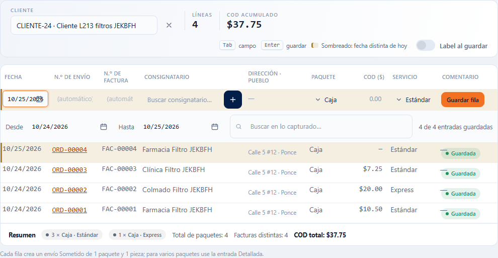

# Capítulo 03 — Envíos de transporte (Lote 3)

Este capítulo describe todo lo que el Lote 3 deja disponible: la captura de envíos de transporte (entrada rápida,
detallada o de entrega especial), la numeración de sus cuatro identificadores, la cotización y el chequeo de crédito (al crear y al marcar el envío como
recogida), los estatus y transiciones, el importador de envíos por plantilla, y dos ajustes que cambian el
comportamiento de módulos ya documentados en el [capítulo 02](02-clientes-y-contratos.md): el bloqueo de lo nuevo cuando
un cliente está dado de baja y el portal multi-cliente. Cada sección indica **qué hace**, **quién puede**, **cómo se
usa**, las **validaciones** con el mensaje exacto y el código HTTP, y los **estatus** con sus transiciones y efectos.
> **Lote 106 (2026-10-17): nuevo flujo de estatus.** El envío nace **Sometido** (ya no hay Borrador ni Confirmada), se cotiza
> y se mide el crédito **al crear**, la acción «Confirmar» pasó a llamarse **Marcar como recogido**, cancelar exige una razón y
> hay una acción nueva, **Reabrir** (permiso `orders.reopen`). Los estatus `DRAFT`, `CONFIRMED`, `INBOUND`, `PLANNED`, `ARRIVED`,
> `ON_HOLD` y `PARTIAL` ya no existen. Este capítulo ya está al día; el detalle completo está en la sección 4.

Los mensajes están verificados contra el código (`src/Teikem.Domain/Orders/*`, `src/Teikem.Infrastructure/Orders/*`,
`src/Teikem.Infrastructure/Services/Order*.cs`, `src/Teikem.Api/Controllers/Order*.cs`) y ejercitados por
`scripts/smoke.sh`. Las preguntas y respuestas de cada mensaje están en [faq.md](faq.md).

Convenciones del capítulo:

- Los recursos se identifican por `publicId` (GUID) en la URL. Un `publicId` de otra compañía, o de otro cliente cuando
  el que llama está limitado a uno (el futuro portal), responde **404** como si no existiera (sin oráculo).
- Todo el módulo vive bajo **LTL_GROUND** ("Última milla terrestre"), un módulo **núcleo**: ningún tenant lo puede
  apagar, así que los envíos nunca responden `403 module_disabled`.
- Un error de validación responde `400` con `title` (mensaje) y `errors` (`{ campo: [mensaje] }`); un conflicto `409`;
  una regla de estatus o de negocio `422`; un recurso ajeno o inexistente `404`; falta de permiso `403`.
- Todas las lecturas y escrituras pasan por un "alcance de cliente" interno (`OrderScope`): hoy el operador interno
  siempre ve cualquier cliente de su compañía; el portal de clientes (Lote 8) fijará el cliente del principal y todo lo
  de este capítulo (alta, ficha, edición, confirmar, cancelar, buscar) quedará acotado a ese cliente sin cambios de API.
- Las fechas son UTC; "hoy" es la fecha UTC del servidor.

---

## 1. Captura de un envío

### 1.0 Entrada rápida y fecha del envío (2026-10-21, dictado de Luis)

**La fecha del envío no puede ser anterior a hoy** (en la entrada rápida, en la detallada y en la importación): ayer ya no se permite. No es solo un aviso: **se bloquea**. Mensaje: `La fecha del envío no puede ser anterior a hoy.` (400, campo `requestedDate`; en pantalla, bajo la fecha). Hoy y los días siguientes valen; el calendario de la fecha ya no deja elegir días pasados.

**La entrada rápida está hecha para capturar sin soltar el teclado:**
- **La fecha es el primer campo** de la fila (el control de fecha de la web: calendario que se abre solo, se puede escribir solo con números y se acomoda con el formato de la compañía). Arranca en **hoy**, y se puede cambiar.
- **Al elegir el cliente**, el cursor va **directo a la fecha** y su calendario se abre. Con **Tab** se pasa al siguiente: el **N.º de factura** (apagado y en «(automático)» si Teikem la genera; se escribe si el cliente asigna sus facturas), luego el consignatario, el paquete, el COD, el servicio y el comentario. Los campos apagados se saltan solos.
- **Enter en cualquier campo guarda la fila.** Al guardarse se crea otra fila y **el cursor vuelve a la fecha**.
- **La fila nueva trae la fecha de la última orden guardada**: si alguien puso la de mañana, la siguiente sale con la de mañana.
- **Las filas con una fecha distinta de hoy se sombrean** (con una marca amarilla a la izquierda, sin cambiar el alto de la fila) y la leyenda de la barra lo recuerda; la fila que se está llenando también se sombrea en cuanto se cambia la fecha.
- **Servicio y paquete por cliente:** cada cliente puede tener su **servicio y su paquete por omisión** (Clientes → ficha → Perfil → «Servicio por omisión» / «Paquete por omisión»; vacío = los de la compañía). Al elegir el cliente, la fila ya sale con ellos, y la fila nueva también.

**La tabla de lo capturado: filtros y resumen (Lote 213, 2026-10-23, dictado de Luis).** Debajo de la fila de captura, las entradas guardadas en esta sesión tienen:
- **Desde / Hasta:** el rango de fechas que se ve (controles de fecha del kit); al abrir los dos son **hoy**. **Guardar una orden con otra fecha ensancha el rango solo**: con una fecha más adelantada el «desde» se queda en hoy y el «hasta» pasa a esa fecha; con una más vieja baja el «desde». Si se mueve un extremo a mano nunca queda al revés (el otro lo sigue). El contador dice «N de M entradas guardadas».
- **Buscar en lo capturado:** búsqueda libre (`QBox`) sobre cualquier dato mostrado: n.º de envío, factura, consignatario, dirección, paquete, servicio, COD, comentario y fecha; todas las palabras, sin importar mayúsculas ni acentos. Sin coincidencias: «Ninguna entrada guardada coincide con el día y la búsqueda.»
- **Resumen en el pie:** «**N × Paquete · Servicio**» por combinación (la más numerosa primero), «**Total de paquetes: N**», «**Facturas distintas: N**» y «**COD total: $X**», calculados sobre lo que se ve (rango + búsqueda). **Facturas distintas** cuenta números: si en el campo de factura hay varios **separados por coma**, **cada coma es otro número**; los repetidos (sin importar mayúsculas) cuentan una vez y las órdenes sin factura no suman. Las barras superiores «Líneas» y «COD acumulado» siguen contando todo lo capturado.



### 1.0b Consignatario nuevo en línea (Lote 213, dictado de Luis; web del personal)

**Qué hace.** Si el consignatario no existe, se crea **ahí mismo, sin ratón y sin salir de la captura**: en la entrada rápida y en la detallada. El botón «+» y su ventana siguen existiendo para quien prefiera el ratón (con más campos: número, persona de contacto, ventana horaria, notas…).

**Quién puede.** `locations.create` (sin él no se ofrece nada). El campo **Teléfono** solo aparece si además tiene `contacts.manage` y `locations.update`. Módulo CATALOG, como el directorio de consignatarios.

**Cómo se usa (solo teclado):**
1. Elija el cliente. En el campo del consignatario **escriba el nombre** que no existe. Al final de la lista aparece **«+ Nuevo consignatario «nombre»»**; si nada coincide, ya está resaltada. Con otras coincidencias se llega con **↓**. **Enter** (o clic) la elige.
2. Se abre el formulario en línea (sin ventana): en la **entrada rápida**, como una fila justo debajo de la fila que está llenando (no mueve ni borra la fecha, la factura ni nada de lo escrito); en la **detallada**, como un panel dentro de la sección 02, debajo del buscador. El **cursor cae solo en el primer campo vacío** (normalmente **Dirección**, porque el nombre ya viene escrito).
3. Campos: **Nombre\***, **Dirección\***, **Pueblo\*** (el mismo selector de pueblo o código postal del catálogo, solo ZIP de entrega; llena ZIP, estado y país) y **Teléfono** (opcional; con la máscara de la compañía). El consignatario nace de tipo entrega, con país Puerto Rico si el pueblo no trae otro, y **su dueño es el cliente de la orden**.
4. **Enter en cualquier campo graba.** Si falta un obligatorio, **el cursor va al primer campo que falta** y sale su mensaje; si está completo, se crea. Al elegir el pueblo con Enter el cursor pasa al teléfono (si se ve), para que el siguiente Enter grabe.
5. Al grabar: aviso «Consignatario creado: nombre», el nuevo **queda elegido**, el formulario se cierra y **el cursor pasa solo al siguiente campo**: en la rápida el desplegable **Paquete**; en la detallada el siguiente control después del consignatario (el interruptor de entrega especial). En la rápida, **Enter en cualquier otro campo guarda la orden** como siempre.
6. **Esc** cancela y devuelve el cursor al campo del consignatario **con el texto que había escrito**. **Tab / Mayús+Tab** recorren los campos; en la rápida, Tab desde el último campo sigue a Paquete sin grabar ni atrapar el cursor. Cambiar el cliente cierra el formulario.

**Mensajes de error exactos.** Los de campos vacíos o largos salen en la pantalla, sin llamar al servidor, bajo el campo:
| Mensaje | Cuándo |
|---|---|
| `El nombre es obligatorio.` | Nombre vacío |
| `La dirección (línea 1) es obligatoria.` | Dirección vacía |
| `La ciudad es obligatoria.` | Sin pueblo elegido |
| `Máximo 200 caracteres.` / `Máximo 100 caracteres.` | Nombre o dirección (200); pueblo (100) |
| `Teléfono inválido.` | Teléfono que no cumple la máscara de la compañía |

Si el servidor rechaza el alta, el mensaje sale **en el mismo formulario y lo escrito se conserva** (se corrige y se vuelve a pulsar Enter): `El nombre es obligatorio.`, `La dirección (línea 1) es obligatoria.` o `La ciudad es obligatoria.` (400, campos `name`, `line1`, `city`); `Máximo N caracteres.` (400); sin permiso, 403; sin sesión, 401. Si el consignatario se creó pero el **teléfono** no, aparece «El consignatario se guardó, pero el teléfono no: motivo» y el consignatario queda elegido igual (el teléfono se corrige después en Catálogo → Consignatarios).

### 1.1 Alta (entrada rápida, detallada o de entrega especial)

Qué hace: crea un envío de transporte. Nace en el estatus inicial (**SUBMITTED**, «Sometido») con hasta dos paradas — **recogido**
(opcional: la que se indique, o si no se indica el punto de recogido por defecto del cliente, o si tampoco hay la
localización CORPORATE activa del cliente; si nada de eso existe, el envío nace solo con la parada de entrega) y
**entrega** (obligatoria) — y una o más líneas de paquete, salvo que sea una entrega especial. Cada envío recibe cuatro
identificadores siempre poblados: número de envío, número de factura del cliente, número de empaque y, por línea, número
de paquete (ver sección 2). **Se cotiza al crear** (Lote 106) si el cliente tiene contrato y tarifa vigente; si no, el envío
queda **sin cotizar y sin error**, y la cotización estricta se exige al marcarla como recogido (sección 3.2). Al crear también
se mide el crédito del cliente (sección 3.3): si se excede, el envío **no se crea** (422 `credit_exceeded`), salvo que se
envíe `overrideCredit: true` con el permiso `orders.credit_override`.

Quién puede: `orders.create`.

Cómo se usa: `POST /api/v1/orders`

```json
{
  "clientPublicId": "…",
  "consigneeLocationPublicId": "…",
  "pickupLocationPublicId": null,
  "serviceType": "STANDARD",
  "packages": [ { "packageType": "BOX", "pieces": 2 }, { "packageType": "ENVELOPE", "pieces": 1, "description": "Documentos" } ],
  "codAmount": 50,
  "requestedDate": "2026-10-05T00:00:00",
  "notes": null
}
```

**Consignatario** (exactamente uno de los dos):
- `consigneeLocationPublicId`: una `Location` del directorio del cliente o compartida del tenant.
- `newConsignee`: captura libre (`name`, `line1`, `city`, …). Antes de crear nada se compara contra las localizaciones
  **DELIVERY/BOTH activas del propio cliente** por nombre + línea 1 normalizados (sin acentos, sin mayúsculas, espacios
  colapsados); si coincide, se reutiliza esa `Location` sin sobreescribir el directorio; si no, se crea una `Location`
  DELIVERY nueva asignada al cliente del envío.

**Entrega especial**: `isSpecialDelivery: true` + `specialServiceId` (de la lista de servicios especiales del cliente,
capítulo 02 sección 6). No lleva `packages` ni `codAmount`; nace con una sola línea con el nombre del servicio y sin tipo
de paquete. Cotiza la tarifa vigente del servicio especial (sección 3).

**Factura repetida (R36)**: si `clientInvoiceNumber` se **teclea** (no si Teikem lo genera) y el consignatario ya tiene
otro envío activa con ese mismo número, la respuesta depende de si el consignatario admite facturas repetidas
(`allowDupInvoice`, capítulo 02 sección 2):

| Caso | Respuesta |
|---|---|
| No admite repetidas | `409` `code: "duplicate_invoice"`, `title`: `El consignatario 'X' no permite facturas repetidas: la orden N ya usa el número F.` |
| Admite repetidas, sin confirmar | `409` `code: "duplicate_invoice_confirmable"`, mismo estilo de mensaje terminando en "…confirme si desea crear el envío de todos modos." |
| Admite repetidas, con `confirmDuplicateInvoice: true` | se crea normalmente |

Ambos 409 traen en `errors`: `clientInvoiceNumber` (el mensaje), `existingOrderNumber` y `existingOrderPublicId` (para que
el front arme el modal "Crear de todos modos" sin parsear el título). El chequeo corre **antes** de dibujar números: un
409 no gasta ningún consecutivo.

| Campo / caso | Mensaje exacto | HTTP |
|---|---|---|
| `clientPublicId` ausente (sin alcance de cliente fijado) | `El cliente es obligatorio.` | 400 |
| Cliente de otra compañía | `Cliente no encontrado.` | 404 |
| Cliente **dado de baja** | `El cliente está dado de baja; solo se consulta su historial.` | 409 |
| Cliente **suspendido** | `El cliente está suspendido; no se pueden crear ni confirmar envíos.` | 422 |
| Ni `consigneeLocationPublicId` ni `newConsignee` | `El consignatario es obligatorio: elija uno del directorio o capture uno nuevo.` (campo `consignee`) | 400 |
| Los dos a la vez | `Indique un consignatario del directorio o uno nuevo, no ambos.` (campo `consignee`) | 400 |
| Consignatario de otro cliente o inexistente | `Consignatario no encontrado.` | 404 |
| Consignatario inactivo | `Consignatario está inactivo; reactívelo o elija otro.` (campo `consigneeLocationPublicId`) | 400 |
| Recogido de otro cliente o inexistente | `Localización de recogido no encontrado.` | 404 |
| `newConsignee.name` / `.line1` / `.city` vacíos | obligatorios | `El nombre del consignatario es obligatorio.` / `La dirección (línea 1) del consignatario es obligatoria.` / `La ciudad del consignatario es obligatoria.` | 400 |
| `newConsignee.country` no ISO alfa-2 | 2 letras | `El código de país debe ser ISO 3166-1 alfa-2 (2 letras).` | 400 |
| Sin líneas de paquete (envío normal) | `Indique al menos una línea de paquete.` (campo `packages`) | 400 |
| Entrega especial con `packages` o `codAmount` | `Una entrega especial no lleva líneas de paquete ni COD.` | 400 |
| `packages[i].pieces` &lt; 1 | `La cantidad de piezas debe ser al menos 1.` | 400 |
| `packages[i].packageType` desconocido / ausente sin default del tenant | `Tipo de paquete desconocido: X.` / `El tipo de paquete es obligatorio.` | 400 |
| `serviceType` desconocido / ausente sin default del tenant | `Tipo de servicio desconocido: X.` / `El tipo de servicio es obligatorio.` | 400 |
| `codAmount` negativo | `El monto COD no puede ser negativo.` | 400 |
| `isSpecialDelivery` sin `specialServiceId` | `El servicio especial es obligatorio en una entrega especial.` (campo `specialServiceId`) | 400 |
| Servicio especial no vigente / de otro cliente | `El servicio especial no está vigente para este cliente.` | 400 |
| Componente "Servicios especiales" apagado en el contrato del cliente | `El componente 'Servicios especiales' está apagado en el contrato vigente del cliente; enciéndalo en el modelo de facturación o capture un envío normal.` | 409 |
| Se envía `codType` o `packBatchNumber` | `El tipo de COD se registra al entregar, no en la captura.` / `El número de empaque siempre lo genera Teikem.` | 400 |
| Choque de número de envío / empaque tras agotar reintentos | `Ya existe un envío con ese número para este cliente.` / `Ya existe un envío con ese número de empaque.` / `No se pudo asignar un número de envío libre; intente de nuevo.` | 409 |

`overrideCredit: true` autoriza crear el envío aunque el cliente exceda su límite de crédito; exige el permiso
`orders.credit_override` (403 `Falta el permiso 'orders.credit_override'.` si falta; ver sección 3.3). Desde el Lote 106 ya no
existe el error `overrideCredit requiere confirmNow=true.`: `overrideCredit` se aplica al crear.
`confirmNow: true` sigue aceptándose en la API (crea y marca el envío como recogido en la misma transacción, sección 3.2), pero
la pantalla web ya no lo usa; si la cotización o el crédito fallan, la creación también se revierte.

### 1.2 Ficha del envío

Qué hace: devuelve el envío completo: cabecera (números, cliente, tipo de servicio, prioridad, estatus, moneda, monto
cotizado y fecha, COD y su estatus, totales, resumen de paquetes), parada de recogido (si tiene) y de entrega con su
`snapshot` de dirección y ventana horaria, líneas de paquete activas, referencias, datos de la entrega especial si
aplica, el origen (`sourceEntityType`/`sourceEntityId`, para lotes de otros módulos) y las **capacidades** disponibles
según el estatus actual (`canEditCargo`, `canReprice`, `canCancel`, `canDelete`, `canConfirm`, `canReopen`). Incluye `rowVersion` para
la edición concurrente.

Quién puede: `orders.view`. El **precio del envío** (`quotedAmount`, «Monto cotizado») solo se ve con el permiso
`orders.view_price`. Sin ese permiso el campo viene vacío (`null`; la pantalla muestra «—») y el resto de la ficha, incluido
el COD, no cambia. Ver la sección 3.5.

Cómo se usa: `GET /api/v1/orders/{publicId}`.

### 1.3 Listado y búsqueda / escaneo

Qué hace: dos formas de encontrar envíos. El **listado** es paginado y admite filtros parciales; su primera columna de
negocio es siempre el **número de empaque** (`packBatchNumber`, único por tenant y siempre con valor). La **búsqueda
exacta** (`lookup`) es para el escaneo: compara el código tal cual contra los tres identificadores, sin coincidencias
parciales.

Quién puede: `orders.view`. El precio de cada fila (`quotedAmount`) solo se ve con `orders.view_price`; sin ese permiso va vacío
(`null`). Ver la sección 3.5.

Cómo se usa:
- `GET /api/v1/orders?clientId=&status=&orderNumber=&invoice=&packBatch=&consignee=&search=&from=&to=&includeInactive=false&skip=0&take=100`
  — `orderNumber`/`invoice`/`packBatch`/`consignee`/`search` son parciales (`LIKE`); `from` inclusivo y `to` exclusivo
  sobre la fecha de creación; `take` se acota entre 1 y 500 (por defecto 100).
- **Filtros con varios valores (Lote 39).** Para pedir varios valores de un mismo filtro, repita el parámetro en la dirección
  (por ejemplo, `?serviceTypes=STANDARD&serviceTypes=EXPRESS` trae los envíos de servicio STANDARD **o** EXPRESS). Las reglas son
  dos:
  1. **Dentro de un filtro** basta con que el envío cumpla **uno** de los valores.
  2. **Entre filtros distintos** el envío debe cumplir **todos** (por ejemplo, tipo de servicio STANDARD **y** pueblo Bayamón).

  El total (`total`) y la paginación cuentan todo lo que cumple los filtros, no solo la página que se ve.

  | Parámetro | Qué filtra | Ejemplo |
  |---|---|---|
  | `serviceTypes` | Tipo de servicio del envío (códigos de la lista `ServiceType`; no importan las mayúsculas). | `serviceTypes=STANDARD&serviceTypes=EXPRESS` |
  | `packageTypes` | Tipo de paquete. Entra la orden que tenga **alguna** línea de paquete activa de ese tipo (códigos `PackageType`). | `packageTypes=BOX` |
  | `invoiceProcessed` (Lote 128) | Si la factura del cliente del envío ya se procesó (hoja de COD cuadrada o cotejo; ver cap. 21 §7): `true` solo procesadas, `false` solo sin procesar, vacío todas. | `invoiceProcessed=true` |
  | `processedFrom` / `processedTo` (Lote 128) | La fecha de procesamiento de la factura: `processedFrom` inclusivo, `processedTo` exclusivo. En la pantalla, el filtro «Fecha de procesamiento» ofrece los rangos sugeridos (Hoy, Esta semana, Este mes… o Personalizado). | `processedFrom=2026-10-18&processedTo=2026-10-19` |
  | `cities` | Pueblo del consignatario (la parada de entrega). Debe ser igual al pueblo pedido; no importan las mayúsculas, las tildes ni los espacios de más. | `cities=bayamon` encuentra «Bayamón» |
  | `postalCodePrefix` | El código postal (ZIP) del consignatario **empieza con** este texto. | `postalCodePrefix=009` trae `00901`, `00961`… |
  | `clientIds` | Clientes (por su `publicId`). Se **suma** a `clientId` si también viene. | `clientIds=…&clientIds=…` |
  | `statuses` | Estatus del envío (códigos `OrderStatus`). Se **suma** a `status` si también viene. | `statuses=PICKUP&statuses=FAILED` |

  **Ejemplo.** Quiero los envíos de Bayamón con ZIP que empiece con `009` y que estén en estatus `PICKUP` (Recogido):
  `GET /api/v1/orders?cities=Bayamón&postalCodePrefix=009&statuses=PICKUP`.

  Todo queda dentro de la compañía activa y de los clientes que el usuario puede ver (su «alcance de datos»): quien solo puede
  ver ciertos clientes no ve envíos de otros con ningún filtro, y pedir un cliente fuera de su alcance responde 404.
- `GET /api/v1/orders/lookup?code=T$TS-00001` — coincidencia **exacta** (sin distinguir mayúsculas), primero por número de
  envío, si no hay por número de empaque, si no hay por factura; devuelve todas las coincidencias de ese grupo
  (`matchedBy`: `ORDER_NUMBER` | `PACK_BATCH` | `INVOICE`, o `null` sin coincidencias) — el número de envío puede
  repetirse entre clientes y la factura entre envíos, el empaque es único.
  Lote 44 (F-G2, 2026-10-12): si ninguno de los tres coincide, busca el **número de paquete** de las líneas activas
  (`matchedBy`: `PACKAGE`; es el código de barras del label de cada pieza). El contador de paquetes es por cliente y un número
  tecleado puede repetirse: con dos o más envíos vuelven todas (ambiguo).
- Lote 44: cada fila de la lista y del lookup trae además `consigneeLine1`, `consigneeLine2` y `consigneeState` (la dirección de la
  parada de entrega) para los labels, el waybill summary y la packing list.

| Caso | Mensaje exacto | HTTP |
|---|---|---|
| `status` desconocido | `Estatus desconocido: X.` (campo `status`) | 400 |
| Algún valor de `statuses` no existe | `Estatus desconocido: X.` (campo `statuses`; X sale en mayúsculas) | 400 |
| Algún valor de `serviceTypes` no existe | `Tipo de servicio desconocido: X.` (campo `serviceTypes`) | 400 |
| Algún valor de `packageTypes` no existe | `Tipo de paquete desconocido: X.` (campo `packageTypes`) | 400 |
| `code` vacío en `lookup` | `Indique el código a buscar.` (campo `code`) | 400 |
| `clientId` o algún `clientIds` es de otra compañía o está fuera de los clientes que el usuario puede ver | `Cliente no encontrado.` | 404 |

Qué hacer con los 400 de los filtros: la `X` del mensaje es el valor que no existe; revise cómo está escrito (código del
lista, por ejemplo `STANDARD`, `BOX`, `PICKUP`) y quítelo o cámbielo. Un código que está inactivo en la lista **sí** se
acepta (sirve para buscar envíos viejas); solo se rechaza un código que no existe.
Qué hacer con el 404: quite ese cliente del filtro; si debería poder verlo, pida al administrador que revise el alcance de datos
de su usuario.

Un pueblo o un prefijo de ZIP sin coincidencias no es un error: responde `200` con `total: 0` (lista vacía).

### 1.4 Edición

Qué hace: edita el envío mientras está en un estatus que lo permita (por defecto, solo **SUBMITTED**, «Sometido»; ver sección 4). Se
puede cambiar el consignatario (con la misma resolución de la sección 1.1 y re-chequeo de R36 si el envío **fue creada
con factura tecleada**), el recogido, el tipo de servicio, la prioridad, las líneas de paquete (reemplazo completo: las
anteriores quedan inactivas como rastro), el COD (agregar, aumentar o quitar con `clearCod: true`), fechas, notas y
referencias. El **cliente, el número de envío, el número de factura y el número de empaque se fijan al crear** y no se
editan. Si el envío ya estaba cotizado, editarlo la **re-cotiza** (exige además la capacidad `REPRICE`, que por defecto también es solo de
Sometido) para no dejar un monto viejo. Mientras siga Sometido y cotizada, cada edición recotiza.

Quién puede: `orders.edit`. En la web se hace dentro del panel **Detalle** del expediente del envío, con un solo botón **Guardar cambios**
(ver [el expediente](frontend/fc2-ordenes-expediente.md)); la pantalla solo manda lo que usted cambió y el `rowVersion` de la ficha.

Cómo se usa: `PATCH /api/v1/orders/{publicId}` con solo los campos que cambian; `rowVersion` opcional (el de la ficha)
para detectar edición concurrente.

| Campo / caso | Mensaje exacto | HTTP |
|---|---|---|
| Se envía `clientPublicId`, `orderNumber`, `clientInvoiceNumber` o `packBatchNumber` | `El campo 'X' se fija al crear la orden y no se edita.` / `El número de empaque siempre lo genera Teikem.` | 400 |
| Se envía `codType` | `El tipo de COD se registra al entregar, no en la captura.` | 400 |
| `consigneeLocationPublicId` y `newConsignee` a la vez | `Indique un consignatario del directorio o uno nuevo, no ambos.` (campo `consignee`) | 400 |
| `codAmount` y `clearCod: true` a la vez | `Indique un monto COD o clearCod, no ambos.` (campo `codAmount`) | 400 |
| Envío de entrega especial con `packages` o `codAmount` | `Una entrega especial no lleva líneas de paquete ni COD.` | 400 |
| El estatus actual no permite `EDIT_CARGO` | `El estatus actual no permite la acción 'EDIT_CARGO'.` | 422 |
| Ya cotizada y el estatus no permite `REPRICE` | `El estatus actual no permite la acción 'REPRICE'.` | 422 |
| `rowVersion` desactualizado | `El registro fue modificado por otro usuario; recargue e intente de nuevo.` | 409 |
| Envío de otra compañía, de otro cliente del alcance, o eliminada en captura | `Orden no encontrado.` | 404 |

### 1.5 Eliminar (solo en la etapa inicial)

Qué hace: **baja lógica** (`isActive = false`), nunca `DELETE`. Solo se permite mientras el envío sigue en su **estatus
inicial** (Sometido); libera de inmediato su número de envío y su número de empaque (ambos son índices únicos filtrados por
`isActive = 1`), así que se pueden volver a capturar. Después de eliminada, ninguna acción vuelve a funcionar sobre ella
(editar, marcar como recogido, repreciar, cancelar, estatus): la ficha y el listado (`includeInactive=true`) la siguen mostrando,
pero como registro histórico.

Quién puede: `orders.cancel`.

Cómo se usa: `DELETE /api/v1/orders/{publicId}` → `204`.

| Caso | Mensaje exacto | HTTP |
|---|---|---|
| El envío ya no está en su etapa inicial | `Solo se puede eliminar un envío en su estatus inicial; use la cancelación.` | 422 |

---

## 2. Numeración de los cuatro identificadores

> **Lote 109 (2026-10-18) — cada PIEZA tiene su propio número único.** El número de paquete ya no es uno por línea repetido en cada pieza: al someter el envío se crea **una pieza por cada pieza de cada línea** (una línea de 3 piezas crea 3), y cada una lleva su número, que es el del label y el que se escanea. El número del **envío** (el conduce) sigue siendo aparte y único.
> - **Formato del sistema** (el que vale cuando el cliente no tiene formato propio): `{Code del cliente}{Code del consignatario}{aammdd}{hhmmssfff}{n}` — por ejemplo `ACMEPR01232610181534051231` — sin separadores nuestros (los Codes se toman tal cual vengan, con rayas si las traen). Si el consignatario no tiene Code se usa su ID. La fecha y la hora son las de la compañía; **n** es el número de la pieza dentro del envío (1, 2, 3… corrido sobre todas las líneas). Máximo 38 caracteres (cabe en el campo de 40 y en un Code 128 de 4 pulgadas).
> - **Los Codes** del cliente y del consignatario tienen **máximo 10 caracteres** (un código, no un título): «El código no puede exceder 10 caracteres.» (400). Un Code ya guardado de más de 10 usa sus primeros 10 en el número. Los códigos autogenerados desde el nombre del cliente salen de 10 caracteres como máximo.
> - **Formato propio del cliente** (ficha del cliente → Numeración): si lo tiene, cada pieza toma el siguiente número de su contador. **Línea con número tecleado**: una pieza → ese número; varias → ese número más el de la pieza (`PQ-B1`, `PQ-B2`…).
> - Al **editar los paquetes** de un envío Sometido las piezas viejas se dan de baja y se crean las nuevas. Una entrega especial no lleva piezas.
> - **Número del envío (conduce), Lote 110:** `{Code del cliente}{Code del consignatario o su ID}{aammdd}{secuencial del día de ese consignatario}` — por ejemplo `ACMEPR0123261018` + `1` = `ACMEPR01232610181` (el segundo envío del mismo consignatario ese día termina en 2). Es único en la compañía; reemplaza al `CND-#######` (los envíos anteriores lo conservan). Se genera al someter el envío; no se teclea.
> - Buscar o escanear por el número de una pieza encuentra su orden; la ficha lista los números de cada pieza y los labels y la hoja de empaque los usan.

Qué hace: todo envío recibe cuatro identificadores, cada uno con su propio contador atómico (tabla `NumberSequence`,
`UPDATE … OUTPUT` dentro de la transacción del alta: sin huecos ni choques entre altas simultáneas):

| Identificador | Ámbito del contador | ¿Quién lo asigna? | Patrón por defecto |
|---|---|---|---|
| Número de envío (`orderNumber`) | por cliente | Teikem, o el cliente si `clientAssignsOrderNumber: true` (capítulo 02, 1.4) | `ORD-#####` |
| Número de factura (`clientInvoiceNumber`) | por cliente | Teikem, o el cliente si `clientAssignsInvoiceNumber: true` | `FAC-#####` |
| Número de empaque (`packBatchNumber`) | por tenant | **siempre Teikem**, nunca configurable | `EMP-#####` (fijo) |
| Número de paquete (`packages[i].packageNumber`) | por cliente | siempre se puede teclear por línea | `PQT-#####` |

El número de envío es único **por cliente** (dos clientes pueden compartir "PO-1001"); el número de empaque es único
**por tenant** y es el identificador inequívoco para escanear. Un número que el cliente "asigna" pero se deja en blanco
lo genera Teikem igual.

| Caso | Mensaje exacto | HTTP |
|---|---|---|
| Se teclea `orderNumber` y el cliente no lo asigna | `El número de envío lo asigna Teikem para este cliente; déjelo en blanco.` (campo `orderNumber`) | 400 |
| Se teclea `clientInvoiceNumber` y el cliente no lo asigna | `El número de factura lo asigna Teikem para este cliente; déjelo en blanco.` (campo `clientInvoiceNumber`) | 400 |
| Se teclea `packBatchNumber` | `El número de empaque siempre lo genera Teikem.` | 400 |
| Un número tecleado excede 40 caracteres | `El número no puede exceder 40 caracteres.` | 400 |
| Un número automático, con el patrón del cliente, excede 40 caracteres | `El número {de orden\|de factura\|de paquete\|de empaque} generado con el patrón del cliente excede 40 caracteres; acorte el patrón en la ficha del cliente.` | 409 |
| Choque de un número automático con uno tecleado por otro usuario | se reintenta solo (hasta 5 veces), sin que el usuario lo note; agotados los reintentos: `No se pudo asignar un número de envío libre; intente de nuevo.` | 409 |

---

## 3. Cotización y crédito

> **Lote 107 (2026-10-17) — el cernidor es AL SOMETER.** Contrato y tarifa vigentes, cliente no suspendido y crédito se revisan **al crear el envío**; si no pasa, no se crea (409/422 con los mismos mensajes de siempre, sin «envío sin cotizar»). Quien pasó el cernidor no se vuelve a revisar: **«Marcar como recogido»** y el escaneo solo **congelan** el precio que ya tenía (ya no cotizan ni miden el crédito). Un cliente sin contrato o sin tarifa no puede someter envíos, ni en la web ni en el portal. Re-cotizar solo mientras el envío está Sometido.

Desde el Lote 106 el envío **se cotiza y se mide el crédito al crearlo** (nace Sometido). Marcarlo como recogido (antes
«Confirmar») repite la cotización en modo estricto, congela el precio y vuelve a medir el crédito.

### 3.1 Vista previa (sin persistir nada)

Qué hace: cotiza el envío y evalúa el crédito del cliente **sin guardar nada**, para que la interfaz muestre el aviso
antes de marcar el envío como recogido. Devuelve las líneas cotizadas (consolidadas por tipo de paquete), la tarifa de despacho y de COD, el
total, el contrato usado, y el chequeo de crédito (`creditLimit`, `pendingBalance` — la suma de `quotedAmount` de las
envíos del cliente que están en curso (**Sometido incluida**, si ya está cotizada), sin contar las terminadas (Entregado, En almacén), las
Canceladas ni el propio envío —, `orderTotal`, `available` y
`exceeds`). Los mismos errores que daría marcarla como recogido (tarifa faltante, servicio especial cerrado) se ven aquí antes.

Quién puede: `orders.view` **y** `orders.view_price`. Desde el Lote 39 la cotización completa (total, líneas, cargos y crédito)
cuenta como información de precios, así que sin `orders.view_price` no se puede abrir.

Cómo se usa: `GET /api/v1/orders/{publicId}/quote`.

| Caso | Mensaje exacto | HTTP |
|---|---|---|
| Falta el permiso `orders.view_price` (queda registrado un evento de seguridad `PERMISSION_DENIED`); pida el permiso al administrador o a Facturación | `Falta el permiso 'orders.view_price'.` | 403 |
| Falta tarifa vigente para alguna línea (servicio/tipo de paquete) | `No hay tarifa vigente para X/Y; configure la tarifa en el contrato del cliente antes de confirmar.` | 422 |
| Servicio especial ya no vigente (se cerró) | `El servicio especial ya no está vigente; elija otro antes de confirmar.` | 409 |
| Componente "Servicios especiales" apagado en el contrato vigente | `El componente 'Servicios especiales' está apagado en el contrato vigente del cliente; enciéndalo en el modelo de facturación o capture un envío normal.` | 409 |

### 3.2 Cotizar al crear y «Marcar como recogido»

**Al crear (Lote 106).** Qué hace: si el cliente tiene contrato y tarifa vigente para las líneas del envío, el envío nace
Sometido **con** su `quotedAmount`, `quotedAtUtc` y el contrato usado, y se mide el crédito (sección 3.3). Si no hay contrato o
falta una tarifa, el envío nace Sometido **sin cotizar y no da error**: ese error aparece al marcarlo como recogido. Mientras la
envío siga Sometido y cotizado, **editarlo lo recotiza**. Un envío sin cotizar no cuenta en el saldo pendiente del cliente.

**Marcar como recogido (antes «Confirmar»).** Qué hace: saca el envío de su etapa inicial (Sometido) hacia la primera
etapa del **pipeline** habilitada después de ella (normalmente **PICKUP**, «Recogido»; si la compañía la deshabilita, la que
siga). Al marcarlo: (1) cotiza el envío con el motor de tarifas del cliente (o la tarifa vigente del servicio especial) en modo
estricto y **congela** `quotedAmount`, `quotedAtUtc` y el contrato usado; (2) verifica que el cliente no esté suspendido; (3)
verifica el crédito (sección 3.3). Si algo falla, el envío **no cambia de estatus** (se revierte todo). Una vez recogida, la
edición de carga queda apagada por defecto (ver sección 4) y no se puede re-cotizar: `REPRICE` por defecto solo existe en Sometido.

Quién puede: `orders.edit` (o `orders.credit_override` cuando el crédito de verdad se excede; ver 3.3).

Cómo se usa: `POST /api/v1/orders/{publicId}/confirm` `{ "rowVersion"?, "overrideCredit"?: false }`. Es el mismo endpoint de siempre;
solo cambió el nombre del botón en la pantalla: **Marcar como recogido**.

| Caso | Mensaje exacto | HTTP |
|---|---|---|
| El envío ya no está en su etapa inicial | `Solo se confirma un envío en su estatus inicial.` | 422 |
| El pipeline no tiene una etapa siguiente a la inicial (la compañía deshabilitó todo el resto) | `El pipeline de envíos no tiene una etapa siguiente a la inicial.` | 422 |
| Cliente suspendido | `El cliente está suspendido; no se pueden crear ni confirmar envíos.` | 422 |
| Falta tarifa / servicio especial cerrado | igual que 3.1 | 422 / 409 |
| Crédito excedido, sin `overrideCredit` | ver 3.3 | 422 |
| `rowVersion` desactualizado | `El registro fue modificado por otro usuario; recargue e intente de nuevo.` | 409 |

### 3.3 Crédito excedido: aviso y autorización con permiso

Qué hace: si el crédito del cliente se excede **al crear el envío o al marcarlo como recogido**, **no bloquea de forma definitiva**: avisa con `422` y
`code: "credit_exceeded"` (`errors`: `limit`, `exposure`, `newAmount`, `available`, todos formateados con dos
decimales), y se puede autorizar con `overrideCredit: true` si quien lo hace tiene el permiso `orders.credit_override`.
Al crear, un exceso sin autorizar **revierte la creación** (el envío no existe). Al autorizar: el envío sigue adelante, queda un
evento de seguridad (`ROLE_CHANGE`/`SUCCESS`, `action: "credit_override"`) y, si fue al marcarla como recogido, un comentario en su historial de estatus
(`Crédito excedido autorizado por {usuario} (límite X, en curso Y, esta orden Z)`).

Quién puede: crear con `overrideCredit: true` exige `orders.create` y `orders.credit_override`. Marcar como recogido sin `overrideCredit` exige `orders.edit`; con `overrideCredit: true` exige
`orders.credit_override` y, si el crédito **no** se excedía de verdad, exige además `orders.edit` (el permiso de
autorización no sirve para mover envíos normales). Esto permite que la plantilla **Billing** (que tiene
`orders.credit_override` pero no `orders.edit`) autorice justo los casos de exceso al marcar como recogido.

| Caso | Mensaje exacto | HTTP |
|---|---|---|
| Crédito excedido, sin `overrideCredit`; quien opera **tiene** `orders.view_price` | `El cliente excede su límite de crédito: límite X.XX, en curso Y.YY, este envío Z.ZZ.` | 422 |
| Crédito excedido, sin `overrideCredit`; quien opera **no** tiene `orders.view_price` (Lote 39) | `El cliente excede su límite de crédito.` (sin cifras; mismo `code: "credit_exceeded"` y `errors` vacío) | 422 |
| `overrideCredit: true` sin el permiso `orders.credit_override` | `Falta el permiso 'orders.credit_override'.` | 403 |
| `overrideCredit: true` al marcar como recogido, con el permiso, pero el crédito no se excedía (o sin `orders.edit`) | `Falta el permiso 'orders.edit'.` | 403 |

Qué hacer ante un 422 de crédito: si usted tiene `orders.credit_override`, repita la acción con `overrideCredit: true` (en la
pantalla, **Autorizar y guardar** al crear y **Autorizar y marcar como recogido** en el expediente); si
no, pida a Facturación o a un administrador que autorice el exceso, o que suban el límite de crédito del cliente.

El comentario del historial (`Crédito excedido autorizado por {usuario} (límite X, en curso Y, esta orden Z)`) se guarda
completo, pero quien lo lee sin `orders.view_price` lo ve sin el paréntesis de cifras:
`Crédito excedido autorizado por {usuario}`.

### 3.4 Reprecio

Qué hace: re-cotiza un envío con las tarifas vigentes (por si el contrato o el tipo de cambio cambiaron).
No cambia de estatus. Solo disponible cuando el estatus actual permite la capacidad `REPRICE` (por defecto, solo
**SUBMITTED**, «Sometido»; antes del Lote 106 era Confirmada).

Quién puede: `orders.edit`.

Cómo se usa: `POST /api/v1/orders/{publicId}/reprice`.

| Caso | Mensaje exacto | HTTP |
|---|---|---|
| El estatus actual no permite `REPRICE` | `El estatus actual no permite la acción 'REPRICE'.` | 422 |

### 3.5 Quién ve los precios (permiso `orders.view_price`, Lote 39)

Qué hace: separa **ver envíos** de **ver lo que cuestan**. Una persona puede trabajar con los envíos (verlas, capturarlas,
confirmarlas) sin ver ningún precio. Sin el permiso `orders.view_price` («Ver precios de los envíos», categoría Envíos), el
sistema deja el precio en blanco (`null`) o sin cifras; nada se rompe y los campos siguen existiendo. El **monto COD**
(`codAmount`, lo que se cobra al entregar) **no** es un precio y siempre se ve.

Quién puede: el permiso `orders.view_price` se asigna a un rol en Sistema → Roles. De fábrica lo traen:

| Rol | Ve los precios |
|---|---|
| Admin de compañía (TenantAdmin) | Sí |
| Facturación (Billing) | Sí |
| Despachador (Dispatcher), Operador de almacén (WarehouseOperator), Chofer (Driver), Solo lectura (ReadOnly) | No. El administrador puede agregar el permiso a un rol propio si alguien más debe verlos. |

Los roles llamados TenantAdmin o Billing que su compañía ya tenía también lo reciben con la actualización de la base (solo se
agrega, no se quita nada). El administrador de plataforma lo tiene siempre.

Qué cambia en cada lugar:

| Dónde | Con `orders.view_price` | Sin `orders.view_price` |
|---|---|---|
| Ficha del envío (`GET /orders/{id}`) y las respuestas de crear, editar, marcar como recogido, reprecio, cancelar, reabrir y estatus | El campo `quotedAmount` trae el monto. | `quotedAmount` va vacío (`null`); en la pantalla se ve «—». |
| Lista de envíos (`GET /orders`) y búsqueda por código (`GET /orders/lookup`, también la estación de escaneo) | Cada fila trae el precio (columna **Cotizado**). | Cada fila va sin precio; la columna **Cotizado** no se muestra. |
| Cotización completa (`GET /orders/{id}/quote`) | Total, líneas, cargo de despacho, cargo de COD y crédito. | Error 403 `Falta el permiso 'orders.view_price'.` |
| Crédito excedido al crear el envío o al marcarla como recogido (también en la entrega especial con chofer y en la importación) | Error 422 con cifras: `El cliente excede su límite de crédito: límite X, en curso Y, este envío Z.` | Error 422 sin cifras: `El cliente excede su límite de crédito.` (mismo código `credit_exceeded`). |
| Historial de estatus del envío (comentario de la autorización de crédito) | `Crédito excedido autorizado por {usuario} (límite X, en curso Y, esta orden Z)` | `Crédito excedido autorizado por {usuario}` |
| Importación de envíos (fila que falló por crédito) | El error con cifras. | `El cliente excede su límite de crédito.` |
| Análisis: campo **Monto cotizado** de la fuente «Envíos» (vistas, exportaciones, indicadores y gráficos) | Con el valor. | Vacío; un indicador que suma ese campo da 0. |

**Ejemplo.** Un despachador (sin `orders.view_price`) marca como recogido un envío de un cliente que ya pasó su límite. Recibe
`El cliente excede su límite de crédito.` (422), sin cifras. No puede autorizarlo (no tiene `orders.credit_override`), así que avisa a
Facturación; ellos ven las cifras, autorizan el exceso y el envío pasa a Recogido.

Preguntas frecuentes de esta sección: en [faq.md](faq.md), «Lote 39 — Precios de los envíos y filtros de la lista».

---

## 4. Estatus y transiciones

Dominio `OrderStatus` (flujo dictado por Luis, Lote 106, 2026-10-17; el del seed original era solo un ejemplo):

**Sometido (SUBMITTED, inicial) → Recogido (PICKUP) → Sin asignar (UNASSIGNED) → Asignado (ASSIGNED) → En tránsito
(IN_TRANSIT) → Entregado (DELIVERED, terminal).** Aparte: **Intento fallido (FAILED)** es lateral; **Cancelado (CANCELLED)** y
**En almacén (IN_WAREHOUSE)** son terminales.

| Estatus | Código | Tipo | Qué quiere decir |
|---|---|---|---|
| Sometido | `SUBMITTED` | inicial | El envío entró. Ya está cotizada (si hay contrato y tarifa) y con el crédito medido. Es la **única etapa donde se edita**. «Planificar» no es un estatus: es la **fecha pedida** de un envío Sometido. |
| Recogido | `PICKUP` | pipeline | Ya se recogió. |
| Sin asignar | `UNASSIGNED` | pipeline | Ya en el almacén, sin ruta. |
| Asignado | `ASSIGNED` | pipeline | Puesta en una ruta. |
| En tránsito | `IN_TRANSIT` | pipeline | La ruta salió con el envío. |
| Entregado | `DELIVERED` | terminal | Entregado. |
| Intento fallido | `FAILED` | lateral | No se pudo entregar. Se documenta con un intento de entrega (`DeliveryAttempt`). En la barra de progreso de las apps se queda en el nivel de la última etapa normal (por ejemplo En tránsito), en color de alerta. Queda en el historial. |
| Cancelado | `CANCELLED` | terminal | Cancelado, con razón obligatoria. |
| En almacén | `IN_WAREHOUSE` | terminal | Para los tipos de servicio de **solo recogida**. El tipo de servicio «pick up» y su flujo Sometido → Recogido → En almacén **llegan en un lote posterior**; hoy ningún tipo de servicio lleva a este estatus. |

**Ya no existen** `DRAFT` (Borrador), `CONFIRMED` (Confirmada), `INBOUND`, `PLANNED`, `ARRIVED`, `ON_HOLD` ni `PARTIAL`.
Al actualizar una base de desarrollo, lo que estaba en `DRAFT` pasó a `SUBMITTED`, `INBOUND` a `UNASSIGNED`, `PLANNED` a
`ASSIGNED`, `CONFIRMED` a `PICKUP`, `ARRIVED` a `IN_TRANSIT` y `ON_HOLD`/`PARTIAL` a `FAILED`; en producción no había envíos.

Todo cambio pasa por el motor de estatus del capítulo 01 (sección 5): valida la etapa, escribe
`GET /api/v1/status/history/TRANSPORT_ORDER/{id}` y dispara efectos. **Hoy el motor no deja saltar etapas del pipeline** (de una etapa
solo se avanza a la siguiente); el escaneo por acción con saltos llega en un lote posterior.

| De → a | Quién / cómo | Qué valida | Efectos |
|---|---|---|---|
| (nace) → Sometido | `orders.create`; automático al crear (`POST /orders`) | datos obligatorios, cliente ni suspendido ni dado de baja, crédito (sección 3.3) | Historial de nacimiento; cotiza si hay contrato y tarifa; mide el crédito (422 si se excede, salvo `overrideCredit`); paradas y COD nacen con su propio historial (ver nota) |
| Sometido → Recogido | **Marcar como recogido**: `orders.edit` (o `orders.credit_override` cuando el crédito se excede), `POST /confirm` | tarifa vigente, servicio especial vigente, cliente no suspendido, crédito | Cotiza en modo estricto y congela `quotedAmount`/`quotedAtUtc`/contrato; la carga deja de poder editarse |
| Recogido → Sin asignar | sin botón en el expediente | Desde `POST /status` responde 422 «avance reservado» (ver abajo) | Lo mueve el módulo que corresponda; no se agregó una acción nueva en este lote |
| Recogido / Sin asignar → Asignado | **despachar la ruta** (`trips.dispatch`) | el envío debe ser elegible (capítulo 05, sección 3.1); un envío Sometido **no** es elegible | El despacho lleva el envío etapa por etapa hasta Asignado, un historial por paso con «Despachada en la ruta {código}» |
| Asignado → En tránsito | **iniciar la ruta** (salida) | — | El historial dice «Salió en la ruta {código}» |
| En tránsito → Entregado | módulo de entregas | — | Anota el intento de entrega (`DeliveryAttempt`) con el chofer de la ruta |
| Una etapa en curso → Intento fallido | `orders.edit`, `POST /status {"toCode": "FAILED"}` (o el módulo de entregas) | no aplica a Cancelado ni a la acción de marcar como recogido (tienen la suya) | Anota el intento fallido; un envío de una ruta abierta se libera de la ruta |
| Intento fallido → la etapa de la que salió | `orders.edit`, `POST /status` | solo regresa a la etapa **exacta** desde la que se desvió (no salta a la siguiente) | — |
| Cualquier estatus no final → Cancelado | `orders.cancel`, `POST /cancel` con `comment` | **la razón es obligatoria** (`comment`); capacidad `CANCEL` (apagada en Entregado, Cancelado y En almacén); respeta las entradas laterales que la compañía configure | Historial con la razón; cancela el viaje de la entrega especial si lo hay |
| Estatus final → etapa en curso | **Reabrir**: `orders.reopen`, `POST /reopen {toCode?, comment, rowVersion?}` | la razón es obligatoria; el envío debe estar en un estatus final; el destino no puede ser final | Sin `toCode` vuelve al **último estatus no final que tuvo**; no re-cotiza ni vuelve a medir el crédito; queda en el historial y en la bitácora de seguridad (`order_reopen`) |
| Una etapa en curso → Entregado o En almacén directo | — | **no disponible aquí** | `422`: `El avance a 'X' lo realiza el módulo correspondiente (trips/entregas); desde aquí solo se registran estatus laterales.` |

Capacidades por estatus (`StatusCapability`, la compañía las cambia desde `/status/capabilities/TRANSPORT_ORDER`):

| Capacidad | Por defecto | Bloquea |
|---|---|---|
| `EDIT_CARGO` | solo permitida en **Sometido** | `PATCH /orders/{id}` fuera de Sometido (422) |
| `REPRICE` | solo permitida en **Sometido** | `POST /reprice` en cualquier otro estatus (422) |
| `CANCEL` | apagada en **Entregado**, **Cancelado** y **En almacén** | `POST /cancel` en esos estatus (422) |
| `ASSIGN_TRIP` | apagada en **Sometido** y en los terminales (Entregado, Cancelado, En almacén) | asignar a una ruta (capítulo 05) |
| (todas) | **En almacén** las bloquea todas | cualquier acción sobre un envío En almacén; solo queda **Reabrir** |

Qué queda bloqueado en cada estatus (resumen):

| Estatus | Editar la carga | Re-cotizar | Cancelar | Eliminar | Asignar a ruta | Reabrir |
|---|---|---|---|---|---|---|
| Sometido | Sí | Sí | Sí | Sí (con `orders.cancel`) | No: márquela como recogido primero | No |
| Recogido y Sin asignar | No | No | Sí | No | Sí | No |
| Asignado y En tránsito | No | No | Sí | No | No: ya van en una ruta | No |
| Intento fallido | No | No | Sí | No | No: regrésela al pipeline primero | No |
| Entregado | No | No | No | No | No | Sí (`orders.reopen`) |
| Cancelado | No | No | No | No | No | Sí (`orders.reopen`) |
| En almacén | No | No | No | No | No | Sí (`orders.reopen`) |

Nota sobre el historial: el ciclo del **COD** del envío (`PENDING`) y el de sus **paradas** (`PENDING` → …) tienen su
propio historial bajo `EntityType` `ORDER_COD` y `ORDER_STOP` respectivamente (`GET /status/history/ORDER_COD/{id}` /
`GET /status/history/ORDER_STOP/{id}`), separado del del envío misma: así el regreso de un Intento fallido nunca se
confunde con el estatus del COD o de una parada.

| Caso | Mensaje exacto | HTTP |
|---|---|---|
| `toCode` vacío (en `/status`) | `Indique el estatus destino.` | 400 |
| Estatus destino inexistente o deshabilitado | `El estatus 'X' no existe o no está habilitado para esta compañía.` | 422 |
| `toCode` que no existe en el catálogo (por ejemplo, un código viejo como `CONFIRMED`) en `POST /status` | `Estatus OrderStatus 'X' no encontrado.` | 404 |
| `toCode: "CANCELLED"` por `/status` | `Para cancelar use la acción de cancelación.` | 422 |
| `toCode` es la etapa de «Marcar como recogido», estando Sometido | `Para confirmar use la acción de confirmación.` | 422 |
| Avance de pipeline no reservado a laterales/regreso | `El avance a 'X' lo realiza el módulo correspondiente (trips/entregas); desde aquí solo se registran estatus laterales.` | 422 |
| Comentario de más de 500 caracteres (`cancel`/`status`/`reopen`) | `El comentario admite como máximo 500 caracteres.` (campo `comment`) | 400 |
| Cancelar sin razón | `Indique la razón de la cancelación.` (campo `comment`) | 400 |
| Reabrir sin el permiso `orders.reopen` | `Falta el permiso 'orders.reopen'.` | 403 |
| Reabrir sin razón | `Indique la razón para reabrir el envío.` (campo `comment`) | 400 |
| Reabrir una orden que no está en un estatus final | `Solo se reabre un envío en estatus final.` | 422 |
| Reabrir indicando un `toCode` que también es final (Entregado, Cancelado, En almacén) | `Un envío reabierto debe quedar en una etapa en curso.` | 422 |
| Reabrir sin `toCode` cuando el envío nunca tuvo un estatus anterior no final al que volver | `El envío no tiene un estatus anterior al que volver; indique el estatus destino.` | 422 |

---

## 5. Cliente dado de baja: se bloquea solo lo nuevo

Qué hace (ajuste aplicado en este lote, cruza varios módulos): un cliente **dado de baja** (`isActive = false`, capítulo
02 sección 1.7) sigue teniendo su ficha, su historial, sus envíos y sus contratos y tarifas **consultables**; solo se
bloquea lo que **crea algo nuevo** para él:

| Acción bloqueada | Servicio | Mensaje exacto | HTTP |
|---|---|---|---|
| Crear un envío (`POST /orders`, entrada rápida/detallada/especial y cada fila del importador) | `OrderService.CreateAsync` | `El cliente está dado de baja; solo se consulta su historial.` | 409 |
| Invitar / reenviar invitación a un usuario de portal | `PortalUserService.InviteAsync` / `ResendInviteAsync` | mismo mensaje | 409 |
| Crear un contrato nuevo | `ContractService.CreateAsync` | mismo mensaje | 409 |
| Agregar un componente o un tramo de tarifa | `RateService.AddComponentAsync` / `AddTierAsync` | mismo mensaje | 409 |
| Agregar un servicio especial | `SpecialServiceService.AddAsync` | mismo mensaje | 409 |

Lo que **no** se bloquea: leer la ficha, el historial, los contratos y las tarifas; **cancelar** o **cerrar** algo que ya
existía (un envío en curso, un contrato, un servicio especial); suspender, reactivar o quitar un usuario de portal.
Reactivar el cliente (`POST /clients/{id}/reactivate`) vuelve a permitir todo lo anterior de inmediato.

> Esto reemplaza la nota de la sección 1.7 del capítulo 02 ("un cliente dado de baja todavía no bloquea escrituras"): con
> el Lote 3, sí bloquea la creación de lo nuevo, con el mensaje de esta tabla.

---

## 6. Portal multi-cliente (cambia el capítulo 02, sección 7)

Qué hace (ajuste aplicado en este lote sobre `PortalUserService`, documentado en detalle en el
[capítulo 02, sección 7](02-clientes-y-contratos.md#7-usuarios-de-portal-del-cliente)): una misma cuenta de portal
(un correo) puede pertenecer a **varios clientes** de la misma compañía; cada cliente tiene su propia fila (su propio
rol, su propio estatus). Invitar un correo que ya es cuenta de portal del mismo tenant, desde otro cliente, agrega una
fila nueva a esa cuenta en vez de rechazarla:

- Si la cuenta ya tiene contraseña y sigue habilitada, la fila nueva pasa **directo a ACTIVE** (sin token de invitación;
  queda el evento `ROLE_CHANGE` `action: "portal_client_added"`).
- Si no tiene contraseña (o estaba desactivada porque no le quedaba ningún cliente vivo), nace **INVITED** con un enlace
  de invitación, como siempre.

**El correo de la invitación (2026-10-22).** Invitar o reenviar la invitación (la de un usuario del cliente y la de un consignatario, que es un usuario de portal ligado a su dirección) **manda un correo** por el proveedor de correo (Brevo) con el botón «Elegir mi contraseña». El enlace va a `{Portal:WebBaseUrl}/accept-invite?email=…&token=…`: la **dirección del portal de cada ambiente** (por ejemplo `https://test-portal.advancelogisticspr.com`). Esa pantalla del portal pide la contraseña dos veces (mínimo 12 caracteres) y, al guardarla, la persona ya puede entrar. El remitente se muestra con el nombre de la compañía. Si falta `Portal:WebBaseUrl`, la invitación **se crea pero el correo no sale** (queda una advertencia en el log); se corrige configurando la dirección y usando **Reenviar invitación**. Si el proveedor de correo falla, la invitación tampoco se cae: se registra el error y se reenvía. En el ambiente de pruebas el correo se redirige al buzón de pruebas como todos los demás.

Aceptar la invitación (`POST /portal-users/accept-invite`) activa **todas** las filas `INVITED` de la cuenta a la vez
(un solo enlace sirve para todos los clientes pendientes). Suspender, reactivar o quitar un usuario de portal actúa
**por fila** (por cliente): la cuenta completa (contraseña, sesiones) solo se desactiva cuando **no le queda ninguna
otra fila activa** en la compañía, y se reactiva en cuanto vuelve a haber una. El correo de un usuario **interno** sigue
respondiendo el mismo 409 neutro (`Ese correo no está disponible para el portal de esta compañía.`); una cuenta de
**otro tenant** también.

---

## 7. Importador de envíos por plantilla

### 7.1 Plantillas de importación

Qué hace: define cómo leer un archivo CSV de envíos por **posición de columna** (no por nombre de cabecera): cada
columna se mapea a un campo de la lista (`orderNumber`, `clientInvoiceNumber`, `serviceType`, `consigneeName`,
`consigneeCode`, `line1`, `line2`, `city`, `state`, `postalCode`, `country`, `contactPhone`, `packageType`, `pieces`,
`weightKg`, `volumeM3`, `description`, `codAmount`, `requestedDate`, `notes`, `reference`) y admite valores fijos
(`defaults`) para los campos que no varían fila a fila (p. ej. `serviceType: "STANDARD"`). Una plantilla es general del
tenant (`clientPublicId: null`) o de un cliente específico. Baja lógica, nunca `DELETE`.

Quién puede: `orders.edit`.

Cómo se usa:
- `GET /api/v1/import-templates?kind=ORDER&clientId=&includeInactive=false`
- `GET /api/v1/import-templates/fields` (Lote 40): lista de campos para el editor de plantillas, `[{ field, required, defaultAllowed }]`; `required` es siempre `false` (las reglas son de grupo: consignatario y paquete) y `defaultAllowed` es `false` para `orderNumber`, `clientInvoiceNumber` y `consigneeName` (identifican cada fila; es una guía para la pantalla, el servidor no los rechaza). Mismo permiso y módulo que el resto de las plantillas.
- `POST /api/v1/import-templates` `{ "name": "Plantilla estándar", "columns": [ {"position":1,"field":"consigneeName"}, {"position":2,"field":"line1"}, {"position":3,"field":"city"}, {"position":4,"field":"pieces"} ], "defaults": {"serviceType":"STANDARD","packageType":"BOX"}, "delimiter": ",", "hasHeader": true }`
- `GET /api/v1/import-templates/{publicId}` · `PATCH /api/v1/import-templates/{publicId}`
- `POST /api/v1/import-templates/{publicId}/deactivate` / `.../reactivate`

| Campo / caso | Mensaje exacto | HTTP |
|---|---|---|
| Sin columnas | `Indique al menos una columna.` (campo `columns`) | 400 |
| Posición &lt; 1 | `La posición debe ser 1 o mayor.` | 400 |
| Posición repetida | `La posición N está repetida.` | 400 |
| Campo desconocido | `Campo desconocido: X.` | 400 |
| Campo repetido | `El campo X está repetido.` | 400 |
| Sin `consigneeName` ni `consigneeCode` (columna o default; desde el Lote 40 un default cuenta, como siempre dijo este manual) | `La plantilla debe incluir consigneeName o consigneeCode.` (campo `columns`) | 400 |
| Sin `packageType`/`pieces` (columna o default) | `La plantilla debe indicar el paquete: packageType o pieces, en una columna o en defaults.` (campo `columns`) | 400 |
| Nombre repetido (tenant + tipo) | `Ya existe una plantilla de importación con ese nombre.` | 409 |
| Delimitador inválido | `El delimitador debe ser un solo carácter (p. ej. ',' o ';'), distinto de comilla y salto de línea.` | 400 |
| Plantilla inexistente o de otro tenant | `Plantilla de importación no encontrado.` | 404 |

### 7.2 Validar (paso 1 de 2)

Qué hace: sube un CSV y lo valida **fila por fila** con las mismas reglas que la captura manual — **sin crear ninguna
envío todavía**. Para cada fila resuelve el consignatario (por `consigneeCode` contra el directorio, si no por
coincidencia de nombre + línea 1, si no "se creará"), evalúa tipo de servicio/paquete, piezas/peso/volumen/COD, la
numeración tecleada y la factura repetida (informativa: aviso, no bloqueo, salvo que el consignatario no admita
repetidas). Guarda un lote (`ImportBatch`, estatus **VALIDATED**) con el resultado de cada fila.

Quién puede: `orders.create`.

Cómo se usa: `POST /api/v1/orders/import/validate` — JSON `{ "templatePublicId", "clientPublicId", "content": "<CSV>" }`
o `POST /api/v1/orders/import/validate-file` como `multipart/form-data` con los mismos campos y el archivo en `file`. Límite: **5.000 filas y 2 MB**.

| Caso | Mensaje exacto | HTTP |
|---|---|---|
| Sin contenido / archivo | `Indique el contenido del archivo CSV.` | 400 |
| Archivo demasiado grande o con demasiadas filas | `El archivo supera el límite de 5.000 filas o 2 MB.` (campo `content` o `file`) | 400 |
| Archivo sin filas de datos | `El archivo no tiene filas de datos.` | 400 |
| Cliente dado de baja / suspendido | igual que la sección 5 / 1.1 | 409 / 422 |
| Fila sin consignatario (ni `consigneeCode` ni `consigneeName`) | `Indique el consignatario: nombre (con dirección) o código del directorio.` (campo `consigneeName`) | (error de esa fila, `200` con la fila marcada inválida) |

La respuesta (`200`) trae `batchPublicId`, `rowCount`, `validRows` y `rows[]` con, por fila: los valores mapeados, el
consignatario resuelto (`EXISTING`/`CREATE`), sus `errors` por campo (impide crear esa fila) y sus `warnings`
(informativos, no impiden crear). `GET /api/v1/orders/import/{batchPublicId}` devuelve la misma vista previa.

### 7.3 Confirmar (paso 2 de 2)

Qué hace: crea una orden por cada fila válida elegida (por defecto, todas las válidas), **en su propia transacción**
(una fila fallida no tumba las demás); cada envío se crea con el mismo comportamiento que `POST /orders` (numeración,
resolución de consignatario, R36, y desde el Lote 106 **nace Sometido y cotizada**, con el crédito medido). `overrideCredit` autoriza el exceso de
crédito de cada una (exige `orders.credit_override`); `confirmDuplicateInvoice` crea también las filas con factura
repetida confirmable. La pantalla **ya no ofrece «Confirmar los envíos al importar»**; `confirmNow` sigue existiendo en la API
(marca como recogido cada envío creado). El lote pasa a **CONFIRMED** (estatus del lote de importación, no del envío); un lote ya confirmado no admite una segunda confirmación.

Quién puede: `orders.create`.

Cómo se usa: `POST /api/v1/orders/import/{batchPublicId}/confirm` `{ "rows"?: [1,2], "overrideCredit"?: false, "confirmDuplicateInvoice"?: false }` (`confirmNow` sigue aceptándose, pero la pantalla ya no lo manda).

| Caso | Mensaje exacto | HTTP |
|---|---|---|
| El lote ya fue confirmado | `El lote ya fue confirmado; valide un archivo nuevo para importar más envíos.` | 409 |
| El lote fue descartado | `El lote fue descartado; valide el archivo de nuevo.` | 409 |
| Dos confirmaciones (o confirmar y descartar) a la vez | `El lote ya se está confirmando o fue confirmado; consulte su resultado.` | 409 |
| `rows` con un ordinal que no existe en el lote | `La fila N no existe en el lote.` | 400 |
| `rows` con una fila que tiene errores | `La fila N tiene errores y no se puede confirmar.` | 400 |
| `overrideCredit` sin el permiso | `Falta el permiso 'orders.credit_override'.` | 403 |

La respuesta trae `created`, `failed`, `skipped` (filas no elegidas) y `rows[]` con, por fila, el envío creado
(`orderPublicId`/`orderNumber`/`orderStatus`) o el `error` puntual de esa fila. Si una fila falló por crédito excedido, quien
lee el lote sin `orders.view_price` ve `El cliente excede su límite de crédito.` sin cifras (sección 3.5).

### 7.4 Descartar

Qué hace: cierra un lote **pendiente de confirmar** sin crear ningún envío (estatus **DISCARDED**, terminal).

Quién puede: `orders.create`.

Cómo se usa: `POST /api/v1/orders/import/{batchPublicId}/discard`.

| Caso | Mensaje exacto | HTTP |
|---|---|---|
| El lote ya no está `VALIDATED` (ya confirmado o descartado) | `Solo se descarta un lote pendiente de confirmar.` | 422 |
| Alguien lo confirmó justo antes | `El lote ya se está confirmando o fue confirmado; consulte su resultado.` | 409 |

---

### 7.5 Archivos con varias líneas por orden (Lote 131; para cualquier cliente)

> Dictado de Luis (2026-10-19). Hay clientes (AxisCare es el primero) cuyo archivo trae **varias líneas por orden** y **no todas son piezas**: unas son el bulto físico con su label pegado, otras describen lo que se envía (p. ej. «dron», «equipo») y otra es la **factura**. El mapeo de la plantilla dice **qué NO es pieza**; **todo lo demás es pieza** (puede haber varias por orden).

**Cómo se configura (sin programar):** en la plantilla de envíos (Envíos → Importar → Nueva plantilla o Editar) se enciende **«El archivo trae varias líneas por envío»** y se agregan **reglas de línea**: *si la columna N [está vacía / trae algo / es igual a / contiene / es una de (separe con |)] «valor», la línea es una **Descripción** o una **Factura***. Cualquiera de las reglas basta y la primera que se cumple manda; si ninguna aplica, la línea es **pieza**. Los textos se comparan sin acentos ni mayúsculas. API: `multiLine` y `lineRules: [{kind: DESCRIPTION|INVOICE, position, operator: EMPTY|NOT_EMPTY|EQUALS|CONTAINS|IN, value}]` en `POST/PATCH /api/v1/import-templates` (`orders.edit`).

**Qué se hace con cada clase de línea:**
| Clase | Qué es | Dónde queda |
|---|---|---|
| Pieza | el bulto físico | una línea de carga con su número de label (campo **N.º de pieza (label)**, `pieceNumber` = su `PackageNumber`, único en la compañía) y sus datos (tipo de paquete, peso, volumen) |
| Descripción | lo que se envía (no es un bulto) | la **descripción de las líneas de carga** del envío (si la pieza no trae la suya); sin pieza, sin label, sin tocar el índice único |
| Factura | la factura del cliente | `ClientInvoiceNumber` del envío (su número sale de la columna de factura mapeada o, si no, del label de esa línea) |

**Cómo se arma el envío:** las filas con el **mismo número de envío** son Un envío (el número lo trae el archivo: el cliente debe numerar sus envíos, `clientAssignsOrderNumber`; la factura, `clientAssignsInvoiceNumber`). Los datos del envío (consignatario, dirección, servicio, COD…) salen de la primera celda con contenido de cada columna entre sus líneas, así que el domicilio puede venir en cualquiera. La vista previa muestra **una fila por orden** con su resumen («2 pieza(s) · 1 descripción(es) · factura INV-1») y los errores de cada línea («Fila 7 · N.º de pieza (label): …»).

**Validaciones (mensaje exacto; el envío queda con error y no se crea, el resto del archivo sí):**
- «El envío no trae ninguna pieza (todas sus líneas son descripción o factura).» (al menos una pieza por orden).
- «La línea no trae número de envío; en un archivo con varias líneas por envío todas lo necesitan.»
- «El número de pieza X se repite en la fila N del archivo.» · «El número de pieza X ya existe en otro envío.» (la pieza no se duplica) · «Una línea con número de pieza propio lleva una sola pieza.»
- «La línea de factura no trae número.» Un envío con más de una factura usa la primera y avisa.
- Las descripciones y las facturas repetidas **no** cuentan como duplicado; solo el número de cada pieza es único.
- Al guardar la plantilla (400): «Un archivo con varias líneas por envío necesita la columna orderNumber en la plantilla.» · «Las reglas de línea solo se usan en una plantilla con varias líneas por envío.» · «Clase de línea desconocida: X. Use DESCRIPTION o INVOICE.» · «Condición desconocida: X. Use EMPTY, NOT_EMPTY, EQUALS, CONTAINS o IN.» · «La condición X necesita un valor.» · «Máximo 20 reglas.»

**Decidido:** no existe un campo `ClientLabelNumber` en la pieza (el label del bulto es su `PackageNumber`). Una línea que es pieza es una línea de carga de 1 pieza con su label; sin label, la fila con `pieces` N crea N piezas numeradas por Teikem.

## 8. Permisos y módulos

| Permiso | Qué habilita |
|---|---|
| `orders.view` | ver envíos (ficha, listado, lookup, vista previa de cotización), plantillas y lotes de importación |
| `orders.create` | crear envíos (captura; nacen Sometidas y cotizadas), validar/confirmar/descartar importaciones |
| `orders.edit` | editar (en Sometido), marcar como recogido (sin exceso de crédito), repreciar y registrar el Intento fallido y su regreso |
| `orders.cancel` | cancelar (la razón es obligatoria) y eliminar (baja lógica en la etapa inicial) |
| `orders.reopen` | reabrir un envío en estatus final (Entregado, Cancelado, En almacén); exige una razón (Lote 106) |
| `orders.credit_override` | autorizar una orden que excede el límite de crédito al crearla o al marcarla como recogido (`overrideCredit: true`) |
| `orders.view_price` | ver los precios: monto cotizado, cotización completa (`/quote`) y cifras del crédito (sección 3.5; Lote 39) |

Todo el módulo requiere **LTL_GROUND** (núcleo, siempre encendido). Plantillas de rol de fábrica: **Dispatcher** trae
`orders.view/create/edit/cancel` (sin `orders.view_price`); **Billing** trae `orders.view`, `orders.credit_override` y
`orders.view_price` (sin `orders.edit`, para que solo pueda autorizar el exceso de crédito, no marcar como recogidos envíos normales
ni editarlas); **TenantAdmin** trae todos (incluido `orders.reopen`, que ninguna otra plantilla trae de fábrica; los roles TenantAdmin ya clonados lo reciben con la actualización de la base); **Driver** y **ReadOnly** solo `orders.view`.

---

## 9. Fuentes de análisis y auditoría

La fuente de datos `TRANSPORT_ORDER` ("Envíos") queda disponible para vistas, indicadores y gráficos con relaciones a
`Client` y `Consignee` (Location). El tenant nuevo (y el demo) recibe de fábrica: la vista **"Envíos"** (columnas
Empaque, número de envío, factura, cliente, consignatario, estatus, piezas, COD, fecha), el indicador **"Envíos en
curso"** (cuenta las activas en Sometido, Recogido, Sin asignar, Asignado, En tránsito o Intento fallido, sin contar las terminales), el indicador **"COD por cobrar"** (suma
el COD `PENDING` de los envíos activas, excluyendo las canceladas) y el gráfico **"Envíos por estatus"** (dona, últimos
30 días). Cada alta o cambio de un envío, sus paradas, líneas y referencias queda en `AuditLog` (`GET /api/v1/audit/changes?entityType=TRANSPORT_ORDER`);
las acciones sobre plantillas y lotes de importación quedan bajo `IMPORT_TEMPLATE` e `IMPORT_BATCH`.

Lote 39: el campo **Monto cotizado** (`QuotedAmount`) de la fuente «Envíos» sale vacío para quien no tiene
`orders.view_price` (también en exportaciones, indicadores y gráficos); el campo sigue existiendo, así que las vistas
guardadas no se rompen. La bitácora (`AuditLog`) y los eventos de seguridad del override sí guardan los montos: solo los ve
quien tiene `admin.audit`.

---

## 10. Preguntas frecuentes

Ver [faq.md](faq.md), sección "Lote 3 — Envíos de transporte", para cada mensaje de error citado en este capítulo con
su causa y qué hacer.

## Número de conduce (Lote 97, P10)

Cada envío de entrega tiene un **número de conduce** (`waybillNumber`, «Waybill» en Advance): el identificador **único** del envío en toda la compañía, que usan el cliente y el consignatario para referirse a ella (y el que busca el consignatario en «¿Cómo va mi envío?» del portal). Lo **genera Teikem** al crear el envío —contador `WAYBILL` por compañía, formato `CND-#######`— y no se teclea ni se cambia. El **número de envío** del cliente (que puede repetirse entre clientes) y el **número de empaque** (`EMP-#####`, el del escaneo) siguen existiendo.

- **Dónde se ve:** columna **Conduce** de la lista de Envíos (se ordena y se exporta), campo **Conduce (waybill)** de la ficha y el campo **Número de waybill** del **label** (antes el label mostraba el número de envío; ahora el conduce).
- **Cómo se busca:** el buscador libre de Envíos, el filtro `waybill` del API (`GET /api/v1/orders?waybill=`, parcial) y **buscar o escanear** (`GET /api/v1/orders/lookup?code=`, exacto): el conduce es la primera coincidencia (`matchedBy = WAYBILL`) y no es ambiguo.
- **Envíos que ya existían:** al actualizar la base (`update.sql` (af)) cada una recibió su conduce en orden de creación y el contador quedó en el siguiente número libre.
- Los envíos dados de baja conservan su conduce y no se reutiliza.

**El conduce que trae el cliente (2026-10-21).** El conduce es el **número de envío**: el único que lleva el código de barras. Si el cliente trae el suyo (como el waybill de Colavora), puede mandarlo al crear el envío (`waybillNumber` en `POST /api/v1/orders`); si no lo manda, Teikem lo genera con la fórmula de arriba.
- **Formato:** hasta 40 caracteres, solo letras, números, guion, guion bajo, punto y barra. Si no cumple: `El conduce solo admite letras, números, guion, guion bajo, punto y barra, hasta 40 caracteres.` (400).
- **También por importación y por integraciones:** la plantilla de importación (CSV/Excel, carpeta, correo, API) tiene el campo **Conduce (número de envío)** (`waybillNumber`); se valida igual (formato, que no se repita dentro del archivo —`El conduce … se repite en la fila … del archivo.`— ni con un envío activo). El API de clientes usa los mismos endpoints que la aplicación, así que `POST /api/v1/orders` también lo acepta.
- **No se puede repetir en la compañía** entre los envíos **activos** (uno dado de baja no cuenta). Si ya existe: `Ya existe un envío activo con ese conduce en la compañía.` (409): el cliente corrige el número; Teikem no le pone otro.
- **El empaque de la orden ya no se muestra** (ni en la lista ni en la ficha ni como filtro): el número del lote de Recolección y empaque (`EMP-#####`) sigue siendo el de la recolección y no cambia.

**Lista de Envíos (2026-10-21).** Primera columna: **Conduce** (con el número de orden en chico debajo, solo cuando es distinto). Después de **Paquete** va **N.º de paquete** con los números de cada pieza (los primeros y «+N»; todos al pasar el cursor y en la exportación). Ya no hay columnas **Empaque** ni **Cotizado**. Filtros: **Conduce** (el principal) y **N.º de paquete** (parcial, `packageNumber`); el buscador libre también encuentra por número de paquete (por prefijo).

**Descripción larga de la línea (2026-10-21).** La descripción de cada línea de paquete admite hasta **4000 caracteres** (`Máximo 4000 caracteres.`, 400) y en la ficha respeta los saltos de línea: así el contenido de un envío (p. ej. los ítems de AxisCare, un ítem por renglón con su cantidad) va dentro de la línea del paquete, no como una línea por ítem. El encabezado de la ficha cuenta las **piezas reales** del envío.

**Estatus en masculino (2026-10-20, Lote 165):** como el envío de transporte ahora se llama *envío*, sus estatus se escriben en masculino: Sometido, Recogido, Sin asignar, Asignado, En tránsito, Entregado, Intento fallido, Cancelado, En almacén y Devuelto. Los códigos (`SUBMITTED`, `PICKUP`, …) no cambian. Las etiquetas se actualizaron con un script idempotente de `Diseño/logistica-db-update.sql`; si una compañía personalizó la etiqueta de algún estatus, esa se conserva.
