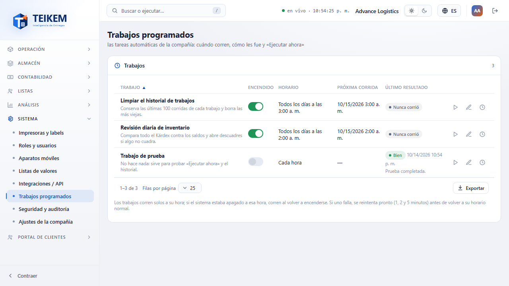

# 13 — Trabajos programados

Lote 50 (P2.2, 2026-10-14). Los **trabajos programados** son las tareas automáticas de la compañía: corren solas a su hora, sin que nadie
las dispare. Cada compañía tiene los suyos (lo que hace uno no toca a las demás). El sistema los ejecuta con un servicio propio
dentro del API (sin programas externos).

## 1. Quién y dónde

- Permiso **`jobs.manage`** («Gestionar los trabajos programados»; lo trae el rol **Admin de compañía** y se agregó a los roles de
  administrador que ya existían). Módulo **Sistema** (siempre encendido).
- Pantalla **Sistema → Trabajos programados** (`/system/jobs`). Sin el permiso, la entrada no aparece en el menú.
- API: `GET /api/v1/jobs`, `GET /api/v1/jobs/{clave}`, `PATCH /api/v1/jobs/{clave}`, `POST /api/v1/jobs/{clave}/run`,
  `GET /api/v1/jobs/{clave}/runs`. No existe DELETE: los trabajos los define el sistema.

## 2. Los trabajos de fábrica

| Clave | Trabajo | Horario inicial | Encendido |
|---|---|---|---|
| `JOB_RUN_PURGE` | **Limpiar el historial de trabajos**: conserva las últimas 100 corridas de cada trabajo y borra las más viejas (solo historial, nunca datos del negocio). | Todos los días 3:00 a. m. | Sí |
| `INVENTORY_SWEEP` | **Revisión diaria de inventario**: compara todo el Kárdex contra los saldos y abre descuadres si algo no cuadra (el barrido completo del Lote 14). Si el módulo de inventario está apagado no hace nada. | Todos los días 2:00 a. m. | Sí |
| `JOB_TEST` | **Trabajo de prueba**: no hace nada; sirve para probar «Ejecutar ahora» y el historial. | Cada hora | No |
| `SALES_BACKORDER_SCAN` | **Avisar backorders que ya se pueden surtir** (Lote 66): revisa las órdenes de venta con backorder y publica el aviso «Backorder que ya se puede surtir» cuando hay inventario disponible. Solo avisa; no surte solo. Si el módulo Órdenes de venta está apagado no hace nada. | Cada 10 minutos | Sí |

Las horas diarias son **hora de Puerto Rico** (la de la compañía). Los trabajos nuevos de versiones futuras aparecen solos en la lista, con
su horario de fábrica; **lo que usted cambie (interruptor u horario) nunca se pisa**.

## 3. La pantalla

Por trabajo: **Encendido** (interruptor), **Horario**, **Próxima corrida**, **Último resultado** (Bien, Falló, Corriendo o Nunca corrió, con su
hora y un resumen o el error) y tres acciones: **Ejecutar ahora**, **Cambiar horario** y **Ver historial**.

- **Ejecutar ahora**: pide la corrida; el sistema la toma **en unos segundos** (aunque el trabajo esté apagado) y no cambia su horario.
  Mientras está pedida o corriendo, el botón no se ofrece; la pantalla se actualiza sola.
- **Interruptor**: al **encender** se calcula la próxima corrida desde ese momento; al **apagar** se borra (no corre por horario, pero
  «Ejecutar ahora» sigue disponible).
- **Cambiar horario**: *Cada cierto tiempo* (de 1 minuto a 7 días; el intervalo se cuenta desde que **termina** la corrida anterior) o
  *Todos los días a una hora* (24 horas). Al guardar se recalcula la próxima corrida si el trabajo está encendido.
- **Ver historial**: las últimas corridas (inicio, fin, origen *Por horario* o *Ejecutar ahora*, resultado y detalle).

## 4. Qué pasa si algo falla o se cae

- **Una falla no detiene nada**: queda con el error a la vista y se **reintenta pronto**: a 1, 2 y 5 minutos (hasta 3 fallas seguidas); después
  vuelve a su horario normal. Una corrida buena borra la cuenta de fallas.
- **Nunca corre dos veces**: si hay varias copias del sistema encendidas, solo una toma cada corrida. Si la que corría se cae a medias, su
  reserva vence (el tiempo máximo del trabajo) y otra copia lo toma.
- Si el sistema estaba apagado a la hora del trabajo, corre al volver a encenderse.

## 5. Validaciones y mensajes

| Situación | Mensaje exacto | HTTP |
|---|---|---|
| La clave no existe (o es de una versión vieja) | `Trabajo no encontrado.` | 404 |
| Intervalo vacío, menor de 60 s o mayor de 7 días | `El intervalo debe estar entre 60 segundos y 7 días (604800).` | 400 (campo `intervalSeconds`) |
| Horario diario sin hora | `Indique la hora diaria (HH:mm).` | 400 (campo `dailyAt`) |
| Hora diaria inválida (p. ej. 25:00) | `La hora diaria no es válida; use HH:mm (24 horas).` | 400 (campo `dailyAt`) |
| Tipo de horario desconocido | `Tipo de horario desconocido: 'X'. Use INTERVAL o DAILY.` | 400 (campo `scheduleKind`) |
| «Ejecutar ahora» con el trabajo corriendo | `El trabajo ya se está ejecutando; espere a que termine.` | 409 |
| El trabajo cambió desde que lo abrió (rowVersion) | `El registro fue modificado por otro usuario; recargue e intente de nuevo.` | 409 |
| Sin el permiso | «Sin permiso» | 403 |

## 6. Para soporte

- Tablas `dbo.ScheduledJob` (una fila por compañía y trabajo: interruptor, horario, próxima corrida, último resultado y la reserva
  `LockedBy`/`LockedUntilUtc`) y `dbo.ScheduledJobRun` (historial). Sección **2026-10-14 (f)** de `Diseño/logistica-db-update.sql`.
- Configuración (`appsettings`): `Jobs:Enabled` (por omisión `true`; `false` apaga el servicio) y `Jobs:PollSeconds` (por omisión 30; mínimo 5).
  Los comandos de consola (`db-init`, `db-update`, `import-legacy`) no arrancan el servicio.
- Cada corrida se ejecuta **como la compañía, sin usuario** («Sistema»), así que la bitácora lo muestra así. Los cambios de interruptor y
  horario sí quedan en la bitácora con el usuario (tipo «Trabajo programado»).
- Una fila con la reserva puesta y el sistema caído se libera sola al vencer el tiempo máximo del trabajo (2 min la prueba, 5 min la
  limpieza, 30 min la revisión de inventario).
