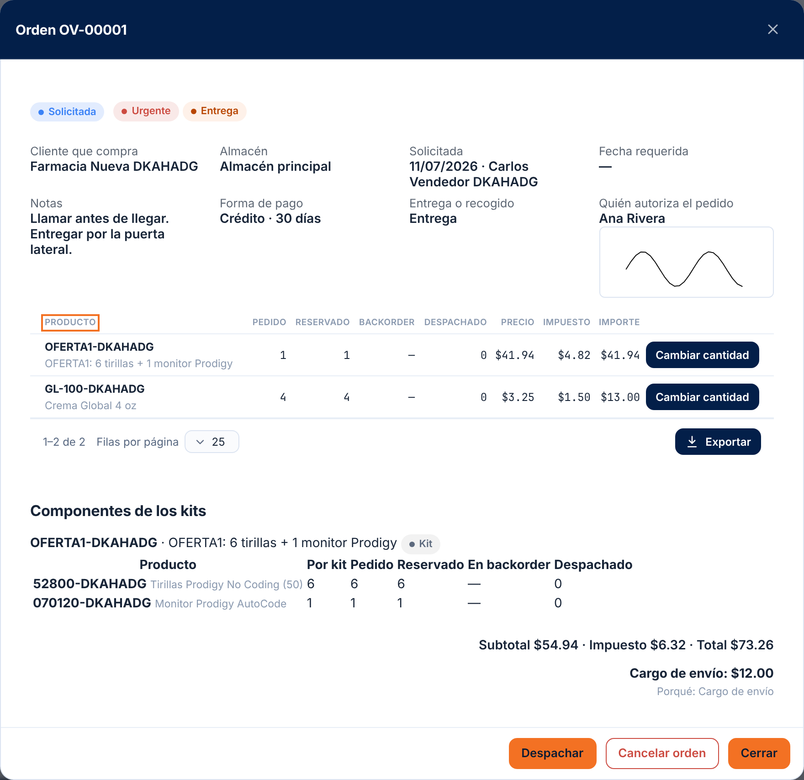
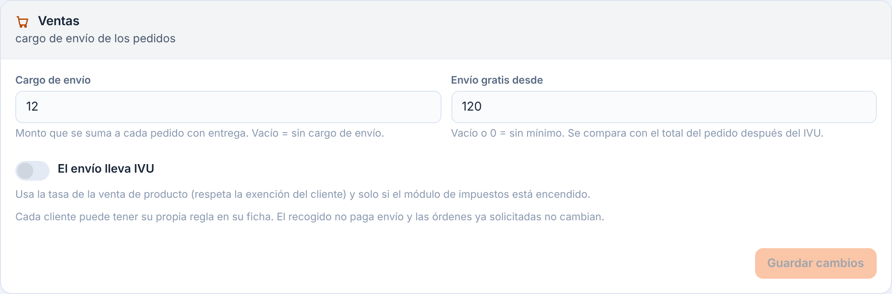

# 18 — Órdenes de venta

Lotes 57 a 64 (2026-10-15) — **S1: borrador, solicitar y reservar, backorders; S2: despachar**. Una **orden de venta** (OV-#####) es el documento que viaja de **Ventas a Almacén**: Ventas le pide al almacén que despache algo para un cliente. Hasta aquí se puede **armar la orden en borrador, solicitarla (validar y reservar inventario), modificarla y cancelarla**; ver, surtir y cerrar los **backorders**; **despachar contra la orden**, retiro / entrega y deshacer un despacho; la web y la app llegan en los lotes siguientes.
**Pedido de vendedores (Lotes 221 a 226, 2026-11-07):** la orden suma urgente, entrega o recogido, forma de pago, cargo de envío, consignación, firma de quien autoriza y cliente prospecto (secciones 18 a 23); el precio sale de listas ([47](47-precios-y-ofertas.md)); el pedido guiado es otra puerta a esta misma orden ([48](48-pedido-guiado.md)); las facturas pasan a QuickBooks ([49](49-quickbooks.md)) y lo consignado se cobra aparte ([19 §4e](19-facturacion.md#4e-consignación-lote-224)); con una **compañía enlazada**, la entrega de un despacho la hace otra compañía ([50](50-companias-enlazadas.md), sección 24).
El diseño completo está en `Diseño/logistica-funcionalidades-maestro.md`, sección 13C. La pantalla se describe en [L60 — Órdenes de venta](frontend/l60-ordenes-de-venta.md) y [L63 — Despachar](frontend/l63-despachar-orden-de-venta.md).

## 1. Quién puede

- Módulo **Órdenes de venta (`SALES_ORDERS`)**: viene **apagado**; se enciende por compañía (Sistema → Módulos). Con el módulo apagado todo el API responde 403.
- Permisos (categoría Órdenes):
  - **`sales.view`** — ver órdenes. Lo tienen el Admin de compañía, el rol **Ventas** y el Operador de almacén.
  - **`sales.create`** — crear y editar el borrador (y, en el lote siguiente, solicitar). Admin de compañía y rol Ventas.
  - **`sales.cancel`** — cancelar. Admin de compañía y rol Ventas.
  - **`sales.price`** — escribir un precio distinto del precio de venta del producto. **Solo el Admin de compañía**; el administrador se lo asigna a quien quiera.
  - **`sales.backorder`** — surtir y cerrar backorders (lotes siguientes). Admin de compañía y Operador de almacén.
- La plantilla de rol **Ventas** (`sales.view`, `sales.create`, `sales.cancel`, `inventory.view`, `clients.read`) la crea el sistema para las compañías nuevas; en las que ya existen el administrador crea el rol y le asigna esos permisos.

## 2. La orden

- **Número** `OV-#####`, único por compañía, consecutivo y sin saltos (un intento que falla no gasta número).
- **Cliente** (obligatorio): el comprador. **Consignatario** (opcional): solo si habrá entrega. **Almacén**: el que la atiende; si la compañía tiene un solo almacén activo se usa solo, si tiene varios hay que indicarlo.
- **Fecha de solicitud** (hoy, en la zona de la compañía), **fecha requerida** (opcional), **notas** (hasta 500 caracteres) y **quién la pidió**.
- **Líneas**: producto, cantidad y precio. Solo se venden **productos propios de la compañía** (no los de un cliente de paso), activos, **sin repetir** en la misma orden. Hasta 200 líneas.
- **Precio**: si no se escribe, se toma el **precio de venta del producto**. Escribir otro precio exige `sales.price` (si es igual al de lista no hace falta). Un producto **sin precio de venta** obliga a escribir el precio.
- **Impuesto**: con el módulo **Impuestos** encendido, cada línea calcula su impuesto con las reglas de la compañía (capítulo [17](17-impuestos.md)) y **guarda una copia**: la tasa usada, su porcentaje, el monto y si salió exenta (producto exento o cliente con exención vigente). El encabezado guarda el **subtotal** y el **impuesto**; el **total** es su suma. Sin el módulo Impuestos el impuesto es cero. Si se cambia el cliente del borrador, el impuesto se recalcula.
- **Estatus**: `DRAFT` (borrador) → `REQUESTED` (solicitada) → `PARTIAL` → `SHIPPED`; `CANCELLED`. En uso hasta ahora: borrador, solicitada y cancelada. La marca **con backorder** no es un estatus: la tiene la orden mientras alguna línea tenga cantidad pendiente.

## 3. Qué se puede hacer

| Acción | Cómo | Permiso |
|---|---|---|
| Ver la lista (más reciente primero; filtros: estatus, cliente y producto —cada uno con uno o varios valores—, buscador por número / cliente / producto, solo con backorder, fechas de solicitud o requerida; ver sección 25) | `GET /api/v1/sales-orders` | `sales.view` |
| Ver una orden | `GET /api/v1/sales-orders/{publicId}` | `sales.view` |
| Crear el borrador | `POST /api/v1/sales-orders` | `sales.create` (+ `sales.price` si cambia un precio) |
| Editar el borrador (lo que no se manda no cambia; las **líneas, si se mandan, reemplazan** a las actuales; `clearConsignee` / `clearRequiredDate` quitan esos datos) | `PATCH /api/v1/sales-orders/{publicId}` | `sales.create` |
| Comprobar disponibilidad y crédito (no guarda) | `GET /api/v1/sales-orders/{publicId}/availability` | `sales.create` |
| Solicitar (validar y reservar) | `POST /api/v1/sales-orders/{publicId}/request` | `sales.create` |
| Modificar una línea solicitada | `PATCH /api/v1/sales-orders/{publicId}/lines/{lineId}` | `sales.create` |
| Ver backorders (más antiguo primero) | `GET /api/v1/sales-orders/backorders` | `sales.view` |
| Surtir una línea / surtir todo / cerrar con faltante | `POST …/lines/{lineId}/fulfill` · `POST /sales-orders/backorders/fulfill` · `POST …/lines/{lineId}/close` | `sales.backorder` |
| Despachar contra la orden (por partes; consume la reserva y baja el inventario) | `POST /api/v1/sales-orders/{publicId}/dispatch` | `warehouse.pick` |
| Crear la entrega de un despacho (orden de transporte) | `POST /api/v1/sales-orders/{publicId}/delivery` | `warehouse.pick` |
| Cancelar un borrador o una solicitada (comentario opcional en el historial; libera lo reservado) | `POST /api/v1/sales-orders/{publicId}/cancel` | `sales.cancel` |

Las órdenes **nunca se borran**: se cancelan. Quedan en la bitácora (altas, cambios) y en el historial de estatus.

## 4. Validaciones y mensajes

| Situación | Mensaje exacto | HTTP |
|---|---|---|
| Sin cliente | `Escoja el cliente que compra.` | 400 (`clientPublicId`) |
| Cliente inexistente (o de otra compañía) | `Cliente no encontrado.` | 404 |
| Cliente inactivo | `El cliente está inactivo; no se le puede vender.` | 422 |
| Consignatario inexistente | `Consignatario no encontrado.` | 404 |
| Varios almacenes y no se indicó | `Indique el almacén: la compañía tiene más de uno.` | 400 (`warehousePublicId`) |
| Almacén inexistente / inactivo / la compañía no tiene ninguno | `Almacén no encontrado.` / `El almacén está inactivo.` / `La compañía no tiene almacenes activos.` | 404 / 422 / 422 |
| Sin líneas | `Agregue al menos un producto a la orden.` | 400 (`lines`) |
| Más de 200 líneas | `La orden admite como máximo 200 líneas.` | 400 |
| Línea sin producto | `Escoja el producto de cada línea.` | 400 |
| Producto inexistente | `Producto no encontrado.` | 404 |
| Producto inactivo | `Hay un producto inactivo en la orden.` | 422 |
| Producto de un cliente de paso | `Solo se pueden vender productos propios de la compañía.` | 422 |
| Producto repetido | `Un producto no puede repetirse en la orden.` | 400 |
| Cantidad vacía o cero | `La cantidad debe ser mayor que cero.` | 400 |
| Más de 3 decimales / demasiado grande | `La cantidad admite como máximo 3 decimales.` / `La cantidad excede el máximo permitido.` | 400 |
| Precio negativo o inválido / más de 4 decimales | `El precio no es válido.` / `El precio admite como máximo 4 decimales.` | 400 |
| Producto sin precio de venta | `El producto {SKU} no tiene precio de venta: escriba el precio.` | 400 |
| Precio distinto del de lista sin `sales.price` | `Cambiar el precio exige el permiso de precios (sales.price).` | 403 |
| Lote inexistente | `Lote no encontrado.` | 404 |
| Notas de más de 500 caracteres | `Las notas no pueden pasar de 500 caracteres.` | 400 |
| Orden inexistente (o de otra compañía) | `Orden de venta no encontrada.` | 404 |
| Editar una orden que ya no es borrador | `Solo se puede editar una orden en borrador.` | 422 |
| Cancelar una orden ya cancelada | `La orden ya está cancelada.` | 409 |
| Con Impuestos encendido y sin tasa por omisión / sin tasa vigente | `Escoja la tasa por omisión en Impuestos → Reglas.` / `No hay una tasa de impuesto vigente en esa fecha. Configure una en Impuestos → Tasas.` | 400 |
| Sin el permiso o con el módulo apagado | «Sin permiso» | 403 |

## 6. Solicitar la orden: validar y reservar (Lote 58)

`POST /api/v1/sales-orders/{publicId}/request` (permiso `sales.create`) pasa la orden de **borrador** a **solicitada** (`REQUESTED`): el almacén ya la ve y **el inventario queda reservado para ella**. La validación y la reserva ocurren **en la misma transacción, con el candado del inventario**: dos vendedores que piden lo mismo a la vez no pueden vender más de lo que hay (uno la obtiene, el otro recibe el aviso de faltante). Nunca se reserva más de lo que existe.

- **Disponible para vender** = lo que hay en mano menos lo ya reservado, en las posiciones **activas** del almacén de la orden (y del **lote**, si la línea pidió uno). **No cuenta** la cuarentena, el cruce de muelle ni los equipos en renta, ni otros almacenes. Es lo mismo que puede recolectar el almacén; difiere del «Disponible» de la tabla de inventario, que sí suma la cuarentena.
- **Qué lote y qué posición**: el sistema reserva por el mismo orden de rotación de la compañía (primero vence / primero entró) y guarda **exactamente** qué saldo reservó cada línea (`SalesOrderReservation`) para liberar justo eso después.
- **Comprobar antes**: `GET /sales-orders/{publicId}/availability` (no guarda nada) devuelve por línea **pedido / disponible / faltante** y el estado del **crédito**. La pantalla lo usa para mostrar el diálogo de faltante.
- **Si falta inventario**: la solicitud responde **409** con el mensaje por línea y **no reserva nada** (ni lo de las líneas que sí alcanzaban). Ventas decide: **pedir solo lo disponible** (editar la cantidad), **reservar lo disponible y dejar el resto en backorder** (`allowBackorder = true`) o **quitar la línea**. Con `allowBackorder` cada línea reserva lo que hay y lo pendiente queda en **backorder**; la orden se marca **con backorder** mientras alguna línea tenga pendiente.
- **Crédito**: se compara el **límite de crédito** del cliente con lo que ya tiene en curso (saldo pendiente de sus órdenes de transporte **más** lo solicitado y sin despachar de sus otras órdenes de venta) y esta orden. Si lo excede responde **422** `credit_exceeded` con el aviso y las cifras; con `overrideCredit = true` y el permiso `orders.credit_override` se autoriza: queda el comentario «Crédito excedido autorizado por …» en el historial de estatus y un evento en la bitácora de seguridad.
- Un producto **con número de serie** todavía no se vende con orden de venta (mensaje en la tabla).

## 7. Cancelar y modificar una orden solicitada (Lote 58)

- **Cancelar** (`POST /sales-orders/{publicId}/cancel`, permiso `sales.cancel`): una orden solicitada **libera exactamente lo que tenía reservado** y borra su backorder; el inventario vuelve a estar disponible para otras ventas. Una orden a la que ya se le despachó algo no se cancela.
- **Modificar una línea** (`PATCH /sales-orders/{publicId}/lines/{lineId}`, permiso `sales.create`; precio distinto del de lista, además `sales.price`): se puede cambiar la **cantidad** y el **precio** de una línea de una orden solicitada mientras **no se haya despachado nada de esa línea**.
  - **Subir** la cantidad reserva lo que haya; si no alcanza responde 409 (o, con `allowBackorder`, el resto queda en backorder).
  - **Bajar** la cantidad quita primero del backorder y luego libera reserva.
  - El impuesto y los totales de la orden se recalculan.

## 8. Mensajes nuevos (Lote 58)

| Situación | Mensaje exacto | HTTP |
|---|---|---|
| Solicitar o comprobar una orden que no está en borrador | `Solo se puede solicitar una orden en borrador.` | 422 |
| Falta inventario al solicitar | `No alcanza el inventario de {SKU}: pedido {n}, disponible {n}, faltante {n}.` | 409 (`insufficient_stock`, un mensaje por línea) |
| Crédito excedido | `El cliente excede su límite de crédito: límite {n}, en curso {n}, esta orden {n}.` | 422 (`credit_exceeded`) |
| Autorizar el crédito sin el permiso | `Falta el permiso 'orders.credit_override'.` | 403 |
| Modificar una línea de una orden que no está solicitada | `Solo se pueden modificar las líneas de una orden solicitada.` | 422 |
| Línea inexistente | `Línea no encontrada.` | 404 |
| Línea cerrada | `La línea está cerrada.` | 422 |
| A la línea ya se le despachó producto | `A esa línea ya se le despachó producto: no se puede modificar.` | 422 |
| Subir una cantidad que no alcanza | `No alcanza el inventario de {SKU} para subir la cantidad: se agregan {n}, disponible {n}, faltante {n}.` | 409 |
| Cantidad o precio inválidos al modificar | `La cantidad debe ser mayor que cero.` / `El precio no es válido.` | 400 |
| Precio distinto del de lista sin `sales.price` | `Cambiar el precio exige el permiso de precios (sales.price).` | 403 |
| Producto con serie en una orden de venta | `Los productos con número de serie todavía no se venden con orden de venta.` | 422 |
| Cancelar una orden con algo despachado | `Solo se puede cancelar una orden en borrador o solicitada que no se haya despachado.` | 422 |

## 9. Backorders: ver, surtir y cerrar con faltante (Lote 59)

Un **backorder** es lo que se pidió y todavía no hay: la línea queda con su cantidad pendiente (`QtyBackordered`) mientras la orden sigue solicitada.

- **Ver los backorders** (`GET /api/v1/sales-orders/backorders`, permiso `sales.view`): todas las líneas con pendiente, **la más antigua primero** (el primero que pidió, primero). Por línea: orden, cliente, almacén, producto, **pedido / reservado / pendiente**, lo **disponible hoy** para vender y lo que se podría **surtir ahora** (el menor entre lo pendiente y lo disponible), y cuántos días lleva esperando. Buscador por número de envío, cliente o producto.
- **Surtir una línea** (`POST /api/v1/sales-orders/{publicId}/lines/{lineId}/fulfill`, permiso `sales.backorder`): reserva para la línea **lo que haya** (todo su pendiente o una parte). Usa el mismo candado del inventario que solicitar: nunca reserva más de lo que existe ni le quita a otra orden. Si no hay nada nuevo, responde 409.
- **Surtir todo** (`POST /api/v1/sales-orders/backorders/fulfill`, permiso `sales.backorder`): recorre los backorders **de la más antigua a la más reciente** y surte lo que se pueda; lo que una línea toma, la siguiente ya no lo ve. Devuelve qué se reservó por línea y cuánto sigue pendiente.
- **Cuándo se puede surtir**: cuando entra inventario (recibo, ajuste de entrada, transferencia, liberar cuarentena) o se cancela otra orden que lo tenía reservado. Hoy el aviso automático «ya hay para este backorder» no existe todavía (llega con los avisos de ventas); la vista muestra siempre lo surtible.
- **Cerrar con faltante** (`POST /api/v1/sales-orders/{publicId}/lines/{lineId}/close`, permiso `sales.backorder`): da la línea por **terminada sin esperar más**: su backorder se borra y la línea queda cerrada. **Lo ya reservado sigue reservado** para despacharse y la **cantidad pedida se conserva** (sirve para medir el cumplimiento). Una línea cerrada no se surte ni se modifica.
- **Cancelar el envío** borra su backorder y libera lo reservado (sección 7).

| Situación | Mensaje exacto | HTTP |
|---|---|---|
| Surtir una línea sin inventario disponible | `No hay inventario disponible para surtir esa línea.` | 409 |
| Surtir o cerrar una línea sin backorder | `Esa línea no tiene backorder.` | 409 |
| Surtir o cerrar en una orden que no está solicitada | `Solo se pueden modificar las líneas de una orden solicitada.` | 422 |
| Surtir o cerrar una línea cerrada | `La línea está cerrada.` | 422 |
| Línea u orden inexistente | `Línea no encontrada.` / `Orden de venta no encontrada.` | 404 |

## 10. Despachar contra la orden (Lote 61)

`POST /api/v1/sales-orders/{publicId}/dispatch` (permiso `warehouse.pick`, el mismo de recolectar) saca del almacén lo reservado para la orden. **Despachar siempre baja el inventario**, lo entreguen o lo vengan a recoger. Todo ocurre en **una sola transacción**:

1. Se **consume la reserva** de las líneas despachadas.
2. El inventario **sale por el ledger** (movimiento de salida con la recolección como referencia: queda en el Kárdex).
3. Se crea la **recolección** (`EMP-#####`) **enlazada a la orden** (`PickBatch.SalesOrderId` y, por línea, `PickBatchLine.SalesOrderLineId`), con el costo del producto congelado.
4. Sube lo **despachado** de cada línea y baja lo reservado.
5. La orden pasa a **despachada parcial** (`PARTIAL`) o **despachada** (`SHIPPED`).

- **Por partes**: se pueden mandar varias líneas y menos cantidad que lo reservado; cada despacho crea su propia recolección. **Nunca se despacha más de lo reservado.**
- **Posición y lote guiados, con cambio permitido**: sin `binId` sale de lo que reservó el sistema. Si el operario tomó de **otra posición** (`binId`, y `lotId` si hay lotes), la reserva **se mueve** a esa posición —si tiene saldo vendible— y de ahí sale; sin saldo responde 409 con el aviso de inventario. La posición debe ser del almacén de la orden, activa y vendible (sin cuarentena, cruce de muelle ni renta).
- **Cuándo está terminada una línea y la orden**: una línea está **terminada** cuando no le queda reserva ni backorder. La orden es `SHIPPED` cuando todas sus líneas están terminadas y se despachó algo; con backorder pendiente se queda en `PARTIAL` hasta que se surta o se **cierre con faltante** (cerrar la última línea pendiente la pasa a despachada).
- **Orden sin nada despachado y todas las líneas cerradas con faltante**: **se cancela sola**, con la nota «Todas las líneas se cerraron con faltante y no se despachó nada.» en el historial.
- El retiro, la **entrega** (crea la orden de transporte) y deshacer un despacho se describen en la sección 11.

| Situación | Mensaje exacto | HTTP |
|---|---|---|
| Sin líneas | `Indique qué líneas se despachan.` | 400 |
| Línea sin identificar | `Indique la línea que se despacha.` | 400 |
| Línea repetida | `Una línea no puede repetirse en el despacho.` | 400 |
| Cantidad vacía o cero | `La cantidad debe ser mayor que cero.` | 400 |
| Orden que no está solicitada ni despachada parcial | `Solo se puede despachar una orden solicitada o despachada parcial.` | 422 |
| Más de lo reservado | `No se puede despachar más de lo reservado: {SKU} tiene {n} reservadas.` | 409 |
| Línea u orden inexistente | `Línea no encontrada.` / `Orden de venta no encontrada.` | 404 |
| Posición inexistente o de otro almacén | `Posición no encontrada.` | 404 |
| Posición inactiva o de cuarentena / cruce / renta | `La posición {código} no es vendible: está inactiva o es de cuarentena, cruce de muelle o renta.` | 422 |
| Sin saldo en la posición escogida | `Inventario insuficiente: …` (el del inventario) | 409 |
| Sin el permiso `warehouse.pick` | «Sin permiso» | 403 |

## 11. Entrega y deshacer un despacho (Lote 62)

- **Qué pasa después de despachar**: el despacho queda como una **recolección** (`EMP-#####`) enlazada a la orden y la orden muestra su lista de **despachos** (`dispatches`): número, estatus (`COLLECTED` = despachado sin entrega, `PACKED` = con entrega, `CANCELLED` = deshecho), cantidad y, si ya la tiene, la **orden de transporte** de la entrega.
  - **Retiro** (el cliente recoge): no hace falta nada más; el despacho queda como `COLLECTED` y ahí termina.
  - **Entrega**: `POST /api/v1/sales-orders/{publicId}/delivery` (permiso `warehouse.pick`, y `orders.create` para crear la orden de transporte) con el despacho (`pickBatchPublicId`) y los datos de la entrega (`order`: servicio, paquetes, COD…, igual que el empaque de hoy). **El cliente y el consignatario salen de la orden de venta** si no se mandan (o se manda un consignatario nuevo). Crea la orden de transporte real, enlazada a la orden de venta (`TransportOrder.SalesOrderId`), y el despacho pasa a `PACKED`. También se puede crear **después**, sobre un despacho ya hecho.
- **Deshacer un despacho** (eliminar su recolección, como hoy): la existencia vuelve a su posición, baja lo despachado de cada línea y, si la orden no está cancelada, **vuelve a reservar** esa cantidad en la misma posición y lote. Una orden despachada o parcial **se reabre** (parcial o solicitada). Si el despacho tenía entrega (empacado), se elimina junto con su orden de transporte según las reglas de siempre.

| Situación | Mensaje exacto | HTTP |
|---|---|---|
| Entrega sin indicar el despacho | `Indique el despacho que se entrega.` | 400 |
| Entrega sin datos | `Indique los datos de la entrega.` | 400 |
| Despacho que no es de esta orden | `Despacho de esta orden no encontrado.` | 404 |
| Despacho que ya tiene entrega o fue deshecho | `El despacho {EMP-#####} ya tiene entrega o fue deshecho: no se puede crear otra.` | 422 |

## 12. Para el aparato: órdenes por despachar y despacho con entrega (Lote 64)

- **`GET /api/v1/sync/sales-orders`** (módulo SALES_ORDERS y permiso `sales.view`; el Operador de almacén lo tiene): las órdenes **solicitadas o despachadas parciales con algo reservado**, con sus líneas (pedido, reservado, despachado, backorder) y, por línea, **de qué posición y lote reservó el sistema cada parte** (`reservations`): es la guía del despacho en el aparato. Siempre llegan **todas las abiertas** (son pocas y sus líneas cambian sin que cambie el encabezado); con `since` llegan además las que se cerraron, despacharon o cancelaron (`isActive = false`) para que el aparato las borre. Filtro opcional `warehousePublicId`.
- **Despacho con entrega en una sola llamada**: `POST /sales-orders/{publicId}/dispatch` acepta `delivery` (los mismos datos del empaque: servicio, paquetes, consignatario nuevo o el de la orden, COD). Despacha **y** crea la orden de transporte en **una transacción**: si la entrega falla (por ejemplo, «Tipo de servicio desconocido»), no sale el inventario y la orden queda como estaba. Es lo que manda el aparato, que despacha sin señal y no conoce el número de la recolección hasta que sincroniza.

## 13. Para soporte

- Tablas `SalesOrder`, `SalesOrderLine` y `SalesOrderReservation` (la que guarda qué saldo reservó cada línea) y las columnas `PickBatch.SalesOrderId` / `PickBatchLine.SalesOrderLineId` (sección **2026-10-15 (l)**), `TransportOrder.SalesOrderId` (**(m)**) y el ajuste de estatus de la **(n)**: «Despachada parcial» y «Despachada» son etapas laterales para poder reabrir la orden al deshacer un despacho, contador `SALESORDER`, dominio de estatus `SalesOrderStatus` y EntityType `SALES_ORDER` (sección **2026-10-15 (k)** de `Diseño/logistica-db-update.sql`).
- Cada línea guarda `TaxRateId`, `TaxRatePct`, `TaxAmount` e `IsTaxExempt`: un cambio posterior de la tasa **no** altera una orden ya guardada.
- Un número `OV-` saltado no ocurre: el contador se toma dentro de la misma transacción que crea la orden.

## 14. En el aparato: despachar una orden de venta (Lote 65)

Pantalla **Órdenes de venta** del aparato (la ficha técnica de la app está en [09 — App de almacén](09-app-almacen.md#12-despachar-una-orden-de-venta-lote-65)).

- **Quién la ve:** el botón «Órdenes de venta» de Inicio aparece solo si el aparato ya bajó órdenes por despachar de su almacén (módulo SALES_ORDERS y permiso `sales.view` en la compañía; el Operador de almacén lo tiene). Sin ellos el servidor contesta 403 y la app lo salta sin avisar de error.
- **Cómo se usa:** se escanea (o escribe) el número `OV-#####`, o se toca la orden en la lista. La app guía **posición por posición** según lo que el sistema reservó: «Ve a A-01», la cantidad reservada ya viene puesta (se puede bajar, nunca subir), se lee la posición y queda marcada ✓. Tocar un ✓ lo deshace. **Omitir** deja esa parte reservada para otro despacho.
- **Sacar de otra posición:** se lee la otra posición; la reserva se mueve ahí si tiene existencia suficiente (el servidor lo confirma al enviar y, si no alcanza, rechaza con `No hay existencia suficiente…`).
- **Al terminar:** *Retiro* (el cliente recoge), *Entrega* (pide los bultos; solo si la orden tiene consignatario; el cliente y el consignatario salen de la orden, el servicio y el cobro de los valores de la compañía) o *Dejar para después* (queda recolectado; la entrega se crea después desde la web, sección 11).
- **Sin señal:** el despacho se guarda en la cola de salida («Despacho de orden de venta» en Sincronización) y la existencia local baja de inmediato; el servidor lo valida al sincronizar. Si lo rechaza, el aparato muestra el mensaje exacto del servidor, quita la fila de la cola, devuelve la existencia y vuelve a bajar la orden.
- **Despacho + entrega** viajan en **una sola llamada** (sección 12): si la entrega falla, no sale el inventario.

## 15. Avisos de ventas (Lote 66)

Las órdenes de venta publican cinco avisos (solicitada, despachada, cancelada, crédito por autorizar y backorder surtible) sobre el motor de avisos: ver la
tabla en [14 — Avisos §3.1](14-avisos.md#31-eventos-de-las-órdenes-de-venta-lote-66). Para recibirlos hay que crear la regla en **Sistema → Reglas de aviso**
(permiso `notifications.manage`) y elegir destinatarios y canal; sin regla no llega nada (no se siembra ninguna).

- **Crédito:** la petición de autorización sale al fallar la solicitud con `El cliente excede su límite de crédito…` (422); quien tenga el permiso de autorizar
  crédito (`orders.credit_override`) solicita de nuevo marcando la autorización. El aviso sirve para que esa persona se entere sin que se lo pidan de palabra.
- **Backorder surtible:** el aviso **no surte**; quien tenga `sales.backorder` surte desde la vista Backorders (sección 9). El modo automático queda para más adelante.
- **Un aviso nunca deshace la operación:** si el correo falla, la orden queda igual y el aviso se reintenta (1, 5 y 30 minutos).
- **Soporte:** los avisos quedan en el registro de envíos (Sistema → Reglas de aviso → Registro) por evento y destinatario; el trabajo `SALES_BACKORDER_SCAN` y su historial se ven en Sistema → Trabajos programados.

## 16. Análisis de órdenes de venta (Lote 67)

Con el módulo **Órdenes de venta** encendido y el permiso `sales.view`, Análisis (Pulso, Indicadores, Gráficos y Vistas) ofrece dos fuentes de datos nuevas.
Sin el módulo apagado o sin el permiso, las fuentes y todo lo que se arme con ellas no aparecen.

**Fuente «Órdenes de venta» (`SALES_ORDER`)**, una fila por orden, con rango de fecha por la fecha de creación:

| Campo | Qué es |
|---|---|
| Número, Cliente, Almacén, Estatus | Los de la orden. |
| Abierta | Solicitada o despachada parcial (todavía hay algo por despachar o esperando inventario). |
| Con backorder / Unidades en backorder | Alguna línea espera inventario (sin contar las cerradas con faltante). |
| Atrasada | Abierta con fecha requerida anterior a hoy (día de la compañía). |
| Fecha del pedido, Fecha requerida, Solicitada el, Despachada el | Fechas. «Despachada el» es el último cambio a Despachada. |
| Días a despachar | De solicitarla a despacharla por completo; solo en órdenes despachadas. |
| Líneas, Unidades pedidas / reservadas / despachadas | Totales de las líneas. |
| Cumplimiento (%) | Despachado sobre lo pedido (máximo 100); solo en órdenes despachadas (con faltante cerrado queda por debajo de 100). |
| Subtotal, Impuesto, Total | Dinero de la orden. |

**Fuente «Líneas de órdenes de venta» (`SALES_ORDER_LINE`)**, una fila por línea: orden, cliente, almacén, estatus de la orden, SKU, producto, pedido, reservado,
despachado, en backorder, cerrada con faltante, **días esperando** (del backorder pendiente), precio, total de la línea e impuesto.

**Contenido de sistema** (se siembra solo en cada compañía; apagado el módulo, queda oculto):

| Qué | Nombre | Detalle |
|---|---|---|
| Indicador (en el Pulso) | **Órdenes de venta abiertas** | Cuántas hay por despachar. |
| Indicador | **Unidades en backorder** | Unidades esperando inventario en órdenes abiertas. |
| Indicador | **Cumplimiento de órdenes de venta (%)** | Promedio de lo despachado sobre lo pedido, órdenes despachadas en 30 días. |
| Indicador | **Días promedio a despachar** | De solicitar a despachar por completo, 30 días. |
| Gráfico | **Órdenes de venta por estatus** | Dona de 30 días. |
| Vistas | **Órdenes de venta**, **Órdenes de venta por cliente**, **Backorders de órdenes de venta** | La última lista las líneas con backorder pendiente, las que más esperan primero. |

**Pulso → Necesita tu atención:** una fila por cada orden abierta con backorder que **ya se puede surtir** (hay disponible para vender), para quien tenga `sales.backorder`.
Muestra unidades surtibles, líneas y días esperando (en rojo si pasa de 7). **Revisar** abre la orden; **Ver todos** abre Órdenes de venta. Es la misma cuenta que la
pestaña Backorders: lo que avisa es lo que **Surtir** va a reservar.

Base de datos: sección **2026-10-16 (o)** de `Diseño/logistica-db-update.sql` (EntityType `SALES_ORDER_LINE`); lo demás lo siembra el código.

## 17. Kits en las órdenes de venta (Lote 69)

Un **kit** ([06 §8b](06-inventario-y-almacen.md#8b-kits-lote-68-2026-10-16)) se vende como una línea más de la orden: la cantidad son **kits enteros** y el precio es el del kit.
Por dentro, todo se mueve en sus **componentes**.

- **Componentes de la línea.** Al guardar el borrador se toma una **foto** de los componentes del kit (cantidad por kit). Un cambio posterior del catálogo **no** altera la orden; si
  usted vuelve a guardar el borrador, la foto se conserva (incluidas las piezas ajustadas). Para tomar el catálogo nuevo, quite la línea y agréguela otra vez.
- **Kit ajustable al pedir.** Si el kit se marcó «Ajustable al pedir», en el borrador se pueden cambiar las **cantidades por kit solo para esta orden** (el cuerpo lleva `components` en la línea).
  En un kit fijo, mandar `components` da `El kit {SKU} no se puede ajustar al pedir.` (400).
- **Disponible y faltante en kits.** Se pueden armar tantos kits como alcance el componente que menos da (disponible para vender ÷ cantidad por kit, hacia abajo). El diálogo de
  faltante, la orden y el backorder cuentan **kits**: pedido 5, disponible 3, faltante 2.
- **Reservar y liberar.** Solicitar reserva **los componentes de cada kit completo** (por FEFO/FIFO de cada componente); nunca una mitad de kit. Cambiar la cantidad, cancelar, surtir un
  backorder o cerrar con faltante actúan sobre los componentes de la misma forma. La reserva guarda el producto reservado (`SalesOrderReservation.ProductId`).
- **Despachar.** Se despachan kits enteros, **de lo reservado de sus componentes** (no se escoge posición ni lote). Salen las piezas de cada componente por el ledger, con la nota
  `{KIT} × n · EMP-… · OV-…` en el Kárdex; la recolección trae una línea por componente y anota los kits que representa (`PickBatchLine.KitProductId` / `KitQuantity`).
  La cantidad de un despacho en la lista de despachos de la orden es en **kits**.
- **Deshacer un despacho** devuelve los componentes a su posición, baja los kits despachados y **vuelve a reservar** cada componente, igual que con un producto normal.
- **En la web** (Operación → Órdenes de venta): una línea de kit lleva el distintivo «Kit» y muestra sus componentes debajo; en la orden solicitada, una tabla por kit con pedido, reservado,
  en backorder y despachado de cada componente.
- **Aparato** (Lote 71): despacha líneas de kit **pieza por pieza** — ver la sección «Kits» de [09 §12](09-app-almacen.md#12-despachar-una-orden-de-venta-lote-65). El servidor manda las líneas de kit con sus componentes y la reserva de cada componente (`GET /sync/sales-orders`: `isKit`, `components` y, por reserva, el producto).

| Situación | Mensaje | HTTP |
|---|---|---|
| Cantidad de kit con decimales | `El kit {SKU} se pide en piezas enteras.` | 400 |
| Piezas ajustadas en un kit fijo | `El kit {SKU} no se puede ajustar al pedir.` | 400 |
| Piezas en una línea que no es kit | `El producto {SKU} no es un kit.` | 400 |
| Piezas ajustadas inválidas | los mismos de [06 §8b.3](06-inventario-y-almacen.md#8b3-reglas-y-mensajes) (cantidad, repetido, kit dentro de kit, inactivo, otro dueño) | 400 |
| Kit sin componentes | `El kit {SKU} no tiene componentes: defínalos antes de venderlo.` | 400 |
| Despachar un kit escogiendo posición o lote | `Un kit se despacha de lo reservado de sus componentes: no se escoge posición ni lote.` | 400 |
| Despachar kits con decimales | `El kit {SKU} se pide en piezas enteras.` | 400 |
| Despachar más kits de los reservados | `No se puede despachar más de lo reservado: {SKU} tiene {n} reservadas.` | 409 |

Para soporte: tabla `SalesOrderLineComponent` (la foto, se borra con la línea) y columnas `SalesOrderReservation.ProductId`, `PickBatchLine.KitProductId` y `KitQuantity`
(sección **2026-10-16 (q)** de `Diseño/logistica-db-update.sql`).

### 17.1 Cambiar una pieza del kit al pedir (Lote 230)

**Qué hace.** En un pedido, una pieza de un kit se puede **cambiar** por otro producto (p. ej. guantes de otra talla) si cumple **todo** esto:

| Condición | Detalle |
|---|---|
| **Misma categoría exacta** | El mismo `ProductCategoryId`: la subcategoría, si la tiene (Guantes → Nitrilo no se cambia por Guantes → Látex). Una pieza **sin categoría** no se sustituye. |
| **Precio de venta exactamente igual** | Se compara el **precio de venta del producto** (`Product.SalePrice`), no el de una lista; ni un centavo de diferencia. Una pieza **sin precio de venta** no se sustituye. |
| **Misma cantidad** | El sustituto va en la cantidad de la pieza (en un kit «Ajustable al pedir» la cantidad sigue siendo libre). |
| **Pieza sustituible** | La pieza no está marcada «No sustituible» ([06 §8b.3b](06-inventario-y-almacen.md#8b3b-no-sustituible-lote-230-2026-11-09)). Por omisión toda pieza es sustituible. |
| **Sustituto válido** | Producto activo, que no sea kit, del mismo dueño de inventario que el kit y que no sea ya otra pieza del mismo kit. |

El **precio del kit no cambia**. Vale para kits fijos y ajustables, regulares y de oferta. **«Ajustable al pedir» sigue igual** (cambiar cantidades de las
piezas sin tocar el precio): la sustitución es aparte y se pueden usar las dos.

**Quién puede.** El vendedor, con `sales.create` — **no hay permiso aparte**: lo decide la definición del kit. Módulo **SALES_ORDERS**.

**Cómo se usa.** En el **pedido guiado** (carrito abierto) y en la ventana de la orden **en borrador**, cada pieza con sustitutos válidos lleva
**«Cambiar»**: la lista (titulada «Productos que pueden sustituir a {SKU}») muestra solo los productos permitidos (SKU, nombre y marca), con la pista «Misma
categoría y mismo precio: el precio del kit no cambia.». Al escoger uno, la pieza muestra el producto nuevo y «en lugar de {SKU original}», con
**«Deshacer»**. La lista no ofrece el producto que ya está puesto ni los que ya son otra pieza de la línea. Las piezas «No sustituibles» o sin sustitutos no
llevan el botón. En la orden guardada o solicitada se ve la pieza real con «en lugar de …»; la **reserva, el despacho, el costo, la factura y el aparato**
usan la **pieza real**, y la orden y la factura muestran la pieza real.

**Quién ve las piezas.** El vendedor con `sales.create` ve las piezas del kit en el borrador y en el carrito **aunque no tenga `inventory.view`** (antes no
las veía): la pantalla las lee del servicio de ventas. Sin `sales.create` (solo lectura) se usa el kit del almacén, que sí exige `inventory.view`.

**API.** `GET /api/v1/sales-orders/kits/{kitPublicId}/substitutes` (`sales.create`, módulo `SALES_ORDERS`) devuelve cada pieza del kit con su categoría, su
precio, si es «no sustituible» y sus sustitutos válidos; sirve antes de guardar la línea. En `POST/PATCH /sales-orders` la línea manda **todas** sus piezas
en `components` y la que cambia lleva `substitutesProductPublicId` = la pieza original. Volver a guardar el borrador sin piezas conserva la sustitución. Se
valida contra el catálogo **actual** del kit: si el catálogo cambió después de guardar el borrador, quite la línea y agréguela otra vez para tomar el nuevo.

| Caso | Mensaje exacto | HTTP |
|---|---|---|
| Pieza marcada no sustituible | `La pieza GM del kit no es sustituible.` | 400 |
| La «original» no es pieza del kit | `GV no es una pieza del kit KIT-1: solo se sustituyen sus piezas.` | 400 |
| Pieza sin categoría | `La pieza CAJA no tiene categoría: solo se sustituye por un producto de la misma categoría.` | 400 |
| Otra categoría | `GV no es de la misma categoría que GM: solo se sustituye por un producto de la misma categoría.` | 400 |
| Pieza sin precio de venta | `La pieza GM no tiene precio de venta: solo se sustituye por un producto del mismo precio.` | 400 |
| Otro precio | `GXL no tiene el mismo precio de venta que GM: solo se sustituye por un producto del mismo precio.` | 400 |
| Otra cantidad (kit fijo) | `El sustituto de GM va en la misma cantidad que la pieza: 2.` | 400 |
| Sustituto que ya es otra pieza | `CAJA ya es otra pieza del kit: no puede sustituir una pieza.` | 400 |
| La misma pieza dos veces | `La pieza GM se sustituyó más de una vez.` | 400 |
| Sustituto inactivo / que es un kit / de otro dueño | `El componente GS está inactivo.` · `K2 es un kit: un kit no puede llevar otro kit como componente.` · `El componente GS es de otro dueño de inventario que el kit.` | 400 |
| Kit fijo con otro cambio además de la sustitución | `El kit KIT-1 no se puede ajustar al pedir.` | 400 |
| Sustitutos de algo que no es kit | `El producto GM no es un kit.` | 422 |
| Kit o pieza original que no existe | `Producto no encontrado.` · `Componente no encontrado.` | 404 |

La pantalla solo ofrece sustitutos válidos, así que estos mensajes salen sobre todo si el catálogo cambió mientras se armaba el pedido: el aviso
aparece arriba de la ventana (o como aviso del paso) y basta con «Deshacer» o escoger otro.

### 17.2 Precio de la línea, ofertas y avisos (Lote 229)

El precio de la línea sale de la oferta, de la lista del cliente, de la lista general o del producto, y **gana el más bajo** entre el negociado del cliente y la
oferta vigente ([47 §2](47-precios-y-ofertas.md#2-de-dónde-sale-el-precio-de-una-línea)). En la orden:

- La línea de un **producto o kit en oferta** queda con el precio de la oferta (`priceSource` `OFFER`); si el negociado del cliente es más bajo, queda el negociado (`CLIENT_LIST`).
- Un **kit creado para una oferta** solo se puede pedir mientras su oferta esté publicada, activa y vigente; si no, `El kit {SKU} es de la oferta «{nombre}», que {motivo}: no se puede vender.` (422; los motivos están en [47 §7](47-precios-y-ofertas.md#7-validaciones-y-mensajes)). Las órdenes ya hechas no cambian; **modificar** una línea ya solicitada o cambiar el cliente de un borrador **no** vuelve a revisar la vigencia del kit.
- **Avisos de precio** (no son errores): al crear o editar el borrador con líneas, la respuesta trae `linePrices[]` con, por producto, de dónde salió el precio (oferta o lista) y los avisos `TWO_OFFERS` y `OFFER_ABOVE_GENERAL`. No se guardan: al volver a abrir el borrador solo se ven los del catálogo. En el pedido guiado se muestran junto al producto, en la línea del carrito y en «Avisos de precio» del paso de entrega ([48 §2](48-pedido-guiado.md)). Se cobra siempre el precio más bajo.
- Un precio distinto del resuelto exige `sales.price` (sin cambio).

## Ver el despacho desde la venta y la venta desde el despacho (2026-10-21)

- En la ficha de la orden de venta, la tabla **Despachos de la orden** muestra el número del despacho (recolección y empaque) **como enlace**: abre la ficha del despacho (necesita `pickbatches.view`; sin él se ve el número sin enlace). El envío que se creó al empacar sigue mostrándose en su columna.
- En la ficha del despacho (Recolección y empaque) aparece el campo **Orden de venta** con su número como enlace a la venta (necesita `sales.view`; sin él, solo el número). Sale solo cuando el despacho nació de una orden de venta (API: `salesOrderPublicId` y `salesOrderNumber` en el despacho).

## 18. Pedido de vendedores: lo nuevo de la orden (Lote 222)

<!-- kemi:staff -->

Lote 222 (2026-11-07). La orden de venta sigue siendo la misma; ahora lleva los datos que antes se pedían en el formulario de los vendedores. Todos viven en `terms` del DTO de la orden (`GET /sales-orders/{publicId}`) y la lista trae los distintivos.

> Captura del recorrido del lote 228 (siguen pendientes los distintivos de la lista):

| Dato | Qué es | Campo del API (`terms` / cuerpo) |
|---|---|---|
| **Urgente** | El almacén lo ve primero; la orden de transporte de su entrega nace con prioridad alta (`HIGH`) si no mandan otra; al solicitarlo sale el aviso «Pedido urgente» | `isUrgent` |
| **Entrega o recogido** | `DELIVERY` (se lleva) o `PICKUP` (lo recoge, sin cargo de envío). Vacío = se deduce: con consignatario es entrega, sin él recogido (así las órdenes de antes no cambian) | `deliveryMode` / `deliveryModeSet` |
| **Forma de pago** y **término** | Cómo paga este pedido (sección 19) | `paymentMethod`, `paymentTerm` |
| **Cambió la forma de pago** | Marca cuando es distinta de la del cliente | `paymentChanged` |
| **Cargo de envío** y su porqué | Sección 20 | `shippingCharge`, `shippingTaxAmount`, `shippingReason` |
| **En consignación** | Se deja al cliente y se cobra cuando lo venda (sección 19; cobro en [19 §4e](19-facturacion.md#4e-consignación-lote-224)) | `isConsignment` |
| **Quién autoriza** y su **firma** | Nombre (hasta 150) y firma dibujada de quien autoriza el pedido | `authorizedByName`, `signatureFilePublicId` |
| **Cómo se envió** | `PASSWORD` o `BIOMETRIC` (solo si salió del pedido guiado) | `submittedWithAuth` |
| **Espera aprobación** | El cliente es prospecto: se reservó, pero no se despacha (sección 21) | `awaitingClientApproval` |
| **Cliente nuevo** / **exige firma** | Datos del cliente que la pantalla necesita | `clientIsProspect`, `clientRequiresSignature` |

**Dónde se ve.** En la ventana de la orden (sección «Pedido: urgencia, entrega, pago y autorización») y en la lista, con los distintivos **Urgente**, **Entrega** / **Recogido**, **En consignación**, **Cambió la forma de pago**, **Espera aprobación** y **Cliente nuevo**; la línea «Cargo de envío: $12.00 (más IVU …)» o «Envío sin cargo», con «Porqué: …»; y «Firma pendiente» si el cliente la exige y falta.

**Cómo se captura (API).** `POST /sales-orders` y `PATCH /sales-orders/{publicId}` (borrador; `sales.create`) aceptan, además de lo de siempre: `{ "isUrgent": true, "deliveryMode": "DELIVERY", "paymentMethod": "CREDIT", "paymentTerm": "NET30", "isConsignment": false, "authorizedByName": "Ana Pérez" }`. En el PATCH, lo que no se manda no cambia; `""` quita el valor (entrega, forma de pago, término, nombre).

**Permisos y roles nuevos** (módulo `SALES_ORDERS` salvo que se diga):

| Permiso | Qué permite | Quién lo trae |
|---|---|---|
| `sales.pricelist` | Listas de precios y ofertas ([47](47-precios-y-ofertas.md)) | Admin de compañía, Supervisor de ventas |
| `sales.approve_client` | Aprobar o rechazar clientes prospecto ([02 §1.8](02-clientes-y-contratos.md#18-cliente-prospecto-alta-mínima-y-aprobación-lote-222)) | Supervisor de ventas (y Admin de compañía) |
| `clients.create_basic` | Alta mínima del cliente desde el pedido; subir sus documentos mientras es prospecto | Ventas |
| `pulse.sales` | Panel «Ventas» del Pulso del día (exige además `sales.view`) | Admin, Ventas, Supervisor de ventas, Oficina de ventas |
| `sales.quickbooks.view` / `.mark` / `.export` | Pestaña QuickBooks ([49](49-quickbooks.md)) | Oficina de ventas (y Admin) |
| `billing.consignment.pay` | Registrar pagos de consignación ([19 §4e](19-facturacion.md#4e-consignación-lote-224); módulo `BILLING`) | Oficina de ventas (y Admin) |

Plantillas de rol: **Supervisor de ventas** (`SalesSupervisor`: `sales.pricelist`, `sales.approve_client`, `sales.view`, `clients.read`, `clients.update`, `pulse.sales`) y **Oficina de ventas** (`SalesOffice`: `sales.view`, `sales.create`, `pulse.sales`, `sales.quickbooks.*`, `billing.consignment.pay`) se crean de fábrica en las compañías nuevas; en una compañía que ya existía las crea el administrador en Sistema → Roles. **Ventas** suma `clients.create_basic` y `pulse.sales`. En las compañías que ya existían, el Admin de compañía recibió los permisos nuevos y el rol Ventas recibió `clients.create_basic` y `pulse.sales`; ningún otro rol clonado los recibe solo.

| Campo / situación | Regla | Mensaje exacto | HTTP |
|---|---|---|---|
| `deliveryMode` | DELIVERY, PICKUP o vacío | `La entrega debe ser DELIVERY (entrega) o PICKUP (recogido).` | 400 (`deliveryMode`) |
| `authorizedByName` | Hasta 150 | `El nombre de quien autoriza no puede pasar de 150 caracteres.` | 400 (`authorizedByName`) |
| Solicitar con un cliente que exige firma, sin nombre o sin firma | — | `Este cliente exige el nombre y la firma de quien autoriza el pedido.` | 400 (`signature`) |
| Solicitar a un cliente suspendido | — | `El cliente está suspendido: no se le puede solicitar una orden.` | 422 |
| Despachar con el cliente sin aprobar | — | `La orden espera la aprobación del cliente nuevo: no se puede despachar hasta que lo aprueben.` | 422 |

## 19. Forma de pago y consignación (Lote 222)

<!-- kemi:staff -->

La orden guarda **cómo paga este pedido** (catálogo `SalesPaymentMethod`): **Contra entrega: cheque** (`COD_CHECK`), **Contra entrega: efectivo** (`COD_CASH`), **Contra entrega: ACH** (`COD_ACH`), **Crédito** (`CREDIT`) o **Consignación** (`CONSIGNMENT`). Con Crédito guarda además el **término** (15, 20, 30, 45 días, o «cobra el representante»).

**La forma de pago del cliente es su término de pago** (el campo «Término de pago» del perfil, ya migrado de QuickBooks). Al crear la orden sin escoger forma, el sistema la **prellena** así:

| Término de pago del cliente | Forma que se prellena | Término del crédito |
|---|---|---|
| `CHEQUE` | Contra entrega: cheque | — |
| `CASH` | Contra entrega: efectivo | — |
| `ACH` | Contra entrega: ACH | — |
| `NET15`, `NET20`, `NET30`, `NET45`, `NET60` | Crédito | el mismo |
| `PK_BY_REP` (cobra el representante; «vendedor recoge cheque») | Crédito | `PK_BY_REP` |
| `CONSIGNMENT` | Consignación (y «En consignación» nace marcada) | — |
| `COD` (contra entrega sin decir cómo) | Nada: el vendedor escoge cheque, efectivo o ACH | — |
| Cualquier otro o sin término | Nada | — |

- **«Cambió la forma de pago»**: la orden queda marcada cuando su forma es distinta de la prellenada, para que la oficina decida si lo pasa al cliente. Un cliente `COD` que paga con cheque, efectivo o ACH **no** cuenta como cambio.
- El **término** solo va con Crédito, y Crédito lo exige.
- **Consignación**: marcar «En consignación» solo se puede con la forma de pago Consignación; cambiar la forma de pago la quita. Los reportes de ventas **no cuentan** lo consignado hasta que se paga ([19 §4e](19-facturacion.md#4e-consignación-lote-224) y sección 22).

| Situación | Mensaje exacto | HTTP |
|---|---|---|
| Forma de pago desconocida | `La forma de pago debe ser COD_CHECK, COD_CASH, COD_ACH, CREDIT o CONSIGNMENT.` | 400 (`paymentMethod`) |
| Crédito sin término | `Indique el término del crédito (15, 20, 30 o 45 días, o cobra el representante).` | 400 |
| Término con otra forma de pago | `El término de pago solo se indica con la forma de pago Crédito.` | 400 |
| Término que no es de crédito o que no existe | `El término de pago no es de crédito.` | 400 (`paymentTerm`) |
| «En consignación» con otra forma de pago | `La venta en consignación exige la forma de pago Consignación.` | 400 (`isConsignment`) |

## 20. Cargo de envío (Lote 222)

<!-- kemi:staff -->

**Qué hace.** Suma a una orden **con entrega** un cargo de envío calculado por el sistema, con su porqué. El vendedor no lo teclea.

**Dónde se configura.**
- **Compañía**: Sistema → Ajustes → **Operación → Ventas**: **Cargo de envío** (vacío = sin cargo), **Envío gratis desde** (vacío o 0 = sin mínimo; se compara con el total del pedido **después del IVU**) y **El envío lleva IVU** (usa la tasa de la venta de producto, respeta la exención del cliente y solo cuenta con el módulo de impuestos encendido). API: `GET /api/v1/sales-orders/settings` (`sales.view` o `admin.tenant`) y `PATCH` (`admin.tenant`) con `{ "charge": 12, "freeFrom": 120, "taxable": true }`: sin cambio = no mandar el campo; cargo `0` = quitar el cargo; mínimo `0` = quitar el mínimo.
- **Cliente** (ficha → panel «Ventas»): **Envío de sus pedidos**: «La de la compañía» (por omisión), «No se le cobra envío» o «Regla propia» (cargo, y «Envío gratis desde» opcional). Ver [02 §1.8](02-clientes-y-contratos.md#18-cliente-prospecto-alta-mínima-y-aprobación-lote-222).

**Cómo se calcula** (el cliente gana a la compañía):

| Caso | Cargo | Porqué que se muestra |
|---|---|---|
| Recogido | $0 | Recogido: sin envío |
| «No se le cobra envío» | $0 | Sin cargo por acuerdo con el cliente |
| Regla propia (o la de la compañía) sin cargo configurado | $0 | (sin motivo) |
| Regla con cargo y el total después del IVU **llega al mínimo** | $0 | Gratis por monto |
| Regla propia con cargo | el del cliente | Cargo de envío del cliente |
| Regla de la compañía con cargo | el de la compañía | Cargo de envío |

El cliente sin regla propia usa siempre la de la compañía **al momento**: un cambio en Ajustes alcanza a todos los que no tienen la suya.

**Cuándo se recalcula.** Al guardar el borrador, al solicitar y al modificar una línea solicitada. **Una vez facturado no cambia.** Cambiar los ajustes de la compañía no toca las órdenes ya solicitadas; los borradores toman la regla nueva al guardarse o solicitarse.

**Cómo suma al total.** El `total` de la orden incluye el envío y su IVU; el `subtotal` y el `taxAmount` siguen siendo solo de productos (los análisis por producto no cambian). El IVU del envío se guarda aparte (`shippingTaxAmount`).

**En la factura.** El cargo de envío entra como una línea de servicio **«OV-##### — Cargo de envío»** (tipo de cargo `SHIPPING`) **una sola vez por orden**, en la primera corrida que factura algo de esa orden. Cancelar la corrida o anular la factura lo libera para la siguiente. No hay PDF de la orden ni de la factura: los datos están en el DTO para la pantalla.

| Campo | Regla | Mensaje exacto | HTTP |
|---|---|---|---|
| Cargo (compañía o cliente) | Mayor que cero, hasta 2 decimales | `El cargo de envío debe ser un monto mayor que cero con hasta 2 decimales.` | 400 (`charge` / `shippingCharge`) |
| Mínimo para envío gratis | Cero o más, hasta 2 decimales | `El mínimo para envío gratis debe ser un monto de cero o más con hasta 2 decimales.` | 400 (`freeFrom` / `shippingFreeFrom`) |
| Regla del cliente | COMPANY, FREE u OWN | `La regla de envío debe ser COMPANY (la de la compañía), FREE (no se le cobra) u OWN (regla propia).` | 400 (`shippingMode`) |
| Regla propia sin cargo | — | `La regla propia de envío necesita el cargo.` | 400 (`shippingCharge`) |
| Ajustes sin cuerpo | — | `El cuerpo de la solicitud es obligatorio.` | 400 |
| `PATCH …/settings` sin `admin.tenant` | — | `Falta el permiso 'admin.tenant'.` | 403 |

## 21. Cliente nuevo (prospecto) y la orden (Lote 222)

<!-- kemi:staff -->

Un cliente dado de alta desde un pedido nace **Prospecto** ([02 §1.8](02-clientes-y-contratos.md#18-cliente-prospecto-alta-mínima-y-aprobación-lote-222)). Con un cliente prospecto:
- Se **arma y se solicita** la orden como siempre: se valida el inventario y el crédito y **se reserva**.
- La orden queda marcada **«Espera aprobación»** (`awaitingClientApproval`) y **no se puede despachar**: `POST …/dispatch` responde 422 `La orden espera la aprobación del cliente nuevo: no se puede despachar hasta que lo aprueben.`
- Al **aprobar** al cliente, la marca se quita y ya se despacha. Al **rechazarlo** (el cliente pasa a Suspendido) sus órdenes abiertas (borrador o solicitadas) **se cancelan** y lo reservado se libera.
- Un cliente **Suspendido** no puede solicitar órdenes (antes sí se podía): `El cliente está suspendido: no se le puede solicitar una orden.`
- El aparato de almacén recibe `isUrgent` y `awaitingClientApproval` al sincronizar; si intenta despachar una orden que espera aprobación, el servidor la rechaza con el mensaje de arriba.

## 22. Avisos, Pulso y análisis del pedido de vendedores (Lotes 222, 224 y 225)

<!-- kemi:staff -->

**Avisos y «Necesita tu atención».**

| Evento / fila | Cuándo | Quién lo ve |
|---|---|---|
| Aviso **«Cliente nuevo pendiente de aprobación»** (`SALES_CLIENT_PENDING_APPROVAL`, no se puede silenciar) | Al dar de alta un cliente desde un pedido | Quien arme la regla en Sistema → Reglas de aviso |
| Aviso **«Pedido urgente»** (`SALES_ORDER_URGENT`, opcional) | Al solicitar una orden urgente | Ídem |
| Aviso **«Facturas por pasar a QuickBooks»** (`SALES_QUICKBOOKS_PENDING`, opcional) | Diario a las 07:00, solo si hay algo ([49](49-quickbooks.md)) | Ídem |
| Fila «Cliente nuevo por aprobar: {nombre}» | Mientras el cliente siga prospecto | `sales.approve_client` |
| Fila «Pedido urgente {número}» | Orden urgente abierta y sin esperar aprobación | `warehouse.pick` |
| Fila «Facturas por pasar a QuickBooks: N» | Hay facturas sin marcar | `sales.quickbooks.view` |

Como todos los avisos de ventas, **la campana y el correo necesitan una regla** (Sistema → Reglas de aviso, `notifications.manage`): no se siembra ninguna. Las filas de «Necesita tu atención» salen solas por permiso.

**Pulso del día → panel «Ventas»** (`pulse.sales` + `sales.view`, módulo `SALES_ORDERS`; `GET /sales-orders/pulse`): **Pedidos de hoy**, **Urgentes abiertos**, **Clientes por aprobar**, **Pedidos esperando al cliente nuevo**, **Facturas por pasar a QuickBooks** (solo con `sales.quickbooks.view`) y **Consignación sin pagar** (solo con `billing.view` o `billing.consignment.pay` y Facturación encendida). Cada cifra abre su lista.

**Análisis.** La fuente **Órdenes de venta** (`SALES_ORDER`) suma el campo **En consignación** (`IsConsignment`). Hay una fuente nueva, **«Ventas (lo vendido)»** (`SALES_REVENUE`, `sales.view`, módulo `SALES_ORDERS`), que usan los indicadores y gráficos de ventas de fábrica **«Ventas (30 días)»** y **«Ventas por día»**: cuenta las órdenes confirmadas (solicitadas, despachadas en parte o despachadas) que **no** son de consignación el día en que se crearon, y los **pagos de consignación** el día en que se pagaron. Las vistas de órdenes (lista, «por cliente», backorders) son operativas y siguen igual; «Pedidos de hoy» cuenta pedidos, no ventas.

## 23. Para soporte del pedido de vendedores

<!-- kemi:staff -->

- Columnas de `SalesOrder`, `Client` y `Tenant`, tabla `ClientDocument`, catálogos `SalesPaymentMethod`, `ClientDocumentType` y `ShippingReason`, tipo de cargo `SHIPPING` y los permisos del Lote 222: sección «2026-11-07 — Lote 222» de `Diseño/logistica-db-update.sql` (propagación a roles clonados con la marca `L222_SALES_PROSPECT`).
- Una orden con el cargo de envío ya facturado (`ShippingInvoiced`) no vuelve a cobrarlo. Si hace falta liberarlo, se anula la factura o se cancela la corrida.
- «¿Por qué la orden de un cliente nuevo no se despacha?»: mire `awaitingClientApproval` y el estatus del cliente.
- «¿Por qué no sale la forma de pago prellenada?»: el cliente no tiene término de pago, o es `COD` u otro que no se traduce (sección 19).

## 24. Entrega por la compañía enlazada (Lote 227)

<!-- kemi:staff -->

Si la compañía tiene un **enlace activo** con otra que da el transporte ([50](50-companias-enlazadas.md)) y el módulo **Compañías enlazadas (`INTERCOMPANY`)** encendido, la **entrega** de un despacho (sección 11, en la web o en el aparato) **no crea la orden de transporte aquí**: se crea en la compañía enlazada, a nombre del cliente que representa a esta compañía. Sin enlace, o con el enlace solo propuesto, o con el módulo apagado, todo sigue como en la sección 11.

- **Quién y cómo:** igual que la entrega de la sección 11 (`warehouse.pick`; `POST /api/v1/sales-orders/{publicId}/delivery`, o el despacho con entrega en una sola llamada). La entrega **necesita consignatario** (el de la orden de venta o uno nuevo) y al menos una línea de paquete.
- **Qué pasa:** en la misma transacción la recolección (`EMP-#####`) pasa a **empacada (`PACKED`) sin orden de transporte aquí** y queda el registro de la entrega, «Por enviar». Al terminar se manda a la otra compañía; si no se puede en ese momento, la manda el trabajo `INTERCOMPANY_SYNC` en 2 minutos o menos. Una orden de venta **urgente** nace allá con prioridad alta y avisa al transporte de allá.
- **Qué se ve en la orden:** en la lista de **despachos** (`dispatches`), cada despacho trae `linkedDelivery`: el estado de la entrega (**Por enviar**, **Enviada** o **No se pudo crear**, con el mensaje de allá), la compañía, el **número y el estatus** de la orden de allá, **quién recibió y cuándo**, y **Ver comprobante** (firma y fotos, que se leen en vivo de la otra compañía). En esos despachos `transportOrderPublicId` va vacío: aquí no hay orden de transporte.
- **Si la otra compañía rechaza la orden** (cliente suspendido, sin tarifa vigente, tipo de servicio…), la entrega queda **No se pudo crear** con el mensaje de allá y un aviso. Se corrige **allá** y se pulsa **Reintentar** en Integraciones / API → Compañías enlazadas (`intercompany.manage` o `warehouse.pick`).
- **Facturación «al entregar»** ([19](19-facturacion.md)): el despacho cuenta como entregado cuando la entrega de allá está **Entregada** o trae comprobante. Antes de eso no se factura.
- **Deshacer el despacho** (sección 11): ya no se puede desde aquí; la entrega es de la otra compañía y se cancela allá. El servidor responde 422 con el mensaje de las recolecciones empacadas cuyo envío ya avanzó (por lectura del código; no se probó).
- Los mensajes de esta sección están en el capítulo [50, sección 5](50-companias-enlazadas.md#5-validaciones-y-mensajes) y en la [FAQ](faq.md#lote-227--compañías-enlazadas).

## 25. Filtros de la lista de órdenes (2026-11-09)

<!-- kemi:staff -->

Pedido de Luis: la pestaña **Órdenes** de Operación → Órdenes de venta filtra por más cosas y de a varios valores. **Quién:** quien ve la lista (`sales.view`, módulo `SALES_ORDERS`). Los filtros van, en este orden:

1. **Buscador libre** (como antes): número de la orden, código o nombre del cliente, SKU o nombre de un producto.
2. **Fechas**: el selector **Fecha** dice cuál se filtra —**Solicitada** (por omisión: el día en que se armó la orden) o **Requerida** (la que pidió el cliente)— y al lado el rango con **sugerencias** (Hoy, Ayer, Últimos 7 días, Esta semana, Este mes…; con «Requerida» también Mañana, Próximos 7 días, Próxima semana) o **Personalizado** (salen **Desde** y **Hasta**). Con «Requerida» y un rango, una orden **sin fecha requerida no aparece**.
3. **Cliente**: uno o varios, con buscador (busca en el servidor por código o nombre; entran también los clientes dados de baja, porque sus órdenes siguen ahí). Para ver la lista de clientes hace falta `clients.read`; sin él el desplegable sale vacío.
4. **Producto**: uno o varios, con buscador por SKU o nombre (las órdenes que tienen **alguna línea** de esos productos).
5. **Estatus**: uno o varios (Borrador, Solicitada, Despachada parcial, Despachada, Cancelada), con buscador.
6. **Solo los asignados a mí** (como antes).

Dentro de un mismo filtro basta con **cualquiera** de los valores elegidos; entre filtros distintos se exigen **todos** (p. ej. clientes A o B **y** producto X **y** estatus Solicitada). **Limpiar** quita todos los filtros. Cambiar un filtro vuelve a la página 1; los filtros se conservan al pasar a Backorders y volver (no al salir de la pantalla). **Exportar** y **ordenar por una columna** usan **todas** las órdenes que cumplen los filtros, no solo la página en pantalla; la línea «Filtros: …» del PDF y del Excel dice lo elegido (p. ej. `Requerida del 01/11/2026 al 30/11/2026 · Cliente FARM (Farmacia Central) · Estatus Solicitada`).

**En el API** (`GET /api/v1/sales-orders`, retrocompatible: un solo valor funciona como antes):

| Parámetro | Qué hace |
|---|---|
| `status` (repetible) | `status=REQUESTED&status=PARTIAL`: cualquiera de esos estatus. |
| `clientPublicId` (repetible) | órdenes de cualquiera de esos clientes. |
| `productPublicId` (repetible, nuevo) | órdenes con alguna línea de cualquiera de esos productos. |
| `from` / `to` | rango de fechas (ambos inclusive). |
| `dateField` (nuevo) | `REQUESTED` (por omisión) o `REQUIRED`: qué fecha filtran `from`/`to`. |

| Situación | Mensaje exacto | HTTP |
|---|---|---|
| `dateField` con otro valor | `La fecha a filtrar debe ser REQUESTED (solicitada) o REQUIRED (requerida).` | 400 (`dateField`) |
