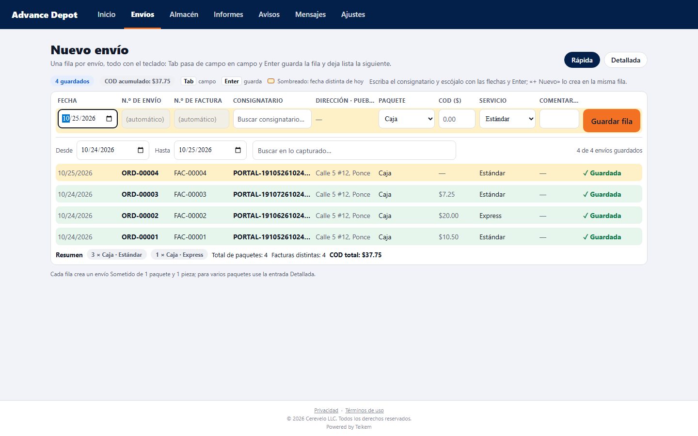

# 30 — Nuevo envío desde el portal del cliente

Lote 105 (portal de clientes, 2026-10-17) y **Lote 213 (2026-10-23, dictado de Luis)**: el «Nuevo envío» del portal tiene **los mismos campos y las mismas funciones que «Nuevo envío» de la web de la compañía** (capítulo 03), salvo lo que no aplica al cliente (el cliente sale de la sesión; no hay precio, autorización de crédito, entrega especial ni «Label al guardar»). El envío **entra directo al flujo normal** (nace Sometido, igual que uno creado por la compañía).

## 1. Quién puede
| Rol de portal | Crear envíos |
|---|---|
| `CLIENT_ADMIN` (administrador) | Sí |
| `CLIENT_OPERATOR` (operador) | Sí |
| `CLIENT_READONLY` (solo consulta) | No: no ve el botón «Nuevo envío»; por API, **403** «Su usuario solo puede consultar; pídale a un administrador de su empresa que le dé permiso para crear envíos.» |

Módulo **CLIENT_PORTAL** encendido. El cliente **sale de la sesión** (nunca del cuerpo): lo que se mande como cliente se ignora, y el envío siempre queda en el cliente de quien entró.

## 2. Dos maneras de entrar
- **Web ancha (computadora):** selector **Rápida / Detallada** arriba a la derecha; se recuerda la última usada (por omisión, Rápida).
- **Celular (app instalada o navegador angosto, menos de 900 px): solo la Detallada.** La rápida es exclusiva de la computadora.

### 2.1 Entrada rápida (web ancha) — todo con el teclado
Una fila por envío (1 paquete, 1 pieza), como la «Entrada rápida» del personal. Columnas (**siempre las mismas que en la rápida de la web de la compañía**): **Fecha** (calendario del navegador; es la fecha lista y la límite), **N.º de envío** y **N.º de factura** (se escriben solo si la compañía deja que el cliente asigne sus números; si no, salen **apagadas con «(automático)»** y Tab las salta, igual que en la web de la compañía), **Consignatario** (buscador con autocompletar: nombre, número, dirección o pueblo), **Dirección · Pueblo** (solo lectura, del elegido), **Tipo de paquete** (desplegable; viene el predeterminado del cliente o de la compañía), **COD**, **Servicio** (desplegable; predeterminado) y **Comentario**.
- **Tab** pasa de campo en campo; **flechas ↑/↓ y Enter** escogen en la lista del consignatario (la última opción es «+ Nuevo consignatario «…»», que abre los campos nombre, dirección, pueblo, estado y código postal en la misma fila); **Enter en cualquier otro campo guarda la fila**.
- La fila guardada queda debajo, de solo lectura, con su conduce (se toca para abrir el envío); la fila nueva conserva **fecha, servicio y tipo de paquete** y el cursor vuelve a la fecha. Arriba: cuántos guardados y el **COD acumulado**.
- Una fila con fecha distinta de hoy se sombrea. Los errores (del cliente o del servidor) salen bajo la fila, marcan el campo y **no borran lo escrito**.

**La tabla de lo capturado: filtros y resumen (2026-10-23).** Debajo de la fila de captura, una barra con dos filtros y, al pie, un resumen:
- **Desde / Hasta:** el rango de fechas que se ve; al abrir los dos son **hoy**. **Capturar un envío con otra fecha ensancha el rango solo**: con una fecha más adelantada el «desde» se queda en hoy y el «hasta» pasa a esa fecha; con una más vieja baja el «desde». Así lo que se acaba de capturar siempre se ve. Si se mueve un extremo a mano nunca queda al revés (el otro lo sigue), y acortar el rango esconde lo de fuera. El contador dice «N de M envíos guardados» (M = todo lo guardado en esta sesión).
- **Buscar en lo capturado:** una caja de texto libre que busca en **cualquier dato** del envío (conduce, número de orden y de factura, consignatario, dirección, tipo de paquete, servicio, COD, comentario, fecha). Con varias palabras deben estar todas; no importan mayúsculas ni acentos. Sin coincidencias sale «Ningún envío guardado coincide con el día y la búsqueda.»
- **Resumen (pie):** «**N × Tipo de paquete · Tipo de servicio**» por cada combinación (la más numerosa primero), **Total de paquetes**, **Facturas distintas** y **COD total** de lo que se está viendo: por ejemplo «8 × Caja · Estándar», «3 × Sobre · Expreso», «Total de paquetes: 11», «Facturas distintas: 9», «COD total: $412.50». Cambia con el rango y la búsqueda. **Facturas distintas** cuenta números, no envíos: en el campo de factura se pueden poner varios **separados por coma** y **cada coma es otro número** («F-2, F-3» son dos); un número repetido (aunque cambie mayúsculas/minúsculas) cuenta una sola vez, y los envíos sin factura no suman.
- Es la misma tabla y el mismo comportamiento que la «Entrada rápida» de la web de la compañía (textos «entradas guardadas» allá).

### 2.2 Entrada detallada (web ancha y celular)
Tres pasos y el **Ticket del envío** (resumen sin precio) a la derecha en la web ancha, o al final en el celular:
- **01 Servicio y fechas:** tipo de servicio (catálogo de la compañía, con el predeterminado), **fecha lista** (de hoy en adelante) y **fecha límite** (no anterior a la lista), N.º de orden y N.º de factura (cada uno solo si el cliente lo asigna; si no, se muestra apagado como «(automático) · Lo asigna la compañía»).
- **02 Consignatario:** buscador con autocompletar; al escoger uno se ven **Número, Dirección, Pueblo, Código postal y Teléfono** de solo lectura. «+ Nuevo» abre los campos del consignatario nuevo (nombre, dirección y pueblo obligatorios). Si el cliente tiene puntos de recogida, el desplegable **Recogida** («Donde se recoge normalmente» por omisión).
- **03 Paquetes y COD:** por paquete, tipo de paquete, descripción, piezas (entero ≥ 1) y peso en kg (opcional); de 1 a 50 paquetes; **COD** opcional.
- **Notas** (hasta 500 caracteres) y un solo **Guardar envío**.

### 2.3 Consignatario que no existe: se escribe y se graba ahí mismo, sin ratón (Lote 213)
En la rápida y en la detallada, al escribir el nombre de un consignatario que no está y pulsar **Enter** (o escoger «+ Nuevo consignatario «…»» al final de la lista) se abre ahí mismo el bloque **Consignatario nuevo** con **Nombre\*, Dirección\*, Pueblo\*, Estado, Código postal y Teléfono (opcional)**:
- El foco cae solo en el primer campo obligatorio que falta (casi siempre la dirección: el nombre ya viene de lo escrito). **Tab** recorre los campos.
- **Enter en cualquier campo del bloque graba el consignatario en el servidor al momento**: si falta nombre, dirección o pueblo, lleva el foco al primero que falta y avisa «Escriba el nombre, la dirección y el pueblo del consignatario.»; si está completo, lo guarda, lo deja **escogido** (con su número y teléfono) y el foco sigue solo: en la rápida, en el **Paquete** de la misma fila; en la detallada, en el **tipo del primer paquete**. **Tab desde el último campo** también graba y sigue. **Esc** cancela.
- Lo de la fila (fecha, número, factura…) no se pierde. Con el bloque abierto y completo, **Enter en otro campo de la fila** graba el consignatario y guarda también el envío de una vez.
- El consignatario queda guardado aunque el envío falle después (por ejemplo, por crédito): no hay que volver a escribirlo, y escribir otra vez su nombre ya lo encuentra en la lista. Si ya existía uno con el mismo nombre y dirección (sin importar mayúsculas ni acentos) se usa ese: **no se duplica**.
- Solo administrador u operador; el teléfono es opcional (si trae un formato que el sistema no entiende, no se crea nada y el error sale en el bloque).

### 2.4 Reglas comunes
- El **tipo de servicio y el tipo de paquete** vienen preseleccionados con el predeterminado del **cliente** (si lo tiene y está habilitado) o de la **compañía**; si la compañía no ofrece catálogo, el servidor usa su predeterminado.
- Si el consignatario nuevo coincide con uno que ya existe, se usa el existente. Nunca se mandan consignatario y nuevo a la vez.
- **No se puede** escoger precio, prioridad ni entrega especial; eso lo decide la compañía por el contrato.

Al crear, se abre la ficha del envío con su conduce y su barra de progreso. Valen las mismas reglas de la web de la compañía: numeración, conduce, crédito, cliente suspendido (422) o dado de baja (409), factura repetida.

## 3. Mensajes de error
| Situación | Código | Mensaje |
|---|---|---|
| Rol de solo consulta | 403 | «Su usuario solo puede consultar; pídale a un administrador de su empresa que le dé permiso para crear envíos.» |
| Sin consignatario | 400 | «Escoja el consignatario o escriba uno nuevo (nombre, dirección y ciudad).» |
| Consignatario y nuevo a la vez | 400 | «Escoja un consignatario o escriba uno nuevo, no las dos cosas.» |
| Sin paquetes | 400 | «Agregue al menos un paquete.» |
| Más de 50 paquetes | 400 | «Un envío puede llevar hasta 50 paquetes.» |
| Notas largas | 400 | «Las notas no pueden pasar de 500 caracteres.» |
| Consignatario nuevo sin nombre | 400 | «El nombre del consignatario es obligatorio.» |
| Consignatario nuevo sin dirección | 400 | «La dirección del consignatario es obligatoria.» |
| Consignatario nuevo sin pueblo | 400 | «El pueblo del consignatario es obligatorio.» |
| Consignatario nuevo con teléfono inválido | 400 | el del teléfono (p. ej. «El valor es obligatorio.» o el del formato del país); no se crea nada |
| Consignatario nuevo con rol de solo consulta | 403 | «Su usuario solo puede consultar; pídale a un administrador de su empresa que le dé permiso para crear envíos.» |
| Fecha límite anterior a la fecha lista | 400 | «La fecha límite no puede ser anterior a la fecha lista.» |
| Fecha lista pasada | 400 | la de la web de la compañía («La fecha pedida no puede ser anterior a hoy.») |
| Servicio o tipo de paquete apagado o inexistente | 400 | «Tipo de servicio desconocido: X.» / «Tipo de paquete desconocido: X.» |
| N.º de orden tecleado cuando lo asigna la compañía | 400 | el de numeración («El número de orden lo asigna Teikem para este cliente; déjelo en blanco.») |
| N.º de factura tecleado cuando lo asigna la compañía | 400 | «El número de factura lo asigna Teikem para este cliente; déjelo en blanco.» |

En pantalla, antes de mandar: «Escoja el tipo de servicio.», «Escoja el tipo de paquete.», «La fecha lista debe ser de hoy en adelante.», «La fecha límite no puede ser anterior a la fecha lista.», «Las piezas deben ser un número entero de 1 o más.», «El peso debe ser un número.», «El cobro debe ser un número.», «El número de orden/factura no puede pasar de 40 caracteres.».

## 4. Endpoints
- `GET /api/v1/portal/order-form`: si puedo crear; mis consignatarios (`code`, dirección, `phone`) y recogidas; `maxPackages`; `clientTypesInvoiceNumber`, `clientAssignsOrderNumber`; `serviceTypes` y `packageTypes` (código y etiqueta en el idioma de la sesión, solo los habilitados para la compañía); `defaultServiceType`, `defaultPackageType`.
- `POST /api/v1/portal/consignees` (Lote 213): `name`, `line1`, `city` obligatorios; `line2`, `state`, `postalCode`, `phone` opcionales. Responde el consignatario como lo ve el formulario (`publicId`, `code`, dirección, `phone`); si ya existía uno igual, responde ese (sin duplicar).
- `POST /api/v1/portal/orders` (cabecera `Idempotency-Key`): `consigneePublicId` **o** `newConsignee`, `pickupPublicId`, `serviceType`, `packages[]` (`packageType`, `description`, `pieces`, `weightKg`), `codAmount`, `orderNumber`, `clientInvoiceNumber`, `requestedDate` (fecha lista), `promisedDate` (fecha límite), `notes`. Responde conduce, número de envío y estatus.
- Ver los envíos: `GET /api/v1/portal/orders` (capítulo 26; desde el Lote 213 con filtro de fecha `fromUtc`/`toUtc` en la pantalla).

## 5. Casos frecuentes
- **El consignatario nuevo se grabó pero el envío no:** es normal si el servidor rechazó el envío (crédito, fecha…): el consignatario ya está en su lista; corrija lo que dice el mensaje y guarde de nuevo.
- **No veo el botón «Nuevo envío»:** su rol es de solo consulta; que la compañía cambie su rol (ficha del cliente → Usuarios de portal, en la web de la compañía).
- **En el teléfono no me sale la entrada rápida:** es así a propósito: en el celular solo existe la detallada. La rápida es de la computadora (ventana de 900 px o más).
- **Tab en la fecha no sale del campo a la primera:** el calendario del navegador recorre mes, día y año con Tab antes de pasar al siguiente campo (comportamiento del navegador).
- **Mi envío aparece «Sometido»:** así nacen todos los envíos (Lote 106): ya está cotizado si su cuenta tiene contrato y tarifa, y mientras siga Sometido se puede corregir; después lo recogen y avanza solo.
- **El desplegable de servicio no trae el que yo uso:** la compañía lo apagó para su cuenta o para todos; pídaselo a la compañía.
