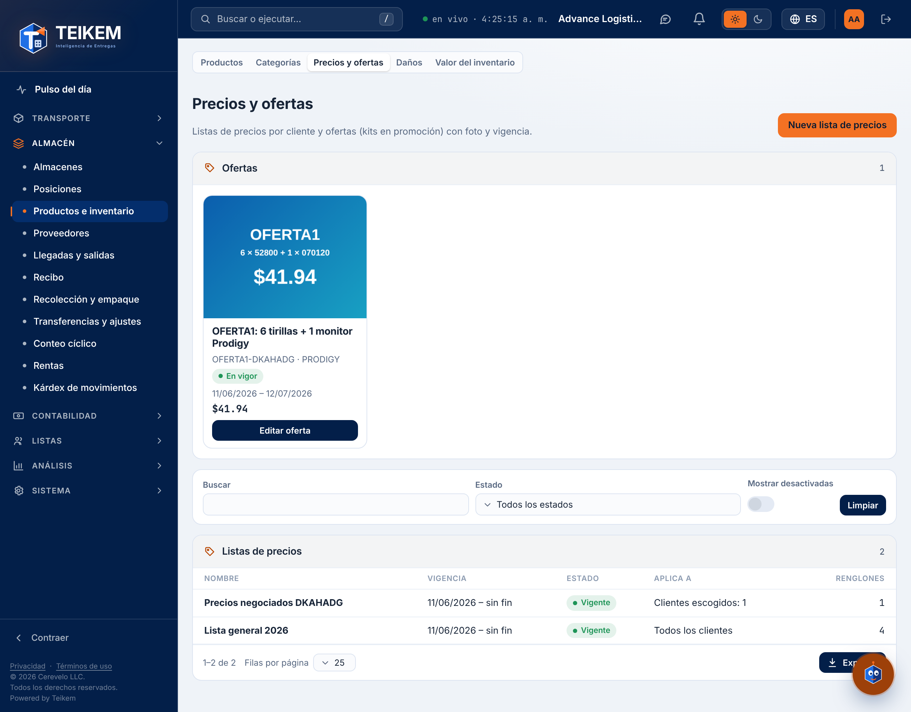
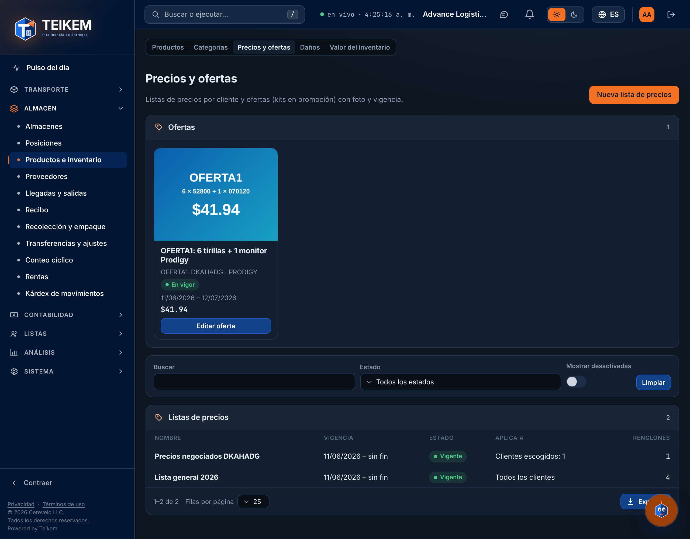
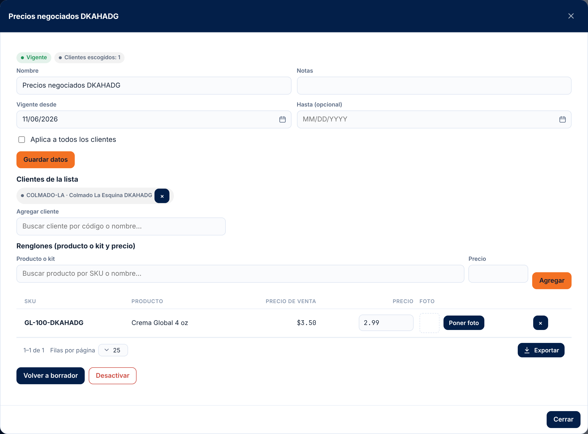

# 47 — Listas de precios y ofertas

<!-- kemi:staff -->

Lote 221 (2026-11-07) — pedido de vendedores, parte P1; **rehecho en el Lote 229 (2026-11-09)**. El **precio de lo que se vende** deja de teclearse: sale de una **lista de precios** que arma el supervisor de ventas o de una **oferta** vigente. Desde el Lote 229 la **oferta es una cosa aparte** de las listas y de los kits, como la circular de una tienda («válido del … al …»): tiene nombre, foto, vigencia y su propio listado de productos o kits con precio de oferta. Ya **no** es un kit marcado como promoción. Este capítulo es para el supervisor de ventas, la oficina y soporte. El pedido que usa estos precios se describe en [48 — Pedido guiado](48-pedido-guiado.md) y la orden en [18 — Órdenes de venta](18-ordenes-de-venta.md).

Los tres conceptos, separados:

| Concepto | Qué es | Lleva ofertas |
|---|---|---|
| **Producto** | Lo que se vende, con su precio de venta. Un **kit es un producto más**, formado por otros productos, con su precio normal; se vende también suelto. | No |
| **Lista de precios** | Los precios de siempre (o negociados por cliente), con vigencia. Se puede manejar una o varias. Al agregar un renglón se escoge un producto o un kit. | **No** |
| **Oferta** | Nombre, foto, vigencia y un listado de productos o kits, cada uno con su precio de oferta. Aplica a todos los clientes o a clientes escogidos. | — |

La pantalla está en **Contabilidad → Precios y ofertas** (`/money/prices`), justo antes de «Ventas». El ítem solo se ve con `sales.pricelist` (Admin de compañía y Supervisor de ventas; el vendedor con solo `sales.view` no la ve). Tiene **dos secciones**: **Ofertas** (arriba, con el botón **Nueva oferta**) y **Listas de precios** (con el botón **Nueva lista de precios**). El enlace viejo `/warehouse/products?tab=prices` lleva a esta pantalla.

> **Capturas pendientes (Lote 229).** Las capturas de abajo son del recorrido del lote 228 (2026-11-07, datos de demostración), cuando la oferta era un kit marcado como promoción. La pantalla ahora tiene las dos secciones, y la ventana de la oferta (datos, foto, clientes, renglones, «Crear kit para esta oferta» y avisos) todavía no tiene captura. Se retomarán con el recorrido de Playwright; la captura `l228-kit-promocion.png` (el antiguo editor del kit con la marca de promoción) ya no corresponde a nada y se dejó de citar.

## 1. Quién puede y dónde

- Módulo **Órdenes de venta (`SALES_ORDERS`)**. Con el módulo apagado todo el API de listas y ofertas responde 403. La foto del producto se rige por el módulo de inventario (`WMS_LOTSERIAL`).
- Permisos:
  - **`sales.view`** — ver ofertas, listas, el catálogo del pedido guiado y **las fotos de los productos** (aunque no se tenga `inventory.view`). La pantalla «Precios y ofertas» en sí exige `sales.pricelist`.
  - **`sales.pricelist`** — crear, publicar, cambiar y desactivar listas **y ofertas**; poner o quitar la foto de la oferta y la de sus renglones; escoger los clientes; crear o cambiar los kits de una oferta. Implica `sales.view`. Lo trae el rol **Supervisor de ventas** (`SalesSupervisor`) y el **Admin de compañía**.
  - **`inventory.manage`** — subir, cambiar o quitar la **foto del producto** (en el editor de producto; ver [06 §2.5](06-inventario-y-almacen.md#25-foto-del-producto-y-categoría-con-subcategoría-lote-229-2026-11-09)).
  - **`sales.price`** — sigue siendo la excepción: escribir en una línea de la orden un precio distinto del que salió de la lista o de la oferta. Solo el Admin de compañía, o quien él designe.
- El Lote 229 **no agregó permisos nuevos**: las ofertas usan `sales.view` y `sales.pricelist`.
- Permiso `sales.pricelist` en compañías que ya existían: se agregó a los roles ya clonados del Admin de compañía; el rol «Supervisor de ventas» lo crea el administrador en Sistema → Roles si la compañía no lo tiene.

## 2. De dónde sale el precio de una línea

Al crear o editar una línea de una orden de venta (y en el pedido guiado), el servidor resuelve el precio así:

1. **Entre el precio negociado del cliente y la oferta vigente, gana el más bajo.** El *negociado* es el precio de una lista **publicada**, **vigente hoy**, que aplica a ese cliente y trae el producto (o el kit). La *oferta* es una oferta **publicada, activa y vigente hoy** que aplica al cliente (todos, o él entre los escogidos) y trae el producto. **A igual precio gana el negociado.**
2. Si el cliente **no** tiene precio negociado: entre la oferta y la **lista general** (publicada, vigente, para todos los clientes) gana el más bajo; sin oferta, la lista general.
3. Si tampoco hay lista: el **precio de venta del producto** (`Product.SalePrice`).
4. Ninguno: el producto **no tiene precio** y la línea se rechaza (ver sección 6).

`priceSource` dice de dónde salió: `OFFER`, `CLIENT_LIST`, `GENERAL_LIST`, `PRODUCT` o `NONE`.

Reglas que conviene saber:
- El vendedor **no teclea precios**. Un precio distinto del resuelto exige `sales.price` (403), salvo que sea el que la línea ya tenía en el borrador.
- La fecha del precio es **hoy**, al crear o editar la línea (no la fecha de la orden). Una orden ya hecha **no cambia** si después cambia la lista o la oferta: la línea guarda su precio.
- Si en un borrador se cambia el cliente sin tocar las líneas, la línea que tenía el precio resuelto del cliente anterior toma el del nuevo; la que tenía un precio excepcional (con `sales.price`) lo conserva.
- Si por datos viejos dos listas del mismo nivel traen el mismo producto en la misma fecha, gana la que empezó más tarde.
- Un **producto normal** que está en una oferta vale el precio de la oferta (si es el más bajo) en el pedido, aunque se pida desde la lista de su marca.

### Avisos de precio (no son errores)

Cuando dos precios chocan, **se cobra siempre el más bajo** y el sistema avisa. Los avisos no impiden guardar, publicar ni enviar el pedido: llegan con código 200.

| Aviso (código) | Cuándo | Dónde se ve | Texto (ejemplo con SKU y precios) |
|---|---|---|---|
| Dos ofertas a la vez (`TWO_OFFERS`) | Un producto está en dos ofertas vigentes para el mismo cliente | Pedido guiado y orden (junto al producto, en la línea del carrito y en el recuadro «Avisos de precio» del paso de entrega) | `El producto GM está en dos ofertas a la vez: «A» a $9.00 y «B» a $11.00. Se aplica la más barata («A»).` Gana la más barata; a igual precio, la que empezó más tarde. |
| Oferta más cara que la lista general (`OFFER_ABOVE_GENERAL`, en el pedido) | El precio de oferta es mayor que el de la lista general vigente | Igual que el anterior | `La oferta «A» pone GM a $12.00, más caro que la lista general ($10.00): se aplica el precio más bajo.` |
| Oferta más cara que la lista general (`OFFER_ABOVE_GENERAL`, al armar la oferta) | Al crear, cambiar o publicar la oferta, un renglón sale más caro que la lista general (vigente cuando la oferta empieza, u hoy si ya empezó) | En la ventana de la oferta, recuadro «Avisos (no impiden guardar ni publicar)» | `El producto GM sale en esta oferta a $12.00, más caro que en la lista general ($10.00): se aplicará el precio más bajo.` |
| Choque con otra oferta más barata (`CHEAPER_OFFER`, al armar la oferta) | Otra oferta **publicada** y activa, en fechas y clientes que se cruzan (una «para todos» se cruza con cualquiera), trae el mismo producto **igual o más barato** | En la ventana de la oferta, en el mismo recuadro | `El producto GM también está en la oferta «B» (del 01/11/2026 al 30/11/2026) a $9.00, igual o más barata que aquí ($10.00): mientras las dos estén vigentes se aplica el precio más bajo.` |

Notas sobre los avisos:
- Los de la oferta (`CHEAPER_OFFER`, `OFFER_ABOVE_GENERAL`) se calculan **al leer** la oferta, en toda respuesta (crear, cambiar, publicar, agregar renglón, abrirla). Una oferta en **borrador** no genera avisos en otras.
- Los del pedido salen en el catálogo (al escoger el producto) y al guardar el borrador. Al volver a abrir un borrador solo quedan los del catálogo, porque los de la orden no se guardan.
- Si lo que cobra el pedido es el precio **negociado** del cliente (más bajo que la oferta), la tarjeta de la oferta lo dice: «Oferta: $9.00. Se cobra su precio negociado, que es más bajo.» (con el precio de la oferta).

## 3. Listas de precios

**Qué hace.** Una lista tiene nombre, vigencia (**desde** obligatorio, **hasta** opcional: vacío = sin fin), notas (hasta 500 caracteres), los **renglones** (producto o kit → precio, con foto opcional) y a quién **aplica**: a todos los clientes (lista general) o solo a clientes escogidos (precios negociados: guantes, cajas, monitor, tirillas). **Una lista no lleva ofertas**: las promociones con vigencia, foto y precio especial van en una oferta (sección 4).

**Quién puede.** Ver: `sales.view`. Todo lo demás: `sales.pricelist`. Módulo `SALES_ORDERS`.

**Cómo se usa (pantalla).** **Contabilidad → Precios y ofertas** → sección **Listas de precios**.
1. **Nueva lista de precios**: nombre, «Vigente desde», «Hasta (opcional)», notas y la casilla «Aplica a todos los clientes». **Crear lista** la deja en **borrador**.
2. En la ventana de la lista: **Guardar datos**; **Renglones** (escoger **producto o kit**, escribir el precio, **Agregar**; cada renglón se puede cambiar de precio, quitar o ponerle foto); **Clientes de la lista** (**Agregar cliente**; solo si no es general).
3. **Publicar**: desde ese momento la lista da precios en sus fechas. **Volver a borrador** la saca de uso. **Desactivar** / **Reactivar** la retiran o la devuelven (nunca se borra).
4. La lista de listas muestra nombre, vigencia, estado (Borrador / Programada / Vigente / Vencida), «Aplica a» y número de renglones; filtra por estado, busca por nombre y puede **Mostrar desactivadas** (el filtro vale para ofertas y listas).

**Cómo se usa (API).** `/api/v1/price-lists`:

| Acción | Llamada | Permiso |
|---|---|---|
| Ver listas (`q`, `state`, `includeInactive`) / una lista | `GET /price-lists` · `GET /price-lists/{publicId}` | `sales.view` |
| Crear en borrador | `POST /price-lists` `{ "name": "Precios negociados: guantes", "validFrom": "2026-11-10", "validTo": null, "appliesToAll": false, "notes": "…" }` | `sales.pricelist` |
| Editar (lo que no viene no cambia; `clearValidTo: true` quita la fecha final) | `PATCH /price-lists/{publicId}` | `sales.pricelist` |
| Publicar / volver a borrador | `POST …/publish` · `POST …/unpublish` | `sales.pricelist` |
| Desactivar / reactivar | `POST …/deactivate` · `POST …/reactivate` | `sales.pricelist` |
| Agregar o cambiar renglones | `POST …/items` `{ "items": [ { "productPublicId": "…", "price": 12.5 } ] }` | `sales.pricelist` |
| Cambiar el precio / quitar un renglón | `PATCH …/items/{itemId}` `{ "price": 11 }` · `DELETE …/items/{itemId}` | `sales.pricelist` |
| Foto del renglón (JPG, PNG, WEBP o GIF) | `POST …/items/{itemId}/image` (multipart `file`) · `DELETE …/items/{itemId}/image` | `sales.pricelist` |
| Agregar / quitar clientes | `POST …/clients` `{ "clientPublicIds": ["…"] }` · `DELETE …/clients/{clientPublicId}` | `sales.pricelist` |

**Campos y reglas.**

| Campo | Regla |
|---|---|
| Nombre | Obligatorio, hasta 120 caracteres. |
| Vigente desde | Obligatorio. |
| Hasta | Opcional; no puede ser anterior al «desde». Los dos extremos cuentan como vigentes. |
| Notas | Hasta 500 caracteres. |
| Aplica a todos los clientes | Una lista general no lleva clientes escogidos; una de clientes necesita al menos uno para publicarse. |
| Renglones | Hasta 2000; solo productos o kits **propios** de la compañía y activos; sin repetir; precio de 0 en adelante con hasta 4 decimales. **Un kit creado para una oferta no entra** en una lista (su precio va en la oferta). |
| Clientes | Hasta 2000; deben ser clientes activos. |
| Foto del renglón | JPG, PNG, WEBP o GIF (se comprueba por el contenido), hasta el tope del almacén de archivos. Por omisión el renglón muestra la foto del producto; si se le pone otra, esa manda. Quitarla solo la desliga: el archivo no se borra. |

**Cruces de listas.** Dos listas **publicadas** de la misma audiencia (dos generales, o dos de clientes que comparten un cliente) no pueden dar precio al mismo producto en fechas que se cruzan: el servidor lo rechaza con 409 y cita hasta 5 SKU. Una lista general y una de clientes **sí** pueden traer el mismo producto (gana la del cliente). Los cruces se comprueban al publicar y en cada cambio de una lista publicada (fechas, renglones, clientes, reactivar). Una lista de temporada encima de la base se permite si no repite productos. (Las **ofertas** no se cruzan con las listas ni entre sí en forma de error: sus choques son avisos, sección 2.)

## 4. Ofertas

### 4.1 Qué es una oferta

Una **oferta** es una entidad aparte con: **nombre** (hasta 120 caracteres), **foto**, **vigencia** («Vale desde» obligatorio, «Hasta» opcional), **notas** (hasta 500), a quién **aplica** (todos los clientes o clientes escogidos) y sus **renglones** (hasta 500). Cada renglón es un **producto o kit que ya existe** con su precio de oferta, o un **kit creado para esa oferta** (4.4). Nace en **borrador** y solo da precios cuando se **publica** y está vigente.

**Sin fecha de fin.** Si «Hasta» queda en blanco, **la oferta no vence**: vale hasta que alguien la desactive o la regrese a borrador. La pantalla lo avisa en dos lugares: en la tarjeta («Sin fecha de fin: vale hasta que la desactive») y en la ventana, debajo del campo («“Hasta” está en blanco: la oferta no tiene fecha de fin y vale hasta que la desactive.»). Revise esto antes de publicar una oferta de temporada.

### 4.2 Quién puede

Ver las ofertas: `sales.view`. Crear, cambiar, publicar, desactivar, poner fotos, escoger clientes y crear kits de la oferta: `sales.pricelist`. Módulo `SALES_ORDERS`. El Lote 229 no agregó permisos.

### 4.3 Cómo se usa (pantalla)

**Contabilidad → Precios y ofertas → Ofertas.** Cada oferta es una tarjeta con su foto, nombre, estado, vigencia, a quién aplica y número de renglones. Se abre con un clic.

1. **Nueva oferta** → ventana con **Nombre de la oferta**, **Notas**, **Vale desde**, **Hasta (en blanco = sin fecha de fin)** y la casilla **Aplica a todos los clientes**. **Crear oferta** la guarda en **borrador** («Oferta creada: agregue su foto y sus renglones.»).
2. **Foto de la oferta**: subir, cambiar o quitar (sección 5).
3. **Clientes de la oferta**: solo si se desmarcó «Aplica a todos los clientes» (**Agregar cliente**; la oferta necesita al menos uno para publicarse).
4. **Renglones** (hay dos maneras, y la pantalla lo explica: «Dos maneras de agregar: escoja un producto o kit que ya existe y póngale su precio de oferta, o cree un kit solo para esta oferta.»):
   - **Escoger un producto o kit**: se busca por SKU o nombre y se escribe el **precio de oferta**; el renglón muestra al lado el precio de la lista general para comparar. El precio se cambia en su celda (al salir del campo) y el renglón se quita con su botón.
   - **Crear kit para esta oferta**: abre una ventana con **SKU del kit**, **Nombre del kit**, **Precio de oferta del kit** y **Piezas del kit** (producto y cantidad; **Agregar pieza**); cada pieza lleva la casilla **No sustituible**. La ventana muestra la «Suma de las piezas a su precio de venta», el «Ahorro para el cliente» (o «Ojo: la oferta sale … más cara que las piezas sueltas.»). **Crear kit** crea el producto, sus piezas y el renglón de un solo paso.
   - Ejemplo: el kit normal es monitor + agujas; el kit de la oferta es monitor + agujas + tirillas, «al precio de las dos» (o las tirillas a mitad de precio).
5. **Foto por renglón**: por omisión el renglón muestra la foto del producto; **Poner otra foto** la cambia y **Volver a la del producto** la quita.
6. **Publicar** (la oferta empieza a dar precios en sus fechas), **Volver a borrador**, **Desactivar** (pide confirmar: «La oferta deja de aplicarse en los pedidos nuevos y sus kits de oferta dejan de venderse. Los pedidos ya hechos no cambian y se puede reactivar.») y **Reactivar**.
7. Los **avisos** (sección 2) salen en el recuadro «Avisos (no impiden guardar ni publicar)». No son errores.

El estado se ve en la tarjeta: **Borrador**, **Publicada (todavía no empieza)**, **Vigente**, **Vencida** o **Desactivada**, y, aparte, el chip **Se aplica hoy** cuando la oferta está dando precios.

### 4.4 Kits de una oferta

Un **kit creado para una oferta** es un producto de verdad (con SKU, piezas y cantidades, y se ve en Productos e inventario), pero **queda atado a su oferta**:

- **Solo se vende mientras su oferta esté publicada, activa y vigente.** Fuera de eso no sale en el catálogo del pedido y pedirlo da el error 422 de la sección 6.
- Al **terminar** la oferta, el kit **queda inactivo para la venta**: no se borra ni se da de baja, y las órdenes y facturas que lo usaron lo siguen viendo. Si la oferta se **extiende** (se cambia o se quita su fecha de fin) o se reactiva, el kit **vuelve a estar disponible**. Lo mismo pasa si la oferta vuelve a borrador o se desactiva: el kit sale de la venta mientras tanto.
- Nace **no ajustable** («Ajustable al pedir» desmarcado). Sus piezas se pueden **sustituir** al pedir, salvo las marcadas «No sustituible» (ver [18 §17.1](18-ordenes-de-venta.md#171-cambiar-una-pieza-del-kit-al-pedir-lote-230)). La marca se puede poner desde la ventana de la oferta (al crear o cambiar el kit) y desde el editor del kit en Productos ([06 §8b.3b](06-inventario-y-almacen.md#8b3b-no-sustituible-lote-230-2026-11-09)).
- **No se pone en una lista de precios ni en otra oferta**: su precio va en su oferta.
- **«Cambiar kit»** (en el renglón) cambia el **nombre** y las **piezas**; el SKU no cambia y el precio se cambia en el renglón. Solo se cambia desde **su** oferta (o desde Productos), no desde otra.
- Si se quita su renglón, el kit sigue atado a la oferta; mientras la oferta valga, se vendería a su precio de venta (que, si no se dio otro, es el precio de oferta con el que se creó).
- La categoría y la categoría de impuesto del kit salen de la primera pieza (la categoría solo si no se da otra).

### 4.5 Cómo se usa (API)

`/api/v1/offers` (módulo `SALES_ORDERS`):

| Acción | Llamada | Permiso |
|---|---|---|
| Ver ofertas (`q`, `state`, `includeInactive`) / una oferta | `GET /offers` · `GET /offers/{publicId}` | `sales.view` |
| Crear (nace en borrador) | `POST /offers` `{ "name": "Circular de noviembre", "validFrom": "2026-11-10", "validTo": null, "appliesToAll": true, "notes": "…" }` | `sales.pricelist` |
| Editar (lo que no viene no cambia; `clearValidTo: true` quita la fecha final) | `PATCH /offers/{publicId}` | `sales.pricelist` |
| Publicar / volver a borrador | `POST …/publish` · `POST …/unpublish` | `sales.pricelist` |
| Desactivar / reactivar | `POST …/deactivate` · `POST …/reactivate` | `sales.pricelist` |
| Foto de la oferta (JPG, PNG o WEBP) | `POST …/image` (multipart `file`) · `DELETE …/image` | `sales.pricelist` |
| Agregar o cambiar renglones | `POST …/items` `{ "items": [ { "productPublicId": "…", "price": 9.5 } ] }` | `sales.pricelist` |
| Cambiar el precio / quitar un renglón | `PATCH …/items/{itemId}` `{ "price": 9 }` · `DELETE …/items/{itemId}` | `sales.pricelist` |
| Foto del renglón | `POST …/items/{itemId}/image` (multipart) · `DELETE …/items/{itemId}/image` | `sales.pricelist` |
| Agregar / quitar clientes | `POST …/clients` `{ "clientPublicIds": ["…"] }` · `DELETE …/clients/{clientPublicId}` | `sales.pricelist` |
| Crear un kit para la oferta | `POST …/kits` `{ "sku": "OFERTA1", "name": "Monitor + agujas + tirillas", "price": 41.94, "components": [ { "productPublicId": "…", "quantity": 1, "notSubstitutable": false } ] }` → `{ productPublicId, sku, offer }` | `sales.pricelist` |
| Cambiar un kit de la oferta (nombre y/o piezas) | `PUT …/kits/{productPublicId}` `{ "name": "…", "components": [ … ] }` | `sales.pricelist` |

Claves de la respuesta de una oferta: `hasEndDate` (false = sin fecha de fin) y `validityText` («desde el 09/11/2026, sin fecha de fin» o «del … al …»); `state` (`DRAFT`, `SCHEDULED`, `ACTIVE`, `EXPIRED`); `inEffect` (se aplica hoy); `warnings[]` (los avisos); y, por renglón, `isOfferKit`, `generalListPrice`, `imagePublicId` (foto propia) y `effectiveImagePublicId` (la que se muestra).

### 4.6 Campos y reglas de la oferta

| Campo | Regla |
|---|---|
| Nombre | Obligatorio, hasta 120 caracteres. |
| Vale desde | Obligatorio. |
| Hasta | Opcional; en blanco = no vence. No puede ser anterior al «desde». Los dos extremos cuentan como vigentes. |
| Notas | Hasta 500 caracteres. |
| Aplica a todos los clientes | Una oferta para todos no lleva clientes escogidos; una de clientes escogidos necesita al menos uno para publicarse y para seguir publicada. |
| Renglones | Hasta 500; productos o kits **propios** de la compañía y activos; sin repetir; precio de 0 en adelante con hasta 4 decimales. Si el producto ya está en la oferta, se le cambia el precio. Un kit de **otra** oferta no entra. |
| Clientes | Hasta 2000; deben ser clientes activos. |
| Foto | JPG, PNG o WEBP (sección 5). |

## 5. Fotos: del producto, del renglón y del kit

**La foto se guarda en el producto** (kits y kits de oferta incluidos) y se pone en el editor de producto, bloque **Foto** ([06 §2.5](06-inventario-y-almacen.md#25-foto-del-producto-y-categoría-con-subcategoría-lote-229-2026-11-09)). Los renglones de listas y ofertas traen **por omisión la foto del producto**, y se les puede poner otra.

**Cuál se muestra** (en la pantalla de precios y ofertas, en el catálogo del pedido guiado y en el cuadrito del producto), en este orden:
1. La foto del **renglón** (de la lista o de la oferta), si se le puso una.
2. La foto del **producto**.
3. Si es un **kit sin foto**, la de la **primera pieza (por orden) que tenga foto**.
4. Ninguna: el cuadrito sale vacío.

Quitar la foto de un renglón hace que vuelva a mostrarse la del producto.

| Quién | Qué puede |
|---|---|
| `sales.view` | **Ver** la foto de cualquier producto (también la de renglones y ofertas), **aunque no tenga `inventory.view`**. Los demás archivos del producto siguen exigiendo `inventory.view`. |
| `inventory.manage` | Subir, cambiar o quitar la **foto del producto** (la misma persona que edita el producto). |
| `sales.pricelist` | Subir, cambiar o quitar la foto de la **oferta**, la de sus **renglones** y la de los renglones de las **listas**. |

Reglas de la foto: **JPG, PNG o WEBP** (se comprueba por el contenido, no por la extensión; las listas de precios siguen aceptando también GIF en su renglón). El tope de tamaño es el del almacén de archivos (10 MB por omisión). Una foto con el lado mayor de más de **1200 px** se **reduce a 1200 px** en su mismo formato; si no se puede leer o reducir, se guarda tal cual. Quitar una foto solo la desliga: el archivo no se borra. Las fotos de promoción que ya existían (antes del Lote 229) se copiaron a la foto del producto donde faltaba. La importación de productos no tiene columna de foto.

El contenido de la foto se baja con `GET /files/{imagePublicId}`. `GET /api/v1/products/{publicId}/image` (`inventory.view` o `sales.view`) dice cuál es la foto propia (`imagePublicId`) y cuál se muestra (`effectiveImagePublicId`); `POST` / `DELETE` del mismo recurso (`inventory.manage`) la ponen o la quitan.

## 6. El catálogo del pedido

`GET /api/v1/sales-orders/catalog?clientPublicId=<cliente>` (`sales.view`) alimenta el pedido guiado: las **marcas** (`Product.Brand`) con productos activos, y por marca sus **ofertas vigentes** (tarjetas con foto) y la **lista completa** de productos y kits, cada uno con el precio ya resuelto para el cliente. Sin `clientPublicId`, los precios de la lista general y las ofertas para todos.

- Solo productos propios, activos y **sin número de serie**.
- Las marcas se agrupan sin distinguir mayúsculas; los productos sin marca van al final (`brand = null`).
- **Ofertas de una marca** = los renglones de ofertas publicadas y vigentes que aplican al cliente, **uno por producto** (el de la oferta más barata). Un **kit de oferta solo sale como tarjeta**, y solo mientras su oferta valga. Un **producto normal en oferta** sale como tarjeta **y además** en la lista de su marca, con el precio resuelto.
- `isPromotion` = el producto está en una oferta vigente para el cliente; `price` y `priceSource` = lo que se cobrará (`OFFER`, o `CLIENT_LIST` si el negociado es más bajo); `offerPrice` = el precio de la oferta; `offerName`, `offerValidFrom`, `offerValidTo` = de qué oferta y hasta cuándo; `imagePublicId` = la foto ya resuelta (sección 5); `notices[]` = los avisos (sección 2) con su texto listo.
- `priceSource` `NONE` = **sin precio**: no se puede pedir sin `sales.price`.
- Cliente inexistente: 404 «Cliente no encontrado.»; cliente inactivo: 422 «El cliente está inactivo; no se le puede vender.»
- En la orden, la respuesta de crear o editar el borrador con líneas trae `linePrices[]` (de dónde salió cada precio y sus avisos); no se guarda en la base.

## 7. Validaciones y mensajes

**Listas de precios.**

| Campo / situación | Regla | Mensaje exacto | HTTP |
|---|---|---|---|
| Cuerpo | Obligatorio | `El cuerpo de la solicitud es obligatorio.` | 400 |
| Nombre de la lista | Obligatorio | `Indique el nombre de la lista de precios.` | 400 (`name`) |
| Nombre de la lista | Hasta 120 | `El nombre de la lista no puede pasar de 120 caracteres.` | 400 |
| Vigente desde | Obligatorio | `Indique desde qué fecha vale la lista.` | 400 (`validFrom`) |
| Hasta | No antes de «desde» | `La fecha «hasta» no puede ser anterior a la fecha «desde».` | 400 (`validTo`) |
| Notas | Hasta 500 | `Las notas no pueden pasar de 500 caracteres.` | 400 |
| Lista inexistente | — | `Lista de precios no encontrada.` | 404 |
| Renglón inexistente | — | `Renglón de la lista no encontrado.` | 404 |
| Lista desactivada | No se cambia | `La lista de precios está desactivada: reactívela para cambiarla.` | 422 |
| Renglones | Al menos uno | `Indique los productos y sus precios.` | 400 (`items`) |
| Renglones | Hasta 2000 | `Una lista admite como máximo 2000 renglones.` | 400 |
| Renglón sin producto | — | `Escoja el producto o kit de cada renglón.` | 400 |
| Renglón sin precio | — | `Indique el precio de cada renglón.` | 400 |
| Precio | 0 o más; hasta 4 decimales | `El precio no es válido.` / `El precio admite como máximo 4 decimales.` | 400 |
| Producto repetido | — | `El producto {SKU} viene repetido.` | 400 |
| Producto de un cliente de paso | Solo propios | `Solo se ponen en una lista productos propios de la compañía.` | 422 |
| Producto inactivo | — | `El producto {SKU} está inactivo: no se puede poner en la lista.` | 422 |
| Kit de una oferta | Su precio va en la oferta | `El kit {SKU} es de la oferta «{nombre}»: su precio va en la oferta, no en una lista de precios.` | 422 |
| Producto inexistente | — | `Producto no encontrado.` | 404 |
| Clientes | Al menos uno al agregar | `Escoja los clientes de la lista.` | 400 (`clientPublicIds`) |
| Clientes | Hasta 2000 | `Una lista admite como máximo 2000 clientes.` | 400 |
| Cliente inexistente | — | `Cliente no encontrado.` | 404 |
| Cliente inactivo | — | `El cliente está inactivo; no se le puede vender.` | 422 |
| Cliente que no está en la lista | — | `Cliente de la lista no encontrado.` | 404 |
| Clientes en una lista general | — | `La lista aplica a todos los clientes: no lleva clientes escogidos. Desmarque «aplica a todos» para escogerlos.` | 422 |
| Hacer general una lista con clientes | — | `La lista tiene clientes escogidos: quítelos antes de hacerla general (aplica a todos).` | 422 |
| Publicar sin renglones | — | `Agregue al menos un renglón antes de publicar la lista.` | 422 |
| Publicar sin clientes (y no general) / quitar el último cliente de una publicada | — | `Escoja al menos un cliente o marque que la lista aplica a todos los clientes.` | 422 |
| Publicar una publicada | — | `La lista ya está publicada.` | 422 |
| Volver a borrador un borrador | — | `La lista ya está en borrador.` | 422 |
| Desactivar / reactivar lo que ya está así | — | `La lista ya está desactivada.` / `La lista ya está activa.` | 422 |
| Cruce con otra lista publicada | Sin precios dobles | `La lista se cruza con «{otra}» en las mismas fechas y para los mismos clientes en: {SKU, …} y N más. Cambie las fechas o quite esos productos de una de las dos.` | 409 |
| Dos personas guardan a la vez | — | `La lista cambió al mismo tiempo. Recárguela e intente de nuevo.` | 409 |
| Foto sin archivo | — | `Adjunte la foto.` | 400 (`file`) |
| Foto del renglón que no es imagen | — | `La foto debe ser una imagen (JPG, PNG, WEBP o GIF).` | 400 |
| Foto demasiado grande | — | `El archivo no puede pasar de {n} MB.` | 400 |

**Ofertas.**

| Campo / situación | Regla | Mensaje exacto | HTTP |
|---|---|---|---|
| Cuerpo | Obligatorio | `El cuerpo de la solicitud es obligatorio.` | 400 |
| Nombre de la oferta | Obligatorio | `Indique el nombre de la oferta.` | 400 (`name`) |
| Nombre de la oferta | Hasta 120 | `El nombre de la oferta no puede pasar de 120 caracteres.` | 400 (`name`) |
| Vale desde | Obligatorio | `Indique desde qué fecha vale la oferta.` | 400 (`validFrom`) |
| Hasta | No antes de «desde» | `La fecha «hasta» de la oferta no puede ser anterior a la fecha «desde».` | 400 (`validTo`) |
| Notas | Hasta 500 | `Las notas no pueden pasar de 500 caracteres.` | 400 (`notes`) |
| Oferta inexistente | — | `Oferta no encontrada.` | 404 |
| Renglón inexistente | — | `Renglón de la oferta no encontrado.` | 404 |
| Cliente que no está en la oferta | — | `Cliente de la oferta no encontrado.` | 404 |
| Kit inexistente (al cambiarlo) | — | `Kit de la oferta no encontrado.` | 404 |
| Oferta desactivada | No se cambia | `La oferta está desactivada: reactívela para cambiarla.` | 422 |
| Renglones | Al menos uno | `Indique los productos y sus precios de oferta.` | 400 (`items`) |
| Renglones | Hasta 500 | `Una oferta admite como máximo 500 renglones.` | 400 (`items`) |
| Renglón sin producto | — | `Escoja el producto o kit de cada renglón.` | 400 |
| Renglón sin precio | — | `Indique el precio de oferta de cada renglón.` | 400 |
| Precio | 0 o más; hasta 4 decimales | `El precio no es válido.` / `El precio admite como máximo 4 decimales.` | 400 (`price`) |
| Producto repetido | — | `El producto {SKU} viene repetido.` | 400 |
| Producto de un cliente de paso | Solo propios | `Solo se ponen en una oferta productos propios de la compañía.` | 422 |
| Producto inactivo | — | `El producto {SKU} está inactivo: no se puede poner en la oferta.` | 422 |
| Kit de otra oferta | — | `El kit {SKU} es de la oferta «{nombre}»: no se puede poner en otra.` | 422 |
| Producto inexistente | — | `Producto no encontrado.` | 404 |
| Clientes | Al menos uno al agregar | `Escoja los clientes de la oferta.` | 400 (`clientPublicIds`) |
| Clientes | Hasta 2000 | `Una oferta admite como máximo 2000 clientes.` | 400 |
| Cliente inexistente | — | `Cliente no encontrado.` | 404 |
| Cliente inactivo | — | `El cliente está inactivo; no se le puede vender.` | 422 |
| Clientes en una oferta para todos | — | `La oferta aplica a todos los clientes: no lleva clientes escogidos. Desmarque «aplica a todos» para escogerlos.` | 422 |
| Hacer «para todos» una oferta con clientes | — | `La oferta tiene clientes escogidos: quítelos antes de hacerla general (aplica a todos).` | 422 |
| Publicar sin renglones | — | `Agregue al menos un renglón antes de publicar la oferta.` | 422 |
| Publicar sin clientes (y no es para todos) / quitar el último cliente de una publicada / desmarcar «aplica a todos» en una oferta ya publicada (todavía no tiene clientes) | — | `Escoja al menos un cliente o marque que la oferta aplica a todos los clientes.` | 422 |
| Publicar una publicada | — | `La oferta ya está publicada.` | 422 |
| Volver a borrador un borrador | — | `La oferta ya está en borrador.` | 422 |
| Desactivar / reactivar lo que ya está así | — | `La oferta ya está desactivada.` / `La oferta ya está activa.` | 422 |
| Dos personas guardan a la vez | — | `La oferta cambió al mismo tiempo. Recárguela e intente de nuevo.` | 409 |
| Kit de oferta sin precio | — | `Indique el precio de oferta del kit.` | 400 (`price`) |
| Kit de oferta sin piezas | — | `Un kit necesita al menos un componente.` | 400 (`components`) |
| Kit de oferta con SKU repetido | — | `Ya existe un producto con ese SKU para ese dueño.` | 409 |
| Piezas inválidas del kit | Las de siempre de los kits | Ver [06 §8b.3](06-inventario-y-almacen.md#8b3-reglas-y-mensajes) | 400 |
| Cambiar un kit desde otra oferta | — | `Ese kit no es de esta oferta: cámbielo desde su propia oferta o desde Productos.` | 422 |
| Foto de la oferta o del renglón sin archivo | — | `Adjunte la foto.` | 400 (`file`) |
| Foto que no es JPG, PNG o WEBP | — | `La foto debe ser una imagen JPG, PNG o WEBP.` | 400 (`file`) |
| Foto demasiado grande | — | `El archivo no puede pasar de {n} MB.` | 400 |
| Almacén de archivos sin configurar | — | `El almacén de archivos no está configurado (Files:MasterKey); avise a soporte.` | 422 |

**Pedido y permisos.**

| Campo / situación | Regla | Mensaje exacto | HTTP |
|---|---|---|---|
| Pedir un kit de oferta fuera de vigencia | Solo se vende con la oferta publicada y vigente | `El kit {SKU} es de la oferta «{nombre}», que {motivo}: no se puede vender.` con motivo = `está desactivada` · `está en borrador` · `todavía no empieza (vale del dd/MM/yyyy al dd/MM/yyyy)` · `ya terminó (valía del dd/MM/yyyy al dd/MM/yyyy)`. Si no tiene fin: `desde el dd/MM/yyyy, sin fecha de fin`. | 422 |
| Producto sin ningún precio | — | `El producto {SKU} no tiene precio de venta: escriba el precio.` | 400 |
| Precio distinto del resuelto sin `sales.price` | — | `Cambiar el precio exige el permiso de precios (sales.price).` | 403 |
| Sin el permiso | — | `Falta el permiso 'sales.pricelist'.` | 403 |
| Módulo apagado | — | `El módulo 'SALES_ORDERS' no está habilitado para esta compañía.` | 403 |

Los mensajes de la foto del producto (`Adjunte la foto.`, `La foto debe ser una imagen JPG, PNG o WEBP.`) también salen al subirla desde el editor del producto.

## 8. Estatus y transiciones

Ni la lista ni la oferta **usan el motor de estatus**: su estado sale de «publicada» y de las fechas, y solo se auditan publicar, volver a borrador y desactivar (bitácora `PRICE_LIST` y `OFFER`).

| Estado que se ve | Cuándo | ¿Da precios en pedidos nuevos? |
|---|---|---|
| **Borrador** | No está publicada | No |
| **Programada** (en la oferta: «Publicada (todavía no empieza)») | Publicada, «desde» es futuro | No (todavía) |
| **Vigente** | Publicada y hoy cae entre «desde» y «hasta» (sin «hasta»: desde «desde» en adelante) | Sí |
| **Vencida** | Publicada y «hasta» ya pasó (una oferta sin «hasta» nunca vence) | No |
| **Desactivada** | `IsActive = 0` (cualquiera de las anteriores) | No; no se puede cambiar |

Transiciones de la **lista** y de la **oferta** (las mismas, con los mensajes de la sección 7):

| De → a | Quién | Qué valida | Efecto |
|---|---|---|---|
| Borrador → Publicada | `sales.pricelist` | Al menos un renglón; clientes escogidos si no es para todos. En la lista, además, sin cruces con otras publicadas | Empieza a dar precios en su vigencia. En la oferta, sus kits de oferta se pueden vender |
| Publicada → Borrador | `sales.pricelist` | Que esté publicada | Deja de dar precios a los pedidos nuevos; los ya hechos no cambian. Los kits de la oferta salen de la venta |
| Cualquiera → Desactivada | `sales.pricelist` | Que esté activa | Igual que borrador, y queda sin edición |
| Desactivada → Activa | `sales.pricelist` | Que esté desactivada; en la lista, si estaba publicada, que no se cruce con otra | Vuelve a su estado anterior |

Qué bloquea cada estado: una lista u oferta **desactivada** no se edita (ni renglones, ni clientes, ni fotos, ni kits) hasta reactivarla; una **publicada** sí se edita (en la lista, cada cambio vuelve a comprobar los cruces; en la oferta, los choques solo avisan); borrador, programada y vencida no afectan precios. Un **kit de oferta** solo se vende con su oferta publicada, activa y vigente.

## 9. Preguntas frecuentes del módulo

- **El vendedor ve el producto «Sin precio» en el pedido.** No hay lista vigente (del cliente ni general) ni oferta que lo traiga, y el producto no tiene precio de venta. Póngalo en una lista publicada y vigente, o dele precio de venta al producto.
- **Publiqué la lista y el pedido sigue con el precio de antes.** Revise la vigencia (¿empieza más adelante?), que no esté en borrador o desactivada, y que el cliente esté en la lista si no es general. Un pedido ya hecho no cambia.
- **Dos precios para el mismo producto.** Entre el precio negociado del cliente y una oferta vigente gana el más bajo; sin oferta, una lista del cliente gana a la general. Dos listas de la misma audiencia no pueden coexistir: el servidor lo rechaza con el 409 de cruce.
- **La oferta no aparece en el pedido.** Debe estar **publicada**, **activa**, vigente hoy y aplicar al cliente (para todos, o él entre los escogidos). Un kit de la oferta solo sale mientras la oferta valga.
- **Dejé «Hasta» en blanco.** La oferta no vence. Desactívela o póngale fecha cuando termine la promoción.
- **Salió un aviso amarillo en la oferta.** Es un aviso de precio, no un error: otra oferta igual o más barata coincide, o el precio sale más caro que la lista general. Se cobra el más bajo; revise si es lo que quería.
- **Quitar un cliente de una lista u oferta publicada falla.** Es el último y no es general / para todos: agregue otro o pásela a borrador primero.
- **No encuentro el kit de la oferta en el pedido.** Revise que la oferta esté publicada y vigente (el kit sigue activo en Productos, pero no se vende fuera de la vigencia).

Todos los mensajes anteriores están en la [FAQ del Lote 221](faq.md#lote-221--listas-de-precios-y-ofertas) (listas) y en la [FAQ del Lote 229](faq.md#lote-229--ofertas-como-entidad-aparte-kits-de-oferta-y-foto-del-producto) (ofertas, avisos y fotos).

## 10. Para soporte

- Listas: tablas `PriceList`, `PriceListItem` y `PriceListClient`; EntityType `PRICE_LIST` y el permiso `sales.pricelist` (sección «2026-11-07 — Lote 221» de `Diseño/logistica-db-update.sql`; propagación a roles clonados con la marca `L221_SALES_PRICELIST`).
- Ofertas (Lote 229): tablas `Offer`, `OfferItem` y `OfferClient`; EntityType `OFFER`; columnas `Product.ImageFileId` (foto del producto) y `Product.OfferId` (kit creado para una oferta, con índice filtrado); sección «2026-11-09 — Lote 229» del mismo archivo (idempotente). Sin permisos nuevos.
- Las columnas `Product.IsPromotion`, `PromoFrom`, `PromoTo` y `PromoImageFileId` **ya no se leen**: se quedan en la base sin uso (la foto de promoción se copió a `ImageFileId` donde faltaba). Una «promoción» vencida ya no bloquea ventas.
- Las listas y las ofertas se exponen por `PublicId` y nunca se borran. Los cambios quedan en la bitácora (entidades `PRICE_LIST` y `OFFER`).
- Las fotos son archivos (clase DOCUMENT) cifrados en el almacén de archivos; se ven con `GET /files/{publicId}`. La foto del producto es un archivo del producto; la de la oferta y la de sus renglones tienen como dueño la oferta (`OFFER`).
- La reducción a 1200 px usa SkiaSharp; en un servidor Linux sin su librería nativa la foto se guarda tal cual (sin reducir).
- Un kit de oferta «inactivo» es **calculado** (el producto sigue con `IsActive = 1`): vuelve solo al extender la oferta.
- Scripts de Solutions: `02-kit-oferta1.sql` crea la oferta «OFERTA1» (publicada, para todos, desde hoy en hora de Puerto Rico y sin fecha de fin) con su kit; `06-lista-precios-inicial.sql` ya no pone OFERTA1 en la lista general. Detalle en `docs/lote229-decisiones.md`.
