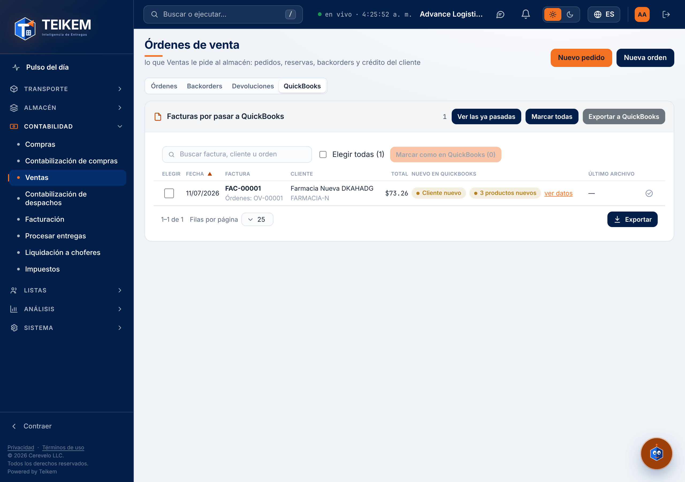
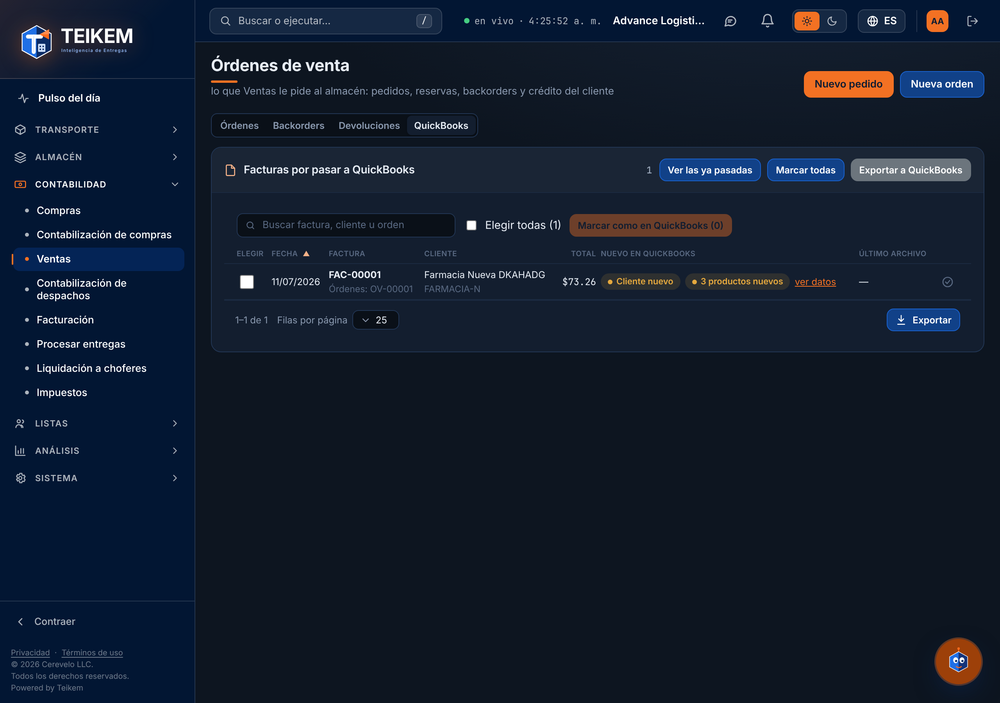
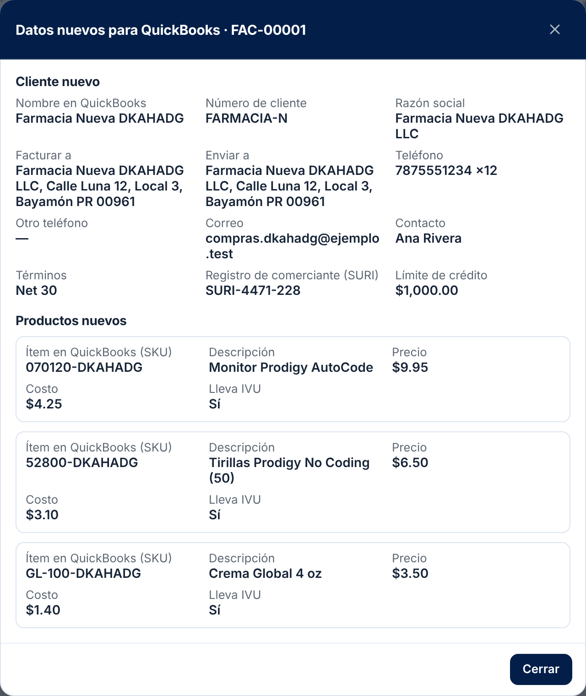
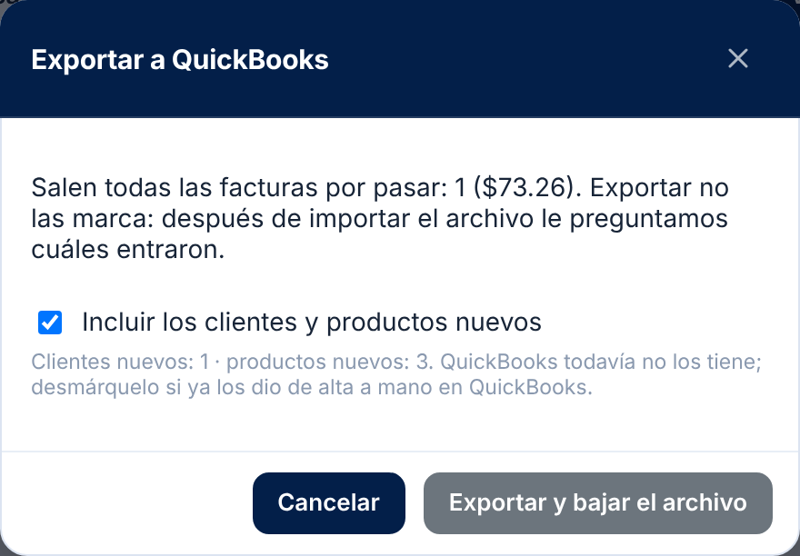
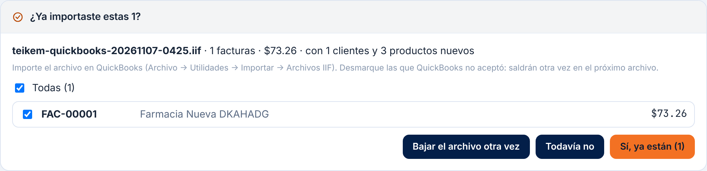
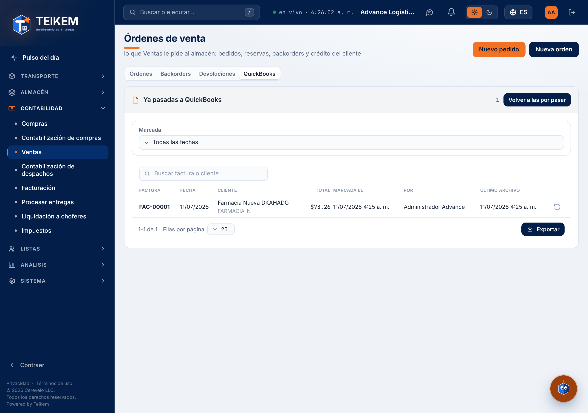
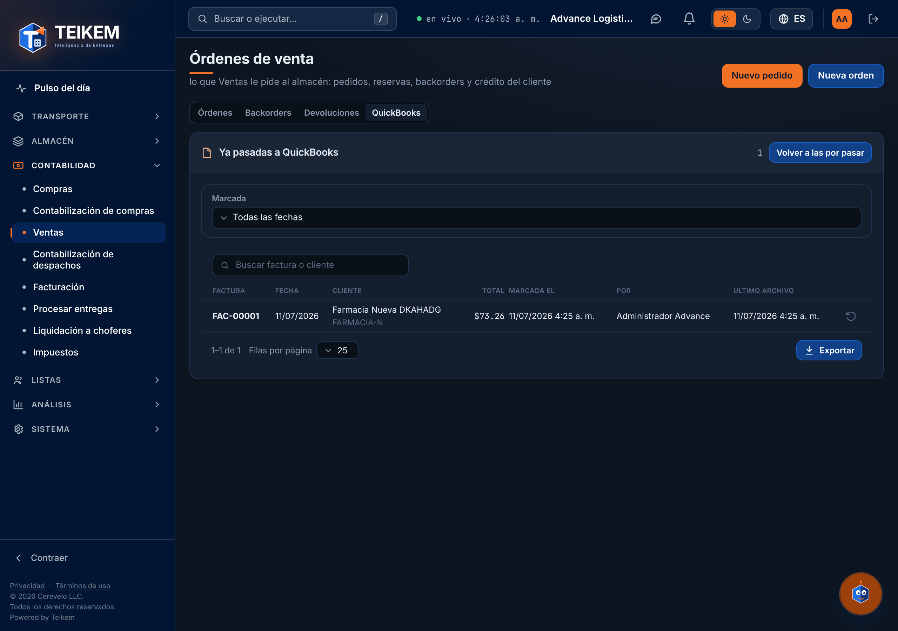
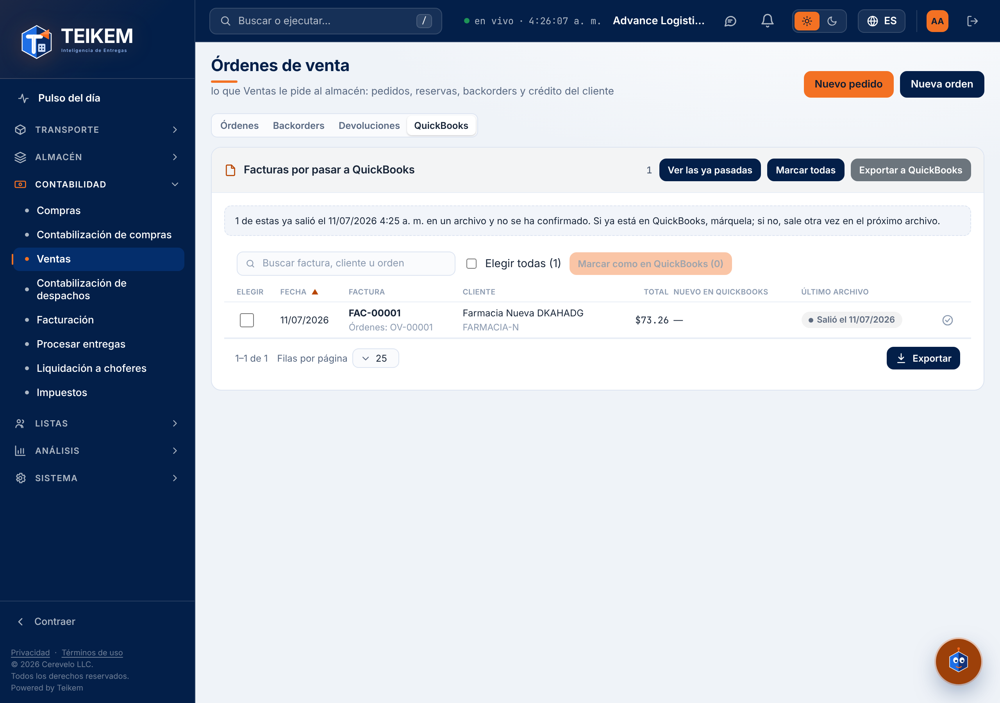
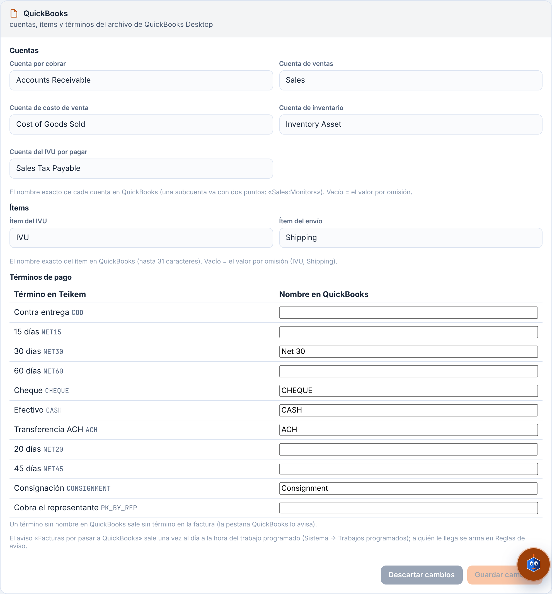

# 49 — Facturas a QuickBooks (archivo IIF)

<!-- kemi:staff -->

Lote 225 (2026-11-07) — pedido de vendedores, parte P5. La oficina pasa a **QuickBooks Desktop** las **facturas de venta emitidas** con un archivo **IIF** que Teikem arma, y deja constancia de cuáles ya entraron. No hay conexión directa con QuickBooks: Teikem baja el archivo y la oficina lo importa. La pantalla está en **Contabilidad → Órdenes de venta → pestaña «QuickBooks»** (`/sales-orders?tab=quickbooks`); las cuentas y nombres se configuran en **Sistema → Ajustes → Operación → QuickBooks**. Las facturas salen de la facturación de ventas ([19](19-facturacion.md)) y de la orden ([18](18-ordenes-de-venta.md)).

> Capturas del recorrido del lote 228 (2026-11-07, datos de demostración).

## 1. Quién puede y dónde

- Módulo **Órdenes de venta (`SALES_ORDERS`)**.
- Tres permisos, todos implican `sales.view`; rol **Oficina de ventas** y Admin de compañía los traen:
  - **`sales.quickbooks.view`** — ver las facturas por pasar, «ver datos» y el histórico; recibe el aviso, la cifra del Pulso y la fila de «Necesita tu atención».
  - **`sales.quickbooks.export`** — **Exportar a QuickBooks** y confirmar «Sí, ya están».
  - **`sales.quickbooks.mark`** — **Marcar como en QuickBooks** (una, varias o todas) y quitar la marca.
- La pestaña se ve con **cualquiera** de los tres (quien marca o exporta necesita ver la lista). La lista y el histórico los leen los tres permisos.
- **Ajustes → Operación → QuickBooks**: se leen con `sales.quickbooks.view` o `admin.tenant`; se cambian con **`admin.tenant`**.

## 2. Qué factura se pasa

**Por pasar** = una factura de venta **emitida** (Emitida, Vencida o Pagada; no el borrador ni la anulada) que trae al menos una línea de una orden de venta o su cargo de envío, y que todavía **no tiene la marca «en QuickBooks»**. Una factura de solo transporte (flete) no aparece. Si la misma factura del cliente también trae flete u otros cargos de transporte, esas líneas salen con el código del tipo de cargo (`FREIGHT`, `HANDLING`…) como ítem, que debe existir en QuickBooks como ítem de servicio.

**Una sola marca.** Cada factura tiene una marca «en QuickBooks» (sí o no; con quién y cuándo). **Exportar no la marca**: la marcan quien confirma «Sí, ya están» después de importar, o quien la marca a mano. Exportar saca **siempre todas** las por pasar, hayan salido antes o no.

## 3. Cómo se usa (pantalla)

1. La pestaña **QuickBooks** lista las facturas por pasar: fecha, factura (con sus órdenes), cliente (y su nombre en QuickBooks si es otro), total, **Cliente nuevo** / **Producto nuevo** (con «ver datos») y «Salió el {fecha}» si ya salió en un archivo. Buscador por factura, cliente u orden. Arriba, los **avisos** del servidor y, si aplica, «N de estas ya salieron el {fecha} en un archivo y no se han confirmado. Si ya están en QuickBooks, márquelas; si no, salen otra vez en el próximo archivo.»
2. **Exportar a QuickBooks** (`sales.quickbooks.export`): la ventana dice cuántas facturas salen y su total, y pregunta **«Incluir los clientes y productos nuevos»** (marcado por omisión; desmárquelo si ya los dio de alta a mano en QuickBooks). **Exportar y bajar el archivo** baja `teikem-quickbooks-AAAAMMDD-HHmm.iif`.
3. En la misma pantalla aparece **«¿Ya importaste estas N?»** con la lista marcada. Importe el archivo en QuickBooks (**Archivo → Utilidades → Importar → Archivos IIF**), **desmarque las que QuickBooks no aceptó** (saldrán otra vez en el próximo archivo) y pulse **Sí, ya están (N)**. **Bajar el archivo otra vez** y **Todavía no** también están ahí. Si se sale de la pestaña, las facturas siguen por pasar con «Salió el …».
4. **Marcar como en QuickBooks** (`sales.quickbooks.mark`): casillas + «Marcar como en QuickBooks (N)», la acción de cada fila, o **Marcar todas** (pide confirmación). Úselo cuando ya están en QuickBooks por otro camino.
5. **Ver las ya pasadas** abre el histórico «Ya pasadas a QuickBooks» (factura, cliente, total, **quién** y **cuándo**, último archivo; filtro por el día de la marca y buscador) con **Quitar la marca** (`sales.quickbooks.mark`) para corregir una marca puesta por error: la factura vuelve a «por pasar»; sus clientes y productos **no** vuelven a salir como nuevos.

**Cómo se usa (API)** (`/api/v1/sales-orders/quickbooks`):

| Acción | Llamada | Permiso |
|---|---|---|
| Lista de por pasar (sin paginar) | `GET /` | cualquiera de los tres |
| Exportar | `POST /export` `{ "includeNew": true }` → archivo en base64, nombre y la lista para «¿Ya importaste?» | `sales.quickbooks.export` |
| Confirmar «Sí, ya están» | `POST /confirm` `{ "invoiceIds": ["…"] }` | `sales.quickbooks.export` |
| Marcar a mano | `POST /mark` `{ "invoiceIds": ["…"] }` o `{ "all": true }` | `sales.quickbooks.mark` |
| Quitar la marca | `POST /unmark` `{ "invoiceIds": ["…"] }` | `sales.quickbooks.mark` |
| Histórico (`from`, `to`, `q`, `skip`, `take`) | `GET /history` | cualquiera de los tres |
| Ajustes | `GET /settings` · `PATCH /settings` | view o `admin.tenant` · `admin.tenant` |

## 4. El archivo

Texto con **tabuladores** y renglones CRLF, en **Windows-1252** (lo que no cabe en esa página sale como «?»), fechas MM/DD/AAAA y montos con punto. En este orden: **productos nuevos** (`!INVITEM`), **clientes nuevos** (`!CUST`) y **facturas** (`!TRNS` / `!SPL` / `!ENDTRNS`).

- **Cada factura cuadra a cero**: la línea principal lleva el total a cuentas por cobrar y cada renglón de venta el ingreso en negativo.
- **El IVU va como una sola línea por factura** (el IVU total de Teikem) con el ítem de impuesto de Ajustes, a la cuenta de impuesto; QuickBooks no lo recalcula. Cada línea lleva su Y/N de gravable.
- **El cargo de envío** sale con el ítem de envío de Ajustes.
- **Los kits no viajan como ítem**: cada línea de kit sale **desglosada por componente** (la foto de componentes de la orden; si no la tiene, la receta del catálogo), con el monto **prorrateado** por precio de lista × cantidad por kit y **cerrado al centavo** (ejemplo: OFERTA1 × 2 = 83.88 → 70.46 + 13.42). Sin precios de lista, a partes iguales.
- **Nombres limpios**: tabuladores y saltos de línea → espacio; comillas dobles → simples; en nombres de cliente e ítem, los dos puntos → guion (en QuickBooks «A:B» es un subcliente o subítem); las cuentas conservan los dos puntos («Sales:Monitors»).
- **Ítem = SKU de Teikem.** El archivo usa el SKU como nombre del ítem: en QuickBooks el ítem debe llamarse **exactamente igual** (QuickBooks conserva el historial al renombrar).
- **Cliente en QuickBooks** = el campo «Código QuickBooks» de la migración (el nombre exacto del cliente en QuickBooks) o, si no lo tiene, el nombre del negocio. Un cliente con ese campo **nunca es nuevo**. En el cliente nuevo: número de cliente de Teikem en la nota, razón social como empresa, SURI como número de reventa, dirección postal como «facturar a» y física como «enviar a».
- **Términos**: cada término de pago del cliente (`NET30`…) se traduce al nombre que tenga en QuickBooks (Ajustes). Sin nombre, la factura sale **sin término** y la lista avisa.
- **Clientes y productos «nuevos»** = los de esas facturas que nunca se marcaron ni confirmaron. Los que ya se pasaron no vuelven a salir.

**Avisos que da la lista (no bloquean):**
- `El nombre del cliente «{nombre}» pasa de 41 caracteres: QuickBooks no lo acepta como nombre de cliente.`
- `El SKU «{sku}» pasa de 31 caracteres: QuickBooks no lo acepta como nombre de ítem.`
- `El término «{código}» no tiene nombre en QuickBooks (Ajustes → Operación → QuickBooks): esas facturas salen sin término.`

## 5. Ajustes → Operación → QuickBooks

Vacío = valor por omisión.

| Campo | Qué es | Por omisión | Límite |
|---|---|---|---|
| Cuenta por cobrar | Cuenta de cuentas por cobrar | `Accounts Receivable` | 159 |
| Cuenta de ventas | Una sola por compañía (sin cuenta por categoría) | `Sales` | 159 |
| Cuenta de costo | Para productos nuevos | `Cost of Goods Sold` | 159 |
| Cuenta de inventario | Para productos nuevos | `Inventory Asset` | 159 |
| Cuenta de impuesto | Donde cae el IVU | `Sales Tax Payable` | 159 |
| Ítem del IVU | Nombre del ítem de impuesto | `IVU` | 31 |
| Ítem del envío | Nombre del ítem del cargo de envío | `Shipping` | 31 |
| Términos de pago | Tabla: término de Teikem → nombre en QuickBooks (un nombre vacío quita el término del mapa) | — | 31 |

El aviso diario «Facturas por pasar a QuickBooks» sale a las **07:00** de la compañía por el trabajo programado `SALES_QUICKBOOKS_PENDING` (la hora se cambia en Sistema → Trabajos programados), **uno al día y solo si hay algo**. A quién y por qué canal (campana, correo) lo dice una **regla de aviso** que arma el administrador en Sistema → Reglas de aviso: no se siembra ninguna. En el Pulso, la cifra «Facturas por pasar a QuickBooks» del panel Ventas y la fila de «Necesita tu atención» (en rojo si la más vieja pasa de 7 días) salen solas para quien tiene `sales.quickbooks.view`.

## 6. Antes de la primera exportación

- **Productos que ya existen en QuickBooks**: los productos migrados no tienen la marca de «ya mandado» y la primera exportación los traería a todos como «Producto nuevo». Soporte los marca como ya mandados con el script de datos de la compañía (`QuickBooksSentAt`); los clientes migrados ya cuentan como mandados por su «Código QuickBooks».
- **Renombrar ítems en QuickBooks**: los ítems de QuickBooks que no se llamen como el SKU de Teikem hay que renombrarlos antes (confirmar contra la lista de ítems de QuickBooks y los SKU reales). Ejemplos del análisis, por confirmar: `NECH 1001` (y `NECH 1002` a `1004`, si aplica), `24081028` → `24-081028`, `24083225` → `24-083225`, `PD-23-36-45gms15/10` → `PD-23-36/15/10`, y los ítems `PD-23-36-45gms3/50` y `Boost Immune` al SKU que tengan en Teikem.
- Recomendación: la **primera exportación sin «Incluir los clientes y productos nuevos»** (`includeNew: false`) hasta confirmar los nombres.
- Ajustes → QuickBooks con las **cuentas reales**, el ítem de IVU y los **términos** (`NET15`, `NET20`, `NET30`, `NET45`, `COD`…).

## 7. Validaciones y mensajes

| Situación | Regla | Mensaje exacto | HTTP |
|---|---|---|---|
| Exportar sin nada por pasar | — | `No hay facturas por pasar a QuickBooks.` | 422 |
| Marcar o confirmar sin facturas | `invoiceIds` o `all` | `Indique las facturas (invoiceIds) o pida todas (all = true).` | 400 (`invoiceIds`) |
| Más de 1000 en una llamada | Usar «todas» | `No se pueden marcar más de 1000 facturas en una sola llamada; use «todas».` | 400 |
| Una factura que no existe o no es de venta emitida | — | `Alguna de las facturas indicadas no existe o no es una factura de venta emitida.` | 400 |
| Confirmar una que nunca salió en un archivo | Se marca a mano | `La factura {número} no ha salido en ningún archivo de QuickBooks; para marcarla a mano use «Marcar como en QuickBooks».` | 422 |
| Sin cuerpo | — | `El cuerpo de la solicitud es obligatorio.` | 400 |
| Ajustes: cuenta larga | Hasta 159 | `El nombre de una cuenta de QuickBooks no puede pasar de 159 caracteres.` | 400 |
| Ajustes: ítem largo | Hasta 31 | `El nombre de un ítem de QuickBooks no puede pasar de 31 caracteres.` | 400 |
| Ajustes: término largo | Hasta 31 | `El nombre de un término de QuickBooks no puede pasar de 31 caracteres.` | 400 |
| Ajustes: término que no existe | Del catálogo de términos de pago | `El término de pago «{código}» no existe en el catálogo de términos de pago.` | 400 (`terms`) |
| Ver, exportar o marcar sin el permiso | — | `Falta el permiso 'sales.quickbooks.view'.` (o `export` / `mark` / `admin.tenant`) | 403 |
| Módulo apagado | — | `El módulo 'SALES_ORDERS' no está habilitado para esta compañía.` | 403 |

## 8. Estatus de una factura frente a QuickBooks

No es un estatus del motor: son dos datos de la factura, `QuickBooksExportedAt` (cuándo salió en un archivo por última vez) y la **marca** `QuickBooksAt` / `QuickBooksBy` (cuándo y quién la dio por pasada).

| De → a | Quién | Qué valida | Efectos | Qué bloquea |
|---|---|---|---|---|
| Por pasar → Salió en un archivo (**Exportar**) | `sales.quickbooks.export` | Que haya facturas por pasar | Anota la fecha del archivo en cada factura (queda en la bitácora de la factura); no marca | Nada: sigue por pasar y sale otra vez en el próximo archivo |
| Salió en un archivo → **En QuickBooks** (**Sí, ya están**) | `sales.quickbooks.export` | Que cada una haya salido en algún archivo | Marca (quién y cuándo); sus clientes y productos quedan como ya mandados | Deja de salir en archivos y de contar como «por pasar» |
| Por pasar → **En QuickBooks** (**Marcar** a mano, una, varias o todas) | `sales.quickbooks.mark` | Que sean facturas de venta emitidas; hasta 1000 por llamada, o `all` | Igual que la anterior | Igual |
| En QuickBooks → Por pasar (**Quitar la marca**) | `sales.quickbooks.mark` | Que sean facturas de venta emitidas | Vuelve a la lista; los clientes y productos **no** vuelven a «nuevos» | — |

Una factura **Anulada** o en **Borrador** no aparece; una **Pagada** o **Vencida** sí.

## 9. Preguntas frecuentes del módulo

- **No veo la pestaña QuickBooks.** Hace falta alguno de `sales.quickbooks.view`, `.mark` o `.export` y el módulo Órdenes de venta encendido.
- **Exporté, importé y las facturas siguen en la lista.** Es lo esperado: exportar no marca. Pulse **Sí, ya están** en «¿Ya importaste estas N?» o márquelas a mano. Si ya se salió de esa pantalla, use **Marcar como en QuickBooks**.
- **QuickBooks rechazó algunas facturas.** Desmárquelas en «¿Ya importaste estas N?» y confirme el resto: las desmarcadas salen en el próximo archivo. Revise primero que sus ítems se llamen como el SKU y que los términos tengan nombre.
- **Una factura que ya pasé me volvió a salir como «ya salió el …».** Salió en un archivo y no se confirmó. Si ya está en QuickBooks, márquela.
- **El cliente sale como «nuevo» y ya existe en QuickBooks.** Llénele el campo «Código QuickBooks» con el nombre exacto del cliente en QuickBooks (los clientes con ese campo nunca son nuevos) o desmarque «Incluir los clientes y productos nuevos».
- **La factura salió sin término.** El término del cliente no tiene nombre en QuickBooks: agréguelo en Ajustes → QuickBooks → Términos de pago.

Los mensajes están en la [FAQ](faq.md#lote-225--quickbooks-archivo-iif).

## 10. Para soporte

- Columnas `Invoice.QuickBooksAt`, `QuickBooksBy`, `QuickBooksExportedAt` (índice filtrado `IX_Invoice_QuickBooksPending`), `Client.QuickBooksSentAt`, `Product.QuickBooksSentAt` y las de `Tenant` (`QuickBooksReceivableAccount`, `…SalesAccount`, `…CostAccount`, `…InventoryAccount`, `…TaxAccount`, `QuickBooksTaxItem`, `QuickBooksShippingItem`, `QuickBooksTermsJson`) y los tres permisos: sección «2026-11-07 — Lote 225» de `Diseño/logistica-db-update.sql` (marca `L225_SALES_QUICKBOOKS` para los roles clonados de Admin de compañía y Oficina de ventas).
- El archivo viaja en JSON (base64) junto con la lista para «¿Ya importaste estas N?»; exportar anota `QuickBooksExportedAt` y nunca marca.
- «Ver datos» muestra el cliente y el producto **como saldrán en el archivo** (`quickBooksCustomer`, `quickBooksName`). La marca «cliente nuevo / producto nuevo» está en la lista de QuickBooks (por factura), no en la orden de venta.
