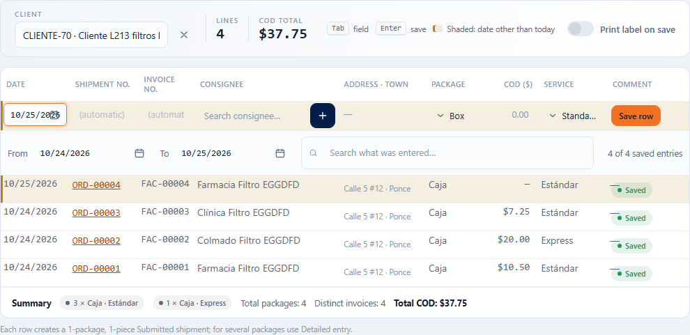

# Chapter 03 — Transport shipments (Batch 3)

This chapter describes everything Batch 3 makes available: the capture of transport shipments (quick entry,
detailed entry or special delivery), the numbering of their four identifiers, the quote and the credit check (when creating and when marking the shipment as
picked up), the statuses and transitions, the template-based shipment importer, and two adjustments that change the
behavior of modules already documented in [chapter 02](02-clientes-y-contratos.md): blocking anything new when
a client is deactivated, and the multi-client portal. Each section states **what it does**, **who can**, **how it is
used**, the **validations** with the exact message and the HTTP code, and the **statuses** with their transitions and effects.
> **Batch 106 (2026-10-17): new status flow.** The shipment is born **Submitted** (there is no longer Draft or Confirmed), it is quoted
> and credit is measured **on creation**, the “Confirm” action was renamed **Mark as picked up**, cancelling requires a reason and
> there is a new action, **Reopen** (permission `orders.reopen`). The statuses `DRAFT`, `CONFIRMED`, `INBOUND`, `PLANNED`, `ARRIVED`,
> `ON_HOLD` and `PARTIAL` no longer exist. This chapter is already up to date; the full detail is in section 4.

The messages are verified against the code (`src/Teikem.Domain/Orders/*`, `src/Teikem.Infrastructure/Orders/*`,
`src/Teikem.Infrastructure/Services/Order*.cs`, `src/Teikem.Api/Controllers/Order*.cs`) and exercised by
`scripts/smoke.sh`. The questions and answers for each message are in [faq.md](faq.md).

Conventions of the chapter:

- Resources are identified by `publicId` (GUID) in the URL. A `publicId` from another company, or from another client when
  the caller is limited to one (the future portal), responds **404** as if it did not exist (no oracle).
- The whole module lives under **LTL_GROUND** ("Ground last mile"), a **core** module: no tenant can
  turn it off, so shipments never respond `403 module_disabled`.
- A validation error responds `400` with `title` (message) and `errors` (`{ field: [message] }`); a conflict `409`;
  a status or business rule `422`; a foreign or nonexistent resource `404`; a missing permission `403`.
- All reads and writes go through an internal "client scope" (`OrderScope`): today the internal operator
  always sees any client of their company; the client portal (Batch 8) will fix the principal's client and everything
  in this chapter (create, record, edit, confirm, cancel, search) will be limited to that client with no API changes.
- Dates are UTC; "today" is the server's UTC date.

---

## 1. Capturing a shipment

### 1.0 Quick entry and shipment date (2026-10-21, dictated by Luis)

**The shipment date cannot be earlier than today** (in quick entry, in detailed entry and in the import): yesterday is no longer allowed. It is not just a warning: **it is blocked**. Message: `The shipment date can't be earlier than today.` (400, field `requestedDate`; on screen, under the date). Today and the following days are valid; the date calendar no longer lets you pick past days.

**Quick entry is built to capture without letting go of the keyboard:**
- **The date is the first field** of the row (the web date control: a calendar that opens by itself, can be typed with numbers only and adapts to the company's format). It starts at **today**, and can be changed.
- **When the client is chosen**, the cursor goes **straight to the date** and its calendar opens. **Tab** moves to the next one: the **Invoice no.** (disabled and showing “(automatic)” if Teikem generates it; typed if the client assigns its invoices), then the consignee, the package, the COD, the service and the comment. Disabled fields are skipped automatically.
- **Enter in any field saves the row.** When it is saved another row is created and **the cursor returns to the date**.
- **The new row carries the date of the last saved order**: if someone set tomorrow's date, the next one comes out with tomorrow's.
- **Rows with a date other than today are shaded** (with a yellow mark on the left, without changing the row height) and the legend of the bar reminds you; the row being filled in is also shaded as soon as the date is changed.
- **Service and package per client:** each client can have its **default service and default package** (Clients → record → Profile → “Default service” / “Default package”; empty = the company's). When the client is chosen, the row already comes with them, and so does the new row.

**The table of what was captured: filters and summary (Batch 213, 2026-10-23, dictated by Luis).** Below the capture row, the entries saved in this session have:
- **From / To:** the date range shown (date controls of the kit); when opened both are **today**. **Saving an order with another date widens the range by itself**: with a later date the “from” stays at today and the “to” moves to that date; with an older one the “from” moves down. If one end is moved by hand it never ends up reversed (the other follows it). The counter says “N of M saved entries”.
- **Search what was entered:** free-text search (`QBox`) over any data shown: shipment no., invoice, consignee, address, package, service, COD, comment and date; all words, regardless of case or accents. With no matches: “No saved entry matches the dates and the search.”
- **Summary in the footer:** “**N × Package · Service**” per combination (the most numerous first), “**Total packages: N**”, “**Distinct invoices: N**” and “**Total COD: $X**”, calculated over what is shown (range + search). **Distinct invoices** counts numbers: if the invoice field has several **separated by commas**, **each comma is another number**; repeated ones (regardless of case) count once and orders without an invoice do not add up. The upper bars “Lines” and “COD total” keep counting everything captured.



### 1.0b New consignee inline (Batch 213, dictated by Luis; staff web)

**What it does.** If the consignee does not exist, it is created **right there, without a mouse and without leaving the capture**: in quick entry and in detailed entry. The “+” button and its window still exist for those who prefer the mouse (with more fields: number, contact person, time window, notes…).

**Who can.** `locations.create` (without it nothing is offered). The **Phone** field only appears if the user also has `contacts.manage` and `locations.update`. Module CATALOG, like the consignee directory.

**How it is used (keyboard only):**
1. Choose the client. In the consignee field **type the name** that does not exist. At the end of the list appears **“+ New consignee «name»”**; if nothing matches, it is already highlighted. With other matches you reach it with **↓**. **Enter** (or a click) chooses it.
2. The inline form opens (no window): in **quick entry**, as a row just below the row you are filling in (it does not move or clear the date, the invoice or anything typed); in **detailed entry**, as a panel inside section 02, below the search box. The **cursor lands by itself in the first empty field** (normally **Address**, because the name is already typed).
3. Fields: **Name\***, **Address\***, **Town\*** (the same town or postal code selector of the catalog, delivery ZIPs only; it fills ZIP, state and country) and **Phone** (optional; with the company's mask). The consignee is born as the delivery type, with country Puerto Rico if the town does not bring another one, and **its owner is the client of the order**.
4. **Enter in any field saves.** If a required field is missing, **the cursor goes to the first missing field** and its message appears; if it is complete, it is created. When the town is chosen with Enter the cursor moves to the phone (if visible), so that the next Enter saves.
5. On save: notice “Consignee created: name”, the new one **is selected**, the form closes and **the cursor moves by itself to the next field**: in quick entry the **Package** dropdown; in detailed entry the next control after the consignee (the special delivery switch). In quick entry, **Enter in any other field saves the order** as always.
6. **Esc** cancels and returns the cursor to the consignee field **with the text that had been typed**. **Tab / Shift+Tab** move through the fields; in quick entry, Tab from the last field continues to Package without saving or trapping the cursor. Changing the client closes the form.

**Exact error messages.** Those for empty or long fields appear on screen, without calling the server, under the field:
| Message | When |
|---|---|
| `Name is required.` | Empty name |
| `Address (line 1) is required.` | Empty address |
| `City is required.` | No town chosen |
| `Maximum 200 characters.` / `Maximum 100 characters.` | Name or address (200); town (100) |
| `Invalid phone.` | Phone that does not meet the company's mask |

If the server rejects the creation, the message appears **in the same form and what was typed is kept** (fix it and press Enter again): `Name is required.`, `Address (line 1) is required.` or `City is required.` (400, fields `name`, `line1`, `city`); `Maximum N characters.` (400); without permission, 403; without a session, 401. If the consignee was created but the **phone** was not, “The consignee was saved, but the phone was not: reason” appears and the consignee stays selected anyway (the phone is fixed later in Catalog → Consignees).

### 1.1 Create (quick entry, detailed entry or special delivery)

What it does: creates a transport shipment. It is born in the initial status (**SUBMITTED**, “Submitted”) with up to two stops — **pickup**
(optional: the one indicated, or if none is indicated the client's default pickup point, or if there is none either the
client's active CORPORATE location; if none of that exists, the shipment is born with only the delivery stop) and
**delivery** (required) — and one or more package lines, unless it is a special delivery. Each shipment receives four
identifiers that are always populated: shipment number, client invoice number, pack number and, per line, package
number (see section 2). **It is quoted on creation** (Batch 106) if the client has a current contract and rate; if not, the shipment
stays **unquoted and without an error**, and the strict quote is required when marking it as picked up (section 3.2). On creation the
client's credit is also measured (section 3.3): if it is exceeded, the shipment **is not created** (422 `credit_exceeded`), unless
`overrideCredit: true` is sent with the permission `orders.credit_override`.

Who can: `orders.create`.

How it is used: `POST /api/v1/orders`

```json
{
  "clientPublicId": "…",
  "consigneeLocationPublicId": "…",
  "pickupLocationPublicId": null,
  "serviceType": "STANDARD",
  "packages": [ { "packageType": "BOX", "pieces": 2 }, { "packageType": "ENVELOPE", "pieces": 1, "description": "Documentos" } ],
  "codAmount": 50,
  "requestedDate": "2026-10-05T00:00:00",
  "notes": null
}
```

**Consignee** (exactly one of the two):
- `consigneeLocationPublicId`: a `Location` from the client's directory or shared by the tenant.
- `newConsignee`: free capture (`name`, `line1`, `city`, …). Before creating anything it is compared against the
  **active DELIVERY/BOTH locations of the client itself** by normalized name + line 1 (no accents, no case,
  collapsed spaces); if it matches, that `Location` is reused without overwriting the directory; if not, a new
  DELIVERY `Location` is created and assigned to the shipment's client.

**Special delivery**: `isSpecialDelivery: true` + `specialServiceId` (from the client's special services list,
chapter 02 section 6). It carries no `packages` or `codAmount`; it is born with a single line with the name of the service and no package
type. It quotes the current rate of the special service (section 3).

**Repeated invoice (R36)**: if `clientInvoiceNumber` is **typed** (not if Teikem generates it) and the consignee already has
another active shipment with that same number, the response depends on whether the consignee allows repeated invoices
(`allowDupInvoice`, chapter 02 section 2):

| Case | Response |
|---|---|
| Does not allow repeated | `409` `code: "duplicate_invoice"`, `title`: `Consignee 'X' does not allow repeated invoices: order N already uses number F.` |
| Allows repeated, unconfirmed | `409` `code: "duplicate_invoice_confirmable"`, same style of message ending in "…confirm if you want to create the shipment anyway." |
| Allows repeated, with `confirmDuplicateInvoice: true` | it is created normally |

Both 409s bring in `errors`: `clientInvoiceNumber` (the message), `existingOrderNumber` and `existingOrderPublicId` (so that
the front end builds the "Create anyway" modal without parsing the title). The check runs **before** drawing numbers: a
409 does not consume any sequence number.

| Field / case | Exact message | HTTP |
|---|---|---|
| `clientPublicId` missing (with no client scope fixed) | `The client is required.` | 400 |
| Client of another company | `Client not found.` | 404 |
| **Deactivated** client | `The client has been deactivated; only its history can be viewed.` | 409 |
| **Suspended** client | `The client is suspended; shipments cannot be created or confirmed.` | 422 |
| Neither `consigneeLocationPublicId` nor `newConsignee` | `The consignee is required: choose one from the directory or capture a new one.` (field `consignee`) | 400 |
| Both at once | `Indicate a consignee from the directory or a new one, not both.` (field `consignee`) | 400 |
| Consignee of another client or nonexistent | `Consignee not found.` | 404 |
| Inactive consignee | `Consignee is inactive; reactivate it or choose another.` (field `consigneeLocationPublicId`) | 400 |
| Pickup of another client or nonexistent | `Pickup location not found.` | 404 |
| `newConsignee.name` / `.line1` / `.city` empty | required | `The consignee name is required.` / `The consignee address (line 1) is required.` / `The consignee city is required.` | 400 |
| `newConsignee.country` not ISO alpha-2 | 2 letters | `The country code must be ISO 3166-1 alpha-2 (2 letters).` | 400 |
| No package lines (normal shipment) | `Enter at least one package line.` (field `packages`) | 400 |
| Special delivery with `packages` or `codAmount` | `A special delivery carries no package lines or COD.` | 400 |
| `packages[i].pieces` &lt; 1 | `The number of pieces must be at least 1.` | 400 |
| `packages[i].packageType` unknown / missing with no tenant default | `Unknown package type: X.` / `The package type is required.` | 400 |
| `serviceType` unknown / missing with no tenant default | `Unknown service type: X.` / `The service type is required.` | 400 |
| Negative `codAmount` | `The COD amount cannot be negative.` | 400 |
| `isSpecialDelivery` without `specialServiceId` | `The special service is required for a special delivery.` (field `specialServiceId`) | 400 |
| Special service not current / of another client | `The special service is not current for this client.` | 400 |
| "Special services" component turned off in the client's contract | `The 'Special services' component is turned off in the client's current contract; turn it on in the billing model or capture a normal shipment.` | 409 |
| `codType` or `packBatchNumber` is sent | `The COD type is recorded on delivery, not at capture.` / `The pack number is always generated by Teikem.` | 400 |
| Shipment / pack number collision after exhausting retries | `A shipment with that number already exists for this client.` / `A shipment with that pack number already exists.` / `A free shipment number could not be assigned; try again.` | 409 |

`overrideCredit: true` authorizes creating the shipment even if the client exceeds its credit limit; it requires the permission
`orders.credit_override` (403 `Missing permission 'orders.credit_override'.` if missing; see section 3.3). Since Batch 106 the
error `overrideCredit requires confirmNow=true.` no longer exists: `overrideCredit` is applied on creation.
`confirmNow: true` is still accepted in the API (it creates and marks the shipment as picked up in the same transaction, section 3.2), but
the web screen no longer uses it; if the quote or the credit fails, the creation is also rolled back.

### 1.2 Shipment record

What it does: returns the complete shipment: header (numbers, client, service type, priority, status, currency, quoted
amount and date, COD and its status, totals, package summary), pickup stop (if any) and delivery stop with their address
`snapshot` and time window, active package lines, references, special delivery data if
applicable, the origin (`sourceEntityType`/`sourceEntityId`, for batches from other modules) and the **capabilities** available
according to the current status (`canEditCargo`, `canReprice`, `canCancel`, `canDelete`, `canConfirm`, `canReopen`). It includes `rowVersion` for
concurrent editing.

Who can: `orders.view`. The **shipment price** (`quotedAmount`, “Quoted amount”) is only seen with the permission
`orders.view_price`. Without that permission the field comes empty (`null`; the screen shows “—”) and the rest of the record, including
the COD, does not change. See section 3.5.

How it is used: `GET /api/v1/orders/{publicId}`.

### 1.3 List and search / scan

What it does: two ways to find shipments. The **list** is paginated and accepts partial filters; its first business
column is always the **pack number** (`packBatchNumber`, unique per tenant and always with a value). The **exact
search** (`lookup`) is for scanning: it compares the code as is against the three identifiers, with no partial
matches.

Who can: `orders.view`. The price of each row (`quotedAmount`) is only seen with `orders.view_price`; without that permission it comes empty
(`null`). See section 3.5.

How it is used:
- `GET /api/v1/orders?clientId=&status=&orderNumber=&invoice=&packBatch=&consignee=&search=&from=&to=&includeInactive=false&skip=0&take=100`
  — `orderNumber`/`invoice`/`packBatch`/`consignee`/`search` are partial (`LIKE`); `from` inclusive and `to` exclusive
  over the creation date; `take` is capped between 1 and 500 (default 100).
- **Filters with several values (Batch 39).** To request several values of the same filter, repeat the parameter in the address
  (for example, `?serviceTypes=STANDARD&serviceTypes=EXPRESS` brings the shipments with service STANDARD **or** EXPRESS). There are
  two rules:
  1. **Within a filter** it is enough for the shipment to meet **one** of the values.
  2. **Between different filters** the shipment must meet **all** of them (for example, service type STANDARD **and** town Bayamón).

  The total (`total`) and the pagination count everything that meets the filters, not only the page shown.

  | Parameter | What it filters | Example |
  |---|---|---|
  | `serviceTypes` | Service type of the shipment (codes from the `ServiceType` list; case does not matter). | `serviceTypes=STANDARD&serviceTypes=EXPRESS` |
  | `packageTypes` | Package type. The order that has **any** active package line of that type is included (`PackageType` codes). | `packageTypes=BOX` |
  | `invoiceProcessed` (Batch 128) | Whether the shipment's client invoice has already been processed (reconciled COD sheet or check; see chap. 21 §7): `true` only processed, `false` only unprocessed, empty all. | `invoiceProcessed=true` |
  | `processedFrom` / `processedTo` (Batch 128) | The processing date of the invoice: `processedFrom` inclusive, `processedTo` exclusive. On screen, the “Processing date” filter offers the suggested ranges (Today, This week, This month… or Custom). | `processedFrom=2026-10-18&processedTo=2026-10-19` |
  | `cities` | Town of the consignee (the delivery stop). It must be equal to the requested town; case, accents and extra spaces do not matter. | `cities=bayamon` finds “Bayamón” |
  | `postalCodePrefix` | The consignee's postal code (ZIP) **starts with** this text. | `postalCodePrefix=009` brings `00901`, `00961`… |
  | `clientIds` | Clients (by their `publicId`). It is **added** to `clientId` if that also comes. | `clientIds=…&clientIds=…` |
  | `statuses` | Status of the shipment (`OrderStatus` codes). It is **added** to `status` if that also comes. | `statuses=PICKUP&statuses=FAILED` |

  **Example.** I want the shipments in Bayamón with a ZIP starting with `009` that are in status `PICKUP` (Picked up):
  `GET /api/v1/orders?cities=Bayamón&postalCodePrefix=009&statuses=PICKUP`.

  Everything stays within the active company and the clients the user can see (their “data scope”): someone who can only
  see certain clients does not see shipments of others with any filter, and requesting a client outside their scope responds 404.
- `GET /api/v1/orders/lookup?code=T$TS-00001` — **exact** match (case-insensitive), first by shipment
  number, if none by pack number, if none by invoice; it returns all the matches of that group
  (`matchedBy`: `ORDER_NUMBER` | `PACK_BATCH` | `INVOICE`, or `null` with no matches) — the shipment number can
  repeat between clients and the invoice between shipments, the pack is unique.
  Batch 44 (F-G2, 2026-10-12): if none of the three matches, it searches the **package number** of the active lines
  (`matchedBy`: `PACKAGE`; it is the barcode of each piece's label). The package counter is per client and a typed
  number can repeat: with two or more shipments all of them come back (ambiguous).
- Batch 44: each row of the list and of the lookup also brings `consigneeLine1`, `consigneeLine2` and `consigneeState` (the address of the
  delivery stop) for the labels, the waybill summary and the packing list.

| Case | Exact message | HTTP |
|---|---|---|
| Unknown `status` | `Unknown status: X.` (field `status`) | 400 |
| Some value of `statuses` does not exist | `Unknown status: X.` (field `statuses`; X comes out in uppercase) | 400 |
| Some value of `serviceTypes` does not exist | `Unknown service type: X.` (field `serviceTypes`) | 400 |
| Some value of `packageTypes` does not exist | `Unknown package type: X.` (field `packageTypes`) | 400 |
| Empty `code` in `lookup` | `Enter the code to search.` (field `code`) | 400 |
| `clientId` or some `clientIds` belongs to another company or is outside the clients the user can see | `Client not found.` | 404 |

What to do with the 400s of the filters: the `X` in the message is the value that does not exist; check how it is written (code from the
list, for example `STANDARD`, `BOX`, `PICKUP`) and remove or change it. A code that is inactive in the list **is**
accepted (it is useful to search old shipments); only a code that does not exist is rejected.
What to do with the 404: remove that client from the filter; if you should be able to see it, ask the administrator to review the data scope
of your user.

A town or ZIP prefix with no matches is not an error: it responds `200` with `total: 0` (empty list).

### 1.4 Edit

What it does: edits the shipment while it is in a status that allows it (by default, only **SUBMITTED**, “Submitted”; see section 4). You
can change the consignee (with the same resolution as section 1.1 and a re-check of R36 if the shipment **was created
with a typed invoice**), the pickup, the service type, the priority, the package lines (full replacement: the
previous ones become inactive as a trail), the COD (add, increase or remove with `clearCod: true`), dates, notes and
references. The **client, the shipment number, the invoice number and the pack number are fixed on creation** and are not
edited. If the shipment was already quoted, editing it **re-quotes** it (it also requires the `REPRICE` capability, which by default is also only in
Submitted) so as not to leave an old amount. While it stays Submitted and quoted, each edit re-quotes.

Who can: `orders.edit`. On the web it is done inside the **Detail** panel of the shipment's order file, with a single **Save changes** button
(see [the order file](frontend/fc2-ordenes-expediente.md)); the screen only sends what you changed and the `rowVersion` of the record.

How it is used: `PATCH /api/v1/orders/{publicId}` with only the fields that change; `rowVersion` optional (the one from the record)
to detect concurrent editing.

| Field / case | Exact message | HTTP |
|---|---|---|
| `clientPublicId`, `orderNumber`, `clientInvoiceNumber` or `packBatchNumber` is sent | `Field 'X' is fixed when the order is created and is not edited.` / `The pack number is always generated by Teikem.` | 400 |
| `codType` is sent | `The COD type is recorded on delivery, not at capture.` | 400 |
| `consigneeLocationPublicId` and `newConsignee` at once | `Indicate a consignee from the directory or a new one, not both.` (field `consignee`) | 400 |
| `codAmount` and `clearCod: true` at once | `Indicate a COD amount or clearCod, not both.` (field `codAmount`) | 400 |
| Special delivery shipment with `packages` or `codAmount` | `A special delivery carries no package lines or COD.` | 400 |
| The current status does not allow `EDIT_CARGO` | `The current status does not allow the action 'EDIT_CARGO'.` | 422 |
| Already quoted and the status does not allow `REPRICE` | `The current status does not allow the action 'REPRICE'.` | 422 |
| Outdated `rowVersion` | `The record was modified by another user; reload and try again.` | 409 |
| Shipment of another company, of another client of the scope, or deleted at capture | `Order not found.` | 404 |

### 1.5 Delete (only in the initial stage)

What it does: **soft delete** (`isActive = false`), never `DELETE`. It is only allowed while the shipment is still in its **initial
status** (Submitted); it immediately frees its shipment number and its pack number (both are unique indexes filtered by
`isActive = 1`), so they can be captured again. Once deleted, no action works on it again
(edit, mark as picked up, reprice, cancel, status): the record and the list (`includeInactive=true`) still show it,
but as a historical record.

Who can: `orders.cancel`.

How it is used: `DELETE /api/v1/orders/{publicId}` → `204`.

| Case | Exact message | HTTP |
|---|---|---|
| The shipment is no longer in its initial stage | `A shipment can only be deleted in its initial status; use cancellation.` | 422 |

---

## 2. Numbering of the four identifiers

> **Batch 109 (2026-10-18) — each PIECE has its own unique number.** The package number is no longer one per line repeated on each piece: when the shipment is submitted **one piece is created for each piece of each line** (a line of 3 pieces creates 3), and each one carries its number, which is the one on the label and the one that is scanned. The **shipment** number (the waybill) is still separate and unique.
> - **System format** (the one that applies when the client has no format of its own): `{Client Code}{Consignee Code}{yymmdd}{hhmmssfff}{n}` — for example `ACMEPR01232610181534051231` — with no separators of ours (the Codes are taken as they come, with dashes if they have them). If the consignee has no Code its ID is used. The date and time are the company's; **n** is the number of the piece within the shipment (1, 2, 3… running across all lines). Maximum 38 characters (it fits in the 40-character field and in a 4-inch Code 128).
> - **The Codes** of the client and the consignee have **a maximum of 10 characters** (a code, not a title): “The code cannot exceed 10 characters.” (400). A Code already saved with more than 10 uses its first 10 in the number. Codes auto-generated from the client's name come out with 10 characters at most.
> - **Client's own format** (client record → Numbering): if it has one, each piece takes the next number of its counter. **Line with a typed number**: one piece → that number; several → that number plus the piece's (`PQ-B1`, `PQ-B2`…).
> - When **editing the packages** of a Submitted shipment the old pieces are deactivated and the new ones are created. A special delivery carries no pieces.
> - **Shipment number (waybill), Batch 110:** `{Client Code}{Consignee Code or its ID}{yymmdd}{sequence of the day for that consignee}` — for example `ACMEPR0123261018` + `1` = `ACMEPR01232610181` (the second shipment of the same consignee that day ends in 2). It is unique in the company; it replaces `CND-#######` (earlier shipments keep it). It is generated when the shipment is submitted; it is not typed.
> - Searching or scanning by a piece's number finds its order; the record lists the numbers of each piece and the labels and the packing sheet use them.

What it does: every shipment receives four identifiers, each with its own atomic counter (table `NumberSequence`,
`UPDATE … OUTPUT` inside the creation transaction: no gaps or collisions between simultaneous creations):

| Identifier | Counter scope | Who assigns it? | Default pattern |
|---|---|---|---|
| Shipment number (`orderNumber`) | per client | Teikem, or the client if `clientAssignsOrderNumber: true` (chapter 02, 1.4) | `ORD-#####` |
| Invoice number (`clientInvoiceNumber`) | per client | Teikem, or the client if `clientAssignsInvoiceNumber: true` | `FAC-#####` |
| Pack number (`packBatchNumber`) | per tenant | **always Teikem**, never configurable | `EMP-#####` (fixed) |
| Package number (`packages[i].packageNumber`) | per client | it can always be typed per line | `PQT-#####` |

The shipment number is unique **per client** (two clients can share "PO-1001"); the pack number is unique
**per tenant** and is the unambiguous identifier for scanning. A number that the client "assigns" but leaves blank
is generated by Teikem anyway.

| Case | Exact message | HTTP |
|---|---|---|
| `orderNumber` is typed and the client does not assign it | `The shipment number is assigned by Teikem for this client; leave it blank.` (field `orderNumber`) | 400 |
| `clientInvoiceNumber` is typed and the client does not assign it | `The invoice number is assigned by Teikem for this client; leave it blank.` (field `clientInvoiceNumber`) | 400 |
| `packBatchNumber` is typed | `The pack number is always generated by Teikem.` | 400 |
| A typed number exceeds 40 characters | `The number cannot exceed 40 characters.` | 400 |
| An automatic number, with the client's pattern, exceeds 40 characters | `The {order\|invoice\|package\|pack} number generated with the client's pattern exceeds 40 characters; shorten the pattern in the client record.` | 409 |
| Collision of an automatic number with one typed by another user | it retries by itself (up to 5 times), without the user noticing; once the retries are exhausted: `A free shipment number could not be assigned; try again.` | 409 |

---

## 3. Quote and credit

> **Batch 107 (2026-10-17) — the screening is AT SUBMISSION.** Current contract and rate, client not suspended and credit are checked **when the shipment is created**; if it does not pass, it is not created (409/422 with the same messages as always, with no “unquoted shipment”). Whoever passed the screening is not checked again: **“Mark as picked up”** and scanning only **freeze** the price it already had (they no longer quote or measure credit). A client with no contract or no rate cannot submit shipments, neither on the web nor in the portal. Re-quoting only while the shipment is Submitted.

Since Batch 106 the shipment **is quoted and its credit is measured on creation** (it is born Submitted). Marking it as picked up (formerly
“Confirm”) repeats the quote in strict mode, freezes the price and measures the credit again.

### 3.1 Preview (without persisting anything)

What it does: quotes the shipment and evaluates the client's credit **without saving anything**, so that the interface shows the warning
before marking the shipment as picked up. It returns the quoted lines (consolidated by package type), the dispatch and COD rate, the
total, the contract used, and the credit check (`creditLimit`, `pendingBalance` — the sum of `quotedAmount` of the
client's shipments that are in progress (**Submitted included**, if already quoted), not counting the finished ones (Delivered, In warehouse), the
Cancelled ones or the shipment itself —, `orderTotal`, `available` and
`exceeds`). The same errors that marking it as picked up would give (missing rate, closed special service) are seen here first.

Who can: `orders.view` **and** `orders.view_price`. Since Batch 39 the full quote (total, lines, charges and credit)
counts as price information, so without `orders.view_price` it cannot be opened.

How it is used: `GET /api/v1/orders/{publicId}/quote`.

| Case | Exact message | HTTP |
|---|---|---|
| Missing permission `orders.view_price` (a `PERMISSION_DENIED` security event is recorded); ask the administrator or Billing for the permission | `Missing permission 'orders.view_price'.` | 403 |
| Missing current rate for some line (service/package type) | `There is no current rate for X/Y; configure the rate in the client's contract before confirming.` | 422 |
| Special service no longer current (it was closed) | `The special service is no longer current; choose another before confirming.` | 409 |
| "Special services" component turned off in the current contract | `The 'Special services' component is turned off in the client's current contract; turn it on in the billing model or capture a normal shipment.` | 409 |

### 3.2 Quote on creation and “Mark as picked up”

**On creation (Batch 106).** What it does: if the client has a current contract and rate for the shipment's lines, the shipment is born
Submitted **with** its `quotedAmount`, `quotedAtUtc` and the contract used, and the credit is measured (section 3.3). If there is no contract or
a rate is missing, the shipment is born Submitted **unquoted and gives no error**: that error appears when marking it as picked up. While the
shipment stays Submitted and quoted, **editing it re-quotes it**. An unquoted shipment does not count in the client's pending balance.

**Mark as picked up (formerly “Confirm”).** What it does: takes the shipment out of its initial stage (Submitted) to the first
**pipeline** stage enabled after it (normally **PICKUP**, “Picked up”; if the company disables it, the one that
follows). When marking it: (1) it quotes the shipment with the client's rate engine (or the current rate of the special service) in
strict mode and **freezes** `quotedAmount`, `quotedAtUtc` and the contract used; (2) it verifies that the client is not suspended; (3)
it verifies the credit (section 3.3). If anything fails, the shipment **does not change status** (everything is rolled back). Once picked up,
cargo editing is turned off by default (see section 4) and it cannot be re-quoted: `REPRICE` by default only exists in Submitted.

Who can: `orders.edit` (or `orders.credit_override` when the credit really is exceeded; see 3.3).

How it is used: `POST /api/v1/orders/{publicId}/confirm` `{ "rowVersion"?, "overrideCredit"?: false }`. It is the same endpoint as always;
only the name of the button on the screen changed: **Mark as picked up**.

| Case | Exact message | HTTP |
|---|---|---|
| The shipment is no longer in its initial stage | `A shipment is only confirmed in its initial status.` | 422 |
| The pipeline has no stage after the initial one (the company disabled all the rest) | `The shipment pipeline has no stage after the initial one.` | 422 |
| Suspended client | `The client is suspended; shipments cannot be created or confirmed.` | 422 |
| Missing rate / closed special service | same as 3.1 | 422 / 409 |
| Credit exceeded, without `overrideCredit` | see 3.3 | 422 |
| Outdated `rowVersion` | `The record was modified by another user; reload and try again.` | 409 |

### 3.3 Credit exceeded: warning and authorization with permission

What it does: if the client's credit is exceeded **when creating the shipment or when marking it as picked up**, **it does not block definitively**: it warns with `422` and
`code: "credit_exceeded"` (`errors`: `limit`, `exposure`, `newAmount`, `available`, all formatted with two
decimals), and it can be authorized with `overrideCredit: true` if the person doing it has the permission `orders.credit_override`.
On creation, an unauthorized excess **rolls back the creation** (the shipment does not exist). On authorization: the shipment goes ahead, a
security event remains (`ROLE_CHANGE`/`SUCCESS`, `action: "credit_override"`) and, if it was when marking it as picked up, a comment in its status history
(`Credit exceeded authorized by {user} (limit X, in progress Y, this order Z)`).

Who can: creating with `overrideCredit: true` requires `orders.create` and `orders.credit_override`. Marking as picked up without `overrideCredit` requires `orders.edit`; with `overrideCredit: true` it requires
`orders.credit_override` and, if the credit was **not** really exceeded, it also requires `orders.edit` (the authorization
permission does not serve to move normal shipments). This lets the **Billing** template (which has
`orders.credit_override` but not `orders.edit`) authorize exactly the cases of excess when marking as picked up.

| Case | Exact message | HTTP |
|---|---|---|
| Credit exceeded, without `overrideCredit`; the operator **has** `orders.view_price` | `The client exceeds its credit limit: limit X.XX, in progress Y.YY, this shipment Z.ZZ.` | 422 |
| Credit exceeded, without `overrideCredit`; the operator does **not** have `orders.view_price` (Batch 39) | `The client exceeds its credit limit.` (no figures; same `code: "credit_exceeded"` and empty `errors`) | 422 |
| `overrideCredit: true` without the permission `orders.credit_override` | `Missing permission 'orders.credit_override'.` | 403 |
| `overrideCredit: true` when marking as picked up, with the permission, but the credit was not exceeded (or without `orders.edit`) | `Missing permission 'orders.edit'.` | 403 |

What to do with a credit 422: if you have `orders.credit_override`, repeat the action with `overrideCredit: true` (on the
screen, **Authorize and save** when creating and **Authorize and mark as picked up** in the order file); if
not, ask Billing or an administrator to authorize the excess, or to raise the client's credit limit.

The history comment (`Credit exceeded authorized by {user} (limit X, in progress Y, this order Z)`) is saved
in full, but whoever reads it without `orders.view_price` sees it without the parenthesis of figures:
`Credit exceeded authorized by {user}`.

### 3.4 Reprice

What it does: re-quotes a shipment with the current rates (in case the contract or the exchange rate changed).
It does not change status. Only available when the current status allows the `REPRICE` capability (by default, only
**SUBMITTED**, “Submitted”; before Batch 106 it was Confirmed).

Who can: `orders.edit`.

How it is used: `POST /api/v1/orders/{publicId}/reprice`.

| Case | Exact message | HTTP |
|---|---|---|
| The current status does not allow `REPRICE` | `The current status does not allow the action 'REPRICE'.` | 422 |

### 3.5 Who sees the prices (permission `orders.view_price`, Batch 39)

What it does: separates **seeing shipments** from **seeing what they cost**. A person can work with shipments (see them, capture them,
confirm them) without seeing any price. Without the permission `orders.view_price` (“View order prices”, category Shipments), the
system leaves the price blank (`null`) or without figures; nothing breaks and the fields keep existing. The **COD amount**
(`codAmount`, what is collected on delivery) is **not** a price and is always seen.

Who can: the permission `orders.view_price` is assigned to a role in System → Roles. Out of the box it comes with:

| Role | Sees the prices |
|---|---|
| Company admin (TenantAdmin) | Yes |
| Billing (Billing) | Yes |
| Dispatcher (Dispatcher), Warehouse operator (WarehouseOperator), Driver (Driver), Read-only (ReadOnly) | No. The administrator can add the permission to a custom role if someone else must see them. |

The roles named TenantAdmin or Billing that your company already had also receive it with the database update (it is only
added, nothing is removed). The platform administrator always has it.

What changes in each place:

| Where | With `orders.view_price` | Without `orders.view_price` |
|---|---|---|
| Shipment record (`GET /orders/{id}`) and the responses of create, edit, mark as picked up, reprice, cancel, reopen and status | The `quotedAmount` field brings the amount. | `quotedAmount` comes empty (`null`); the screen shows “—”. |
| Shipment list (`GET /orders`) and search by code (`GET /orders/lookup`, also the scan station) | Each row brings the price (**Quoted** column). | Each row comes without a price; the **Quoted** column is not shown. |
| Full quote (`GET /orders/{id}/quote`) | Total, lines, dispatch charge, COD charge and credit. | Error 403 `Missing permission 'orders.view_price'.` |
| Credit exceeded when creating the shipment or when marking it as picked up (also in the special delivery with driver and in the import) | Error 422 with figures: `The client exceeds its credit limit: limit X, in progress Y, this shipment Z.` | Error 422 without figures: `The client exceeds its credit limit.` (same code `credit_exceeded`). |
| Shipment status history (credit authorization comment) | `Credit exceeded authorized by {user} (limit X, in progress Y, this order Z)` | `Credit exceeded authorized by {user}` |
| Shipment import (row that failed because of credit) | The error with figures. | `The client exceeds its credit limit.` |
| Analysis: **Quoted amount** field of the “Shipments” source (views, exports, indicators and charts) | With the value. | Empty; an indicator that sums that field gives 0. |

**Example.** A dispatcher (without `orders.view_price`) marks as picked up a shipment of a client that already passed its limit. They receive
`The client exceeds its credit limit.` (422), with no figures. They cannot authorize it (they do not have `orders.credit_override`), so they notify
Billing; they see the figures, authorize the excess and the shipment moves to Picked up.

Frequently asked questions for this section: in [faq.md](faq.md), “Batch 39 — Shipment prices and list filters”.

---

## 4. Statuses and transitions

Domain `OrderStatus` (flow dictated by Luis, Batch 106, 2026-10-17; the one in the original seed was only an example):

**Submitted (SUBMITTED, initial) → Picked up (PICKUP) → Unassigned (UNASSIGNED) → Assigned (ASSIGNED) → In transit
(IN_TRANSIT) → Delivered (DELIVERED, terminal).** Apart from that: **Failed attempt (FAILED)** is lateral; **Cancelled (CANCELLED)** and
**In warehouse (IN_WAREHOUSE)** are terminal.

| Status | Code | Type | What it means |
|---|---|---|---|
| Submitted | `SUBMITTED` | initial | The shipment came in. It is already quoted (if there is a contract and rate) and with the credit measured. It is the **only stage where it is edited**. “Plan” is not a status: it is the **requested date** of a Submitted shipment. |
| Picked up | `PICKUP` | pipeline | It has already been picked up. |
| Unassigned | `UNASSIGNED` | pipeline | Already in the warehouse, with no route. |
| Assigned | `ASSIGNED` | pipeline | Placed on a route. |
| In transit | `IN_TRANSIT` | pipeline | The route departed with the shipment. |
| Delivered | `DELIVERED` | terminal | Delivered. |
| Failed attempt | `FAILED` | lateral | It could not be delivered. It is documented with a delivery attempt (`DeliveryAttempt`). In the progress bar of the apps it stays at the level of the last normal stage (for example In transit), in alert color. It remains in the history. |
| Cancelled | `CANCELLED` | terminal | Cancelled, with a mandatory reason. |
| In warehouse | `IN_WAREHOUSE` | terminal | For **pickup-only** service types. The “pick up” service type and its flow Submitted → Picked up → In warehouse **arrive in a later batch**; today no service type leads to this status. |

**No longer exist** `DRAFT` (Draft), `CONFIRMED` (Confirmed), `INBOUND`, `PLANNED`, `ARRIVED`, `ON_HOLD` or `PARTIAL`.
When updating a development database, what was in `DRAFT` moved to `SUBMITTED`, `INBOUND` to `UNASSIGNED`, `PLANNED` to
`ASSIGNED`, `CONFIRMED` to `PICKUP`, `ARRIVED` to `IN_TRANSIT` and `ON_HOLD`/`PARTIAL` to `FAILED`; in production there were no shipments.

Every change goes through the status engine of chapter 01 (section 5): it validates the stage, writes
`GET /api/v1/status/history/TRANSPORT_ORDER/{id}` and triggers effects. **Today the engine does not let you skip pipeline stages** (from one stage
you only advance to the next); action-based scanning with skips arrives in a later batch.

| From → to | Who / how | What it validates | Effects |
|---|---|---|---|
| (born) → Submitted | `orders.create`; automatic on creation (`POST /orders`) | required data, client neither suspended nor deactivated, credit (section 3.3) | Birth history; quotes if there is a contract and rate; measures the credit (422 if exceeded, unless `overrideCredit`); stops and COD are born with their own history (see note) |
| Submitted → Picked up | **Mark as picked up**: `orders.edit` (or `orders.credit_override` when the credit is exceeded), `POST /confirm` | current rate, current special service, client not suspended, credit | Quotes in strict mode and freezes `quotedAmount`/`quotedAtUtc`/contract; the cargo can no longer be edited |
| Picked up → Unassigned | no button in the order file | From `POST /status` it responds 422 “reserved advance” (see below) | It is moved by the corresponding module; no new action was added in this batch |
| Picked up / Unassigned → Assigned | **dispatch the route** (`trips.dispatch`) | the shipment must be eligible (chapter 05, section 3.1); a Submitted shipment is **not** eligible | The dispatch takes the shipment stage by stage up to Assigned, one history entry per step with “Dispatched on route {code}” |
| Assigned → In transit | **start the route** (departure) | — | The history says “Departed on route {code}” |
| In transit → Delivered | deliveries module | — | Records the delivery attempt (`DeliveryAttempt`) with the route's driver |
| An in-progress stage → Failed attempt | `orders.edit`, `POST /status {"toCode": "FAILED"}` (or the deliveries module) | does not apply to Cancelled or to the mark-as-picked-up action (they have their own) | Records the failed attempt; a shipment on an open route is released from the route |
| Failed attempt → the stage it left from | `orders.edit`, `POST /status` | it only returns to the **exact** stage from which it detoured (it does not skip to the next one) | — |
| Any non-final status → Cancelled | `orders.cancel`, `POST /cancel` with `comment` | **the reason is mandatory** (`comment`); `CANCEL` capability (turned off in Delivered, Cancelled and In warehouse); respects the lateral entries the company configures | History with the reason; cancels the special delivery's trip if there is one |
| Final status → in-progress stage | **Reopen**: `orders.reopen`, `POST /reopen {toCode?, comment, rowVersion?}` | the reason is mandatory; the shipment must be in a final status; the destination cannot be final | Without `toCode` it returns to the **last non-final status it had**; it does not re-quote or measure the credit again; it remains in the history and in the security log (`order_reopen`) |
| An in-progress stage → Delivered or In warehouse directly | — | **not available here** | `422`: `The advance to 'X' is performed by the corresponding module (trips/deliveries); only lateral statuses are recorded from here.` |

Capabilities per status (`StatusCapability`, the company changes them from `/status/capabilities/TRANSPORT_ORDER`):

| Capability | Default | Blocks |
|---|---|---|
| `EDIT_CARGO` | only allowed in **Submitted** | `PATCH /orders/{id}` outside Submitted (422) |
| `REPRICE` | only allowed in **Submitted** | `POST /reprice` in any other status (422) |
| `CANCEL` | turned off in **Delivered**, **Cancelled** and **In warehouse** | `POST /cancel` in those statuses (422) |
| `ASSIGN_TRIP` | turned off in **Submitted** and in the terminal ones (Delivered, Cancelled, In warehouse) | assigning to a route (chapter 05) |
| (all) | **In warehouse** blocks them all | any action on an In warehouse shipment; only **Reopen** remains |

What is blocked in each status (summary):

| Status | Edit the cargo | Re-quote | Cancel | Delete | Assign to route | Reopen |
|---|---|---|---|---|---|---|
| Submitted | Yes | Yes | Yes | Yes (with `orders.cancel`) | No: mark it as picked up first | No |
| Picked up and Unassigned | No | No | Yes | No | Yes | No |
| Assigned and In transit | No | No | Yes | No | No: they are already on a route | No |
| Failed attempt | No | No | Yes | No | No: return it to the pipeline first | No |
| Delivered | No | No | No | No | No | Yes (`orders.reopen`) |
| Cancelled | No | No | No | No | No | Yes (`orders.reopen`) |
| In warehouse | No | No | No | No | No | Yes (`orders.reopen`) |

Note on the history: the cycle of the shipment's **COD** (`PENDING`) and that of its **stops** (`PENDING` → …) have their
own history under `EntityType` `ORDER_COD` and `ORDER_STOP` respectively (`GET /status/history/ORDER_COD/{id}` /
`GET /status/history/ORDER_STOP/{id}`), separate from the shipment's own: this way the return from a Failed attempt is never
confused with the status of the COD or of a stop.

| Case | Exact message | HTTP |
|---|---|---|
| Empty `toCode` (in `/status`) | `Indicate the destination status.` | 400 |
| Nonexistent or disabled destination status | `Status 'X' does not exist or is not enabled for this company.` | 422 |
| `toCode` that does not exist in the catalog (for example, an old code such as `CONFIRMED`) in `POST /status` | `Status OrderStatus 'X' not found.` | 404 |
| `toCode: "CANCELLED"` through `/status` | `To cancel, use the cancellation action.` | 422 |
| `toCode` is the “Mark as picked up” stage, while Submitted | `To confirm, use the confirmation action.` | 422 |
| Pipeline advance not reserved to lateral/return | `The advance to 'X' is performed by the corresponding module (trips/deliveries); only lateral statuses are recorded from here.` | 422 |
| Comment of more than 500 characters (`cancel`/`status`/`reopen`) | `The comment allows a maximum of 500 characters.` (field `comment`) | 400 |
| Cancel without a reason | `Indicate the reason for the cancellation.` (field `comment`) | 400 |
| Reopen without the permission `orders.reopen` | `Missing permission 'orders.reopen'.` | 403 |
| Reopen without a reason | `Indicate the reason for reopening the shipment.` (field `comment`) | 400 |
| Reopen an order that is not in a final status | `A shipment is only reopened in a final status.` | 422 |
| Reopen indicating a `toCode` that is also final (Delivered, Cancelled, In warehouse) | `A reopened shipment must end up in an in-progress stage.` | 422 |
| Reopen without `toCode` when the shipment never had a previous non-final status to return to | `The shipment has no previous status to return to; indicate the destination status.` | 422 |

---

## 5. Deactivated client: only what is new is blocked

What it does (adjustment applied in this batch, crosses several modules): a **deactivated** client (`isActive = false`, chapter
02 section 1.7) still has its record, its history, its shipments and its contracts and rates **available for viewing**; only what
**creates something new** for it is blocked:

| Blocked action | Service | Exact message | HTTP |
|---|---|---|---|
| Create a shipment (`POST /orders`, quick/detailed/special entry and each row of the importer) | `OrderService.CreateAsync` | `The client has been deactivated; only its history can be viewed.` | 409 |
| Invite / resend an invitation to a portal user | `PortalUserService.InviteAsync` / `ResendInviteAsync` | same message | 409 |
| Create a new contract | `ContractService.CreateAsync` | same message | 409 |
| Add a component or a rate tier | `RateService.AddComponentAsync` / `AddTierAsync` | same message | 409 |
| Add a special service | `SpecialServiceService.AddAsync` | same message | 409 |

What is **not** blocked: reading the record, the history, the contracts and the rates; **cancelling** or **closing** something that already
existed (an in-progress shipment, a contract, a special service); suspending, reactivating or removing a portal user.
Reactivating the client (`POST /clients/{id}/reactivate`) allows all of the above again immediately.

> This replaces the note in section 1.7 of chapter 02 ("a deactivated client does not yet block writes"): with
> Batch 3, it does block the creation of what is new, with the message in this table.

---

## 6. Multi-client portal (changes chapter 02, section 7)

What it does (adjustment applied in this batch on `PortalUserService`, documented in detail in
[chapter 02, section 7](02-clientes-y-contratos.md#7-client-portal-users)): the same portal account
(one email) can belong to **several clients** of the same company; each client has its own row (its own
role, its own status). Inviting an email that is already a portal account of the same tenant, from another client, adds a
new row to that account instead of rejecting it:

- If the account already has a password and is still enabled, the new row goes **directly to ACTIVE** (no invitation token;
  the event `ROLE_CHANGE` `action: "portal_client_added"` remains).
- If it has no password (or it was deactivated because it had no live client left), it is born **INVITED** with an
  invitation link, as always.

**The invitation email (2026-10-22).** Inviting or resending the invitation (that of a client user and that of a consignee, which is a portal user linked to their address) **sends an email** through the email provider (Brevo) with the “Choose my password” button. The link goes to `{Portal:WebBaseUrl}/accept-invite?email=…&token=…`: the **portal address of each environment** (for example `https://test-portal.advancelogisticspr.com`). That portal screen asks for the password twice (minimum 12 characters) and, once saved, the person can sign in. The sender is shown with the company's name. If `Portal:WebBaseUrl` is missing, the invitation **is created but the email does not go out** (a warning remains in the log); it is fixed by configuring the address and using **Resend invitation**. If the email provider fails, the invitation does not fall either: the error is logged and it is resent. In the test environment the email is redirected to the test mailbox like all the others.

Accepting the invitation (`POST /portal-users/accept-invite`) activates **all** the `INVITED` rows of the account at once
(a single link works for all pending clients). Suspending, reactivating or removing a portal user acts
**per row** (per client): the whole account (password, sessions) is only deactivated when **it has no
other active row left** in the company, and it is reactivated as soon as there is one again. The email of an **internal** user keeps
responding the same neutral 409 (`That email is not available for this company's portal.`); an account from
**another tenant** too.

---

## 7. Template-based shipment importer

### 7.1 Import templates

What it does: defines how to read a shipment CSV file by **column position** (not by header name): each
column is mapped to a field from the list (`orderNumber`, `clientInvoiceNumber`, `serviceType`, `consigneeName`,
`consigneeCode`, `line1`, `line2`, `city`, `state`, `postalCode`, `country`, `contactPhone`, `packageType`, `pieces`,
`weightKg`, `volumeM3`, `description`, `codAmount`, `requestedDate`, `notes`, `reference`) and it accepts fixed values
(`defaults`) for the fields that do not vary row by row (e.g. `serviceType: "STANDARD"`). A template is general to the
tenant (`clientPublicId: null`) or for a specific client. Soft delete, never `DELETE`.

Who can: `orders.edit`.

How it is used:
- `GET /api/v1/import-templates?kind=ORDER&clientId=&includeInactive=false`
- `GET /api/v1/import-templates/fields` (Batch 40): list of fields for the template editor, `[{ field, required, defaultAllowed }]`; `required` is always `false` (the rules are per group: consignee and package) and `defaultAllowed` is `false` for `orderNumber`, `clientInvoiceNumber` and `consigneeName` (they identify each row; it is a guide for the screen, the server does not reject them). Same permission and module as the rest of the templates.
- `POST /api/v1/import-templates` `{ "name": "Plantilla estándar", "columns": [ {"position":1,"field":"consigneeName"}, {"position":2,"field":"line1"}, {"position":3,"field":"city"}, {"position":4,"field":"pieces"} ], "defaults": {"serviceType":"STANDARD","packageType":"BOX"}, "delimiter": ",", "hasHeader": true }`
- `GET /api/v1/import-templates/{publicId}` · `PATCH /api/v1/import-templates/{publicId}`
- `POST /api/v1/import-templates/{publicId}/deactivate` / `.../reactivate`

| Field / case | Exact message | HTTP |
|---|---|---|
| No columns | `Indicate at least one column.` (field `columns`) | 400 |
| Position &lt; 1 | `The position must be 1 or greater.` | 400 |
| Repeated position | `Position N is repeated.` | 400 |
| Unknown field | `Unknown field: X.` | 400 |
| Repeated field | `Field X is repeated.` | 400 |
| No `consigneeName` or `consigneeCode` (column or default; since Batch 40 a default counts, as this manual always said) | `The template must include consigneeName or consigneeCode.` (field `columns`) | 400 |
| No `packageType`/`pieces` (column or default) | `The template must indicate the package: packageType or pieces, in a column or in defaults.` (field `columns`) | 400 |
| Repeated name (tenant + kind) | `An import template with that name already exists.` | 409 |
| Invalid delimiter | `The delimiter must be a single character (e.g. ',' or ';'), other than a quote or a line break.` | 400 |
| Nonexistent template or from another tenant | `Import template not found.` | 404 |

### 7.2 Validate (step 1 of 2)

What it does: uploads a CSV and validates it **row by row** with the same rules as manual capture — **without creating any
shipment yet**. For each row it resolves the consignee (by `consigneeCode` against the directory, if not by
name + line 1 match, if not "will be created"), evaluates service/package type, pieces/weight/volume/COD, the
typed numbering and the repeated invoice (informative: warning, not blocking, unless the consignee does not allow
repeated ones). It saves a batch (`ImportBatch`, status **VALIDATED**) with the result of each row.

Who can: `orders.create`.

How it is used: `POST /api/v1/orders/import/validate` — JSON `{ "templatePublicId", "clientPublicId", "content": "<CSV>" }`
or `POST /api/v1/orders/import/validate-file` as `multipart/form-data` with the same fields and the file in `file`. Limit: **5,000 rows and 2 MB**.

| Case | Exact message | HTTP |
|---|---|---|
| No content / file | `Indicate the content of the CSV file.` | 400 |
| File too large or with too many rows | `The file exceeds the limit of 5,000 rows or 2 MB.` (field `content` or `file`) | 400 |
| File with no data rows | `The file has no data rows.` | 400 |
| Deactivated / suspended client | same as section 5 / 1.1 | 409 / 422 |
| Row with no consignee (neither `consigneeCode` nor `consigneeName`) | `Indicate the consignee: name (with address) or directory code.` (field `consigneeName`) | (error of that row, `200` with the row marked invalid) |

The response (`200`) brings `batchPublicId`, `rowCount`, `validRows` and `rows[]` with, per row: the mapped values, the
resolved consignee (`EXISTING`/`CREATE`), its `errors` per field (they prevent creating that row) and its `warnings`
(informative, they do not prevent creation). `GET /api/v1/orders/import/{batchPublicId}` returns the same preview.

### 7.3 Confirm (step 2 of 2)

What it does: creates one order for each chosen valid row (by default, all the valid ones), **in its own transaction**
(a failed row does not bring down the others); each shipment is created with the same behavior as `POST /orders` (numbering,
consignee resolution, R36, and since Batch 106 it is **born Submitted and quoted**, with the credit measured). `overrideCredit` authorizes the credit
excess of each one (it requires `orders.credit_override`); `confirmDuplicateInvoice` also creates the rows with a confirmable
repeated invoice. The screen **no longer offers “Confirm the shipments on import”**; `confirmNow` still exists in the API
(it marks each created shipment as picked up). The batch moves to **CONFIRMED** (status of the import batch, not of the shipment); an already confirmed batch does not accept a second confirmation.

Who can: `orders.create`.

How it is used: `POST /api/v1/orders/import/{batchPublicId}/confirm` `{ "rows"?: [1,2], "overrideCredit"?: false, "confirmDuplicateInvoice"?: false }` (`confirmNow` is still accepted, but the screen no longer sends it).

| Case | Exact message | HTTP |
|---|---|---|
| The batch was already confirmed | `The batch was already confirmed; validate a new file to import more shipments.` | 409 |
| The batch was discarded | `The batch was discarded; validate the file again.` | 409 |
| Two confirmations (or confirm and discard) at the same time | `The batch is already being confirmed or was confirmed; check its result.` | 409 |
| `rows` with an ordinal that does not exist in the batch | `Row N does not exist in the batch.` | 400 |
| `rows` with a row that has errors | `Row N has errors and cannot be confirmed.` | 400 |
| `overrideCredit` without the permission | `Missing permission 'orders.credit_override'.` | 403 |

The response brings `created`, `failed`, `skipped` (rows not chosen) and `rows[]` with, per row, the created shipment
(`orderPublicId`/`orderNumber`/`orderStatus`) or the specific `error` of that row. If a row failed because of exceeded credit, whoever
reads the batch without `orders.view_price` sees `The client exceeds its credit limit.` without figures (section 3.5).

### 7.4 Discard

What it does: closes a batch **pending confirmation** without creating any shipment (status **DISCARDED**, terminal).

Who can: `orders.create`.

How it is used: `POST /api/v1/orders/import/{batchPublicId}/discard`.

| Case | Exact message | HTTP |
|---|---|---|
| The batch is no longer `VALIDATED` (already confirmed or discarded) | `Only a batch pending confirmation is discarded.` | 422 |
| Someone confirmed it just before | `The batch is already being confirmed or was confirmed; check its result.` | 409 |

---

### 7.5 Files with several lines per order (Batch 131; for any client)

> Dictated by Luis (2026-10-19). There are clients (AxisCare is the first) whose file has **several lines per order** and **not all of them are pieces**: some are the physical package with its label attached, others describe what is being shipped (e.g. “drone”, “equipment”) and another is the **invoice**. The template mapping says **what is NOT a piece**; **everything else is a piece** (there can be several per order).

**How it is configured (no programming):** in the shipment template (Shipments → Import → New template or Edit) turn on **“The file has several lines per shipment”** and add **line rules**: *if column N [is empty / has content / equals / contains / is one of (separate with |)] “value”, the line is a **Description** or an **Invoice***. Any of the rules is enough and the first one that is met rules; if none applies, the line is a **piece**. Texts are compared without accents or case. API: `multiLine` and `lineRules: [{kind: DESCRIPTION|INVOICE, position, operator: EMPTY|NOT_EMPTY|EQUALS|CONTAINS|IN, value}]` in `POST/PATCH /api/v1/import-templates` (`orders.edit`).

**What is done with each class of line:**
| Class | What it is | Where it ends up |
|---|---|---|
| Piece | the physical package | a cargo line with its label number (field **Piece no. (label)**, `pieceNumber` = its `PackageNumber`, unique in the company) and its data (package type, weight, volume) |
| Description | what is being shipped (not a package) | the **description of the cargo lines** of the shipment (if the piece does not bring its own); no piece, no label, without touching the unique index |
| Invoice | the client's invoice | `ClientInvoiceNumber` of the shipment (its number comes from the mapped invoice column or, if not, from the label of that line) |

**How the shipment is assembled:** the rows with the **same shipment number** are ONE shipment (the number comes in the file: the client must number its shipments, `clientAssignsOrderNumber`; the invoice, `clientAssignsInvoiceNumber`). The shipment data (consignee, address, service, COD…) come from the first cell with content in each column among its lines, so the address can come in any of them. The preview shows **one row per order** with its summary (“2 piece(s) · 1 description(s) · invoice INV-1”) and the errors of each line (“Row 7 · Piece no. (label): …”).

**Validations (exact message; the shipment ends up with an error and is not created, the rest of the file is):**
- “The shipment has no piece (all its lines are description or invoice).” (at least one piece per order).
- “The line has no shipment number; in a file with several lines per shipment all of them need it.”
- “Piece number X is repeated in row N of the file.” · “Piece number X already exists in another shipment.” (the piece is not duplicated) · “A line with its own piece number carries a single piece.”
- “The invoice line has no number.” A shipment with more than one invoice uses the first one and warns.
- Repeated descriptions and invoices do **not** count as duplicates; only the number of each piece is unique.
- When saving the template (400): “A file with several lines per shipment needs the orderNumber column in the template.” · “Line rules are only used in a template with several lines per shipment.” · “Unknown line class: X. Use DESCRIPTION or INVOICE.” · “Unknown condition: X. Use EMPTY, NOT_EMPTY, EQUALS, CONTAINS or IN.” · “Condition X needs a value.” · “Maximum 20 rules.”

**Decided:** there is no `ClientLabelNumber` field on the piece (the package's label is its `PackageNumber`). A line that is a piece is a cargo line of 1 piece with its label; without a label, the row with `pieces` N creates N pieces numbered by Teikem.

## 8. Permissions and modules

| Permission | What it enables |
|---|---|
| `orders.view` | see shipments (record, list, lookup, quote preview), import templates and batches |
| `orders.create` | create shipments (capture; they are born Submitted and quoted), validate/confirm/discard imports |
| `orders.edit` | edit (in Submitted), mark as picked up (without credit excess), reprice and record the Failed attempt and its return |
| `orders.cancel` | cancel (the reason is mandatory) and delete (soft delete in the initial stage) |
| `orders.reopen` | reopen a shipment in a final status (Delivered, Cancelled, In warehouse); requires a reason (Batch 106) |
| `orders.credit_override` | authorize an order that exceeds the credit limit when creating it or when marking it as picked up (`overrideCredit: true`) |
| `orders.view_price` | see the prices: quoted amount, full quote (`/quote`) and credit figures (section 3.5; Batch 39) |

The whole module requires **LTL_GROUND** (core, always on). Out-of-the-box role templates: **Dispatcher** has
`orders.view/create/edit/cancel` (without `orders.view_price`); **Billing** has `orders.view`, `orders.credit_override` and
`orders.view_price` (without `orders.edit`, so that it can only authorize the credit excess, not mark normal shipments as picked up
or edit them); **TenantAdmin** has all of them (including `orders.reopen`, which no other template has out of the box; TenantAdmin roles already cloned receive it with the database update); **Driver** and **ReadOnly** only `orders.view`.

---

## 9. Analysis sources and audit

The data source `TRANSPORT_ORDER` ("Shipments") becomes available for views, indicators and charts with relationships to
`Client` and `Consignee` (Location). A new tenant (and the demo) receives out of the box: the view **"Shipments"** (columns
Pack, shipment number, invoice, client, consignee, status, pieces, COD, date), the indicator **"Shipments in
progress"** (counts the active ones in Submitted, Picked up, Unassigned, Assigned, In transit or Failed attempt, not counting the terminal ones), the indicator **"COD to collect"** (sums
the `PENDING` COD of the active shipments, excluding the cancelled ones) and the chart **"Shipments by status"** (donut, last
30 days). Every creation or change of a shipment, its stops, lines and references remains in `AuditLog` (`GET /api/v1/audit/changes?entityType=TRANSPORT_ORDER`);
actions on import templates and batches remain under `IMPORT_TEMPLATE` and `IMPORT_BATCH`.

Batch 39: the **Quoted amount** field (`QuotedAmount`) of the “Shipments” source comes out empty for whoever does not have
`orders.view_price` (also in exports, indicators and charts); the field keeps existing, so saved views
do not break. The log (`AuditLog`) and the security events of the override do keep the amounts: only whoever has
`admin.audit` sees them.

---

## 10. Frequently asked questions

See [faq.md](faq.md), section "Batch 3 — Transport shipments", for each error message quoted in this chapter with
its cause and what to do.

## Waybill number (Batch 97, P10)

Every delivery shipment has a **waybill number** (`waybillNumber`, “Waybill” in Advance): the **unique** identifier of the shipment across the whole company, which the client and the consignee use to refer to it (and the one the consignee searches for in “How is my order doing?” in the portal). **Teikem generates it** when the shipment is created —`WAYBILL` counter per company, format `CND-#######`— and it is neither typed nor changed. The client's **shipment number** (which can repeat between clients) and the **pack number** (`EMP-#####`, the scanning one) keep existing.

- **Where it is seen:** **Waybill** column of the Shipments list (it sorts and exports), **Waybill number** field of the record and the **Waybill number** field of the **label** (before, the label showed the shipment number; now the waybill).
- **How it is searched:** the free-text search of Shipments, the `waybill` filter of the API (`GET /api/v1/orders?waybill=`, partial) and **search or scan** (`GET /api/v1/orders/lookup?code=`, exact): the waybill is the first match (`matchedBy = WAYBILL`) and it is not ambiguous.
- **Shipments that already existed:** when updating the database (`update.sql` (af)) each one received its waybill in order of creation and the counter was left at the next free number.
- Deactivated shipments keep their waybill and it is not reused.

**The waybill the client brings (2026-10-21).** The waybill is the **shipment number**: the only one that carries the barcode. If the client brings its own (like Colavora's waybill), it can send it when creating the shipment (`waybillNumber` in `POST /api/v1/orders`); if it does not send it, Teikem generates it with the formula above.
- **Format:** up to 40 characters, only letters, numbers, hyphen, underscore, period and slash. If it does not comply: `The waybill only allows letters, numbers, hyphen, underscore, period and slash, up to 40 characters.` (400).
- **Also through import and integrations:** the import template (CSV/Excel, folder, email, API) has the field **Waybill (shipment number)** (`waybillNumber`); it is validated the same way (format, that it is not repeated within the file —`Waybill … is repeated in row … of the file.`— nor with an active shipment). The client API uses the same endpoints as the application, so `POST /api/v1/orders` also accepts it.
- **It cannot be repeated in the company** among **active** shipments (a deactivated one does not count). If it already exists: `An active shipment with that waybill already exists in the company.` (409): the client corrects the number; Teikem does not give it another one.
- **The order's pack is no longer shown** (not in the list, nor in the record, nor as a filter): the number of the Picking & packing batch (`EMP-#####`) is still the picking one and does not change.

**Shipments list (2026-10-21).** First column: **Waybill** (with the order number in small type below, only when it is different). After **Package** comes **Package no.** with the numbers of each piece (the first ones and “+N”; all of them on hover and in the export). There are no longer **Pack** or **Quoted** columns. Filters: **Waybill** (the main one) and **Package no.** (partial, `packageNumber`); the free-text search also finds by package number (by prefix).

**Long line description (2026-10-21).** The description of each package line allows up to **4000 characters** (`Maximum 4000 characters.`, 400) and in the record it respects line breaks: this way the content of a shipment (e.g. the AxisCare items, one item per line with its quantity) goes inside the package line, not as one line per item. The header of the record counts the **real pieces** of the shipment.

**Statuses in the masculine (2026-10-20, Batch 165):** since the transport order is now called *envío* (shipment), its Spanish statuses are written in the masculine: Sometido, Recogido, Sin asignar, Asignado, En tránsito, Entregado, Intento fallido, Cancelado, En almacén and Devuelto. The codes (`SUBMITTED`, `PICKUP`, …) do not change. The labels were updated with an idempotent script in `Diseño/logistica-db-update.sql`; if a company customized the label of some status, that one is kept.
