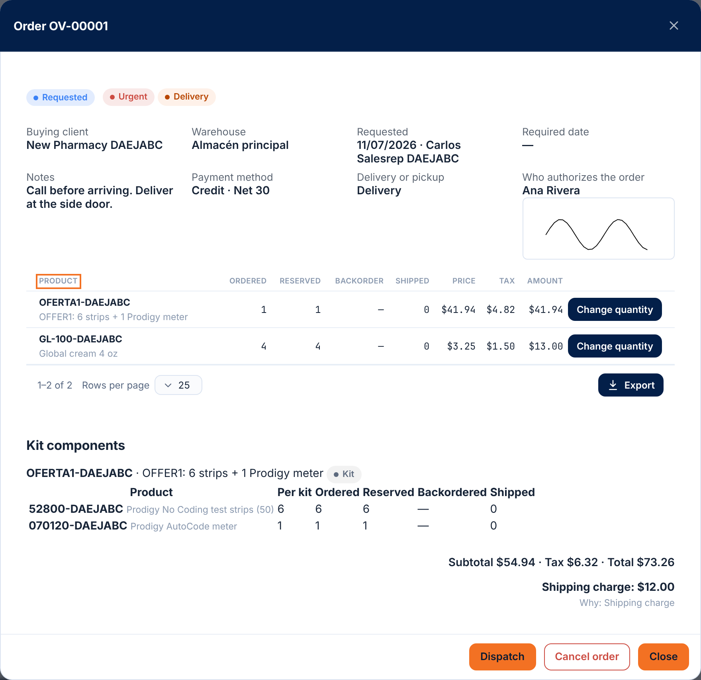
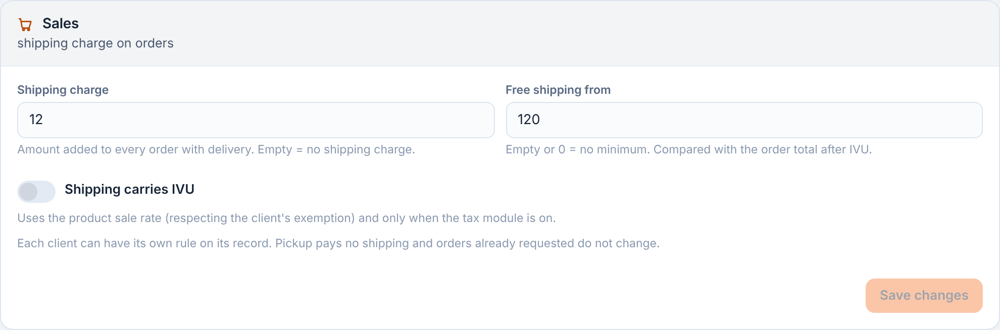

# 18 — Sales orders

Batches 57 to 64 (2026-10-15) — **S1: draft, request and reserve, backorders; S2: dispatch**. A **sales order** (OV-#####) is the document that travels from **Sales to Warehouse**: Sales asks the warehouse to dispatch something for a client. So far you can **build the order as a draft, request it (validate and reserve inventory), modify it and cancel it**; view, fill and close **backorders**; **dispatch against the order**, pickup / delivery and undo a dispatch; the web and the app come in the following batches.
**Salespeople's order (Batches 221 to 226, 2026-11-07):** the order adds urgent, delivery or pickup, payment method, shipping charge, consignment, signature of whoever authorizes and prospect client (sections 18 to 23); the price comes from lists ([47](47-precios-y-ofertas.md)); the guided order is another door to this same order ([48](48-pedido-guiado.md)); invoices go to QuickBooks ([49](49-quickbooks.md)) and what is consigned is collected separately ([19 §4e](19-facturacion.md#4e-consignment-batch-224)); with a **linked company**, the delivery of a dispatch is made by another company ([50](50-companias-enlazadas.md), section 24). In this edition, messages written in code font are the exact Spanish text the server sends, followed by their English meaning.
The full design is in `Diseño/logistica-funcionalidades-maestro.md`, section 13C. The screen is described in [L60 — Sales orders](frontend/l60-ordenes-de-venta.md) and [L63 — Dispatch](frontend/l63-despachar-orden-de-venta.md).

## 1. Who can

- Module **Sales orders (`SALES_ORDERS`)**: it comes **off**; it is turned on per company (System → Modules). With the module off, the whole API answers 403.
- Permissions (Orders category):
  - **`sales.view`** — view orders. Held by the Company admin, the **Sales** role and the Warehouse operator.
  - **`sales.create`** — create and edit the draft (and, in the next batch, request). Company admin and Sales role.
  - **`sales.cancel`** — cancel. Company admin and Sales role.
  - **`sales.price`** — write a price other than the product's sale price. **Only the Company admin**; the administrator assigns it to whoever they want.
  - **`sales.backorder`** — fill and close backorders (following batches). Company admin and Warehouse operator.
- The **Sales** role template (`sales.view`, `sales.create`, `sales.cancel`, `inventory.view`, `clients.read`) is created by the system for new companies; in existing ones the administrator creates the role and assigns those permissions to it.

## 2. The order

- **Number** `OV-#####`, unique per company, consecutive and without gaps (a failed attempt does not use up a number).
- **Client** (required): the buyer. **Consignee** (optional): only if there will be a delivery. **Warehouse**: the one that serves it, **one per order** (dispatch is per warehouse; there is no warehouse per line). With a single active warehouse that one is used; with several, if none is given the **main warehouse** is taken ([§26](#26-the-orders-warehouse-and-what-is-available-when-picking-products-batch-235)).
- **Request date** (today, in the company's time zone), **required date** (optional), **notes** (up to 500 characters) and **who requested it**.
- **Lines**: product, quantity and price. Only **the company's own products** are sold (not those of a pass-through client), active, **without repeating** in the same order. Up to 200 lines.
- **Price**: if none is written, the **product's sale price** is taken. Writing a different price requires `sales.price` (if it equals the list price it is not needed). A product **without a sale price** forces you to write the price.
- **Tax**: with the **Taxes** module on, each line computes its tax with the company's rules (chapter [17](17-impuestos.md)) and **keeps a copy**: the rate used, its percentage, the amount and whether it came out exempt (exempt product or client with a current exemption). The header stores the **subtotal** and the **tax**; the **total** is their sum. Without the Taxes module the tax is zero. If the draft's client is changed, the tax is recalculated.
- **Status**: `DRAFT` → `REQUESTED` → `PARTIAL` → `SHIPPED`; `CANCELLED`. In use so far: draft, requested and cancelled. The **with backorder** flag is not a status: the order has it while any line has a pending quantity.

## 3. What can be done

| Action | How | Permission |
|---|---|---|
| View the list (most recent first; filters: status, client and product —each with one or several values—, search box by number / client / product, only with backorder, requested or required dates; see section 25) | `GET /api/v1/sales-orders` | `sales.view` |
| View an order | `GET /api/v1/sales-orders/{publicId}` | `sales.view` |
| Create the draft | `POST /api/v1/sales-orders` | `sales.create` (+ `sales.price` if a price changes) |
| Edit the draft (what is not sent does not change; the **lines, if sent, replace** the current ones; `clearConsignee` / `clearRequiredDate` remove those values) | `PATCH /api/v1/sales-orders/{publicId}` | `sales.create` |
| Check availability and credit (does not save) | `GET /api/v1/sales-orders/{publicId}/availability` | `sales.create` |
| Request (validate and reserve) | `POST /api/v1/sales-orders/{publicId}/request` | `sales.create` |
| Modify a requested line | `PATCH /api/v1/sales-orders/{publicId}/lines/{lineId}` | `sales.create` |
| View backorders (oldest first) | `GET /api/v1/sales-orders/backorders` | `sales.view` |
| Fill a line / fill all / close with shortage | `POST …/lines/{lineId}/fulfill` · `POST /sales-orders/backorders/fulfill` · `POST …/lines/{lineId}/close` | `sales.backorder` |
| Dispatch against the order (in parts; consumes the reservation and lowers inventory) | `POST /api/v1/sales-orders/{publicId}/dispatch` | `warehouse.pick` |
| Create the delivery of a dispatch (transport order) | `POST /api/v1/sales-orders/{publicId}/delivery` | `warehouse.pick` |
| Cancel a draft or a requested order (optional comment in the history; releases what was reserved) | `POST /api/v1/sales-orders/{publicId}/cancel` | `sales.cancel` |

Orders are **never deleted**: they are cancelled. They stay in the log (creations, changes) and in the status history.

## 4. Validations and messages

| Situation | Exact message | HTTP |
|---|---|---|
| No client | `Choose the buying client.` | 400 (`clientPublicId`) |
| Client does not exist (or belongs to another company) | `Client not found.` | 404 |
| Inactive client | `The client is inactive; nothing can be sold to it.` | 422 |
| Consignee does not exist | `Consignee not found.` | 404 |
| Several warehouses and none specified | No longer an error (Batch 235): the company's **main warehouse** is taken. | — |
| Warehouse does not exist / inactive / the company has none | `Warehouse not found.` / `The warehouse is inactive.` / `The company has no active warehouses.` | 404 / 422 / 422 |
| No lines | `Add at least one product to the order.` | 400 (`lines`) |
| More than 200 lines | `The order allows at most 200 lines.` | 400 |
| Line without product | `Choose the product of each line.` | 400 |
| Product does not exist | `Product not found.` | 404 |
| Inactive product | `There is an inactive product in the order.` | 422 |
| Product of a pass-through client | `Only the company's own products can be sold.` | 422 |
| Repeated product | `A product cannot be repeated in the order.` | 400 |
| Empty or zero quantity | `The quantity must be greater than zero.` | 400 |
| More than 3 decimals / too large | `The quantity allows at most 3 decimals.` / `The quantity exceeds the allowed maximum.` | 400 |
| Negative or invalid price / more than 4 decimals | `The price is not valid.` / `The price allows at most 4 decimals.` | 400 |
| Product without a sale price | `Product {SKU} has no sale price: enter the price.` | 400 |
| Price other than the list price without `sales.price` | `Changing the price requires the pricing permission (sales.price).` | 403 |
| Lot does not exist | `Lot not found.` | 404 |
| Notes longer than 500 characters | `Notes cannot exceed 500 characters.` | 400 |
| Order does not exist (or belongs to another company) | `Sales order not found.` | 404 |
| Editing an order that is no longer a draft | `Only a draft order can be edited.` | 422 |
| Cancelling an already cancelled order | `The order is already cancelled.` | 409 |
| With Taxes on and no default rate / no current rate | `Choose the default rate in Taxes → Rules.` / `There is no tax rate in force on that date. Set one up in Taxes → Rates.` | 400 |
| Without the permission or with the module off | “No permission” | 403 |

## 6. Requesting the order: validate and reserve (Batch 58)

`POST /api/v1/sales-orders/{publicId}/request` (permission `sales.create`) moves the order from **draft** to **requested** (`REQUESTED`): the warehouse now sees it and **the inventory is reserved for it**. Validation and reservation happen **in the same transaction, under the inventory lock**: two salespeople requesting the same thing at the same time cannot sell more than there is (one gets it, the other receives the shortage notice). More than what exists is never reserved.

- **Available to sell** = what is on hand minus what is already reserved, in the **active** bins of the order's warehouse (and of the **lot**, if the line asked for one). It **does not count** quarantine, cross-dock or rented units, nor other warehouses. It is the same thing the warehouse can pick; it differs from the “Available” in the inventory table, which does add quarantine.
- **Which lot and which bin**: the system reserves following the company's rotation order (first expired / first in) and stores **exactly** which balance each line reserved (`SalesOrderReservation`) so it can release exactly that later.
- **Check first**: `GET /sales-orders/{publicId}/availability` (saves nothing) returns per line **ordered / available / short** and the **credit** status. The screen uses it to show the shortage dialog.
- **If inventory is short**: the request answers **409** with the message per line and **reserves nothing** (not even for the lines that did have enough). Sales decides: **order only what is available** (edit the quantity), **reserve what is available and leave the rest on backorder** (`allowBackorder = true`) or **remove the line**. With `allowBackorder` each line reserves what there is and the pending part stays on **backorder**; the order is flagged **with backorder** while any line has a pending quantity.
- **Credit**: the client's **credit limit** is compared with what it already has in progress (outstanding balance of its transport orders **plus** what is requested and not dispatched in its other sales orders) and this order. If it exceeds it, the response is **422** `credit_exceeded` with the notice and the figures; with `overrideCredit = true` and the `orders.credit_override` permission it is authorized: the comment “Credit exceeded authorized by …” stays in the status history and an event in the security log.
- A product **with a serial number** cannot be sold with a sales order yet (message in the table).

## 7. Cancelling and modifying a requested order (Batch 58)

- **Cancel** (`POST /sales-orders/{publicId}/cancel`, permission `sales.cancel`): a requested order **releases exactly what it had reserved** and deletes its backorder; the inventory becomes available again for other sales. An order that already had something dispatched cannot be cancelled.
- **Modify a line** (`PATCH /sales-orders/{publicId}/lines/{lineId}`, permission `sales.create`; price other than the list price, also `sales.price`): the **quantity** and the **price** of a line of a requested order can be changed as long as **nothing from that line has been dispatched**.
  - **Raising** the quantity reserves whatever there is; if it is not enough it answers 409 (or, with `allowBackorder`, the rest stays on backorder).
  - **Lowering** the quantity takes first from the backorder and then releases reservation.
  - The tax and the order totals are recalculated.

## 8. New messages (Batch 58)

| Situation | Exact message | HTTP |
|---|---|---|
| Requesting or checking an order that is not a draft | `Only a draft order can be requested.` | 422 |
| Inventory short when requesting | `Not enough inventory of {SKU}: ordered {n}, available {n}, short {n}.` | 409 (`insufficient_stock`, one message per line) |
| Credit exceeded | `The client exceeds its credit limit: limit {n}, in progress {n}, this order {n}.` | 422 (`credit_exceeded`) |
| Authorizing credit without the permission | `Missing permission 'orders.credit_override'.` | 403 |
| Modifying a line of an order that is not requested | `Only the lines of a requested order can be modified.` | 422 |
| Line does not exist | `Line not found.` | 404 |
| Closed line | `The line is closed.` | 422 |
| Product already dispatched from the line | `Product has already been dispatched from that line: it cannot be modified.` | 422 |
| Raising a quantity that is not available | `Not enough inventory of {SKU} to raise the quantity: adding {n}, available {n}, short {n}.` | 409 |
| Invalid quantity or price when modifying | `The quantity must be greater than zero.` / `The price is not valid.` | 400 |
| Price other than the list price without `sales.price` | `Changing the price requires the pricing permission (sales.price).` | 403 |
| Serialized product in a sales order | `Products with a serial number cannot be sold with a sales order yet.` | 422 |
| Cancelling an order with something dispatched | `Only a draft or requested order with nothing dispatched can be cancelled.` | 422 |

## 9. Backorders: view, fill and close with shortage (Batch 59)

A **backorder** is what was ordered and is not there yet: the line keeps its pending quantity (`QtyBackordered`) while the order remains requested.

- **View the backorders** (`GET /api/v1/sales-orders/backorders`, permission `sales.view`): all the lines with a pending quantity, **the oldest first** (first to order, first served). Per line: order, client, warehouse, product, **ordered / reserved / pending**, what is **available today** to sell and what could be **filled now** (the lesser of pending and available), and how many days it has been waiting. Search box by shipment number, client or product.
- **Fill a line** (`POST /api/v1/sales-orders/{publicId}/lines/{lineId}/fulfill`, permission `sales.backorder`): reserves for the line **whatever there is** (all of its pending quantity or part of it). It uses the same inventory lock as requesting: it never reserves more than what exists nor takes from another order. If there is nothing new, it answers 409.
- **Fill all** (`POST /api/v1/sales-orders/backorders/fulfill`, permission `sales.backorder`): goes through the backorders **from the oldest to the most recent** and fills what it can; what one line takes, the next one no longer sees. It returns what was reserved per line and how much is still pending.
- **When it can be filled**: when inventory comes in (receipt, inbound adjustment, transfer, releasing quarantine) or another order that had it reserved is cancelled. Today the automatic notice “there is stock for this backorder now” does not exist yet (it comes with the sales notices); the view always shows what can be filled.
- **Close with shortage** (`POST /api/v1/sales-orders/{publicId}/lines/{lineId}/close`, permission `sales.backorder`): marks the line as **finished without waiting any longer**: its backorder is deleted and the line is closed. **What was already reserved stays reserved** to be dispatched and the **ordered quantity is kept** (it is used to measure fulfillment). A closed line is neither filled nor modified.
- **Cancelling the shipment** deletes its backorder and releases what was reserved (section 7).

| Situation | Exact message | HTTP |
|---|---|---|
| Filling a line with no available inventory | `There is no inventory available to fill that line.` | 409 |
| Filling or closing a line without backorder | `That line has no backorder.` | 409 |
| Filling or closing in an order that is not requested | `Only the lines of a requested order can be modified.` | 422 |
| Filling or closing a closed line | `The line is closed.` | 422 |
| Line or order does not exist | `Line not found.` / `Sales order not found.` | 404 |

## 10. Dispatching against the order (Batch 61)

`POST /api/v1/sales-orders/{publicId}/dispatch` (permission `warehouse.pick`, the same as picking) takes what is reserved for the order out of the warehouse. **Dispatching always lowers inventory**, whether it is delivered or picked up. Everything happens in **a single transaction**:

1. The **reservation is consumed** for the dispatched lines.
2. The inventory **leaves through the ledger** (outbound movement with the pick batch as reference: it stays in the movement ledger).
3. The **pick batch** (`EMP-#####`) is created **linked to the order** (`PickBatch.SalesOrderId` and, per line, `PickBatchLine.SalesOrderLineId`), with the product cost frozen.
4. The **dispatched** quantity of each line goes up and the reserved quantity goes down.
5. The order moves to **partially shipped** (`PARTIAL`) or **shipped** (`SHIPPED`).

- **In parts**: several lines and less quantity than what is reserved can be sent; each dispatch creates its own pick batch. **More than what is reserved is never dispatched.**
- **Guided bin and lot, with changes allowed**: without `binId` it comes out of what the system reserved. If the operator took from **another bin** (`binId`, and `lotId` if there are lots), the reservation **moves** to that bin —if it has sellable balance— and it comes out of there; without balance it answers 409 with the inventory notice. The bin must belong to the order's warehouse, be active and sellable (no quarantine, cross-dock or rental).
- **When a line and the order are finished**: a line is **finished** when it has no reservation or backorder left. The order is `SHIPPED` when all its lines are finished and something was dispatched; with a pending backorder it stays in `PARTIAL` until it is filled or **closed with shortage** (closing the last pending line moves it to shipped).
- **Order with nothing dispatched and all lines closed with shortage**: **it cancels itself**, with the note “All lines were closed with shortage and nothing was dispatched.” in the history.
- Pickup, **delivery** (creates the transport order) and undoing a dispatch are described in section 11.

| Situation | Exact message | HTTP |
|---|---|---|
| No lines | `Specify which lines are dispatched.` | 400 |
| Unidentified line | `Specify the line being dispatched.` | 400 |
| Repeated line | `A line cannot be repeated in the dispatch.` | 400 |
| Empty or zero quantity | `The quantity must be greater than zero.` | 400 |
| Order that is neither requested nor partially shipped | `Only a requested or partially shipped order can be dispatched.` | 422 |
| More than what is reserved | `You cannot dispatch more than what is reserved: {SKU} has {n} reserved.` | 409 |
| Line or order does not exist | `Line not found.` / `Sales order not found.` | 404 |
| Bin does not exist or belongs to another warehouse | `Bin not found.` | 404 |
| Inactive bin or quarantine / cross-dock / rental bin | `Bin {code} is not sellable: it is inactive or it is a quarantine, cross-dock or rental bin.` | 422 |
| No balance in the chosen bin | `Insufficient inventory: …` (the inventory one) | 409 |
| Without the `warehouse.pick` permission | “No permission” | 403 |

## 11. Delivery and undoing a dispatch (Batch 62)

- **What happens after dispatching**: the dispatch remains as a **pick batch** (`EMP-#####`) linked to the order and the order shows its list of **dispatches** (`dispatches`): number, status (`COLLECTED` = dispatched without delivery, `PACKED` = with delivery, `CANCELLED` = undone), quantity and, if it already has one, the **transport order** of the delivery.
  - **Pickup** (the client collects): nothing else is needed; the dispatch stays as `COLLECTED` and it ends there.
  - **Delivery**: `POST /api/v1/sales-orders/{publicId}/delivery` (permission `warehouse.pick`, and `orders.create` to create the transport order) with the dispatch (`pickBatchPublicId`) and the delivery data (`order`: service, packages, COD…, the same as today's packing). **The client and the consignee come from the sales order** if they are not sent (or a new consignee is sent). It creates the real transport order, linked to the sales order (`TransportOrder.SalesOrderId`), and the dispatch moves to `PACKED`. It can also be created **later**, on a dispatch already made.
- **Undoing a dispatch** (deleting its pick batch, as today): the stock returns to its bin, the dispatched quantity of each line goes down and, if the order is not cancelled, that quantity is **reserved again** in the same bin and lot. A shipped or partial order **is reopened** (partial or requested). If the dispatch had a delivery (packed), it is deleted together with its transport order under the usual rules.

| Situation | Exact message | HTTP |
|---|---|---|
| Delivery without specifying the dispatch | `Specify the dispatch being delivered.` | 400 |
| Delivery without data | `Specify the delivery data.` | 400 |
| Dispatch that does not belong to this order | `Dispatch of this order not found.` | 404 |
| Dispatch that already has a delivery or was undone | `Dispatch {EMP-#####} already has a delivery or was undone: another one cannot be created.` | 422 |

## 12. For the device: orders to dispatch and dispatch with delivery (Batch 64)

- **`GET /api/v1/sync/sales-orders`** (SALES_ORDERS module and `sales.view` permission; the Warehouse operator has it): the orders **requested or partially shipped with something reserved**, with their lines (ordered, reserved, dispatched, backorder) and, per line, **from which bin and lot the system reserved each part** (`reservations`): it is the dispatch guide on the device. **All the open ones** always arrive (they are few and their lines change without the header changing); with `since` the ones that were closed, shipped or cancelled (`isActive = false`) also arrive so the device deletes them. Optional filter `warehousePublicId`.
- **Dispatch with delivery in a single call**: `POST /sales-orders/{publicId}/dispatch` accepts `delivery` (the same packing data: service, packages, new consignee or the order's, COD). It dispatches **and** creates the transport order in **one transaction**: if the delivery fails (for example, “Unknown service type”), the inventory does not leave and the order stays as it was. This is what the device sends, since it dispatches without signal and does not know the pick batch number until it syncs.

## 13. For support

- Tables `SalesOrder`, `SalesOrderLine` and `SalesOrderReservation` (the one that stores which balance each line reserved) and the columns `PickBatch.SalesOrderId` / `PickBatchLine.SalesOrderLineId` (section **2026-10-15 (l)**), `TransportOrder.SalesOrderId` (**(m)**) and the status adjustment of **(n)**: “Partially shipped” and “Shipped” are lateral stages so the order can be reopened when undoing a dispatch, `SALESORDER` counter, `SalesOrderStatus` status domain and `SALES_ORDER` EntityType (section **2026-10-15 (k)** of `Diseño/logistica-db-update.sql`).
- Each line stores `TaxRateId`, `TaxRatePct`, `TaxAmount` and `IsTaxExempt`: a later change of the rate does **not** alter an order already saved.
- A skipped `OV-` number does not happen: the counter is taken inside the same transaction that creates the order.

## 14. On the device: dispatching a sales order (Batch 65)

**Sales orders** screen of the device (the app's technical sheet is in [09 — Warehouse app](09-app-almacen.md#12-dispatch-a-sales-order-batch-65)).

- **Who sees it:** the “Sales orders” button on Home appears only if the device has already downloaded orders to dispatch from its warehouse (SALES_ORDERS module and `sales.view` permission in the company; the Warehouse operator has it). Without them the server answers 403 and the app skips it without reporting an error.
- **How it is used:** the `OV-#####` number is scanned (or typed), or the order is tapped in the list. The app guides **bin by bin** according to what the system reserved: “Go to A-01”, the reserved quantity is already filled in (it can be lowered, never raised), the bin is scanned and it is marked ✓. Tapping a ✓ undoes it. **Skip** leaves that part reserved for another dispatch.
- **Taking from another bin:** the other bin is scanned; the reservation moves there if it has enough stock (the server confirms it when sending and, if it is not enough, rejects it with `There is not enough stock…`).
- **When finishing:** *Pickup* (the client collects), *Delivery* (asks for the packages; only if the order has a consignee; the client and the consignee come from the order, the service and the charge from the company's values) or *Leave for later* (it stays collected; the delivery is created later from the web, section 11).
- **Without signal:** the dispatch is saved in the outbound queue (“Sales order dispatch” in Sync) and the local stock goes down immediately; the server validates it when syncing. If it rejects it, the device shows the server's exact message, removes the row from the queue, returns the stock and downloads the order again.
- **Dispatch + delivery** travel in **a single call** (section 12): if the delivery fails, the inventory does not leave.

## 15. Sales notices (Batch 66)

Sales orders publish five notices (requested, shipped, cancelled, credit to authorize and backorder that can be filled) on the notification engine: see the
table in [14 — Notifications §3.1](14-avisos.md#31-sales-order-events-batch-66). To receive them you must create the rule in **System → Notification rules**
(permission `notifications.manage`) and choose recipients and channel; without a rule nothing arrives (none is seeded).

- **Credit:** the authorization request goes out when the request fails with `The client exceeds its credit limit…` (422); whoever has the permission to authorize
  credit (`orders.credit_override`) requests again checking the authorization. The notice is there so that person finds out without being asked in person.
- **Backorder that can be filled:** the notice **does not fill**; whoever has `sales.backorder` fills from the Backorders view (section 9). The automatic mode is left for later.
- **A notice never undoes the operation:** if the e-mail fails, the order stays the same and the notice is retried (1, 5 and 30 minutes).
- **Support:** the notices stay in the delivery log (System → Notification rules → Log) per event and recipient; the `SALES_BACKORDER_SCAN` job and its history are seen in System → Scheduled jobs.

## 16. Sales order analytics (Batch 67)

With the **Sales orders** module on and the `sales.view` permission, Analytics (Pulse, Indicators, Charts and Views) offers two new data sources.
With the module off or without the permission, the sources and everything built with them do not appear.

**Source “Sales orders” (`SALES_ORDER`)**, one row per order, with the date range by creation date:

| Field | What it is |
|---|---|
| Number, Client, Warehouse, Status | Those of the order. |
| Open | Requested or partially shipped (there is still something to dispatch or waiting for inventory). |
| With backorder / Backordered units | Some line is waiting for inventory (not counting those closed with shortage). |
| Overdue | Open with a required date earlier than today (company day). |
| Order date, Required date, Requested on, Shipped on | Dates. “Shipped on” is the last change to Shipped. |
| Days to ship | From requesting it to shipping it completely; only in shipped orders. |
| Lines, Units ordered / reserved / shipped | Totals of the lines. |
| Fulfillment (%) | Shipped over ordered (maximum 100); only in shipped orders (with a closed shortage it stays below 100). |
| Subtotal, Tax, Total | Money of the order. |

**Source “Sales order lines” (`SALES_ORDER_LINE`)**, one row per line: order, client, warehouse, order status, SKU, product, ordered, reserved,
shipped, backordered, closed with shortage, **days waiting** (of the pending backorder), price, line total and tax.

**System content** (seeded automatically in each company; with the module off, it stays hidden):

| What | Name | Detail |
|---|---|---|
| Indicator (on the Pulse) | **Open sales orders** | How many are left to dispatch. |
| Indicator | **Backordered units** | Units waiting for inventory in open orders. |
| Indicator | **Sales order fulfillment (%)** | Average of shipped over ordered, orders shipped in 30 days. |
| Indicator | **Average days to ship** | From requesting to shipping completely, 30 days. |
| Chart | **Sales orders by status** | 30-day donut. |
| Views | **Sales orders**, **Sales orders by client**, **Sales order backorders** | The last one lists the lines with a pending backorder, the ones waiting the longest first. |

**Pulse → Needs your attention:** one row for each open order with a backorder that **can already be filled** (there is stock available to sell), for whoever has `sales.backorder`.
It shows fillable units, lines and days waiting (in red if over 7). **Review** opens the order; **View all** opens Sales orders. It is the same count as the
Backorders tab: what it reports is what **Fill** is going to reserve.

Database: section **2026-10-16 (o)** of `Diseño/logistica-db-update.sql` (EntityType `SALES_ORDER_LINE`); the rest is seeded by the code.

## 17. Kits in sales orders (Batch 69; redone in Batches 231 and 232)

There are **two kinds of kit** ([06 §8b](06-inventario-y-almacen.md#8b-kits-assembled-and-offer-batches-68-231-and-232-2026-11-10)) and they behave differently in the order:

| | **Offer kit** (Batch 231) | **Assembled kit** (Batch 232) |
|---|---|---|
| How it looks in the order | A line with the “Kit” badge and **its pieces underneath** | A **normal** line, no pieces underneath (it is a product with inventory) |
| What is reserved and dispatched | **The pieces** of each complete kit (by FEFO/FIFO of each piece) | **The kit itself**, from its stock and lot, like any product |
| If it is not enough | A piece is short: the shortage is counted in kits | The kit is short: **backorder**, like any product |
| “Change” a piece (17.1) and “Adjustable when ordering” | **Yes**, only here | **No**: sending pieces gives `El producto {SKU} no es un kit.` (400) |
| When it can be ordered | Only if it is in a **published, in-effect** offer for the client | Whenever it is active and has a price |
| Where it is created | In an offer ([47 §4.4](47-precios-y-ofertas.md#44-offer-kits-and-the-library-batch-231)) | In Products & inventory ([06 §8b.2](06-inventario-y-almacen.md#8b2-assembled-kit-how-it-is-used-batch-232)) |

The rest of this section (line components, available and short, reserve, dispatch and undo) describes the **offer kit**. An **assembled kit** has nothing special in the order: it is sold, reserved, picked and dispatched **like a normal product** (with its bin and lot), and its stock comes from the assembly ([06 §8b.2](06-inventario-y-almacen.md#8b2-assembled-kit-how-it-is-used-batch-232)).

An **offer kit** is sold as one more line of the order: the quantity is in **whole kits** and the price is the kit's.
Internally, everything moves in its **components**.

- **Line components.** When saving the draft, a **snapshot** of the kit's components (quantity per kit) is taken. A later change of the catalog does **not** alter the order; if
  you save the draft again, the snapshot is kept (including the adjusted pieces). To take the new catalog, remove the line and add it again.
- **Kit adjustable when ordering** (an offer kit only). If the kit was marked “Adjustable when ordering”, the **quantities per kit can be changed for this order only** in the draft (the body carries `components` in the line).
  In a fixed kit, sending `components` gives `Kit {SKU} cannot be adjusted when ordering.` (400).
- **Available and short in kits.** As many kits can be assembled as the component that yields the least allows (available to sell ÷ quantity per kit, rounded down). The shortage
  dialog, the order and the backorder count **kits**: ordered 5, available 3, short 2.
- **Reserve and release.** Requesting reserves **the components of each complete kit** (by FEFO/FIFO of each component); never half a kit. Changing the quantity, cancelling, filling a
  backorder or closing with shortage act on the components in the same way. The reservation stores the reserved product (`SalesOrderReservation.ProductId`).
- **Dispatch.** Whole kits are dispatched, **from what is reserved of their components** (no bin or lot is chosen). The pieces of each component leave through the ledger, with the note
  `{KIT} × n · EMP-… · OV-…` in the movement ledger; the pick batch carries one line per component and records the kits it represents (`PickBatchLine.KitProductId` / `KitQuantity`).
  The quantity of a dispatch in the order's dispatch list is in **kits**.
- **Undoing a dispatch** returns the components to their bin, lowers the dispatched kits and **reserves each component again**, the same as with a regular product.
- **On the web** (Operations → Sales orders): a kit line carries the “Kit” badge and shows its components underneath; in the requested order, one table per kit with ordered, reserved,
  backordered and dispatched for each component.
- **Device** (Batch 71): it dispatches kit lines **piece by piece** — see the “Kits” section of [09 §12](09-app-almacen.md#12-dispatch-a-sales-order-batch-65). The server sends the kit lines with their components and the reservation of each component (`GET /sync/sales-orders`: `isKit`, `components` and, per reservation, the product).

| Situation | Message | HTTP |
|---|---|---|
| Kit quantity with decimals | `Kit {SKU} is ordered in whole pieces.` | 400 |
| Adjusted pieces in a fixed kit | `Kit {SKU} cannot be adjusted when ordering.` | 400 |
| Pieces in a line that is not a kit (a normal product or an assembled kit) | `Product {SKU} is not a kit.` | 400 |
| Changing or adjusting the pieces of a kit that is not an offer kit (an old KIT-type kit without the offer mark) | `El kit {SKU} no admite cambiar ni ajustar sus piezas al pedir: eso solo se puede en un kit de oferta.` (The kit {SKU} does not allow changing or adjusting its pieces when ordering: that is only possible on an offer kit.) | 400 |
| Ordering an offer kit that is in no published offer in effect for the client | `El kit de oferta {SKU} no está en ninguna oferta publicada y vigente para este cliente: no se puede vender.` (The offer kit {SKU} is in no published offer in effect for this client: it cannot be sold.) | 422 |
| Ordering an assembled kit with not enough stock | The one of any product: `Not enough inventory of {SKU}: ordered {n}, available {n}, short {n}.` ([§8](#8-new-messages-batch-58)) | 409 |
| Invalid adjusted pieces | the same as in [06 §8b.3](06-inventario-y-almacen.md#8b3-rules-and-messages) (quantity, repeated, kit inside a kit, inactive, another owner) | 400 |
| Kit without components | `Kit {SKU} has no components: define them before selling it.` | 400 |
| Dispatching a kit choosing a bin or lot | `A kit is dispatched from what is reserved of its components: no bin or lot is chosen.` | 400 |
| Dispatching kits with decimals | `Kit {SKU} is ordered in whole pieces.` | 400 |
| Dispatching more kits than reserved | `You cannot dispatch more than what is reserved: {SKU} has {n} reserved.` | 409 |

For support: table `SalesOrderLineComponent` (the snapshot, deleted with the line) and columns `SalesOrderReservation.ProductId`, `PickBatchLine.KitProductId` and `KitQuantity`
(section **2026-10-16 (q)** of `Diseño/logistica-db-update.sql`).

### 17.1 Swapping a kit piece when ordering (Batch 230)

> The server only answers in Spanish, so the message table keeps the **exact Spanish text**, followed by its English meaning.

**What it does.** In an order, a piece of an **offer kit** can be **swapped** for another product (e.g. gloves of another size) if it meets **all** of this:

| Condition | Detail |
|---|---|
| **Exact same category** | The same `ProductCategoryId`: the subcategory, if it has one (Gloves → Nitrile is not swapped for Gloves → Latex). A piece **without a category** is not substituted. |
| **Sale price exactly equal** | The **product's sale price** (`Product.SalePrice`) is compared, not a list's; not a cent of difference. A piece **without a sale price** is not substituted. |
| **Same quantity** | The substitute goes in the piece's quantity (in a kit that is «Adjustable when ordering» the quantity is still free). |
| **Substitutable piece** | The piece is not marked «Not substitutable» ([06 §8b.3b](06-inventario-y-almacen.md#8b3b-not-substitutable-batch-230-2026-11-09)). By default every piece is substitutable. |
| **Valid substitute** | Active product, not a kit, of the same inventory owner as the kit and not already another piece of the same kit. |

The **kit price does not change**. Since Batch 231 it applies **only to the offer kit** (fixed or adjustable); an assembled kit has no substitution. **«Adjustable when ordering» stays as it was** (changing the
quantities of the pieces without touching the price): substitution is separate and both can be used.

**Who can.** The salesperson, with `sales.create` — **there is no separate permission**: the kit's definition decides. Module **SALES_ORDERS**.

**How to use it.** In the **guided order** (cart open) and in the order window **as a draft**, each piece with valid substitutes has a **«Change»** button: the
list (titled «Products that can replace {SKU}») shows only the allowed products (SKU, name and brand), with the hint «Same category and same price: the kit
price does not change.». Picking one makes the piece show the new product and «instead of {original SKU}», with **«Undo»**. The list does not offer the product
that is already set nor those that are already another piece of the line. «Not substitutable» pieces or those without substitutes have no button. In the saved
or requested order the real piece shows with «instead of …»; the **reservation, dispatch, cost, invoice and the device** use the **real piece**, and the order
and the invoice show the real piece.

**Who sees the pieces.** A salesperson with `sales.create` sees the kit's pieces in the draft and in the cart **even without `inventory.view`** (before, they did
not): the screen reads them from the sales service. Without `sales.create` (read-only) the warehouse kit is used, which does require `inventory.view`.

**API.** `GET /api/v1/sales-orders/kits/{kitPublicId}/substitutes` (`sales.create`, module `SALES_ORDERS`) returns each kit piece with its category, price,
whether it is «not substitutable» and its valid substitutes; it works before saving the line. In `POST/PATCH /sales-orders` the line sends **all** its pieces in
`components` and the one that changes carries `substitutesProductPublicId` = the original piece. Saving the draft again without pieces keeps the substitution. It
is validated against the kit's **current** catalog: if the catalog changed after the draft was saved, remove the line and add it again to take the new one.

| Case | Exact message (Spanish, as sent) | Meaning | HTTP |
|---|---|---|---|
| Substituting or adjusting pieces on a kit that is not an offer kit (an assembled kit or an old kit) | `El kit KIT-1 no admite cambiar ni ajustar sus piezas al pedir: eso solo se puede en un kit de oferta.` | The kit KIT-1 does not allow changing or adjusting its pieces when ordering: that is only possible on an offer kit. | 400 |
| Piece marked not substitutable | `La pieza GM del kit no es sustituible.` | Piece GM of the kit is not substitutable. | 400 |
| The «original» is not a piece of the kit | `GV no es una pieza del kit KIT-1: solo se sustituyen sus piezas.` | GV is not a piece of kit KIT-1: only its pieces are substituted. | 400 |
| Piece without category | `La pieza CAJA no tiene categoría: solo se sustituye por un producto de la misma categoría.` | Piece CAJA has no category: it is only replaced by a product of the same category. | 400 |
| Another category | `GV no es de la misma categoría que GM: solo se sustituye por un producto de la misma categoría.` | GV is not of the same category as GM: … | 400 |
| Piece without sale price | `La pieza GM no tiene precio de venta: solo se sustituye por un producto del mismo precio.` | Piece GM has no sale price: it is only replaced by a product of the same price. | 400 |
| Another price | `GXL no tiene el mismo precio de venta que GM: solo se sustituye por un producto del mismo precio.` | GXL does not have the same sale price as GM: … | 400 |
| Another quantity (fixed kit) | `El sustituto de GM va en la misma cantidad que la pieza: 2.` | The substitute of GM goes in the same quantity as the piece: 2. | 400 |
| Substitute that is already another piece | `CAJA ya es otra pieza del kit: no puede sustituir una pieza.` | CAJA is already another piece of the kit: it cannot replace a piece. | 400 |
| The same piece twice | `La pieza GM se sustituyó más de una vez.` | Piece GM was substituted more than once. | 400 |
| Substitute inactive / a kit / of another owner | `El componente GS está inactivo.` · `K2 es un kit: un kit no puede llevar otro kit como componente.` · `El componente GS es de otro dueño de inventario que el kit.` | Component GS is inactive. · K2 is a kit: a kit cannot carry another kit as a component. · Component GS belongs to a different inventory owner than the kit. | 400 |
| Fixed kit with another change besides the substitution | `El kit KIT-1 no se puede ajustar al pedir.` | Kit KIT-1 cannot be adjusted when ordering. | 400 |
| Substitutes of something that is not a kit | `El producto GM no es un kit.` | Product GM is not a kit. | 422 |
| Kit or original piece that does not exist | `Producto no encontrado.` · `Componente no encontrado.` | Product not found. · Component not found. | 404 |

The screen only offers valid substitutes, so these messages appear mostly if the catalog changed while the order was being built: the notice appears at the top
of the window (or as a step notice) and «Undo» or picking another is enough.

### 17.2 Line price, offers and warnings (Batch 229)

The line price comes from the offer, the client's list, the general list or the product, and **the lowest wins** between the client's negotiated price and the
offer in effect ([47 §2](47-precios-y-ofertas.md#2-where-the-price-of-a-line-comes-from)). In the order:

- The line of a **product or kit in an offer** keeps the offer price (`priceSource` `OFFER`); if the client's negotiated price is lower, the negotiated one stays (`CLIENT_LIST`).
- An **offer kit** can only be ordered while it is in some published, active offer in effect for the client; otherwise, `El kit de oferta {SKU} no está en ninguna oferta publicada y vigente para este cliente: no se puede vender.` (The offer kit {SKU} is in no published offer in effect for this client: it cannot be sold.) (422; [47 §4.4](47-precios-y-ofertas.md#44-offer-kits-and-the-library-batch-231)). Its price comes from the offer line; if it is in two offers in effect, the cheapest is charged and the `TWO_OFFERS` warning appears. Orders already placed do not change (the line keeps its copy); **modifying** an already requested line or changing a draft's client does **not** re-check the kit's validity (it is checked when creating or editing the draft's lines).
- **Price warnings** (they are not errors): when creating or editing the draft with lines, the response carries `linePrices[]` with, per product, where the price came from (offer or list) and the `TWO_OFFERS` and `OFFER_ABOVE_GENERAL` warnings. They are not stored: when the draft is reopened only the catalog's are seen. In the guided order they show next to the product, on the cart line and in «Price warnings» of the delivery step ([48 §2](48-pedido-guiado.md)). The lowest price is always charged.
- A price different from the resolved one requires `sales.price` (unchanged).

## Seeing the dispatch from the sale and the sale from the dispatch (2026-10-21)

- In the sales order record, the **Order dispatches** table shows the dispatch number (pick & pack) **as a link**: it opens the dispatch record (needs `pickbatches.view`; without it the number is shown without a link). The shipment created when packing is still shown in its column.
- In the dispatch record (Picking & packing) the **Sales order** field appears with its number as a link to the sale (needs `sales.view`; without it, only the number). It shows only when the dispatch was born from a sales order (API: `salesOrderPublicId` and `salesOrderNumber` in the dispatch).

## 18. Sales-rep order: what is new in the order (Batch 222)

<!-- kemi:staff -->

Batch 222 (2026-11-07). The sales order is still the same; it now carries the data that used to be asked on the salespeople's form. All of it lives in `terms` of the order DTO (`GET /sales-orders/{publicId}`) and the list carries the badges.

> Screenshot from the batch 228 walkthrough (the list badges are still pending):

| Data | What it is | API field (`terms` / body) |
|---|---|---|
| **Urgent** | The warehouse sees it first; the transport order of its delivery is born with high priority (`HIGH`) if no other is given; requesting it sends the «Urgent order» notice | `isUrgent` |
| **Delivery or pickup** | `DELIVERY` (taken to the client) or `PICKUP` (the client collects it, no shipping charge). Empty = deduced: with a consignee it is delivery, without one pickup (so older orders do not change) | `deliveryMode` / `deliveryModeSet` |
| **Payment method** and **term** | How this order is paid (section 19) | `paymentMethod`, `paymentTerm` |
| **Payment method changed** | Mark when it differs from the client's | `paymentChanged` |
| **Shipping charge** and its reason | Section 20 | `shippingCharge`, `shippingTaxAmount`, `shippingReason` |
| **On consignment** | Left with the client and collected when sold (section 19; collection in [19 §4e](19-facturacion.md#4e-consignment-batch-224)) | `isConsignment` |
| **Who authorizes** and their **signature** | Name (up to 150) and drawn signature of whoever authorizes the order | `authorizedByName`, `signatureFilePublicId` |
| **How it was sent** | `PASSWORD` or `BIOMETRIC` (only if it came from the guided order) | `submittedWithAuth` |
| **Awaiting approval** | The client is a prospect: it was reserved but is not dispatched (section 21) | `awaitingClientApproval` |
| **New client** / **requires signature** | Client data the screen needs | `clientIsProspect`, `clientRequiresSignature` |

**Where it shows.** In the order window («Order: urgency, delivery, payment and authorization» section) and in the list, with the badges **Urgent**, **Delivery** / **Pickup**, **On consignment**, **Payment method changed**, **Awaiting approval** and **New client**; the line «Shipping charge: $12.00 (plus IVU …)» or «No shipping charge», with «Why: …»; and «Signature pending» if the client requires it and it is missing.

**How it is captured (API).** `POST /sales-orders` and `PATCH /sales-orders/{publicId}` (draft; `sales.create`) accept, besides the usual: `{ "isUrgent": true, "deliveryMode": "DELIVERY", "paymentMethod": "CREDIT", "paymentTerm": "NET30", "isConsignment": false, "authorizedByName": "Ana Pérez" }`. In the PATCH, what is not sent does not change; `""` removes the value (delivery, payment method, term, name).

**New permissions and roles** (module `SALES_ORDERS` unless stated):

| Permission | What it allows | Who has it |
|---|---|---|
| `sales.pricelist` | Price lists and offers ([47](47-precios-y-ofertas.md)) | Company admin, Sales supervisor |
| `sales.approve_client` | Approve or reject prospect clients ([02 §1.8](02-clientes-y-contratos.md#18-prospect-client-minimal-sign-up-and-approval-batch-222)) | Sales supervisor (and Company admin) |
| `clients.create_basic` | Minimal client sign-up from the order; uploading its documents while it is a prospect | Sales |
| `pulse.sales` | «Sales» panel of the Day pulse (also requires `sales.view`) | Admin, Sales, Sales supervisor, Sales office |
| `sales.quickbooks.view` / `.mark` / `.export` | QuickBooks tab ([49](49-quickbooks.md)) | Sales office (and Admin) |
| `billing.consignment.pay` | Record consignment payments ([19 §4e](19-facturacion.md#4e-consignment-batch-224); module `BILLING`) | Sales office (and Admin) |

Role templates: **Sales supervisor** (`SalesSupervisor`: `sales.pricelist`, `sales.approve_client`, `sales.view`, `clients.read`, `clients.update`, `pulse.sales`) and **Sales office** (`SalesOffice`: `sales.view`, `sales.create`, `pulse.sales`, `sales.quickbooks.*`, `billing.consignment.pay`) are created by default in new companies; in a company that already existed the administrator creates them in System → Roles. **Sales** adds `clients.create_basic` and `pulse.sales`. In companies that already existed, the Company admin received the new permissions and the Sales role received `clients.create_basic` and `pulse.sales`; no other cloned role receives them on its own.

| Field / situation | Rule | Exact message (Spanish, as sent) | Meaning | HTTP |
|---|---|---|---|---|
| `deliveryMode` | DELIVERY, PICKUP or empty | `La entrega debe ser DELIVERY (entrega) o PICKUP (recogido).` | Delivery must be DELIVERY or PICKUP. | 400 (`deliveryMode`) |
| `authorizedByName` | Up to 150 | `El nombre de quien autoriza no puede pasar de 150 caracteres.` | The name of who authorizes cannot exceed 150 characters. | 400 (`authorizedByName`) |
| Requesting for a client that requires a signature, without name or signature | — | `Este cliente exige el nombre y la firma de quien autoriza el pedido.` | This client requires the name and signature of whoever authorizes the order. | 400 (`signature`) |
| Requesting for a suspended client | — | `El cliente está suspendido: no se le puede solicitar una orden.` | The client is suspended: an order cannot be requested for it. | 422 |
| Dispatching with the client not approved | — | `La orden espera la aprobación del cliente nuevo: no se puede despachar hasta que lo aprueben.` | The order awaits the new client's approval: it cannot be dispatched until they approve. | 422 |

## 19. Payment method and consignment (Batch 222)

<!-- kemi:staff -->

The order stores **how this order is paid** (catalog `SalesPaymentMethod`): **COD: check** (`COD_CHECK`), **COD: cash** (`COD_CASH`), **COD: ACH** (`COD_ACH`), **Credit** (`CREDIT`) or **Consignment** (`CONSIGNMENT`). With Credit it also stores the **term** (15, 20, 30, 45 days, or «collected by the rep»).

**The client's payment method is its payment term** (the «Payment term» field of the profile, already migrated from QuickBooks). When the order is created without choosing a method, the system **prefills** it like this:

| Client's payment term | Method that is prefilled | Credit term |
|---|---|---|
| `CHEQUE` | COD: check | — |
| `CASH` | COD: cash | — |
| `ACH` | COD: ACH | — |
| `NET15`, `NET20`, `NET30`, `NET45`, `NET60` | Credit | the same |
| `PK_BY_REP` (the rep collects; «salesperson picks up the check») | Credit | `PK_BY_REP` |
| `CONSIGNMENT` | Consignment (and «On consignment» is born checked) | — |
| `COD` (cash on delivery without saying how) | Nothing: the salesperson chooses check, cash or ACH | — |
| Any other or no term | Nothing | — |

- **«Payment method changed»**: the order is marked when its method differs from the prefilled one, so the office can decide whether to pass it on to the client. A `COD` client paying by check, cash or ACH does **not** count as a change.
- The **term** only goes with Credit, and Credit requires it.
- **Consignment**: checking «On consignment» is only possible with the Consignment payment method; changing the payment method removes it. Sales reports **do not count** what is consigned until it is paid ([19 §4e](19-facturacion.md#4e-consignment-batch-224) and section 22).

| Situation | Exact message (Spanish, as sent) | Meaning | HTTP |
|---|---|---|---|
| Unknown payment method | `La forma de pago debe ser COD_CHECK, COD_CASH, COD_ACH, CREDIT o CONSIGNMENT.` | The payment method must be COD_CHECK, COD_CASH, COD_ACH, CREDIT or CONSIGNMENT. | 400 (`paymentMethod`) |
| Credit without a term | `Indique el término del crédito (15, 20, 30 o 45 días, o cobra el representante).` | Give the credit term (15, 20, 30 or 45 days, or the rep collects). | 400 |
| Term with another payment method | `El término de pago solo se indica con la forma de pago Crédito.` | The payment term is only given with the Credit payment method. | 400 |
| Term that is not credit or does not exist | `El término de pago no es de crédito.` | The payment term is not a credit one. | 400 (`paymentTerm`) |
| «On consignment» with another payment method | `La venta en consignación exige la forma de pago Consignación.` | A consignment sale requires the Consignment payment method. | 400 (`isConsignment`) |

## 20. Shipping charge (Batch 222)

<!-- kemi:staff -->

**What it does.** Adds to an order **with delivery** a shipping charge calculated by the system, with its reason. The salesperson does not type it.

**Where it is configured.**
- **Company**: System → Settings → **Operations → Sales**: **Shipping charge** (empty = no charge), **Free shipping from** (empty or 0 = no minimum; compared with the order total **after IVU**) and **Shipping carries IVU** (uses the product sale rate, respects the client's exemption and only counts with the tax module on). API: `GET /api/v1/sales-orders/settings` (`sales.view` or `admin.tenant`) and `PATCH` (`admin.tenant`) with `{ "charge": 12, "freeFrom": 120, "taxable": true }`: no change = do not send the field; charge `0` = remove the charge; minimum `0` = remove the minimum.
- **Client** (record → «Sales» panel): **Shipping on its orders**: «The company's» (default), «No shipping charge» or «Own rule» (charge, and optional «Free shipping from»). See [02 §1.8](02-clientes-y-contratos.md#18-prospect-client-minimal-sign-up-and-approval-batch-222).

**How it is calculated** (the client beats the company):

| Case | Charge | Reason shown |
|---|---|---|
| Pickup | $0 | Pickup: no shipping |
| «No shipping charge» | $0 | No charge by agreement with the client |
| Own (or company) rule with no charge configured | $0 | (no reason) |
| Rule with a charge and the total after IVU **reaches the minimum** | $0 | Free by amount |
| Own rule with a charge | the client's | Client shipping charge |
| Company rule with a charge | the company's | Shipping charge |

A client without its own rule always uses the company's **at that moment**: a change in Settings reaches everyone who has no rule of their own.

**When it is recalculated.** When saving the draft, when requesting and when modifying a requested line. **Once invoiced it does not change.** Changing the company settings does not touch orders already requested; drafts take the new rule when saved or requested.

**How it adds to the total.** The order's `total` includes the shipping and its IVU; `subtotal` and `taxAmount` remain products only (per-product analytics do not change). The shipping's IVU is stored separately (`shippingTaxAmount`).

**On the invoice.** The shipping charge enters as a service line **«OV-##### — Cargo de envío»** (charge type `SHIPPING`) **once per order**, in the first run that invoices something of that order. Cancelling the run or voiding the invoice frees it for the next one. There is no PDF of the order or the invoice: the data is in the DTO for the screen.

| Field | Rule | Exact message (Spanish, as sent) | Meaning | HTTP |
|---|---|---|---|---|
| Charge (company or client) | Greater than zero, up to 2 decimals | `El cargo de envío debe ser un monto mayor que cero con hasta 2 decimales.` | The shipping charge must be an amount greater than zero with up to 2 decimals. | 400 (`charge` / `shippingCharge`) |
| Minimum for free shipping | Zero or more, up to 2 decimals | `El mínimo para envío gratis debe ser un monto de cero o más con hasta 2 decimales.` | The minimum for free shipping must be an amount of zero or more with up to 2 decimals. | 400 (`freeFrom` / `shippingFreeFrom`) |
| Client's rule | COMPANY, FREE or OWN | `La regla de envío debe ser COMPANY (la de la compañía), FREE (no se le cobra) u OWN (regla propia).` | The shipping rule must be COMPANY, FREE or OWN. | 400 (`shippingMode`) |
| Own rule without a charge | — | `La regla propia de envío necesita el cargo.` | The own shipping rule needs the charge. | 400 (`shippingCharge`) |
| Settings without a body | — | `El cuerpo de la solicitud es obligatorio.` | The request body is required. | 400 |
| `PATCH …/settings` without `admin.tenant` | — | `Falta el permiso 'admin.tenant'.` | Permission 'admin.tenant' is missing. | 403 |

## 21. New client (prospect) and the order (Batch 222)

<!-- kemi:staff -->

A client created from an order is born a **Prospect** ([02 §1.8](02-clientes-y-contratos.md#18-prospect-client-minimal-sign-up-and-approval-batch-222)). With a prospect client:
- The order is **built and requested** as usual: stock and credit are validated and **it reserves**.
- The order is marked **«Awaiting approval»** (`awaitingClientApproval`) and **cannot be dispatched**: `POST …/dispatch` answers 422 `La orden espera la aprobación del cliente nuevo: no se puede despachar hasta que lo aprueben.`
- When the client is **approved**, the mark is removed and it can be dispatched. When it is **rejected** (the client becomes Suspended) its open orders (draft or requested) **are cancelled** and what was reserved is released.
- A **Suspended** client cannot request orders (it could before): `El cliente está suspendido: no se le puede solicitar una orden.`
- The warehouse device receives `isUrgent` and `awaitingClientApproval` when syncing; if it tries to dispatch an order awaiting approval, the server rejects it with the message above.

## 22. Notices, Pulse and analytics of the sales-rep order (Batches 222, 224 and 225)

<!-- kemi:staff -->

**Notices and «Needs your attention».**

| Event / row | When | Who sees it |
|---|---|---|
| **«New client pending approval»** notice (`SALES_CLIENT_PENDING_APPROVAL`, cannot be muted) | When a client is created from an order | Whoever sets up the rule in System → Notification rules |
| **«Urgent order»** notice (`SALES_ORDER_URGENT`, optional) | When an urgent order is requested | Same |
| **«Invoices to pass to QuickBooks»** notice (`SALES_QUICKBOOKS_PENDING`, optional) | Daily at 07:00, only if there is something ([49](49-quickbooks.md)) | Same |
| Row «New client to approve: {name}» | While the client is still a prospect | `sales.approve_client` |
| Row «Urgent order {number}» | Open urgent order not awaiting approval | `warehouse.pick` |
| Row «Invoices to pass to QuickBooks: N» | There are unmarked invoices | `sales.quickbooks.view` |

Like all sales notices, **the bell and the email need a rule** (System → Notification rules, `notifications.manage`): none is seeded. The «Needs your attention» rows show up on their own by permission.

**Day pulse → «Sales» panel** (`pulse.sales` + `sales.view`, module `SALES_ORDERS`; `GET /sales-orders/pulse`): **Today's orders**, **Open urgent orders**, **Clients to approve**, **Orders waiting for a new client**, **Invoices to send to QuickBooks** (only with `sales.quickbooks.view`) and **Unpaid consignment** (only with `billing.view` or `billing.consignment.pay` and Billing on). Each figure opens its list.

**Analytics.** The **Sales orders** source (`SALES_ORDER`) adds the field **On consignment** (`IsConsignment`). There is a new source, **«Sales (what was sold)»** (`SALES_REVENUE`, `sales.view`, module `SALES_ORDERS`), used by the default sales indicators and charts **«Ventas (30 días)»** and **«Ventas por día»** (sales, last 30 days / by day): it counts confirmed orders (requested, partially dispatched or dispatched) that are **not** consignment on the day they were created, and **consignment payments** on the day they were paid. The order views (list, «by client», backorders) are operational and stay the same; «Today's orders» counts orders, not sales.

## 23. For support of the sales-rep order

<!-- kemi:staff -->

- Columns of `SalesOrder`, `Client` and `Tenant`, table `ClientDocument`, catalogs `SalesPaymentMethod`, `ClientDocumentType` and `ShippingReason`, charge type `SHIPPING` and the Batch 222 permissions: section «2026-11-07 — Lote 222» of `Diseño/logistica-db-update.sql` (propagation to cloned roles with the mark `L222_SALES_PROSPECT`).
- An order whose shipping charge was already invoiced (`ShippingInvoiced`) does not charge it again. If it must be freed, the invoice is voided or the run is cancelled.
- «Why is a new client's order not dispatched?»: look at `awaitingClientApproval` and the client's status.
- «Why is the payment method not prefilled?»: the client has no payment term, or it is `COD` or another that does not translate (section 19).

## 24. Delivery by the linked company (Batch 227)

<!-- kemi:staff -->

If the company has an **active link** with another that provides the transport ([50](50-companias-enlazadas.md)) and the **Linked companies (`INTERCOMPANY`)** module on, the **delivery** of a dispatch (section 11, on the web or on the device) **does not create the transport order here**: it is created in the linked company, in the name of the client that represents this company. Without a link, or with the link only proposed, or with the module off, everything goes on as in section 11.

- **Who and how:** the same as the delivery in section 11 (`warehouse.pick`; `POST /api/v1/sales-orders/{publicId}/delivery`, or the dispatch with delivery in a single call). The delivery **needs a consignee** (the sales order's or a new one) and at least one package line.
- **What happens:** in the same transaction the pick batch (`EMP-#####`) becomes **packed (`PACKED`) without a transport order here** and the delivery record is left, «To send». When it finishes it is sent to the other company; if that is not possible at that moment, the `INTERCOMPANY_SYNC` job sends it within 2 minutes or less. An **urgent** sales order is born over there with high priority and notifies the transport team over there.
- **What shows on the order:** in the list of **dispatches** (`dispatches`), each dispatch brings `linkedDelivery`: the delivery state (**To send**, **Sent** or **Could not be created**, with the message from over there), the company, the **number and status** of the order over there, **who received and when**, and **View proof** (signature and photos, read live from the other company). On those dispatches `transportOrderPublicId` is empty: there is no transport order here.
- **If the other company rejects the order** (suspended client, no current rate, service type…), the delivery is left **Could not be created** with the message from over there and a notice. It is fixed **over there** and **Retry** is pressed in Integrations / API → Linked companies (`intercompany.manage` or `warehouse.pick`).
- **Billing «on delivery»** ([19](19-facturacion.md)): the dispatch counts as delivered when the delivery over there is **Delivered** or has a proof. Before that it is not invoiced.
- **Undoing the dispatch** (section 11): it can no longer be done from here; the delivery belongs to the other company and is cancelled over there. The server answers 422 with the message of packed pick batches whose shipment already advanced (from reading the code; not tested).
- The messages in this section are in chapter [50, section 5](50-companias-enlazadas.md#5-validations-and-messages) and in the [FAQ](faq.md#batch-227--linked-companies).

## 25. Order list filters (2026-11-09)

<!-- kemi:staff -->

Requested by Luis: the **Orders** tab of Operation → Sales orders filters by more things and by several values. **Who:** whoever sees the list (`sales.view`, module `SALES_ORDERS`). The filters come in this order:

1. **Free search** (as before): order number, client code or name, product SKU or name.
2. **Dates**: the **Date** selector says which one is filtered —**Requested** (default: the day the order was created) or **Required** (the one the client asked for)— and next to it the range with **suggestions** (Today, Yesterday, Last 7 days, This week, This month…; with "Required" also Tomorrow, Next 7 days, Next week) or **Custom** (**From** and **To** appear). With "Required" and a range, an order **without a required date does not show up**.
3. **Client**: one or several, with search (searched on the server by code or name; inactive clients are included, because their orders are still there). Listing clients needs `clients.read`; without it the drop-down is empty.
4. **Product**: one or several, with search by SKU or name (orders that have **any line** of those products).
5. **Status**: one or several (Draft, Requested, Partially dispatched, Dispatched, Cancelled), with search.
6. **Only the ones assigned to me** (as before).

Within one filter **any** of the chosen values is enough; across different filters **all** are required (e.g. clients A or B **and** product X **and** status Requested). **Clear** removes every filter. Changing a filter goes back to page 1; the filters are kept when you switch to Backorders and back (not when you leave the screen). **Export** and **sorting by a column** use **all** the orders that match the filters, not only the page on screen; the "Filters: …" line of the PDF and Excel states what was chosen.

**In the API** (`GET /api/v1/sales-orders`, backward compatible: a single value works as before):

| Parameter | What it does |
|---|---|
| `status` (repeatable) | `status=REQUESTED&status=PARTIAL`: any of those statuses. |
| `clientPublicId` (repeatable) | orders of any of those clients. |
| `productPublicId` (repeatable, new) | orders with a line of any of those products. |
| `from` / `to` | date range (both inclusive). |
| `dateField` (new) | `REQUESTED` (default) or `REQUIRED`: which date `from`/`to` filter. |

| Situation | Exact message (in Spanish) | HTTP |
|---|---|---|
| `dateField` with another value | `La fecha a filtrar debe ser REQUESTED (solicitada) o REQUIRED (requerida).` | 400 (`dateField`) |

## 26. The order's warehouse and what is available when picking products (Batch 235)
<!-- kemi:staff -->

Luis's decision (2026-11-10). It applies to the **New order** window, the **guided order** ([48](48-pedido-guiado.md)) and the sellers' app.

- **The order keeps its warehouse**: one per order. There is no warehouse per line.
- **Default warehouse = the main one.** With **a single active warehouse** the field is not shown (that one is used). With **more than one**, the **Warehouse** field comes **already selected with the main warehouse** (the one marked in Warehouse → Warehouses; if none is marked, the oldest active one: [06 §1.7](06-inventario-y-almacen.md#17-main-warehouse-batch-235)) and can be changed. Whoever calls the API without `warehousePublicId` also gets the main one.
- **“Available: N”** on every line of “New order” (under the product) and every row of the guided order: what **can be sold in the order's warehouse** ([§6](#6-requesting-the-order-validate-and-reserve-batch-58): on hand − reserved, active bins, without quarantine, cross-dock or rental). **Offer kit** = complete kits that can be built with its pieces in that warehouse (with the catalog pieces; if pieces are swapped in the order, Request makes the final count). **Assembled kit** = its own stock. Changing the order's warehouse changes what is available.
- **Ordering more than what is available is allowed.** The line is **marked in red**: **“Backorder: N”** badge and “Only X available in {warehouse}; N go on backorder.” (with 1: “Only 1 available in {warehouse}; 1 goes on backorder.”; with none: “None available in {warehouse}; N go on backorder.”). **It does not block**: the order is saved with that quantity. **Requesting** works as always ([§6](#6-requesting-the-order-validate-and-reserve-batch-58)): the shortage dialog with “reserve what is available and leave the rest on backorder”. The guided order, if the line was already marked, sends `allowBackorder` directly and does not ask again.
- **Other warehouses note**: “Available in {warehouse}: N” or “Available in: {warehouse A} N · {warehouse B} M”, only if another active warehouse has stock. It is not editable: to sell from there, change the order's warehouse.

**API** — `GET /api/v1/sales-orders/stock` (module `SALES_ORDERS`, permission `sales.view`). A single query for the whole catalog: `warehouses[]` (active warehouses by code: `publicId`, `code`, `name`, `isMain`) and `products[]` (`productPublicId`, `stock[]` with `warehousePublicId` and `available`). Only the company's own active products with more than zero available in some active warehouse travel: **what is missing is 0**. It is a snapshot without locks (the screen refreshes it every 30 seconds and when an order is saved); Request has the final word.

| Situation | What you see | HTTP |
|---|---|---|
| Quantity above what is available in the order's warehouse | On-screen notice, not an error: “Only X available in {warehouse}; N go on backorder.” | — |
| Requesting without accepting the backorder | `No alcanza el inventario de {SKU}: pedido {n}, disponible {n}, faltante {n}.` | 409 |
| Without `sales.view` or without the module | What is available is not shown and the Warehouse field is the usual one | 403 |
