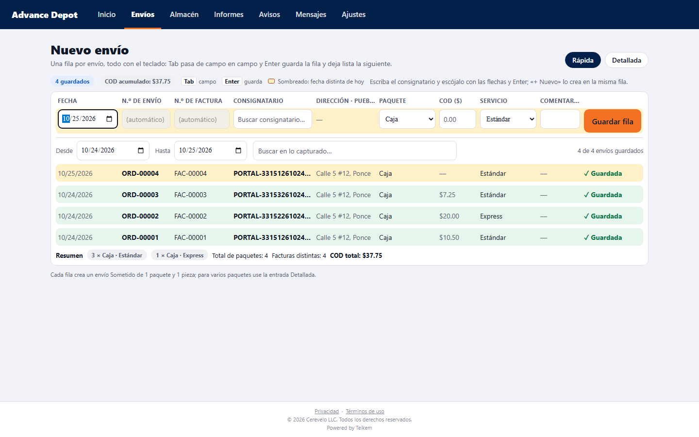

# 30 — New shipment from the client portal

Batch 105 (client portal, 2026-10-17) and **Batch 213 (2026-10-23, dictated by Luis)**: the portal's “New shipment” has **the same fields and the same functions as “New shipment” in the company's web app** (chapter 03), except what does not apply to the client (the client comes from the session; there is no price, credit authorization, special delivery or “Print label on save”). The shipment **enters the normal flow directly** (it is born Submitted, the same as one created by the company).

## 1. Who can
| Portal role | Create shipments |
|---|---|
| `CLIENT_ADMIN` (administrator) | Yes |
| `CLIENT_OPERATOR` (operator) | Yes |
| `CLIENT_READONLY` (view only) | No: does not see the “New shipment” button; through the API, **403** “Your user can only view. Ask an administrator at your company to let you create shipments.” |

Module **CLIENT_PORTAL** on. The client **comes from the session** (never from the body): whatever is sent as the client is ignored, and the shipment always stays with the client of whoever signed in.

## 2. Two ways to enter it
- **Wide web (computer):** **Quick / Detailed** selector at the top right; the last one used is remembered (by default, Quick).
- **Installed app, tablet and phone: Detailed only.** The quick entry is exclusive to the web on a computer.
- **View per device (Luis's rule, 2026-10-24):** the **installed app, tablets and phones** (also in the browser, even if the tablet measures 1194 px or more) see the mobile form: tabs at the bottom, cards and **only the Detailed entry**. The **web on a computer** (fine pointer and window of 900 px or more) sees the wide form: top bar, tables and the Quick entry with the keyboard. A computer browser with a narrow window (less than 900 px) also falls into the mobile form.

### 2.1 Quick entry (wide web) — everything with the keyboard
One row per shipment (1 package, 1 piece), like the staff's “Quick entry”. Columns (**always the same as in the quick entry of the company's web app**): **Date** (browser calendar; it is the ready date and the due date), **Shipment no.** and **Invoice no.** (typed only if the company lets the client assign its numbers; if not, they appear **dimmed with “(automatic)”** and Tab skips them, the same as in the company's web app), **Consignee** (search box with autocomplete: name, number, address or town), **Address · Town** (read-only, from the chosen one), **Package type** (dropdown; the client's or the company's default comes in), **COD**, **Service** (dropdown; default) and **Comment**.
- **Tab** moves from field to field; **↑/↓ arrows and Enter** choose in the consignee list (the last option is “+ New consignee “…””, which opens the name, address, town, state and postal code fields in the same row); **Enter in any other field saves the row**.
- The saved row stays below, read-only, with its waybill (tap it to open the shipment); the new row keeps **date, service and package type** and the cursor returns to the date. At the top: how many saved and the **COD total**.
- A row with a date other than today is shaded. Errors (from the client or the server) appear under the row, mark the field and **do not erase what was typed**.

**The table of what was entered: filters and summary (2026-10-23).** Under the entry row, a bar with two filters and, at the foot, a summary:
- **From / To:** the date range shown; on opening, both are **today**. **Entering a shipment with another date widens the range by itself**: with a later date the “from” stays on today and the “to” moves to that date; with an older one the “from” moves down. That way what was just entered is always visible. If one end is moved by hand it is never left backwards (the other follows), and shortening the range hides what is outside. The counter says “N of M saved shipments” (M = everything saved in this session).
- **Search what was entered:** a free-text box that searches **any data** of the shipment (waybill, order and invoice number, consignee, address, package type, service, COD, comment, date). With several words all of them must be present; case and accents do not matter. With no matches it says “No saved shipment matches the dates and the search.”
- **Summary (foot):** “**N × Package type · Service type**” for each combination (the most numerous first), **Total packages**, **Distinct invoices** and **Total COD** of what is being shown: for example “8 × Box · Standard”, “3 × Envelope · Express”, “Total packages: 11”, “Distinct invoices: 9”, “Total COD: $412.50”. It changes with the range and the search. **Distinct invoices** counts numbers, not shipments: in the invoice field several can be entered **separated by comma** and **each comma is another number** (“F-2, F-3” are two); a repeated number (even if the case changes) counts only once, and shipments without an invoice do not add up.
- It is the same table and the same behavior as the “Quick entry” of the company's web app (texts “entries saved” over there).

### 2.2 Detailed entry (wide web and phone)
Three steps and the **Shipment ticket** (summary without price) on the right in the wide web, or at the end on the phone:
- **01 Service and dates:** service type (the company's catalog, with the default), **ready date** (from today on) and **due date** (not before the ready date), Order no. and Invoice no. (each one only if the client assigns it; if not, it is shown dimmed as “(automatic) · Assigned by the company”).
- **02 Consignee:** search box with autocomplete; on choosing one, **Number, Address, Town, Postal code and Phone** are shown read-only. “+ New” opens the fields of the new consignee (name, address and town required). If the client has pickup points, the **Pickup** dropdown (“Where it is usually picked up” by default).
- **03 Packages and COD:** per package, package type, description, pieces (integer ≥ 1) and weight in kg (optional); from 1 to 50 packages; **COD** optional.
- **Notes** (up to 500 characters) and a single **Save shipment**.

### 2.3 Consignee that does not exist: typed and saved right there, without a mouse (Batch 213)
In the quick and the detailed entry, on typing the name of a consignee that is not there and pressing **Enter** (or choosing “+ New consignee “…”” at the end of the list), the **New consignee** block opens right there with **Name\*, Address\*, Town\*, State, Postal code and Phone (optional)**:
- The focus lands by itself on the first required field that is missing (almost always the address: the name already comes from what was typed). **Tab** goes through the fields.
- **Enter in any field of the block saves the consignee on the server at once**: if name, address or town is missing, it takes the focus to the first missing one and warns “Enter the consignee's name, address and town.”; if it is complete, it saves it, leaves it **chosen** (with its number and phone) and the focus continues by itself: in the quick entry, to the **Package** of the same row; in the detailed entry, to the **type of the first package**. **Tab from the last field** also saves and continues. **Esc** cancels.
- The row's data (date, number, invoice…) is not lost. With the block open and complete, **Enter in another field of the row** saves the consignee and also saves the shipment at once.
- The consignee stays saved even if the shipment fails afterwards (for example, because of credit): there is no need to type it again, and typing its name again already finds it in the list. If one already existed with the same name and address (regardless of case or accents) that one is used: **it is not duplicated**.
- Administrator or operator only; the phone is optional (if it comes in a format the system does not understand, nothing is created and the error appears in the block).

### 2.4 Common rules
- The **service type and the package type** come preselected with the **client's** default (if it has one and it is enabled) or the **company's**; if the company offers no catalog, the server uses its default.
- If the new consignee matches one that already exists, the existing one is used. Consignee and new consignee are never sent at the same time.
- **It is not possible** to choose price, priority or special delivery; the company decides that through the contract.

On creation, the shipment record opens with its waybill and its progress bar. The same rules of the company's web app apply: numbering, waybill, credit, suspended client (422) or deactivated client (409), repeated invoice.

## 3. Error messages
| Situation | Code | Message |
|---|---|---|
| View-only role | 403 | “Your user can only view. Ask an administrator at your company to let you create shipments.” |
| No consignee | 400 | “Choose the consignee or enter a new one (name, address and city).” |
| Consignee and new consignee at the same time | 400 | “Choose a consignee or enter a new one, not both.” |
| No packages | 400 | “Add at least one package.” |
| More than 50 packages | 400 | “A shipment can carry up to 50 packages.” |
| Long notes | 400 | “Notes cannot exceed 500 characters.” |
| New consignee without name | 400 | “The consignee name is required.” |
| New consignee without address | 400 | “The consignee address is required.” |
| New consignee without town | 400 | “The consignee town is required.” |
| New consignee with invalid phone | 400 | the phone's (e.g. “The value is required.” or the country's format one); nothing is created |
| New consignee with view-only role | 403 | “Your user can only view. Ask an administrator at your company to let you create shipments.” |
| Due date before the ready date | 400 | “The due date cannot be before the ready date.” |
| Ready date in the past | 400 | the company web app's (“The requested date cannot be before today.”) |
| Service or package type off or nonexistent | 400 | “Unknown service type: X.” / “Unknown package type: X.” |
| Order no. typed when the company assigns it | 400 | the numbering one (“The order number is assigned by Teikem for this client; leave it blank.”) |
| Invoice no. typed when the company assigns it | 400 | “The invoice number is assigned by Teikem for this client; leave it blank.” |

On screen, before sending: “Choose the service type.”, “Choose the package type.”, “The ready date must be today or later.”, “The due date cannot be before the ready date.”, “Pieces must be a whole number, 1 or more.”, “Weight must be a number.”, “The amount must be a number.”, “The order/invoice number cannot exceed 40 characters.”.

## 4. Endpoints
- `GET /api/v1/portal/order-form`: whether I can create; my consignees (`code`, address, `phone`) and pickups; `maxPackages`; `clientTypesInvoiceNumber`, `clientAssignsOrderNumber`; `serviceTypes` and `packageTypes` (code and label in the session's language, only those enabled for the company); `defaultServiceType`, `defaultPackageType`.
- `POST /api/v1/portal/consignees` (Batch 213): `name`, `line1`, `city` required; `line2`, `state`, `postalCode`, `phone` optional. Responds with the consignee as the form sees it (`publicId`, `code`, address, `phone`); if an identical one already existed, responds with that one (without duplicating).
- `POST /api/v1/portal/orders` (header `Idempotency-Key`): `consigneePublicId` **or** `newConsignee`, `pickupPublicId`, `serviceType`, `packages[]` (`packageType`, `description`, `pieces`, `weightKg`), `codAmount`, `orderNumber`, `clientInvoiceNumber`, `requestedDate` (ready date), `promisedDate` (due date), `notes`. Responds with waybill, shipment number and status.
- See the shipments: `GET /api/v1/portal/orders` (chapter 26; since Batch 213 with date filter `fromUtc`/`toUtc` on the screen).

## 5. Frequent cases
- **The new consignee was saved but the shipment was not:** it is normal if the server rejected the shipment (credit, date…): the consignee is already in your list; correct what the message says and save again.
- **I do not see the “New shipment” button:** your role is view only; have the company change your role (client record → Portal users, in the company's web app).
- **On the phone or the tablet the quick entry does not appear:** it is like that on purpose: in the installed app, the tablet and the phone only the detailed entry exists. The quick entry belongs to the web on a computer (window of 900 px or more).
- **Tab on the date does not leave the field on the first try:** the browser calendar goes through month, day and year with Tab before moving to the next field (browser behavior).
- **My shipment appears “Submitted”:** that is how all shipments are born (Batch 106): it is already quoted if your account has a contract and rate, and while it stays Submitted it can be corrected; afterwards it is picked up and advances by itself.
- **The service dropdown does not bring the one I use:** the company turned it off for your account or for everyone; ask the company for it.
