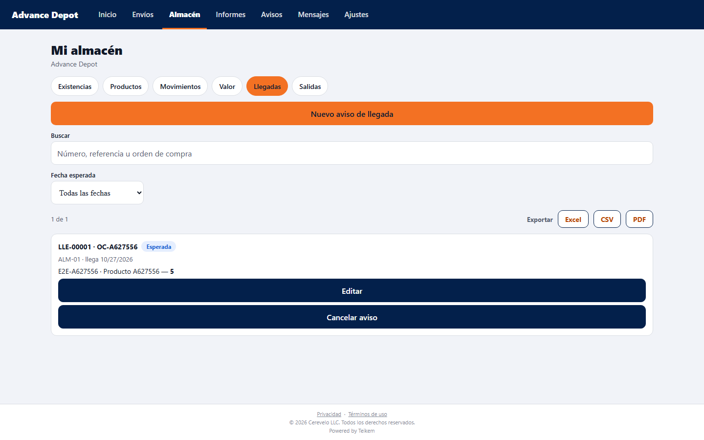

# 41 — Warehouse client portal (server)

Batch 153 (2026-10-20). Portal session (`/api/v1/portal/*`): the account signs in to **one company and one client** at a time; if it has access to several (for example, warehouse in one company and transport in another), it switches with “Switch access” (`POST /portal/auth/switch-client`) without another password or second step. The menu comes from what that company offers (`GET /portal/me` → `capabilities`).

| What | Route | Who | Detail |
|---|---|---|---|
| My stock | `GET /portal/warehouse/stock` | any access of the client with warehouse | by product, lot and warehouse; the search box looks at SKU, name, barcode, **lot number and warehouse (code or name)** (2026-10-24); at most 100 per page |
| My products | `GET /portal/warehouse/products` | same | with the total on hand; inactive ones with `includeInactive` |
| My movements | `GET /portal/warehouse/movements` | same | `from`/`to` (company days) and search box (product, SKU, barcode, lot, serial or note); without bin or user |
| Value of my inventory | `GET /portal/warehouse/valuation` | **ADMIN or OPERADOR** of the client | company valuation (average or by layers) |

Errors: 403 “The user has no active access to the portal.” (session without client), 403 “Your access does not include seeing the inventory value.” (read-only access), 403 with the module-off notice if the company has no warehouse. A product or movement of another client never appears.

## Portal screens (client app)

Batch 154 (2026-10-20). The tab bar of `app-cliente` follows the **active company** (`capabilities` of `GET /portal/me`):

| The company offers | Tabs | Opens on |
|---|---|---|
| Transport only | Home, Orders, Notices, Messages, Settings | Home |
| Warehouse only | Warehouse, Notices, Messages, Settings | Warehouse |
| Both | All | Home |

**Date filters and search boxes (2026-10-24, Batch 213):** **Movements**, **Arrivals** and **Exits** have the same date filter as My shipments (Today, Yesterday, Last 7 days, This week, Last week, Last 30 days, This month, Last month, This year, Custom with From/To): in Movements it filters by the day of the movement, in Arrivals by the **expected date** (`from`/`to` of `GET /portal/warehouse/arrivals`) and in Exits by the **requested date** (`from`/`to` of `GET /portal/warehouse/exits`). **Arrivals** now also has its search box (notice number, reference or purchase order). The search boxes wait until you stop typing. When exporting (Excel, CSV or PDF) the filter sentence states the search and the range.

The **Warehouse** tab has four sections: **Stock** (by product, lot and warehouse), **Products**, **Movements** and **Value** (only if the access is ADMIN or OPERADOR). Each list has a search box and “Load more”. Quantities and prices are in the company's currency. In Settings, whoever has access to several companies sees “Client · Company” and when switching, the menu is rebuilt with what the new company offers.

## What the client creates from its portal (Batch 156)

Three things that the company turns on **per client** in the client record (Clients → profile → “What the client creates from its portal”; with the warehouse module; off by default). Only the client's **ADMIN or OPERADOR** accesses use them; the read-only one does not. Everything is created in the name of the session's client (no client is chosen) and with **the same rules and messages as the staff** (same services): whatever is rejected on the staff screen is rejected the same way here.

| What | Route | Detail |
|---|---|---|
| Warehouses to choose from | `GET /portal/warehouse/warehouses` | the company's active ones; with only one it is chosen automatically |
| Create product | `POST /portal/warehouse/products` | SKU, name, barcode, brand, optional purchase cost, lot-tracked or not; the owner is the client |
| Edit product | `PATCH /portal/warehouse/products/{publicId}` | name, barcode, brand, model, weight, volume and cost (what is not sent stays the same; empty barcode, brand and model remove them). The SKU, lot/serial control and the unit are not changed here. Only products of the session's client; in the app, “Edit” button on each product (with the same permission as “New product”) |
| My arrival notices | `GET/POST /portal/warehouse/arrivals`, `POST …/arrivals/{id}/cancel` | only the client's products; optional unit price (if the product has no cost, it takes the one from the first line); cancel only while still expected and without receipt |
| My exit notices | `GET/POST /portal/warehouse/exits`, `GET …/exits/{id}`, `POST …/exits/{id}/cancel` | reserves on the spot whatever there is and leaves the rest pending; cancel only while still requested |

In the app, the “Arrivals” and “Exits” tabs and the “New product” button appear only if the company turned it on for that client (`capabilities.canCreateProducts/Arrivals/Exits` of `GET /portal/me`).

Errors: 403 “Your company does not allow you to create products from the portal.” / “…arrival notices…” / “…exit notices…” (flag off), 403 “Your access is read-only and cannot create documents.”, 404 if the notice or the product belongs to another client (what belongs to others is never seen, edited or cancelled), 400 “There is no change to save.” when editing without sending anything, and the staff's 400/422 (product of another client, invalid quantity, repeated SKU, etc.).

### Editing what the client created (Batch 158)

| What | Route | Detail |
|---|---|---|
| Edit my arrival notice | `PATCH /portal/warehouse/arrivals/{id}` | warehouse, reference, date and lines; only while still expected and without an open receipt (same messages as the staff) |
| Edit the data of my exit notice | `PATCH /portal/warehouse/exits/{publicId}` | reference, destination, required date and notes (empty text removes them); only while still requested |
| Change the quantity of a line | `PATCH /portal/warehouse/exits/{publicId}/lines/{lineId}` | readjusts the reservation (up: reserves whatever there is; down: releases the backorder first) |

The same client creation flag is required; what belongs to others responds 404. In the app, each editable notice has the “Edit” button. When choosing a product in an exit notice, what is available is shown in parentheses.
