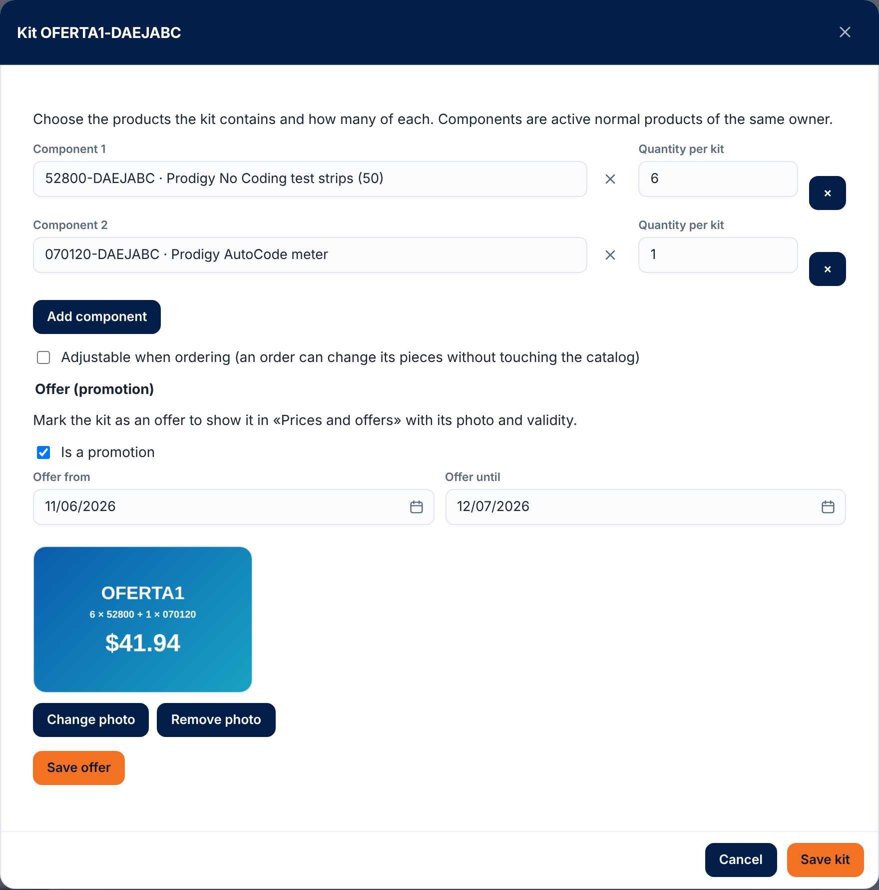

# 47 — Price lists and offers

<!-- kemi:staff -->

> **English edition.** Translation of the Spanish chapter `docs/manual/47-precios-y-ofertas.md`. The server only answers in Spanish, so every "Exact message" column keeps the **exact Spanish text** the screen shows, followed by its English meaning.

Batch 221 (2026-11-07) — salespeople's order, part P1. The **price of what is sold** is no longer typed: it comes from a **price list** set up by the sales supervisor, and **offers** are kits on promotion with a photo and validity dates. This chapter is for the sales supervisor, the office and support. The order that uses these prices is described in [48 — Guided order](48-pedido-guiado.md) and the order itself in [18 — Sales orders](18-ordenes-de-venta.md).

The screen is in **Accounting → Prices and offers** (`/money/prices`), right before «Sales». The menu item only shows with `sales.pricelist` (Company admin and Sales supervisor; a salesperson with only `sales.view` no longer sees it). It used to be a tab of Products and inventory: the old link `/warehouse/products?tab=prices` redirects to the new screen. At the top there are two buttons: **New price list** and **New offer** (pick an own product and the kit editor opens; if it is not a kit yet, define its components and after saving the «Offer (promotion)» section appears with photo, validity and «Is a promotion»).

> Screenshots from the batch 228 walkthrough (2026-11-07, demo data).

## 1. Who can and where

- Module **Sales orders (`SALES_ORDERS`)**. With the module off, the whole API answers 403.
- Permissions:
  - **`sales.view`** — view the guided-order catalog (the «Prices and offers» screen itself requires `sales.pricelist`).
  - **`sales.pricelist`** — create, publish, change and deactivate lists; add or remove the photo; mark a kit as an offer and set its validity. Implies `sales.view`. Held by the **Sales supervisor** role (`SalesSupervisor`) and the **Company admin**.
  - **`sales.price`** — remains the exception: writing on an order line a price different from the one that came from the list. Only the Company admin, or whoever they designate.
- Seeing the photo of an offer or a line requires being able to see products (`inventory.view`, which the Sales role has); uploading it requires `sales.pricelist`.
- In companies that already existed, the new permission was added to the already-cloned Company admin roles; the «Sales supervisor» role is created by the administrator in System → Roles if the company does not have it.

## 2. Where the price of a line comes from

When an order line is created or edited (and in the guided order), the server looks for the price in this order and keeps the first one it finds:

1. **The client's price list**: a **published** list, **in effect today**, that applies to that client and carries the product (or kit).
2. **The general list**: a published, in-effect list that applies to all clients and carries the product.
3. **The product's sale price** (`Product.SalePrice`).
4. None: the product **has no price** and the line is rejected (see section 6).

Rules worth knowing:
- The salesperson **does not type prices**. A price different from the resolved one requires `sales.price` (403), unless it is the one the line already had in the draft.
- The price date is **today**, when the line is created or edited (not the order date). An order already placed **does not change** if the list changes later: the line keeps its price.
- If the client of a draft is changed without touching the lines, a line that had the previous client's resolved price takes the new client's; one that had an exceptional price (with `sales.price`) keeps it.
- If, because of old data, two lists of the same level carry the same product on the same date, the one that started later wins.
- A **kit** (and an offer) goes into a list like any product: its price is the price of the whole kit.

## 3. Price lists

**What it does.** A list has a name, validity (**from** required, **until** optional: empty = no end), notes (up to 500 characters), the **lines** (product or kit → price, with an optional photo) and whom it **applies to**: all clients (general list) or only chosen clients (negotiated prices: gloves, boxes, monitor, test strips).

**Who can.** View: `sales.view`. Everything else: `sales.pricelist`. Module `SALES_ORDERS`.

**How to use it (screen).** **Accounting → Prices and offers** → **Price lists** block.
1. **New price list**: name, «Valid from», «Until (optional)», notes and the «Applies to all clients» checkbox. **Create list** leaves it as a **draft**.
2. In the list window: **Save details**; **Lines** (choose product or kit, type the price, **Add**; each line can have its price changed, be removed or get a photo); **Clients of the list** (**Add client**; only if it is not general).
3. **Publish**: from then on the list gives prices within its dates. **Back to draft** takes it out of use. **Deactivate** / **Reactivate** withdraw or return it (it is never deleted).
4. The list of lists shows name, validity, status (Draft / Scheduled / In effect / Expired), «Applies to» and number of lines; filter by status, search by name and **Show deactivated**.

**How to use it (API).** `/api/v1/price-lists`:

| Action | Call | Permission |
|---|---|---|
| View lists (`q`, `state`, `includeInactive`) / one list | `GET /price-lists` · `GET /price-lists/{publicId}` | `sales.view` |
| Create as draft | `POST /price-lists` `{ "name": "Negotiated prices: gloves", "validFrom": "2026-11-10", "validTo": null, "appliesToAll": false, "notes": "…" }` | `sales.pricelist` |
| Edit (what is not sent does not change; `clearValidTo: true` removes the end date) | `PATCH /price-lists/{publicId}` | `sales.pricelist` |
| Publish / back to draft | `POST …/publish` · `POST …/unpublish` | `sales.pricelist` |
| Deactivate / reactivate | `POST …/deactivate` · `POST …/reactivate` | `sales.pricelist` |
| Add or change lines | `POST …/items` `{ "items": [ { "productPublicId": "…", "price": 12.5 } ] }` | `sales.pricelist` |
| Change a price / remove a line | `PATCH …/items/{itemId}` `{ "price": 11 }` · `DELETE …/items/{itemId}` | `sales.pricelist` |
| Line photo (JPG, PNG, WEBP or GIF) | `POST …/items/{itemId}/image` (multipart `file`) · `DELETE …/items/{itemId}/image` | `sales.pricelist` |
| Add / remove clients | `POST …/clients` `{ "clientPublicIds": ["…"] }` · `DELETE …/clients/{clientPublicId}` | `sales.pricelist` |

**Fields and rules.**

| Field | Rule |
|---|---|
| Name | Required, up to 120 characters. |
| Valid from | Required. |
| Until | Optional; cannot be earlier than «from». Both ends count as in effect. |
| Notes | Up to 500 characters. |
| Applies to all clients | A general list carries no chosen clients; a client list needs at least one to be published. |
| Lines | Up to 2000; only the company's **own** active products or kits; no repeats; price from 0 up with up to 4 decimals. |
| Clients | Up to 2000; must be active clients. |
| Photo | JPG, PNG, WEBP or GIF (checked by content), up to the file store limit. Removing it only unlinks it: the file is not deleted. |

**List overlaps.** Two **published** lists of the same audience (two general ones, or two client lists that share a client) cannot give a price to the same product on overlapping dates: the server rejects it with 409 and cites up to 5 SKUs. A general list and a client list **can** carry the same product (the client's wins). Overlaps are checked when publishing and on every change of a published list (dates, lines, clients, reactivate). A seasonal list on top of the base one is allowed if it does not repeat products.

## 4. Offers (kits on promotion)

**What it does.** An **offer** is a **kit** (chapter [06 §8b](06-inventario-y-almacen.md#8b-kits-batch-68-2026-10-16)) marked «Is a promotion», with an optional **photo** and **validity**. On the screen they show as cards with their photo (what the salesperson will see in the guided order, above their brand). Outside its validity it **cannot be sold**: it cannot be put on a new line or on a draft that is saved again. Orders already placed do not change (the line keeps its price and the copy of its components).

**Who can.** View: `sales.view` or `inventory.view`. Mark, set dates and add the photo: `sales.pricelist`.

**How to use it (screen).** Open the kit in the product editor (Products → the kit): **Offer (promotion)** section → check **Is a promotion**, type «Offer from» / «Offer until» (optional) and press **Save offer**; then **Add photo** (the photo button is enabled once the mark is saved). The kit's card in «Prices and offers» opens this same editor with **Edit offer**. The offer's **price** is not in the kit: it is set as a line of a price list (section 3).

**How to use it (API).** `GET /products/{publicId}/promo` (`sales.view` or `inventory.view`) · `PUT /products/{publicId}/promo` `{ "isPromotion": true, "promoFrom": "2026-11-10", "promoTo": "2026-12-31" }` (`sales.pricelist`; missing or `null` dates = no such date) · `POST /products/{publicId}/promo/image` (multipart) · `DELETE /products/{publicId}/promo/image` · `GET /price-lists/offers` (offers with `inEffect` = sold today).

Offer status on the card: **In effect**, **Scheduled** (starts later) or **Expired**.

Turning a kit back into a normal product removes the offer mark; the validity and photo stay in case it becomes a kit again.

## 5. The order catalog

`GET /api/v1/sales-orders/catalog?clientPublicId=<client>` (`sales.view`) feeds the guided order: the **brands** (`Product.Brand`) with active products, and per brand its **offers in effect** (with photo) and the **full list** of products and kits, each with the price already resolved for the client. Without `clientPublicId`, the prices of the general list.

- Only own, active products **without a serial number**.
- Brands are grouped ignoring case; products without a brand go last (`brand = null`).
- `priceSource` says where the price came from: `CLIENT_LIST`, `GENERAL_LIST`, `PRODUCT` or `NONE` (**no price**: it cannot be ordered without `sales.price`).
- Offers outside their validity do not appear. An offer is not repeated in its brand's list.
- Client does not exist: 404 `Cliente no encontrado.` (Client not found.); inactive client: 422 `El cliente está inactivo; no se le puede vender.` (The client is inactive; nothing can be sold to it.)

## 6. Validations and messages

| Field / situation | Rule | Exact message (Spanish, as sent) | Meaning | HTTP |
|---|---|---|---|---|
| Body | Required | `El cuerpo de la solicitud es obligatorio.` | The request body is required. | 400 |
| List name | Required | `Indique el nombre de la lista de precios.` | Give the price list a name. | 400 (`name`) |
| List name | Up to 120 | `El nombre de la lista no puede pasar de 120 caracteres.` | The list name cannot exceed 120 characters. | 400 |
| Valid from | Required | `Indique desde qué fecha vale la lista.` | Say from which date the list is valid. | 400 (`validFrom`) |
| Until | Not before «from» | `La fecha «hasta» no puede ser anterior a la fecha «desde».` | «Until» cannot be earlier than «from». | 400 (`validTo`) |
| Notes | Up to 500 | `Las notas no pueden pasar de 500 caracteres.` | Notes cannot exceed 500 characters. | 400 |
| List does not exist | — | `Lista de precios no encontrada.` | Price list not found. | 404 |
| Line does not exist | — | `Renglón de la lista no encontrado.` | List line not found. | 404 |
| Deactivated list | Cannot be changed | `La lista de precios está desactivada: reactívela para cambiarla.` | The price list is deactivated: reactivate it to change it. | 422 |
| Lines | At least one | `Indique los productos y sus precios.` | Give the products and their prices. | 400 (`items`) |
| Lines | Up to 2000 | `Una lista admite como máximo 2000 renglones.` | A list admits at most 2000 lines. | 400 |
| Line without product | — | `Escoja el producto o kit de cada renglón.` | Choose the product or kit of each line. | 400 |
| Line without price | — | `Indique el precio de cada renglón.` | Give the price of each line. | 400 |
| Price | 0 or more; up to 4 decimals | `El precio no es válido.` / `El precio admite como máximo 4 decimales.` | The price is not valid. / The price admits at most 4 decimals. | 400 |
| Repeated product | — | `El producto {SKU} viene repetido.` | Product {SKU} comes repeated. | 400 |
| Pass-through client's product | Own products only | `Solo se ponen en una lista productos propios de la compañía.` | Only the company's own products go in a list. | 422 |
| Inactive product | — | `El producto {SKU} está inactivo: no se puede poner en la lista.` | Product {SKU} is inactive: it cannot go in the list. | 422 |
| Product does not exist | — | `Producto no encontrado.` | Product not found. | 404 |
| Clients | At least one when adding | `Escoja los clientes de la lista.` | Choose the clients of the list. | 400 (`clientPublicIds`) |
| Clients | Up to 2000 | `Una lista admite como máximo 2000 clientes.` | A list admits at most 2000 clients. | 400 |
| Client does not exist | — | `Cliente no encontrado.` | Client not found. | 404 |
| Inactive client | — | `El cliente está inactivo; no se le puede vender.` | The client is inactive; nothing can be sold to it. | 422 |
| Client not in the list | — | `Cliente de la lista no encontrado.` | List client not found. | 404 |
| Clients on a general list | — | `La lista aplica a todos los clientes: no lleva clientes escogidos. Desmarque «aplica a todos» para escogerlos.` | The list applies to all clients: it carries no chosen clients. Uncheck «applies to all» to choose them. | 422 |
| Making a list with clients general | — | `La lista tiene clientes escogidos: quítelos antes de hacerla general (aplica a todos).` | The list has chosen clients: remove them before making it general. | 422 |
| Publish without lines | — | `Agregue al menos un renglón antes de publicar la lista.` | Add at least one line before publishing the list. | 422 |
| Publish without clients (not general) / remove the last client of a published list | — | `Escoja al menos un cliente o marque que la lista aplica a todos los clientes.` | Choose at least one client or mark that the list applies to all clients. | 422 |
| Publish a published list | — | `La lista ya está publicada.` | The list is already published. | 422 |
| Back to draft a draft | — | `La lista ya está en borrador.` | The list is already a draft. | 422 |
| Deactivate / reactivate what is already so | — | `La lista ya está desactivada.` / `La lista ya está activa.` | The list is already deactivated / active. | 422 |
| Overlap with another published list | No double prices | `La lista se cruza con «{otra}» en las mismas fechas y para los mismos clientes en: {SKU, …} y N más. Cambie las fechas o quite esos productos de una de las dos.` | The list overlaps with «{other}» on the same dates and for the same clients in: {SKUs} and N more. Change the dates or remove those products from one of the two. | 409 |
| Two people save at once | — | `La lista cambió al mismo tiempo. Recárguela e intente de nuevo.` | The list changed at the same time. Reload it and try again. | 409 |
| Photo without file | — | `Adjunte la foto.` | Attach the photo. | 400 (`file`) |
| Photo that is not an image | — | `La foto debe ser una imagen (JPG, PNG, WEBP o GIF).` | The photo must be an image (JPG, PNG, WEBP or GIF). | 400 |
| Photo too large | — | `El archivo no puede pasar de {n} MB.` | The file cannot exceed {n} MB. | 400 |
| Offer: not a kit | — | `Solo un kit puede ser oferta (promoción).` | Only a kit can be an offer (promotion). | 422 |
| Offer: dates | «Until» not before «from» | `La fecha «hasta» de la oferta no puede ser anterior a la fecha «desde».` | The offer's «until» date cannot be earlier than its «from» date. | 400 (`promoTo`) |
| Photo of an unmarked offer | — | `Marque el kit como oferta antes de ponerle la foto.` | Mark the kit as an offer before adding the photo. | 422 |
| Offer outside validity on a line | — | `La oferta {SKU} no está vigente hoy (vale del dd/MM/aaaa al dd/MM/aaaa): no se puede vender.` (also «desde el …», «hasta el …» or «sin fechas») | Offer {SKU} is not in effect today (valid from … to …): it cannot be sold. | 422 |
| Product with no price at all | — | `El producto {SKU} no tiene precio de venta: escriba el precio.` | Product {SKU} has no sale price: type the price. | 400 |
| Price different from the resolved one without `sales.price` | — | `Cambiar el precio exige el permiso de precios (sales.price).` | Changing the price requires the price permission (sales.price). | 403 |
| Without the permission | — | `Falta el permiso 'sales.pricelist'.` | Permission 'sales.pricelist' is missing. | 403 |
| Module off | — | `El módulo 'SALES_ORDERS' no está habilitado para esta compañía.` | Module 'SALES_ORDERS' is not enabled for this company. | 403 |

## 7. Statuses and transitions

The list **does not use the status engine**: its state comes from «published» and the dates, and only publish, back to draft and deactivate are audited.

| State shown | When | Gives prices on new orders? |
|---|---|---|
| **Draft** | Not published | No |
| **Scheduled** | Published, «from» is in the future | No (not yet) |
| **In effect** | Published and today falls between «from» and «until» | Yes |
| **Expired** | Published and «until» has passed | No |
| **Deactivated** | `IsActive = 0` (any of the above) | No; cannot be changed |

| From → to | Who | What it validates | Effect |
|---|---|---|---|
| Draft → Published | `sales.pricelist` | At least one line; chosen clients if not general; no overlaps with other published lists | Starts giving prices within its validity |
| Published → Draft | `sales.pricelist` | That it is published | Stops giving prices to new orders; orders already placed do not change |
| Any → Deactivated | `sales.pricelist` | That it is active | Same as draft, and it cannot be edited |
| Deactivated → Active | `sales.pricelist` | That it is deactivated; if it was published, that it does not overlap with another | Returns to its previous state |

What each state blocks: a **deactivated** list cannot be edited (lines, clients, photos) until reactivated; a **published** one can be edited, but every change re-checks overlaps (409 if it creates one); draft, scheduled and expired lists do not affect prices.

## 8. Frequently asked questions of the module

- **The salesperson sees the product as «No price» in the order.** There is no in-effect list (the client's or the general one) that carries it, and the product has no sale price. Put it in a published, in-effect list, or give the product a sale price.
- **I published the list and the order still has the old price.** Check the validity (does it start later?), that it is not draft or deactivated, and that the client is in the list if it is not general. An order already placed does not change.
- **Two prices for the same product.** A client list beats the general one. Two of the same audience cannot coexist: the server rejects it with the overlap 409.
- **The offer does not show in the order.** It must be a kit with «Is a promotion», be in effect today, active, and have a price in a list (or a sale price).
- **Removing a client from a published list fails.** It is the last one and the list is not general: add another or move it to draft first.

All the messages above are in the [FAQ](faq.md#batch-221--price-lists-and-offers).

## 9. For support

- Tables `PriceList`, `PriceListItem` and `PriceListClient`; columns `Product.IsPromotion`, `PromoFrom`, `PromoTo` and `PromoImageFileId`; EntityType `PRICE_LIST` and the permission `sales.pricelist` (section «2026-11-07 — Lote 221» of `Diseño/logistica-db-update.sql`; propagation to cloned roles with the mark `L221_SALES_PRICELIST`).
- Lists are exposed by `PublicId` and are never deleted. Changes go to the audit log (entity `PRICE_LIST`).
- Photos are files of the product (class DOCUMENT) encrypted in the file store; they are seen with `GET /files/{publicId}`.
