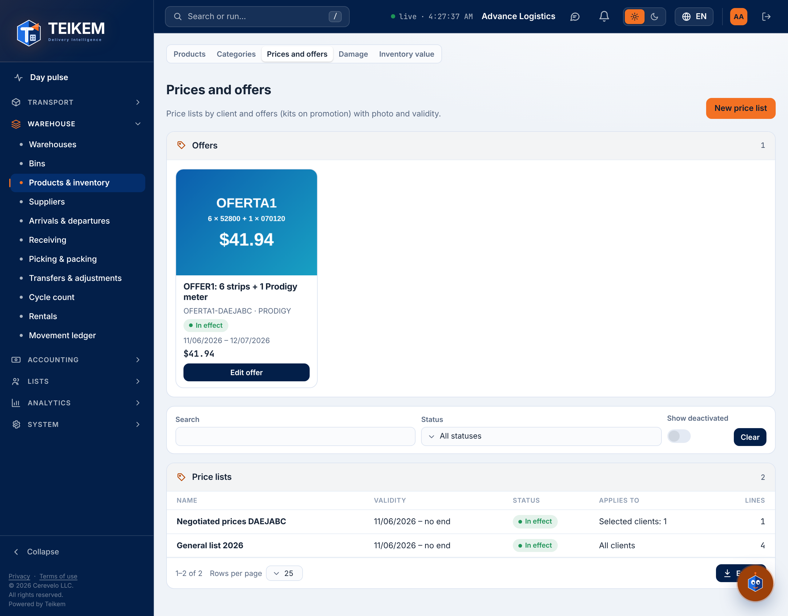
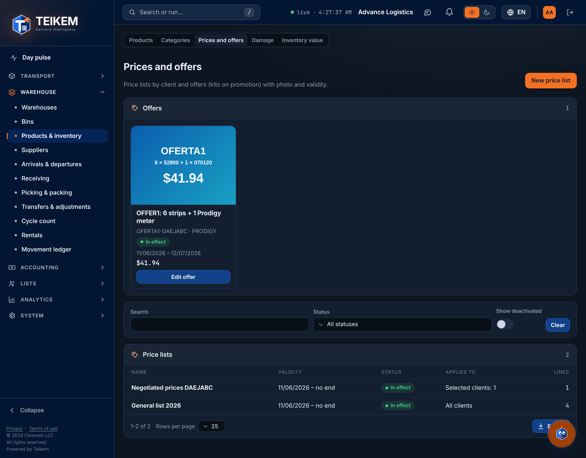
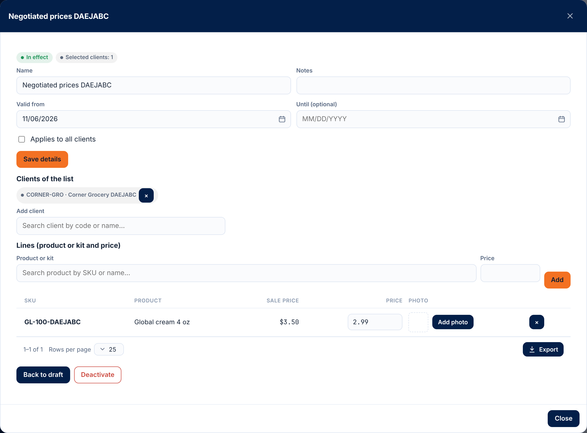

# 47 — Price lists and offers

<!-- kemi:staff -->

> **English edition.** Translation of the Spanish chapter `docs/manual/47-precios-y-ofertas.md`. The server only answers in Spanish, so every "Exact message" column keeps the **exact Spanish text** the screen shows, followed by its English meaning.

Batch 221 (2026-11-07) — salespeople's order, part P1; **redone in Batch 229 (2026-11-09)**. The **price of what is sold** is no longer typed: it comes from a **price list** set up by the sales supervisor or from an **offer** in effect. Since Batch 229 the **offer is a separate thing** from price lists and kits, like a store's weekly flyer («valid from … to …»): it has a name, a photo, validity dates and its own list of products or kits with an offer price. It is **no longer** a kit marked as a promotion. Since **Batch 231 (2026-11-10)** the kits that are assembled when ordered live in an **offer kit library**: they are created once and **reused** from one offer to another («Use a previous kit»). This chapter is for the sales supervisor, the office and support. The order that uses these prices is described in [48 — Guided order](48-pedido-guiado.md) and the order itself in [18 — Sales orders](18-ordenes-de-venta.md).

The three concepts, kept apart:

| Concept | What it is | Carries offers |
|---|---|---|
| **Product** | What is sold, with its sale price. A **kit is just another product**, made of other products, with its normal price; it is also sold loose. | No |
| **Price list** | The usual prices (or prices negotiated per client), with validity dates. One or several can be kept. When adding a line you choose a product or a kit. | **No** |
| **Offer** | Name, photo, validity and a list of products or kits, each with its offer price. It applies to all clients or to chosen clients. | — |

The screen is in **Accounting → Prices and offers** (`/money/prices`), right before «Sales». The menu item only shows with `sales.pricelist` (Company admin and Sales supervisor; a salesperson with only `sales.view` does not see it). It has **two sections**: **Offers** (on top, with the **New offer** button) and **Price lists** (with the **New price list** button). The old link `/warehouse/products?tab=prices` redirects to this screen.

> **Screenshots pending (Batch 229).** The screenshots below are from the batch 228 walkthrough (2026-11-07, demo data), when the offer was a kit marked as a promotion. The screen now has the two sections, and the offer window (details, photo, clients, lines, «Create a kit for this offer» and warnings) has no screenshot yet. They will be retaken with the Playwright walkthrough; the screenshot `l228-kit-promocion.png` (the old kit editor with the promotion mark) no longer corresponds to anything and is no longer cited. **Batch 231:** the offer kit window («Use a previous kit» with the library and «Create a new kit») has no screenshot yet either.

## 1. Who can and where

- Module **Sales orders (`SALES_ORDERS`)**. With the module off, the whole lists-and-offers API answers 403. The product photo follows the inventory module (`WMS_LOTSERIAL`).
- Permissions:
  - **`sales.view`** — view offers, lists, the guided-order catalog and **product photos** (even without `inventory.view`). The «Prices and offers» screen itself requires `sales.pricelist`.
  - **`sales.pricelist`** — create, publish, change and deactivate lists **and offers**; add or remove the photo of the offer and of its lines; choose the clients; create, reuse or change offer kits (the library). Implies `sales.view`. Held by the **Sales supervisor** role (`SalesSupervisor`) and the **Company admin**.
  - **`inventory.manage`** — upload, change or remove the **product photo** (in the product editor; see [06 §2.5](06-inventario-y-almacen.md#25-product-photo-and-category-with-subcategory-batch-229-2026-11-09)).
  - **`sales.price`** — remains the exception: writing on an order line a price different from the one that came from the list or the offer. Only the Company admin, or whoever they designate.
- Batches 229 and 231 **added no new permissions**: offers and the offer kit library use `sales.view` and `sales.pricelist`.
- Permission `sales.pricelist` in companies that already existed: it was added to the already-cloned Company admin roles; the «Sales supervisor» role is created by the administrator in System → Roles if the company does not have it.

## 2. Where the price of a line comes from

When an order line is created or edited (and in the guided order), the server resolves the price like this:

1. **Between the client's negotiated price and the offer in effect, the lowest wins.** The *negotiated* price is the price in a **published** list, **in effect today**, that applies to that client and carries the product (or kit). The *offer* is an offer that is **published, active and in effect today**, that applies to the client (all clients, or him among the chosen ones) and carries the product. **At equal price the negotiated one wins.**
2. If the client has **no** negotiated price: between the offer and the **general list** (published, in effect, for all clients) the lowest wins; without an offer, the general list.
3. If there is no list either: the **product's sale price** (`Product.SalePrice`).
4. None: the product **has no price** and the line is rejected (see section 7).

`priceSource` says where it came from: `OFFER`, `CLIENT_LIST`, `GENERAL_LIST`, `PRODUCT` or `NONE`.

Rules worth knowing:
- The salesperson **does not type prices**. A price different from the resolved one requires `sales.price` (403), unless it is the one the line already had in the draft.
- The price date is **today**, when the line is created or edited (not the order date). An order already placed **does not change** if the list or the offer changes later: the line keeps its price.
- If the client of a draft is changed without touching the lines, a line that had the previous client's resolved price takes the new client's; one that had an exceptional price (with `sales.price`) keeps it.
- If, because of old data, two lists of the same level carry the same product on the same date, the one that started later wins.
- A **regular product** that is in an offer is worth the offer price (if it is the lowest) in the order, even when it is ordered from its brand's list.

### Price warnings (they are not errors)

When two prices clash, **the lowest is always charged** and the system warns. Warnings do not stop saving, publishing or sending the order: they arrive with code 200.

| Warning (code) | When | Where it shows | Text (example with SKU and prices; the server sends it in Spanish) |
|---|---|---|---|
| Two offers at once (`TWO_OFFERS`) | A product is in two offers in effect for the same client | Guided order and order (next to the product, on the cart line and in the «Price warnings» box of the delivery step) | `El producto GM está en dos ofertas a la vez: «A» a $9.00 y «B» a $11.00. Se aplica la más barata («A»).` (Product GM is in two offers at once: «A» at $9.00 and «B» at $11.00. The cheapest applies («A»).) The cheapest wins; at equal price, the one that started later. |
| Offer more expensive than the general list (`OFFER_ABOVE_GENERAL`, in the order) | The offer price is higher than the general list in effect | Same as above | `La oferta «A» pone GM a $12.00, más caro que la lista general ($10.00): se aplica el precio más bajo.` (Offer «A» puts GM at $12.00, more than the general list ($10.00): the lowest price applies.) |
| Offer more expensive than the general list (`OFFER_ABOVE_GENERAL`, when building the offer) | When creating, changing or publishing the offer, a line is more expensive than the general list (in effect when the offer starts, or today if it already started) | In the offer window, box «Warnings (they do not block saving or publishing)» | `El producto GM sale en esta oferta a $12.00, más caro que en la lista general ($10.00): se aplicará el precio más bajo.` (Product GM is in this offer at $12.00, more than in the general list ($10.00): the lowest price will apply.) |
| Clash with a cheaper offer (`CHEAPER_OFFER`, when building the offer) | Another **published**, active offer, with overlapping dates and clients (an «all clients» offer overlaps with any), carries the same product **at the same price or cheaper** | In the offer window, same box | `El producto GM también está en la oferta «B» (del 01/11/2026 al 30/11/2026) a $9.00, igual o más barata que aquí ($10.00): mientras las dos estén vigentes se aplica el precio más bajo.` (Product GM is also in offer «B» (from … to …) at $9.00, equal or cheaper than here ($10.00): while both are in effect the lowest price applies.) |

Notes on warnings:
- The offer's own (`CHEAPER_OFFER`, `OFFER_ABOVE_GENERAL`) are calculated **when the offer is read**, in every response (create, change, publish, add a line, open it). A **draft** offer generates no warnings in others.
- The order's show in the catalog (when picking the product) and when the draft is saved. When a draft is reopened only the catalog's remain, because the order's are not stored.
- If what the order charges is the client's **negotiated** price (lower than the offer), the offer card says so: «Offer: $9.00. The client's negotiated price is charged because it is lower.» (with the offer's price).

## 3. Price lists

**What it does.** A list has a name, validity (**from** required, **until** optional: empty = no end), notes (up to 500 characters), the **lines** (product or kit → price, with an optional photo) and whom it **applies to**: all clients (general list) or only chosen clients (negotiated prices: gloves, boxes, monitor, test strips). **A list carries no offers**: promotions with validity, photo and special price go in an offer (section 4).

**Who can.** View: `sales.view`. Everything else: `sales.pricelist`. Module `SALES_ORDERS`.

**How to use it (screen).** **Accounting → Prices and offers** → **Price lists** section.
1. **New price list**: name, «Valid from», «Until (optional)», notes and the «Applies to all clients» checkbox. **Create list** leaves it as a **draft**.
2. In the list window: **Save details**; **Lines** (choose a **product or kit**, type the price, **Add**; each line can have its price changed, be removed or get a photo); **Clients of the list** (**Add client**; only if it is not general).
3. **Publish**: from then on the list gives prices within its dates. **Back to draft** takes it out of use. **Deactivate** / **Reactivate** withdraw or return it (it is never deleted).
4. The list of lists shows name, validity, status (Draft / Scheduled / In effect / Expired), «Applies to» and number of lines; filter by status, search by name and **Show deactivated** (the filter applies to offers and lists).

**How to use it (API).** `/api/v1/price-lists`:

| Action | Call | Permission |
|---|---|---|
| View lists (`q`, `state`, `includeInactive`) / one list | `GET /price-lists` · `GET /price-lists/{publicId}` | `sales.view` |
| Create as draft | `POST /price-lists` `{ "name": "Negotiated prices: gloves", "validFrom": "2026-11-10", "validTo": null, "appliesToAll": false, "notes": "…" }` | `sales.pricelist` |
| Edit (what is not sent does not change; `clearValidTo: true` removes the end date) | `PATCH /price-lists/{publicId}` | `sales.pricelist` |
| Publish / back to draft | `POST …/publish` · `POST …/unpublish` | `sales.pricelist` |
| Deactivate / reactivate | `POST …/deactivate` · `POST …/reactivate` | `sales.pricelist` |
| Add or change lines | `POST …/items` `{ "items": [ { "productPublicId": "…", "price": 12.5 } ] }` | `sales.pricelist` |
| Change a price / remove a line | `PATCH …/items/{itemId}` `{ "price": 11 }` · `DELETE …/items/{itemId}` | `sales.pricelist` |
| Line photo (JPG, PNG, WEBP or GIF) | `POST …/items/{itemId}/image` (multipart `file`) · `DELETE …/items/{itemId}/image` | `sales.pricelist` |
| Add / remove clients | `POST …/clients` `{ "clientPublicIds": ["…"] }` · `DELETE …/clients/{clientPublicId}` | `sales.pricelist` |

**Fields and rules.**

| Field | Rule |
|---|---|
| Name | Required, up to 120 characters. |
| Valid from | Required. |
| Until | Optional; cannot be earlier than «from». Both ends count as in effect. |
| Notes | Up to 500 characters. |
| Applies to all clients | A general list carries no chosen clients; a client list needs at least one to be published. |
| Lines | Up to 2000; only the company's **own** active products or kits; no repeats; price from 0 up with up to 4 decimals. **An offer kit cannot go** in a list (its price goes in an offer). |
| Clients | Up to 2000; must be active clients. |
| Line photo | JPG, PNG, WEBP or GIF (checked by content), up to the file store limit. By default the line shows the product photo; if another is set, that one wins. Removing it only unlinks it: the file is not deleted. |

**List overlaps.** Two **published** lists of the same audience (two general ones, or two client lists that share a client) cannot give a price to the same product on overlapping dates: the server rejects it with 409 and cites up to 5 SKUs. A general list and a client list **can** carry the same product (the client's wins). Overlaps are checked when publishing and on every change of a published list (dates, lines, clients, reactivate). A seasonal list on top of the base one is allowed if it does not repeat products. (**Offers** do not overlap with lists or with each other as an error: their clashes are warnings, section 2.)

## 4. Offers

### 4.1 What an offer is

An **offer** is a separate entity with: **name** (up to 120 characters), **photo**, **validity** («Valid from» required, «Until» optional), **notes** (up to 500), whom it **applies to** (all clients or chosen clients) and its **lines** (up to 500). Each line is an **existing product or kit** with its offer price, a **previous offer kit** from the library («Use a previous kit») or a **new offer kit** («Create a new kit») (4.4). It is born as a **draft** and only gives prices once **published** and in effect.

**No end date.** If «Until» is left blank, **the offer does not expire**: it is valid until someone deactivates it or sends it back to draft. The screen says so in two places: on the card («No end date: valid until you deactivate it») and in the window, under the field («“Until” is blank: the offer has no end date and is valid until you deactivate it.»). Check this before publishing a seasonal offer.

### 4.2 Who can

View offers: `sales.view`. Create, change, publish, deactivate, add photos, choose clients and create, reuse or change offer kits: `sales.pricelist`. Module `SALES_ORDERS`. Batches 229 and 231 added no permissions.

### 4.3 How to use it (screen)

**Accounting → Prices and offers → Offers.** Each offer is a card with its photo, name, status, validity, whom it applies to and number of lines. It opens with a click.

1. **New offer** → window with **Offer name**, **Notes**, **Valid from**, **Until (blank = no end date)** and the **Applies to all clients** checkbox. **Create offer** saves it as a **draft** («Offer created: add its photo and lines.»).
2. **Offer photo**: upload, change or remove (section 5).
3. **Offer clients**: only if «Applies to all clients» was unchecked (**Add client**; the offer needs at least one to be published).
4. **Lines** (three ways, and the screen explains it: «Add an existing product with its offer price, or an offer kit: use a previous one from the library (at the price you want) or create a new one.»):
   - **Pick a product**: search by SKU or name and type the **offer price**; the line shows the general list price next to it for comparison. The price is changed in its cell (when leaving the field) and the line is removed with its button. This search **no longer offers offer kits**: those are added with the next two buttons.
   - **Use a previous kit**: opens the **offer kit library** (4.4). Search by SKU or name; each kit shows its photo, SKU, name, its pieces and «Last offer: «…» at $…» (or «Not used in any offer yet»). When you pick one, **the pieces appear read-only** («The composition of a previous kit does not change; for a different composition, create a new kit.») and the **offer price comes pre-filled with the last one** («Last price: $41.94 (offer «January»). You can set another.»): **the price can be changed**. **Add to the offer** puts the line. If the kit is already a line of this offer, it shows «Already in this offer» and cannot be picked again.
   - **Create a new kit**: window with **Kit SKU**, **Kit name**, **Kit offer price**, **Kit pieces** (product and quantity; **Add piece**; each piece has the **Not substitutable** checkbox) and the **Adjustable when ordering** checkbox (born unchecked). The window shows «Pieces at their sale price», «Client saves» (or «Careful: the offer costs … more than the loose pieces.»). **Create kit** creates the product, its pieces and the line in a single step, and the kit **stays saved in the library**: «Kit … created, saved in the library and added to the offer.». From «Use a previous kit», **«Create a new kit with these pieces»** goes to this tab with the pieces, name and price already filled in (SKU blank), for the case «November's, but with another piece».
   - The two ways of adding a kit are tabs of the same window («How to add the kit»): you can switch from one to the other without closing it.
   - Example: the normal kit is monitor + needles; the offer's kit is monitor + needles + test strips, «at the price of the two» (or the strips at half price). To repeat November's offer in January: create the January offer and use **Use a previous kit**; the pieces are not typed again.
5. **Photo per line**: by default the line shows the product photo; **Use another photo** changes it and **Back to the product photo** removes it.
6. **Publish** (the offer starts giving prices within its dates), **Back to draft**, **Deactivate** (asks for confirmation: «The offer stops applying to new orders; an offer kit is only still sold if it is in another offer in effect. Orders already placed do not change and it can be reactivated.») and **Reactivate**.
7. **Warnings** (section 2) appear in the «Warnings (they do not block saving or publishing)» box. They are not errors.

The status shows on the card: **Draft**, **Published (not started yet)**, **In effect**, **Expired** or **Deactivated**, and, separately, the **Applies today** chip when the offer is giving prices.

### 4.4 Offer kits and the library (Batch 231)

An **offer kit** is a kit that is **assembled when ordered**: it has no stock of its own; when a client orders it, the system reserves and ships **its pieces**. Inside, it is a product, but marked as an offer kit: it **is not shown in Warehouse → Products & inventory** and **is not created there** (for a kit with stock, an **assembled kit**, see [06 §8b](06-inventario-y-almacen.md#8b-kits-assembled-and-offer-batches-68-231-and-232-2026-11-10)).

**The offer kit library.** Every offer kit that is created is **saved** in the library (the composition; the price is not, although the last one is remembered). **It is no longer tied to a single offer**: an offer uses it with a normal line (its price), and the same kit can be in several offers at once. There is no separate library screen: it is seen from the offer window, in **Use a previous kit**. The kits that Batch 229 had tied to an offer moved to the library.

- **Use a previous kit.** The **composition does not change** (pieces, quantities, «Not substitutable» and «Adjustable when ordering»): if you want another, **create a new kit** (there is a shortcut that copies the pieces). The **price can** be changed in each offer, and the screen suggests the **last** one: that of the most recent line still placed in an active offer; if none is left, the most recent of all. A kit that was never used has no previous price: it has to be typed.
- **Create a new kit.** SKU, name, price, pieces and «Adjustable when ordering». The SKU is not repeated for the same owner. The category and tax category come from the first piece (the category only if none is given); the kit's sale price is the one given (otherwise, the offer price it was created with).
- **It is sold only while it is in some published offer in effect** for the client: an offer that is **published, active and in effect today** (both ends count; without «until» it does not expire) that applies to the client (to all, or to him among the chosen ones) with an active line of that kit. Outside that it does not show in the order catalog and ordering it gives the 422 error of section 7. If the kit is in two offers in effect, the cheapest is charged and the `TWO_OFFERS` warning appears.
- **A kit sold permanently is an offer with no end date**: put the kit in an offer with «Until» blank.
- **The kit is not deleted or deactivated.** When no offer holds it, it is simply not sold; the orders and invoices that used it still see it (the line keeps its copy). If an offer is **extended** (its end date is changed or removed), reactivated or published again, the kit **becomes available again** by itself. When an offer is deactivated or sent back to draft, its kits leave the sale unless they are in another offer in effect.
- **The composition is fixed once used.** The kit counts as **used** from the moment it has a line in any offer (even if removed or the offer is a draft) or a line in any sales order. From the screen, a kit is born with its line: that is why **«Change kit»** (on the line) changes **the name** and leaves the pieces read-only with the note «The composition of a previous kit does not change…». The SKU does not change and the price is changed on the line. Only through the API can a kit be created in the library without putting it in an offer and its pieces corrected while it has never been used. Sending the same composition (even in another order) does not count as a change.
- **Piece substitution and «Adjustable when ordering»: only here.** The pieces of an offer kit can be **substituted** when ordering, except those marked «Not substitutable» (see [18 §17.1](18-ordenes-de-venta.md#171-swapping-a-kit-piece-when-ordering-batch-230)); the mark is set when creating the kit in the offer window. «Adjustable when ordering» is born unchecked. Neither exists on an assembled kit or a normal product.
- **It does not go in a price list.** Its price goes in an offer (422).
- **It does not show in Products & inventory** (nor in its counts, filters or export, nor in the import, nor in what is sent to integrations). Its record by identifier still answers and orders and invoices name it.

### 4.5 How to use it (API)

`/api/v1/offers` (module `SALES_ORDERS`):

| Action | Call | Permission |
|---|---|---|
| View offers (`q`, `state`, `includeInactive`) / one offer | `GET /offers` · `GET /offers/{publicId}` | `sales.view` |
| Create (born as a draft) | `POST /offers` `{ "name": "November flyer", "validFrom": "2026-11-10", "validTo": null, "appliesToAll": true, "notes": "…" }` | `sales.pricelist` |
| Edit (what is not sent does not change; `clearValidTo: true` removes the end date) | `PATCH /offers/{publicId}` | `sales.pricelist` |
| Publish / back to draft | `POST …/publish` · `POST …/unpublish` | `sales.pricelist` |
| Deactivate / reactivate | `POST …/deactivate` · `POST …/reactivate` | `sales.pricelist` |
| Offer photo (JPG, PNG or WEBP) | `POST …/image` (multipart `file`) · `DELETE …/image` | `sales.pricelist` |
| Add or change lines («Use a previous kit» = a line with the kit's `productPublicId`; with an offer kit already used the `price` may be left empty and the last one is used) | `POST …/items` `{ "items": [ { "productPublicId": "…", "price": 9.5 } ] }` | `sales.pricelist` |
| Change a price / remove a line | `PATCH …/items/{itemId}` `{ "price": 9 }` · `DELETE …/items/{itemId}` | `sales.pricelist` |
| Line photo | `POST …/items/{itemId}/image` (multipart) · `DELETE …/items/{itemId}/image` | `sales.pricelist` |
| Add / remove clients | `POST …/clients` `{ "clientPublicIds": ["…"] }` · `DELETE …/clients/{clientPublicId}` | `sales.pricelist` |
| «Create a new kit» and put it in this offer right away (it stays in the library) | `POST …/kits` `{ "sku": "OFERTA1", "name": "Monitor + needles + strips", "price": 41.94, "adjustable": false, "components": [ { "productPublicId": "…", "quantity": 1, "notSubstitutable": false } ] }` → `{ productPublicId, sku, offer }` | `sales.pricelist` |
| View the offer kit library (`q` = the SKU or name contains; `includeInactive`; up to 500) | `GET /offers/kits?q=` → per kit: pieces, `lastPrice`, `lastOfferName`, `offerCount` (in how many active offers it is today), `compositionLocked`, `effectiveImagePublicId` | `sales.view` |
| View a library kit | `GET /offers/kits/{productPublicId}` (404 if it is not an offer kit) | `sales.view` |
| Create a kit in the library without putting it in an offer | `POST /offers/kits` `{ "sku": "…", "name": "…", "components": [ … ], "adjustable": false, "salePrice": 41.94 }` | `sales.pricelist` |
| Change a library kit (the name always; pieces and «adjustable» only if never used) | `PATCH /offers/kits/{productPublicId}` `{ "name": "…" }` | `sales.pricelist` |
| Change a kit from an offer (compatibility; prefer the library `PATCH`) | `PUT …/kits/{productPublicId}` `{ "name": "…", "components": [ … ] }` (the kit must be in that offer) | `sales.pricelist` |

Keys of an offer's response: `hasEndDate` (false = no end date) and `validityText` («desde el 09/11/2026, sin fecha de fin» or «del … al …»); `state` (`DRAFT`, `SCHEDULED`, `ACTIVE`, `EXPIRED`); `inEffect` (applies today); `warnings[]` (the warnings); and, per line, `isOfferKit` (the line is an offer kit; the same kit can be in several offers), `generalListPrice`, `imagePublicId` (the line's own photo) and `effectiveImagePublicId` (the one shown).

### 4.6 Offer fields and rules

| Field | Rule |
|---|---|
| Name | Required, up to 120 characters. |
| Valid from | Required. |
| Until | Optional; blank = does not expire. Cannot be earlier than «from». Both ends count as in effect. |
| Notes | Up to 500 characters. |
| Applies to all clients | An all-clients offer carries no chosen clients; a chosen-clients offer needs at least one to be published and to stay published. |
| Lines | Up to 500; the company's **own** active products or kits; no repeats; price from 0 up with up to 4 decimals. If the product is already in the offer, its price is changed. An offer kit from the library can go in any offer (also in several at once); without a price, it takes the last one it was used with. |
| Clients | Up to 2000; must be active clients. |
| Photo | JPG, PNG or WEBP (section 5). |

## 5. Photos: of the product, of the line and of the kit

**The photo is stored on the product** (kits and offer kits included) and is set in the product editor, **Photo** block ([06 §2.5](06-inventario-y-almacen.md#25-product-photo-and-category-with-subcategory-batch-229-2026-11-09)). Lines of lists and offers carry **the product photo by default**, and another can be set on them.

**Which one is shown** (in the prices and offers screen, in the guided-order catalog and in the product thumbnail), in this order:
1. The photo of the **line** (of the list or the offer), if one was set.
2. The photo of the **product**.
3. If it is a **kit without a photo**, that of the **first piece (by order) that has a photo**.
4. None: the thumbnail is empty.

Removing a line's photo makes the product's show again.

| Who | What they can do |
|---|---|
| `sales.view` | **See** the photo of any product (also that of lines and offers), **even without `inventory.view`**. Other files of the product still require `inventory.view`. |
| `inventory.manage` | Upload, change or remove the **product photo** (the same person who edits the product). |
| `sales.pricelist` | Upload, change or remove the photo of the **offer**, that of its **lines** and that of the **list** lines. |

Photo rules: **JPG, PNG or WEBP** (checked by content, not by extension; price lists still also accept GIF on their line). The size limit is the file store's (10 MB by default). A photo whose longer side is over **1200 px** is **reduced to 1200 px** in its same format; if it cannot be read or reduced, it is saved as is. Removing a photo only unlinks it: the file is not deleted. Promotion photos that existed before Batch 229 were copied to the product photo where it was missing. Product import has no photo column.

The photo content is downloaded with `GET /files/{imagePublicId}`. `GET /api/v1/products/{publicId}/image` (`inventory.view` or `sales.view`) says which is the product's own photo (`imagePublicId`) and which is shown (`effectiveImagePublicId`); `POST` / `DELETE` on the same resource (`inventory.manage`) set or remove it.

## 6. The order catalog

`GET /api/v1/sales-orders/catalog?clientPublicId=<client>` (`sales.view`) feeds the guided order: the **brands** (`Product.Brand`) with active products, and per brand its **offers in effect** (cards with photo) and the **full list** of products and kits, each with the price already resolved for the client. Without `clientPublicId`, the prices of the general list and the offers for all clients.

- Only own, active products **without a serial number**.
- Brands are grouped ignoring case; products without a brand go last (`brand = null`).
- **Offers of a brand** = the lines of published offers in effect that apply to the client, **one per product** (the one from the cheapest offer). An **offer kit only shows as a card**, and only while it is in some published offer in effect for the client. A **regular product in an offer** shows as a card **and also** in its brand's list, with the resolved price.
- `isPromotion` = the product is in an offer in effect for the client; `price` and `priceSource` = what will be charged (`OFFER`, or `CLIENT_LIST` if the negotiated price is lower); `offerPrice` = the offer's price; `offerName`, `offerValidFrom`, `offerValidTo` = which offer and until when; `imagePublicId` = the photo already resolved (section 5); `notices[]` = the warnings (section 2) with their text ready.
- `priceSource` `NONE` = **no price**: it cannot be ordered without `sales.price`.
- Client does not exist: 404 `Cliente no encontrado.` (Client not found.); inactive client: 422 `El cliente está inactivo; no se le puede vender.` (The client is inactive; nothing can be sold to it.)
- On the order, the response of creating or editing the draft with lines carries `linePrices[]` (where each price came from and its warnings); it is not stored in the database.

## 7. Validations and messages

**Price lists.**

| Field / situation | Rule | Exact message (Spanish, as sent) | Meaning | HTTP |
|---|---|---|---|---|
| Body | Required | `El cuerpo de la solicitud es obligatorio.` | The request body is required. | 400 |
| List name | Required | `Indique el nombre de la lista de precios.` | Give the price list a name. | 400 (`name`) |
| List name | Up to 120 | `El nombre de la lista no puede pasar de 120 caracteres.` | The list name cannot exceed 120 characters. | 400 |
| Valid from | Required | `Indique desde qué fecha vale la lista.` | Say from which date the list is valid. | 400 (`validFrom`) |
| Until | Not before «from» | `La fecha «hasta» no puede ser anterior a la fecha «desde».` | «Until» cannot be earlier than «from». | 400 (`validTo`) |
| Notes | Up to 500 | `Las notas no pueden pasar de 500 caracteres.` | Notes cannot exceed 500 characters. | 400 |
| List does not exist | — | `Lista de precios no encontrada.` | Price list not found. | 404 |
| Line does not exist | — | `Renglón de la lista no encontrado.` | List line not found. | 404 |
| Deactivated list | Cannot be changed | `La lista de precios está desactivada: reactívela para cambiarla.` | The price list is deactivated: reactivate it to change it. | 422 |
| Lines | At least one | `Indique los productos y sus precios.` | Give the products and their prices. | 400 (`items`) |
| Lines | Up to 2000 | `Una lista admite como máximo 2000 renglones.` | A list admits at most 2000 lines. | 400 |
| Line without product | — | `Escoja el producto o kit de cada renglón.` | Choose the product or kit of each line. | 400 |
| Line without price | — | `Indique el precio de cada renglón.` | Give the price of each line. | 400 |
| Price | 0 or more; up to 4 decimals | `El precio no es válido.` / `El precio admite como máximo 4 decimales.` | The price is not valid. / The price admits at most 4 decimals. | 400 |
| Repeated product | — | `El producto {SKU} viene repetido.` | Product {SKU} comes repeated. | 400 |
| Pass-through client's product | Own products only | `Solo se ponen en una lista productos propios de la compañía.` | Only the company's own products go in a list. | 422 |
| Inactive product | — | `El producto {SKU} está inactivo: no se puede poner en la lista.` | Product {SKU} is inactive: it cannot go in the list. | 422 |
| Offer kit | Its price goes in an offer | `El kit {SKU} es un kit de oferta: su precio va en una oferta, no en una lista de precios.` | The kit {SKU} is an offer kit: its price goes in an offer, not in a price list. | 422 |
| Product does not exist | — | `Producto no encontrado.` | Product not found. | 404 |
| Clients | At least one when adding | `Escoja los clientes de la lista.` | Choose the clients of the list. | 400 (`clientPublicIds`) |
| Clients | Up to 2000 | `Una lista admite como máximo 2000 clientes.` | A list admits at most 2000 clients. | 400 |
| Client does not exist | — | `Cliente no encontrado.` | Client not found. | 404 |
| Inactive client | — | `El cliente está inactivo; no se le puede vender.` | The client is inactive; nothing can be sold to it. | 422 |
| Client not in the list | — | `Cliente de la lista no encontrado.` | List client not found. | 404 |
| Clients on a general list | — | `La lista aplica a todos los clientes: no lleva clientes escogidos. Desmarque «aplica a todos» para escogerlos.` | The list applies to all clients: it carries no chosen clients. Uncheck «applies to all» to choose them. | 422 |
| Making a list with clients general | — | `La lista tiene clientes escogidos: quítelos antes de hacerla general (aplica a todos).` | The list has chosen clients: remove them before making it general. | 422 |
| Publish without lines | — | `Agregue al menos un renglón antes de publicar la lista.` | Add at least one line before publishing the list. | 422 |
| Publish without clients (not general) / remove the last client of a published list | — | `Escoja al menos un cliente o marque que la lista aplica a todos los clientes.` | Choose at least one client or mark that the list applies to all clients. | 422 |
| Publish a published list | — | `La lista ya está publicada.` | The list is already published. | 422 |
| Back to draft a draft | — | `La lista ya está en borrador.` | The list is already a draft. | 422 |
| Deactivate / reactivate what is already so | — | `La lista ya está desactivada.` / `La lista ya está activa.` | The list is already deactivated / active. | 422 |
| Overlap with another published list | No double prices | `La lista se cruza con «{otra}» en las mismas fechas y para los mismos clientes en: {SKU, …} y N más. Cambie las fechas o quite esos productos de una de las dos.` | The list overlaps with «{other}» on the same dates and for the same clients in: {SKUs} and N more. Change the dates or remove those products from one of the two. | 409 |
| Two people save at once | — | `La lista cambió al mismo tiempo. Recárguela e intente de nuevo.` | The list changed at the same time. Reload it and try again. | 409 |
| Photo without file | — | `Adjunte la foto.` | Attach the photo. | 400 (`file`) |
| List-line photo that is not an image | — | `La foto debe ser una imagen (JPG, PNG, WEBP o GIF).` | The photo must be an image (JPG, PNG, WEBP or GIF). | 400 |
| Photo too large | — | `El archivo no puede pasar de {n} MB.` | The file cannot exceed {n} MB. | 400 |

**Offers.**

| Field / situation | Rule | Exact message (Spanish, as sent) | Meaning | HTTP |
|---|---|---|---|---|
| Body | Required | `El cuerpo de la solicitud es obligatorio.` | The request body is required. | 400 |
| Offer name | Required | `Indique el nombre de la oferta.` | Give the offer a name. | 400 (`name`) |
| Offer name | Up to 120 | `El nombre de la oferta no puede pasar de 120 caracteres.` | The offer name cannot exceed 120 characters. | 400 (`name`) |
| Valid from | Required | `Indique desde qué fecha vale la oferta.` | Say from which date the offer is valid. | 400 (`validFrom`) |
| Until | Not before «from» | `La fecha «hasta» de la oferta no puede ser anterior a la fecha «desde».` | The offer's «until» date cannot be earlier than its «from» date. | 400 (`validTo`) |
| Notes | Up to 500 | `Las notas no pueden pasar de 500 caracteres.` | Notes cannot exceed 500 characters. | 400 (`notes`) |
| Offer does not exist | — | `Oferta no encontrada.` | Offer not found. | 404 |
| Line does not exist | — | `Renglón de la oferta no encontrado.` | Offer line not found. | 404 |
| Client not in the offer | — | `Cliente de la oferta no encontrado.` | Offer client not found. | 404 |
| Kit does not exist (when changing it from an offer) | — | `Kit de la oferta no encontrado.` | Offer kit not found. | 404 |
| Library kit does not exist, or is not an offer kit | — | `Kit de oferta no encontrado.` | Offer kit not found. | 404 |
| Deactivated offer | Cannot be changed | `La oferta está desactivada: reactívela para cambiarla.` | The offer is deactivated: reactivate it to change it. | 422 |
| Lines | At least one | `Indique los productos y sus precios de oferta.` | Give the products and their offer prices. | 400 (`items`) |
| Lines | Up to 500 | `Una oferta admite como máximo 500 renglones.` | An offer admits at most 500 lines. | 400 (`items`) |
| Line without product | — | `Escoja el producto o kit de cada renglón.` | Choose the product or kit of each line. | 400 |
| Line without price | Required; only an offer kit that was already used may go without a price (it takes the last one) | `Indique el precio de oferta de cada renglón.` | Give the offer price of each line. | 400 |
| Price | 0 or more; up to 4 decimals | `El precio no es válido.` / `El precio admite como máximo 4 decimales.` | The price is not valid. / The price admits at most 4 decimals. | 400 (`price`) |
| Repeated product | — | `El producto {SKU} viene repetido.` | Product {SKU} comes repeated. | 400 |
| Pass-through client's product | Own products only | `Solo se ponen en una oferta productos propios de la compañía.` | Only the company's own products go in an offer. | 422 |
| Inactive product | — | `El producto {SKU} está inactivo: no se puede poner en la oferta.` | Product {SKU} is inactive: it cannot go in the offer. | 422 |
| Product does not exist | — | `Producto no encontrado.` | Product not found. | 404 |
| Clients | At least one when adding | `Escoja los clientes de la oferta.` | Choose the clients of the offer. | 400 (`clientPublicIds`) |
| Clients | Up to 2000 | `Una oferta admite como máximo 2000 clientes.` | An offer admits at most 2000 clients. | 400 |
| Client does not exist | — | `Cliente no encontrado.` | Client not found. | 404 |
| Inactive client | — | `El cliente está inactivo; no se le puede vender.` | The client is inactive; nothing can be sold to it. | 422 |
| Clients on an all-clients offer | — | `La oferta aplica a todos los clientes: no lleva clientes escogidos. Desmarque «aplica a todos» para escogerlos.` | The offer applies to all clients: it carries no chosen clients. Uncheck «applies to all» to choose them. | 422 |
| Making an offer with clients «for all» | — | `La oferta tiene clientes escogidos: quítelos antes de hacerla general (aplica a todos).` | The offer has chosen clients: remove them before making it general. | 422 |
| Publish without lines | — | `Agregue al menos un renglón antes de publicar la oferta.` | Add at least one line before publishing the offer. | 422 |
| Publish without clients (not for all) / remove the last client of a published offer / uncheck «applies to all» on an already published offer (it has no clients yet) | — | `Escoja al menos un cliente o marque que la oferta aplica a todos los clientes.` | Choose at least one client or mark that the offer applies to all clients. | 422 |
| Publish a published offer | — | `La oferta ya está publicada.` | The offer is already published. | 422 |
| Back to draft a draft | — | `La oferta ya está en borrador.` | The offer is already a draft. | 422 |
| Deactivate / reactivate what is already so | — | `La oferta ya está desactivada.` / `La oferta ya está activa.` | The offer is already deactivated / active. | 422 |
| Two people save at once | — | `La oferta cambió al mismo tiempo. Recárguela e intente de nuevo.` | The offer changed at the same time. Reload it and try again. | 409 |
| Offer kit without price | — | `Indique el precio de oferta del kit.` | Give the kit's offer price. | 400 (`price`) |
| Offer kit without pieces | — | `Un kit necesita al menos un componente.` | A kit needs at least one component. | 400 (`components`) |
| Offer kit with a repeated SKU | — | `Ya existe un producto con ese SKU para ese dueño.` | A product with that SKU already exists for that owner. | 409 |
| Invalid kit pieces | The usual kit ones | See [06 §8b.3](06-inventario-y-almacen.md#8b3-rules-and-messages) | | 400 |
| Changing the pieces, quantities, «Not substitutable» or «Adjustable when ordering» of a kit already used in an offer (even if removed) or in an order | The composition does not change; the name does | `La composición del kit {SKU} ya no se puede cambiar porque ya se usó en una oferta o en un pedido: cree un kit nuevo con las piezas que quiera.` | The composition of kit {SKU} can no longer be changed because it was already used in an offer or an order: create a new kit with the pieces you want. | 422 |
| Changing with `PUT /offers/{id}/kits/{kit}` a kit that is not in that offer | — | `Ese kit no está en esta oferta: cámbielo desde la biblioteca de kits de oferta.` | That kit is not in this offer: change it from the offer kit library. | 422 |
| Importing products with the SKU of an offer kit | The kit is changed in the offer | `Ese SKU es un kit de oferta: no se cambia por la importación de productos, sino en Contabilidad → Precios y ofertas.` | That SKU is an offer kit: it is not changed by the product import but in Accounting → Prices and offers. | row with error (`sku`) |
| Offer or line photo without file | — | `Adjunte la foto.` | Attach the photo. | 400 (`file`) |
| Photo that is not JPG, PNG or WEBP | — | `La foto debe ser una imagen JPG, PNG o WEBP.` | The photo must be a JPG, PNG or WEBP image. | 400 (`file`) |
| Photo too large | — | `El archivo no puede pasar de {n} MB.` | The file cannot exceed {n} MB. | 400 |
| File store not configured | — | `El almacén de archivos no está configurado (Files:MasterKey); avise a soporte.` | The file store is not configured (Files:MasterKey); tell support. | 422 |

**Order and permissions.**

| Field / situation | Rule | Exact message (Spanish, as sent) | Meaning | HTTP |
|---|---|---|---|---|
| Ordering an offer kit that is in no published offer in effect for the client | Only sold while it is in some published, active offer in effect that applies to the client | `El kit de oferta {SKU} no está en ninguna oferta publicada y vigente para este cliente: no se puede vender.` | The offer kit {SKU} is in no published offer in effect for this client: it cannot be sold. | 422 |
| Changing or adjusting the pieces of a kit that is not an offer kit | Substitution and «Adjustable when ordering» only apply to an offer kit | `El kit {SKU} no admite cambiar ni ajustar sus piezas al pedir: eso solo se puede en un kit de oferta.` | The kit {SKU} does not allow changing or adjusting its pieces when ordering: that is only possible on an offer kit. | 400 |
| Product with no price at all | — | `El producto {SKU} no tiene precio de venta: escriba el precio.` | Product {SKU} has no sale price: type the price. | 400 |
| Price different from the resolved one without `sales.price` | — | `Cambiar el precio exige el permiso de precios (sales.price).` | Changing the price requires the price permission (sales.price). | 403 |
| Without the permission | — | `Falta el permiso 'sales.pricelist'.` | Permission 'sales.pricelist' is missing. | 403 |
| Module off | — | `El módulo 'SALES_ORDERS' no está habilitado para esta compañía.` | Module 'SALES_ORDERS' is not enabled for this company. | 403 |

The product-photo messages (`Adjunte la foto.`, `La foto debe ser una imagen JPG, PNG o WEBP.`) also appear when uploading it from the product editor.

## 8. Statuses and transitions

Neither the list nor the offer **uses the status engine**: their state comes from «published» and the dates, and only publish, back to draft and deactivate are audited (logs `PRICE_LIST` and `OFFER`).

| State shown | When | Gives prices on new orders? |
|---|---|---|
| **Draft** | Not published | No |
| **Scheduled** (on the offer: «Published (not started yet)») | Published, «from» is in the future | No (not yet) |
| **In effect** | Published and today falls between «from» and «until» (without «until»: from «from» onward) | Yes |
| **Expired** | Published and «until» has passed (an offer without «until» never expires) | No |
| **Deactivated** | `IsActive = 0` (any of the above) | No; cannot be changed |

Transitions of the **list** and the **offer** (the same, with the messages of section 7):

| From → to | Who | What it validates | Effect |
|---|---|---|---|
| Draft → Published | `sales.pricelist` | At least one line; chosen clients if not for all. On the list, also no overlaps with other published ones | Starts giving prices within its validity. On the offer, its offer kits can be sold (if the client receives it) |
| Published → Draft | `sales.pricelist` | That it is published | Stops giving prices to new orders; orders already placed do not change. Its offer kits leave the sale, except those that are in another offer in effect |
| Any → Deactivated | `sales.pricelist` | That it is active | Same as draft, and it cannot be edited |
| Deactivated → Active | `sales.pricelist` | That it is deactivated; on the list, if it was published, that it does not overlap with another | Returns to its previous state |

What each state blocks: a **deactivated** list or offer cannot be edited (lines, clients, photos, kits) until reactivated; a **published** one can be edited (on the list, every change re-checks overlaps; on the offer, clashes only warn); draft, scheduled and expired ones do not affect prices. An **offer kit** is only sold if it is in **some** published, active offer in effect that applies to the client.

## 9. Frequently asked questions of the module

- **The salesperson sees the product as «No price» in the order.** There is no in-effect list (the client's or the general one) or offer that carries it, and the product has no sale price. Put it in a published, in-effect list, or give the product a sale price.
- **I published the list and the order still has the old price.** Check the validity (does it start later?), that it is not draft or deactivated, and that the client is in the list if it is not general. An order already placed does not change.
- **Two prices for the same product.** Between the client's negotiated price and an offer in effect the lowest wins; without an offer, a client list beats the general one. Two lists of the same audience cannot coexist: the server rejects it with the overlap 409.
- **The offer does not show in the order.** It must be **published**, **active**, in effect today and apply to the client (all clients, or him among the chosen ones). An offer's kit only shows while the offer is valid.
- **I left «Until» blank.** The offer does not expire. Deactivate it or set a date when the promotion ends.
- **A yellow warning appeared on the offer.** It is a price warning, not an error: another offer at the same price or cheaper overlaps, or the price is higher than the general list. The lowest is charged; check it is what you wanted.
- **Removing a client from a published list or offer fails.** It is the last one and it is not general / for all: add another or move it to draft first.
- **I cannot find the offer's kit in the order.** Check that the kit is in a published, active offer in effect that applies to the client (an offer kit is not sold outside the validity, and it does not show in Products & inventory either).
- **Where do I create a kit?** If it is assembled when ordered, in an offer: **Create a new kit**. If it must have stock in the warehouse, in Products & inventory → **New product** → «Is what you are creating a kit?» → Yes ([06 §8b](06-inventario-y-almacen.md#8b-kits-assembled-and-offer-batches-68-231-and-232-2026-11-10)).
- **How do I repeat November's offer in January?** Create the January offer and, in **Lines**, use **Use a previous kit**: pick the kit and confirm the price (the last one is suggested). The pieces are not typed again.
- **Can I change the pieces of a previous kit?** No: the composition of a kit already used does not change (what past offers and orders saw would be lost). Use **Create a new kit with these pieces** and change what you need. The price can be changed in each offer.
- **I want to sell a kit all the time.** Put it in an offer with «Until» blank (no end date).
- **The kit does not show in Products & inventory.** That is normal: an offer kit lives in the offer kit library, not in inventory. A kit with stock is an assembled kit.

All the messages above are in the [Batch 221 FAQ](faq.md#batch-221--price-lists-and-offers) (lists) , in the [Batch 229 FAQ](faq.md#batch-229--offers-as-a-separate-entity-offer-kits-and-the-product-photo) (offers, warnings and photos) and in the [Batch 231 FAQ](faq.md#batch-231--offer-kit-with-library) (offer kits and their library).

## 10. For support

- Lists: tables `PriceList`, `PriceListItem` and `PriceListClient`; EntityType `PRICE_LIST` and the permission `sales.pricelist` (section «2026-11-07 — Lote 221» of `Diseño/logistica-db-update.sql`; propagation to cloned roles with the mark `L221_SALES_PRICELIST`).
- Offers (Batch 229): tables `Offer`, `OfferItem` and `OfferClient`; EntityType `OFFER`; columns `Product.ImageFileId` (product photo) and `Product.OfferId` (kit created for an offer, with a filtered index; no longer used since Batch 231); section «2026-11-09 — Lote 229» of the same file (idempotent). No new permissions.
- Offer kits (Batch 231): column `Product.IsOfferKit` (BIT, 0 by default) and filtered index `IX_Product_OfferKit`; the section «2026-11-10 — Lote 231» of `Diseño/logistica-db-update.sql` (idempotent, no new permissions) marked the kits that had `OfferId`. `Product.OfferId` is **no longer read or written** (the column stays). The kit is still stored as a product of type `KIT`; its validity is **calculated** (see below).
- The columns `Product.IsPromotion`, `PromoFrom`, `PromoTo` and `PromoImageFileId` are **no longer read**: they stay in the database unused (the promotion photo was copied to `ImageFileId` where it was missing). An expired «promotion» no longer blocks sales.
- Lists and offers are exposed by `PublicId` and are never deleted. Changes go to the audit log (entities `PRICE_LIST` and `OFFER`).
- Photos are files (class DOCUMENT) encrypted in the file store; they are seen with `GET /files/{publicId}`. The product photo is a file of the product; the offer's and its lines' photos are owned by the offer (`OFFER`).
- The reduction to 1200 px uses SkiaSharp; on a Linux server without its native library the photo is saved as is (not reduced).
- An offer kit "out of sale" is **calculated** (the product keeps `IsActive = 1`): it is sold while it is in some published, active offer in effect for the client, and it comes back by itself when the offer is extended or reactivated. The library (`GET /offers/kits`) lists the kits by SKU; `offerCount` says in how many active offers it is today.
- Solutions scripts: `02-kit-oferta1.sql` creates the library kit «OFERTA1» and the offer «OFERTA1» (published, for all clients, from today in Puerto Rico time, with no end date, at $41.94); `06-lista-precios-inicial.sql` no longer puts OFERTA1 in the general list. Detail in `docs/lote229-decisiones.md`.
