# Screenshots of the apps (warehouse and client portal)

Screenshots taken on 2026-10-22 with Playwright, without a device or emulator: the app runs as a web page in the browser against a **simulated** API (sample data, not from any real company).
They are repeated with `npm run export:visual` and `npm run visual` inside `app-almacen/` and `app-cliente/` (see each one's `scripts/visual-check.cjs`). The warehouse one uses a 390×844 phone.

## Warehouse app (device)

| Screen | Screenshot |
|---|---|
| Register this device (first time) | 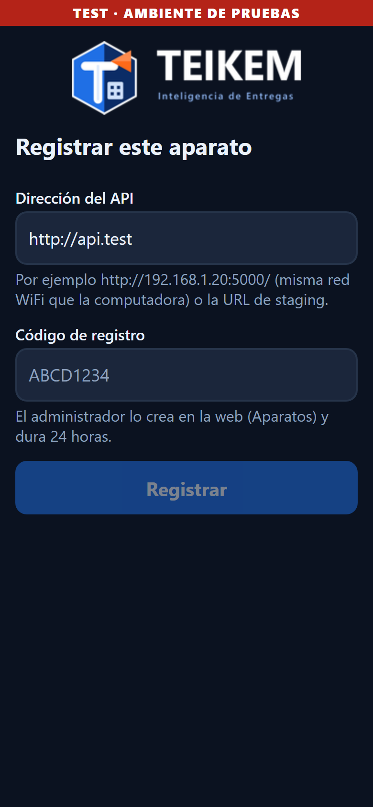 |
| Who are you? |  |
| PIN | 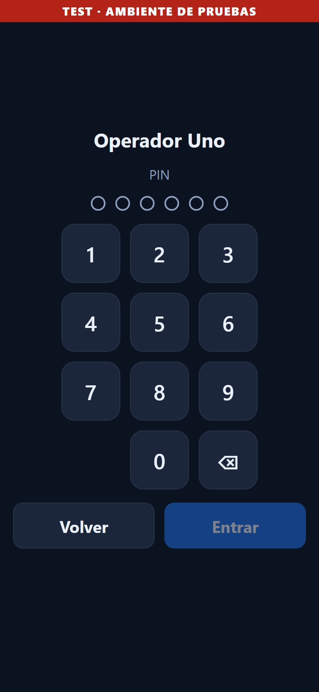 |
| Main menu (the blue tiles have something assigned to the person) | 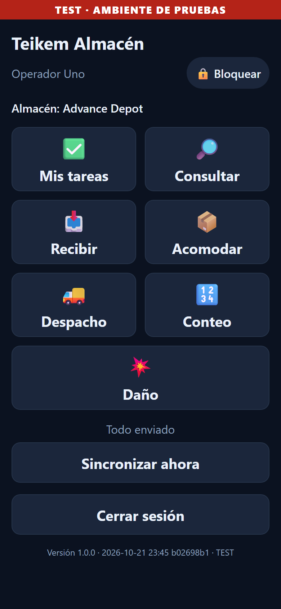 |
| My tasks | 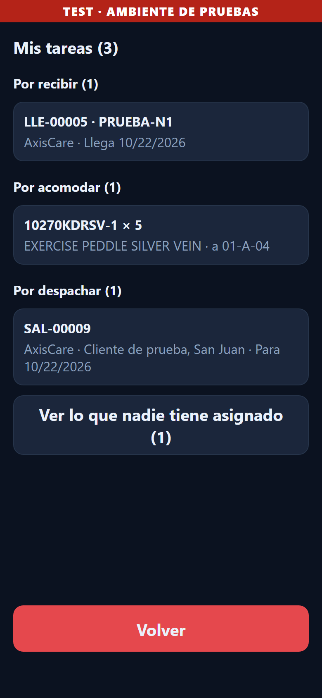 |
| Receive: pending notices and orders | 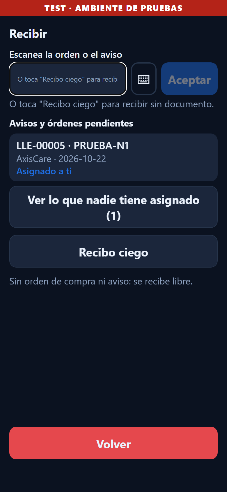 |
| Receive against a notice (what the document says) | 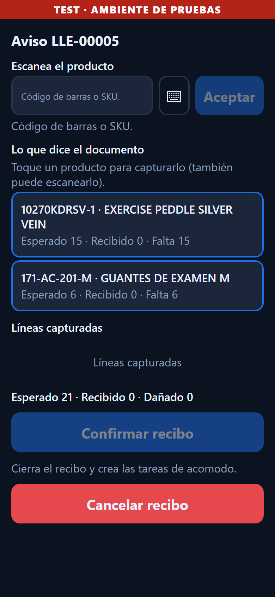 |
| Receive a part: “Receive a part”, then “Confirm receipt” |  |
| Putaway | 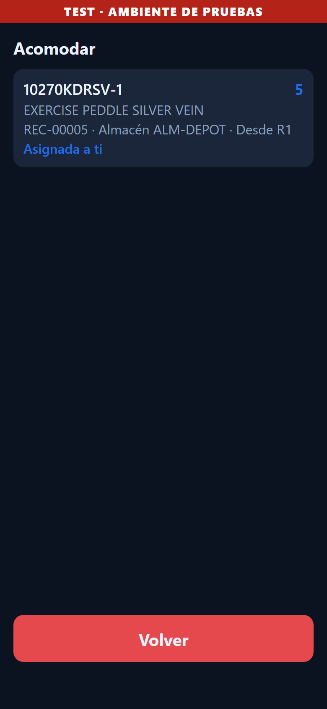 |
| Dispatch of exit notices | 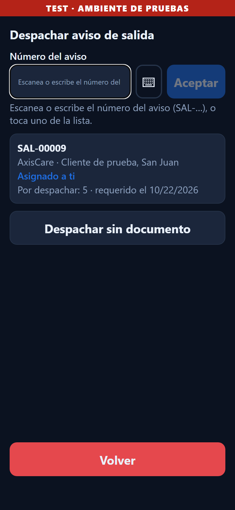 |

## Client portal (desktop web and phone)

| Screen | Screenshot |
|---|---|
| Sign in |  |
| Choose password (invitation) | 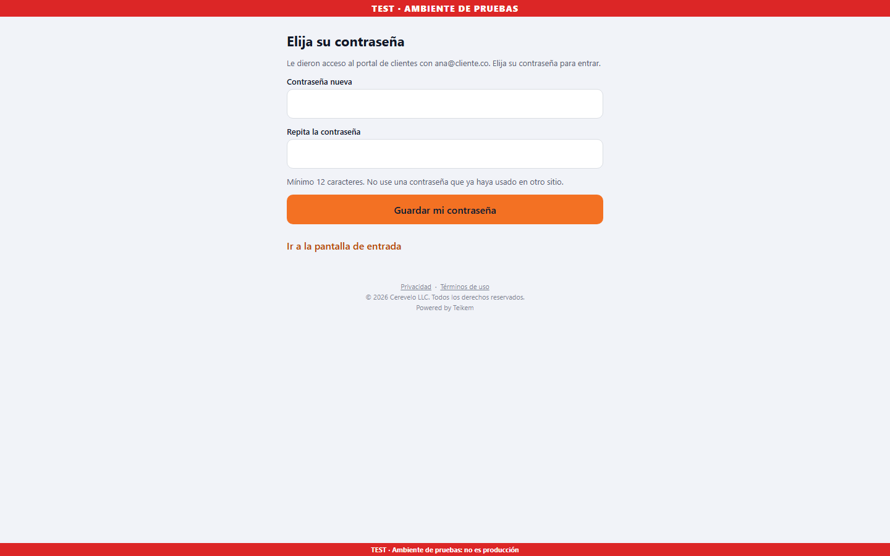 |
| Home (dashboard) |  |
| Home with another company's branding | 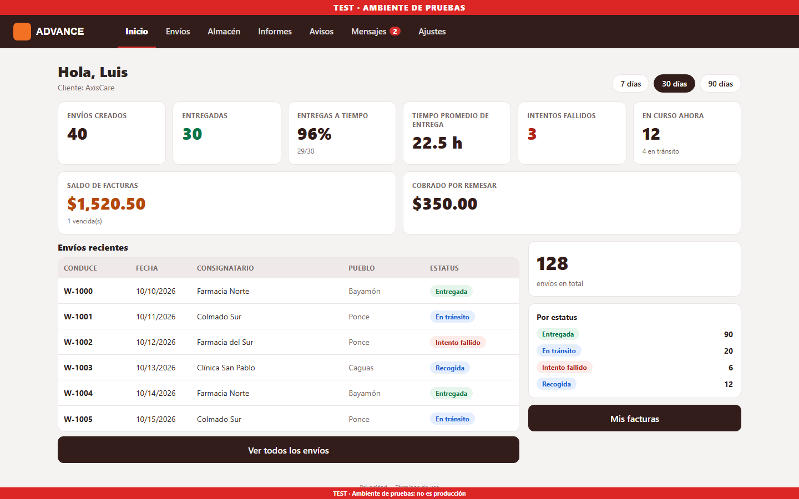 |
| Shipments | 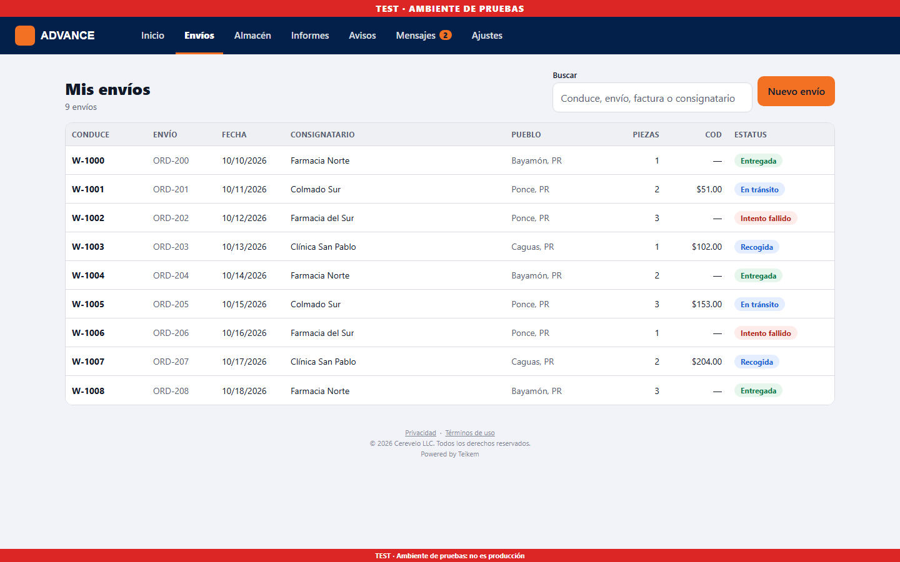 |
| New shipment, quick entry | 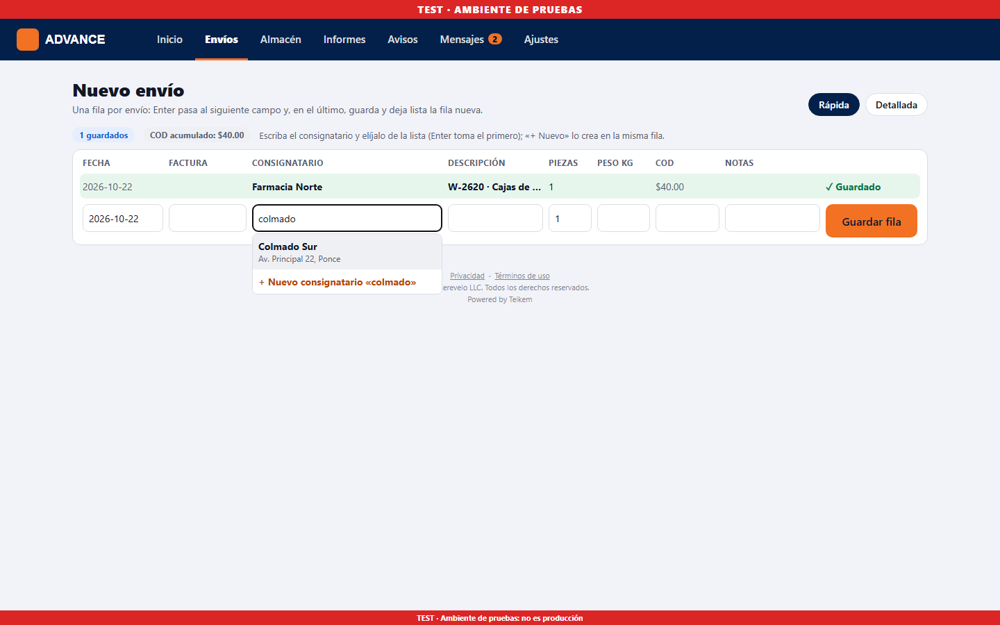 |
| Invoices | 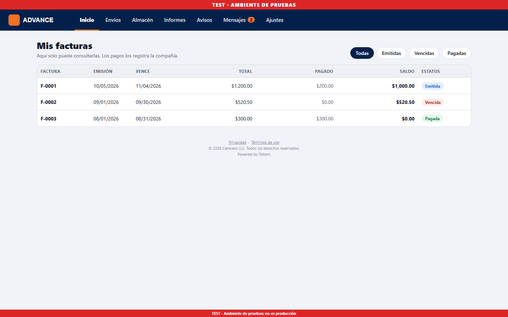 |
| Warehouse | 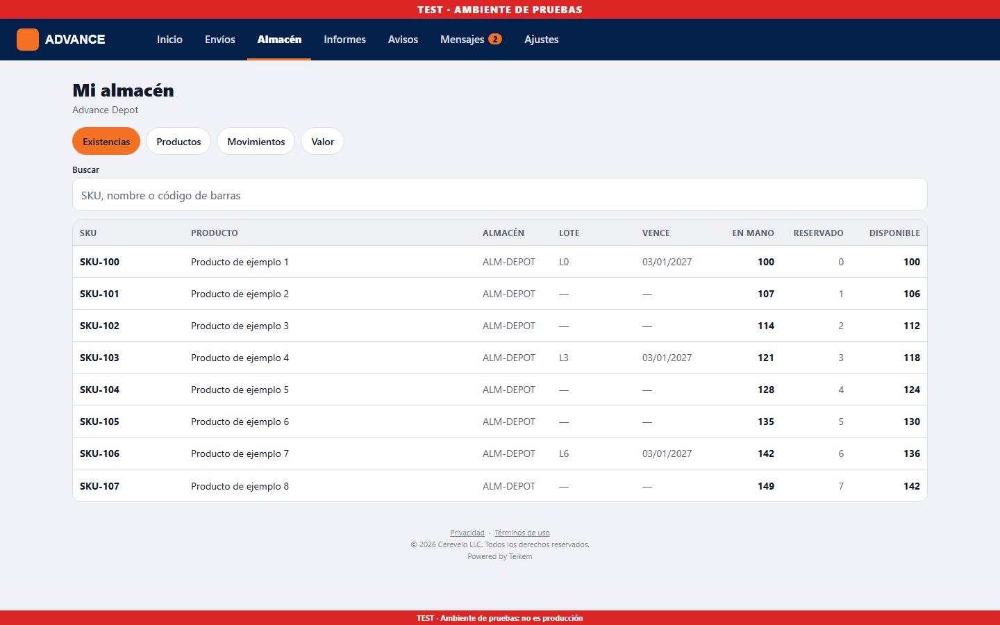 |
| Reports | 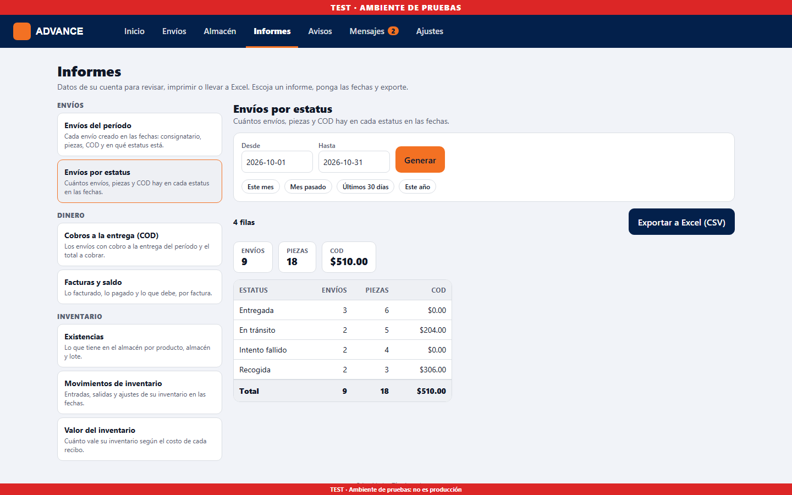 |
| Home on the phone | 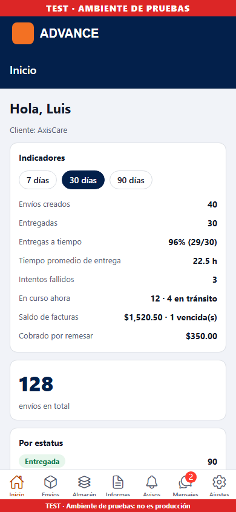 |
| New shipment on the phone | 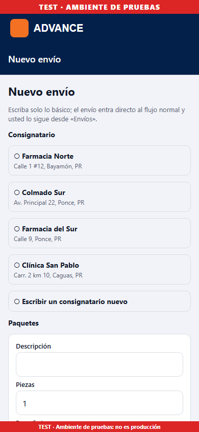 |
