# F1 — Access, menu, Day pulse and My account

First chapter of the staff web screens manual. It covers the skeleton on which every business screen of the following
batches is mounted: signing in, the menu and the header, the home screen ("Day pulse") and "My account".
Addresses (URLs) as they appear in the browser; screenshots in `img/f1-*.png`.

## Sign in

**What it is for.** It is the entry door to Teikem: with their email and password, each person enters the company (tenant)
where they have an account.

**How to get there.** Address `/login`. If you have not signed in and try to open any other screen, the system sends you
here on its own.

**What you see.**

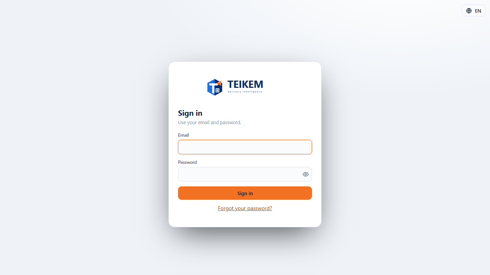

A box with the Teikem logo, "Email", "Password" and the **Sign in** button. At the top right, the language
selector (globe + "ES"/"EN"), available even without signing in.

**What each control does.**
- **Email / Password**: your account data.
- **Sign in**: sends the user and the password. If they are correct, depending on your account you may go to: the home screen
  directly, the two-step verification screen (if your company requires it or you already turned it on), or the choose-company
  screen (if you belong to more than one).

**Permission.** None: anyone with an account can see this screen.

**Messages you may see and what to do.**

| Message | When it appears | What to do |
|---|---|---|
| "Enter a valid email." | The email does not look like an email (missing `@`, etc.) | Correct the email. |
| "Enter your password." | You left the password blank | Enter your password. |
| "Invalid credentials." | The email does not exist, the account is locked by failed attempts, or the password is wrong | Check both values; if you suspect it was locked (5 failed attempts lock it for 15 minutes), wait a few minutes. |

## Two-step verification (MFA)

**What it is for.** Second step of the sign-in when your company requires a code in addition to the password, or when
you already turned on two-step verification in "My account".

**How to get there.** Address `/mfa`, automatically after "Sign in" if the API answers that the code is needed. It has
no menu entry (it is part of the sign-in flow); if you open `/mfa` directly without going through the login, it
sends you back to `/login`.

**What you see and what each button does.** Depending on the case:
- **You already have verification turned on**: a "Verification code" field and the **Verify** button (it accepts the 6-digit
  code from your app or a single-use recovery code). "Back to sign in" cancels and returns to `/login`.
- **Your company requires it and you have not turned it on yet** (mandatory setup): first a **Start setup** button;
  then the key to type by hand into your app (Google Authenticator, Microsoft Authenticator, 1Password…) or the link
  "Open in authenticator app", a code field and the **Confirm** button; on confirming, the **recovery
  codes** are shown (only once, with a button to copy them) and finally you are asked for a new code from the app to finish
  signing in.

**Permission.** None (part of the sign-in).

**Messages you may see and what to do.**

| Message | When it appears | What to do |
|---|---|---|
| "Invalid MFA code." | The app code expired (it lasts 30 seconds) or the recovery code was already used or is mistyped | Use the current code from the app or an unused recovery code. |
| "Invalid code." | When confirming the authenticator app setup, the 6-digit code does not match the key you were shown | Check the phone's time and type again the code the app shows at that moment. |

If you lost the phone with the app: use a recovery code (they were shown to you when turning it on). If you lost those too, ask
an administrator of your company to help you; there is no way to reset MFA yourself without those codes.

## Several companies

Since 2026-09-30 **there is no screen to choose a company** (formerly `/select-tenant`). If your user belongs to several
companies, "Sign in" takes you straight to your default company (if you have none, to the first one by name). To work in
another, use the **company selector in the header** (between the clock and the theme): it only lists the companies you
have access to. With a single company, the header shows its name without a selector.

## First sign-in (email, your own password and two-step verification)

**What it is for.** Since 2026-09-30 every user (new or existing) completes, the first time they enter, three steps in this
order; until they are finished nothing can be used (neither the web app nor the warehouse app with PIN):

1. **Verify your email** — "Send code" sends a 6-digit code to your email (shown masked, j***@empresa.com);
   type it in and "Verify". "Send another code" sends a new one. The code expires in a few minutes.
2. **Set your own password** — the one the administrator gave you is temporary. At least 12 characters, typed twice; it cannot
   be the same one you were given nor one that appears in known breaches.
3. **Set up two-step verification** — continues on the MFA screen: scan the QR code (or type the key) into the
   authenticator app, confirm with a code, save the recovery codes and sign in.

**How to get there.** Automatically after "Sign in" (address `/onboarding`). If you close halfway through, when you sign in again
it continues where you left off (what was done is not repeated). "Back to sign in" cancels.

**Permission.** None.

**Messages you may see.**

| Case | Exact message | HTTP |
|---|---|---|
| Wrong or expired email code | `El código no es válido o venció.` | 400 |
| The email did not go out (provider down) | `No se pudo enviar el correo. Intente de nuevo en unos minutos.` | 409 |
| Password equal to the one you were given | `La contraseña nueva debe ser distinta de la que le dieron.` | 400 |
| Password in known breaches | `Esta contraseña aparece en brechas conocidas; elija otra.` | 400 |
| Short password / do not match (on screen) | `Use al menos 12 caracteres.` / `Las dos contraseñas no coinciden.` | — |

## Recovery codes (if you lose your phone)

When setting up two-step verification (when signing in or in My account) the recovery codes are shown **only once**:
each one works once in place of the app code. Since 2026-10-01:

- **Copy** and **Download** (file `teikem-codigos-de-recuperacion.txt` with the account, the date and one code per line).
- Mandatory checkbox **"I saved them somewhere safe, away from this phone."**: without checking it you cannot continue
  ("Verify" when signing in, "Done" in My account).
- **My account → Two-step verification → "Generate new codes"** (with MFA on): asks for reauthentication, shows new
  codes and **the previous ones stop working**. If you do not have MFA on: `Active primero la verificación en dos pasos.` (409).
- If you lost the phone **and** the codes, a company administrator resets your MFA; the user receives an email
  "Your Teikem two-step verification was reset" (notice only: it does not grant access) and sets it up again when signing in.

## Menu and header

**What it is for.** It is the frame of every screen once the session is started: the side menu to move between screens and
the header with the active company, the language, your user and sign out. There are no business screens yet in this batch: the
only visible group is "Operations" with "Day pulse".

**What you see.**

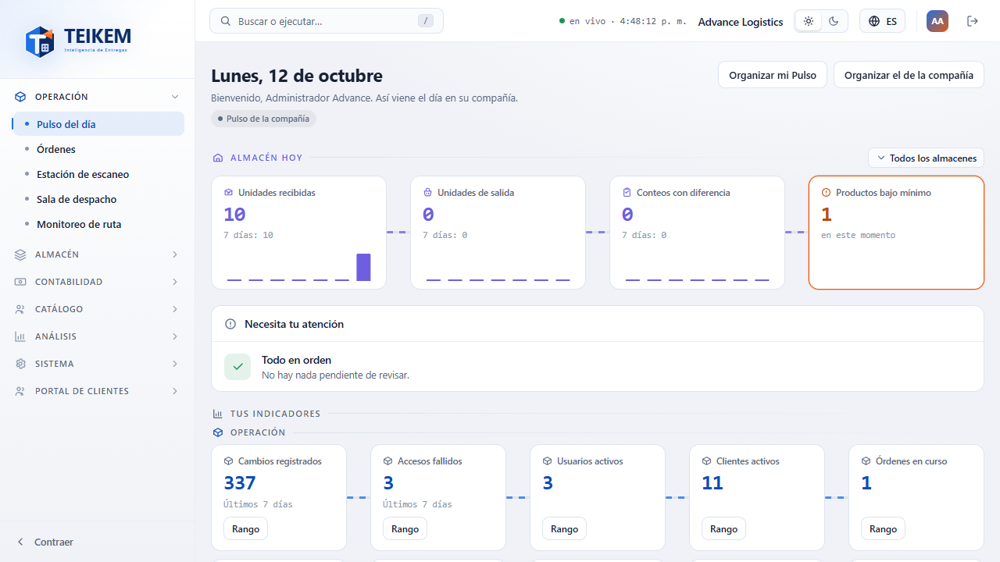

- **Side menu**: groups the screens by topic (Operations, List, Warehouse, Analytics, Administration); a group with
  no screen visible to you does not appear. The **Collapse** button (at the bottom) reduces it to icons only on wide screens.
  Below 900 px of width the menu becomes a drawer: an "Open menu" button (☰) appears in the header and the menu
  slides over the content.

  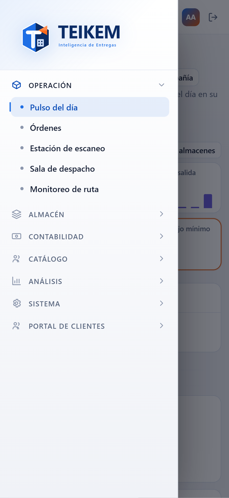

- **Header**: name of the active company (if you belong to more than one company you can switch to, a selector
  appears here instead); the language selector (ES/EN); your name (leads to "My account"); the sign-out button (exit
  arrow icon).

**What each button does.**
- **A menu group** (e.g. "Operations"): expands or closes it; it does not change the screen.
- **Language selector**: changes the language of the whole interface instantly, without reloading the page or losing what you had
  open (the current screen, the expanded menu group and whatever you typed in a form are kept).

  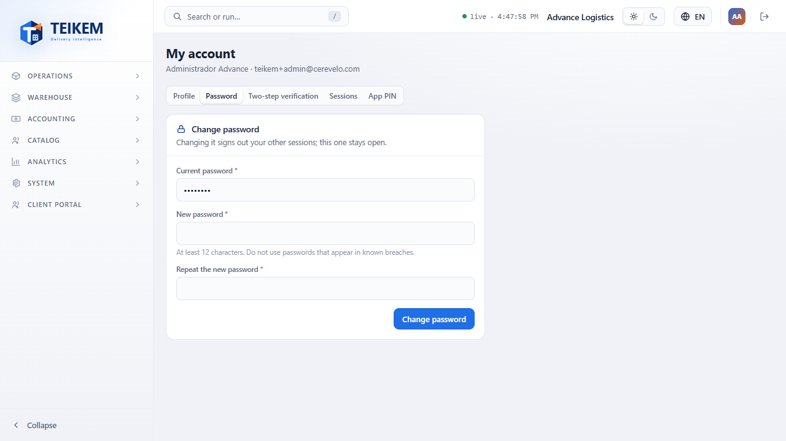

- **Company selector** (when applicable): changes the active company and returns to home.
- **Your name**: goes to "My account".
- **Sign out**: closes the session and returns to "Sign in".

**Permission.** The menu and the header do not ask for permission; each menu entry shows or hides itself according to the permission and
module its screen requires (that is why in this batch only "Day pulse" appears).

**Messages you may see.** If switching companies fails, the server message appears next to the company selector in
the header.

## Day pulse

**What it is for.** It is the home screen: a quick glance at the indicators and charts that you (or your company) marked
to be seen here every day.

**How to get there.** Address `/`, "Day pulse" entry of the Operations group (always visible in the menu).

**What you see.** A greeting with your name, the **Needs your attention** panel (since Batch 14, if you have the `pulse.attention` permission; see
[F7A](f7a-pulso-almacen-y-actividad.md#day-pulse-needs-your-attention-panel)), an "Indicators" section (cards with a number: recorded changes, failed
sign-ins, active users, active clients, orders in progress, COD to collect, etc., according to what your
company has marked) and a "Charts" section (bar, donut or line).

**Batch 15:** at the very top goes the **Warehouse today** band (if you have `pulse.warehouse` and `inventory.view`) and the date and that band stay fixed when
scrolling; the indicators are grouped in a **row per module** (Operations, Warehouse, Accounting); and the charts are **always** drawn as a
chart (there is no longer a list when they have few points), with at most 2 per row. Details and screenshots in
[F7A](f7a-pulso-almacen-y-actividad.md#day-pulse-warehouse-today--last-7-days-band-batch-15). The screenshots of this section were regenerated.

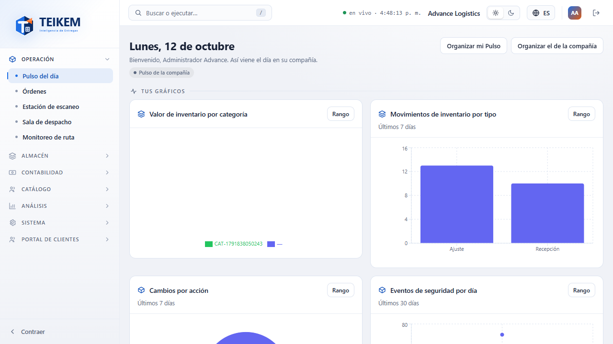

On a phone, the cards stack in a single column, one below the other.

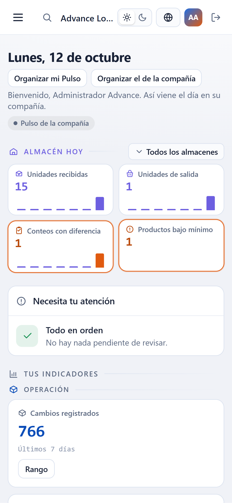

**What each button does.**
- **Range** (on each card): opens "My date range" for that card: choose the mode (for example, last 7 days, current
  month, a custom range with From/To) you want to see. It is your own preference; it does not change what the
  other users of your company see. **Save** applies the change and recalculates the card; **Cancel** closes without saving.

**Permission.** `analytics.view`, **Analytics** module (`ANALYTICS`). If you lack either of the two, instead of indicators
you see a greeting without data (the screen never asks the server for anything):

| Situation | Message |
|---|---|
| Without the `analytics.view` permission | "Your user is not allowed to see the indicators and charts of the Day pulse. Ask your company administrator to grant it." |
| With the permission but without the Analytics module turned on | "The indicators and charts of the Day pulse are part of the Analytics module, which is not active in your company. Ask the administrator to activate it." |
| With permission and module, but your company marked nothing for Pulse | "There is nothing in Pulse yet" / "Mark indicators or charts so they appear here (option “Show in the day's Pulse”)." |

**Messages of the "My date range" dialog.**

| Message | When it appears |
|---|---|
| "Choose a range." | You did not choose any mode |
| "Enter the From date." / "Enter the To date." | You chose the custom range and left one of the two dates empty |
| "From cannot be later than To." | The From date is after To |

## My account

**What it is for.** Each user sees and adjusts their own data here: profile, password, two-step verification and the
sessions (devices) where they have an open session.

**How to get there.** Address `/account`; it opens with your name in the header (it is not in the side menu). Each tab
has its own address so it can be linked directly: `/account`, `/account?tab=password`, `/account?tab=mfa`,
`/account?tab=sessions`.

**Permission.** None in particular: anyone with a started session sees and uses the four tabs of their own account.
Turning off two-step verification is the only action that additionally asks you to confirm your identity again (see
"Reauthentication" below).

### Profile tab

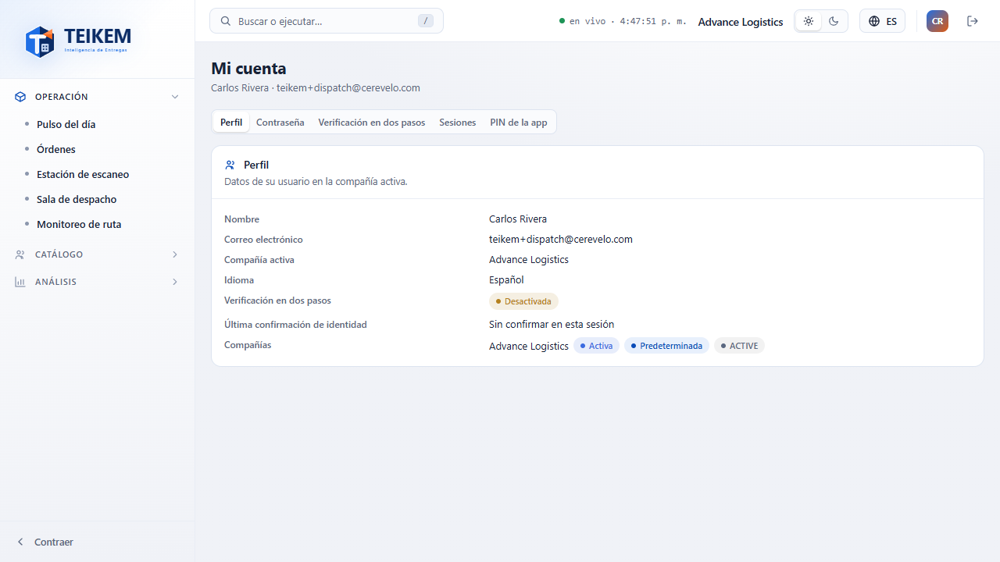

**What you see.** Read-only: name, email, active company, language, whether two-step verification is turned on or
off, when you last confirmed your identity in this session ("Not confirmed in this session" if you never did), and
the list of companies you belong to (marking which is the active one and which is your default). If you are a platform
administrator, it also says so. There are no edit buttons here: changing your name or email is done by an administrator from
Administration (outside this batch).

### Password tab

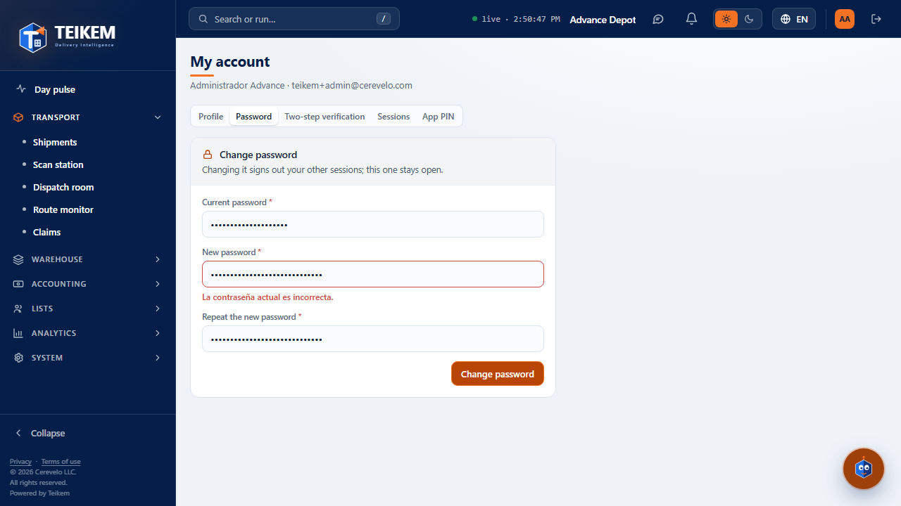

**What you see.** "Current password", "New password", "Repeat the new password" and the **Change password** button. When
you change it, your other sessions are closed (the current one stays open).

**Validations and messages.**

| Field | Rule | Message |
|---|---|---|
| Current password | required | "Enter your current password." |
| New password | at least 12 characters | "The new password must have at least 12 characters." |
| Repeat the new password | must match the new one | "Passwords do not match." |

If the current password you typed is not the right one, the server rejects the change and the message appears under the
"New password" field (not under "Current password"): **"Incorrect password."** — this message may be seen in English even if the
rest of the screen is in Spanish; it is a text the server sends as is and does not depend on the language you chose.
If your new password appears in known leaks, the message is "This password appears in known breaches; choose another
one." (also under "New password"). In both cases: correct the indicated field and submit again.

### Two-step verification tab

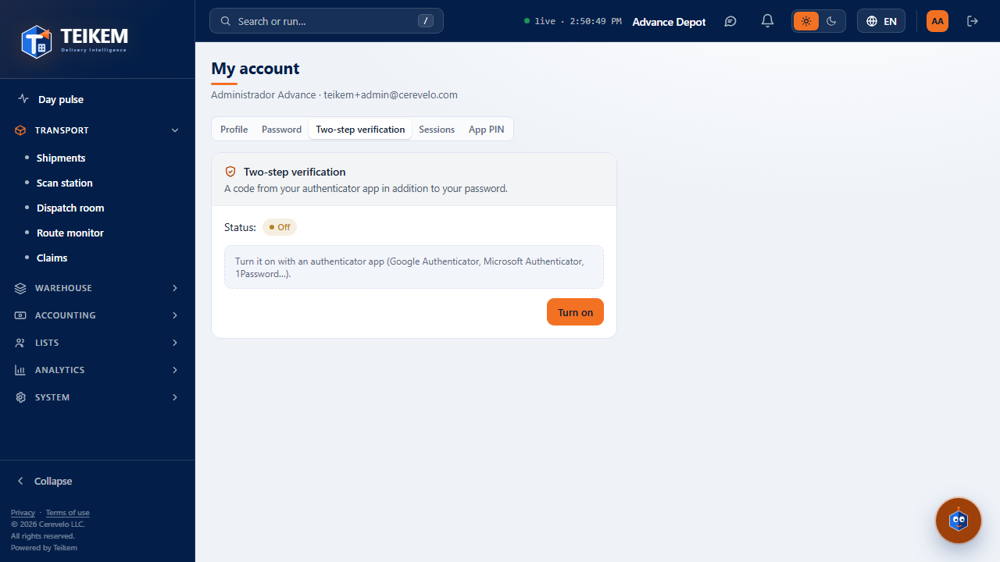

**What you see.** The state ("On" or "Off") and a short explanation. If it is off, the **Turn on** button; if
it is on, the **Turn off** button.

**Turn on.** When you press **Turn on**, the key to type by hand into your authenticator app is shown (or the link "Open
in authenticator app") and a field for the 6-digit code shown by the app.

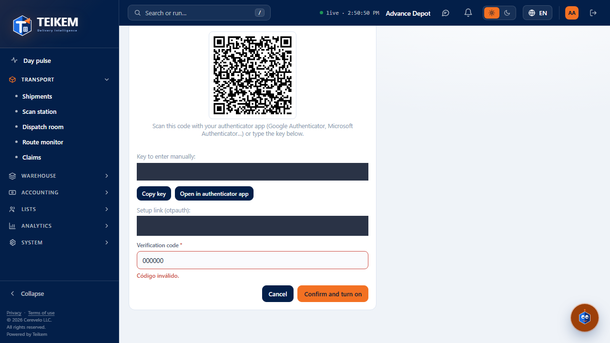

- **Copy key**: copies the key to the clipboard ("Copied to clipboard." or "Could not copy; select it and copy it
  manually." if the browser does not allow it).
- **Confirm and turn on**: validates the code; if it is correct, shows the **recovery codes** (only once, with a
  **Copy** button) and finishes with **I saved them**.
- **Cancel**: exits without turning anything on.

**Turn off.** Asks you to confirm your identity (password, and your MFA code if you already have it on) before turning it off.

**Validations and messages.**

| Field | Rule | Message |
|---|---|---|
| Verification code | 6 digits | "Enter the 6 digits shown by your app." |
| Verification code | the code does not match the key shown | "Invalid code." (under the field) |

### Sessions tab

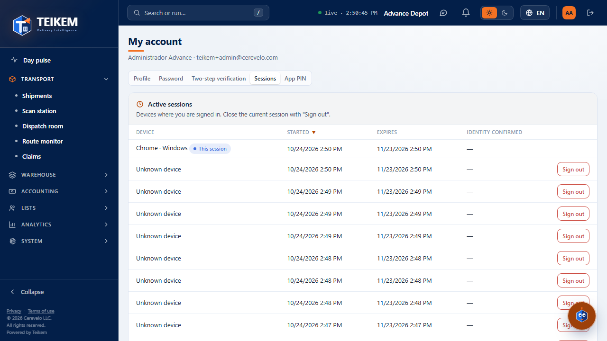

**What you see.** A table with each device where you have an open session: device (or "Unknown device"),
start, expiration and whether you confirmed your identity recently there; the row of the session you are connected with now
carries the "This session" mark.

**What each button does.**
- **Sign out** (on any row that is not yours): asks for confirmation and revokes that session; that device will have to
  sign in again. The current session does not have this button: to close it use **Sign out** in the header.

**Messages.** "No active sessions." if the list is empty (it should not happen, since the current session is always present);
"Session signed out." on confirming.

## Reauthentication (AAL2)

**What it is for.** Confirms your identity again before a sensitive action (for example, turning off your two-step
verification). It appears on its own, as a box over the screen you are on, when the server answers that it is needed
("aal2_required"); also before turning off MFA.

**What you see.** "Confirm your identity", a password field and, if you already have two-step verification turned on, a
code field. **Confirm** retries the original action; **Cancel** leaves it undone.

**Permission.** None additional: it is part of the action that requested it.

**Messages you may see.** "Incorrect password." or "Invalid MFA code." if either of the two values is not correct;
correct it and try again.

## No permission / Module turned off

**What it is for.** These are the screens you see instead of the one you requested when you lack the permission or the module that screen
requires (for example, if someone shares a link to a screen of a module turned off in your company). In this batch there are no
business screens yet; they are seen if you navigate directly to an address that uses them.

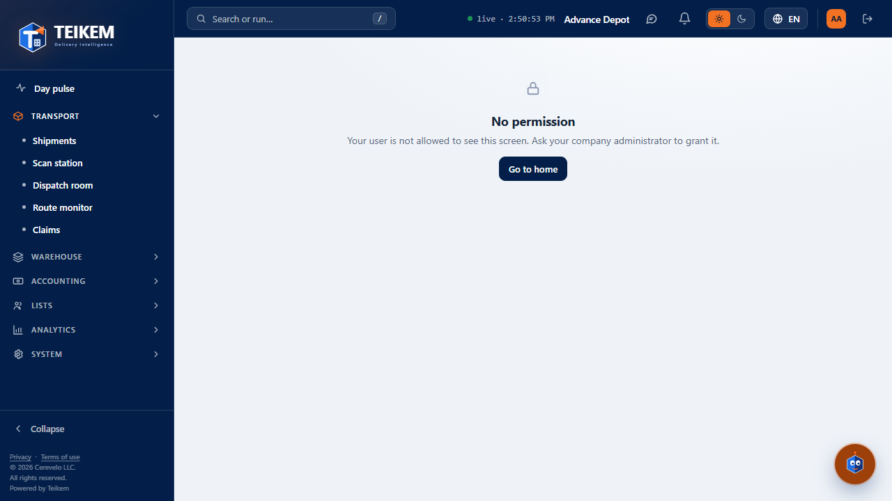

**What you see.** An icon, the title ("No permission" or "Module turned off"), a sentence explaining the cause and the **Go to
home** button (returns to Day pulse).

**Messages.**

| Message | Cause | What to do |
|---|---|---|
| "Your user is not allowed to see this screen. Ask your company administrator to grant it." | You lack the permission that screen requires | Ask an administrator of your company to grant you the permission. |
| "This module is not enabled for your company." | The module of that screen is turned off in your company | Ask an administrator to activate the module (Administration › Modules, outside this batch). |

## Frequently asked questions of this chapter

**Why does the menu only show "Day pulse"?** Because in Batch F1 there are no business screens yet (clients,
orders, fleet, trips, inventory): they arrive in the following batches. Each one will appear on its own in its group when your permission and
your company's module allow it.

**Why does the screen not reload when changing the language?** It is on purpose: changing the language only changes the texts, it does not
reset what you were doing (a half-filled form, the menu group you had open).

**Why does "My account" have no button to edit my name or email?** This screen is only for what belongs to
you (password, MFA, sessions); changing your profile data, role or permissions is done by an administrator from
Administration, which arrives in a later batch.

**I switched companies and I no longer see the same as before, is that normal?** Yes: the menu, the permissions and the modules turned on are
per company. If you belong to several, each one may have a different menu.
