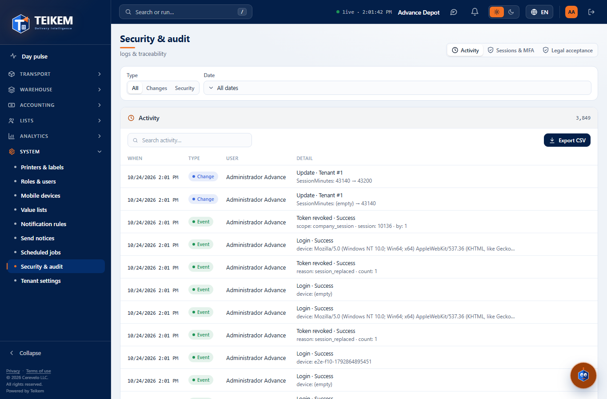
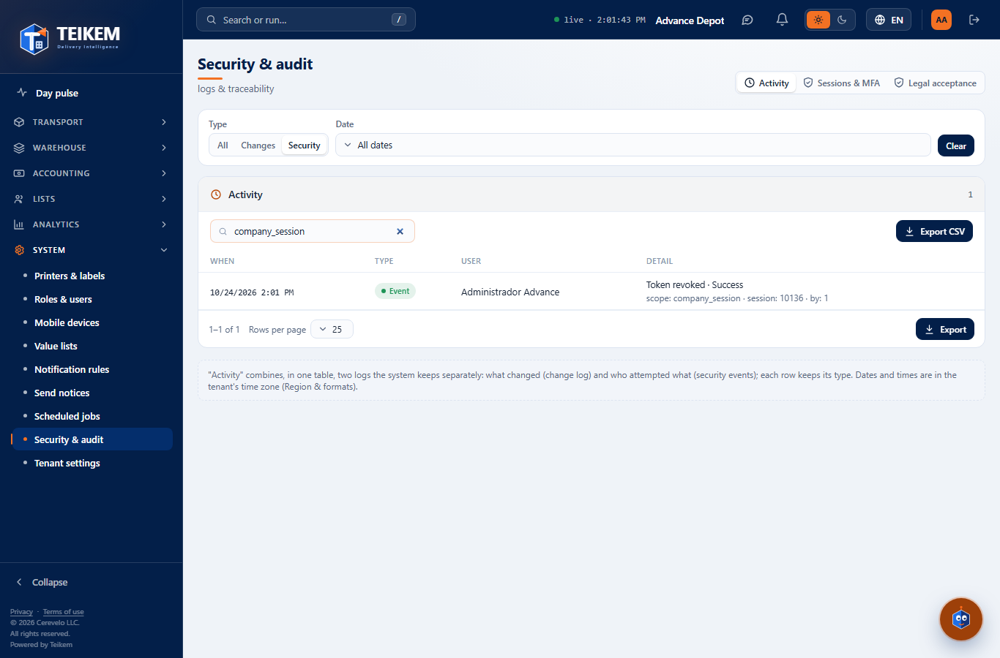
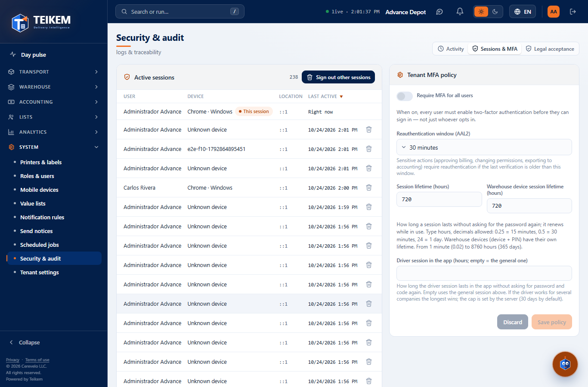
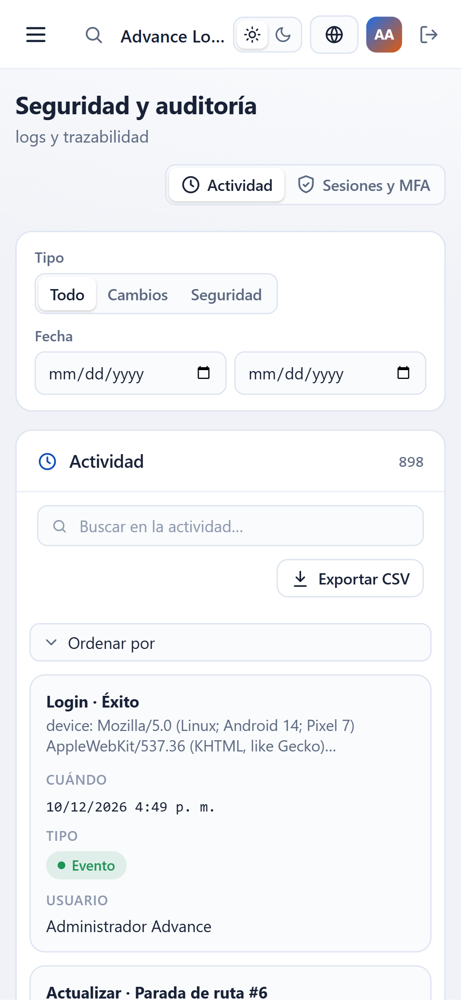

# F10 — Security & audit

Screen **System → Security & audit** (`/system/audit`), which stops being a "pending" screen. It gathers in one place the
company log (what changed and who tried what), the open sessions of all users and the company's security
policy (mandatory MFA, reauthentication and session lifetime). Backend: chapter 01, sections 1.5, 9,
9.1 and 11; frontend decisions in `docs/frontend/loteF10-decisiones.md`.

**Who can.** See the screen: permission **`admin.audit`** with the **System** module (`SYSTEM`) turned on (without the permission, the
menu does not show it and the address leads to "No permission"). Inside:

| Action | Permission |
|---|---|
| See the activity, export it and see the company's sessions | `admin.audit` |
| Revoke a session or "Sign out other sessions" | plus `admin.users` (without it, the buttons do not appear) |
| Change the policy (MFA, reauthentication, session lifetime) | `admin.tenant` (without it, the policy is read-only) |

**Tabs.** At the top right, as in the mockup: **Activity** (no parameter) and **Sessions & MFA** (`?tab=sessions`).
The **Open Security & audit** button of Tenant settings → General opens Sessions & MFA directly. At the bottom, the note:
“Activity” combines, in one table, two logs the system keeps separately… Dates and times are in the tenant's time zone
(Region & formats).

## 1. Activity

A single table with the **change log** (what changed: creations, changes, deactivations and restorations of the audited records) and
the **security events** (who tried what: sign-ins, sign-outs, MFA, reauthentication, denied permissions, revoked
sessions…), most recent first (`GET /api/v1/audit/activity`).

- **Columns** (all sortable with a click on the header; the order applies to the page on screen and to what is exported):
  - **When**: date and time with the company's format and time zone (`10/03/2026 6:40 a. m.`).
  - **Type**: **Change** (blue) for the change log; **Alert** (red) for a failed or blocked event, a denied permission
    or an account lockout; **Event** (green) for the rest.
  - **User**: who made the change or the attempt; "—" if unknown (e.g. a sign-in attempt with an email that does not exist).
  - **Detail**: on top what happened ("Update · Company #1", "Login · Success", "Token revoked · Success") and below the data,
    readable: in a change "Field: before → after" (`SessionDays: 30 → 29`), in an event "field: value" (`device: ZEBRA-01`).
    The first 4 data items are shown and "and N more"; the file brings them all. Hovering with the mouse shows the IP if there is one.
- **Filters** (top bar; **Clear** removes them):
  - **Type**: **All / Changes / Security** (the segment of the mockup).
  - **Date**: from / to, in company days (from midnight of the first day to midnight of the day after the last).
  - **Search activity…** (inside the panel): free text searched by the server (300 ms after you stop typing) in
    the detail, the IP, the user's name or email, the name or code of the type, the result, the action and the entity
    (`Permiso`, `LOGIN`, `Compañía`) and the entity number (`#12`). Case-insensitive.
- The panel counter is the **real total** with the filters. Table footer: range, **Rows per page** (10/25/50/100), ‹ › and
  **Export** (Excel, CSV or PDF, with everything filtered).
- **Export CSV** (button next to the search box, the one from the mockup): downloads `auditoria-AAAA-MM-DD.csv` with **all** the rows that
  match the type, the date and the search (not just the page), in the table order, with the columns When, Type, User and
  Detail. Commas, quotes and line breaks go between quotes, the date comes out as a date (`2026-10-03 06:40:00`, in the company's
  time) and a text that starts with `=`, `+`, `-` or `@` carries an apostrophe so that Excel does not execute it. Notice
  "Downloading N rows"; if there are more than 10,000, the first 10,000 are downloaded with the notice "The first 10000
  rows were downloaded; narrow the date to export the rest.".

## 2. Sessions & MFA

### 2.1 Active sessions

The open sessions of **all the users of the company** (`GET /api/v1/audit/sessions`), not just yours (yours
are also in My account → Sessions).

- **User**, **Device** (browser and system, "Chrome · Windows"; a warehouse device says "ZEBRA-01 · Dock 1
  (Warehouse device)"; without data, "Unknown device"), **Location** (the IP from which the session was opened or renewed; there is
  no city or country) and **Last active** (the last renewal of the session, which happens every 15 minutes while in use;
  yours says "Right now"). Sortable; by default the most recent on top.
- **This session** marks yours: it has no button to revoke it (it is closed with **Sign out**).
- **Revoke** (trash can of the row, `admin.users`): asks for confirmation "Revoke this session?" — "{user}'s session on {device}
  will be closed. They will have to sign in again on that device." → notice "Session revoked".
- **Sign out other sessions** (panel header, `admin.users`; disabled if there are no others): confirms "Sign out other
  sessions?" — "N company sessions will be closed: all but this one. Each user will have to sign in again." → notice "Other
  sessions were signed out (N)". It is a sensitive action: if your last verification is older than the reauthentication
  window, the screen asks you for the password (and the MFA code if you have one) and repeats it on its own.
- What happens after revoking: that device or browser cannot renew the session; whatever it has open stops working at the
  latest in 15 minutes. **If it tries**, the server closes **all** the sessions of that user for security (see decision 3
  of the batch): they will have to sign in again on all their devices.

### 2.2 Tenant MFA policy

The four security values of the company (`GET`/`PUT /api/v1/tenant/settings`, only what changed):

| Field | What it does | Values |
|---|---|---|
| **Require MFA for all users** | every user must turn on two-step verification before being able to sign in | yes / no |
| **Reauthentication window (AAL2)** | sensitive actions ask for the password again if the last verification is older | 15, 30 or 60 minutes (if the saved value is another one, it also appears) |
| **Session lifetime (hours)** | how long a session lasts without asking for the password again; it is renewed while in use. **It is written in hours and accepts decimals** (2026-10-12): `0.25` = 15 minutes, `0.5` = 30 minutes, `24` = 1 day | 0.02 (1 minute) to 8760 (365 days) |
| **Warehouse device session lifetime (hours)** | the same for warehouse devices (device + PIN), also in hours with decimals | 0.02 to 8760 |

- **Save policy** / **Discard** (only with changes; "There are unsaved changes."). On saving: notice "Policy saved".
- The new lifetime applies to the sessions opened or renewed from that moment on; the open ones keep the one they had.
- Without `admin.tenant`: notice "Read only: changing the policy requires the permission to manage the tenant (admin.tenant)." and
  the fields disabled, without buttons.

| Field | Rule | Message | Where |
|---|---|---|---|
| Session / device lifetime | from 1 minute to 365 days (in hours: 0.02 to 8760) | "Between 0.02 hours (1 minute) and 8760 hours (365 days)." (screen) / "The lifetime must be between 1 minute and 365 days (8760 hours)." (server) | Screen (under the field, not sent) and server, 400 under the field |
| Reauthentication window | 15, 30 or 60 minutes | "The reauthentication window must be 15, 30 or 60 minutes." | Server, 400 under the field (the screen only offers those values, plus the saved one if it was another) |

### 2.3 Preferred IPs (trusted network)

Below the MFA policy there is a panel **Preferred IPs (trusted network)** (only with `admin.tenant`). It is the list of the company's IPs or ranges from which **the verification code is not requested when signing in**. It is for a location (warehouse, office) that goes out to the internet through a fixed public IP: whoever connects by cable or Wi-Fi from that network enters with their password, without the code.

**What changes and what does not**
- **Only the sign-in code** is skipped. The **password is always requested** (with the usual lockout by attempts).
- Sensitive actions (permissions, roles, temporary passwords, modules…) **still ask for the code** (recent reauthentication): a session that entered without a code does not pass them.
- **It is never skipped** for: platform administrators, people with the individual “always MFA” flag and people who **have not yet enrolled** their MFA (they enroll it first; the IP skips the code, not the enrollment).
- **Recovering the password by email always asks for the code** from whoever has their MFA enrolled, even if they are on the preferred network.
- Every person and computer that goes out through that IP enters without a code (cable, Wi-Fi, visitors if they share the exit). Load **only the internal network**; if there is a guest network, it must go out through another IP.
- The feature is **off by default on the server** (`Auth:TrustedNetworks:Enabled`). While off, the list can be prepared but the code is not skipped, and the panel says so.

**The panel**
- **Your current IP is X** — with “Add this IP” (if it is not covered) or “covered by “Name””.
- **Maximum entries** (per company; empty = no limit) and how many it uses. Lowering it below what already exists deletes nothing: only new additions are blocked.
- **Test an IP**: says whether any active and current entry covers it.
- The table: **Network**, **IP / range**, **Addresses** it covers, **Status** (Active, Inactive, Expired), **Expires**, **Confirmed by** (who confirmed, and when, that it is internal network only); “You are here” marks the one that covers your IP. Actions: **Change**, **Activate / Deactivate**, **Delete**.

**Adding an IP or a range**
- **A single IP (recommended)** or **A range of IPs** (choose the size: /32 = a single one, /29 = 8, /24 = 256…; there are shortcuts). Below comes the preview (“It will be saved as 192.168.10.0/24 — 256 addresses”) and the warnings: it was adjusted to the network address, it is a private IP (it only works if the connection arrives through an internal network), very wide range, or **it does not include your current IP**.
- Ranges that are too wide (IPv4 wider than /16, IPv6 wider than /48), unusable addresses (empty, loopback, multicast) and loose forms such as “127.1” are not accepted.
- **Expires (optional)**: blank means it does not expire; it is valid while active.
- You must check **“I confirm this IP belongs only to the company's internal network, not to a guest network or a public network”** (also when changing the IP or the range); who and when is recorded.
- Creating, changing, activating, deactivating, deleting and changing the maximum **require recent MFA** and are recorded in the security log (type “Trusted network”); in addition an **email is sent to the administrators** of the company with what changed, who did it and from which IP.

| Field | Rule | Message |
|---|---|---|
| Name | required, max. 100 | "Enter a name for the network…" |
| IP or range | valid, not too wide; no duplicates | 400 under the field; 409 "That IP or range is already in the list." |
| Maximum entries | integer ≥ 0 or empty | 409 "This company reached its maximum of N entries." when adding |
| “Internal network only” confirmation | required when creating and when changing the IP | "Confirm that this IP belongs only to the internal network…" |
| Expires | future date | "The expiration date must be in the future." |

## 3. On the phone (360 px)

 

The tables become cards (with "Sort by"), the filters and the policy stay in one column and the page never scrolls
sideways; the tabs scroll within their strip if they do not fit.

## 4. Frequent cases

- **I am looking for something that happened months ago and it does not appear in the first pages.** Set the **Date** of that period or a search: the
  counter says how many rows there are and the pages go all the way to the end.
- **A user lost their phone.** In Active sessions look for their session by device and last activity and **Revoke it**. If you do not
  know which one it is, in Roles & users you can close all the sessions of that user.
- **I revoked a session and the user says they were kicked out of all their devices.** It is expected if the revoked device tried
  to keep being used: the server takes it as a possible token theft and closes all their sessions.
- **Why is the location a number?** It is the IP address; Teikem does not query external services to convert it into a city.
- **I want to export the log for an external audit.** Filter by date and type and use **Export CSV** (or Export → Excel/PDF
  in the footer, which also carry the company, the title and the applied filters).
