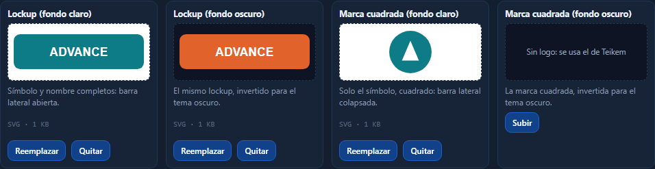
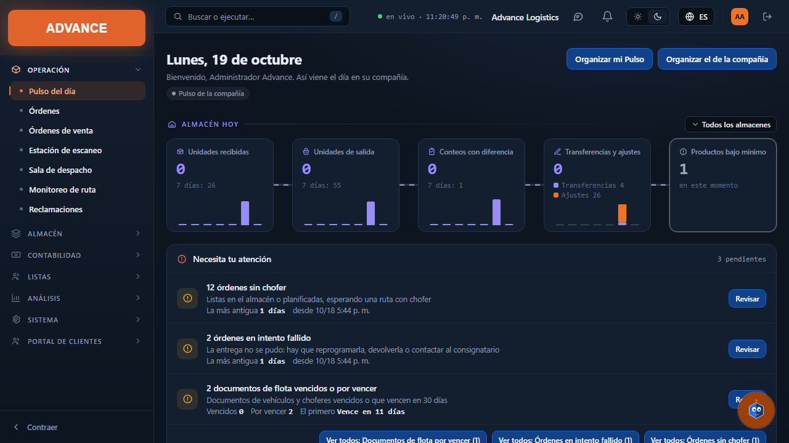
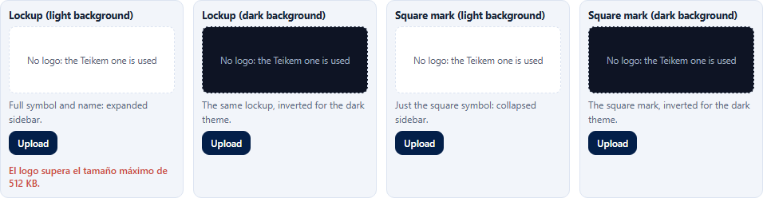
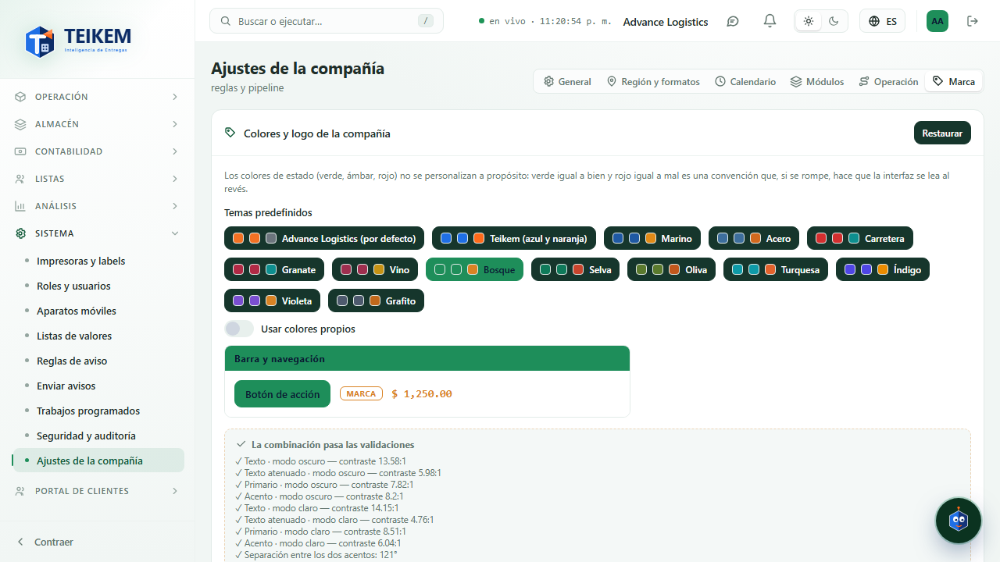

# F11 — Company branding: logos and colors validated by the server

**Branding** tab of **System → Tenant settings** (`/system/settings?tab=brand`), now connected to the server: the
company's **logos** are uploaded, viewed and removed from here, and the colors are also validated by the server with the same
rules as the screen. Backend: chapter 01, section 11.2; decisions in `docs/lote19-decisiones.md`; the colors tab is
described in [F9, section 7](f9-ajustes-de-la-compania.md).

**Who can.** See the tab and the logos: any user with a session (it is the branding of the interface); on the screen, with the
**`admin.tenant`** permission and the **System** module (like the rest of Settings). Upload, replace and remove logos and save colors:
**`admin.tenant`**. Without it the tab is **read-only**: the colors and the logos are seen, without buttons.

## 1. Logos

Four slots, each with its preview on a **light background** or **dark background** as appropriate:

| Slot | What for | Where it is seen |
|---|---|---|
| Lockup (light background) | full symbol and name | open sidebar, **light** theme |
| Lockup (dark background) | the same lockup, inverted | open sidebar, **dark** theme |
| Square mark (light background) | only the symbol, square | **collapsed** sidebar (and pending screens), light theme |
| Square mark (dark background) | the square mark, inverted | same, dark theme |

- **Upload / Replace:** the button opens the file picker (SVG, PNG, JPG or WebP, up to 512 KB). The logo is saved **at
  once** ("Logo saved"); no need for "Save changes" (that button is only for the colors). Under the preview you can read
  the type and the size ("SVG · 2 KB").
- **Remove:** the “Remove” button of the slot ("Logo removed"). If the company is left without a logo in a slot, the interface uses the
  other variant of the same piece and, if there is none, the Teikem logo ("No logo: the Teikem one is used").
- **Variants:** in the dark theme the inverted one is used and in the light theme the normal one; if only one of the two was uploaded, it is used in
  both themes. The **lockup** and the **square mark** are independent pieces: without a square mark, the collapsed sidebar shows the
  Teikem symbol.
- **It applies to the whole company** without reloading: the sidebar changes as soon as the file is uploaded, and the other users see it
  the next time their screen checks the logos (when opening it or when returning to the window).

### Server errors, next to the slot

The exact server message appears in red under the slot where it failed (the other logos are not touched):

| What happened | Message | HTTP |
|---|---|---|
| The content is not SVG/PNG/JPG/WebP (even if the name says `.png`) | `Formato no admitido: el logo debe ser SVG, PNG, JPG o WebP.` | 415 |
| The file weighs more than 512 KB (the screen warns before sending it; the server also rejects it) | `El logo supera el tamaño máximo de 512 KB.` | 413 |
| SVG with active content or external references | `El SVG no se acepta: contiene el elemento <script>, que puede ejecutar código o cargar contenido externo.` (or another reason: `on…` attribute, `javascript:`, link outside the file, DOCTYPE, external stylesheet) | 400 |
| The file is one image type and declares another | `El contenido del archivo (image/png) no coincide con el tipo declarado (image/jpeg).` | 415 |
| Cut or damaged image | `El archivo está dañado o incompleto y no se puede usar como logo.` | 400 |

The full list with the "what to do" for each one is in the FAQ, section "Batch 19".

## 2. Colors: the server repeats the validations

The contrast validations (text 7:1; muted text and the two accents 4.5:1, in dark and light mode) and hue separation
(40°) are still shown live, and now the **server repeats them when saving** with the same numbers. If something did not pass (for
example, someone calls the API by hand), the exact server message appears in red **next to the colors** and nothing is saved.
The note of the validation list says so: “The server repeats these checks when saving: a brand that does not pass is rejected.”

## 3. Calendar: repeated holiday

When adding a holiday on a date that already has one, the server answers 409 and the screen shows its message: **“There is already a
holiday on that date.”** (before, the screen detected it on its own and the server would have replaced the holiday without warning). To
change one, delete it and add it again.

## 4. Frequent cases

- **I uploaded the logo and the sidebar did not change.** Check the theme: in dark the “dark background” slot is used and, if missing, the
  light background one. For the collapsed sidebar the **square mark** is needed.
- **The logo looks too small or too big.** The lockup takes the width of the sidebar with a maximum height of 64 px and the square mark,
  44 px; the image fits without distortion. Use a canvas with little margin around it.
- **My designer's SVG is rejected.** The message says which element or attribute caused it; see the FAQ.
- **I do not see the upload buttons.** Without `admin.tenant` the tab is read-only.
