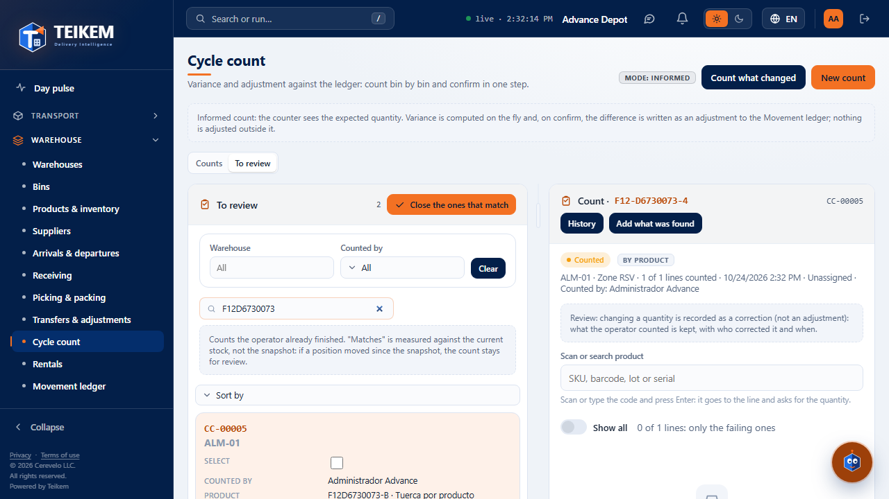
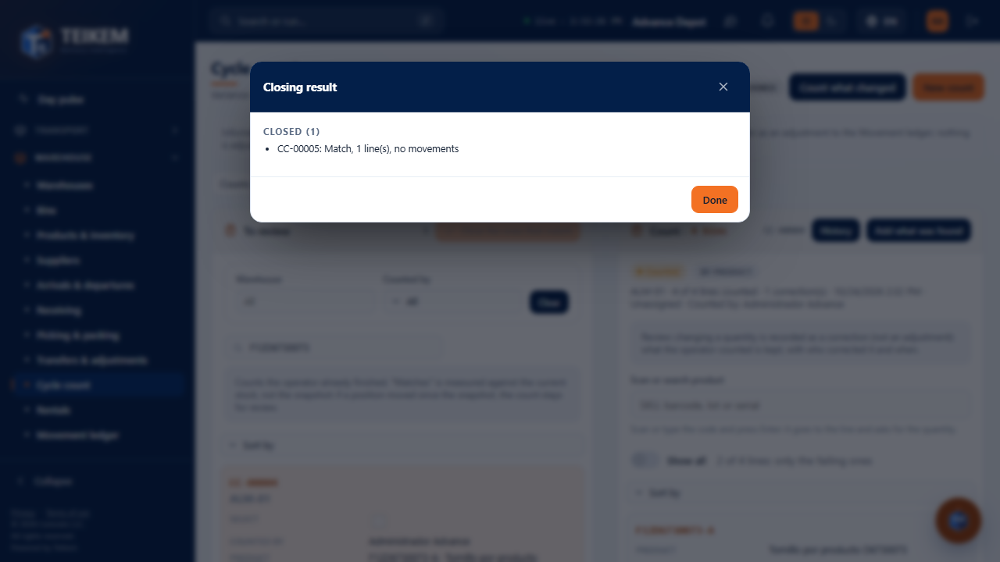
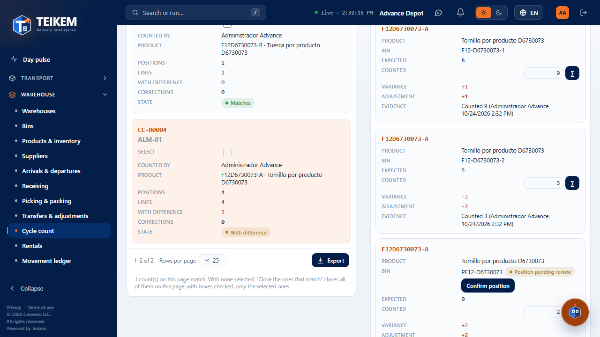
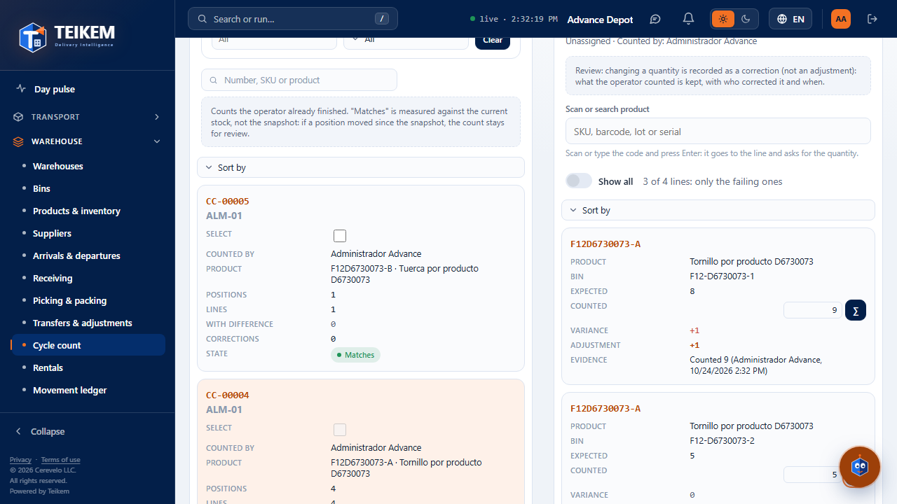
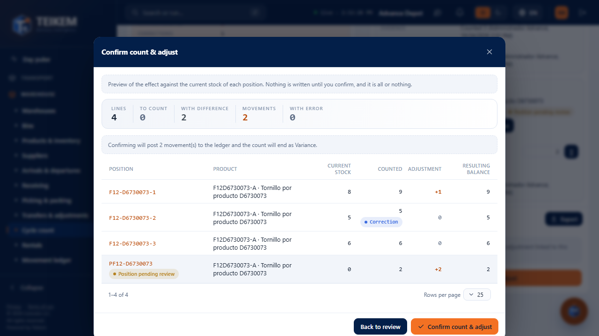
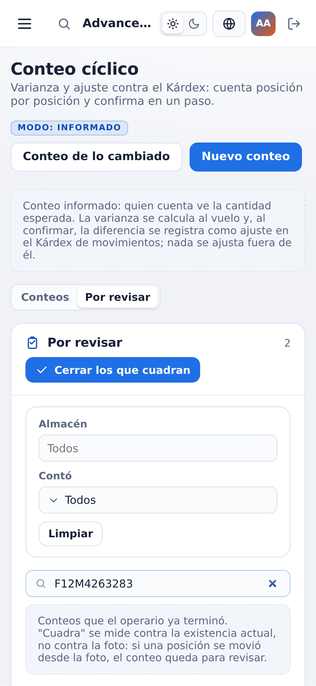
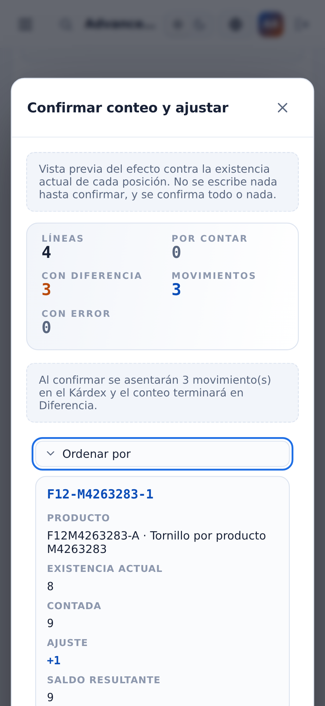

# F12 — Cycle count by product: "To review", supervisor correction and preview

Screen **Warehouse → Cycle count** (`/warehouse/cycle-counts`). This batch adds the **quick review** of the counts the
operator already finished in the app (especially the counts **by product**): a "To review" list, the bulk close of the ones that
match, the correction of quantities with evidence and a **preview of the effect** before confirming. Server: chapter
[06, section 6, "Batch 21"](../06-inventario-y-almacen.md); decisions in `docs/frontend/loteF12-decisiones.md`. The app ("Count
by product") is in [chapter 09](../09-app-almacen.md).

**Who can.** Everything requires the **WMS_LOTSERIAL** module.

| What | Permission |
|---|---|
| See the screen and the usual list | `inventory.view` |
| See the **To review** tab, the preview, correct quantities, **Close the ones that match** and **Confirm count & adjust** | `warehouse.count` |
| **Confirm position** (bin pending review) | `warehouse.manage` |

Without `warehouse.count` (**blind** count) you do not see the "To review" tab or anything of what is expected: neither the preview, nor the
adjustment, nor "only the failing ones". Who sees the system quantities **did not change**. The evidence (who counted and who corrected) is
seen, because it does not reveal what the system says.

## 1. "To review" tab

At the top of the screen there are two tabs: **Counts** (the usual list) and **To review** (`?tab=review`). "To review" shows
the counts in **Counted** status (the ones the operator finished), most recent first, with the chosen count on the right.

| Column | What it says |
|---|---|
| Select | checkbox to close only some (it can only be checked on the ones that **match**) |
| Count | number (CC-…) and warehouse |
| Counted by | who captured the most lines; "Ana and 1 more" if several counted |
| Product | the first one (SKU · name) and "and N more" if the count has several products |
| Bins · Lines | how many bins and lines it has |
| With difference | lines that would post an adjustment **against the current stock** (in red if there is any) |
| Corrections | lines the supervisor corrected |
| Status | **Matches** (green), **With difference** (orange), **With errors** (red), **Lines missing** (gray) |

- **"Matches" is measured against the current stock, not against the snapshot.** If a bin moved since the snapshot was taken, a
  count that agreed with the snapshot may come out "With difference".
- The status is calculated by the server with the same calculation as the confirmation. "With errors" wins over "Lines missing" and this one over
  "With difference".
- **Filters** (they go to the server and return to page 1): **Warehouse** (one or all), **Counted by** (the people who appear in the list
  and, if your user can manage users, all of the company's) and the **search box** (count number, SKU or product
  name). **Clear** removes them.
- The columns are sorted with a click on the header (it sorts the page on screen). With a narrow panel or on the phone the list
  becomes cards with "Sort by". The footer has the range, "Rows per page" and **Export** (everything filtered).
- **Clicking a count** opens it on the right (`?count=<id>`); without choosing, the first one of the page opens.

## 2. Close the ones that match

The **Close the ones that match** button (above the list) closes as **Matched**, without moving inventory, the counts that match:

- **With no boxes checked:** all the ones that match **on the page on screen** (with the filters above).
- **With boxes checked:** only the selected ones (the button says "Close selected (N)").
- A confirmation says **how many and which** ("2 matching count(s) will be closed: CC-00012, CC-00015…") and allows an
  optional **comment** (maximum 500 characters) that stays in the history of each closed count.
- Before closing each one, the server **checks again** the current stock. Each count is closed in its own
  transaction: it ends as Matched or stays as it was.
- The **result** lists the **Closed** ones ("CC-00012: Match, 1 line(s), no movements") and the ones that **stay for review**
  with their reason. A click on the number opens that count.

| Reason (code) | Text shown | What to do |
|---|---|---|
| `WouldPost` | Would post {n} movement(s); review it. | Open it, see the preview and correct or confirm by hand |
| `Errors` | Has {n} line(s) with errors: *(server message)* | Release the reservation or correct the quantity |
| `Pending` | {n} line(s) left to count. | Finish counting |
| `Stale` | The stock changed while closing; review it. | Look at it again |
| `NotCounted` | Counting is not finished yet. | Wait for the operator to finish |
| `AlreadyReconciled` | It was already confirmed. | Nothing |
| `NotFound` | The count does not exist. | Nothing (another user deleted it) |
| `NoLines` | The count has no lines. | Delete it or add what was found |
| `Failed` | Could not close it: *(server message)* | According to the message |

If none on the page matches, the button stays disabled ("No count on this page matches.").

## 3. Reviewing a count: only the failing lines, evidence and correction

A **Counted** count opens showing **only the failing lines**: the ones that would post an adjustment against the current stock or
that have an error. The **Show all** switch shows the rest; next to it you read "3 of 4 lines: only the failing ones". A
Pending count (the one counted on the web) opens with all the lines.

New grid columns (with `warehouse.count` and the count open):

- **Adjustment:** what would be posted in that bin against the **current** stock (+ in blue comes in, − in red goes out; when hovering with the
  mouse: "Current stock 8 → resulting balance 9"). If the line has an error (counted less than what is reserved), the server
  message appears below and the row is marked in red. The **Variance** is still against the snapshot.
- **Evidence:** *Counted 3 (Ana Operaria, 10/03/2026 8:54 a. m.)* and, if someone corrected it, the **Correction** chip with *Corrected to 5
  (Sofía Supervisora, …)*. Dates and times in the company's format and time zone.

**Correcting** is typing another quantity in **Counted** (Enter or leaving the field saves). In a Counted count that is a
**correction, not an adjustment**: it does not move inventory by itself; what the operator counted is kept and who corrected and
when is noted. The inventory moves only on confirming. The row just corrected **stays in view** even if it no longer fails. The
preview and the Adjustment column are recalculated on their own ("recalculating…").

**Bin pending review:** a bin the operator created from the app ("Another bin") carries the **Position
pending review** chip. With `warehouse.manage`, **Confirm position** appears ("Position … confirmed."); it can also be reviewed
in Warehouses → record → Bins (section 5).

## 4. Preview and confirm

**Confirm count & adjust** no longer confirms directly: first it saves what was typed and opens the **preview of the effect**, which
the server calculates with the same rule as the confirmation (without writing anything):

- **Totals:** Lines, To count, With difference, Movements and With error.
- **By bin:** Bin (with the chip if it is provisional), Product, Lot, **Current stock** (chip "Balance changed" if it moved
  since the snapshot), Reserved (if any), **Counted** (chip "Correction"), **Adjustment** (+/−), **Resulting balance** and **Error**.
- **Notices:** "{n} line(s) still to count: it cannot be confirmed until they are counted."; "Match: the count agrees with the
  current stock; confirming adjusts nothing."; "Confirming will post {n} movement(s) to the ledger and the count
  will end as Variance."; "The stock of {n} position(s) changed since the snapshot…".
- **What blocks** (the Confirm button stays disabled and the reason is read next to it): an error of the whole count (e.g. a
  serial in two lines), "{n} line(s) have errors; fix them before confirming.", "{n} line(s) left to count." or "The count
  has no lines."
- **Confirm** is **all or nothing** and uses the version of the count that was previewed: if someone changed the count afterwards, the server
  answers 409 and the preview is recalculated. **Back to review** closes without confirming.

On confirming: "Count CC-…: Variance, 2 adjustment(s) in the ledger." (or "…: Match, no adjustments.") and the count is closed with
the link "See the adjustments in the ledger". The reason of each ledger adjustment carries the evidence of the correction.

### Server messages seen here

| Message | HTTP | Where | What to do |
|---|---|---|---|
| The count of {sku} in {bin} ({counted}) is less than what is reserved ({reserved}); release the reservation before reconciling. | 409 on confirming; in the preview, as a line error | Error / Adjustment column | Release the reservation or correct the quantity |
| The record was modified by another user; reload and try again. | 409 | footer of the preview | The preview is recalculated on its own; review and confirm again |
| The count was already reconciled; it is read-only. | 422 | preview | Another user confirmed it or closed it in bulk |
| {n} line(s) left to count. | 422 | Confirm button | Count the pending lines |
| The bin is not pending review. | 409 | notice when confirming a bin | It was already confirmed: nothing to do |
| At most 200 counts are reviewed at a time; narrow by warehouse or by ids. | 400 | confirmation of the bulk close | It does not happen from the screen (it closes at most one page of 200) |
| The comment allows at most 500 characters. | (screen) | comment of the bulk close | Shorten the comment |

## 5. Bins pending review in the warehouse

In **Warehouses → warehouse record → Bins**, a bin created from a count carries the **Pending review** chip next to
the code; the **Only pending review** switch filters them and the row action **Confirm position** (`warehouse.manage`)
removes the mark. In **Bins** (Locations) the same chip is seen.

## 6. On the phone (360 px)

 

The list and the count stack, the tables become cards and the preview is read in full without horizontal scrolling of the
page.

## 7. Frequent cases

- **The operator put 0 where there was 1 and 1 where there was 0:** correct the two lines in the grid (they remain as corrections) and the
  preview will show 0 movements: "Match".
- **A count matched yesterday and today it says "With difference":** someone moved inventory in that bin after the snapshot; the
  preview marks it with "Balance changed". Check whether the count is still correct before confirming.
- **I do not see the "To review" tab:** your user does not have `warehouse.count` (blind count).
- **Create a count by product from the web:** it is now possible (Batch F13, [chapter F13](f13-nuevo-conteo-por-producto.md)).
