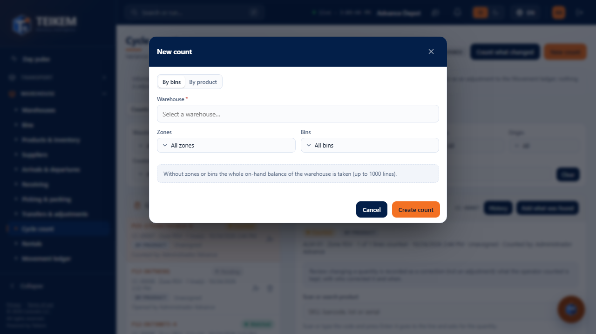
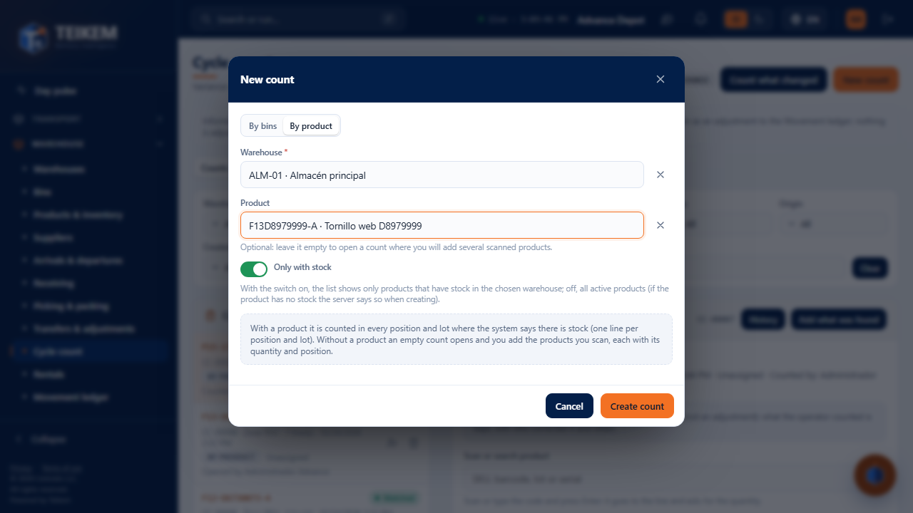
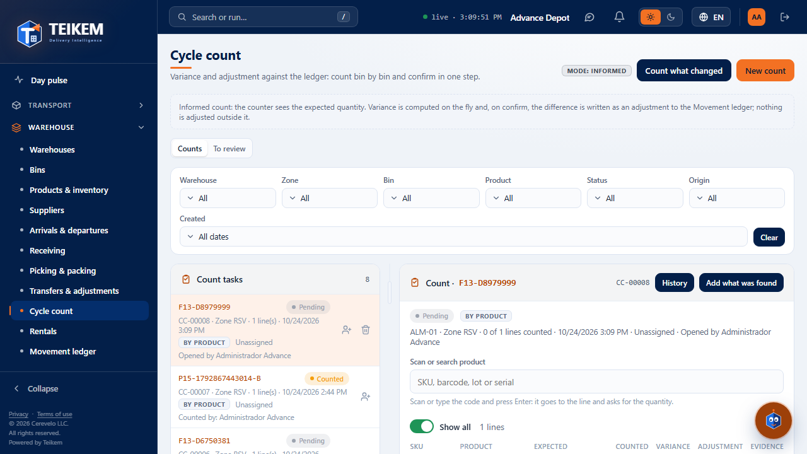
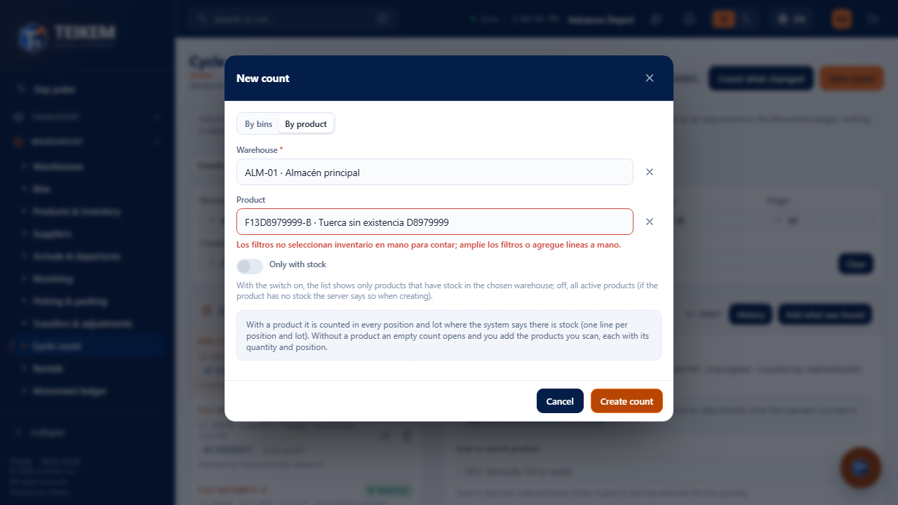

# F13 — New "By product" count from the web

> **Updated on 2026-10-05 (Batch 25):** in **By product** the product is **optional**: without choosing it, an empty count opens to which scanned products are added (the scanner of the detail opens "Add what was found" with the product set and the bin optional). See [lote25-decisiones.md](../../lote25-decisiones.md) and the FAQ "Batch 25".

Screen **Warehouse → Cycle count** (`/warehouse/cycle-counts`), **New count** button. This change (owner's decision of
2026-10-03) adds the **By product** option: a warehouse and **one** product are chosen, and the server builds the count with one line for
each bin and lot where the system says there is stock of that product. It is the same count that is created from the warehouse app
("Count by product"), with origin **Product**. Server: chapter [06, section 6, "Batch 21"](../06-inventario-y-almacen.md).

**Who can.** Requires the **WMS_LOTSERIAL** module and the **`warehouse.count`** permission (the same one as the usual "New count": without it
the button is not seen). Creating the count is `POST /api/v1/cycle-counts`.

## 1. The two options of the modal

The **New count** modal opens with two tabs:

| Tab | Fields | What it creates |
|---|---|---|
| **By bins** (the usual one) | Warehouse (required), Zones and Bins (optional) | A count with all the on-hand balance of what was chosen; without zones or bins, of the whole warehouse (maximum 1000 lines) |
| **By product** (new) | Warehouse (required), Product (required, with a search box by SKU or name) | A count of that product with one line per bin and lot with stock; origin **Product** |

When switching tabs the errors are cleared; the chosen warehouse is kept.

## 2. Creating a count by product

1. **New count** → **By product** tab.
2. Choose the **Warehouse** and type part of the SKU or the name in **Product**; choose an option from the list. Below the selector is the
   **Only with stock** switch (second block of the owner's decisions, 2026-10-03): **it starts on** and the list offers only the
   products that have on-hand stock in the chosen warehouse (`GET /api/v1/products?warehousePublicId=…&onlyOnHand=true`; it is the same
   stock the server counts, including the reserved one). Turn it off to see **all** the active products, for example to
   count something the system believes does not exist. The preference is not saved: every time you open the modal it starts on again, and
   when changing the warehouse the list is requested again with the new warehouse.
3. **Create count**. The notice *Count CC-00012 created with N line(s).* appears, the modal closes and the new count stays open in the
   right panel (`?count=<id>`), with its list of bins and lots. It can now be counted from the web or from the app.

Products with a **serial number**: the server accepts them, but the capture by serial is still done on the web, in the count
row (the warehouse app does not capture serials yet).

## 3. Messages and validations

| When | Message | HTTP | Where it is seen |
|---|---|---|---|
| No warehouse | `Seleccione un almacén.` (web text) | — (not sent) | Under Warehouse |
| No product (By product tab) | `Elija el producto.` | — (not sent) | Under Product |
| The product has no stock in any bin of the warehouse (it can only be chosen with the **Only with stock** switch off) | `Los filtros no seleccionan inventario en mano para contar; amplíe los filtros o agregue líneas a mano.` | 400 | Under Product; the modal stays open |
| The product or the warehouse no longer exist | `Producto no encontrado.` / warehouse error | 404 | Notice above the form |
| More than 1000 lines | `El conteo no puede tener más de 1000 líneas…` (server text) | 400 | Notice above the form |

The web does **not** use `allowEmpty`: a product without stock **cannot** be counted from here (to count something the system believes does not
exist, use "Count by product" in the warehouse app, which opens the empty count and lets you add what was found in a bin).

## 4. Frequent cases

- **The product does not appear in the list:** the search box only offers active products; search by SKU or by name. With **Only with stock**
  on, the ones with no stock in the chosen warehouse do not come out either: turn off the switch or change the warehouse.
- **"Los filtros no seleccionan inventario…" with a product that does exist:** it has no on-hand stock in that warehouse (it may be in
  another warehouse or all reserved/in transit). Change the warehouse or receive it first.
- **There is already an open count of that product:** another one can be created; each count is independent. On confirming, each one adjusts against the
  current stock (see [chapter F12](f12-conteo-por-producto.md), "Preview").
- **Mobile (360 px):** the modal takes the width of the screen and the two tabs fit without scrolling the page.
