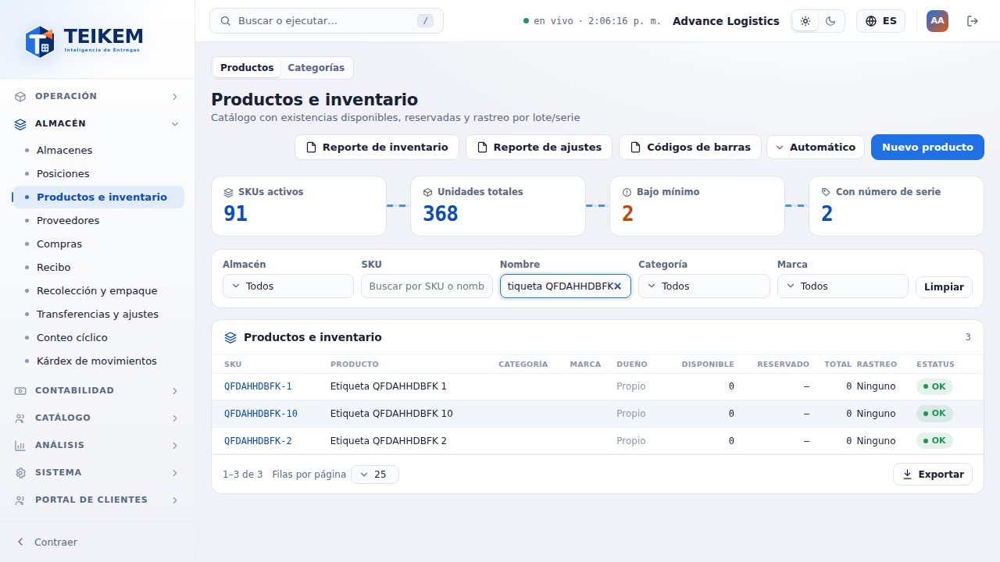
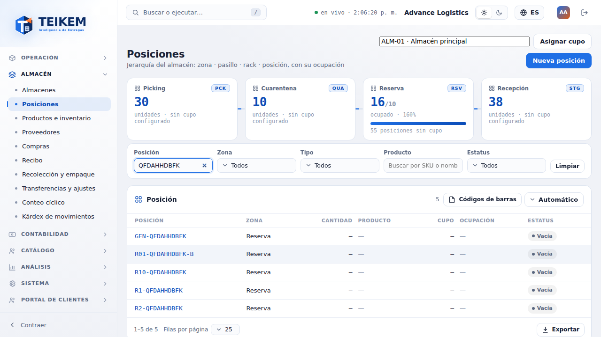
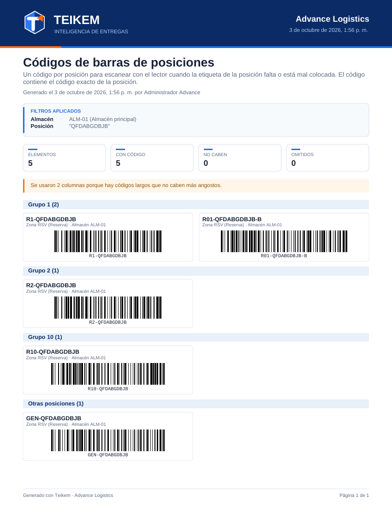
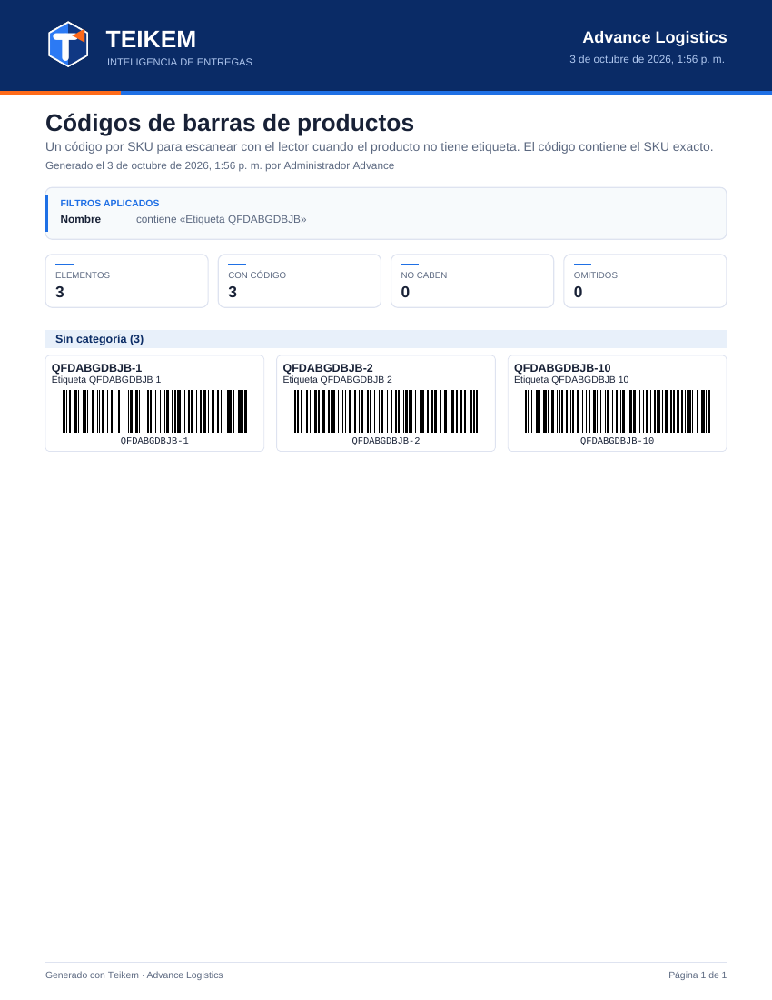
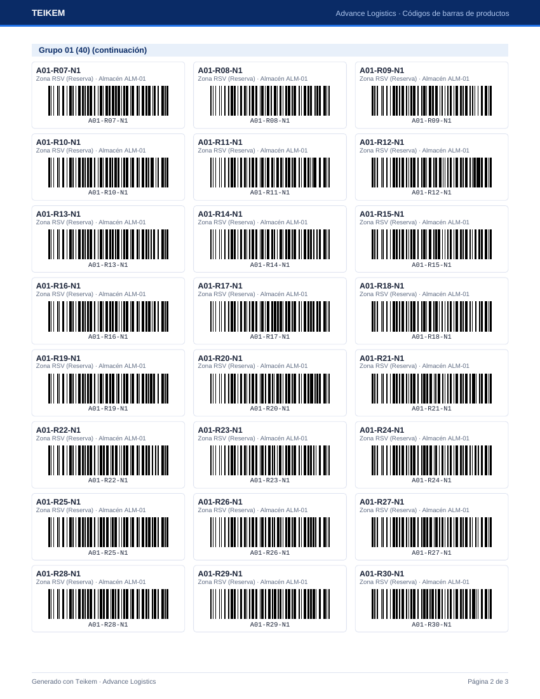

# F14 — Barcodes for counting (products and bins)

When taking inventory (counting), many products have no label and the bin labels may be missing or badly
placed. These two reports print a sheet with **one barcode per item** so that the counter **scans the paper** with the
reader (Zebra) instead of typing. Owner's request of 2026-10-03, with the grid design of the same day (fewer pages).

| Report | From | What the barcode carries |
|---|---|---|
| **Product barcodes** | Warehouse → **Products & inventory** (`/warehouse/products`), header | The **exact SKU** of the product (not the product's own barcode) |
| **Bin barcodes** | Warehouse → **Bins** (`/warehouse/locations`), table header; and the **Bins** tab of the warehouse record | The **exact code** of the bin |

The reader app already recognizes what was scanned: it looks up the product by barcode **or SKU**, and the bin by its **exact code**.

**Who can.** **WMS_LOTSERIAL** module and **`inventory.view`** permission (the same one as the screens and their other reports and Export). Without the
permission the button is not seen. The reports are built in the browser (there is no dedicated endpoint): they read the list with
`GET /api/v1/products` or `GET /api/v1/warehouses/{almacén}/bins`, 200 at a time, with no row limit.

## 1. Generating the report

1. Filter the screen as usual (in Products: Warehouse, SKU, Name, Category, Brand or an indicator of the current; in Bins:
   Bin, Zone, Type, Product, Status or a zone box).
2. Press **Barcodes**: it is a **menu** (since 2026-10-05; there is no longer a separate selector next to it) with two options, **Automatic** and
   **2 columns** (wider codes, easier to read, but more pages). Choosing one generates the PDF; the same in Products and in Bins.
3. The button says **Generating…** while it is built and then the PDF is downloaded, for example
   `codigos-de-barras-de-productos-advance-logistics-2026-10-03.pdf` or `codigos-de-barras-de-posiciones-advance-logistics-2026-10-03.pdf`.

**The report is exactly what is filtered**: the same filters as the table and as Export. Without filters, all the products come out (or all
the active bins of the chosen warehouse). In Bins, the inactive ones do not come out (the screen does not show them); in the Bins tab of
the warehouse record, they come out if "Include inactive" is checked, with the *Inactive* mark. In Products, the inactive ones come out if the table
shows them, with the *Inactive* mark.

## 2. What the sheet looks like

- **Portrait letter sheet.** At the top, like the other reports: the branding, the company, title, *Generated on … by …* with the company's
  date and time, the **Applied filters** box and four cards: **Items** (report total), **With barcode**, **Too long** and
  **Left out**. At the bottom, *Generated with Teikem* and *Page X of Y*. A sample PDF: [f14-ejemplo-posiciones.pdf](img/f14-ejemplo-posiciones.pdf).
- **Grid.** Each box is an item: on top the **SKU** in bold and its description (up to 2 lines; if it is longer it ends in
  "…"), or the **bin code** with its zone and warehouse in gray; below, the **barcode** with the readable value. In
  **Automatic** there are **3 columns** if all the codes fit; if any is too long, **2**, and if even so they do not fit, **1**. When
  fewer columns than requested are used, a notice at the top says so (*2 columns were used because some long barcodes do not fit
  narrower.*). With bins of short codes about 24 fit per page (3 × 8).
- **Groups.** Each group starts with a blue band with its title and the quantity. If the group continues on the next page, the band is
  repeated as *… (continued)*. A title is never left alone at the foot of a page and a box is never split between two pages.
  - **Products** (since 2026-10-09): **no groups or bands**; the codes come out in a run, from left to right, in the **same order you
    see in the table**: if you clicked on a column header (SKU, Product, Category…), the report comes out sorted that way, with **all** the
    products of the filter (not just the visible page); if you did not sort anything, in the order in which the filter returns the list.
  - **Bins**: by the **first number of the code** (the first sequence of digits: `A01-R01-N1-P01` → group **01**, `R1` → **1**,
    `B-06` → **06**). They are compared as numbers (2 before 10) and `01` and `1` are the **same group**, which is titled as it appears in
    its first code (*Group 01 (8)*). Codes without digits (`GENERAL`, `MUELLE`) go to **Other bins** at the end. Within each
    group, by full code in natural order.

### The barcode

Code 128 (the one all the warehouse readers read), drawn in vectors: it prints sharp on any printer. Each code has
around it a blank margin (quiet zone) of at least 10 thin bars; the thinnest bar measures 0.33 mm and, if the value is long, it
narrows down to 0.25 mm at minimum; the bars are 12 mm high. **Print at 100%** ("Actual size"; not "Fit to page"): when
shrinking the sheet the bars become thinner than the minimum and the reader may not read them.

## 3. Report notices (no HTTP code)

| Notice | When | What to do |
|---|---|---|
| *The report includes only the first {n} products (the server returned no more). Generate it again.* (or *the first {n} bins*) | The server stopped returning rows before the total (it is not a row limit) | Generate it again; if it repeats, tell support |
| *{n} columns were used because some long barcodes do not fit narrower.* / *A single column was used…* | Some code does not fit in 3 (or 2) columns at 0.25 mm | Nothing: it is informative. To go back to 3 columns, take the long codes out with the filters |
| *Some values have no barcode (too long or left out): see the notices at the end of the report.* | There are items of the two following rows | Check the last page |
| *Too long for a readable barcode in the page width ({n}); listed without a barcode: …* + box **Does not fit: too long for a readable barcode** | The value is so long that it does not fit even in one column at 0.25 mm (more than ~62 letters, or fewer if mixed) | Type that SKU or code by hand into the reader; or shorten the code |
| *Left out because they contain characters the barcode (Code 128) does not support ({n}): VALUE (not supported: É)* | The value has accents, ñ or other characters outside printable ASCII | Type that value by hand; to print it, change the bin code (the SKU cannot be changed) |
| *No product matches the filters.* / *No bin matches the filters.* | The filter leaves nothing | Change the filters |
| Toast *The report could not be generated. Try again.* | Reading the API or building the PDF failed | Try again; if it continues, tell support with the time |

## 4. Frequent cases

- **The reader does not read the paper:** print at 100% (without "Fit to page"), with black ink and white paper; do not fold the sheet over the
  code. Try **2 columns** (wider codes).
- **The reader reads but the app does not find the product:** the code carries the SKU; if the product was deactivated, the app does not offer it.
  Confirm that the SKU is active in Products & inventory.
- **I want only the bins of one aisle:** in Bins type the aisle in the **Bin** filter (it searches in code, aisle, rack,
  level and position) or use the Bins tab of the warehouse record, which has separate filters for Aisle, Rack, Level and Position.
- **The Warehouse filter of Products does not change the list:** it is the same as in the table: the warehouse narrows the quantities, it does not remove products.
  That is why the barcode report (which has no quantities) comes out the same.
- **Why do R1 and R01 come out together?** Because the first number is the same (1). It is on purpose: the owner asked to treat them as the same
  group.
- **Mobile (360 px):** the button and its menu fit and the PDF downloads the same.
