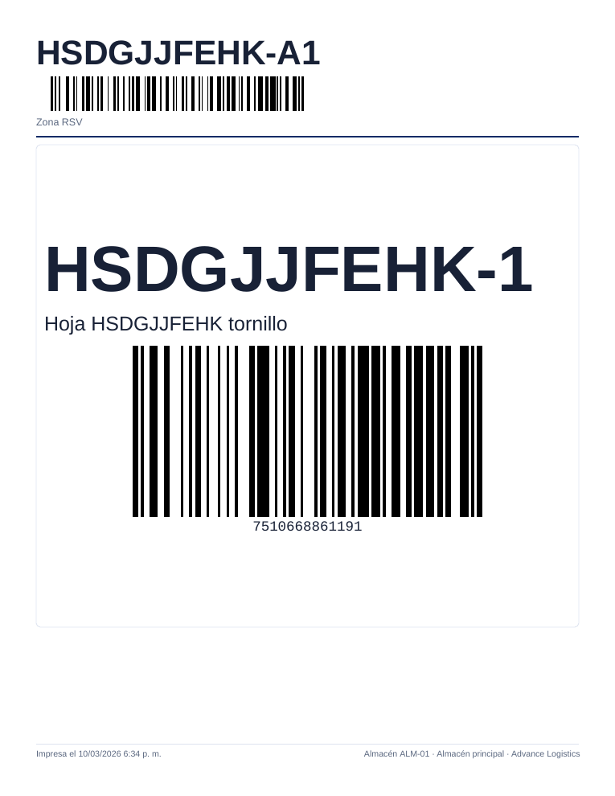
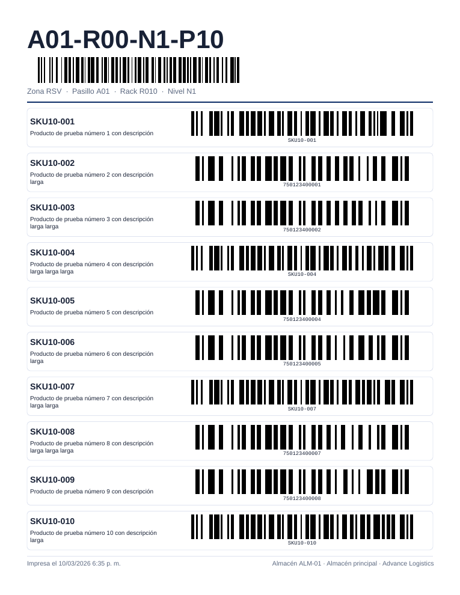
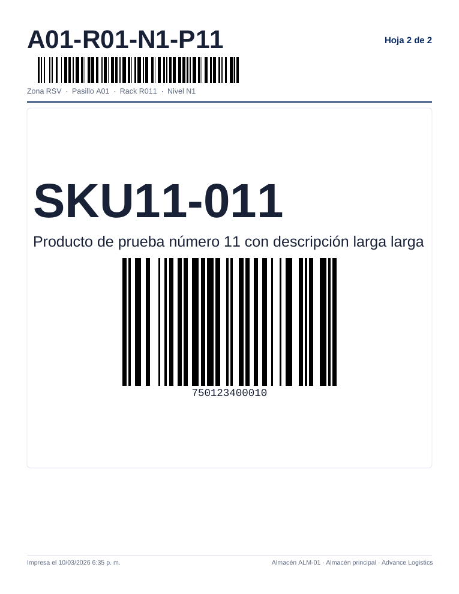

# F15 — Products by bin (Locations)

A PDF to print **all the products of a bin**, with the **barcode of each one**, **one bin per page**: that way whoever
works on a high rack (up to 30 feet) scans the products **from the paper** without reaching the product or its label. Owner's request of
2026-10-05; it replaces the "bin sheets" of the original Batch F15 (2026-10-03), which were removed because nobody found a use for them: they carried a
state (printed / outdated) and a notice that were not needed. Decisions in `docs/lote24-decisiones.md`.

**Where.** Warehouse → **Bins** (`/warehouse/locations`), in the header of the bin table of the warehouse chosen above, next to
**Barcodes** and **Location labels**.

**Who can.** **WMS_LOTSERIAL** module and **`inventory.view`** permission (the one of the screen). Without the permission the button is not seen.

## 1. Filtering and choosing what to print

- **Aisle** filter (at the top, next to **Bin**): text that goes to the server (`aisle`, the bin must **contain** that text in its aisle),
  with a 300 ms pause so as not to query on every key. It is for pulling a whole aisle without remembering how the code is built.
  **Bin** still searches in code, aisle, rack, level and position. **Clear** removes both.
- **Select** checkboxes per row (first column): **Select all on this page** checks or unchecks the visible page (it stays half-checked
  if only some are checked); the counter says **N checked** and **Clear checks** erases them. The checks are kept when changing page or
  filter within the same warehouse. Checking does not open the bin.

There are two ways to choose what to print:

1. **The bins in the current filter**: exactly the ones in the table with all its filters (Bin, Aisle, Zone, Type, Product, Status
   or a zone box), all the pages.
2. **The checked bins**: the ones with a checked box.

Press **Products by bin**: the modal opens with *checked* if there are checks, otherwise with *current filter*.

- **Include empty bins** (off by default): off, the bins without products are not printed; on, they come out with a
  **No products** page.
- **No limit** (since 2026-10-10): **all** the bins in the scope are printed. Beyond **500** the modal only **warns** that the PDF is large
  (*That is {N}: the PDF will be large and may take a moment. All of them are printed; there is no limit.*); **Generate PDF** stays enabled.

## 2. Generating the PDF

Press **Generate PDF**: the bins are read from the server **200 at a time** (`GET /api/v1/warehouses/{almacén}/bin-products`: *Reading
bins… 200 of 431*; **Cancel** stops everything), the PDF is built in the browser and downloaded, for example
`productos-por-posicion-advance-logistics-2026-10-05.pdf`. The bins go **by code in natural order** (A-2 before A-10). A notice
says *N page(s) of M bin(s) were generated.*, plus the empty ones left out and the products without a readable code if applicable. **Nothing is marked or
saved**: reprinting is generating it again.

Print the PDF **at 100%** ("Actual size", without "Fit to page"), in black on white paper.

## 3. What the page looks like

- **Portrait letter, one bin per page, always**: each bin starts a new page.
- **Header**: the **bin code in large type** with its **barcode** (Code 128 of the exact code) and below *Zone RSV · Aisle 01 ·
  Rack R1 · Level N1 · Position P01* (only the parts that exist; *Inactive* if the bin is deactivated).
- **Products (up to 10 per page)**: each one in a box with the **SKU** in large type, the **name** (if it is long it is cut with "...") and its
  **barcode**: the **product's barcode**; if it has none (or the reader does not support it, or it does not fit), the **SKU**. Below the bars goes the
  readable value. Only the products with **stock** in the bin, adding up lots (one line per product), **by SKU**.
- **Adaptive size**: the height of the page is shared among its products: with **1 or 2** the code comes out as large as possible and goes below the
  text at full width; with **3 to 10** it goes to the right of the text and everything shrinks so they fit. It never goes below what is readable (thin bar of at
  least 0.25 mm).

- **More than 10 products**: the bin continues on another page with the same header and *Sheet 2 of 2* at the top right (11 products = 10 + 1).

- **Bin without products** (only with *Include empty bins*): the header and, in the center, **No products**.
- **Footer**: *Printed on 10/05/2026 2:05 p. m.* (company formats and time; it is the time of the data read) and *Warehouse ALM-01 · Almacén
  principal · Advance Logistics*.
- **No code**: if neither the barcode nor the SKU of a product can be printed as Code 128 (accents, ñ…), the box carries the value and
  *No barcode: Code 128 does not support Ñ*; if it is so long that it does not fit readable, *Does not fit: too long for a readable barcode*. In both
  cases a notice at the foot of that page lists them (the same texts as the barcode report, F14).

## 4. Messages

| Message | Where | What to do |
|---|---|---|
| *That is {N}: the PDF will be large and may take a moment. All of them are printed; there is no limit.* (from 500) | Modal (notice, not error) | Nothing to do: all of them are printed. If the PDF seems too large to you, filter by zone, aisle or text, or check fewer bins |
| *There are no bins in your choice.* | Modal | The chosen scope has no bins; choose another or change the filters |
| *There is nothing to print: the chosen bins have no products. Turn on "Include empty bins" to print them.* | Modal (red); no PDF is generated | Turn on the switch if you want *No products* pages |
| *Printing cancelled.* | Notice below | Nothing: nothing was downloaded |
| *The products-by-bin PDF could not be generated. {server message}* | Modal (red) | If the server answered 400/404 (e.g. *Almacén no encontrado.*), the message goes at the end as is; otherwise, try again |
| *N page(s) of M bin(s) were generated.* | Notice below (green) | — |

The server messages (with their HTTP code) are in the [FAQ, Products by bin section](../faq.md#products-by-bin-report-replaces-the-bin-sheets-of-batch-23-and-f15).

## 5. Exporting the table

The **Export** button of the table pulls **everything filtered** (all the pages, with no row limit) with the same filters, including **Aisle**; not just
the page on screen.

## 6. Frequent cases

- **Printing a whole aisle**: type the aisle in **Aisle**, **Products by bin** → *The bins in the current filter* → **Generate PDF**.
- **Printing only some bins**: check their boxes → **Products by bin** → *The checked bins*.
- **Goods moved after printing**: the paper does not warn; generate it again.
- **The reader does not read the code**: print at 100%; the codes were validated by decoding the PDF at 150–600 dpi, but not with a physical Zebra.
