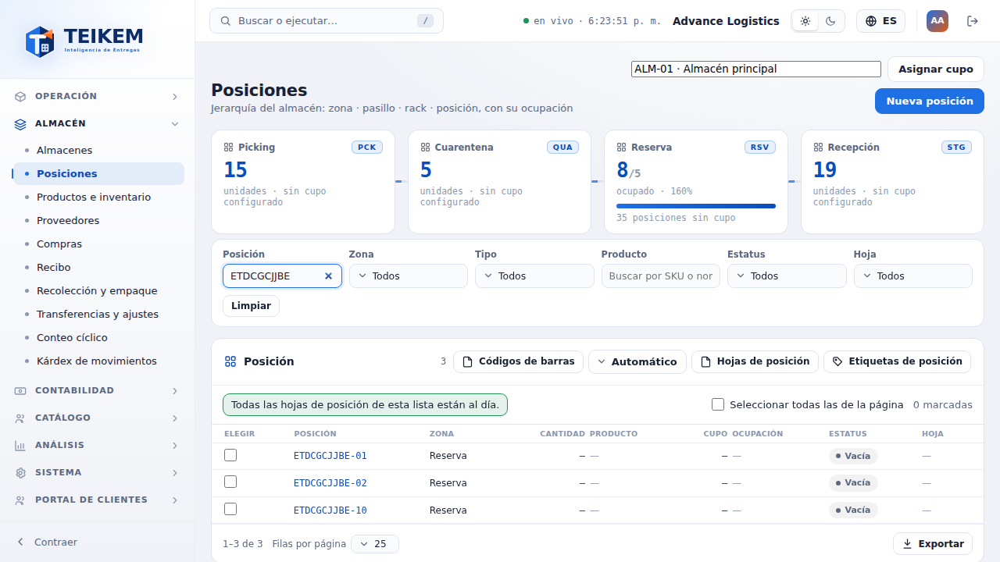
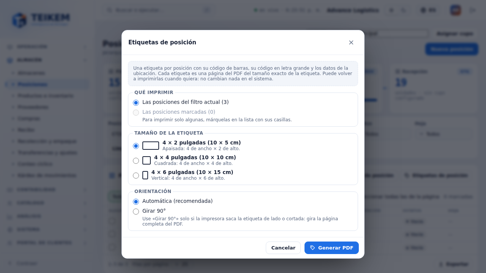
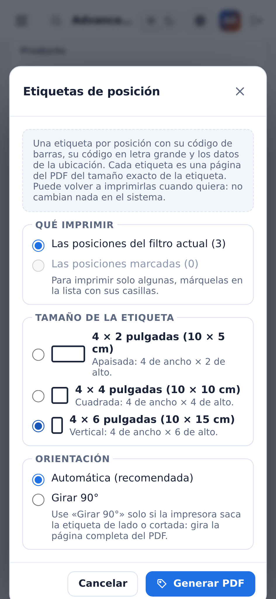
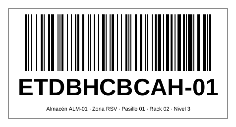
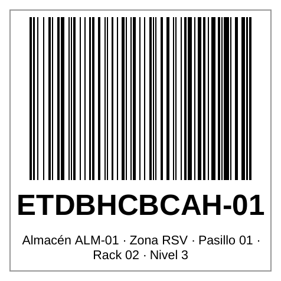
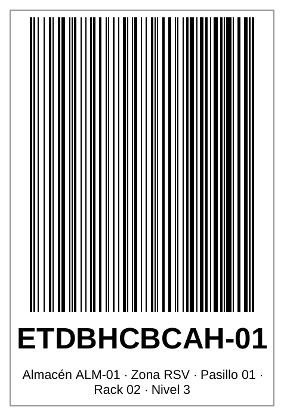
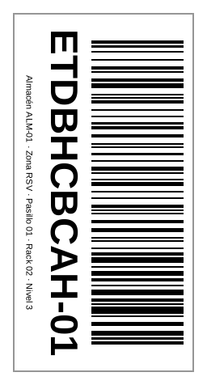
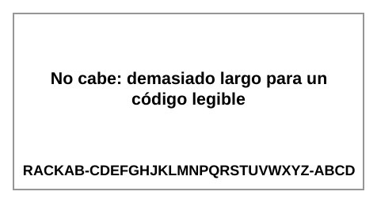

# F16 — Location labels (Locations)

The **bin label** is an adhesive label for a label printer (Zebra or another thermal one) that identifies a bin
of the rack: its **barcode** and its **code in large type**. Owner's request of 2026-10-04: *"A way to print or
reprint the labels of the bins, that lets me print several sizes: 4x2, 4x4, 4x6, that adjusts. One label per bin,
with its barcode. On the bins screen, and filtered according to the filter of that same screen."*

**Where.** Warehouse → **Bins** (`/warehouse/locations`), **Location labels** button in the table header, next to
**Barcodes** and **Products by bin**.

**Who can.** **WMS_LOTSERIAL** module and **`inventory.view`** permission: the same one as the screen and as the bin barcode
report (F14). Without the permission the button is not seen. There is no separate permission for printing.

**Server.** It did not change: the screen reads the usual bin list (`GET /api/v1/warehouses/{almacén}/bins`) and builds the PDF in
the browser.

It is **generic**: the bin code is printed as is (no floor, aisle or level format is assumed).

## 1. Bin label, products by bin and barcode report: they are not the same

| | **Bin label** (this chapter) | **Products by bin** ([F15](f15-productos-por-posicion.md)) | **Barcodes** ([F14](f14-codigos-de-barras.md)) |
|---|---|---|---|
| What it is | One adhesive label per bin with its code | One letter page per bin with the **list of products** in it | A list on letter sheets with one code per bin, for counting |
| Paper | Roll of 4 × 2, 4 × 4 or 4 × 6 inch labels | Letter | Letter |
| Does it change with the content? | **No**: it identifies the bin; it is valid while the bin exists | **Yes**: it becomes outdated when a product comes in or goes out | No |
| Does it have a state? | **No.** Printing marks nothing; it is reprinted whenever wanted | No: it is a list of what is there when generated | No |

They are different things: the label identifies the bin; the report lists its products.

## 2. Choosing what to print, size and orientation

Press **Location labels**. The modal opens with **The checked bins** if any is checked; otherwise, with **The bins in the
current filter**.

- **What to print**
  - **The bins in the current filter (N)**: exactly what the table shows with **all** its filters (Bin —the search box—,
    Zone or the zone box of the current, Type, Product, Status and Aisle), from all the pages, not just the visible one.
  - **The checked bins (N)**: the ones you checked with the **Select** box (and **Select all on this page**), even if they are on
    other pages or outside the current filter. Disabled without checks (*To print only some, check them in the list.*).
- **Label size** (with a drawing of its shape):
  - **4 × 2 inches (10 × 5 cm)** — *Landscape: 4 wide × 2 high.* (default)
  - **4 × 4 inches (10 × 10 cm)** — *Square: 4 wide × 4 high.*
  - **4 × 6 inches (10 × 15 cm)** — *Portrait: 4 wide × 6 high.*
- **Orientation**: **Automatic (recommended)** or **Rotate 90°** — *Use “Rotate 90°” only if the printer prints the label sideways or
  cut off: it rotates the whole PDF page.*

The chosen size and orientation **are remembered in that browser** for the next time (reprint the same way).

**No limit** (since 2026-10-10): **all** the labels in the scope are printed. Beyond **500**, the modal only **warns** (*That is {N}: the PDF will be large and may take a moment. All of them are printed; there is no limit.*) and
**Generate PDF** stays enabled.

On the phone (360 px) the modal takes the width of the screen, without horizontal scrolling:

## 3. Generating the PDF

Press **Generate PDF**:

1. The bins are read **200 at a time** (*Reading bins… 200 of 431*). While reading, **Cancel** stops it (*Cancelled; the PDF
   was not generated.*).
2. The PDF is built in the browser (*Generating the PDF (N labels)…*) and downloaded, for example
   `etiquetas-de-posicion-4x2-advance-logistics-2026-10-04.pdf` (the size goes in the name). The bins go **by code in natural
   order** (A-2 before A-10).
3. The modal closes with the notice *N labels of 4 × 2 inches were generated.* If any bin came out **without a barcode** (see
   §4), the modal **stays open** with the list (*N came out without a barcode (code in text only):* and the usual
   notices) and the **Done** button; the PDF was downloaded all the same.

**Nothing is marked**: nothing other than a read is called and the checkbox checks stay, in case you
want to reprint. **Reprinting** = generating the PDF again with the same filter or the same checks.

### How to print it

- Open the PDF and send it to the label printer with the **label size set in the driver equal to the chosen one** (4 × 2, 4 × 4
  or 4 × 6) and **100% scale / "Actual size"** (without "Fit to page"). Each page of the PDF already measures exactly one label.
- If the label comes out **sideways or cut off** (some drivers feed the label rotated), generate the PDF again with **Rotate 90°**.
- Everything goes in **pure black** (no grays), which is what a thermal printer prints.

## 4. What the label looks like

One **PDF page per bin**, of the **exact size** of the label (4 × 2 = 288 × 144 points; 4 × 4 = 288 × 288; 4 × 6 =
288 × 432), with an **internal safety margin of 0.1 inches** on each side (nothing is drawn on the cutting edge). From top to bottom:

| 4 × 2 | 4 × 4 | 4 × 6 |
|---|---|---|
|  |  |  |

- **Barcode** (Code 128 of the exact bin code), **horizontal and as large as possible**: it takes the whole usable width with
  its quiet zone; the thinnest bar measures between **0.25 mm** (the readable minimum of all the reports) and **1 mm**. Its height is everything
  left after the text (at least 8 mm): in 4 × 2 about 2.5 cm, in 4 × 6 more than 10 cm.
- **The code in large type**: the type adjusts to fill the width without being cut (up to a maximum according to the size); if the code is
  so long that it does not fit on one line even with the minimum readable type (10 pt), it goes on two.
- **Location data**, in smaller type: *Warehouse ALM-01 · Zone RSV · Aisle 01 · Rack 02 · Level 3* — only the ones that have a
  value (warehouse, zone, aisle, rack, level and position), up to two lines.

With **Rotate 90°** the page is the same but rotated (the viewer shows it lying down):

**Without a barcode.** If the bin code has characters that Code 128 does not support (accents, ñ…) the label carries, in
place of the bars, *No barcode: Code 128 does not support Ñ*; if it is so long that it does not fit in the 4 inches even with the minimum
0.25 mm bar (about 30 characters), *Does not fit: too long for a readable barcode*. In both cases the label comes out the same with the
code in text and the modal lists them when finishing.

## 5. Messages

| Message | Where | What to do |
|---|---|---|
| *That is {N}: the PDF will be large and may take a moment. All of them are printed; there is no limit.* (from 500) | Notice in the modal; Generate PDF stays enabled | Filter by zone or by the code (Bin), or check fewer |
| *There are no bins in your choice.* | Modal | The scope has no bins; change the filters or choose another |
| *There are no locations to print with your choice.* | Modal (red), no PDF | The bins stopped existing in the meantime; reload the list |
| *Cancelled; the PDF was not generated.* | Notice below | Nothing |
| *The labels could not be generated. {message}* | Modal (red) | If the server answered (e.g. 404 *Almacén no encontrado.*, 400 from a filter), the message goes at the end as is; otherwise, try again |
| *N labels of 4 × 2 inches were generated.* | Notice below (green) | — |
| *N came out without a barcode (code in text only):* + *Too long for a readable barcode…* / *Left out because they contain characters the barcode (Code 128) does not support…* | Modal (stays open) | The PDF was already downloaded; those labels carry only the text. If you need a code, rename the bin with a shorter code or one without accents |

The screen never asks for more than 200 bins per read (the maximum of the list), so the server's *take* 400 should not be seen.

## 6. Frequent cases

- **Labeling a whole aisle**: type the aisle in **Bin** (e.g. `A01-`), **Location labels** → *The bins in the
  current filter* → size → **Generate PDF**.
- **Reprinting a torn label**: check it with its box → **Location labels** → *The checked bins* → **Generate PDF**.
- **Labeling only the new bins of a zone**: filter by the zone (zone box of the current or Zone filter) and by the code, or check them.
- **The printer prints the label sideways or cut off**: check that the driver size is the same one you chose and that it prints at 100%;
  if it continues, generate with **Rotate 90°**.
- **Does the label become "old" when the products change?** No: the label only identifies the bin. What becomes outdated is
  **Products by bin** (F15), which lists products.
- **The reader does not read the code**: print at 100% on a 203 or 300 dpi printer. The codes were validated by decoding the PDF at
  300, 203 and 150 dpi (see `docs/frontend/loteF16-decisiones.md`); at 150 dpi codes of more than ~23 characters are not read (their bars
  end up less than 2 printer dots); it was not tested with a physical Zebra.
