# F17 — Rentals (web) and "Convert to serial"

Screens of the **Rentals** submodule of Warehouse (block F-R1 of `docs/rentas-plan-de-ejecucion.md`): the **rental list**, the **record** of
a rental with its actions (schedule, dispatch, extend, cancel), the **creation and edit** with the **unit selector by serial** and the
rate per unit, and the **Convert to serial** button on the product record. The server rules (what each action does, effects on the
inventory, all the messages) are in chapter [11 — Rentals](../11-rentas.md) and in chapter 06 §2.1 (Convert to serial); here
how they are used from the web is explained. Rental returns, the processing of the returned unit and the rental reports are in
[F18](f18-devoluciones-y-proceso-de-rentas.md).

**Server.** It did not change: the web uses `/api/v1/rentals` (list, record, create, edit, units, rate, schedule, dispatch, cancel,
extensions), `/api/v1/status/history/RENTAL/{id}` (history) and `POST /api/v1/products/{publicId}/convert-to-serial`.

## 1. Who can and where

| What | Where | Permission and module |
|---|---|---|
| See the rental list and record | Warehouse → **Rentals** (`/warehouse/rentals`, record `/warehouse/rentals/{renta}`) | `rental.view` + **Rentals** module (`RENTAL_EQUIPMENT`). Without the module: "Module turned off" screen; without the permission: "No permission" and the item does not appear in the menu |
| New rental, Edit, Add equipment, rate and remove a unit, Schedule, Dispatch, Cancel | List (**New rental**) and record | `rental.manage` (without it the buttons are not seen) |
| Extend | Record | `rental.extend` |
| Convert to serial | Product record (Warehouse → Products & inventory → product, `/warehouse/products/{producto}`) | `inventory.manage` **and** `inventory.adjust`, **WMS_LOTSERIAL** module |

To choose the **client**, their **location** and their **contact** when creating a rental you also need to be able to view clients and locations
(`clients.read` and `locations.read`, **Lists** module). Without them the fields warn *"Your user cannot view clients."* / *"Your
user cannot read locations (locations.read permission and Lists module)."* (see "Decisions" of the batch: the Warehouse operator
does not have them).

The **Rentals** item is in the Warehouse group right before **Movement ledger**.

## 2. Converting a product to serial

Advance Depot's equipment arrived without tracking and **only equipment with a serial number is rented**. On the product record, the
**Convert to serial** button appears only if the product **has no tracking** and **has stock**, and you have both permissions.

1. Press **Convert to serial**. The modal shows a box per **bin with stock** (*"Serials for A-01 · ALM-01 (2 on hand)"*).
2. Type or **paste** the serial numbers, **one per line** (also separated by comma). Under each box, the counter *"1 of 2
   serials"* turns blue when it matches.
3. **Review and convert** validates: **repeated** serials (in any bin, case-insensitive), **long** ones (more than 80) and the
   **count** per bin, with the same message as the server.
4. Confirmation: *"3 serials of … will be created in 2 bin(s)."* and **It is a net-zero movement**: for each bin an
   outbound adjustment of the untracked units and an inbound adjustment per serial are posted, with the reason **"Serial conversion"**; on hand and
   available do not change. Afterwards the product is serial-tracked and does not go back.
5. **Convert to serial**: notice *"… is now serial-tracked: N serials created."*; the button disappears and the serials are seen in the
   Serials tab.

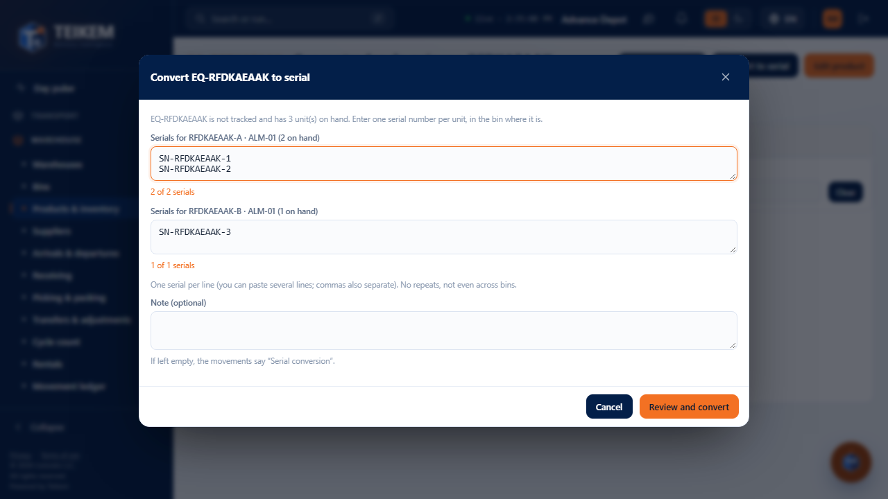
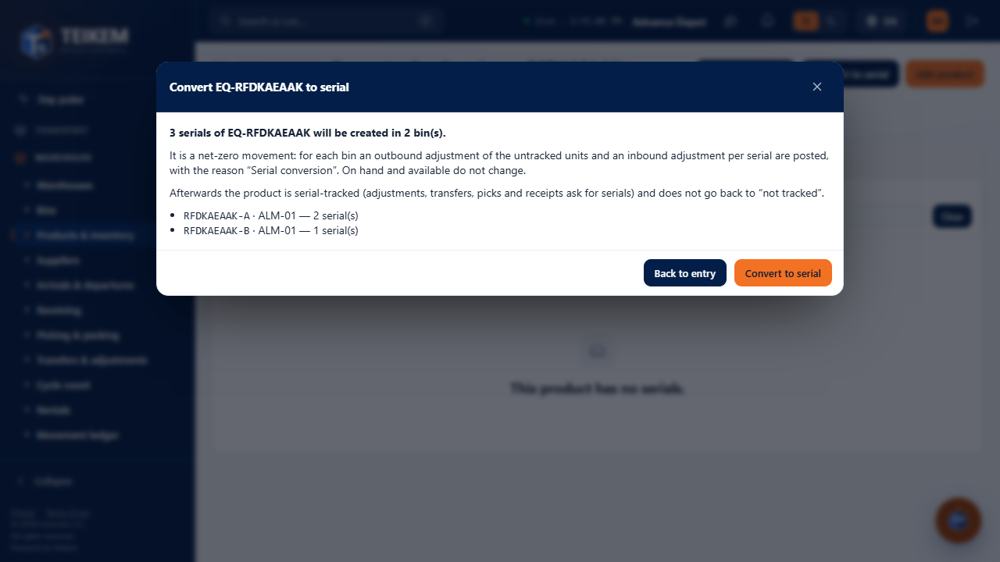

If the product has **reserved** units, **lot-tracked** stock or stock **without a bin**, or **fractional** stock, the modal says so on opening
(with the server message) and does not allow converting. If the server rejects (e.g. 409 *"Serial SN-1 is already in inventory."*), the
message appears at the top and you go back to the capture without losing what was typed.

## 3. Rental list

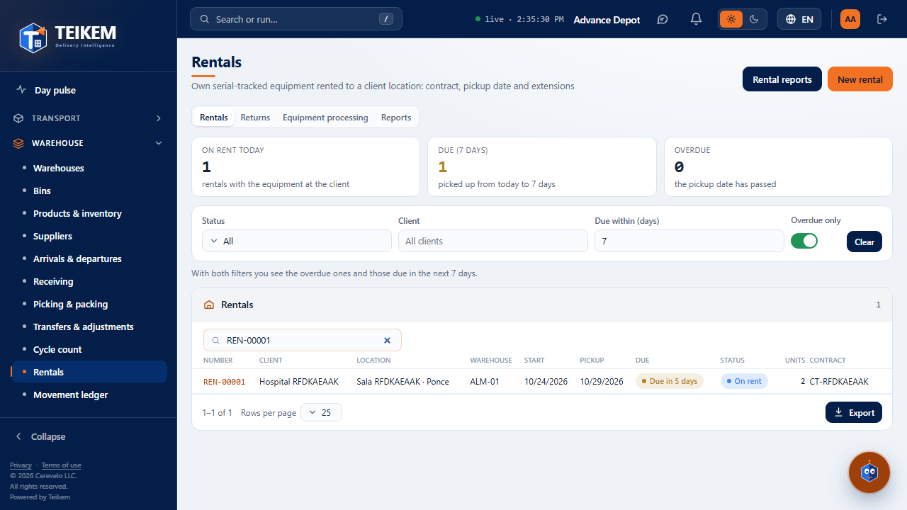

- **Filters** (they go to the server): **Status** (several), **Client**, **Due within (days)** (the Scheduled or On rent ones picked up from today to
  today + N), **Overdue only** (Scheduled or On rent with the pickup already past) and the **search box** (rental or contract number, client,
  location or serial number). With "Due within" and "Overdue only" together you see both things (the note under the filters says so).
  **Clear** removes everything.
- **Columns** (all sortable): Number, Client, Location, Warehouse, Start, Pickup, **Due**, Status (with its color and text),
  Units and Contract. **Due** is a **calculated value**, not a status: *"Expired N days ago"* (red), *"Pickup today"* or *"Expires in
  N days"* (amber, up to 7 days), *"In N days"* (further ahead) and "—" if the rental is not open. "Today" is the company's day.
- 25 rows per page (changeable), **Export** (Excel, CSV or PDF) with everything filtered.
- Click on a row → the record.
- Links: *"View all"* in "Needs your attention" opens the list with `?dueWithinDays=7&overdue=true`; *"Review"* opens
  `/warehouse/rentals?rental=…`, which leads to that rental's record.

On the phone the table becomes cards:

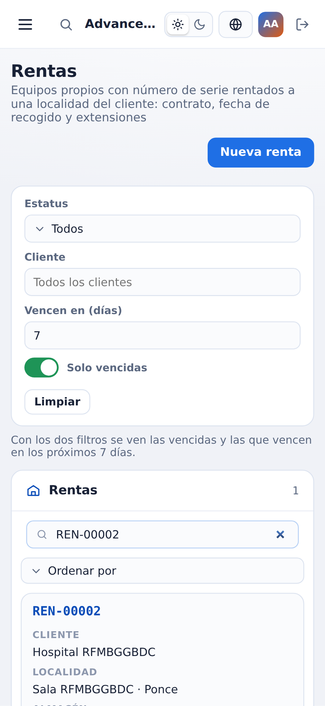

## 4. New rental (Draft)

**New rental** opens the form. The rental is born as **Draft** and **reserves nothing**.

- **Client** (active), **Client location** (only the client's own locations; when changing the client, location and
  contact are cleared), **Client contact** (optional), **Source warehouse** (already chosen if the company has only one), **Start date**
  (today by default), **Pickup date**, **Contract number** and **Contract signed on**, **Estimated transport cost** and its currency
  (just a data item: shipments will arrive with their module) and **Notes**.
- **Units by serial** (optional; they are also added later on the record):
  1. **Equipment (SKU or name)**: own products with available stock in the source warehouse. If it is not serial-tracked: *"Product … is not
     serial-tracked; only equipment with a serial number is rented."* and the hint to **Convert to serial**.
  2. **Available serials in ALM-01 (N)**: checkboxes with the bin of each serial. Only the **available** ones of the source warehouse in zones
     that are rented (not quarantine, cross-dock or On rent; the ones hidden for that reason are counted in a note) and that are **not** already in
     the rental. **Search or scan serial** filters the list; **Enter** with the exact serial picks it (barcode reader). An already
     chosen serial warns *"Serial … is already in this rental."* and one that is not available *"Serial … is not available in ALM-01."*.
  3. **Rate for these units (optional)**: frequency (Daily, Weekly, Monthly or **Fixed**), amount and currency (the company's if none
     is chosen). It is just a data item (it is not calculated or charged).
  4. **Add N unit(s)**: they go to the **Equipment to rent** table, where they can be removed. If you change the source warehouse, they are removed.
- **Create rental with N unit(s)** → the record of the new rental (*"Rental REN-… created as Draft."*).

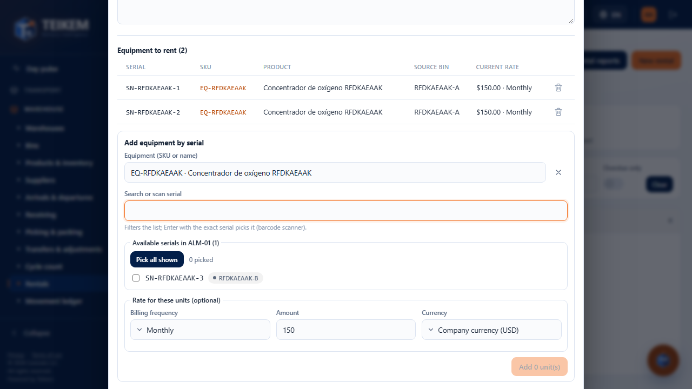

The server errors appear under their field or above the form with the exact message, for example 409 *"Serial SN-2 is already in
rental REN-00003."* or 409 *"Serial SN-2 is not available in A-01."* (someone took it in the meantime).

On the phone the form is one column:

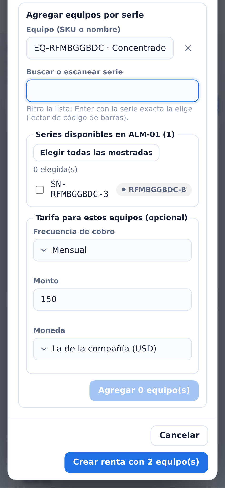

## 5. Rental record

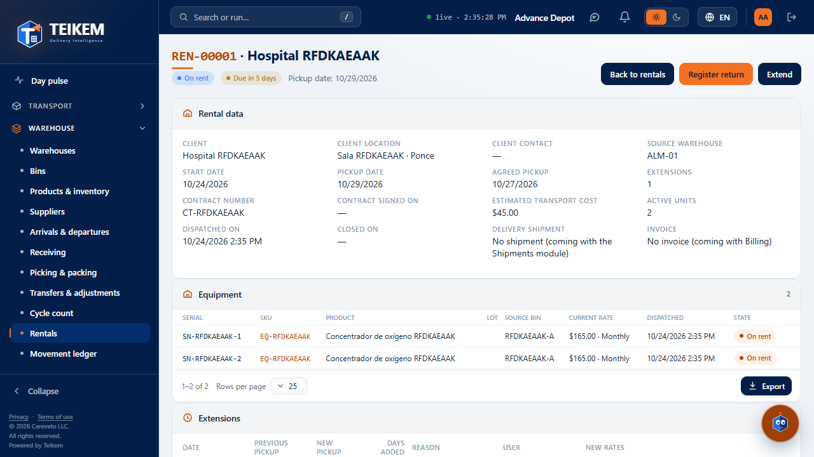

- **Header**: number and client, status (with its color), calculated due date and the pickup date; the actions that apply.
- **Rental data**: client, location, contact, source warehouse, start, **pickup** (current) and **agreed pickup** (the
  original one, which does not change with the extensions), extensions, contract and signing date, transport cost, active units, dispatched on,
  closed on, shipment and invoice (*no link* until Shipments and Billing exist) and notes.
- **Units**: serial, SKU, product, lot, **source bin**, **current rate**, dispatch date and **state** (*To dispatch*, *On
  rent*, *Returned* or *Inactive*). Before dispatch, with `rental.manage`: **Rate** (corrects the current one) and **Remove unit** (it becomes
  inactive; in a Scheduled one its reservation is released). In a **cancelled** rental the units it had are seen, dimmed.
- **Extensions**: date, previous and new pickup, days added, reason, user and new rates.
- **Status history**: each change with who, when and the comment.

### Actions (according to the status)

| Status | Actions |
|---|---|
| Draft | Edit, Add equipment, **Schedule**, Cancel rental |
| Scheduled | Edit, Add equipment (they are reserved at once), **Dispatch**, Extend, Cancel rental |
| On rent | **Extend** and **Register return** ([F18](f18-devoluciones-y-proceso-de-rentas.md)) |
| Returned / Cancelled | View only |

All of them ask for confirmation and accept an optional **comment** that stays in the history:

- **Schedule**: *"The N unit(s) are reserved for this rental: the product's available quantity goes down and on hand does not change."*
- **Dispatch**: *"Each unit moves with a transfer to the EN-RENTA bin of warehouse ALM-01: it still belongs to the company (on hand),
  does not count as available and its serial becomes “On rent”."*

  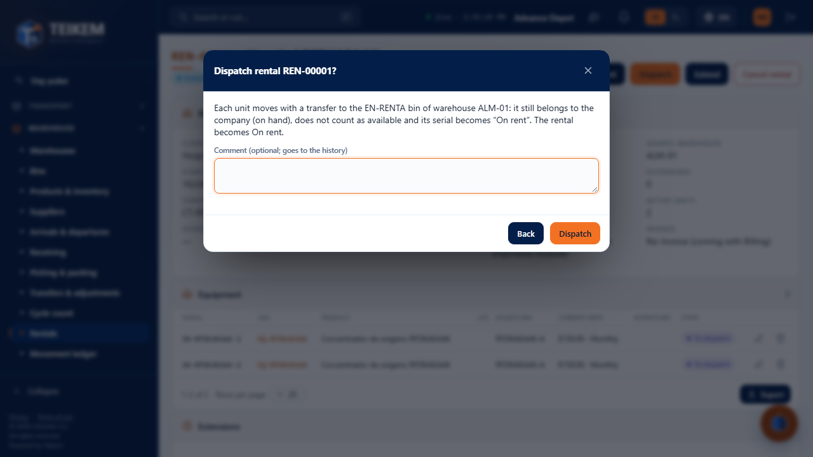
- **Cancel rental**: in Draft *"Nothing was reserved."*; in Scheduled *"the reservations are released and the serials are
  available again."*

If the server rejects, the dialog **does not close** and shows its exact message (e.g. 422 *"The rental has no equipment; add at least
one."* or 422 *"Only a Draft or Scheduled rental can be cancelled; to finish it, register the return."*).

**Edit** opens the same form: the client is not changed (*"The rental's client cannot be changed; cancel the rental and create another."*), the
warehouse only without units and the dates only without extensions; only what changed is saved.

### Extend

**Extend** (`rental.extend`): **New pickup date** (later than the current one), **Reason** (required, up to 300) and, optional,
**New rate** for the chosen units (it is only recorded if it changes; it starts the day after the previous pickup). The errors appear
under their field with the server message: *"The new pickup date must be later than the current one (2026-10-08)."* and *"Enter the reason
for the extension."*. When extending, the due date is recalculated and the extension appears in its table.

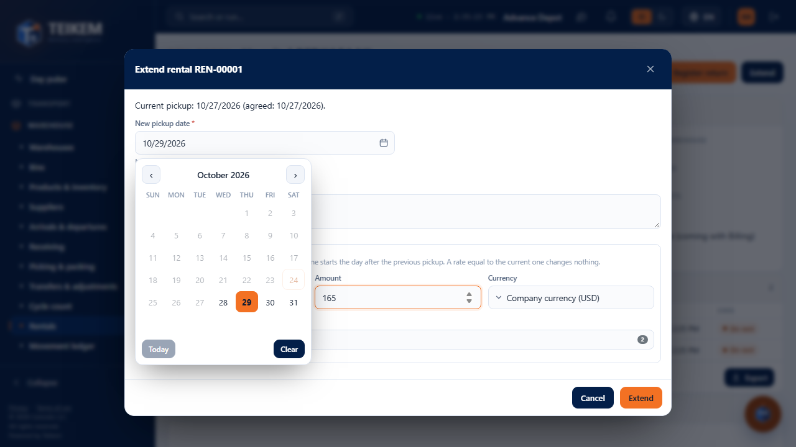

On the phone the actions wrap and the tables become cards, without horizontal scrolling:

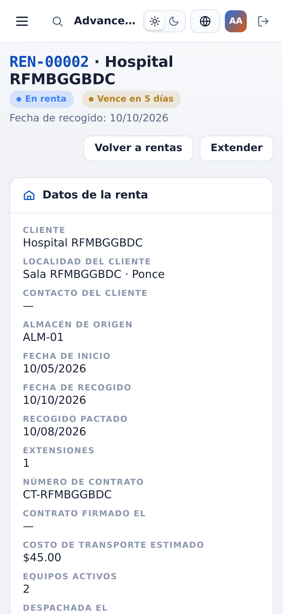

## 6. Notice in "Needs your attention"

In the Pulse, each **open rental that is overdue or due within 7 days** appears as *"Rental REN-… overdue"*, *"Rental REN-…: pickup today"* or
*"Rental REN-…: due in N days"*, with client · location · warehouse, **Pickup**, **Units** and, if it is overdue, **Days overdue** (in
red; the ones about to expire in amber). **Review** opens the record; **View all** opens the list with "Due within 7 days" and "Overdue only".

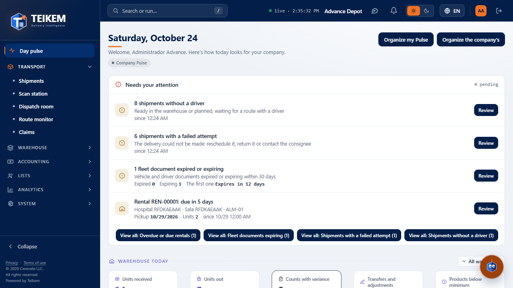

## 7. Messages (besides the server's, which are shown as is — chapter 11 §9 and chapter 06 §2.1)

| Where | Message | When |
|---|---|---|
| New rental | *"Choose the source warehouse."* | No source warehouse (the web asks for it to offer its serials) |
| New rental | *"Enter a valid number."* | Transport cost that is not a number |
| Unit selector | *"Serial {s} is already in this rental."* | You scanned a serial you already chose or that is already in the rental |
| Unit selector | *"Serial {s} is not available in {warehouse}."* | You scanned a serial that is not available in the source warehouse |
| Unit selector | *"A rental allows at most 200 units."* | It would exceed 200 units |
| Extend | *"Choose at least one unit for the new rate."* | You set a new rate without units |
| Confirmations | *"The comment allows at most 500 characters."* | Long comment |

The validation messages the web checks before sending are **the same** as the server's (creation, rate, extension, conversion), so
that the user sees exactly the same text: see the FAQ, section "Batch F17".

## 8. Frequent cases

- **I do not see "Rentals" in the menu**: the Rentals module must be turned on (it depends on Inventory and traceability) and your role must have
  `rental.view`.
- **"Convert to serial" does not appear**: the product is already serial- or lot-tracked, has no stock, or you lack `inventory.manage` or
  `inventory.adjust`.
- **The unit does not appear in the selector**: it is not own, it has no available stock in the source warehouse, it is in quarantine or
  cross-dock, or it is already in this rental; if it is another warehouse, change the source warehouse (without added units).
- **I scheduled and the product shows "Unavailable"**: it is expected: the serials are reserved.
- **I dispatched and on hand did not go down**: correct: the unit still belongs to the company, in the EN-RENTA bin.
- **The rental shows "Overdue"**: extend it (if the client is still using it) or register its return ([F18](f18-devoluciones-y-proceso-de-rentas.md)).
