# F18 — Rental returns, equipment processing and rental reports (web)

Screens of block **F-R2** of `docs/rentas-plan-de-ejecucion.md`: **register the return** of a rental from its record, the **list and
record of returns**, the **processing queue** of returned units (advance, complete and scrap), the **summary cards**
of the rentals list and the **Rental reports** (views, indicators and Analytics chart). The server rules (what each
action does, its effects on inventory and all the messages) are in chapter [11 — Rentals](../11-rentas.md) §5, §6 and §10; here we explain
how they are used from the web. The rental (list, record, creation, dispatch, extension) is in [F17](f17-rentas.md).

**Server.** Unchanged: the web uses `POST /api/v1/rentals/{publicId}/returns`, `GET /api/v1/rental-returns[/{publicId}]`,
`GET /api/v1/rental-processes`, `POST /api/v1/rental-processes/{id}/advance|complete|scrap`, `/api/v1/status/history/RENTAL_PROCESS/{id}`,
`GET /api/v1/rentals` (summary totals) and, for the reports, `GET /api/v1/analytics/reports`, `POST /api/v1/analytics/reports/{id}/run`,
`GET /api/v1/analytics/indicators[/{id}/value]` and `GET /api/v1/analytics/charts[/{id}/data]`.

## 1. Who can and where

| What | Where | Permission and module |
|---|---|---|
| View returns (list and record) | Warehouse → **Rental returns** (`/warehouse/rental-returns`, record `/warehouse/rental-returns/{devolución}`) | `rental.view` + **Rentals** module (`RENTAL_EQUIPMENT`) |
| Register a return | Record of an **On rent** rental → **Register return** | `rental.return` |
| View the processing queue | Warehouse → **Equipment processing** (`/warehouse/rental-processes`) | `rental.view` + Rentals |
| Advance and complete a process | Processing queue (row buttons) | `rental.maintenance` |
| Scrap a unit in processing | Processing queue | `rental.maintenance` **and** `inventory.adjust` (without it, the button does not appear and a note under the filters explains it) |
| Rental reports | Rentals list → **Rental reports** or **Reports** tab (`/warehouse/rental-reports`) | `rental.view` + Rentals, plus `analytics.view` + **Analytics** module (without them: "No permission" or "Module turned off", and the tab is not shown) |

The four screens share a strip of **tabs**: Rentals · Returns · Equipment processing · Reports. In the Warehouse menu,
**Rental returns** and **Equipment processing** come right after **Rentals** (the movement ledger is still the last one).

## 2. Register a return

On the record of an **On rent** rental with dispatched units not yet returned, **Register return** appears.

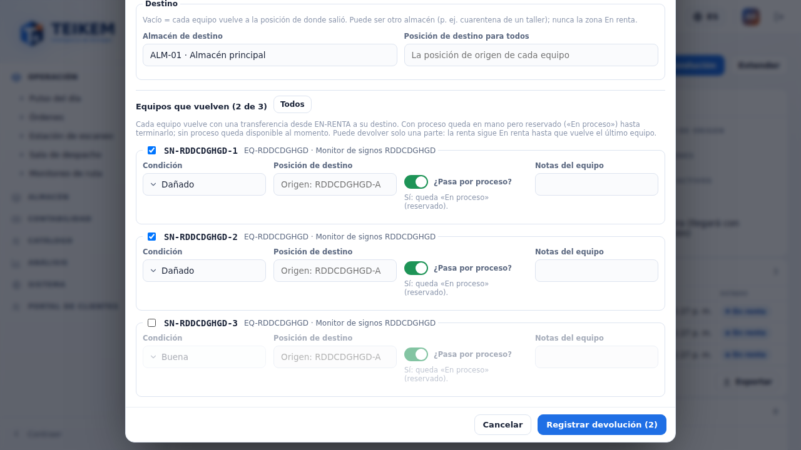

- **Return date**: today (company day) by default; it cannot be in the future or before the rental start. If it is before the
  pickup date, the web warns *"Early return: the date is before the pickup date (…)"* (it is a calculated value, not a status).
- **Reason** (required, one per return): End of contract, Early due to damage, Early at the client's request or Other. With **Other**
  the **Notes** are required.
- **Estimated pickup cost** and its currency: just a value (the pickup will come from a shipment when that module exists).
- **Destination**: **Destination warehouse** (the rental's by default; it can be another, for example a workshop) and **Destination
  location for all** (optional). Empty = each unit goes back to **the bin it left from**. The **On rent** zone is not offered.
- **Units coming back (N of M)**: one per dispatched unit not yet returned, with its checkbox (**All/None**). You can return **a
  part**: the rental stays On rent until the last one comes back. Per unit: **Condition** (Good by default, Damaged, Incomplete), its own **Destination
  bin** (optional), **Goes through processing?** (yes by default) and **Unit notes**.
- **Register return (N)**: notice *"Return DRN-… registered: N unit(s)."* (if the last one came back: *"… Rental REN-… is now
  Returned."*). The rental record is refreshed and its **Returns** panel links the new return.

Effects (chapter 11 §5): each unit comes back with a transfer from EN-RENTA; **with processing** it stays on hand but **reserved** ("In
processing") and its process opens as *Pending*; **without processing** it becomes available right away.

If the server rejects, the dialog does not close and shows its exact message (for example 409 *"Serial {s} is not on rent in {REN-n}."*
or 400 *"The destination bin cannot be in the On rent zone."*).

On the phone each unit is a one-column block:

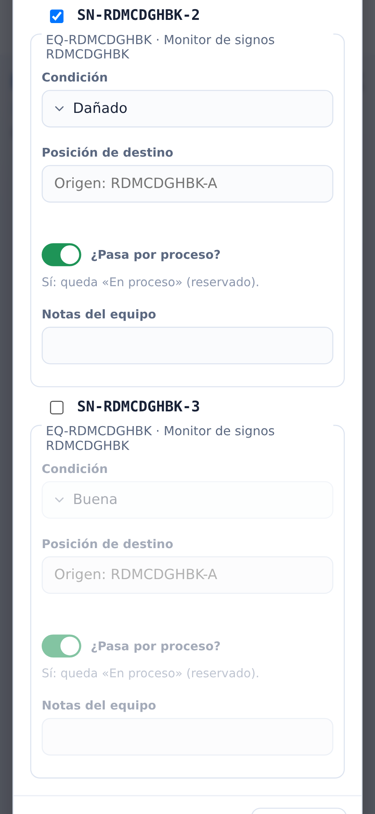

## 3. Returns: list and record

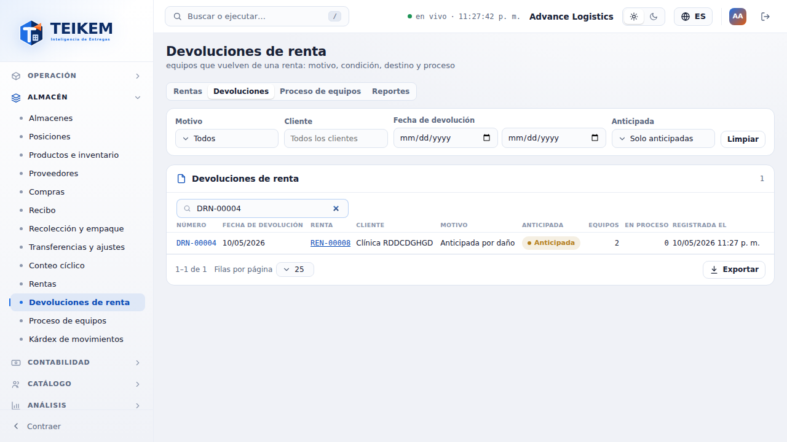

- **Filters** (sent to the server): **Reason** (several), **Client**, **Return date** (range), **Early** (Early only / At
  term only) and the **search box** (DRN number, rental number or serial). From the record of a rental, **See in Returns** opens the list
  filtered by that rental (*"Only the returns of rental REN-…"*, with **Remove this filter**).
- **Columns** (all sortable): Number, Return date, **Rental** (link to the rental record), Client, Reason, Early,
  Units, In processing (open processes) and Registered on. Export outputs everything filtered.
- Click on the row → the **return record**: reason, early or at term, date, units, open processes, **status of the rental
  after the return**, pickup cost, pickup shipment (no link for now), who and when, notes, and the **returned units**
  with their condition, the destination (warehouse · bin) and the **status of their process** (or *"No processing (available)"*) with **See processing**
  (opens the queue with that serial). The **Rental REN-…** button goes back to the rental.

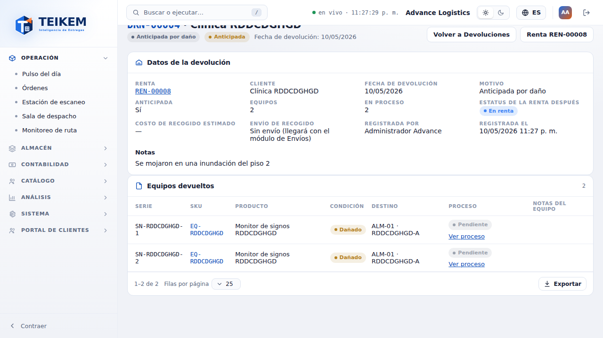

## 4. Equipment processing (queue)

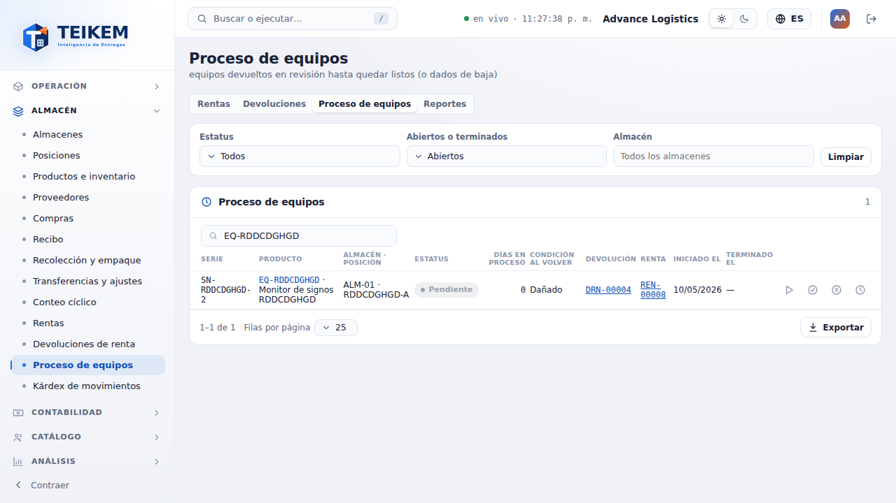

- **Filters**: **Status** (the company's, with their names), **Open or finished** (Open by default; Finished = Ready or
  Scrapped; All), **Warehouse** and the search box (serial, SKU, return number or rental number).
- **Columns**: Serial, Product, Warehouse · bin, **Status** (with the list color), **Days in processing** (company days since
  it came back, until today or until it finished), Condition on return, Return and Rental (links), Started on and Finished on. Finished ones
  are dimmed.
- Row **actions** (open process): **Advance**, **Complete**, **Scrap**; and **History** (the steps with who, when and
  comment) also on finished ones.

**Advance**: choose the status in **Moves to** (the next step is proposed, *"Cleaning (next)"*). The enabled statuses
that are not final are offered (Ready and Scrapped have their own action). The server applies the pipeline rules: next step, Repair or
Awaiting parts from any step and back from there. An out-of-order jump shows its message as is:

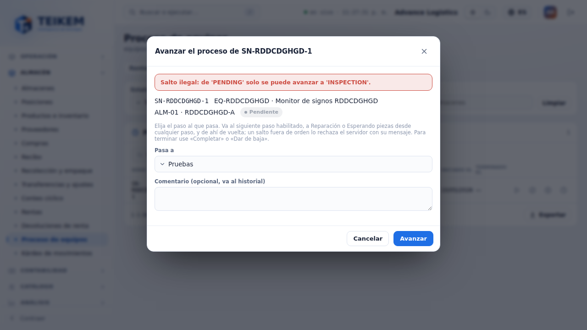

**Complete**: the process moves to **Ready**, the reservation is released and the unit becomes **available** again. Optional: move it to another
bin of the **same warehouse** (not the On rent zone); to another warehouse, with a transfer afterwards.

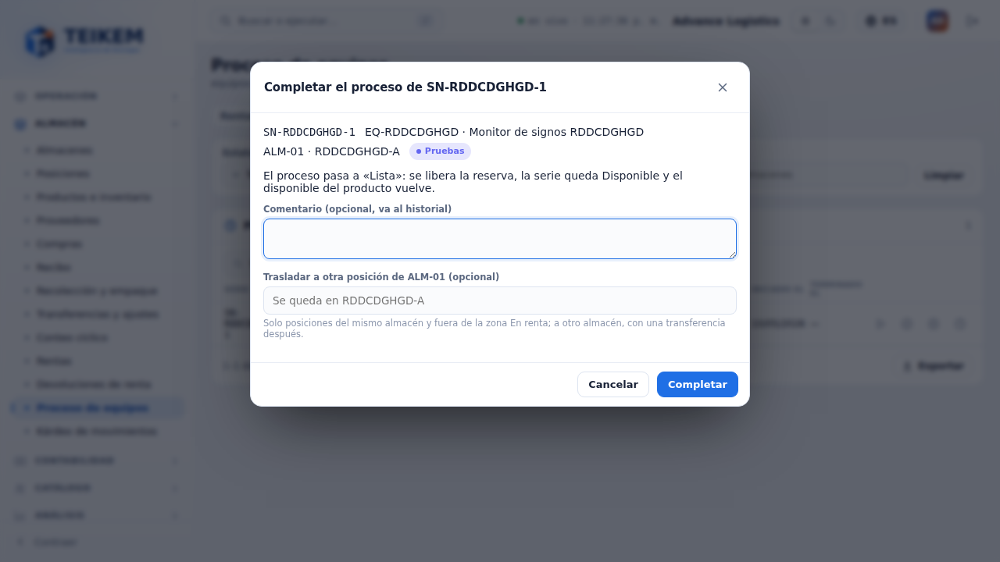

**Scrap** (also requires `inventory.adjust`): it is an **outbound adjustment** (−1) with the reason **Damage**; the serial is scrapped and does not
come back. That is why it is confirmed **by typing the serial** (case-insensitive); without it: *"Type the serial {s} to confirm the scrap."*

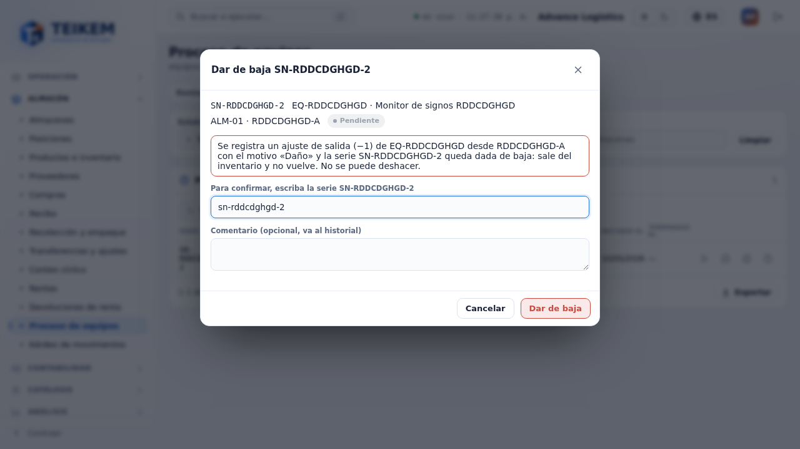

## 5. Rentals list summary and Rental reports

Above the rentals list, three cards with the current total: **On rent today** (On rent rentals), **Due (7 days)** (picked
up from today to 7 days out) and **Overdue** (the pickup date has passed; Scheduled or On rent). One click applies that filter to the list (the card
stays marked). It is the same criterion as the "Needs your attention" notice and the indicators.

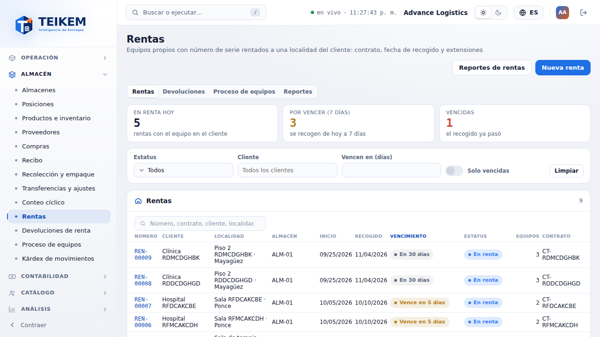

**Rental reports** shows what the server seeded in Analytics for Rentals, calculated by the **Analytics engine** (the web
recalculates nothing):

- **Indicators**: "Rentals due (7 days)" and "Overdue rentals" with their value. To see them on the Pulse, turn on *Show on my Pulse*
  in Analytics → Indicators (they come off because "Needs your attention" already shows each rental).
- **Chart** "Rental returns by reason" (last 30 days).
- **Rental views**: Units on rent by client, Rentals due (7 days), Overdue rentals, Rental returns by reason and Units
  in processing (and the ones the company creates on those sources). When you choose one it runs with the "All" range; grouped ones show their
  **Totals** below. Export like any table. On the phone the view is chosen in a dropdown list.

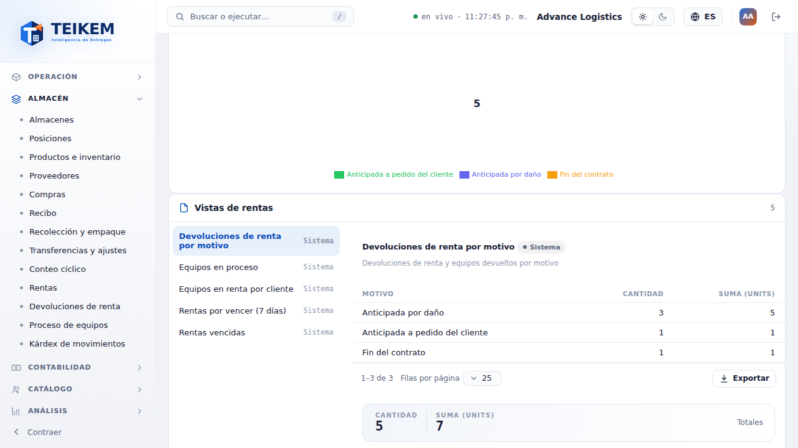

On the phone, everything wraps at 360 px with no horizontal scrolling (the tab strip scrolls within itself):

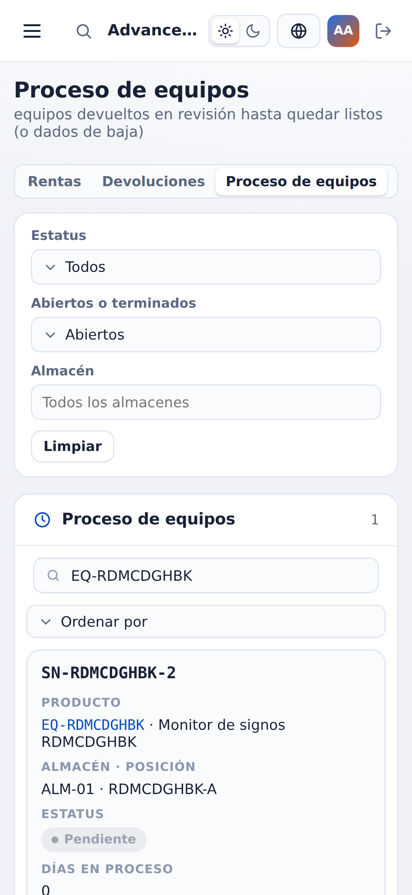
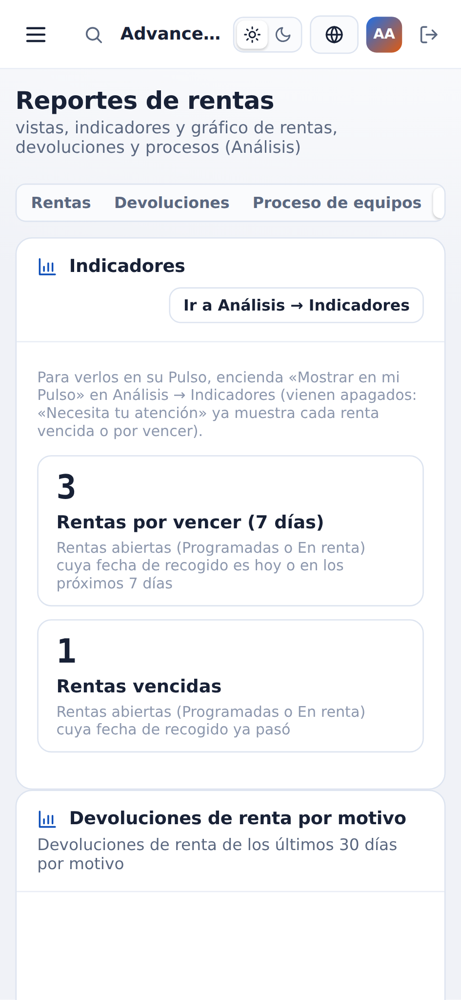

## 6. Messages

The server's come out **as is** (chapter 11 §9 "Return, processing and count"). The web checks before sending, with **the same text**:
*"Enter the return reason: END_OF_CONTRACT, EARLY_DAMAGE, EARLY_CLIENT or OTHER."*, *"With the reason 'Other', describe the return
in the notes."*, *"The return date cannot be in the future."*, *"The return date cannot be before the rental start
(yyyy-mm-dd)."*, *"The estimated pickup cost cannot be negative."*, *"Enter at least one serial being returned."*, *"Notes
allow at most 1000 characters."*, *"Unit notes allow at most 500 characters."* and *"Enter the status the
process moves to."*. Web only:

| Where | Message | When |
|---|---|---|
| Register return | *"Enter a valid number."* | Pickup cost that is not a number |
| Scrap | *"Type the serial {s} to confirm the scrap."* | The confirmation does not match the serial |
| Processing queue | *"Scrapping also requires the inventory.adjust permission (inventory adjustments), which your user does not have: ask an administrator."* | Has `rental.maintenance` but not `inventory.adjust` |

## 7. Frequent cases

- **I do not see "Register return"**: the rental is not On rent, it has no units left to return, or your role does not have `rental.return`.
- **I returned a unit and it is still "Not available"**: it went through processing; finish it with **Complete** in Equipment processing.
- **I made a mistake and checked "goes through processing"**: complete it right away (Complete); it becomes available.
- **I want to return to the quarantine of another warehouse**: change the **Destination warehouse** and choose the bin (for all or per unit).
- **"Illegal jump: …" when advancing**: the pipeline goes step by step; choose the next one (the one that says "(next)") or Repair / Awaiting
  parts.
- **"Scrap" does not appear**: `inventory.adjust` is missing (the note under the filters says so) or the process already finished.
- **I do not see the Reports tab**: `analytics.view` and the Analytics module turned on are required.

> **Menu (adjustment of 2026-10-06):** in Warehouse there is a single item, **Rentals**. Inside, the tabs **Rentals · Returns · Equipment processing · Reports** (Reports only with `analytics.view` and the Analytics module). Where this chapter says "the Rental returns / Equipment processing menu item", read "the tab".
