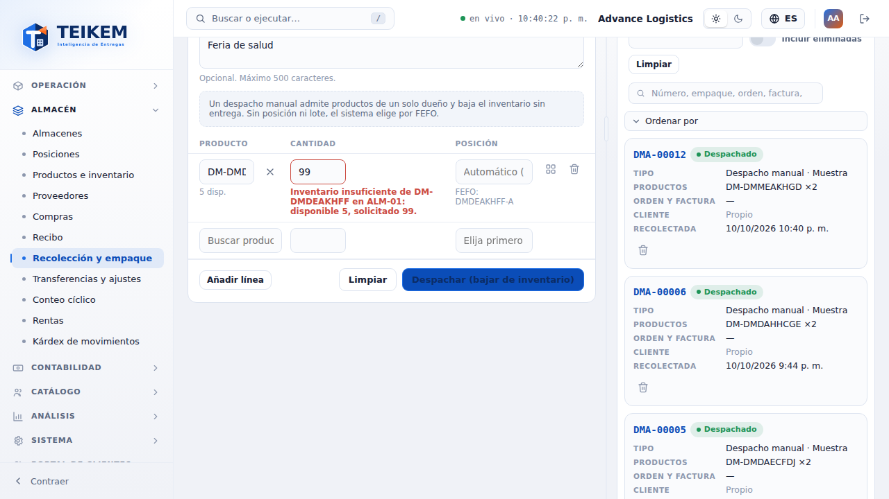
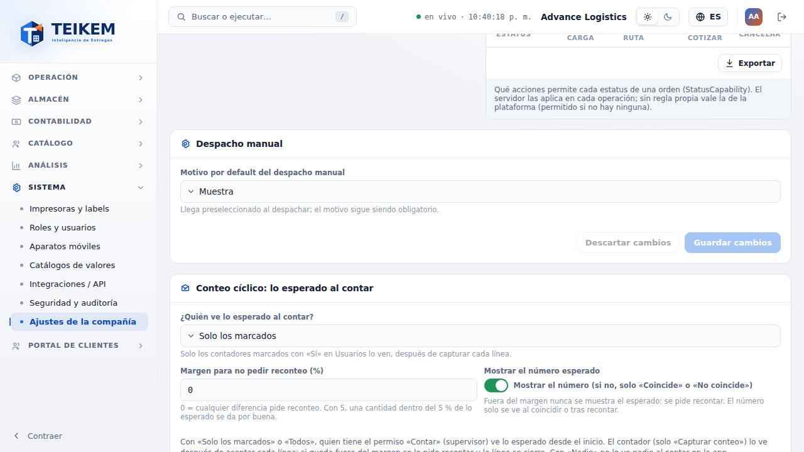
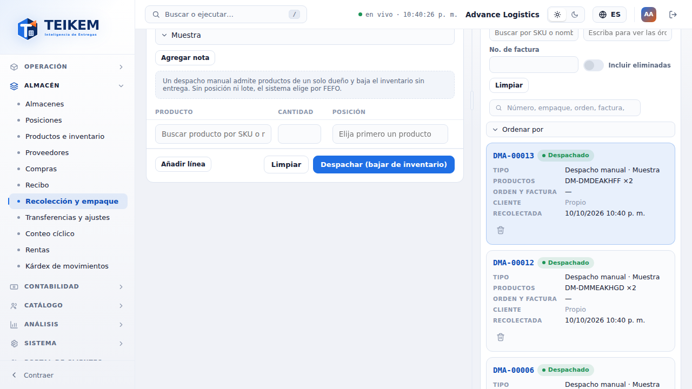
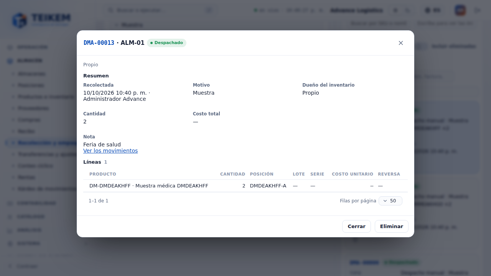
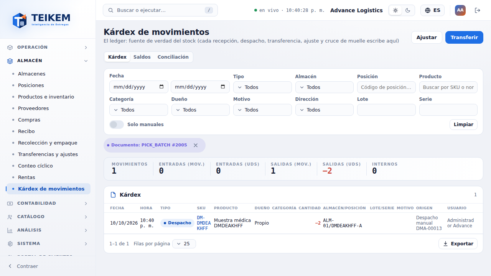
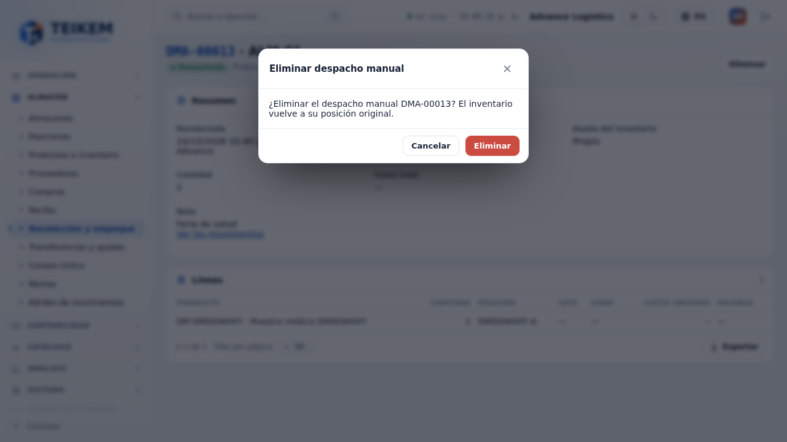
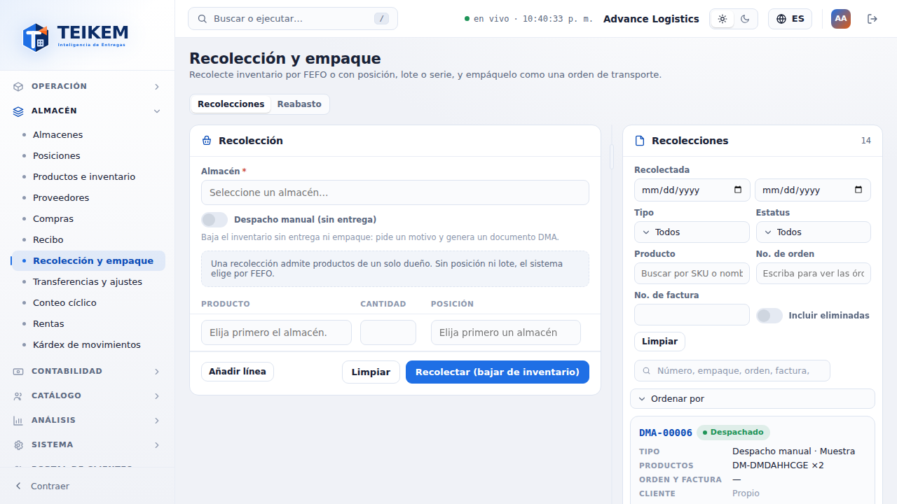
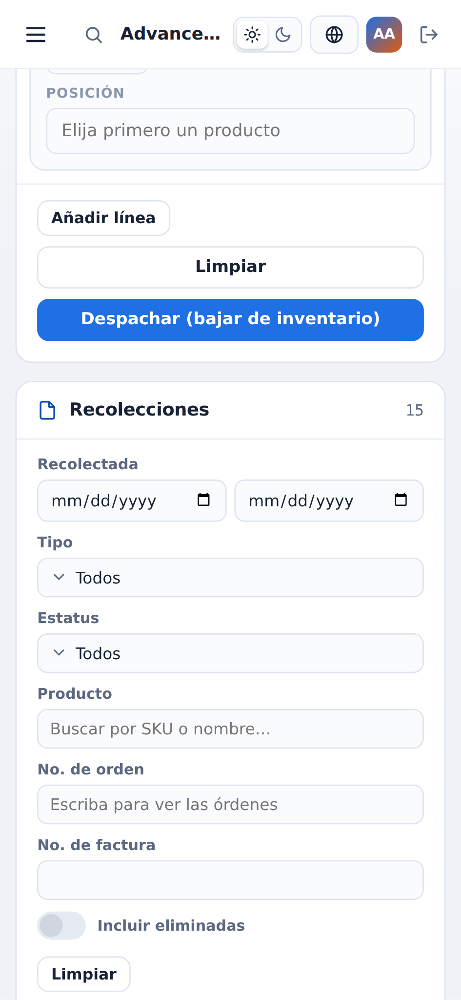

# F19 — Manual issue on the web (Picking & packing)

The **manual issue** is an inventory outbound **without delivery** (sample, internal use, customer pickup, sale or other) that leaves its
own **DMA-#####** document with a required reason and a free note. **There is no new screen or menu item**: everything lives in
**Warehouse → Picking & packing** (`/warehouse/pick-batches`), where everything is a *pick batch* and some (the manual ones) have no packing.
The server rules, the HTTP codes and the exact messages are in chapter [06 — Inventory and warehouse](../06-inventario-y-almacen.md)
§7b and in the “Manual issue” section of the [FAQ](../faq.md); here we explain how it is used from the screen.

**Server.** Unchanged: the web uses `POST /api/v1/manual-issues` (with `Idempotency-Key`), `GET /api/v1/manual-issues/reasons`,
`DELETE /api/v1/manual-issues/{publicId}`, `GET /api/v1/pick-batches?kind=ALL|PACK|MANUAL` and the record `GET /api/v1/pick-batches/{publicId}`.

## 1. Who can

| What | Where | Permission and module |
|---|---|---|
| View the list and the record (also of manual ones) | Picking & packing | `inventory.view` + **Lots and serials** module (`WMS_LOTSERIAL`) |
| Issue | **Picking** panel → **Manual issue (no delivery)** switch | `warehouse.issue` |
| Delete a manual issue (with reversal) | List row or record → **Delete** | `warehouse.issue` (`warehouse.pick` is not enough) |

Whoever has `warehouse.pick` **and** `warehouse.issue` sees the switch and chooses the mode. Whoever only has `warehouse.issue` sees the panel already in manual
mode (no switch). Whoever only has `warehouse.pick` sees nothing new: the panel is “Pick (take out of inventory)” as always.

## 2. Make a manual issue

1. Choose the **Warehouse** (if the company has only one, it is already chosen) and turn on **Manual issue (no delivery)**.
2. **Reason** appears (required: Sample, Internal use, Customer pickup, Sale or Other; the company can rename or disable them), **already
   preselected** (see §2b), and the **Add a note** button (the note is optional, maximum 500 characters, empty and hidden by default).
3. Fill in the lines **just like a pick batch**: product (with its available stock), quantity, bin (empty = the system chooses by
   FEFO), lot, serials (serialized products) and **Suggest bins** (it spreads the quantity across bins in FEFO order).
   An issue accepts products of **a single owner**.
4. **Issue (take out of inventory)**: a single submission. The `DMA-#####` number is assigned by the server and the notice says *“Manual issue DMA-… recorded.”*.
   The list highlights it. The stock **is still shown** (it is not blind).

Screen messages (before calling the server): *“Enter the reason for the manual issue.”*, *“The note allows at most 500 characters.”*,
*“A manual issue can only have products from the same owner.”* and those of the lines (product, quantity, serials). The server's are
shown **as is** next to what they correct; for example, without enough stock (409) the row is marked on its **quantity** with
*“Insufficient inventory of SKU in ALM-01: available 5, requested 99.”* and **nothing is deducted and the number is not consumed**.

If the network drops while sending, press **Issue** again without changing anything: it is sent with the same idempotency key and the server returns the
same document, not a new one.

## 2b. Default reason (2026-10-11 b)

The manual issue must not complicate the operation: the **Reason comes preselected**, with this priority:

1. the **last reason you used** in this browser (saved when issuing, per company and user) if it still exists and is enabled;
2. otherwise, the **company's default reason** (`isDefault` in `GET /api/v1/manual-issues/reasons`);
3. if there is none, it stays empty and must be chosen (the reason **is still required**: the server demands it all the same).

After issuing, the panel is ready for the next one with the reason just used. A last reason that no longer exists is ignored without error.
If the browser does not allow saving data, it simply is not remembered.

**Where the default is set.** Tenant settings → **Operations** → **Manual issue** panel → **Default reason for manual issues** (the active reasons
of the list + “No default reason”; help: *“It comes preselected when issuing; the reason is still required.”*). It requires `admin.tenant` (without it, it is visible
but cannot be changed) and the Lots and serials module. It saves with `PUT /api/v1/tenant/settings` (`defaultManualIssueReason`, `""` = no default); the 400 error
*“Reason {CODE} does not exist or is inactive.”* appears under the selector and nothing is saved.

**Note.** The field sits behind **Add a note** so it does not take up space; no default text. It is hidden again after issuing or **Clear**.

## 3. Picking & packing list

The list brings **everything**. **Type** column: *Pack*, or *Manual issue · {reason}*. **Type** filter: All / Packs / Manual issues (sends
`kind`). The status of a manual one is shown as **Issued** (and **Cancelled** if it was deleted; use “Include deleted” to see them). A manual one has
no **Pack**. You can search by number, reason, note or SKU in the search box. Sorting columns and exporting include everything filtered.

## 4. Record of a manual issue

Clicking the row (modal) or the address `/warehouse/pick-batches/{publicId}` shows: DMA number, **Issued**, **Reason**, **Inventory owner**,
who and when, quantity and total cost, **Note**, **See the movements** link (movement ledger of the document: note *“DMA-… · reason”*, the free note does
not go to the ledger) and the lines (product, quantity, bin, lot, serial, unit cost, reversal). No packing stages and no **Pack**.

## 5. Delete (with reversal)

**Delete** asks for confirmation: *“Delete manual issue DMA-…? The inventory goes back to its original bin.”* It restores the inventory with
a reversal movement and the document becomes **Cancelled**. Server errors (404 if it was already deleted, 409 for version —the record reloads—, 422
if the product is already deactivated) appear as is in the dialog.

## 6. On the phone (360 px)

Same steps, no horizontal scroll: the panel and the list become cards and the Type and the reason fit in the card (screenshots `f19-m-*`).

