# F6 — Warehouse and inventory (minimum) + order lookup

Chapter of the screens manual for the warehouse module (functional manual 06) and for the read-only lookup of
transport orders that comes with it. All the screens live under the **Warehouse** group of the side menu, except
"Orders", which is under **Operations**, and the "Warehouse" panel of the Pulse, shown on the home screen. Addresses
as they appear in the browser; screenshots in `img/f6-*.png`. The **Warehouses** and **Bins** sections (formerly
“Locations”) and the common table footer were rewritten in Batch 11: their screenshots are pending (they are marked in the
text) and the old images of the warehouse list, zones and bins were removed because they no longer matched the
current screen. In Batch 12, **Products & inventory**, **Suppliers** and **Purchase orders**
(Purchases) were rewritten and the **Set capacity** button was added to Bins. The screenshots of Products, Suppliers and Purchase orders are
the ones regenerated by the `f6.spec.ts` run with the new screen (test data of that run); the ones of
Bins with **Set capacity**, the **Add adjustment** block and the PDFs are still pending (they are marked in the text).
In Batch 13, **Receiving** was rewritten (the menu calls it **Receiving**: master-detail with the tabs Receipts, Arrival
notices and Pending putaway), as were **Warehouse tasks** (there is no longer a single queue: each type lives on its own screen) and **Picking &
packing** (two panels with a draggable bar); their screenshots are the ones regenerated by the `f6.spec.ts` run. The ones of
the Arrival notices tab and the New notice modal are still pending (they are marked in the text). Batch 13 also adjusted, by decision of the product
owner on 2026-09-30, the **purchase order** record (supplier and warehouse editable in Draft), the mandatory note on every
manual adjustment, the **Total units** indicator and the company defaults when **Packing**.
In Batch 14, **Transfers & adjustments** was added (Increase/Decrease, with the Adjustment report), **Movement ledger** was rewritten (formerly
“Inventory”: filters shared by Ledger, Balances and Reconciliation, summary, movement detail and discrepancies with their automatic
reconciliation) as was **Cycle count** (two panels, “Count what changed” and confirm in a single step). **Inventory adjustments** left the menu
(its purchase shortages are resolved in the purchase order record). Its screenshots are the `l14-*.png` generated by the
`lote14.spec.ts` run; the `f6-inventario-*` ones were regenerated. “Needs your attention” in the Pulse is in chapter
[F7A](f7a-pulso-almacen-y-actividad.md#day-pulse-needs-your-attention-panel).
In Batch 16, the warehouse **receiving mode** was added (record → Details → Receiving and a column in the list), the **receipt direct to bin** (Destination bin
column, suggested bins, capacity warning), the **Pending putaway** warning in direct warehouses, the **Picking Bin selector** (only where there is
stock) and, in "All tables", the **header and filters of the exports**, **dates as dates** and the **number format** (thousands comma). Its screenshots are the
`l16-*.png` (generated by the `lote16.spec.ts` run).

## Product and Bin filters (2026-10-12)

In Products & inventory, Ledger, Balances, Reconciliation, Transfers & adjustments, Receipts, Picking, Locations, Cycle count and Purchases (Product only), the **Product** (or “SKU or name”) and **Bin** filters are a **dropdown with a search box and multiple selection**, like Warehouse or Category: it opens, you type to search (the search is on the server, by SKU or name, or by bin code across warehouses), you check the boxes and what you chose stays at the top; the button shows the name (if it is one) or “N selected”. In Cycle count there is no longer the “Search” text filter.

## All tables: footer, rows per page and Export (Batch 11)

It applies to all the tables of the application that use the standard component, not only Warehouse.

> **Screenshot pending:** table footer with the range, "Rows per page" and the Export menu open.

**The table footer.** As long as the table has rows, a bar always appears below it with:
- The range and the total: `1–25 of 552`.
- **Rows per page**: 10, 25, 50 or 100 (if the screen started with another size, that size also appears in the list).
  The default is 25. In the lists that come paginated from the server (Orders, Inventory —Balances and Ledger—,
  Picking & packing, Purchase orders, Receipts, the task queues, Products, the Bins tab of the warehouse
  record and Bins) changing the size requests the data again and goes back to page 1. In the others the list is
  already loaded and the change is immediate.
- The **Export** button.
- The **‹** and **›** buttons with `Page X of Y` (only if there is more than one page).

If the table has no rows, the empty message is shown (by default "No results") and there is no footer. Some supporting tables do not paginate and show all their
rows (the lines with fields to capture, and the "Recent activity" panel, which has its own "See more").

**Sorting.** One click on the header sorts by that column. In a list paginated by the server it sorts **only the
rows of the page you are viewing**, not the whole result.

**Export.** The menu offers **Excel (.xlsx)**, **CSV (.csv)** and **PDF (.pdf)** and shows how many rows will come out
(`Rows: 552`). The file is generated in your browser and downloads by itself; nothing is sent anywhere else.

| Question | Answer |
|---|---|
| Which rows come out? | In an already loaded table, **all** the rows with the active filters, in the order you see (not only the page). In a list paginated by the server, **all the rows of the current query**, with the same filters: the screen reads the complete result 200 rows at a time; if you sorted by a column, the file comes out in that order. |
| Is there a limit? | Yes: 10,000 rows. If the query has more, the file carries the first 10,000 and the notice "Only the first {count} rows were exported (export limit). Refine the filters to export the rest." appears. |
| Which columns come out? | The ones you see, with the same text the screen shows (not the actions column or the selection checkboxes). A "—" comes out as an empty cell. Numbers come out as numbers in Excel (they can be added up). Yes/No for true/false values. |
| What is the file called? | Like the table or, if it has no name, the title of its panel, in lowercase and without accents, plus today's date: `almacenes-2026-09-29.xlsx`. |
| CSV | Comma-separated, UTF-8 encoding with byte order mark (Excel opens it correctly with accents and ñ). A text that starts with `=`, `+`, `-` or `@` comes out with an apostrophe in front so Excel does not take it for a formula. |
| PDF | A4 sheet, portrait (landscape if the table has more than 5 columns), with the company, the title, “Generated on …” and the filter line at the top (see "Export: company, filters, dates and numbers") and the page number at the bottom. It only supports Latin characters: accents and ñ come out fine; other symbols come out as `?`. The Receipts list, which exports each receipt with its lines, comes out in letter landscape. |

If something fails while generating the file, the notice "The file could not be generated. Please try again." appears. While it is
being prepared, the button says "Exporting…".

### Export: company, filters, dates and numbers (Batch 16)

Requests of the product owner (2026-09-30). They apply to all tables with the **Export** button.

- **Header.** Every **PDF** and every **Excel** carry at the top, in this order: the **company** (the company you signed in with), the **title** of the table, **“Generated on …”** (date and time of
  the export, in the language of the screen) and the **filters** line. In Excel, each line goes in its own row (column A), then a **blank row** and the table with **autofilter** (the Excel filter
  arrows). The library that generates the Excel files (community edition of SheetJS) **does not write bold or frozen panes**: headers are not bold and are not frozen. The **CSV does not change**:
  it carries only the table.
- **The filters line.** It says which filters were **chosen** when exporting, in the order they appear on the screen: `Filters: Warehouse ALM-01 (Main warehouse) · Status Receiving · Created from 01/09/2026 to 30/09/2026`.
  A value with code and name is written `Code (Name)`; a selection of more than 4 values says `A, B, C, D and 3 more`; a range says `from 01/09/2026 to 30/09/2026`, `from 01/09/2026` or
  `to 30/09/2026` (in English, month/day); the free-text search says `Search "text"`. If the screen has a filter bar and **none is chosen**, it says **“No filters”**. Tables that **have no filter bar**
  and those that are **inside a window (modal)** do not carry that line. The branded PDF reports (Products & inventory) keep their own “Applied filters” box.
- **Dates as dates.** In **Excel**, date columns are real dates (serial number with format `yyyy-mm-dd`, or `yyyy-mm-dd hh:mm` if they have a time): they sort, filter and subtract. In **CSV** they come out as
  `2026-09-30` or `2026-09-30 14:03:00`. Times are **Puerto Rico** time, not the computer's. The **PDF** shows the date as readable text. The Ledger exports **Date** with date and time and no longer exports the **Time** column;
  Counts and Discrepancies export the real date.
- **Receipts with their lines.** The export of **Receipts** (and of **Pending putaway**) brings each receipt **with its lines**. In **Excel and CSV**, one row **per line** repeating the receipt data (Number,
  Status, Type, Origin, Document, Sender, Warehouse, Transport, Reference, Expected arrival, Created, Confirmed and Difference of the receipt) and, from the line, SKU, Product, Expected, Received, Difference and Lot/Serial; a
  receipt without lines takes one row with the line columns empty. In **PDF**, one block per receipt with a band (number and status as title and the rest of the data) and the small table of its lines ("No lines" if it has none).
  The "Lines" column no longer comes out (the lines are shown). The file is called `recibos-2026-09-30.xlsx`.
- **Numbers and money on screen and in PDF.** Quantities carry a **thousands comma and decimal point** (`61,023`; `1,250.5`) in Spanish and in English, and money carries **`$`** (`$1,234.50`): Balances (cost and value),
  Picking (unit cost and total), Orders (COD and quoted) and the report PDFs. Before, in Spanish, `61.023` read as a decimal. Document numbers and identifiers carry no comma. In **Excel**, the number
  is still a number (not text): Excel gives it the format according to its settings.

**Dropdowns and filters.** The arrow of all dropdowns is now on the **left**, and the filters take up the whole
width of the panel (they wrap to another line on narrow screens) without leaving gaps.

## "Warehouse" panel in the Day pulse

**What it is for.** It gives a glance at the current state of the warehouse (not of a period: it is "right now") from the same
home screen where the indicators and charts of Batch F1 are already shown.

**How to get there.** It appears automatically below the Pulse indicators and charts (`/`), without asking for anything separately.

> This panel was extended in Batch F7A with the warehouse and category or product filter, and with the "Below
> minimum" card. The current description and screenshots are in
> [F7A — Pulse: Warehouse panel with filter and Recent activity](f7a-pulso-almacen-y-actividad.md#day-pulse-warehouse-panel-with-filter).
> Only the permission reference remains here, which did not change.

**Permission.** It is drawn only if you have `inventory.view` **and** the **Warehouse and lot/serial** module (`WMS_LOTSERIAL`)
turned on; without either of the two, the Pulse looks the same as in F1 (without this panel, without asking the server for anything).

## Warehouses: zones, bins and docks

**What it is for.** It manages the company's warehouses and, inside each one, its zones, bins and
docks. (Rewritten in Batch 11: master-detail list, record with filters and occupancy, city and ZIP code from
a list. The server rules and messages are in
[chapter 06, section 1](../06-inventario-y-almacen.md#1-warehouses-and-locations).)

**How to get there.** Menu **Warehouse › Warehouses**, address `/warehouse/warehouses`; the record at
`/warehouse/warehouses/:publicId`.

### Warehouse list

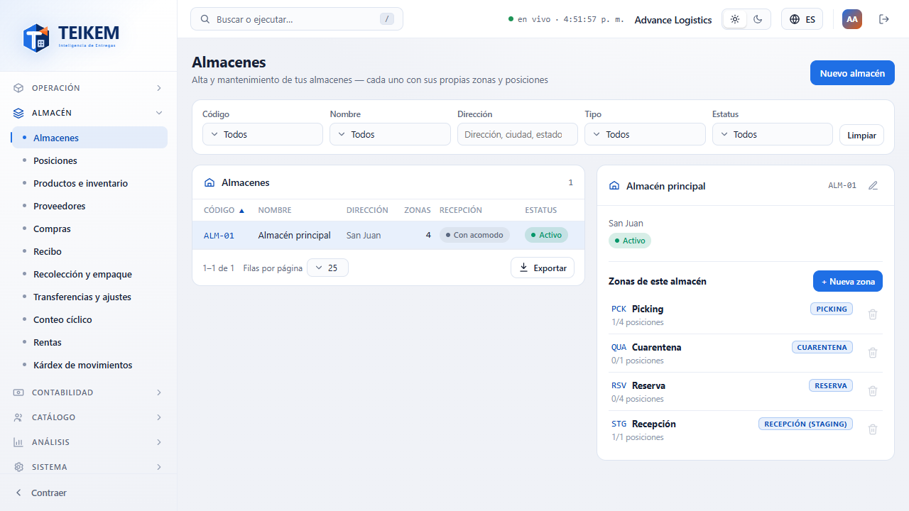

Below the title ("Create and manage your warehouses — each with its own zones and slots") there are two
areas: the **table** and, to its right (420 px; under 720 px wide it goes below the table), the **panel of the chosen
warehouse**.

**Filters** (at the top, with the **Clear** button; they filter on the screen, without requesting data again):
- **Code** and **Name**: multiple-selection dropdowns with a search box.
- **Address**: free text. Each word must appear in the address, the city, the state or the ZIP code (case- and
  accent-insensitive).
- **Type**: zone types; the warehouse that has **some active zone** of those types remains.
- **Status**: multiple selection (Active, Inactive).
There is no search box inside the table nor the "Show" selector: inactive warehouses are always shown, dimmed.

**The table.** Columns: Code, Name, Address, Zones, **Receiving** (Batch 16: a chip with the warehouse mode, **With putaway** or **Direct to bin**) and Status (the status used to be called "State"). It sorts by Code by
default. A click on the row **chooses** the warehouse and shows it in the right panel; the choice stays in the address
(`?warehouse=…`), so the link can be copied. Without a choice, the first one by code is shown. The footer is the common one
of all tables (above, "All tables").

**The right panel.** It shows the name and code of the warehouse, its address and its status, and the **Zones in
this warehouse** block:
- The pencil icon opens the warehouse **record** ("Edit warehouse" with `warehouse.manage`; "Open the warehouse
  record" without it).
- **+ New zone** (with `warehouse.manage`; disabled if the warehouse is deactivated) opens the zone form.
- One row per **active zone**: code, name, type and `occupied/total bins` (active bins with stock out of
  active bins). With `warehouse.manage`, a click on the row opens the form to edit it.
- The **trash can** of each row deactivates the zone (asks for confirmation: "Zone {code} will become inactive."; notice "Zone
  deactivated."). If the zone has active bins the trash can is disabled and the tooltip on hover says "Can’t
  deactivate: this zone has slots created".
- Without zones: "No zones yet — create the first one". Without a chosen warehouse: "Select a warehouse from the list".

**New warehouse** (header button, with `warehouse.manage`).

> **Screenshot pending:** "New warehouse" form with the "City or ZIP code" combobox open.

| Field | How it works |
|---|---|
| Code | Required; letters, numbers, hyphen and underscore, maximum 30. It cannot be changed afterwards |
| Name | Required |
| Address | Free text |
| City or ZIP code | A single field with a search box: type a city, a municipality or the first digits of a ZIP code (it waits 250 ms between keystrokes, ↑ ↓ Enter to choose, Esc closes the list, the ✕ "Remove city and ZIP code" empties the field). Each option is shown as `ZIP · POSTAL CITY (Municipality), State` and, outside Puerto Rico, ends with the country. Choosing an option fills in **City, ZIP code, State and Country** |
| State and Country | Read-only: filled from the chosen locality ("Filled from the chosen city."). If you choose none, the country stays Puerto Rico and the state empty |
| Receiving mode (Batch 16) | **With putaway** (default) or **Direct to bin**. The default receiving bin is not asked here (when creating the warehouse it has no bins yet): it is set later in the record |
| Active | Box checked and cannot be changed: every warehouse starts active ("Every new warehouse starts active; deactivate it from its record.") |

On save, "Warehouse created." appears.

### Warehouse record

Header with code, name and city, the status bar (Active → Inactive, with **Advance to Inactive**, final)
and four tabs: **Details**, **Zones**, **Bins**, **Docks**.

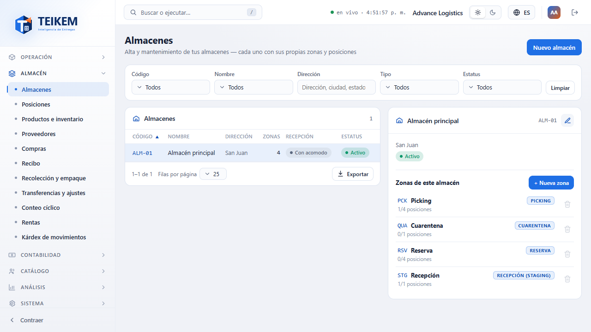

**Details.** Code (read-only: "The warehouse code cannot be changed."), Name, Address, **City or ZIP
code** (the same combobox as in creation; it shows `City · ZIP` with what is saved, even if the warehouse was created before
the list), and read-only State and Country. **Save** is only enabled if there were changes and is only seen by whoever has
`warehouse.manage`; notice "Changes saved.". Without `warehouse.manage` the form is shown disabled.

**Receiving (Batch 16).** At the end of Details there is a **Receiving** group with two fields, which only whoever has `warehouse.manage` can change:

| Field | How it works |
|---|---|
| **Receiving mode** | **With putaway** or **Direct to bin**. Help: "With put-away: goods go to the receiving bin and put-away tasks are created. Direct to bin: each line carries its bin and goes there on confirmation, with no tasks." |
| **Default receiving bin** | Selector of the bins of `STAGING` or `CROSSDOCK` zones of the warehouse. Empty says "The first receiving bin" (the first bin of a `STAGING` zone). Help: "A STAGING or CROSSDOCK zone bin of this warehouse. Empty: the first receiving bin. Used by put-away receipts and by cross-docked lines." Emptying it removes it |

When saving with **another mode** the confirmation **“Change the receiving mode?”** appears: "New receipts at {code} will come in {with putaway | direct to bin}. The {n} open receipts keep their mode and the
{m} receipts with pending put-away stay as they are." (**Change mode** button; while the receipts are being counted, "…" appears). Changing the mode **does not touch** open receipts or pending putaways. The server rules and
messages are in [manual 06, section 1.4](../06-inventario-y-almacen.md#14-receiving-mode-and-default-receiving-bin-batch-16).

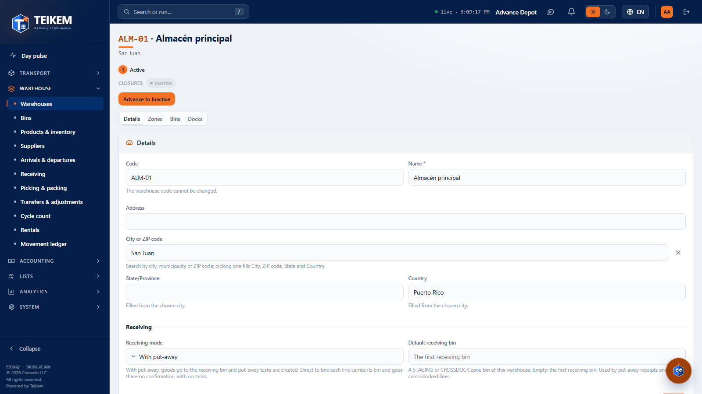

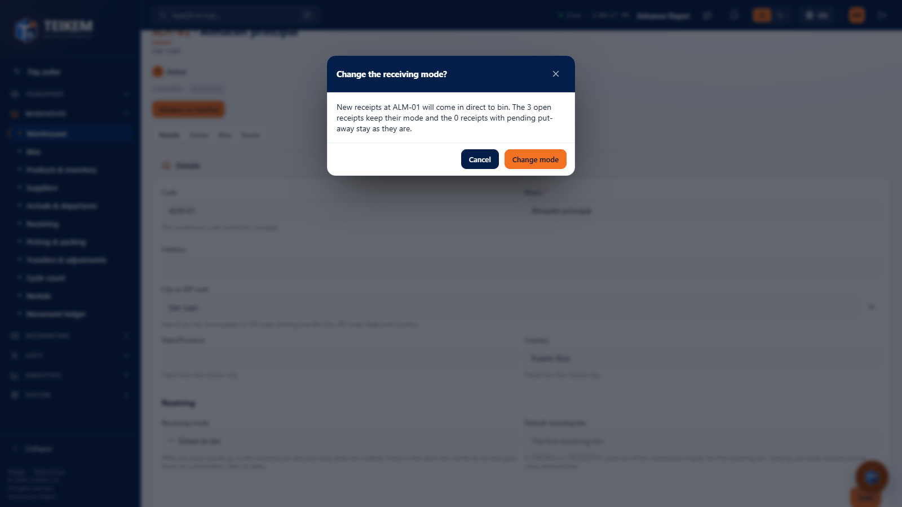

**Zones.**

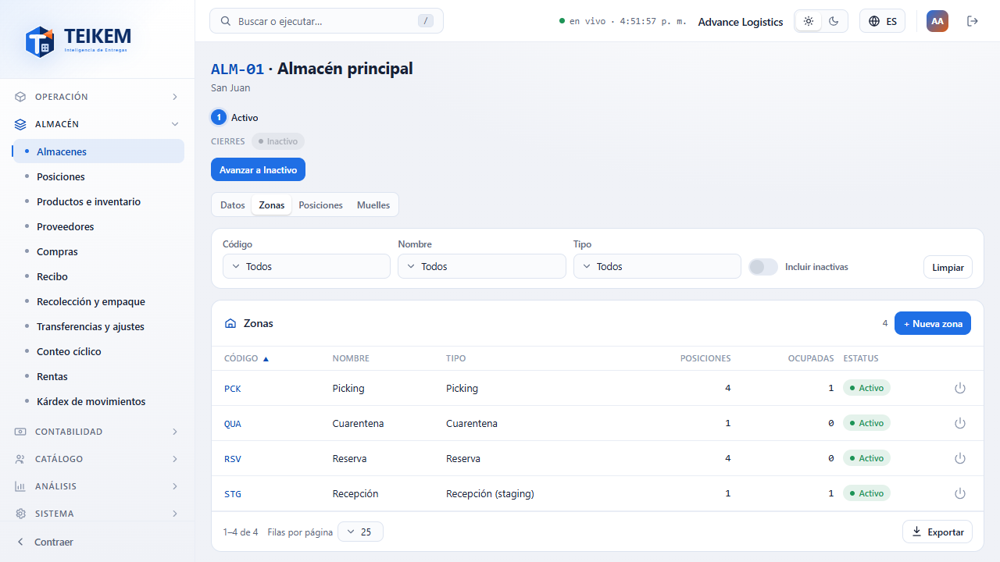

- Filters: **Code**, **Name**, **Type** (multiple selection with a search box; they filter on the screen) and **Include
  inactive**.
- Columns: Code, Name, Type, Bins (active), **Occupied** (active with stock) and **Status** (Active /
  Inactive).
- **+ New zone** in the panel header. A **click on the row** opens the edit form (there is no longer an
  "Edit" button). Per row, one icon: **Deactivate** (the server rejects it with 409 if the zone still has active bins) or **Reactivate**, with confirmation.
- Without `warehouse.manage` the rows cannot be opened and there are no icons.

**Zone form** ("New zone" / "Edit zone"): **Code** (required; **can be edited**: "Unique in the warehouse.
Changing it does not move its bins or stock."), **Name** (required) and **Type** (dropdown with a search box
over the zone types; it can be left empty). If the code is already used by another zone of the warehouse, the server message
"A zone with that code already exists in the warehouse." appears **below the Code field** and the form stays open.
Notices: "Zone created." / "Changes saved.".

**Bins.**

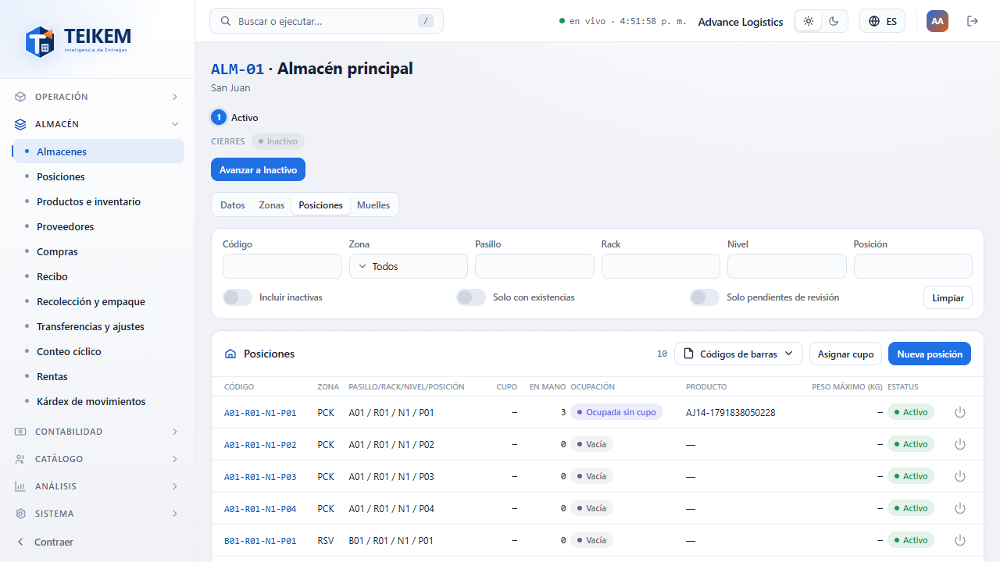

- This tab **paginates on the server** (25 by default): adding, editing or deactivating a bin no longer waits for
  the whole warehouse to load. Opening or closing a form does not query again.
- Filters (sent to the server; the text ones wait a moment after the last keystroke): **Code** (it also searches by
  aisle, rack, level and position, and by the zone code), **Zone** (multiple selection with a search box), **Aisle**,
  **Rack**, **Level**, **Position**, **Include inactive** and **Only with stock**. The panel counter is the total
  that meets the filters.
- Columns: Code, Zone, Aisle/rack/level/position, **Capacity**, On hand, **Occupancy**, Product, Max weight (kg) and
  Status. **Occupancy** is a chip —Empty, Partial, Full or In use, no capacity— and, if the bin has capacity and stock,
  the percentage (`40 %`). **Product** shows the SKU if there is only one (the name appears on hover), "N products" if
  there are several and "—" if there are none.
- **Set capacity** and **New bin** in the header (with `warehouse.manage`). **Set capacity** sets or clears the capacity of
  many bins at once and starts with the Zone, Aisle, Rack, Level and Position set in the
  filters of this tab (the Code filter is not carried over); see "Set capacity" in the Bins section, below. A click
  on the row opens the edit form. Per row: **Deactivate** / **Reactivate**.
- **Export** outputs **all** the bins that meet the filters, not only the page.

**Bin form** ("New bin" / "Edit"):
- Creation: **Zone** (dropdown with a search box by code, name or type; required), **Code** (optional if you type some
  part), Aisle, Rack, Level, Position, **Max capacity** and Max weight (kg).
- Edit: the **code and zone do not change** (they are shown disabled: "The bin's code and zone cannot be
  changed."). Aisle, rack, level, position, capacity and weight do, but changing the parts **does not recalculate** the code.
- **Max capacity**: product units that fit ("Units that fit; empty = no capacity."). Integer greater than zero. When editing,
  leaving it empty clears the capacity.

**Docks.** No changes from Batch F6: code, type (Inbound/Outbound/Both), status and active; **New dock**,
**Edit**, **Change status** (Free ↔ Occupied ↔ Maintenance) and **Deactivate**/**Reactivate**.

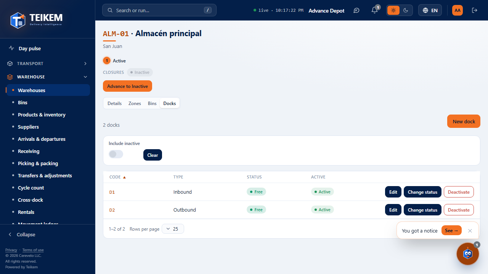

### Bins (formerly “Locations”)

**What it is for.** A view of a whole warehouse: how much of its capacity is occupied in each zone and where everything is,
bin by bin. Since Batch 12 the menu item is called **Bins** (formerly “Locations”; in English, “Bins”) and
it allows editing a bin with a click on its row and setting capacity in bulk. The address did not change.

**How to get there.** Menu **Warehouse › Bins**, address `/warehouse/locations`. The chosen warehouse and zone go in
the address (`?warehouse=…&zone=…`).

> **Screenshot pending:** Bins screen with the boxes per zone, the filters, the bins table and the
> **Set capacity** button.

**Top right:** the **warehouse** selector (if none is chosen, the first active one; changing warehouse clears the filters),
**Set capacity** and **New bin** (both with `warehouse.manage`; **New bin** opens the same form as the record).

**The boxes per zone.** One per active zone, joined by a pipe:
- With capacity: `occupied/capacity` (for example `10/25`), the text `occupied · 40%` and a bar. The capacity is the sum of the capacity
  of the zone's bins; the occupied part, what there is in those same bins. If the zone has bins **without capacity**,
  the box warns about it ("1 slot without capacity" / "N slots without capacity") and those bins **do not count** in the percentage.
- Zone with bins but none with capacity: the total stock and "units · no capacity set" (there is no percentage).
- Zone without bins: `0` and "no slots".
- A **click on a box** filters the table by that zone; another click on the same one removes it ("Click to show only this zone
  in the table; click again to clear the filter").
Without zones, the screen says "This warehouse has no zones yet".

**Filters:** **Position** (text: it searches in code, aisle, rack, level and position; it waits a moment after the last
keystroke), **Zone**, **Type** (zone type: equivalent to choosing all the zones of that type), **Product** (bins with
stock of any of those products) and **Status** (Empty, Partial, Full, In use, no capacity). All are sent to the server and the
**Clear** button removes them. If the combination leaves no zone (for example, a zone and a type that do not match) the
table stays empty: "No slot matches the filters.".

**The table.** Columns: Position, Zone, Quantity, Product (the name if there is only one; "N products" if there are several), **Capacity**,
**Occupancy** (bar and percentage; "—" if the bin has no capacity) and **Status** (Empty / Partial / Full / In use, no
capacity). It only shows active bins. With `warehouse.manage`, a **click on the row** opens the bin edit
form (the same as in the warehouse record: the code and zone do not change; the aisle, rack, level, position, capacity and max
weight do); on save the table and the boxes are refreshed. Without that permission the rows do not open. The table has no
deactivation icons: deactivating or reactivating a bin is done in the Bins tab of the warehouse record. It paginates on the server with the common footer; **Export**
outputs all the ones that meet the filters. Without bins: "This warehouse has no slots yet.". Without active
warehouses: "There are no active warehouses.".

**What is not there yet.** The occupancy bars of the last 7 days shown in the mockup are not there: they depend on a
daily history that does not exist yet (see `docs/lote11-decisiones.md`).

#### Set capacity (max capacity of many bins at once)

**What it is for.** Set or clear the max capacity (units) of all the bins that meet a scope, in a single step
and without editing them one by one. It is useful, for example, to correct the capacity the migration estimated (see the frequently asked question
“Where did the capacity of my bins come from?” in the FAQ). Who can: `warehouse.manage`, module `WMS_LOTSERIAL`. Without that
permission the button does not appear. It is reached from **Set capacity** in Bins and in the Bins tab of the warehouse record.
It always applies only to **active** bins. It calls `POST /api/v1/warehouses/{publicId}/bins/capacity` (chapter 06 of the
functional manual).

> **Screenshot pending:** the “Set bin capacity” modal with scope, action and preview.
> **Screenshot pending:** the confirmation notice with more than 100 bins.

**The modal.** Title “Set bin capacity”. It has two groups:
- **Scope:** **Zone** (several, with a search box; with none chosen it says “Any zone”), **Aisle**, **Rack**, **Level** and
  **Position** (text: contains), the **Only bins without capacity** switch (it does not overwrite any capacity already captured) and, only
  while no filter is set, the **Whole warehouse** switch. From Bins the modal starts with the zone
  of `?zone=`; from the record, with the filters of the tab.
- **Action:** a radio button, **Max capacity** (with the “Max capacity (units)” field, integer greater than zero) or **Clear
  capacity**. When choosing Clear capacity, “Only bins without capacity” is disabled (“Does not apply when clearing the capacity.”).

**The preview.** Below the modal, a line says how many bins it will apply to, with a brief pause after the last
change: “Counting bins…”, “Will apply to 1 bin.”, “Will apply to {count} bins.”. If there is no filter
nor “Whole warehouse”: “Choose at least one filter (zone, aisle, rack, level or position) or tick “Whole warehouse”.”. If nothing
matches: “No bin matches the scope: nothing to apply.”. The apply button (**Set capacity** or
**Clear capacity**) stays disabled while there is no scope, it is counting, there are no bins or the count failed.
With “Only bins without capacity” and text filters (aisle, rack, level or position) the exact count is only done if there are
up to 1,000 bins; with more, the preview says “Will apply to at most {count} bins (those that already
have a capacity are skipped).” and the figure is a ceiling.

**On apply.**
1. If there are more than 100 bins, or “Whole warehouse” was checked, it asks for confirmation (“Confirm bulk capacity”): “A max capacity
   of {qty} units will be set on {count} bins.” or “The max capacity of {count} bins will be cleared.”, plus “The change
   affects the whole warehouse.” when applicable and “Bins that already have that value do not change.”. With an approximate
   count, the {count} says “up to N”.
2. It applies and closes the modal with the notice “Capacity set on {changed} of {matched} bins” (or “Capacity cleared on {changed} of
   {matched} bins”; in singular, “of 1 bin”). `matched` are the ones that met the scope and `changed` the ones that really
   changed: those that already had that capacity do not count as changed.
3. The tables and the occupancy boxes refresh by themselves.
4. If the server rejects the request, the message stays in the modal (red box at the top) and the modal remains open; the capacity
   error is also shown under the field. The server messages are in chapter 06 of the functional manual.

**What blocks it.** With the warehouse deactivated, the server answers 422 “The warehouse is deactivated; view only.”.

**Products by bin and Aisle filter.** The Bins table also has the **Select** checkbox, the **Aisle** filter (text) and the
**Products by bin** button, next to **Barcodes**: a PDF with one bin per page and the barcode of each product it holds, to
scan from the paper on a high rack. Everything is explained in [F15 — Products by bin](f15-productos-por-posicion.md).

**Bin labels (Batch F16).** The **Location labels** button, next to **Products by bin**, generates a PDF with one label
per bin (4 × 2, 4 × 4 or 4 × 6 inches, one page per label) from the current filter or from the selected ones, for the label
printer; it changes nothing in the system. See [F16 — Bin labels](f16-etiquetas-de-posicion.md).

### Permissions and module

`inventory.view` (view Warehouses, the record, Bins and the city list); **`warehouse.manage`** to create and
edit the warehouse, its zones, bins and docks, set capacity in bulk, deactivate and reactivate, and the manual status of the dock. Module
**Warehouse and lot/serial** (`WMS_LOTSERIAL`).

### Statuses and transitions

| Entity | From → to | Who | What it validates / triggers | Blocks |
|---|---|---|---|---|
| Warehouse | Active → Inactive (terminal) | `warehouse.manage` (status bar of the record) | Inventory and open documents | 409 "Warehouse {code} has inventory or open documents; it cannot be deactivated." Already inactive: view only (nothing is edited; 422 "The warehouse is deactivated; view only.") |
| Zone | Active → Inactive | `warehouse.manage` (Deactivate icon in the record or trash can in the list panel) | Active bins | 409 "The zone has active bins; deactivate them first." (the trash can in the list is already disabled) |
| Zone | Inactive → Active | `warehouse.manage` (Reactivate icon) | — | — |
| Bin | Active → Inactive / Inactive → Active | `warehouse.manage` (icons in the Bins tab) | Inventory and open tasks | 409 "Bin {code} has inventory; it cannot be deactivated." / 409 "The bin has open warehouse tasks; complete or cancel them before deactivating it." |
| Dock (operating status) | Free ↔ Occupied ↔ Maintenance (lateral) | `warehouse.manage` | — | — |
| Dock (active) | Active → Inactive | `warehouse.manage` | Current appointments | 409 "The dock has scheduled or ongoing appointments." |

The **occupancy** of a bin (Empty, Partial, Full, In use, no capacity) and that of a zone are not statuses: they are calculated
by themselves comparing the stock on hand with the capacity, they have no transitions and they block no action.

### Validations and messages

| Field | Rule | Message | Where |
|---|---|---|---|
| Code (warehouse, zone) | required | "The code is required." | Screen (and server 400) |
| Code (warehouse, zone) | letters, numbers, hyphen and underscore, max. 30 | "Code only allows letters, numbers, hyphen and underscore (max 30)." | Screen (and 400) |
| Zone code | unique in the warehouse (on create and on edit) | "A zone with that code already exists in the warehouse." | Server, 409, under the Code field |
| Warehouse code | unique in the company | "A warehouse with that code already exists." | Server, 409 |
| Name (warehouse, zone) | required | "The name is required." | Screen (and 400) |
| Zone (bin creation) | required | "Select the zone." | Screen |
| Code or aisle/rack/level/position | one of the two | "Enter the bin's code or its aisle/rack/level/position." | Screen (and 400) |
| Bin code already used | unique in the warehouse | "A bin with that code already exists in the warehouse." | Server, 409 |
| Max capacity | greater than zero | "The bin's max capacity must be greater than zero." | Screen (and 400) |
| Max capacity | whole number | "Max capacity must be a whole number." | Screen |
| Max capacity | up to 2,147,483,647 | "Max capacity is too large." | Screen |
| Max weight (bin) | > 0 | "Max weight must be greater than zero." | Screen |
| Max weight (bin) | ≤ 3 decimals | "Max weight allows up to 3 decimals." | Screen |
| Code (dock) | required | "The code is required." | Screen |
| City or ZIP code | the server denies the list query | "Your user cannot view the city list." | Combobox list |
| City or ZIP code | no matches | "No cities or ZIP codes match." | Combobox list |
| Bins filters | combination with no results | "No slot matches the filters." | Table |
| Set capacity: Max capacity | empty | "Enter the max capacity." | Screen |
| Set capacity: Max capacity | whole number | "Max capacity must be a whole number." | Screen |
| Set capacity: Max capacity | greater than zero | "The bin's max capacity must be greater than zero." | Screen (and server 400) |
| Set capacity: Max capacity | up to 2,147,483,647 | "Max capacity is too large." | Screen |
| Set capacity: scope | some filter or “Whole warehouse” | "Choose at least one filter (zone, aisle, rack, level or position) or tick “Whole warehouse”." | Screen (preview; the button stays disabled) |
| Set capacity: scope | at least one bin | "No bin matches the scope: nothing to apply." | Screen (preview) |
| Set capacity: preview | the count could be calculated | "Could not count the affected bins: {message}" | Screen (preview) |
| Set capacity: warehouse | must be active | "The warehouse is deactivated; view only." | Server, 422, in the modal box |

## Products and categories

**What it is for.** It is the item master (SKU): cost, price, minimums, category, who the owner is (own or
a client's) and how it is tracked (no tracking, by lot or by serial).

**How to get there.** Menu **Warehouse › Products & inventory**, address `/warehouse/products` (with the
**Categories** sub-tab on the same screen). A click on a row opens the product in a modal; the record with the Lots and
Serials tabs is still at `/warehouse/products/:publicId` (reached from the modal with “View lots” / “View serials”).

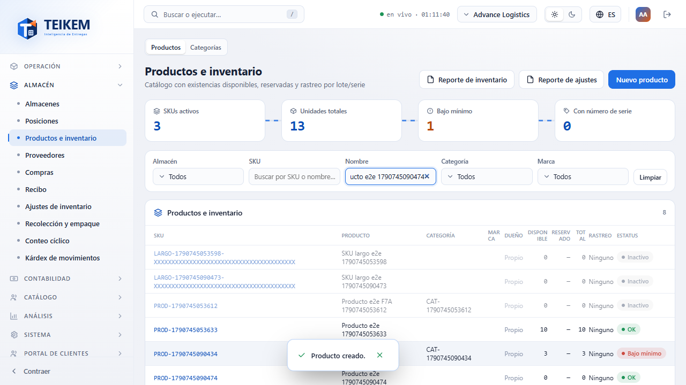

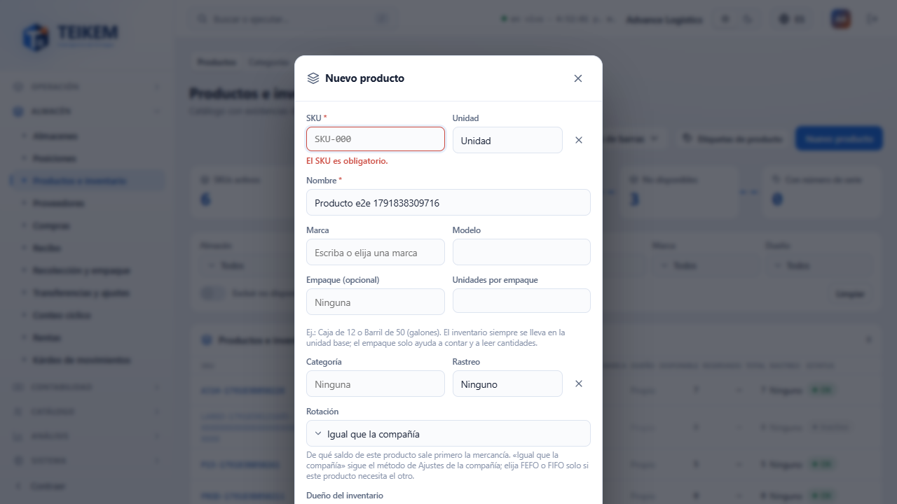

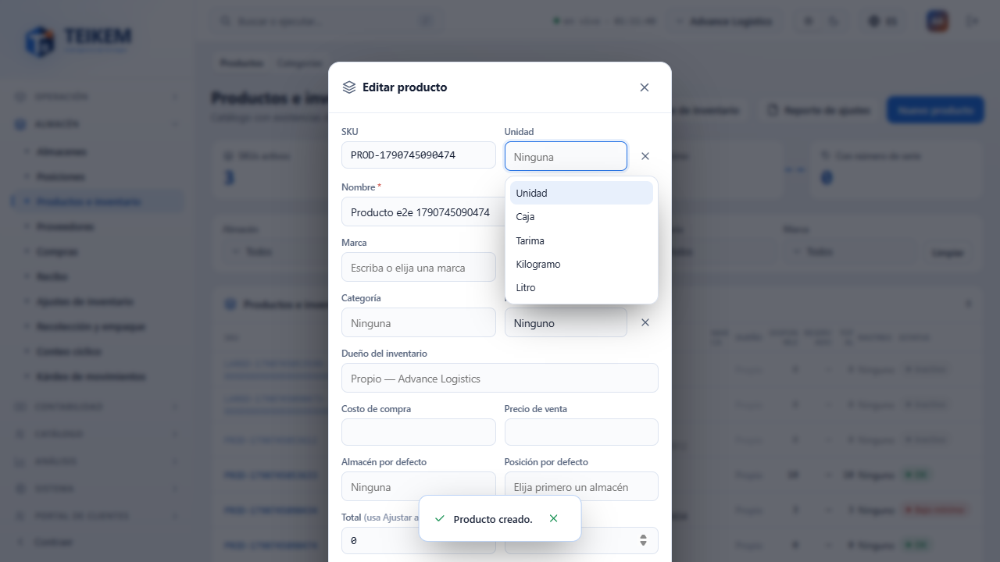

> **Screenshot pending:** the “Add adjustment” block open inside the product modal.

**The indicators (KPIs) are buttons.** At the top there are five cards: **Active SKUs**, **Total units**, **Below minimum**, **Unavailable** (since 2026-10-05) and
**Serial-tracked**. Their figures are for the whole list (they do not change when using the filters) and use the thousands separator of the
language (367.329 in Spanish). Each card filters the table on click; another click on the same one removes the filter. The chosen
filter stays in the address (`?kpi=`), so the link can be copied or you can go back with the browser.

| Card | What it counts | Filter it applies to the table | `?kpi=` |
|---|---|---|---|
| Active SKUs | Active products | Active only | `active` |
| Total units | Stock on hand of all balances **of active products** (inactive ones do not add up) | Active with stock on hand greater than zero (it also counts quarantine and cross-dock, and does not subtract what is reserved) | `available` |
| Below minimum | Active products with a minimum whose available is lower | Below minimum | `low` |
| Unavailable | Active products **with no available units** (on hand minus reserved = 0): no stock or everything reserved. It counts products, not units | Active with available = 0 | `unavailable` |
| Serial-tracked | Active products with serial tracking or with registered serials | Serial tracking or with registered serials (includes inactive ones that have them) | `serial` |

**When a card turns orange.** Only when there is something to attend to: **Below minimum** when its figure is greater than zero, and
**Serial-tracked** when there are serialized products whose captured serials are fewer than their stock; in that case
it shows below “N with incomplete serials”. With nothing pending, both are shown in the normal color. **Active SKUs** and **Total
units** are never orange.

**Filters** (sent to the server; **Clear** removes them all, including the chosen indicator):
- **Warehouse** (several, with a search box): it limits the **quantities** of each row (Available, Reserved, Total) to those warehouses.
  It does not remove products from the list: a product with no stock in that warehouse still appears with zeros.
- **SKU or name** (dropdown with a search box and multiple selection, same as Warehouse; it searches on the server by SKU or by name; it includes inactive products). What you chose stays at the top with its checkbox and the button shows the SKU (one) or “N selected”.
- **Bin** (the same dropdown with a search box and multiple selection; it searches across warehouses, or only in the warehouses chosen above): it leaves the products with stock in any of the chosen bins, and the quantities of each row are those of those bins. It goes to the API as `binIds`.
- **Category** (several; includes subcategories).
- **Brand** (several, with a search box; it offers the brands already used by the company's products).

The **State** filter no longer exists (the indicators replace it) nor the free-text search box inside the table: to search by
text use **Name** or **SKU**.

**What you see (list).** Columns: SKU, Product, Category, **Brand** (the **Model** appears below, in a dim tone; it has no
column of its own), Owner ("Own" or the client's name), Available, Reserved, Total, Tracking and **Status** (chip: OK,
Below minimum or Inactive; inactive rows are dimmed). It paginates on the server with the common footer; a click on the
header sorts only the visible page. **Export** outputs everything that meets the filters; in the file, the Brand column
carries “Brand · Model”.

**What each button does.**
- **Inventory report** and **Adjustment report**: they generate a PDF with the table filters (see "PDF reports").
- **New product** (`inventory.manage`): opens the empty modal.
- **Click on a row**: opens the edit modal (without `inventory.manage` it opens as “View product data”, read-only).

**The product modal** (creation and edit). Fields in this order: **SKU** (required on create; on edit it cannot be changed) and
**Unit** (dropdown with a search box); **Name**; **Brand** and **Model**; **Category** (dropdown with a search box; it searches
by any level of the “Root / Child” path; **in a new product it comes with the company's default category**, if Settings → Operations has one; on edit it is not touched) and **Tracking** (dropdown with a search box); **Inventory owner**; **Purchase
cost** and **Sale price**; **Default warehouse** and **Default slot**; **Total** (read-only: it is changed with an
adjustment) and **Reorder point**; on edit, the **Active product** switch (locked while the product has
inventory) and, folded under “More product data”, barcode, weight, volume, picking minimum and maximum and the custom

**Where it is (Batch 25, 2026-10-05).** In “Edit product” there is a second collapsible panel, **Where it is (stock by bin)**: it is requested when opened and lists, by bin (with warehouse and zone) and lot (with expiration), what is **on hand, reserved and available**, plus the total. It only shows bins with stock; with none it says “No stock in any bin.”.
fields. With movements, Unit, Tracking and Owner are locked.
- **Brand** is free text with suggestions: as you type it offers the brands already used in the company, but a new one can be
  typed. **Model** is free text. Both are optional, up to 100 characters; leading and trailing spaces are trimmed.
  On edit, clearing the content removes the brand or the model.

**Add adjustment** (only on edit and with `inventory.adjust`). The adjustment block is **hidden** until you press **+ Add
adjustment**. When opened it shows: **Quantity (+/-)** (positive adds, negative subtracts), **Reason** (dropdown with a search box, without the
reasons the system assigns), **Warehouse** and **Bin** (by default, the product's), Lot or Serials if the tracking
requires it, and **Note** (required, up to 300 characters; “Why the adjustment (required)”). Buttons **Cancel adjustment** (closes
the block without changes) and **Apply adjustment**. On apply, “Adjustment applied: {quantity} {sku}” appears, the **Total** of the modal is
updated and the block is hidden again, empty; the modal stays open. If the adjustment would leave the inventory negative, the
server rejects it (409, “Insufficient inventory of {sku} in {bin}: available {x}, requested {y}.”) and the message
appears **inside the block**, which stays open to correct it. The note is required **also in the API**
(`POST /api/v1/inventory/adjustments` answers 400 with the error in `errors.notes`); adjustments made by the system do not ask for it. The
block's messages share text with the other manual adjustments: the **Adjust** button of the Ledger and **Resolve** a shortage with
"Manual adjustment" (Purchases) also require the note.

### PDF reports (Products & inventory)

The two header buttons generate a PDF in your browser (nothing is sent anywhere else) with **the filters the
table has at that moment**. While it is being generated, the button says “Generating…”; if it fails: “The report could not be generated. Try
again.”. The PDFs only support Latin characters (accents and ñ come out fine; other symbols come out as `?`). Both are
landscape and bring: a header with the Teikem logo, the company, the title, the date and time and the user who generated it; the
**Applied filters** box (or “No filters: includes every record of the company.”); summary cards; the table with
the header repeated on every page and alternating rows; and the footer “Generated with Teikem · company” with “Page X of Y”.

> **Screenshot pending:** first page of the Inventory report.
> **Screenshot pending:** first page of the Adjustment report.

**Inventory report.** A snapshot of the inventory at the moment, grouped by category (with the number of products in each)
and with a subtotal per category and a grand total.
- Columns: SKU, Product, Category, Brand, Available, Reserved, Total, Unit cost and Value. Summary: Products,
  Units on hand, Available and Inventory value.
- **It only lists products with stock** (on hand other than zero). Those at 0 do not come out and a notice says how many
  were left out: “Products without stock (0 on hand) not included: {count}.”.
- **Value = Total × purchase cost** recorded in the product. The system does not keep an average cost or a cost per lot (the
  report says so). A product with stock but no cost shows “—” in the cost and in the value, does not add to the totals and
  a warning is given: “Products with stock and no purchase cost: {count}. Their value shows as «—» and is not added to the totals.”.
  If no product has a cost, the total value of the summary is also “—”.
- With a Warehouse filter, the quantities are only for those warehouses (the filter makes it clear).
- It reads up to 10,000 products; with more, it warns: “The report includes only the first {count} products (read limit).
  Refine the filters to see the rest.”.

**Adjustment report.** Movements of type **Adjustment** from the Ledger, newest first, of the products that
meet the table filters (Warehouse, SKU, Name, Category and Brand). **It has no date range:** it includes the whole
adjustment history that meets the filters.
- Columns: Date and time, SKU, Product (with the lot or the serial, if it has one), Warehouse / Bin, Quantity (±), Reason, Note and
  User. Summary: Adjustments, In, Out and Net; at the end of the table, the In, Out and Net rows.
- **It excludes the migration opening balances** (reason OPENING_BALANCE), because they were recorded as adjustments but are not
  operational adjustments. A notice says how many were left out: “Migration opening balances excluded: {count} (they are not
  operational adjustments).”.
- If there is a chosen indicator (active, with available, below minimum, serial-tracked), it does not apply to the movements; the report
  warns about it: “The «{view}» view depends on the product's current state and does not apply to movements: adjustments of
  the products matching the other filters are included.”.
- It reads up to 10,000 movements; with more: “The report includes only the {count} most recent adjustments (read limit). Refine
  the filters to see the rest.”.
- Without adjustments: “There are no adjustments for the chosen filters.”.

The file name carries the title, the company and the date (for example `reporte-de-inventario-advance-depot-2026-09-30.pdf`).

**Validations and messages (brand, model and modal adjustment).**

| Field | Rule | Message | Where |
|---|---|---|---|
| Brand | max. 100 characters | "Brand cannot exceed 100 characters." | Screen (the field no longer lets you type more) and 400 |
| Model | max. 100 characters | "Model cannot exceed 100 characters." | Screen (the field no longer lets you type more) and 400 |
| Adjustment: Quantity | empty or not numeric | "Enter the adjustment quantity (a number, positive to add or negative to subtract)." | Screen |
| Adjustment: Quantity | other than zero | "The adjustment quantity cannot be zero." | Screen (and 400) |
| Adjustment: Quantity | up to 3 decimals | "The quantity allows at most 3 decimals." | Screen (and 400) |
| Adjustment: Reason | required | "Select a reason." | Screen |
| Adjustment: Warehouse | required | "Select a warehouse." | Screen |
| Adjustment: Bin | required | "Select a bin." | Screen |
| Adjustment: Note | required | "Write a note explaining the adjustment." | Screen |
| Adjustment: Note | max. 300 characters | "Notes allow at most 300 characters." | Screen (and 400) |
| Adjustment: balance | not leave the inventory negative | "Insufficient inventory of {sku} in {bin}: available {x}, requested {y}." | Server, 409, inside the block |

**What you see (record).** The full record (`/warehouse/products/:publicId`) keeps the **Details**, **Lots** and
**Serials** tabs; today Lots and Serials are reached from the modal.

**Categories sub-tab** (on the same Products screen, "Categories" tab):

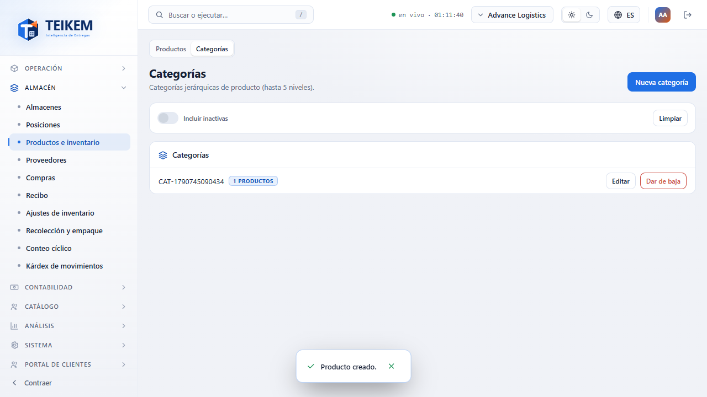

A simple tree with indentation per level (up to 5); each row shows how many products it has and **Edit**/
**Deactivate**/**Reactivate**; **New category** chooses the name and the parent category (or "root").

**Permission.** `inventory.view` (list, record, lots, serials, categories); **`inventory.manage`** to create/edit/
deactivate/reactivate product and category. Module `WMS_LOTSERIAL`.

**Validations and messages (product).**

| Field | Rule | Message |
|---|---|---|
| SKU | required | "SKU is required." |
| SKU | max. 60 characters | "SKU cannot exceed 60 characters." |
| SKU | no spaces or control characters | "SKU cannot contain spaces or control characters." |
| Name | required | "Product name is required." |
| Name | max. 200 characters | "Name cannot exceed 200 characters." |
| Barcode | max. 60 characters | "Barcode cannot exceed 60 characters." |
| Tracking | required | "Select the tracking type." |
| Cost / Price | not negative | "Cost and price cannot be negative." |
| Cost | ≤ 4 decimals | "Cost admits at most 4 decimals." |
| Price | ≤ 4 decimals | "Price admits at most 4 decimals." |
| Cost or price | ceiling | "Cost or price exceeds the maximum allowed." |
| Minimums | not negative | "Minimums cannot be negative." |
| Picking maximum | ≥ minimum | "The pick bin maximum must be greater than or equal to the minimum." |
| Picking minimum | requires a preferred bin in a PICKING zone | "A minimum pick quantity requires a preferred bin in a PICKING zone." |
| Weight / volume | not negative | "Weight and volume cannot be negative." |
| Weight | ≤ 3 decimals, < 1,000,000,000 | "Weight admits at most 3 decimals and must be less than 1,000,000,000." |
| Volume | ≤ 4 decimals, < 100,000,000 | "Volume admits at most 4 decimals and must be less than 100,000,000." |

On edit: changing the tracking, base unit or owner of a product with movements: **"Cannot be changed: the
product already has movements."** (409). Deactivation blocked with inventory on hand or open documents (409).

**Validations and messages (category).** "Category name is required."; "Category name cannot
exceed 150 characters."; more than 5 levels or a repeated name at the same level: rejected by the server (409);
deactivation blocked with active products or subcategories (409).

## Transfers & adjustments

**What it is for.** It is where the inventory is corrected by hand and where what has been corrected is looked up: **Adjustments** (increase or decrease the quantity of
a bin, with reason and note) and **Transfers** (move inventory from one bin to another, in the same warehouse or another). It shows
**all** adjustments and transfers, including those the system generates (count, receipt, putaway, replenishment), with filters to narrow down. It is
the screen that replaced "Inventory adjustments" in the menu.

**How to get there.** Menu **Warehouse › Transfers & adjustments** (right after Picking & packing), address
`/warehouse/transfers-adjustments`. Two tabs: **Adjustments** (the entry one) and **Transfers** (`?tab=transfers`).

**What you see (Adjustments).**

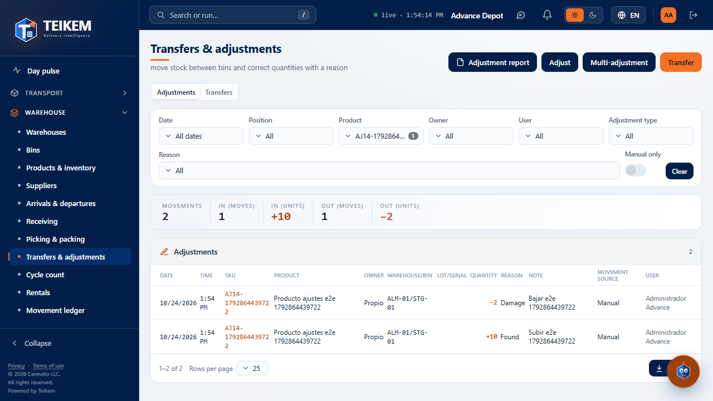

- **Header:** **Adjustment report** (PDF with the tab filters), **Adjust** and **Transfer** (these two, only with `inventory.adjust`).
- **Filters** (all sent to the server and go back to page 1): **Date** (from and to), **Bin** (2026-10-12; formerly Warehouse: dropdown with search and multiple selection, options “Code · Zone · Warehouse”), **Product** (search box by SKU or name;
  the selection stays as a pill removed with ✕), **Owner** ("Own" or a client), **Adjustment type** (All, Increase or Decrease),
  **Reason**, **Manual only** and **Clear**.
- **Summary** (strip of numbers, with the same filters): **Movements**, **In (moves)**, **In (units)**, **Out (moves)** and
  **Out (units)**.
- **"Adjustments" table:** Date, Time, SKU, Product, Owner, Warehouse/Bin, Lot/Serial, Quantity (with sign and color: blue in, red out),
  Reason, Note, Movement source (Manual, Count, Receipt, etc.) and User. A click on a row opens the **movement detail**
  (see "Movement ledger"). Footer with rows per page and **Export**.

**What you see (Transfers).**

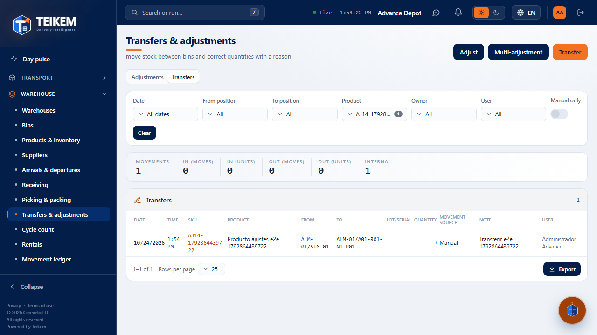

Filters: **Date**, **Source bin**, **Destination bin** (2026-10-12; formerly source and destination warehouse: dropdowns with search and multiple selection, options “Code · Zone · Warehouse”; the API receives `fromBinIds` and `toBinIds`), **Product**, **Owner**, **User** and **Manual only**. The summary adds **Internal**
(transfers that do not leave the filtered warehouses or bins; without a warehouse filter, every transfer is internal). Table:
Date, Time, SKU, Product, **Source** and **Destination** (warehouse/bin), Lot/Serial, Quantity (no sign: a transfer neither adds nor
subtracts), Movement source (Manual, Putaway or replenishment, Count…), Note and User. There is no Reason filter: transfers carry no
reason.

**What each button does.**

- **Adjust** opens the **Inventory adjustment** modal:

  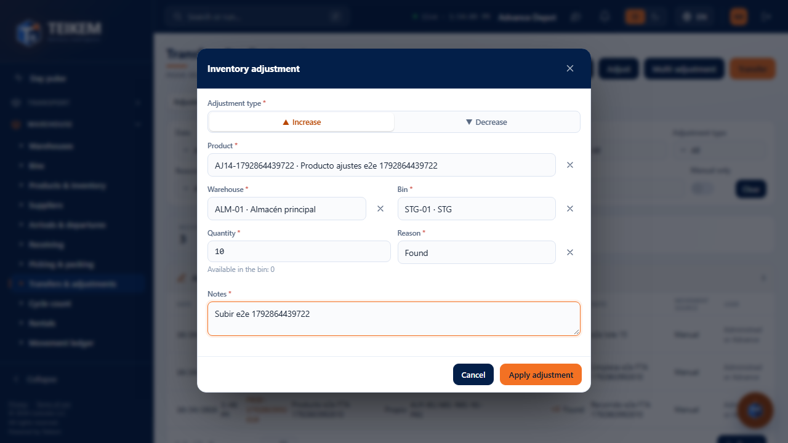

  1. **Adjustment type** (required): **Increase** brings inventory in; **Decrease** takes it out. The quantity is always written as a positive; the screen
     sets the sign.
  2. **Product**, **Warehouse** and **Bin**. Below the quantity appears **"Available in the bin: N"**. When **increasing** you
     can choose any bin of the warehouse; when **decreasing**, the list offers only the bins where the product has
     available stock, each with its quantity ("A-01 · A · 5 avail."), and the field is off until a product is chosen ("Choose a product
     first"). If you switch to Decrease, or change the product or the warehouse, and the chosen bin no longer has that product, it is removed.
  3. **Quantity** (greater than zero, up to 3 decimals; when **decreasing** it cannot exceed what is available).
  4. **Reason**, with a search box. It depends on the direction: **Found** only when increasing; **Damage**, **Loss** and **Expired** only when decreasing; the rest
     in both. If you change direction and the chosen reason is no longer valid, it is removed.
  5. **Notes** (required, up to 300 characters).
  6. If the product is **lot**-tracked: when increasing, the lot number; when decreasing, one of the lots in the
     bin is chosen (with what is available and its expiration). If it is **serial**-tracked: when increasing, the serials are typed (one per line); when decreasing,
     the serials that go out are chosen (the quantity is the number of serials).
  7. **Apply adjustment** saves and notifies **"Adjustment recorded ({qty})."**; the Ledger and the balances refresh by themselves.

  The same modal is used in the Ledger and, with the product already fixed, in the product record (**Add adjustment**).

- **Transfer** opens **Inventory transfer**, in this order: **Source warehouse** → **Source bin** → **Item** (list of what there is
  in that bin: product and lot, with what is available; searched by SKU, name or lot) → **Serials** (only if the product carries them) →
  **Destination warehouse** (by default the source one) → **Destination bin** → **Quantity** (capped at what is available; in serialized
  products it is the number of chosen serials) → **Notes** (optional). **Transfer** saves and notifies "Transfer recorded.".

- **Adjustment report** generates a PDF of the adjustments with **the same filters** it has on screen (dates, owner, type, reason, warehouse,
  product), not only with those of Products.

**Permission.** `inventory.view` and the **Warehouse and lot/serial** module (`WMS_LOTSERIAL`) to enter; **`inventory.adjust`** to Adjust and
Transfer. Without `inventory.adjust` the buttons do not appear.

**Validations and messages.** Those of the form (without HTTP code) are: "Choose whether the adjustment increases or decreases stock.", "Select a
product.", "Select a warehouse.", "Select a bin.", "Select a reason.", "Enter the adjustment quantity.", "The quantity
must be greater than zero.", "The quantity allows at most 3 decimals.", "You cannot decrease more than what is available in the bin ({qty}).",
"Enter the lot number." (when increasing), "Choose the lot." (when decreasing), "Enter at least one serial number.", in the transfer "Choose the
item to transfer.", "Choose at least one serial.", "You cannot transfer more than what is available in the bin ({qty}).", "The source and destination
cannot be the same bin.", and the required note of the adjustment ("Write a note explaining the adjustment."). The server's (409
"Insufficient inventory of {sku} in {bin}: available {x}, requested {y}." and others) appear above the form. All of them are in
manual 06, section 3, and in the [FAQ](../faq.md#batch-14--transfers--adjustments-cycle-count-ledger-reconciliation-and-needs-your-attention-batch-4-of-the-change-plan).

### Multi-adjustment (2026-10-12)

**Multi-adjustment** button, right after “Adjust” in *Transfers & adjustments*. **Only whoever has the `inventory.adjust.multi` permission sees it** (module WMS_LOTSERIAL); the permission **does not come in any role**: the company administrator (or the platform one) grants it, or removes it, from **Roles**. Without the permission the API answers 403. It is used to bring the inventory of **one warehouse** up to date by product and bin, several at once (the weekly inventory), in a single operation; the normal adjustment does not change.

**New adjustment tab**
1. Choose the **warehouse** (with only one active it is chosen by itself).
2. **Add products** (search box by SKU or name). Each one brings a block with **all the bins where there is stock** and the **In system** quantity.
3. Type, per bin, **On hand now**. The **Difference** column comes out by itself: `+4` (green), `−3` (red) or `=`. **Empty = that line is not touched**; equal to the system = no movement is generated either. “Add bin” adds a place where the system had nothing (goods were found there); “Remove” takes the product out of the document. **Lot** products carry one row per bin and lot.
4. Type the **note** (required, max. 300; the reason is fixed: “Physical inventory”) and press **Apply adjustment**: the confirmation shows the summary (“12 lines · +40 · −65 units · 5 products”).

**What happens on apply**
- The **AJM-######** document is created and **one movement of type Adjustment for each line with a difference** (reason “Physical inventory”). Balances, Ledger and reports see it like any adjustment; in the Ledger the source reads “**Multi-adjustment AJM-000123**” and the movement detail shows the document. The “Physical inventory” reason also serves as a filter in the adjustments list.
- **All or nothing**: if one line fails, none is applied and the screen marks the lines.
- The difference is calculated on the server against the balance at that moment. If what the screen saw is no longer what there is (goods came in or went out while counting), it answers **409** with the changed lines: the screen updates “In system”, keeps what was typed and you have to apply again. It is never applied on a different balance.
- Without lines with a difference no document is created. Resending the same request does not duplicate it (`Idempotency-Key`).

**History tab**: previous passes (number, date, warehouse, lines, products, up, down, user). A click on a row opens the detail with each line: **In system / On hand now / Difference**.

| Case | Code | Message |
|---|---|---|
| Empty note | 400 | "Write a note explaining the adjustment." |
| No quantity typed | 400 | "Enter the quantity on hand now in at least one bin." |
| Nothing with a difference | 400 | "No line differs from the system: there is nothing to adjust." |
| Negative on hand now | 400 | "What is on hand now cannot be negative." |
| Repeated combination | 400 | "That combination of product, bin and lot is repeated." |
| Serialized product | 400 | "Serialized products are not adjusted here: use the normal adjustment." |
| Lot product without lot / no lot with lot | 400 | "This product is lot-tracked: enter the lot of the line." / "This product is not lot-tracked." |
| Quarantine, on rent or cross-dock bin | 422 | "Bin {bin} is a quarantine, on rent or cross-dock bin: …" |
| The system changed while counting | 409 `stale_system_qty` | "The stock of {sku} in {bin} changed while you were counting: the system has {n}. Review and confirm again." |
| It would fall below what is reserved | 409 `insufficient_stock` | "{sku} in {bin} has {n} reserved: the stock cannot fall below that." |

It does not include: serialized products, reversal (it is corrected with another multi-adjustment), the device, or loading from Excel.

### Deactivate and Delete bins (2026-10-12)

A bin has three states: **Active**, **Inactive** (temporary) and **Deleted** (final). Both actions require `warehouse.manage`.

| Action | Effect | Can it be undone? | The code? |
|---|---|---|---|
| **Deactivate** (formerly “Dar de baja”) | It becomes inactive: it leaves the selectors and the normal lists; it appears with “Include inactive”. | Yes: **Reactivate**. | Stays reserved (it is the same bin). |
| **Delete** | It becomes deleted (and always inactive): it does not appear in **any** list or selector, not even with “Include inactive”. | **No** (reactivating it gives 409 “The bin was deleted and cannot be reactivated.”). | **Becomes free**: a new bin can use that code. |

- **One bin:** **Delete** icon (red trash can) in the row of the Bins tab of the warehouse record; confirmation “Position {code} is deleted for good…”. An active (empty) or an inactive one can be deleted.
- **Several at once** (a rack is reorganized): in **Bins**, check the boxes and use **Delete selected (N)**. It is **partial**: it deletes the ones that qualify and, when done, a summary says which were skipped and why; the skipped ones stay checked. Up to 500 at a time.
- **It is skipped or rejected (409) with the exact reason** if the bin: has inventory on hand or reserved (“Bin {code} has inventory; it cannot be deleted.”); has open warehouse tasks; is the warehouse's **default receiving bin** (“…change it first.”); is a **product's preferred bin** (“…change it first.”); or is in an **open cycle count** (Pending or Counted).
- **The history is kept:** a bin with past movements can be deleted; in the Ledger, the balances and the old documents it is shown with its code and the **“(deleted)”** mark.
- **Reusable code:** creating a bin with the code of a **deleted** one works. With that of an **inactive** one it gives 409 “An inactive bin with that code already exists: reactivate it or delete it.”; with that of an active one, “A bin with that code already exists in the warehouse.”.
- API: `DELETE /api/v1/warehouses/{id}/bins/{binId}` (204) and `POST /api/v1/warehouses/{id}/bins/delete` with `{ binIds: [...] }` → `{ deleted: [{ binId, code }], skipped: [{ binId, code, reason }] }`.

## Movement ledger: Ledger, Balances and Reconciliation

**What it is for.** It looks up the available inventory in each bin (**Balances**), its movement history (**Ledger**) and compares the Ledger
against the balances (**Reconciliation**). It has no status of its own: it is a book of movements. Adjustments and transfers are made from
**Adjust** and **Transfer** (also here, in the header).

**How to get there.** Menu **Warehouse › Movement ledger**, address `/warehouse/kardex` (the old address `/warehouse/inventory`
leads there). Tabs **Ledger** (the entry one), **Balances** (`?tab=balances`) and **Reconciliation** (`?tab=reconciliation`).

### Shared filters and summary

**The filters are the same on the three tabs and are kept when you switch tabs.** Each tab applies only some of them; the ones it does not
apply are shown **dimmed** and a note under the bar names them ("Not applied to Balances (they only change the movement summary): …").

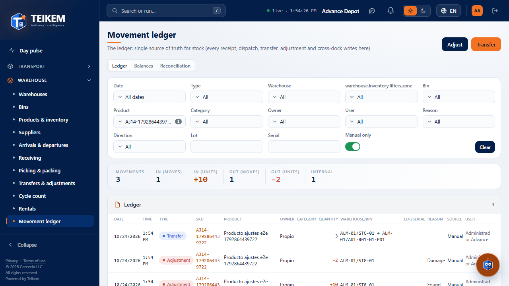

| Filter | Ledger | Balances | Reconciliation |
|---|---|---|---|
| **Date** (from and to; Puerto Rico days) | Yes | Summary only | Yes (detection date) |
| **Type** | Yes | Summary only | No |
| **Warehouse**, **Bin** (searches all warehouses by code, zone or warehouse), **Product**, **Category** | Yes | Yes | Yes |
| **Owner** ("Own" or a client), **Reason**, **Direction** (In or Out), **Manual only** | Yes | Summary only | No |
| **User** (who made the movement; several at once, with a search box): the people with movements (deactivated people with history are marked “(inactive)”) and “System (no user)” for what no person did (automatic closures, legacy loads), the latter only if such movements exist. It is also in **Transfers & adjustments** | Yes | No | No |
| **Lot** | Yes | Yes | No |
| **Serial** | Yes | Summary only | No |
| **Include zero**, **Only with available** | — | Yes | — |
| **Status** (of the discrepancies; **Pending** by default) | — | — | Yes |

**Summary.** A strip of numbers with **the same filters** as the table: **Movements**, **In (moves)**, **In (units)**, **Out (moves)**,
**Out (units)** and **Internal**. In **Balances**, **On hand** and **Available** are added. In **Reconciliation** the strip shows **Pending**,
**In the list** and, on the right, the state of the automatic check.

**Source document.** If you arrive from a link with a document (`?refEntity=` and `?refId=`, for example from a closed count) a
pill "Document: … #…" appears with an ✕ to remove it.

### Ledger

Columns: **Date**, **Time**, **Type** (colored chip: Receipt, Dispatch, Transfer, Adjustment, Cross-dock), **SKU**, **Product**, **Owner**,
**Category**, **Quantity** (with sign and color), **Warehouse/Bin** (transfers show source → destination), **Lot/Serial**, **Reason**,
**Source** (Manual, Count, Receipt…) and **User**; plus a free-text search box. Clicking a row opens the **movement detail**
(`?txn=<id>`).

### Detail of a movement

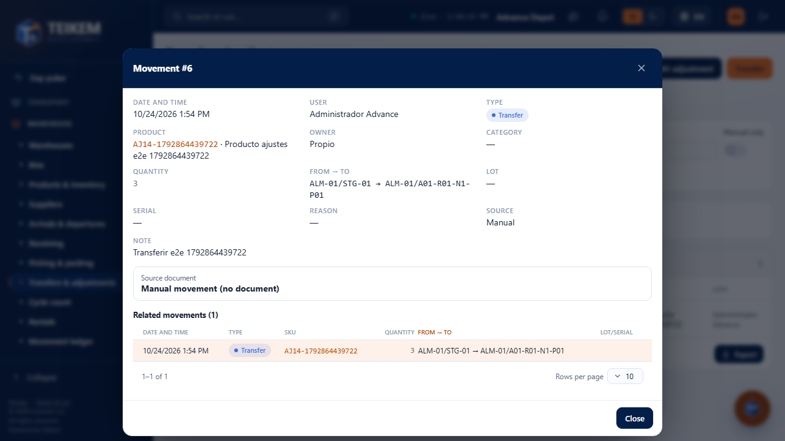

Read-only modal with: **Date and time**, **User** ("System" if the system did it), **Type**, **Product** (SKU as a link and name), **Owner**,
**Category**, **Quantity**, **From → to**, **Lot** (with "expires …"), **Serial**, **Reason**, **Source** and **Note**. Below, the **Source document**:
its number, its status, the date and the party (client or supplier) and an **Open** button that takes you to the receipt, the pick, the count, the purchase
order, the order or the product; the button **only appears if you have the permission and the module of that screen**. A warehouse task has
no screen of its own: it also shows the **Task document** (its parent document) with its Open. A movement made by hand says
"Manual movement (no document)". At the end, **Related movements (N)**: those of the same document or, if it has none, those of the same entry
(up to 200; if there are more, it warns "Showing the first 200 related movements."). The modal does not embed the body of the document: to
see it, **Open**.

### Balances

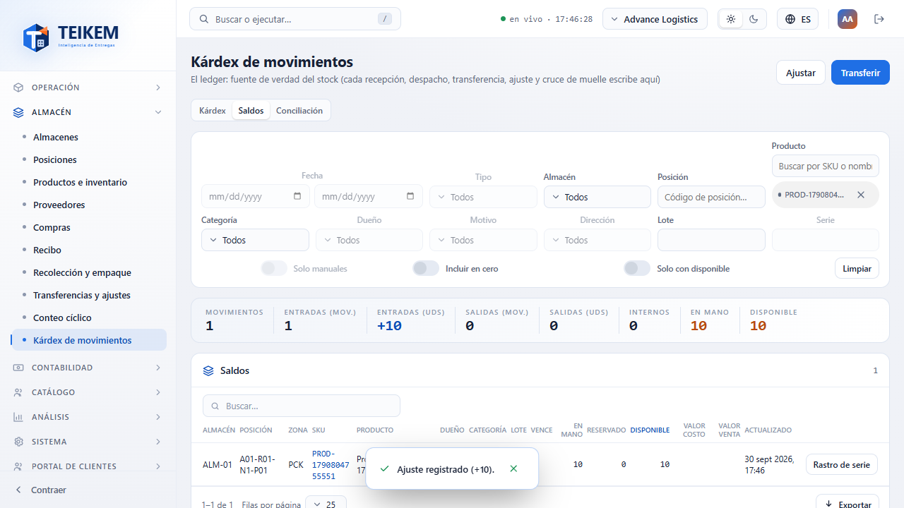

Columns: warehouse, bin, zone, SKU, product, **owner**, **category**, lot, expiration, on hand, reserved, available, cost value, sale
value and updated. Each row can open **Genealogy** (if it has a lot) or **Serial trace**. Balances does not filter by Owner (the filter only
changes the movement summary).

### Reconciliation

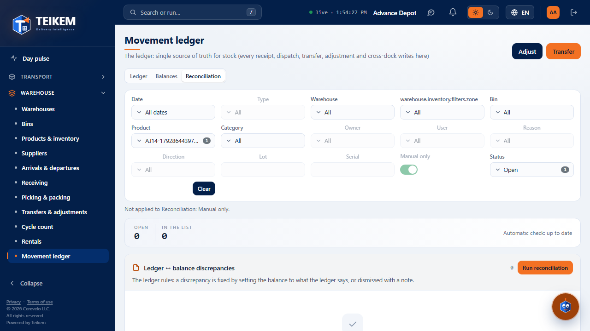

Lists the **ledger ↔ balance discrepancies**: the balance of a bin (or of a whole product) does not match what the movements add up to. It is not a
physical difference on the shelf. See manual 06, section 3.3, and the FAQ of Batch 14.

- **Strip:** **Pending** and **In the list** and, on the right, **Automatic check: up to date**, **N queued** or **off**.
- **Run reconciliation** (`inventory.adjust`): checks the balances against the ledger now, **for the products in the Product filter or, if there is
  none, for all of them**, and saves the discrepancies. It notifies "Reconciliation finished." and writes the result: "Reconciliation of {date}: {n}
  products and {n} balances checked · {n} new discrepancies · {n} still open · {n} corrected themselves.".
- **Table "Ledger ↔ balance discrepancies":** Detected, SKU, Product, Warehouse/Bin ("Product total" if the discrepancy is on the total), Lot,
  **Ledger**, **Balance**, **Difference** (balance − ledger, with sign and color), Type and Status (chip Pending, Resolved, Dismissed or Corrected
  itself). With no discrepancies: "No open discrepancies" / "The ledger and the balances match with these filters." Each pending row has the icons
  **Fix the balance from the ledger** (only on those of type balance by bin) and **Dismiss** (with `inventory.adjust`); a click on the row,
  or on either of the two icons, opens the detail.
- **Discrepancy detail** (modal "Discrepancy · {sku}"): the large **Difference** with the status chip; product, where, lot, type, ledger, balance,
  **Reserved today**, who detected it (Automatic, Manual, Migration), when and how many checks; a note reminding you that a discrepancy is not
  a physical difference and that an adjustment or a count does not fix it; if it is closed, who closed it, when, "from → to" and their note; a **Note
  (required to dismiss)** with the buttons **Fix the balance from the ledger** and **Dismiss** (only if it is Pending and you have
  `inventory.adjust`); the **latest movements of the bin** (a click opens the movement detail) and the **history**.
  - **Fix the balance from the ledger** sets the balance equal to what the movements give, **without creating a movement**. It notifies "Balance fixed
    from the ledger."; if it already matched, "The balance already matched; the discrepancy closed itself.".
  - **Dismiss** requires the note ("Write a note explaining why the discrepancy is dismissed.") and notifies "Discrepancy dismissed.".
  - A discrepancy on the **product total** has no fix button: it is resolved by fixing the per-bin ones, or dismissed with a note.
  - After fixing a per-bin one, the screen offers **Create a count for that bin** (with `warehouse.count.capture`): it creates a Pending count
    and offers **Open count {number}**.

**Permission.** `inventory.view` (Ledger, Balances, read-only Reconciliation, details, genealogy and serial trace); **`inventory.adjust`** for
Adjust, Transfer, **Run reconciliation**, Fix and Dismiss; **`warehouse.count.capture`** for "Create a count for that bin".
Module `WMS_LOTSERIAL`.

**Validations and messages.**

| Field | Rule | Message |
|---|---|---|
| Ledger range | from ≤ to | "The 'from' date cannot be later than the 'to' date." |
| Note when dismissing | required, up to 500 characters | "Write a note explaining why the discrepancy is dismissed." / "The note can have at most 500 characters." |
| Fix with a reservation greater than the ledger | 409 | "The ledger gives {ledger} for {sku} in {bin}, less than what is reserved ({reserved}); release the reservation before fixing the balance." |
| Fix with a negative ledger | 409 | "The ledger gives a negative balance ({ledger}) for {sku} in {bin}; review the movements before fixing the balance." |
| Resolve one that is already closed | 422 | "The discrepancy is already closed; it is read-only." |
| Fix the product total | 422 | "This discrepancy is for the product total: fix the per-bin discrepancies, or dismiss it with a note." |
| Two checks at the same time | 409 | "The reconciliation collided with another simultaneous check; try again." |

## Receiving: receipts and arrival notices

**What it is for.** It records the goods that enter the warehouse: blind receipts (with no prior document), return receipts,
against a client's arrival notice (ASN), or against your own purchase order. Since Batch 13 everything is done on **a
single screen**: the list of receipts on the left and, on the right, the detail of the selected receipt, with its lines, its
**Confirm receipt** button and its putaway tasks. The receipt's own record no longer exists.

**How to get there.** Menu **Warehouse › Receiving**, address `/warehouse/receipts`. It has three tabs:

| Tab | Address | What it shows |
|---|---|---|
| **Receipts** | `/warehouse/receipts` | The receipts and the detail of the selected one. |
| **Arrival notices** | `/warehouse/receipts?tab=asns` | The clients' arrival notices. |
| **Pending putaway** | `/warehouse/receipts?tab=putaway` | The confirmed receipts that still have putaway tasks. |

The selected receipt goes in the address (`?receipt=…`), so the link can be copied. The old address of the record
(`/warehouse/receipts/:publicId`) now leads to the screen with that receipt selected, and a receipt's event in Recent activity
opens the receipt the same way. Switching tabs clears the selected receipt.

### Receipts tab

**Filters** (on top; all go to the server and return to page 1; **Clear** removes them):
- **Warehouse** (one, with a search box), **Status** and **Type** (dropdowns with a search box, several can be chosen), **Created** (date range).
- **Product** (several, with a search box; includes deactivated products, because it is history).
- **Difference**: **Short** (some line received less than expected), **Over** (some line received more) or **No variance**;
  several can be chosen.

**The list (left).** Title "Receiving" with the total. On top a free-text search box ("Number, notice, client, purchase order or
supplier"; it also searches the carrier and the reference). Each receipt shows:
- The number (`REC-00007`) and, on the right, its **status** in a colored chip.
- The sender: the supplier (purchase order) or the client (notice); on blind and return receipts, the type.
- A faint line with carrier · date (the expected arrival, or the creation date) · origin (**Purchase order**, **Client**, **Blind**,
  **Return**) with its document · reference · "N to put away" if it has open putaway tasks.

The most recent go first. The footer of the list has the range, **Rows per page**, ‹ ›, and **Export** (everything that matches the
filters, not just the page; see "All tables"). **One click** selects the receipt; **double-click** opens its header in a modal (the
same one as the pencil in the detail). A **direct to bin** receipt carries the **Direct** tag next to its origin. **Export** outputs each receipt **with its lines** (see "Export: company, filters, dates and numbers").

**The detail (right).**

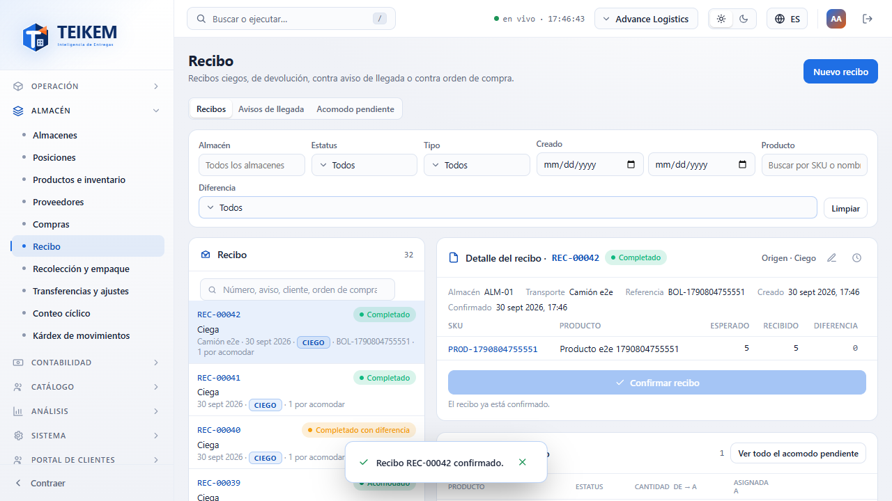

- **Title:** "Receipt detail · REC-…" with its status; on the right, the origin ("Origin · Purchase order: PO-…",
  "Origin · Client: …" or "Origin · Blind"), the **pencil** (Edit the receipt header; if it is confirmed, View the receipt
  header) and the **clock** (History: the receipt's status changes).
- **Receipt data:** warehouse, receiving (the default bin), dock, carrier, reference, expected arrival, created and
  confirmed (only those that have data).
- **Receipt lines:** SKU, Product, Expected, Received and Difference (0 in gray; other than 0 in red, with sign: `−2`, `+3`).
- **Confirm receipt** (wide button, `warehouse.receive`) and, if the receipt is confirmed, the **Putaway tasks** panel.

### Capturing the lines

The lines are captured **directly in the detail table**, while the receipt is open (Expected, Receiving or
Discrepancy) and you have `warehouse.receive`. One row is saved at a time, when you leave the field or press Enter; while it saves,
the row says "Saving…". Each save can change the receipt's status (the chip updates on its own).

- **Blind or return receipt.** Each row has **Product** (search by SKU or name), **Expected**, **Received** and a
  trash can; there is always an **empty row at the end** to keep capturing (up to 200 lines). When you type the **received** quantity, the
  **expected one is copied automatically** while it is empty or 0; if you type another expected quantity (for example, the one on the invoice), it stops
  being copied. Quantities with a comma or a period, up to 3 decimals. The copy happens only on screen: once the line is saved with its
  expected quantity, changing the received one does not move it again, and the difference is visible.
- **Receipt against an arrival notice or a purchase order.** The **expected quantity comes from the document and is read-only**; only the
  **received** quantity is captured. **There is no "Add item"** on the web: a line that was not in the document can only be recorded through the app or the
  API. The document's lines are not removed: if nothing arrived, capture 0.
- **Lot- or serial-tracked products.** The row shows the **Lot and serials** icon, which opens "Lot and serials · {product}": lot with
  manufacturing and expiration dates, serial numbers (one per line) and the receiving bin of that line. For a serial-tracked product **the
  received quantity is the number of serials captured** ("For a serial-tracked product, the received quantity is the number of serials captured: N.").
- **Remove a line** (trash can, only lines that do not come from the document and have no cross-dock): asks for confirmation ("Remove the
  {product} line from the receipt?") and notifies "Line removed.".

Under the table, while the receipt is open, the notes appear:
- "Scan or type each line to record what was received" (for those who can capture).
- When some line differs, a highlighted notice. On a receipt with a document: "What was received differs from what was expected — on confirming, the
  difference is recorded as an inventory adjustment." On a blind or return receipt: "What was received differs from what was expected — on confirming,
  what was received goes into inventory and the receipt becomes “Completed with variance” (no adjustment)."

### Confirming the receipt

**Confirm receipt** opens a confirmation ("Receipt {number} is confirmed in full: inventory is posted and putaway tasks
are created. It can no longer be changed.") and, on accepting, notifies "Receipt {number} confirmed.". The button is **disabled** and below it
says why:

| Reason shown below the button | What to do |
|---|---|
| "The receipt is already confirmed." | Nothing: a Completed, Completed with variance or Put away receipt is not confirmed again. |
| "Add at least one line to confirm." | The receipt has no saved lines. Add one (or delete the receipt if it was created by mistake). |
| "Saving lines…" | Wait for the row to finish saving. |
| "Some lines are not saved: leave the field or press Enter to save them." | Something has been typed that has not been saved; leave the field or press Enter. |
| "Fix the marked lines before confirming." | Some row has an error (the message appears under its field); fix it. |

If the server rejects the confirmation with per-line errors (for example, the lot is missing), the message appears on that line's row.

### Direct to bin receipt (Batch 16)

**What it is for.** In a warehouse with **Direct to bin** mode (warehouse record → Data → Receiving) the receipt **does not go through the receiving bin**: each line carries the **bin where it is stored** and, on confirming, the
goods go in there, **with no putaway tasks**. The rules, messages and statuses are in [manual 06, section 4.1](../06-inventario-y-almacen.md#41-receipt-direct-to-bin-batch-16).

**What it looks like.**
- **Receipt mode.** The header has **Receiving mode** ("Defaults to the warehouse's; it can only change while the receipt is open."). When creating a receipt it follows the selected warehouse's mode as long as you do not choose another (the
  field says "The warehouse's"). On a direct receipt **the Receiving bin is hidden** from the header and from the **Lot and serials** modal: the goods do not go through there.
- **Chips.** The detail has the **Direct to bin** chip next to the status; the list, the **Direct** tag.
- **"Target bin" column.** The grid of lines adds a column with a selector ("Choose where it is stored…"). **It does not offer receiving or cross-dock bins** (quarantine, yes) and puts the
  **suggested** ones first. **It is saved on choosing**, like the rest of the row. Under the selector, if the chosen bin is not the suggested one, the hint **“Suggested: {bin} · {reason}”** appears (for example, "Suggested: R-02 · Empty reserve").
  In a narrow panel (under 760 px) each line is shown as a card.
- **Capacity warning.** If the received quantity is more than the free space of the chosen bin, an orange chip **“Exceeds the capacity of {bin}: {n} fit”** appears. **It does not block**: you can save and confirm. The free space is
  the capacity minus the bin's stock and minus what other lines of the same receipt already assign to it; with no capacity configured there is no warning.
- **Use suggested bins.** A button under the table (with `warehouse.receive`, with the receipt open and some line still to assign) assigns to each line that receives something and has no bin the **first suggested one where it fits**. It notifies
  **“A bin was assigned to {n} line(s); {m} without a suggestion.”**: choose the {m} by hand. **Nothing is filled in automatically**: only when you press it.
- **Confirm.** The button is turned off with the reason **“The target bin is missing on {n} line(s).”** while some line that receives something has no target. The confirmation says: "Receipt {number} is confirmed in full: each line
  goes to its target bin, with no put-away tasks. It can no longer be changed." Afterwards the receipt is **Put away** (it passes through Completed at the same moment, and the history keeps both steps) and there are no putaway tasks to work.
  A lot-tracked product without a lot and a line with an assigned cross-dock are not asked for a target.
- **Returns.** On a return receipt, the first suggestion is a **quarantine** bin ("Quarantine (return)") if the warehouse has one.

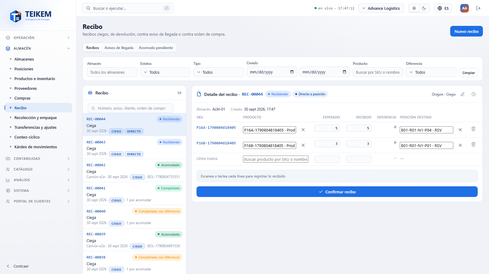

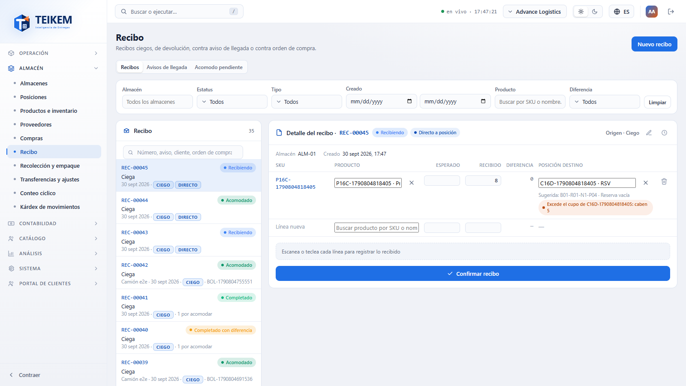

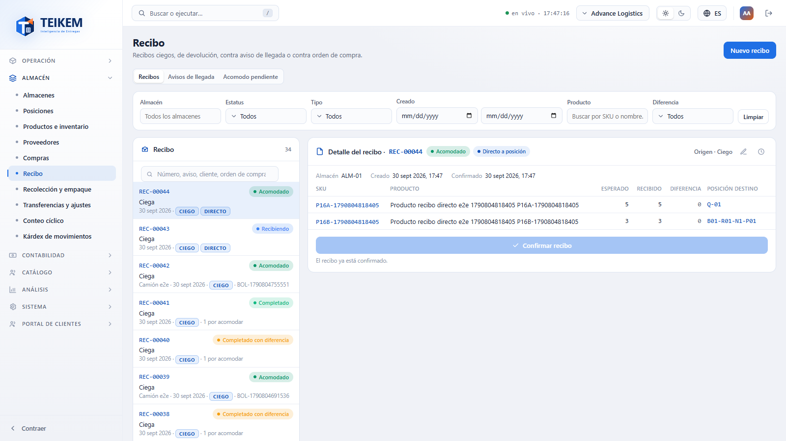

| Reason shown under **Confirm receipt** (direct receipt) | What to do |
|---|---|
| "The target bin is missing on {n} line(s)." | Choose the bin of each line that receives something, or press **Use suggested bins**. |

### Receipt header (modal)

**New receipt** (screen header, `warehouse.receive`) and the **double-click** or the **pencil** of a receipt open the same modal.

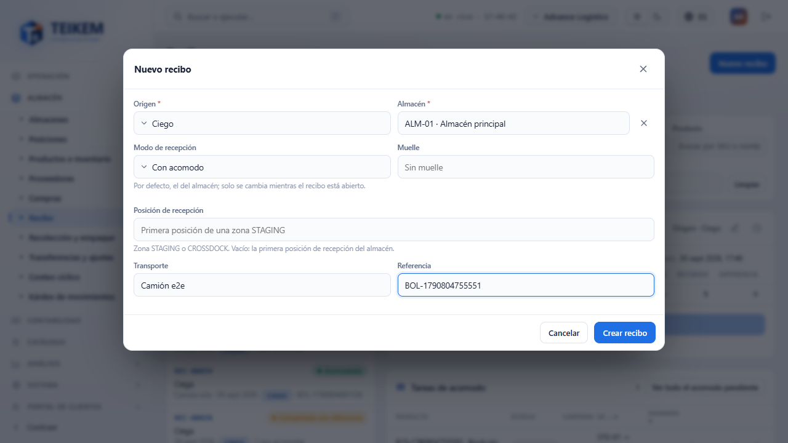

| Field | Rule |
|---|---|
| **Origin** | Blind, Return, Against advance shipping notice or Against purchase order (the latter only if you have `purchasing.receive` and the Purchases module turned on). When editing, Blind ↔ Return only on receipts without a document. |
| **Warehouse** (required) | When editing, it only changes on a receipt without a document and without lines. |
| **Arrival notice** / **Purchase order** | Only when creating with that origin: pending notices (without a receipt) or Sent or Partially received orders **of the selected warehouse**. With **Receive** from a notice, the origin, the warehouse and the notice come already selected. |
| **Receiving mode** (Batch 16) | **With put-away** or **Direct to bin**. When creating, it follows the selected warehouse's ("The warehouse's"); when editing, it shows the receipt's and can only be changed while it is open. |
| **Receiving bin** | STAGING or CROSSDOCK zone. Empty: the warehouse's default bin or, if it has none, the first bin of a STAGING zone. It becomes the default bin of the lines. **It is not asked for on a direct receipt.** |
| **Dock** | Optional; the warehouse's docks. |
| **Carrier** and **Reference** | Free text, up to 80 characters. |

- **Create receipt:** notifies "Receipt REC-… created." and the receipt is left **first in the list, selected and with its detail ready**, even if the
  filters exclude it (until a filter changes). A blind or return receipt is born **Expected** with the table empty for capturing; against a
  notice or purchase order it is born **Receiving** with the document's lines (received equal to expected).
- **Save** (when editing): sends only what changed and notifies "Receipt {number} header saved."; with no changes, it closes without
  calling the server. On a receipt with a document the notice "With an advance ship notice or a purchase order, the origin, the warehouse and the
  expected quantities come from the document." appears; if the warehouse cannot be changed, "The warehouse can only be changed on a receipt without a document and without
  lines.".
- **Delete receipt** (red; only open and with no assigned cross-dock): "Delete receipt {number}? If it came from a client notice,
  the notice becomes pending again; if it came from a purchase order, the order can be received again." It notifies "Receipt {number}
  deleted.".
- **Read-only:** if the receipt is already confirmed or you do not have `warehouse.receive`, the modal shows the data as text and only
  has **Close**. When confirmed, it says "The receipt is already confirmed: its header cannot be changed.".

### Arrival notices tab

List of the notices (ASN) that clients announce.
- **Filters** (all on the server): **Warehouse**, **Owning client** (with a search box), **Reference** (contains; it waits a moment after
  the last keystroke) and **Expected arrival** (range, both ends included; a notice without a date does not fall in a range). This tab
  **has no free-text search box**.
- **Table** (25 per page, sorted by header): Notice (`#id · reference`), Warehouse, Client / PO, Expected arrival, Status,
  Lines and **Receipt** (link to the receipt on the Receipts tab, if it already has one). The server returns up to 200 notices per query.
- **New notice** (`warehouse.receive`): warehouse, **Owning client** (required), Reference (up to 80), Expected arrival and the
  lines (Client's product, **Expected quantity** greater than zero and Lot), up to 200. **Add line** adds another.
- **Receive** (row of a pending notice without a receipt): opens **New receipt** with the notice and its warehouse already selected.
- **Cancel notice** (pending notice): "Cancel advance shipping notice #{id}? It can no longer be received." It notifies "Advance shipping
  notice cancelled.". If the notice already has a receipt, the server rejects it (409): delete the receipt first.

> **Screenshot pending:** Arrival notices tab with its filters and the New notice modal.

### Pending putaway tab

Shows the **Completed** or **Completed with variance** receipts that still have putaway tasks to close. It has the
same filters and the same list as the Receipts tab (here the Status filter only offers those two). On the right, **the putaway
tasks of the selected receipt**, with the actions of each row (see the screenshot and the actions under "Warehouse tasks", below). When the **last** task closes, the receipt becomes
**Put away** and leaves this list. Double-clicking a receipt opens its header (read-only: it is already confirmed).

**Pending putaway in a direct warehouse (Batch 16).** If the **Warehouse** filter is a **direct to bin** warehouse, the notice **“{code} receives direct to bin: only receipts from before the change or
with cross-docking appear here.”** appears. Direct receipts do not generate putaway tasks, so they are not listed here; they are Put away on confirming. The receipts that already had tasks when the mode changed keep appearing.

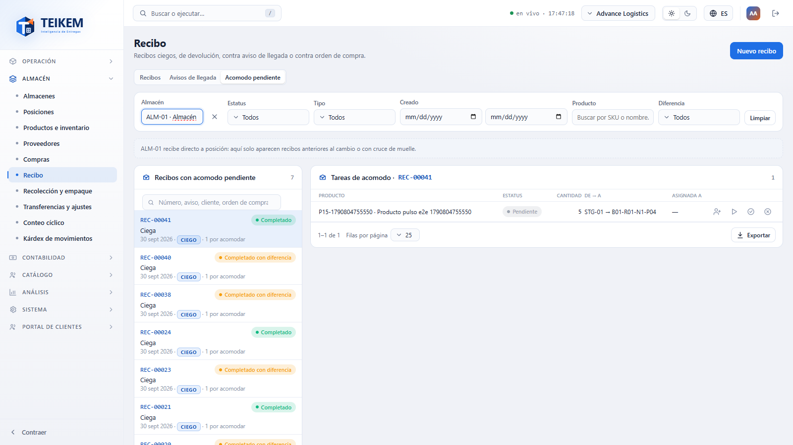

**Permission.** `inventory.view` (the whole module read-only); **`warehouse.receive`** to create, edit the header, capture
lines, confirm, delete and manage notices, and start and complete the putaway tasks; **`warehouse.manage`** to assign and
cancel them. Receiving against a purchase order also requires `purchasing.receive` + the Purchases module. Module `WMS_LOTSERIAL`.

**Statuses and transitions.** The status **is not changed by a button**: the system moves it according to what you capture.

| From → to | Who | What triggers it | What is blocked afterwards |
|---|---|---|---|
| (new) → **Expected** | `warehouse.receive` | Creating a blind or return receipt without lines | Confirm (there are no lines) |
| Expected → **Receiving** | `warehouse.receive` | Saving the first line | — |
| Receiving ↔ **Discrepancy** | `warehouse.receive` | Each saved line: if any differs from the expected quantity, Discrepancy; if all match, Receiving | — |
| Receiving → **Completed** | `warehouse.receive` | **Confirm receipt**, with no variance | Changing the header, the lines, confirming and deleting |
| Discrepancy → **Completed with variance** | `warehouse.receive` | **Confirm receipt**, with a variance | Same as Completed |
| Completed or Completed with variance → **Put away** | the system | The last putaway task closes (or there was nothing to put away) | — |
| Receiving or Discrepancy → **Put away** (**direct** receipt, Batch 16) | `warehouse.receive` | **Confirm receipt**, with a target bin on each line that receives something | Completed or Completed with variance and **Put away** at the same moment; the history keeps both steps; no tasks |

Against a notice or purchase order the receipt **is born in Receiving**. A receipt **never goes back to Expected**: if all its
lines are deleted it stays in Receiving, and to undo it you delete the receipt. The technical detail (effects on the ledger, purchase order and
cross-dock) is in manual 06, section 4.

**Validations and messages.**

| Field | Rule | Message |
|---|---|---|
| Warehouse | required | "Choose the warehouse." |
| Arrival notice / Purchase order | required depending on the origin | "Choose the advance shipping notice." / "Choose the purchase order." |
| Purchase order (list) | no permission to view orders | "Your user cannot view purchase orders." |
| Arrival notice / Purchase order | warehouse first | "Choose the warehouse first." |
| Carrier / Reference | up to 80 characters | "The carrier allows at most 80 characters." / "The reference allows at most 80 characters." |
| Product (row) | required | "Enter the product." |
| Received quantity | required, not negative | "Enter the received quantity." / "The received quantity cannot be negative." |
| Expected quantity (blind or return) | not negative | "The expected quantity cannot be negative." |
| Quantity | number, up to 3 decimals | "Enter a number." / "The quantity allows at most 3 decimals." / "The quantity exceeds the allowed maximum." |
| Lot (lot-tracked product) | required | "Product {sku} is lot-tracked: enter the lot." |
| Serials (serial-tracked product) | as many as the quantity, no repeats | "Product {sku} is serial-tracked: enter {qty} serial number(s) (there are {n})." / "Serial number '{serial}' is repeated." |
| Receipt lines | max. 200 | "The receipt allows at most 200 lines." |
| Notice: client | required | "Enter the client that owns the goods of the notice." |
| Notice: expected quantity | greater than zero | "The expected quantity must be greater than zero." |
| Notice: lines | max. 200 | "An advance shipping notice allows at most 200 lines." |
| Receipt not found | the link points to a receipt that no longer exists | "Receipt not found." |
| Confirm / delete / edit a confirmed receipt | the server rejects it (422) | "Receipt {n} was already confirmed; it cannot be changed." |
| Direct receipt: confirm with a line without a target | the server rejects it (400) | "Enter the target bin of {sku}: the receipt goes direct to bin." (under that line's row) |
| Direct receipt: receiving or cross-dock target bin | the server rejects it (400) | "Bin {code} is in a {zoneType} zone; the target bin must be a storage bin." |
| Direct receipt: deactivated bin or zone | the server rejects it (422) | "Target bin {code} is deactivated." / "The zone of target bin {code} is inactive." |

The other server messages (type change with a document, warehouse with lines, expected quantity on a receipt with a document, assigned
cross-dock, etc.) appear as they are on the form or under the row's field; they are all in manual 06, section 4, and in the
[FAQ](../faq.md#batch-13--receiving-batch-3-of-the-change-plan-status-cycle-editable-header-expected-in-blind-and-filters).

## Warehouse tasks

**What it is for.** All the physical warehouse work the system generates: putaway after a receipt, replenishment of
picking bins, cycle counting and cross-dock. **There is no longer a "Warehouse tasks" screen or menu item** with
all the tasks together: each type is worked on the screen it belongs to.

**How to get there.**

| Task type | Where it is worked | What you can do there |
|---|---|---|
| **Putaway** | **Receiving › Pending putaway**, and the "Putaway tasks" panel in the detail of a confirmed receipt | Assign, start, complete and cancel |
| **Replenishment** | **Picking & packing › Replenishment** (`?tab=replenish`), with the **Run replenishment** button | Assign, start, complete and cancel |
| **Count** | **Cycle count › list of counts** (the "Count tasks" tab was removed in Batch 14) | Assign with the row icon; the task is completed when the count is **confirmed** |
| **Cross-dock** | **Cross-dock › Cross-dock tasks** | Assign and start; they are completed by moving the assignment from the plan |

The old address `/warehouse/tasks` leads to **Receiving › Pending putaway** (replenishment tasks are not reached that way).

**What you see.**

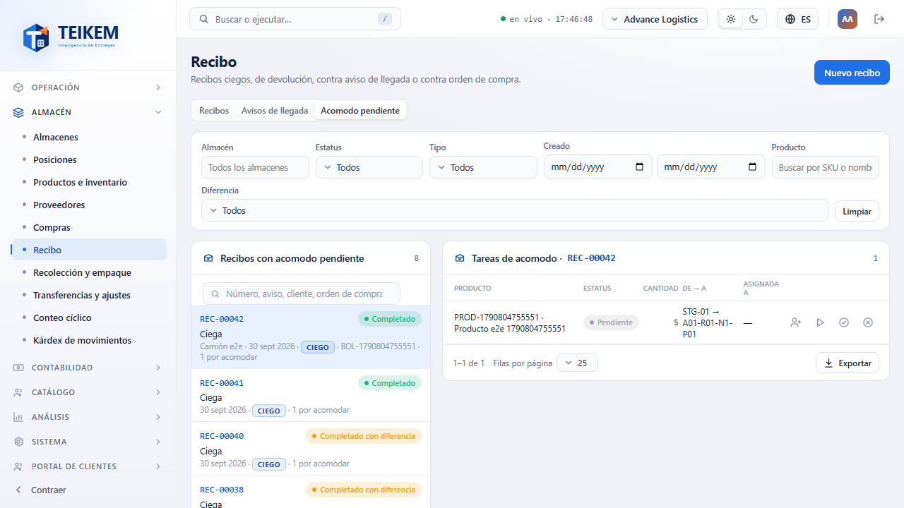

The receipt's putaway task table is compact: columns **Product**, **Status**, **Quantity**, **From → to** (receiving
bin → target bin) and **Assigned to**, plus the actions column. Headers only break between words, never
inside one. In the Replenishment, Count and Cross-dock queues the table also has **Type** (if the queue mixes types),
**Priority**, **Warehouse**, **Reference** and **Created**, and these filters: **Warehouse**, **Status**, **Assigned to me** and **Include
closed**.

**What each action does.** In every queue the actions of a row are **icons with a tooltip** (the accessible name is that of the
action):

| Icon | Action | When it appears | Permission |
|---|---|---|---|
| Person with "+" | **Assign** | Open task | `warehouse.manage` |
| Triangle ▶ | **Start** | Pending task | That of the task type (see below) |
| Circle with a check mark | **Complete** | Open task that is completed from the queue | That of the task type |
| Circle with an X (red) | **Cancel** | Open Putaway or Replenishment task | `warehouse.manage` |

- **Assign** opens "Assign task": choose the user (or "Unassigned"). It notifies "Task assigned.".
- **Start** moves the task to in progress and notifies "Task started.".
- **Complete** opens "Complete task": **Target bin** (empty uses the suggested one), **Quantity** (empty completes the total; the
  remainder becomes a new task) and **Serial numbers** if applicable. It notifies "Task completed.".

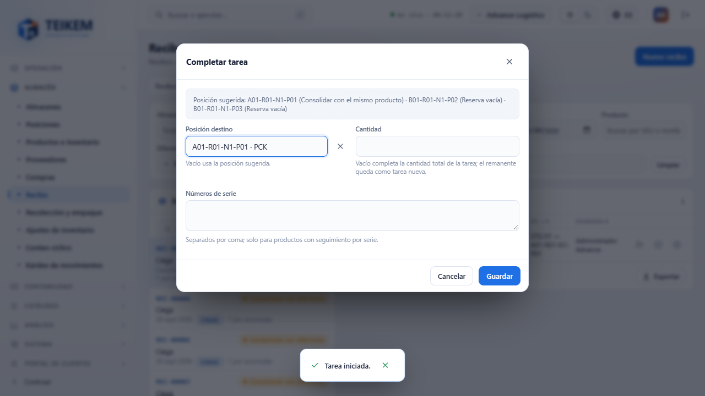

- **Cancel** asks for confirmation ("The task will be cancelled and cannot be resumed.") and notifies "Task cancelled.".
- **Run replenishment** (header of Picking & packing, Replenishment tab): choose the warehouse and it creates the replenishment tasks
  that are needed. It notifies "{count} replenishment tasks were created.".

**When the last putaway task** of a receipt closes (completed or cancelled), the receipt moves on its own to **Put away** and leaves the
Pending putaway tab.

**Permission.** `inventory.view` (see the tasks); **`warehouse.manage`** (assign, cancel); **Start** and **Complete** require the
permission of the task type: `warehouse.receive` (Putaway), `warehouse.pick` (Replenishment and the Run replenishment button), `warehouse.count`
(Count: since Batch 14 the web only assigns the task, with `warehouse.manage`, and completes it when the count is confirmed) or `warehouse.crossdock` (Cross-dock). Module `WMS_LOTSERIAL`.

**Statuses and transitions.** Pending → In progress (**Start**) → Done (**Complete**); Cancelled is a detour from
Pending or In progress, only for Putaway and Replenishment. No manual pipeline transition.

**Messages you may see.**

| Message | When it appears |
|---|---|
| "Your user cannot look up the list of users." | When opening **Assign** without permission to see users |
| "Empty uses the suggested bin." / "Empty completes the task's full quantity; the remainder becomes a new task." | Help of the **Complete** form |
| "There is no suggested bin for this task." | The task (usually not Putaway) brings no suggestion from the server |
| "This receipt has no put-away tasks." | A receipt selected in Pending putaway with no tasks |
| "Select a receipt to see its put-away tasks" | No receipt selected in Pending putaway |
| "{count} replenishment tasks were created." | When **Run replenishment** finishes |

## Cycle count

**What it is for.** Takes a "snapshot" of the on-hand balance of a bin, lets you capture what was counted and **confirm the adjustment in a single step**
against the current balance. Since Batch 14 the screen has **two panels**: the list of counts on the left and the selected count on the
right; there is no longer a separate record or a "Count tasks" tab.

**How to get there.** Menu **Warehouse › Cycle count**, address `/warehouse/cycle-counts`. The selected count goes in `?count=<id>` (the
old addresses `/warehouse/cycle-counts/:id` redirect there).

**What you see.**

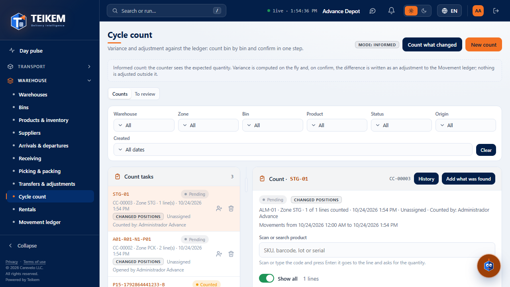

- **Header:** the **Mode: informed** mark, and (with `warehouse.count`) **Count what changed** and **New count**. Below, a note: whoever
  counts sees the expected quantity, the variance is calculated on the fly and, on confirming, the difference is recorded as an adjustment in the ledger.
- **Filters** (all go to the server): **Warehouse**, **Zone** (those of the selected warehouses), **Bin** (searches all warehouses),
  **Product**, **Status**, **Origin** (Selection or What changed), **Created** (from and to, Puerto Rico days) and **Search** (number, SKU or
  product), plus **Clear**. The list on the left has no search box of its own: it is filtered with these.
- **Two panels with a draggable bar** (34 % / 66 %; remembered in the browser; Enter or double-click on the bar restores it). Under 900 px,
  one below the other.

### List of counts (left panel, "Count tasks")

One count per row: the **bin** (or "N bins") with the **status chip** (Pending, Counted, Matched or Variance, with the color of the
list); below, "CC-00155 · Zone PCK · 27 line(s) · date"; the **What changed** tag if it came from "what changed"; and **Unassigned** or
"Assigned to {name}". A click selects the count. On the right of each row there are two icons:

| Icon | Action | When | Permission |
|---|---|---|---|
| Person with "+" | **Assign** the count to a user (assigns its count task) | Open counts (Pending or Counted) | `warehouse.manage` (and `admin.users` to list whom) |
| Trash can | **Delete** the count (asks to confirm: "Delete pending count {number}? Its count task is cancelled and the deletion is audited.") | Only **Pending** | `warehouse.count` |

Footer of the list: range, rows per page (50 by default) and **Export** (everything that matches the filters).

### Selected count (right panel)

- **Title and buttons:** "Count · {bin}" with the number (CC-…); **History** (the status changes); **Refresh snapshot** (only if there are
  lines whose balance changed since the snapshot: it takes them again and clears their capture) and **Add what was found** (a product that is in the
  bin but not in the count). These two, only with `warehouse.count` and with the count open.
- **Count header:** status chip, origin tag, warehouse, zone, "N of M lines counted", date, whom it is assigned to and, in the
  "what changed" ones, **"Movements from {from} to {to}"**.
- **Scanner** ("Scan or search product"): type or scan a **SKU, barcode, lot or serial** and press Enter: it takes you to the line and
  opens **Count {product}** to type the quantity (Enter saves; empty clears the capture). If the code matches several lines,
  it asks you to choose the bin and the lot; if it is not in the count, it warns you.
- **Table of lines** with **all** the lines from the start: SKU, Product, (Bin if there are several), (Lot), **Expected** (with the
  "Old snapshot" mark if the balance changed), **Counted** (**edited in the row itself**: on leaving the field or with Enter it is saved and moves to the
  next one; on serial-tracked products the "Serials (n)" button opens the serial count) and **Variance** (counted − expected, with color). On a closed
  count, **Adjusted** (what was posted to the ledger) is added, and the "Balance changed" mark on the lines whose balance moved since the snapshot.
- **Confirm count & adjust** (`warehouse.count`): under the table, with the note "On confirm, each line with variance generates an adjustment
  linked to this count ({number}).". It asks to confirm ("The adjustments of count {number} are posted to the ledger against the current balance ({n}
  line(s) with variance). Afterwards it is read-only.") and takes the count from **Pending** (or **Counted**) **directly** to its final status:
  **Matched** if there was nothing to adjust ("Count {number}: Matched, no adjustments.") or **Variance** if at least one
  movement was posted ("Count {number}: Variance, {n} adjustment(s) in the ledger."). Before confirming, the screen saves what was typed. The button
  is turned off, with the reason below, if there are lines left to count, if there are no lines, if the count was already confirmed or if it is a blind count.
- **Closed count:** the notice "Count closed. Adjustments are already in the Movement ledger." with the link **See the adjustments in the
  ledger** (opens the ledger filtered by that count).
- **Without `warehouse.count`** the screen is **blind read-only**: the expected quantities and the variance are not shown and nothing is captured ("Your
  user lacks the informed-count permission: expected quantities are hidden and counting is done in the warehouse app."). The
  web **does not confirm blind counts**.

### New count and Count what changed

- **New count** (origin "Selection"): warehouse and, optionally, zones or bins (with no filters it takes the whole on-hand balance
  of the warehouse, at most 1000 lines). On creating, the list goes back to page 1 and the first count created is selected.
- **Count what changed** creates **one Pending count for each bin** with movements in a time window:

  

  1. **Warehouse** (with more than one, you have to choose).
  2. **From** and **To**, already filled in with the default window —from the **last time "what changed" was generated in that warehouse** (the first time,
     from the start of the day) until now—, in **Puerto Rico time**. They can be changed; the range does not exceed 31 days. **Back to the default
     window** restores them.
  3. **Zones** (optional) and **Include empty bins** (on by default: the bins that ended up at 0 are also counted, to
     confirm that they really are empty).
  4. The **Preview** is calculated on its own when any value changes: the window, the last generation ("First time in this warehouse: from the
     start of the day." if there is none), "{n} movement(s) in the window", **"{n} count(s) will be created, one per bin, with {lines} line(s)"**, and
     how many bins are skipped for having a pending count, for being inactive or for having nothing to count; and "Up to 200
     bins at a time.". If something prevents creating, the preview says the exact message and **Create** stays turned off.
  5. **Create {n} count(s)** creates all or none and notifies "{n} count(s) of what changed were created.".

  The movements that come out of a count do not count (a count does not generate another), and the bins that are inactive or already have a Pending or
  Counted count are skipped.

**Permission.** `inventory.view` (see the list and the counts, blind without `warehouse.count`); **`warehouse.count`** for New count, Count what
changed, capturing, Add what was found, Refresh snapshot, **Confirm** and Delete; **`warehouse.manage`** for Assign. Module `WMS_LOTSERIAL`.

**Statuses and transitions.** **Pending** → (**Counted**, blind only, from the app) → **Matched** or **Variance** (terminal). The web takes it
from Pending directly to Matched or Variance with **Confirm count & adjust**. **Variance** means that on confirming at least one
movement was posted to the ledger; **Matched**, that there was nothing to adjust. A closed count is read-only.

**Validations and messages.**

| Message | When it appears |
|---|---|
| "The count allows at most 1000 lines; narrow the filters." | When creating a count without zones/bins on a very large warehouse |
| "The filters do not select any on-hand inventory to count; widen the filters or add lines by hand." | Filters with no inventory, or in "what changed" when there is nothing left to count |
| "Enter the bin." / "Enter the counted quantity." | When adding/capturing a line |
| "Give the lot by its id or by its number, not both." | Lot ambiguity when adding a manual line |
| "{n} line(s) left to count." | Reason under the turned-off **Confirm** button (and 422 response of the API) |
| "The count has no lines." / "The count was already confirmed; it is read-only." / "The web does not confirm blind counts." | Other reasons for the turned-off **Confirm** button |
| "That code is not in this count. Use \"Add what was found\" if the product is in the bin." | Scanner with no match |
| "{n} lines match: choose the bin and lot." | Scanner with several matches |
| "Some quantities could not be saved; fix them before confirming." | When confirming with a row that failed to save |
| 409 (the counted quantity is less than the reserved one) | On **Confirm** |
| "Choose the warehouse." | In "Count what changed" with more than one warehouse |
| "There were no movements in {warehouse} between {from} and {to}; there are no bins to count." / "The {n} bins with changes already have a pending count." / "There are {n} bins with changes; at most 200 are generated at a time. Narrow the date range or the zones." / "The \"what changed\" range allows at most 31 days." / "The 'from' date cannot be later than the 'to' date." | In the preview and when creating "what changed" |

## Picking & packing

**What it is for.** Picks inventory (by automatic FEFO or by choosing bin/lot/serial) and packs it as a new transport
order, without going through the full capture of an order. Since Batch 13 the capture and the list are on **the same
screen, in two panels**.

**How to get there.** Menu **Warehouse › Picking & packing** (it goes right after **Receiving**), address `/warehouse/pick-batches`.
It has two tabs: **Pick batches** (the two-panel one) and **Replenishment** (`?tab=replenish`, the replenishment tasks and the
**Run replenishment** button; see "Warehouse tasks"). The full record of a pick batch is still at `/warehouse/pick-batches/:publicId`,
but from the list the detail opens in a modal.

**What you see.**

With `warehouse.pick` the screen has **two panels side by side**: **Picking** (capture, left) and **Pick batches**
(list, right). Without `warehouse.pick` there is no capture panel and the list takes the full width.

**The bar between the panels.** It is a vertical bar that can be moved to give more room to one side.
- **It starts at 60/40** (the capture panel takes 60 %).
- **With the mouse or a finger:** drag the bar. **With the keyboard:** focus the bar (Tab) and use **←** and **→** (5 % per keystroke) or
  **Home** and **End** (the extremes).
- **Back to 60/40:** press **Enter** with the bar focused, or **double-click** it. That also forgets the saved position.
- **It is remembered:** the position is saved in the browser (`teikem.split.pick-batches`), so when you come back to the screen or reload
  it stays where you left it. It is saved **per browser, not per user**: on another computer or another browser it starts at 60/40, and whoever signs in with another user in the same browser sees the same position.
- **Limits:** the capture panel does not go below 35 % or above 75 %, and each panel keeps a minimum width (420 px the capture,
  320 px the list).
- **On a phone** (window of 900 px or less, or when there is not enough room for both panels) **one goes below the other**, with no
  bar: first the capture and the list below.

### Picking panel (capture)

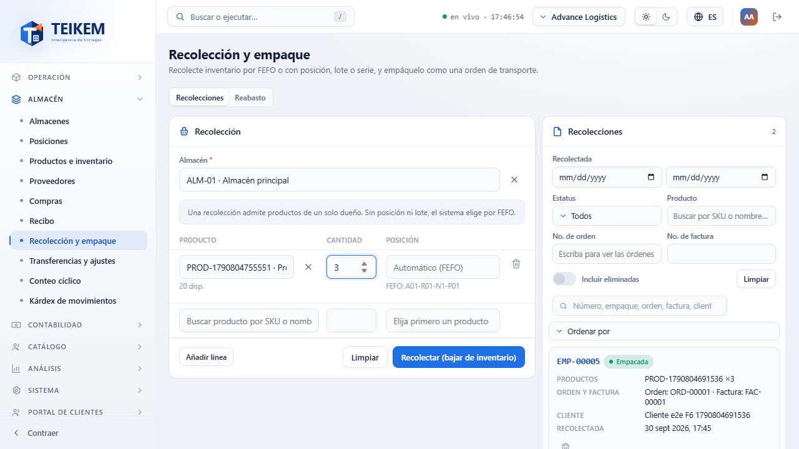

- **Warehouse** (required): if the company has a single active warehouse, it comes already selected. Below, the note "A pick batch holds
  products of a single owner. Without bin or lot the system picks by FEFO.".
- **Grid of lines** (up to 100). Columns:
  - **Product**: search by SKU or name in the selected warehouse; only products with available stock and of the same owner
    as the other lines appear. Under the field the stock is shown ("15 avail.").
  - **Quantity**: when the product is chosen it is set to 1. On a serial-tracked product it must match the number of serials.
  - **Bin**: empty means "Automatic (FEFO)": the system chooses. While there is no product the field is turned off ("Choose
    a product first"). With a product, the list offers **only the bins where that product has available stock** (and,
    if you chose a lot, only those of that lot), each with its available quantity ("A01-R01-N1-P01 · PICK · 12 avail."), in the same order in which
    the system would use them (expires first; then picking, reserve…; then code); the first one is marked **Suggested** and under the
    field it is announced ("FEFO: A01-R01-N1-P01"). If you change the product or the lot and the chosen bin no longer has that product,
    it is removed on its own.
  - **Lot**: only if some line is of a lot- or serial-tracked product; empty is "Automatic (FEFO)". It offers the lots with
    stock.
  - **Serials**: only for serial-tracked products. The **Serials (n)** button opens "Serials of line n · SKU": one serial per line (or
    separated by commas) and "Captured: n."; **Done** saves them on the line.
  - **Trash can**: removes the line. The empty row at the end is not removed.
- **There is always an empty row at the end**: when the product of the last row is chosen another one is added. **Add line** also adds
  one. On reaching 100 lines the button turns off and "Up to 100 lines per pick batch." appears.
- **Pick (take out of inventory):** records **all** the lines with data in a single operation (empty rows are ignored).
  It notifies "Pick batch EMP-… created.", leaves the lines empty (the warehouse stays) and **highlights the new pick batch** in the list; it does not
  open its detail. If the server rejects a line (for example, insufficient inventory), the message appears on that line's row.
- **Clear:** empties the lines (the warehouse stays).
- If the panel gets narrow (less than 560 px), each line is shown as a card.

### Pick batches panel (list)

- **Filters** (inside the panel; all go to the server and return to page 1; **Clear** removes them): **Picked** (date
  range), **Status**, **Product** (several; includes deactivated products), **Shipment no.**, **Invoice no.** and **Include
  deleted** (switch). Plus a free-text search box ("Number, pack, shipment, invoice, client or SKU", applied after the
  filters).
  - **Shipment no.** is a field with suggestions: as you type, it offers existing order numbers ("Type to see shipments";
    if there are none, "No shipment with that number."; if they cannot be looked up, "Shipments could not be loaded."). You can choose a
    suggestion (↑ ↓ Enter) or leave what you typed: it searches by content. The X ("Clear the shipment number") empties it.
- **Table** (25 per page, with the common footer and **Export**): **Number** (with its status and, if applicable, the "Deleted" chip),
  **Products** ("SKU ×quantity"), **Shipment and invoice**, **Client** ("Own" if the inventory is your own) and **Picked**. If the
  panel gets narrow (less than 640 px) the rows are shown as cards, as in the screenshot above.
- **Row actions** (icons with a tooltip):
  - **Pack** (box; `warehouse.pick` + `orders.create`; only on pick batches that can be packed): opens "Pack EMP-…".
  - **Delete** (red trash can; `warehouse.pick`, and `orders.cancel` if it is already packed; only if possible): asks for confirmation —
    "Delete pick batch {number}? Inventory goes back to its original bin." or, if it is packed, "Delete pick batch
    {number}? Its shipment {order} is deleted too and inventory goes back to its original bin."— and notifies "Pick batch {number} deleted.".
- **Clicking the row** (or the number) opens the **detail in a modal**; that way you do not lose what you have captured in the panel on the
  left.

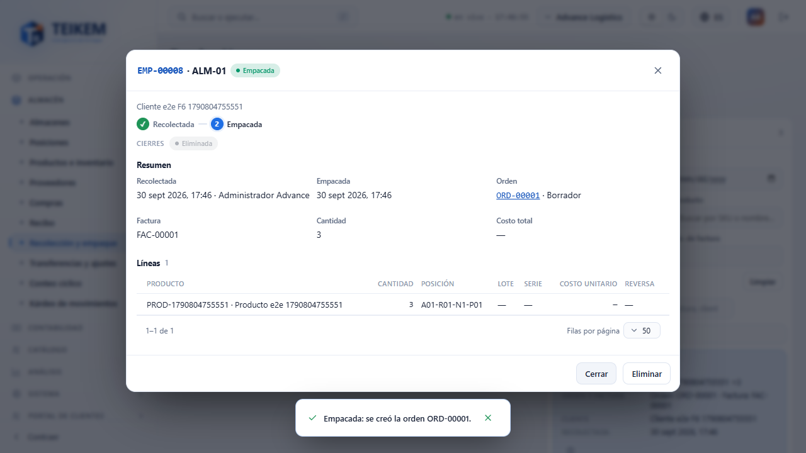

**The detail** shows the owning client, the status stages (**Picked → Packed**, with the closure **Deleted**; read-only),
the **Summary** (picked with date and user, packed, order —with a link to the order if you have `orders.view`— and its
status, invoice, quantity and total cost) and the **Lines** (product, quantity, bin, lot, serial, unit cost and "Reversed" if
it was already restored). The footer has **Close** and, as applicable, **Delete** and **Pack**. While the Pack or Delete dialog
is open, the detail does not close with Esc or with a click outside; on deleting, the detail closes.

### Pack

**Pack** (from the row or from the detail) opens a form with the data of the order born from the packing.

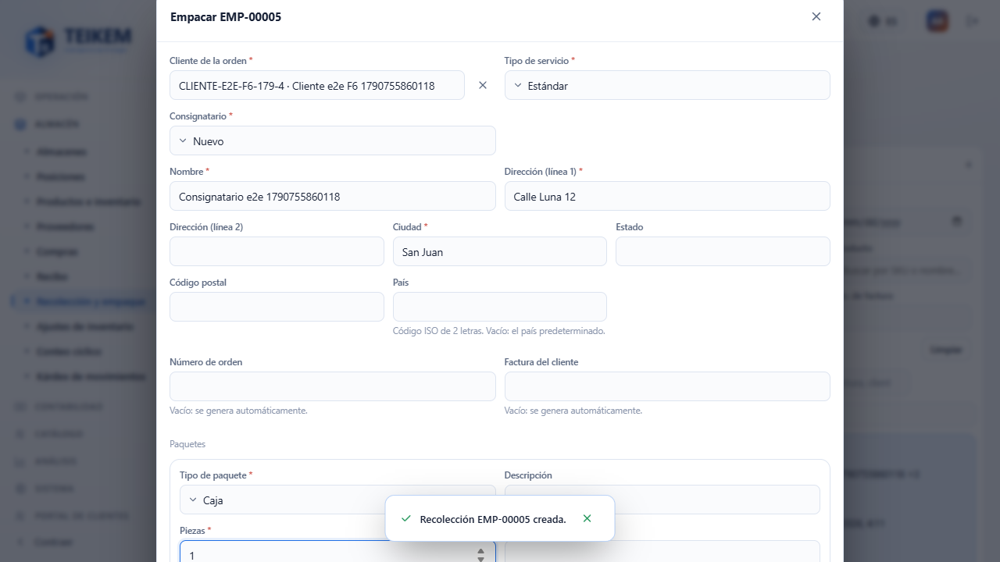

| Field | Rule |
|---|---|
| **Shipment client** (required) | Must be the client that owns the picked inventory; if the pick batch belongs to a client, the field reminds you: "Must be the client that owns the inventory: {client}.". |
| **Service type** | Offers **"Company default ({label})"** only if the company has one. **If it does not, that option does not appear and the field is required.** |
| **Consignee** (required) | "From directory" (choose one of the client's) or "New" (name, address, city required; state, postal code and country optional; the country is the 2-letter ISO code). |
| **Shipment number** and **Client invoice** | Optional: empty, they are generated automatically. |
| **Packages** (at least one) | **Package type** (with the same "Company default" only if it exists; otherwise, required), Description, **Pieces** (whole number, at least 1) and **Weight (kg)** (not negative). **Add package** adds another. |
| **Notes** | Optional. |

**Pack and create shipment** notifies "Packed: shipment {order} was created." and the pick batch becomes Packed.

**Permission.** `inventory.view` (list and see the detail); **`warehouse.pick`** to pick, pack and delete; **Pack**
also requires `orders.create`; deleting a **packed** pick batch also requires `orders.cancel`. Module `WMS_LOTSERIAL`.

**Statuses and transitions.** There is no pipeline button: each step is done by an action.

| From → to | Who | What triggers it | What is blocked afterwards |
|---|---|---|---|
| (new) → **Picked** | `warehouse.pick` | **Pick (take out of inventory)** | — |
| Picked → **Packed** | `warehouse.pick` + `orders.create` | **Pack** (creates the transport order) | It is not packed again ("Pick batch {n} was already packed.") |
| Picked → **Cancelled** | `warehouse.pick` | **Delete** (returns the inventory to its bin) | Read-only ("Pick batch {n} was deleted; it is read-only.") |
| Packed → **Cancelled** | `warehouse.pick` + `orders.cancel` | **Delete** (deletes the order too and returns the inventory) | Same as above; only if the order is still in its initial stage |

**Validations and messages.**

| Field | Rule | Message |
|---|---|---|
| Warehouse | required | "Choose the warehouse." |
| Lines | at least one with data | "Enter at least one line to pick." (under the product of the first row) |
| Lines | max. 100 | "A pick batch allows at most 100 lines." |
| Product (line with data) | required | "Enter the product." |
| Owner | a single owner per pick batch | "A pick batch can only contain products of a single owner." |
| Quantity (line) | > 0, up to 3 decimals | "The quantity must be greater than zero." / "The quantity allows at most 3 decimals." |
| Serials (serial-tracked product) | as many as the quantity, no repeats across lines | "Product {sku} is serial-tracked: scan the serials to pick." / "For serial-tracked products the quantity must equal the number of scanned serials." / "Serial {serial} is repeated in the pick batch." |
| Serials (line) | max. 500 | "A line allows at most 500 serials." |
| Lot / serial on a product that does not use it | — | "Product {sku} is not lot-tracked." / "Product {sku} is not serial-tracked." |
| Client (pack) | required | "Enter the shipment client." |
| Service type (pack, company without a default) | required | "Choose the service type." |
| Package type (pack, company without a default) | required | "Choose the package type." |
| Consignee (pack) | required (directory or new) | "The consignee is required: choose one from the directory or capture a new one." |
| Name / Address / City (new consignee) | required | "The consignee name is required." / "The consignee address (line 1) is required." / "The consignee city is required." |
| Country (new consignee) | 2-letter ISO code | "Use the 2-letter ISO country code." |
| Packages | at least one | "Enter at least one package line." |
| Pieces (package) | ≥ 1 | "The number of pieces must be at least 1." |
| Weight (package) | not negative | "The weight cannot be negative." |
| Stock | the server checks it when picking | 409 "Insufficient inventory of {sku} in {bin}: available {x}, requested {y}." (no partial effect) |

The other server messages (inactive bin, non-pickable zone, order that already moved on, etc.) appear on the row or in the
dialog; they are in manual 06, section 7, and in the [FAQ](../faq.md).

## Suppliers

**What it is for.** Directory of suppliers for purchase orders: contact, payment term and status.

**How to get there.** Menu **Warehouse › Suppliers**, address `/warehouse/suppliers`. Since Batch 12 this item goes **before**
“Purchases” in the menu.

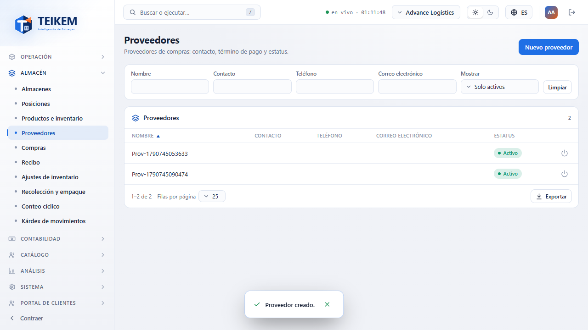

**What you see.** Filters (on the screen, without querying the server): **Name**, **Contact**, **Phone**, **Email** and
**Show** (“Active only”, by default, or “Include inactive”). The Phone one compares **by digits**: typing `787` or
`5551234` finds `(787)555-1234` whatever the stored format. **Clear** removes them. There is no search box inside the
table. Columns: Name, Contact, **Phone**, Email and **Status** (green “Active” or gray “Inactive” chip, with the same
colors as Warehouses); sorted by name; inactive suppliers are shown dimmed. Table of 25 rows per page.

**What each button does.**
- **New supplier** (`purchasing.manage`).
- **Clicking a row**: opens the supplier to edit it (only with `purchasing.manage`; without that permission the rows do not open).
  There is no longer an “Edit” button on the row.
- **Deactivate icon** at the end of each active row (tooltip “Deactivate”; confirmation “Supplier {name} will become
  inactive.”) and **reactivate icon** on the inactive ones (tooltip “Reactivate”; “Supplier {name} will become available
  again.”). Only with `purchasing.manage`. Notices: “Supplier deactivated.” / “Supplier reactivated.”.

**The modal** (“New supplier” / “Edit”): **Name** (required), **Contact**, **Phone**, **Email**,
**Payment term** (dropdown with a search box, “Search payment term…”) and **Notes**. Notices: “Supplier created.” /
“Changes saved.”.
- **Phone with mask.** Type only the digits: the field applies the company's mask (Tenant settings →
  Region and formats; in Puerto Rico `(###) ###-####`) as you type, up to the digits the mask asks for (10 in Puerto
  Rico). Since batch F9 the phone **is stored with digits only** (`7875551234`) and shown with the current mask; if the
  company changes the mask, all phones are shown with the new one. It can be left empty. A supplier saved earlier with
  another format is shown with the mask if it has exactly the digits of the mask (with or without the country code `+1`);
  otherwise, it is shown as is and must be corrected in order to save.

**Permission.** `purchasing.view` (see the list); **`purchasing.manage`** to create/edit/deactivate/reactivate. Module
**Purchases** (`PURCHASING`).

**Validations and messages.**

| Field | Rule | Message | Where |
|---|---|---|---|
| Name | required | "The supplier name is required." | Screen (and 400) |
| Name | unique among active suppliers | "An active supplier with that name already exists." | Server, 409 |
| Phone | empty or exactly the digits of the company's mask | "The phone must have {n} digits: {mask}." (Puerto Rico: "The phone must have 10 digits: (###) ###-####.") | Screen |
| Email | valid format | "The email address is not valid." | Screen (and 400) |

## Purchase orders

**What it is for.** Orders your own goods from a supplier, tracks what was received against what was ordered and
resolves what was left short.

**How to get there.** Menu **Warehouse › Purchase orders**, address `/warehouse/purchase-orders`; record at
`/warehouse/purchase-orders/:publicId` (tabs **Lines** and **Shortages**).

**What you see (list).**

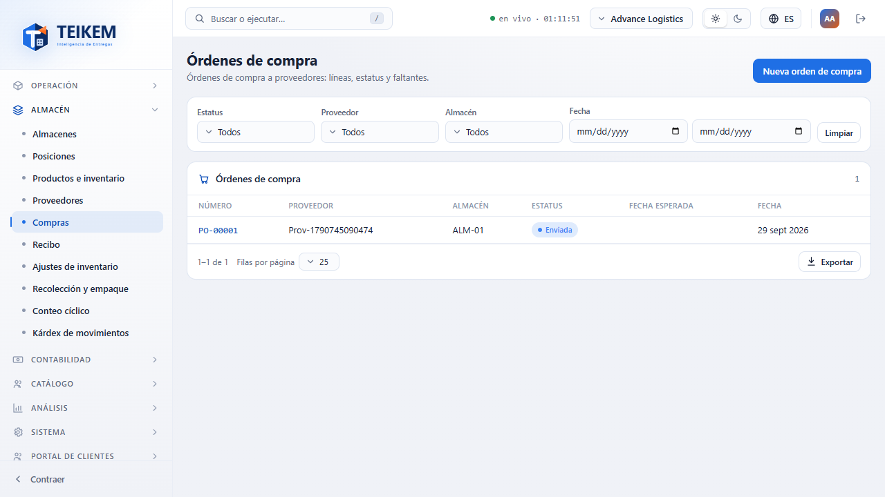

Columns: number, supplier, warehouse, status, expected date and date. Filters (Batch 12): **Status**, **Supplier** and
**Warehouse**, all three **multi-select with a search box** (the order appears if its supplier or warehouse is any of the
chosen ones), **Product** (2026-10-12; the same searchable multi-select dropdown as Products & inventory: the order appears if it has a line of any of the chosen products) and **Date** (range). **Clear** removes them. There is no longer a search box inside the table.

**What each button does.**
- **New purchase order**: **Supplier** (dropdown with a search box, “Search supplier…”; required), **Warehouse**
  (required **on the screen**), expected date, notes and the lines (**Product** with a search box —own products only—,
  **Ordered quantity**, **Unit cost**); it is born in Draft. There must be **at least one line with an ordered quantity greater
  than zero**; the notice appears above the lines. (In the API the warehouse is optional when the company has a single active
  warehouse; the screen always asks for it.)

  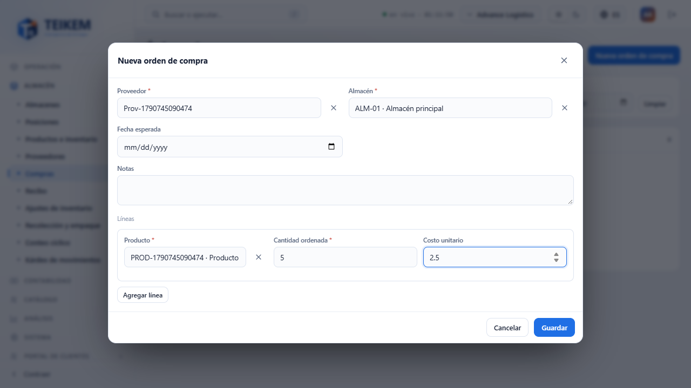

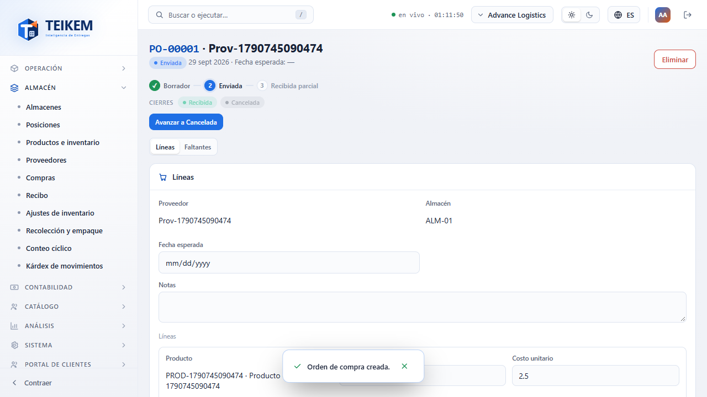

**What you see (record).** Status bar with the buttons **Advance to Sent** and **Advance to Cancelled** (the only
manual ones; Partially received/Received are set by the system when a receipt is confirmed); tabs **Lines** (editable only
in Draft; a line with receipts shows the note "This line already has receipts: it cannot be removed, its quantity cannot go below what was
received, and its cost cannot change.") and **Shortages** (pending lines with **Resolve**). The **supplier** and the **warehouse** are
editable fields **only while the order is in Draft** (supplier with a search box over the active ones, warehouse with the same
selector as when creating; both required) and are saved together with the lines; the screen sends only what changed. Outside Draft they are
shown read-only (the server answers 409 "The supplier and the warehouse can only be changed while the purchase order is in
draft."); if you made a mistake and the order was already sent, cancel it and create another one. When saving the lines the same rule as when creating applies:
at least one line with an ordered quantity greater than zero.

**What each button does (record).**
- **Delete** (header, only if the server allows `canDelete`: no receipts and no open receipt).
- **Add line** / **Remove line**: only in Draft.
- **Resolve** (Shortages tab): choose the action —**Close** (write it off), **Reorder** (also requires
  `purchasing.manage`) or **Manual adjustment** (also requires the `WMS_LOTSERIAL` module; it enters inventory with a bin,
  lot/serials if applicable).

**Permission.** `purchasing.view` (list, see the record and shortages); **`purchasing.manage`** (create/edit/send/cancel/
delete the order, and suppliers); **`inventory.adjust`** to resolve a shortage. Module `PURCHASING`.

**Statuses and transitions.**

| From → to | Who | What triggers it |
|---|---|---|
| Draft → Sent | `purchasing.manage` (pipeline button) | — |
| Sent/Draft/Partially received → Cancelled | `purchasing.manage` (pipeline button) | 409 "A fully received purchase order cannot be cancelled." if it is already Received |
| Sent → Partially received → Received | the system | When a receipt against the order is confirmed |

**Validations and messages.**

| Field | Rule | Message |
|---|---|---|
| Supplier | required | "Enter the supplier." |
| Warehouse | required on the screen (the API accepts it empty only with a single active warehouse) | "Choose the warehouse." |
| Lines | at least one with an ordered quantity > 0 (creating and editing lines) | "Add at least one line with an ordered quantity greater than zero." |
| Product (line) | required, own only | "Enter the product." / "The purchase order only allows own products; {sku} belongs to a client." |
| Ordered quantity | > 0, ≤ 3 decimals | "The ordered quantity must be greater than zero." / "The quantity allows at most 3 decimals." |
| Unit cost | ≥ 0, ≤ 4 decimals | "The unit cost cannot be negative." / "The unit cost admits at most 4 decimals." |
| Product (line) | no repeats | "That product is already in the purchase order." |
| Lines | at least one, max. 200 | "The purchase order must have at least one line." / "The purchase order admits at most 200 lines." |
| Quantity (resolve shortage) | > 0, ≤ pending | "The quantity must be greater than zero." / "The quantity cannot exceed the pending shortage." |
| Bin (manual adjustment) | required | "Enter the bin where the goods will be put away." |
| Lot/serials (manual adjustment) | according to the product's tracking | "Product {sku} is lot-tracked; enter the lot." / "Product {sku} is serial-tracked; enter the serial numbers." |

Outside Draft, editing the order (without the capability enabled by the tenant's status) answers 422 "The current status
does not allow the action 'EDIT_PURCHASE_ORDER'."

## Dock appointments

**What it is for.** Schedule of the use of the warehouse docks, optionally linked to an arrival notice or to a
trip (cross-dock demo).

**How to get there.** Menu **Warehouse › Dock appointments**, address `/warehouse/dock-appointments`.

**What you see.** Columns: dock, direction (inbound/outbound), start, end, status and reference. Filters: warehouse,
dock, status and date range.

**What each button does.**
- **New appointment**: warehouse, dock, direction, scheduled start/end and, optionally, what it links to (none,
  arrival notice or trip).
- **Reschedule** (per row): changes start/end.
- **Change status** (per row): opens the pipeline control (Scheduled → Arrived → Completed; No-show/
  Cancelled as detours).

**Permission.** `inventory.view` (see the schedule); **`warehouse.crossdock`** to schedule, reschedule and change status.
Module **Cross-dock** (`CROSSDOCK`, off by default).

**Validations and messages.**

| Field | Rule | Message |
|---|---|---|
| Dock | required | "Enter the dock." |
| Scheduled start | required | "Enter the scheduled start." |
| Direction | required | "Enter the appointment direction (inbound or outbound)." |
| Link to an arrival notice | must be inbound | "An advance ship notice appointment must be inbound (INBOUND)." |
| Link | at most one | "An appointment links to an arrival notice or to a trip, never both." |

## Cross-dock: plans

**What it is for.** Allocates lines of a receipt directly to outbound orders, without going through a reserve
bin (cross-dock flow demo).

**How to get there.** Menu **Warehouse › Cross-dock**, address `/warehouse/cross-dock-plans`; record at
`/warehouse/cross-dock-plans/:id`.

**What you see (list).** Columns: plan, warehouse, status, allocations, allocated/moved/missing quantity and created.
Filters: warehouse and status.

**What each button does.**
- **New plan**: warehouse and, optionally, the transit zone (STAGING).

**What you see (record).** Read-only status bar (Open → Allocated → Completed: the system moves it according to
the allocations), "Available lines" table (candidates to allocate) and "Allocations" table with its own
status (Planned → Moved/Cancelled).

**What each button does (record).**
- **Complete plan** (header, while it is not Completed): if there are allocations left unmoved, the server
  rejects it.
- **Allocate to a shipment** (per candidate line, if it has availability): searches the order by exact number, invoice or
  pack batch, and the quantity.
- **Move** (per Planned allocation): records the physical movement, with an optional comment.
- **Cancel allocation** (per Planned allocation).

**Permission.** `inventory.view` (see plans and candidates); **`warehouse.crossdock`** to create the plan, allocate,
cancel, move and complete. Module `CROSSDOCK`.

**Validations and messages.**

| Message | When it appears |
|---|---|
| "Choose a shipment." | When allocating without choosing the target order |
| "No exact matches." | The order search (number/invoice/pack batch) found nothing exact |
| "Searching shipments requires the orders.view permission and the LTL_GROUND module." | Without that permission/module, when trying to search an order to allocate |
| "If allocations are still pending a move, the server will reject the action." | Help before confirming **Complete plan** |

## Order lookup (read-only)

**What it is for.** Gives warehouse context on transport orders (for example, the one created by "Pack" in
Picking & packing), without creating or editing anything: it is a lookup.

**How to get there.** Menu **Operations › Orders**, address `/orders`; record at `/orders/:publicId`.

**What you see (list).**

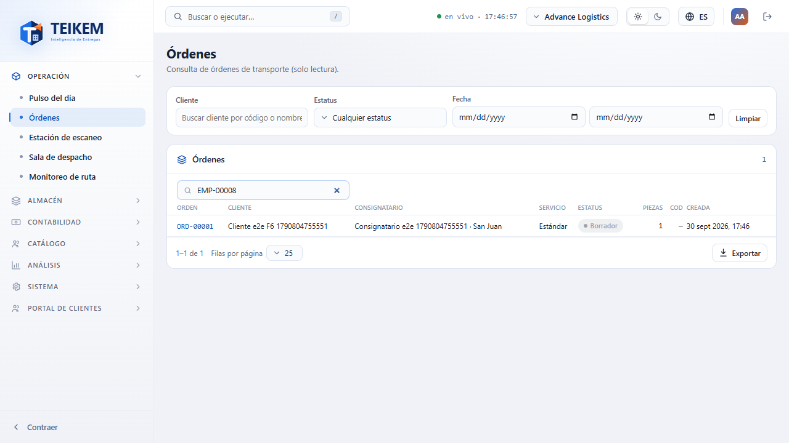

Columns: order, client, consignee, service, status, pieces, COD and created. Filters: client, status and date
range. No "New" button and no row actions.

**What you see (record).**

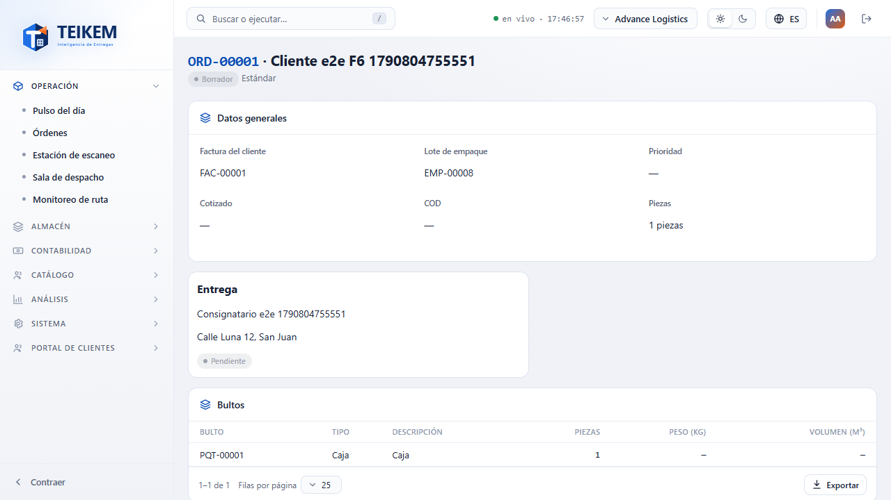

Stacked panels (not tabs): **General data** (invoice, pack batch, priority, quoted, COD, pieces),
**Pickup**/**Delivery** (name, address, time window, stop status), **Packages** (number, type,
description, pieces, weight, volume) and read-only **Status history**. No interactive `StatusPipeline`: the
status cannot be changed from here.

**Permission.** `orders.view`. Module **Ground transport** (`LTL_GROUND`).

**Messages you may see.** "The shipment does not exist or does not belong to your company." if the link is wrong or the order
belongs to another company.

## Frequently asked questions for this chapter

**Why does "Purchase orders" not let me edit the lines if it is already Sent?** It is only edited in Draft; once
sent, changing quantities or costs could throw off what the supplier is already preparing. If you need to correct it,
ask an administrator to revert the status or cancel the order and create a new one.

**Why can't I choose a client's product in the purchase order?** Purchase orders are for replenishing
your own inventory; the product selector already comes filtered to own products only so that you do not even try (the
server would reject it anyway with "The purchase order only allows own products...").

**Why does the receipt not have a button to move it to "Put away" by hand?** Because the system decides that step: it happens on its own when
the last putaway task the receipt generated is completed (or cancelled). Go to **Receiving › Pending putaway** to complete them.
Likewise, "Discrepancy", "Receiving" and "Completed" are moved by the system according to what you capture and confirm.

**Where did "Warehouse tasks" go?** There is no longer a queue with all the tasks: putaway is in Receiving › Pending putaway,
replenishment in Picking & packing › Replenishment, counting in Cycle count and cross-dock in Cross-dock.

**How do I open a receipt's header?** By double-clicking the receipt in the list or with the pencil in the detail (Edit the receipt
header). If the receipt is already confirmed it opens read-only.

**How do I return the Picking & packing bar to 60/40?** Focus the bar and press Enter, or double-click it.

**How do I set a warehouse to direct?** In **Warehouses**, open the warehouse, **Details** tab, **Receiving** group: change the **Receiving mode** to "Direct to bin", save and confirm. **New** receipts are born
direct; open ones keep their mode and the pending putaway tasks continue.

**Why does my direct receipt not let me confirm?** Because the target bin is missing on some line that receives something ("The target bin is missing on {n} line(s)."). Choose it in the **Target bin** column or press **Use suggested
bins**.

**Can I go over a bin's capacity?** Yes: the orange chip **“Exceeds the capacity of {bin}: {n} fit”** only warns. Save and confirm anyway, and transfer the excess afterwards.

**Why don't I see the receiving bins in "Target bin"?** Because on a direct receipt the goods are stored, not received at receiving: the selector does not offer receiving (`STAGING`) or cross-dock
(`CROSSDOCK`) bins. Quarantine is offered.

**Why does the Bin selector in Picking & packing only show some bins?** Because it only offers the bins where the chosen product has available stock (with its quantity), in the order in which the system
would use them. Without a product, the field is turned off.

**Why do the numbers have a comma?** Puerto Rico format: comma for thousands and period for decimals (`61,023`). See "Export: company, filters, dates and numbers".

**Why does "Cross-dock" not appear in my menu?** The `CROSSDOCK` module comes off by default; ask an
administrator to turn it on in Settings if your company needs it.

**What does the "Below minimum" chip in Products mean?** That the available quantity of that product is below the "Minimum
inventory" configured in its record; it does not block anything, it is only a signal to replenish.

**Why does a zone's occupancy say "units · no capacity set"?** Because none of its active bins has a
"Max capacity". Occupancy is calculated against the sum of the bins' capacity; with no capacity there is no percentage. Open the
zone in Bins or in the Bins tab of the record and type the capacity of each bin, or use **Set capacity** to
set it on many at once.

**Why does a zone's box say "N slots without capacity"?** Because the zone mixes bins with and without capacity. The
percentage is calculated only with the ones that have capacity; the others are reported separately so they do not distort the number.

**How do I export a table and what does it export?** With the **Export** button in the table footer: choose Excel, CSV or PDF. Everything
that matches the screen's filters comes out (not just the page you are looking at), up to 10,000 rows.

**Why does my city appear in capital letters?** Because the city comes from the postal list. Outside Puerto Rico it is the official
postal name (`NEW YORK`); in Puerto Rico the municipality is stored with its normal spelling (`Toa Baja`). It cannot be
typed by hand from the screen.

**Why can't I change a bin's code or zone?** It is a system rule: a bin's code and zone
stay fixed from creation ("The bin's code and zone cannot be changed."). What you can change
is the aisle, rack, level, position, the capacity and the maximum weight (the code is not recalculated). If you need another code or another
zone, create a new bin and deactivate the previous one (only possible with no inventory and no open tasks). The **code of a
zone**, on the other hand, can be edited.

**Where did “Locations” go?** It is called **Bins** since Batch 12 (same place in the menu, same address
`/warehouse/locations`). In English it is “Bins”.

**Why does the inventory report not list products with 0?** Because it is a snapshot of what there is: only products
with an on-hand stock other than zero come in. The report's notice says how many were left out. To also see the ones at zero use
the screen's table or **Export**.

**Why does the adjustments report not include the opening balances of the migration?** Because they were recorded as adjustments (reason
OPENING_BALANCE) but they are not operational adjustments. The report's notice says how many were excluded; they are still in the ledger.

**Why does the inventory value show “—”?** Because the product has no **Purchase cost**. The value is Total × purchase
cost; without a cost it is neither calculated nor added. Capture the cost on the product and generate the report again.

**Why, with a Warehouse filter in Products, do products with no stock still appear?** Because the Warehouse filter
narrows the **quantities** of each row to that warehouse, it does not remove products. To see only the active ones with on-hand stock, use the
“Total units” indicator.

**How do I fix the capacity of many bins at once?** With **Set capacity** in Bins (see that section): choose the
scope, type the capacity, check “Will apply to N bins” and apply.

**Why can't I change the supplier or the warehouse of a purchase order?** They can only be changed while the order is in
**Draft**. Once sent they stay fixed: cancel the order and create another one with the correct data.

**Where did “Inventory adjustments” go?** It left the menu (Batch 14). That screen showed incompletely received purchases, not adjustments. Shortages
are resolved in the record of each purchase order, **Shortages** tab; inventory adjustments, in **Transfers & adjustments** and in
the ledger. The old address leads to Purchases.

**Why does the adjustment ask for “Increase” or “Decrease” instead of a signed number?** Because that is how the owner decided it (Batch 14): the quantity is typed as
a positive number and the direction says whether it adds or subtracts; besides, the reasons change according to the direction (Found only when increasing; Damage, Loss and Expired only
when decreasing). The API still receives the signed quantity.

**Why are some ledger filters dimmed?** The three tabs share the filters, but each one applies only some; the ones it does not
apply are dimmed and a note under the bar names them. They are not lost: they apply again when you return to the tab where they apply.

**How do I see which document originated a movement?** Click the row in the ledger (or in Adjustments or Transfers): the detail shows the
**Source document** with its status and an **Open** button (it appears only if you have the permission and the module of that screen), and the related
movements.

**How do I confirm a count?** Count the lines (type the SKU or the barcode in the scanner and press Enter, or type the quantity in the
row itself) and press **Confirm count & adjust**; it ends up in **Matched** or **Variance**. There is no longer “Finish count” or “Reconcile”.

**How do I assign a count?** With the person-with-“+” icon on the row of the list of counts (it needs `warehouse.manage`; to choose whom,
also `admin.users`).

**What do I do with a discrepancy?** See Movement ledger › Reconciliation. Fix the balance from the ledger or dismiss it with a note; an adjustment or a
count does not fix it (manual 06, section 3.3).
