# F7A — Pulse: Warehouse panel with filter and Recent activity

Screen manual chapter for Batch F7A (frontend), about the home screen **Day pulse** (`/`), already
described in chapter F1. This batch adds a filter to the "Warehouse" panel (Batch F6) and a new panel, "Recent
activity". Neither screen has its own route: both live below the Pulse indicators and charts.
Screenshots in `img/f7a-*.png`. Batch 14 adds the **Needs your attention** panel (at the very top, screenshot `img/l14-pulso-atencion.png`) and changes the
**Open counts** figure of the Warehouse panel (see the two new sections, before "Recent activity"). **Batch 15** adds the **Warehouse today** band (at the very top), the sticky rows, the indicators per module, the charts always drawn and the "Company" charts (new sections at the beginning; screenshots `img/l15-*.png`).

## Day pulse: "Warehouse today · last 7 days" band (Batch 15)

**What it is for.** It is the first thing you see under the date: four Warehouse numbers with **today's** figures and how the last 7 days are going,
without entering any screen. Each card is a link to the detail. What each one counts, with its rules, is in chapter
[07, section 5.1](../07-pulso-y-actividad.md).

**How to get there.** It appears by itself at the top of the Pulse (`/`), below the date and the "Organize" buttons. Nothing else is required. The numbers
in the screenshots are those of the demo on the day they were taken (that is why they change from one screenshot to another).

**What you see.**

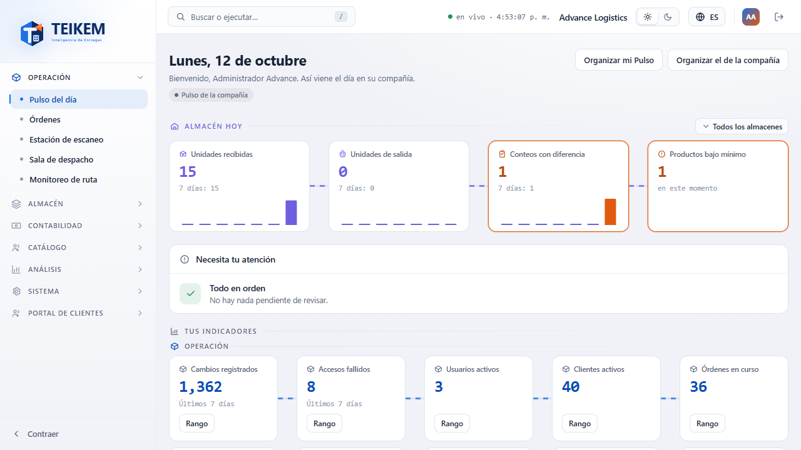

- **Title:** "WAREHOUSE TODAY · LAST 7 DAYS", with the warehouse icon, in violet. On the right, a warehouse selector ("All
  warehouses" or the warehouse code).
- **Five cards joined by a dotted violet pipe:** **Units received**, **Units out**, **Counts with variance**,
  **Transfers & adjustments** (2026-10-12) and **Products below minimum**.
- **Transfers & adjustments** is a single box for the two movement types: the **big number** is **today's** (transfers + adjustments), the legend shows the **7-day** total of each one (violet square = Transfers, blue = Adjustments) and the small bars are **one per day with two stacked color segments** (violet at the bottom = transfers, blue on top = adjustments; hover over each segment to see the date, the type and the quantity; the last one is today). It counts **movements** (not units) and **all** of those two types, including the system's own (putaways, replenishments, receipt variances, counts…), just like the *Transfers & adjustments* list, which it opens on click. It respects the warehouse chosen in the band; it never turns orange.
- **In each of the first three:** the **big number for today** (violet), the small text **"7 days: N"** with the week's total and
  **7 small bars**, one per day. The one on the right is **today** and is the one that grows during the day; a day with no movement is a line (empty
  bar). In the screenshot, the six previous days are empty and only today has a bar.
- **Products below minimum:** the number **right now**, "right now" and **no small bars**.
- **Orange** (border and number): "Counts with variance" if there was any today (its bar for today is orange too) and "Products below
  minimum" if there is any. In the screenshot both are orange.
- **Hovering over a small bar** shows the day's detail with the long date and the quantity; on today's, it starts with "Today":

  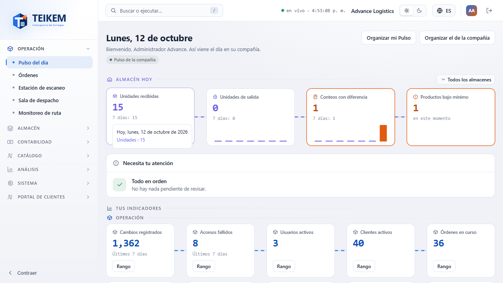

  The small bars only display: clicking the card (not the bar) opens the detail.

**Where clicking a card takes you.** Always with the chosen warehouse and, in the ledger, with the 7 days:

- **Units received** → Movement ledger with the type **Receiving** and the dates of the 7 days.

  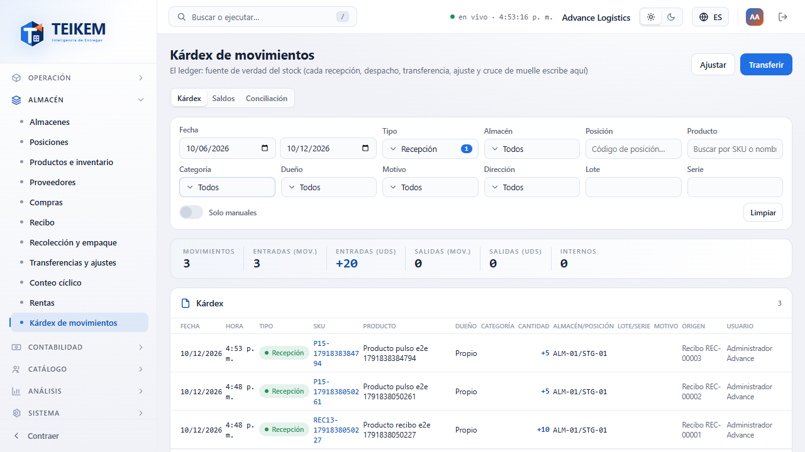

- **Units out** → Ledger with the types **Dispatch** and **Cross-dock** and the 7 days.
- **Counts with variance** → Cycle count with the status **Variance** already chosen (no dates). The list brings the counts in Variance and
  the first one open on the right.

  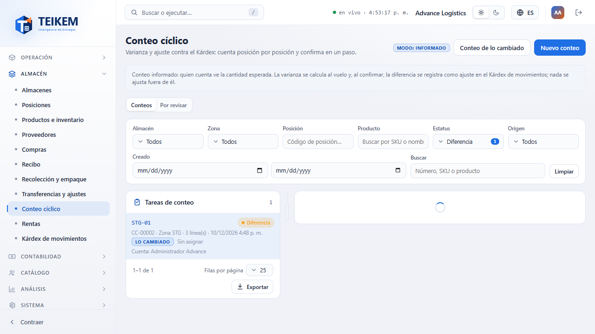

- **Products below minimum** → Products & inventory with the **Below minimum** box checked (in orange) and the table of those products.

  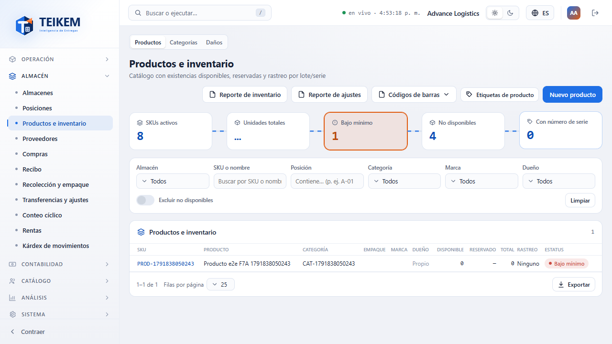

> **Watch out for the ledger sum.** The ledger filters by movement type and the card is a net figure (deleted pick batches subtract in
> "Units out", and receipt variances add in "Units received"), so the sum you see in the ledger may not match
> the card. See the FAQ.

**The warehouse.** The band's selector is the **same** one as in the "Warehouse" panel further down: changing it in one changes the other, and it is remembered per
user in that browser. The card links carry the chosen warehouse (the Ledger, Cycle count and Products & inventory read it from the
address when they open).

**Messages you may see.** "…" in each number while loading; "—" if the query fails (for example, a 403 when switching company),
without taking you out of the Pulse. There are no error messages of its own.

**Permission.** It is drawn with `pulse.warehouse`, `inventory.view` and the **Warehouse and lot/serial** module (`WMS_LOTSERIAL`) turned on. It can be hidden
or moved with Organize (see below).

## Day pulse: sticky header when scrolling (Batch 15; adjusted on 2026-10-05)

When scrolling down the Pulse, **only the header stays fixed at the top**: the date with "Organize my Pulse" and "Organize the company's", the greeting
("Welcome… Here's how today looks for your company.") and the "Company Pulse" chip. The "Warehouse today" band, "Needs your attention" and everything else
scroll away: **no section stays fixed** (owner's decision; in the original Batch 15 the
"Warehouse today" band was also fixed, and the screenshot `img/l15-pulso-fijas.png` may show it that way).

- While organizing, there are no sticky rows: the Organize bar (with "Done") already stays at the top.
- With the keyboard, the focus is not covered by the sticky row: the screen leaves a margin when scrolling to whatever receives the focus.
- It only happens on the home screen: Analytics → Indicators and Charts do not change.

## Day pulse: indicators in one row per module (Batch 15)

"Your indicators" is now shown **per module**: one row with its label (**Operations**, **Warehouse** and, if there are indicators, **Accounting**,
in that order, the menu's). Each indicator keeps its range ("Last 7 days") and its **Range** button; the module is no longer repeated on the
card.

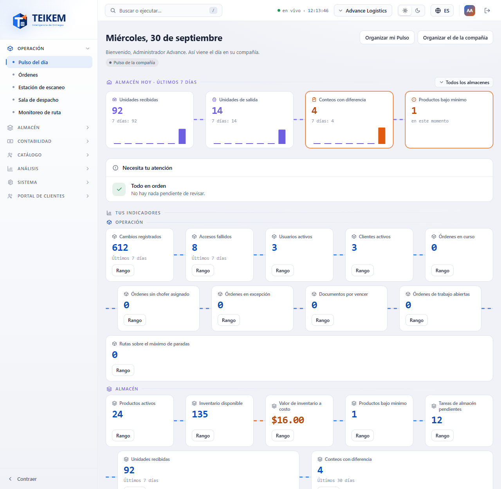

In **Organize**, indicators are ordered only within their row (with the help text "Indicators are shown in one row per module; here they are
ordered within their row.").

## Day pulse: "Your charts" always as a chart (Batch 15)

All the charts in "Your charts" are drawn as a chart, even if they have one, two or three points (before, a list was shown). There are **at
most 2 per row** (on the phone, one below the other). The first two are the warehouse ones: **"Inventory value by category"**, a donut with
the total in the center, on the left, and **"Inventory movements by type"**, bars of positive units for the last 7 days, on the
right.

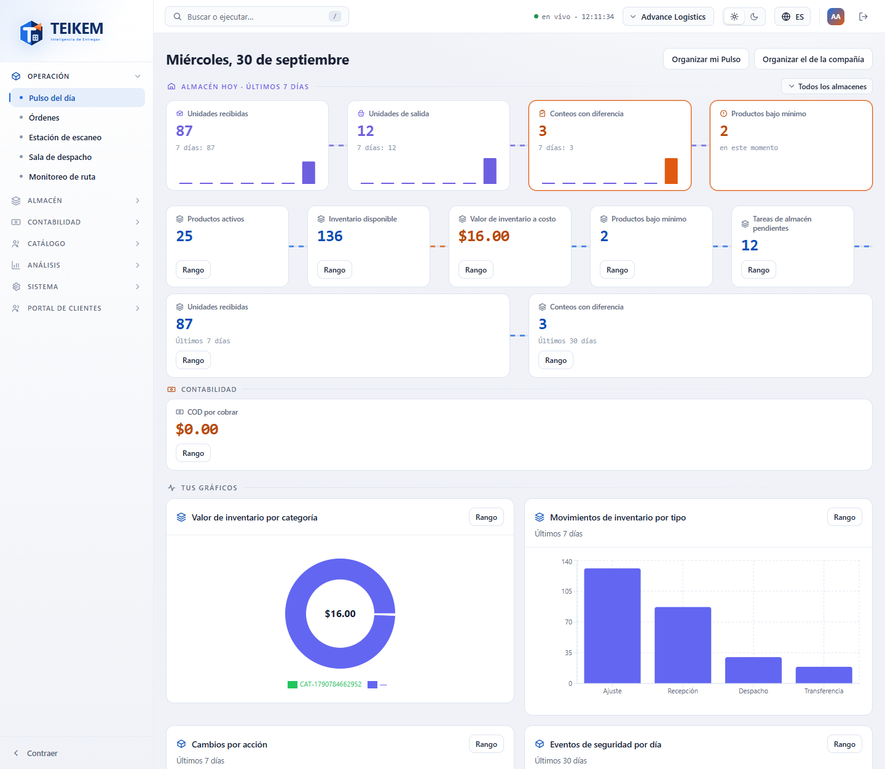

In the screenshot you see the band at the top, then the two indicator rows for Warehouse and Accounting, and the charts below. The demo's donut has
a single category with value (hence a single slice, drawn the same way, with "$16.00" in the center). If a donut or a bar chart has more than 8 groups,
the last point is **"Others"**, which gathers the rest.

## Analytics → Charts: the "Company" charts (Batch 15)

The two warehouse charts are no longer factory charts: in Analytics → Charts they carry the **"Company"** chip next to the name, they can be edited and
deleted (with `analytics.manage`) and they can be shown or hidden in the Pulse like any other.

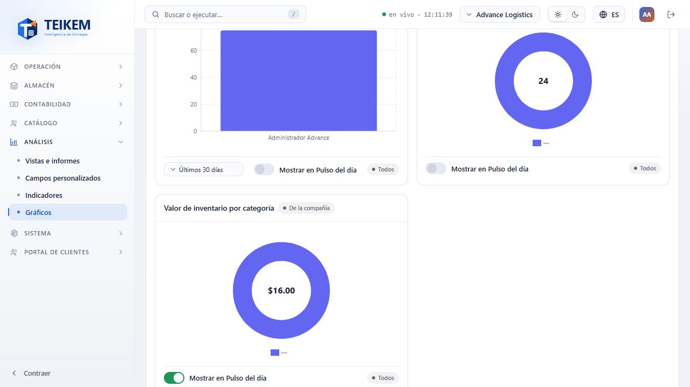

When you **Delete** a company chart, the confirmation warns: "Delete chart {name}? It belongs to the company: once deleted it is not
created again." Whoever lacks `analytics.manage` does not see Edit or Delete.

## Day pulse: organizing with the band (Batch 15)

From **Organize my Pulse** and **Organize the company's**, the "Warehouse today" panel appears in the list of panels: it is moved, hidden and
shown like the others. Under the title there is a note: "The band that sits right below the date stays fixed when scrolling; if you hide it or move it
down, only the date stays fixed." With no changes, the band comes first. See chapter [F8a](f8a-menu-sistema-analisis-y-marca.md).

## Day pulse: "Warehouse" panel with filter

**What it is for.** A glance at the current state of the warehouse (balance, open documents), with the option of narrowing it to
a single warehouse and, for the balance, to a specific category or product — for example, to check at a glance whether
a particular product is below its minimum, without going to the Inventory screen.

**How to get there.** It appears automatically below the Pulse indicators and charts (`/`), with nothing else required.

**What you see.**

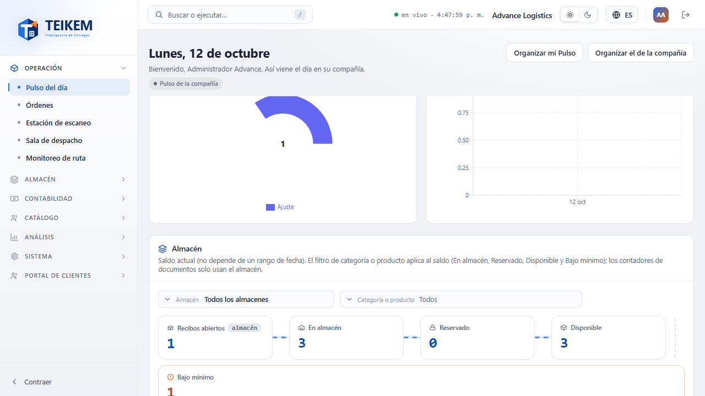

A row of filters and, below, six cards: **On hand**, **Available** (with "Reserved: on hand − available"),
**Below minimum**, **Open receipts**, **Pending tasks** (with the breakdown by type: Putaway, Replenishment, Count,
Cross-dock) and **Open counts** (Pending and Counted; see "Open counts" below). The last three carry the **warehouse** mark: they only receive the warehouse
filter, never the category or product one (the text in the panel header makes it clear, and hovering or focusing
the mark shows "Only the warehouse filter applies (not the category or product)."). These cards do not
have the "Range" button of the others: they are the current balance, not a period's.

**What each control does.**

- **Warehouse**: drop-down list with "All warehouses" and the active warehouses of your company; it applies to the
  six cards.
- **Category or product**: a combobox with a search box, two sections (Categories and Products) and a "✕" button to
  clear the selection. It only affects On hand, Available and Below minimum.

  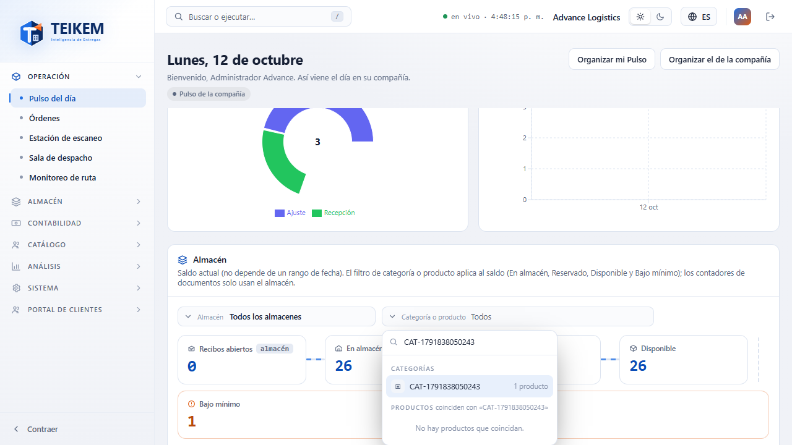

  - Type the name of a category or of a product (by SKU or name); categories are filtered instantly,
    products are searched on the server a quarter of a second after you stop typing.
  - Choose a **category**: "On hand" shows its subtitle with the name and how many products it has (counting its
    subcategories); "Below minimum" counts the products of that category below their minimum and offers the link
    **"View in Inventory ›"**.

    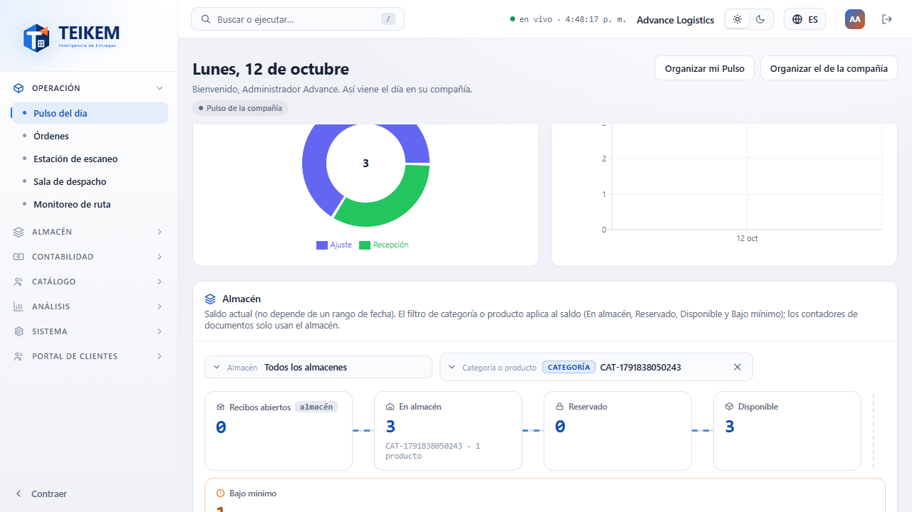
  - Choose a **product**: "On hand" shows its SKU (and its minimum, if it has one); "Below minimum" turns into **Yes**/**No** with
    the link **"View {SKU} ledger ›"**.

    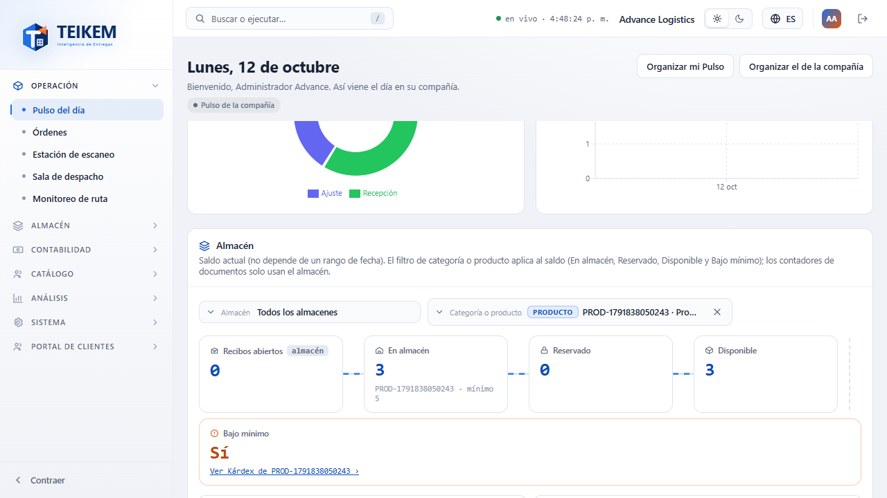
  - Keyboard: ↑/↓ arrows go through the options, Enter chooses, Escape closes without choosing.
- **"View in Inventory ›" / "View … ledger ›" links**: they take you to the Inventory screen (chapter 06) already with the
  same warehouse and the same category or product as the card, so that what you see there matches the figure the
  Pulse had.

  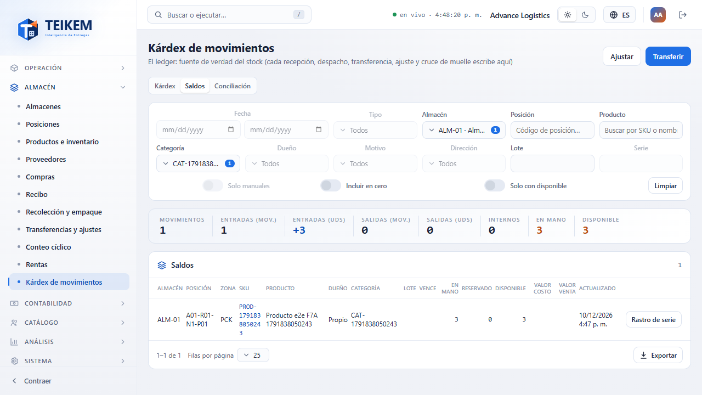
  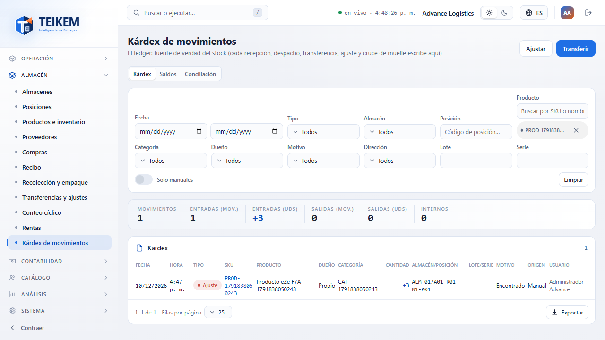

**The selection is remembered.** The chosen warehouse and category/product are saved for your user in this same
browser and restored the next time you open the Pulse (including a page reload); if in the meantime that
warehouse, category or product was deactivated or deleted, the selection is discarded by itself, without any error
message, and the panel goes back to "All warehouses" / no category or product.

**Permission.** It is drawn only with `inventory.view` **and** the **Warehouse and lot/serial** module (`WMS_LOTSERIAL`)
turned on; without either of the two, the Pulse looks the same as in F1, without this panel and without asking the server for anything.

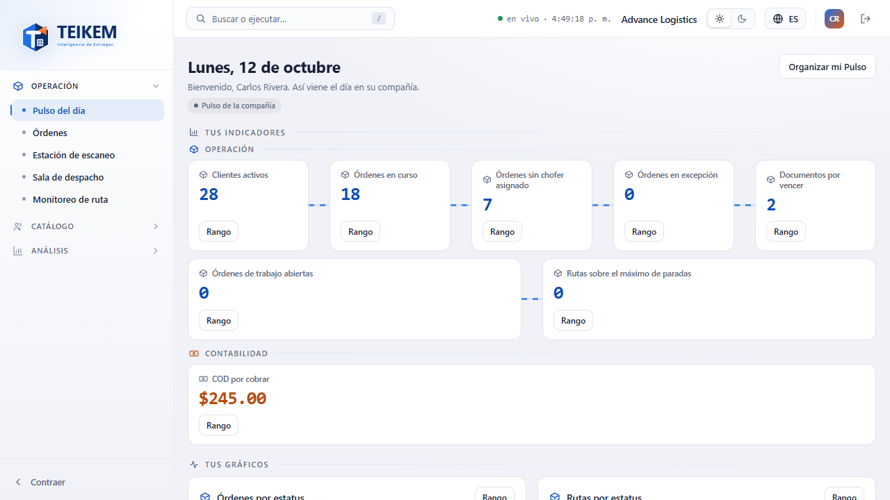

**Messages you may see.** While each card loads, it shows "…"; if a query fails (for example, a 403 when
switching to a company without permission), it shows "—" in that card instead of taking you out of the home screen. If it
cannot query products (without `inventory.view` in a secondary company, a rare case), the "Products" section of the
control shows "Your user cannot view products." instead of the list.

## Day pulse: "Needs your attention" panel

**What it is for.** It is the first thing you see in the Pulse after the "Warehouse today" band (Batch 15): it lists what **needs someone to review it**. Today it brings a single type of notice, the
**ledger ↔ balance discrepancy** (the balance of a bin does not match what the movements add up to; see chapter
[06, section 3.3](../06-inventario-y-almacen.md)). With nothing pending, it says everything is in order.

**How to get there.** It appears automatically at the top of the Pulse (`/`), below the "Warehouse today" band and before "Your indicators". It scrolls with the rest (it is not sticky).

**What you see.**

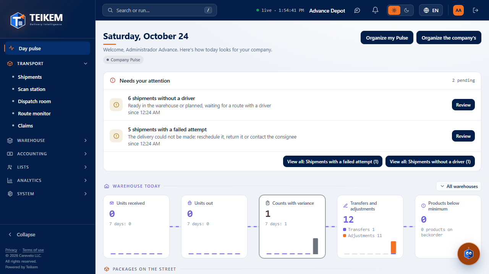

- **Header:** "Needs your attention" and, if there are pending items, "{N} pending" (or "1 pending"); the alert icon lights up.
- **One row per pending discrepancy** (the **5 oldest**): the title "Discrepancy in {SKU}" (or "Discrepancy in the total of {SKU}"), the product and
  where (warehouse · bin · lot, or "all positions" in a discrepancy of the total), the figures **Ledger**, **Balance** and **Difference** (balance −
  ledger, with sign and in red), "since {time}" and the **Review** button.
- **Review** opens the Movement ledger on the **Reconciliation** tab with that discrepancy open (`/warehouse/kardex?tab=reconciliation&discrepancy=…`),
  where the balance is fixed or the discrepancy is dismissed with a note.
- **View all ({N})** (panel footer, with pending items): opens the full list of Pending discrepancies.
- **All in order** ("Nothing pending to review."): there are no pending discrepancies you can see.

> **Screenshot pending:** the panel with a pending discrepancy row (the screenshot above is the "All in order" state; a real discrepancy requires
> touching the balances directly in the database, so it is not generated in the automated run).

**It refreshes by itself.** The panel is queried again every time the Pulse opens. The check that opens discrepancies runs on its own, a few seconds
after each movement; when a discrepancy is resolved, the row disappears.

**Organize.** Like the other panels, it can be moved and hidden from **Organize my Pulse** and **Organize the company's** (chapter
[F8a](f8a-menu-sistema-analisis-y-marca.md)).

**Permission.** It is drawn only with **`pulse.attention`**; each type of notice also requires its own: discrepancies, `inventory.view` with the
**Warehouse and lot/serial** module (`WMS_LOTSERIAL`) turned on. What you cannot see does not count. Without `pulse.attention` (or if the server responds 403) the
panel is not drawn and the Pulse looks as before. It comes with Company admin, Warehouse operator, Billing and Read-only. **Fix** and
**Dismiss** also require `inventory.adjust`.

**Messages you may see.** "All in order" / "Nothing pending to review." (nothing pending). While loading, a loading indicator; if
the query fails for another reason, the error message inside the panel.

## "Open counts" in the Warehouse panel

The **Open counts** card (above, in "Day pulse: “Warehouse” panel with filter") now counts the cycle counts **Pending and
Counted** with their **real total** (before, it counted a list cut at 200 and only the "Open" ones; with “Count what changed”, which creates one per
bin, the figure would have stayed at 200). Counts in Matched or Variance no longer count. It still receives only the warehouse
filter.

## Day pulse: "Recent activity" panel

**What it is for.** It shows, in a single place, the latest things that happened in your company (receipts, counts, adjustments,
pick batches, purchase orders, creations and deactivations…), grouped by business module, so you do not have to go screen by
screen looking for it.

**How to get there.** It appears automatically below the "Warehouse" panel in the Pulse (`/`).

**What you see.**

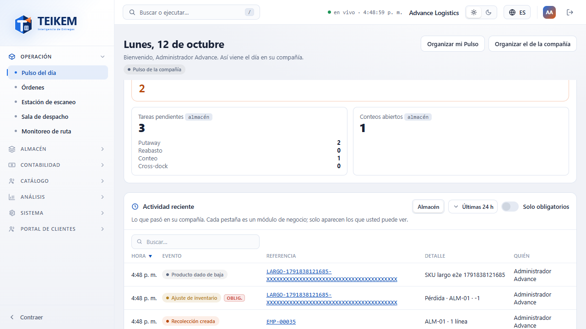

One tab per business module you can see (for now, only **Warehouse**; Operations and Accounting
will appear by themselves when your company has them available), a **time window** selector (Last 24 h /
Last 48 h / Today), the **"Mandatory only"** switch, a free-text search box and a table with: **Time** (your
own computer's), **Event** (a colored pill per family, with the **mand.** mark if it is an event that
is always shown), **Reference** (with a link to the corresponding record, when your user has permission to
see it), **Detail** and **Who**. At the bottom, "N events · [window]" and the **"See more"** button if there is more to load.

**What each control does.**

- **Module tabs**: they change which events are listed; if your company or your user only sees one module, there are no
  tabs to choose from (it appears anyway, already in that module).
- **Time window**: narrows the events to the last 24 h, 48 h or "Today" (since midnight).
- **"Mandatory only"**: hides the optional events (for example, "Pick batch created") and leaves only those the
  platform considers must always be seen (for example, an inventory adjustment).

  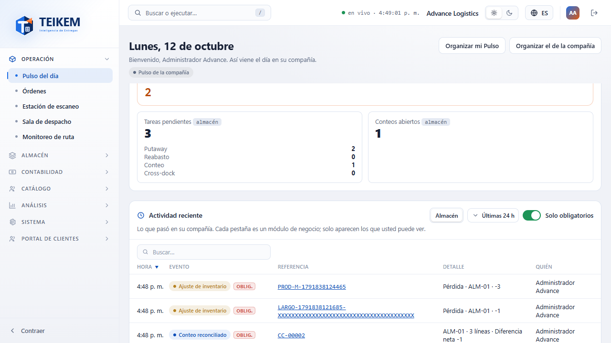
- **Search box**: filters what is already loaded on screen (it does not ask the server again); it searches the event, the
  reference, the detail and who did it.
- **Column headers** (Time, Event, Reference, Who): they sort the table; by default it comes sorted by
  Time, most recent first.
- **"See more"**: requests the next page of events and adds it below the one already loaded.
- **Reference** (link): opens the record of the receipt, the purchase order, the cycle count, the pick batch, the
  product or the warehouse as appropriate; if your user has no permission for that record, the text is shown but without
  a link. Inventory adjustments and transfers have no link (there is no "movement" record to
  go to).

**Language.** The event texts (name, detail) are translated by the server according to the language you have chosen;
changing the language with the header selector does not reload the page or lose the chosen time window.

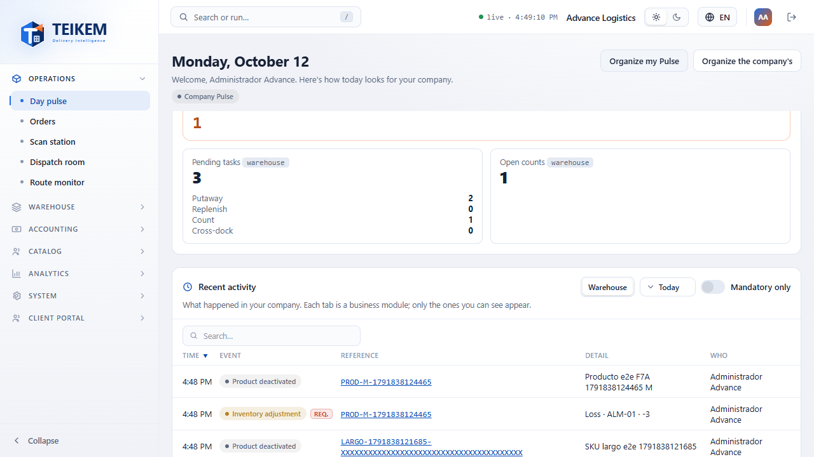

**Permission.** It is drawn only with `analytics.view` **and** the **Analytics** module (`ANALYTICS`) turned on; if your
company or your user does not see any business module (for example, without `inventory.view` for Warehouse), the panel
simply does not appear.

**Messages you may see.**

- While loading: a loading indicator with the panel's title and subtitle.
- No events in the chosen window: **"No activity in this window"**.
- The search box with no matches: **"No results"** (the generic one for the system's tables).
- An error when querying (for example, a connection error): the server's message in place of the table.

## On the phone (360 px)

The **Warehouse today** band is compacted: **four boxes in 2×2** with the number and the small bars, without the small text ("7 days: N") or "· last 7 days" in the title, and it stays fixed under the date when scrolling; with the phone sideways (little height) only the date stays fixed. The charts in "Your charts" go one below the other. The Warehouse panel cards stack in a single column and the Recent activity table is shown as a list
of cards (one per event), without losing any column or overflowing the screen; the "Category or product" control
takes the full width and its list, when opened, also fits without overflowing.

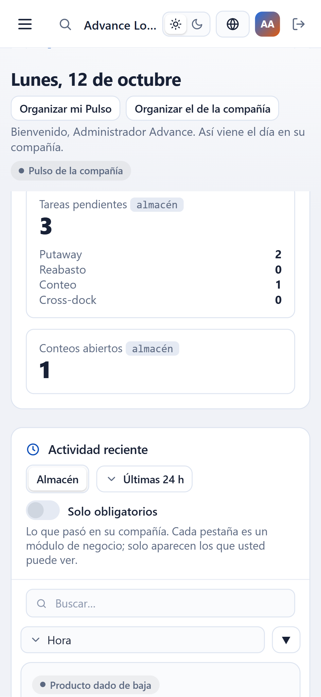

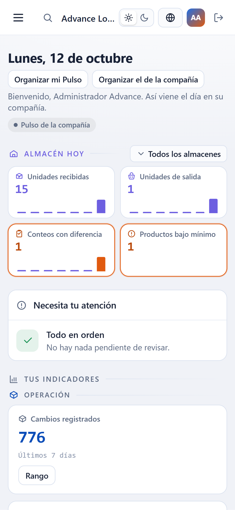

In the screenshot, the date and the Organize buttons go on two lines, and the band takes two rows of two boxes: "Counts with variance" and "Products below minimum" are in orange. No horizontal scroll.

## Frequently asked questions for this chapter

**Why does "Below minimum" say "Yes" instead of a number?** Because you chose a specific product in the "Category or
product" filter: for a single product the question is yes/no whether it is below its minimum, not a quantity. Clear the selection (✕)
to see again the number of products below minimum for the whole warehouse (or the chosen category).

**I chose a warehouse and a category, and when I enter Inventory from "View in Inventory" I see more filters applied
than I expected, why?** The link carries the same filters as the card (warehouse and category or product),
so that what you see in Inventory matches exactly the figure the Pulse had.

**Why did my chosen warehouse or product disappear when I reloaded the page?** It may be that that warehouse, that
category or that product was deactivated or deleted in the meantime: the saved selection is cleared by itself, without
warning, and the panel goes back to "All warehouses" with no category or product.

**Why don't I see the "Operations" or "Accounting" tab in Recent activity?** Those modules are not yet
available (they come in later batches); only the tabs of the modules your company has
turned on and that you can see appear.

**What does the "mand." mark next to an event mean?** That it is an event the platform considers must always
be seen in Recent activity, even with "Mandatory only" turned on; the rest of the events can be hidden
with that switch.

**I searched for something in the Recent activity search box and did not find an event I know happened, why?** The search box
only checks what is already loaded on screen (according to the chosen time window and tab); if the event happened
outside that window, switch to "48 h" or load more with "See more" before searching.

**Why does the ledger I open from "Units out" add up differently than the card?** Because the card is a net figure and the ledger filters by
type: deleted pick batches subtract in the card, but in the ledger they are an adjustment that the filter (Dispatch and Cross-dock) does not include.
Same with "Units received": receipt variances add in the card and appear separately in the ledger. See the [Batch 15 FAQ](../faq.md).

**I tap "Counts with variance" and see more counts than the number, why?** The link opens the Cycle count with the status Variance and no
dates; the number only counts those closed today (and "7 days: N", those of the week).

**How do I remove the sticky band?** With Organize (mine or the company's): hide "Warehouse today" or move it down. Only the date stays fixed.

**I changed the warehouse in the band and the one in the "Warehouse" panel changed.** That is expected: both share the same warehouse.
