# F8a — Full menu, branding, Pulse by panels, System and Analytics

Screen manual chapter for Batch F8a (frontend): the menu and header with the complete mockup (the 7
groups, with a "pending" screen for what has no function yet), the Teikem branding, the Day pulse
organized by panels with their own permission and two-level ordering (company and user), the **Roles &
users** screen (with the PIN for warehouse devices and per-person MFA), **Mobile devices**, **Value
lists** and **Indicators and Charts**. Screenshots in `img/f8a-*.png`.

The per-row actions in these tables (edit, delete, PIN, MFA, adjust, restore…) are shown as an icon
matching the action, not as a text button — hover over the icon to see which action it is.

## Branding and menu structure

**What you see.** The Teikem logo in the sidebar (it changes variant with the light/dark theme and with the
language) and, in the header, the "Search or run…" bar (command palette), the "live" clock, the
company selector, theme, language, your name and "Sign out".

The **7 groups** of the mockup, in this order: **Operations**, **Warehouse**, **Accounting**, **List**,
**Analytics**, **System**, **Client portal**. A group is only drawn if it has at least one item your user
can see (by permission and module); within each group, the items for which your company or your role does not
yet have a function open a "pending" screen with the title and subtitle of that screen and the notice "This screen
arrives in a later batch."

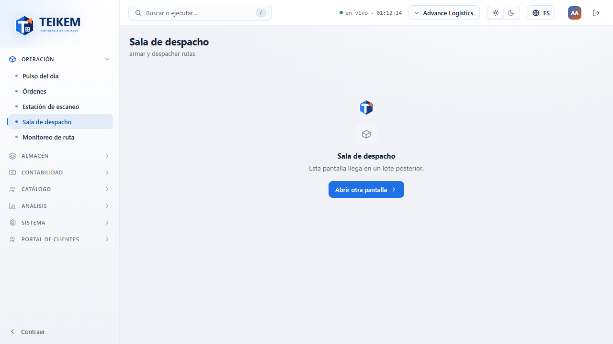

**Command palette.** It opens with **/** (outside a text field) or Ctrl/⌘+K, or with the magnifying glass on narrow
screens; type part of the title or subtitle of a screen (without accents) to filter it, ↑/↓ arrows to
move and Enter to enter; Escape closes it. It only offers screens your user can see.

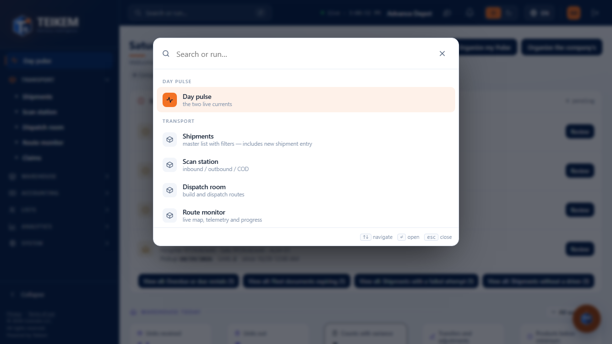

**Collapsing the sidebar** shows the brand name and its icons: you do not lose the screen you were on nor
does the page reload. The theme (light/dark) and the language are saved in your browser and kept on reload.

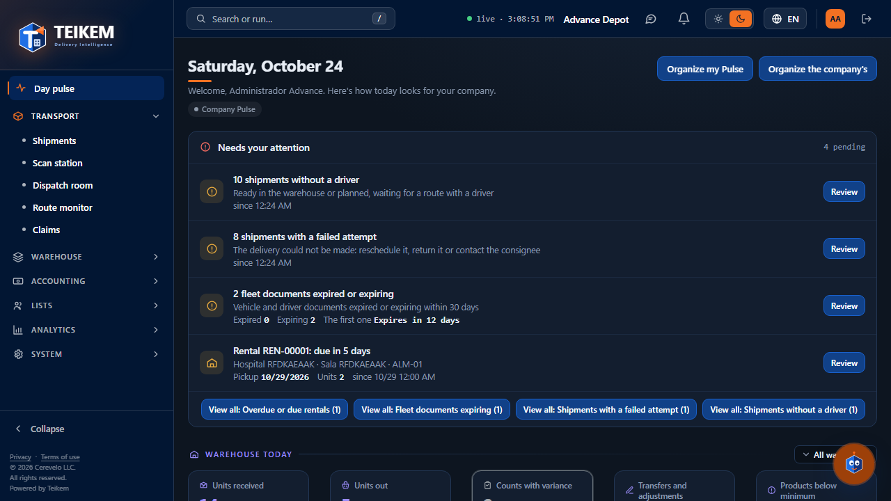

**Without permission for a screen opened directly by URL:**

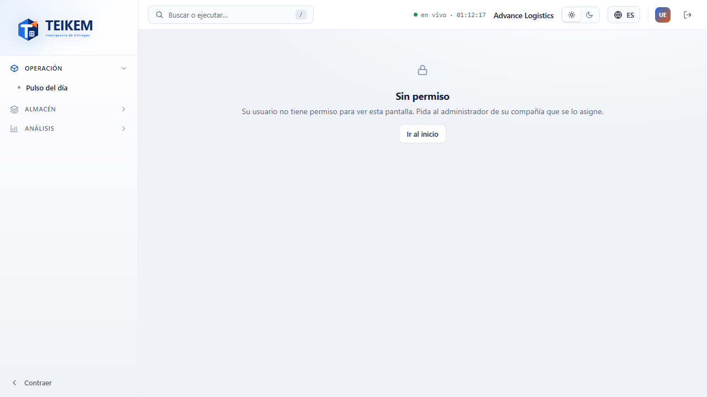

> "Your user is not allowed to see this screen. Ask your company administrator to grant it."

## Day pulse: organize (mine and the company's)

The detail of which panel each user sees (`pulse.*` permission per panel, read access to the data source, module
turned on) is in chapter [07 — Day pulse](../07-pulso-y-actividad.md), section 3. Here the
organize screen is documented.

**"Organize my Pulse"** (always available if you have any panel): inside, each panel and each indicator/chart
has a drag handle (with the mouse, on desktop), ▲/▼ buttons to move up/down and a "Hide"/
"Show" button. "Done" saves a single request with the new order; hidden items are dimmed while you organize. On
saving, the notice "Pulse saved" appears and, if you had never organized yours before, a chip **"Personal Pulse ·
Back to the company's"** next to the title — this order is yours only and is kept on reload.

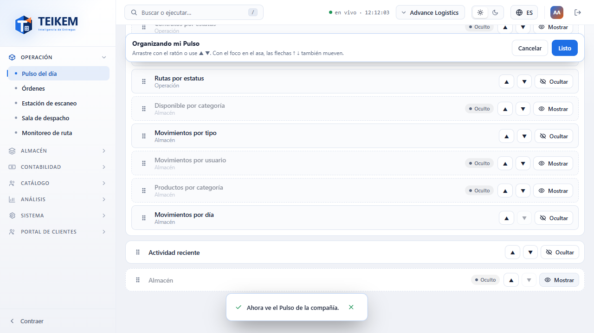

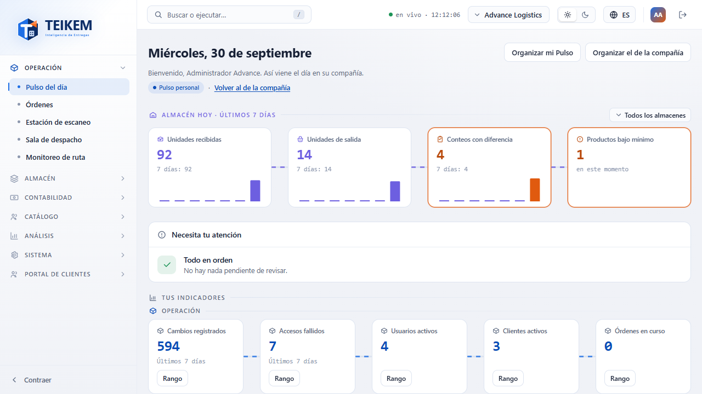

Since Batch 14 the organizer also lists the **Needs your attention** panel (permission `pulse.attention`): it can be moved and hidden like the
other panels.

Since Batch 15 it also lists the **Warehouse today** panel (the band; first by default) with a note explaining that the band that sits right
below the date stays fixed when scrolling and that, if it is hidden or moved down, only the date stays fixed. **Indicators** are listed per module
row (Operations, Warehouse, Accounting) and only move within their row; on saving, the order is saved per row. See [F7A](f7a-pulso-almacen-y-actividad.md).

**"Back to the company's"** (the chip's link): asks for confirmation — "Your Pulse order and hidden items are cleared and you'll see the
company's. Your date ranges are kept." — and discards your whole personal Pulse.

**"Organize the company's"** (only with the `pulse.organize_company` permission): same organizer, but it starts from the
**real company Pulse** (not yours) and, on saving, changes what **everyone** without their own
personal Pulse sees — including the panels that permission does not give access to (for example, someone with
Warehouse permissions only also stops seeing a panel you hide here, if they have no Pulse of their own).

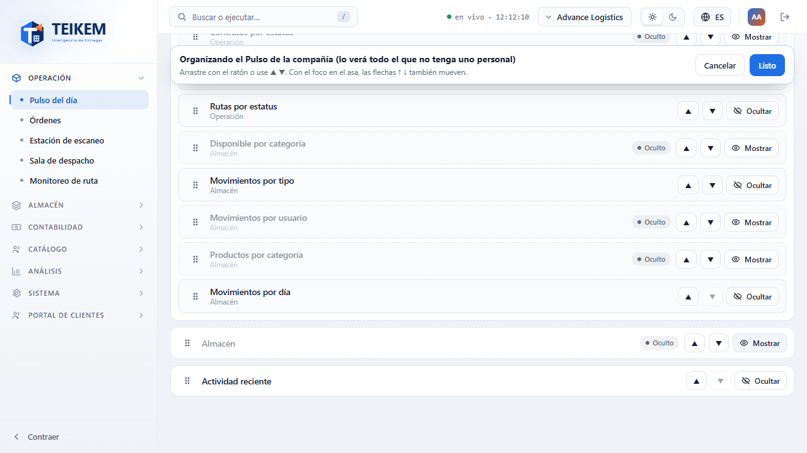

**Permission.** "Organize my Pulse" does not require any permission other than seeing at least one panel; "Organize the
company's" requires `pulse.organize_company` — without it, the button does not appear (§2.2: what you cannot do is not offered).

## Analytics: Indicators and Charts

**What it is for.** Manage the indicators and charts your company can build (not just see them in the Pulse):
create them, edit them, choose whether they are shown in your own Pulse or in the company's, and their date range.

**How to get there.** Group **Analytics** → **Indicators** / **Charts** (`analytics.view`, **Analytics** module).

**What you see.** Cards grouped by business module, each with its current value, the date range, the
**"Show in the day's Pulse"** switch (your personal preference) and, if you also have `analytics.manage` over
that definition, the "…in the company's" switch (the one seen by everyone without a personal Pulse).

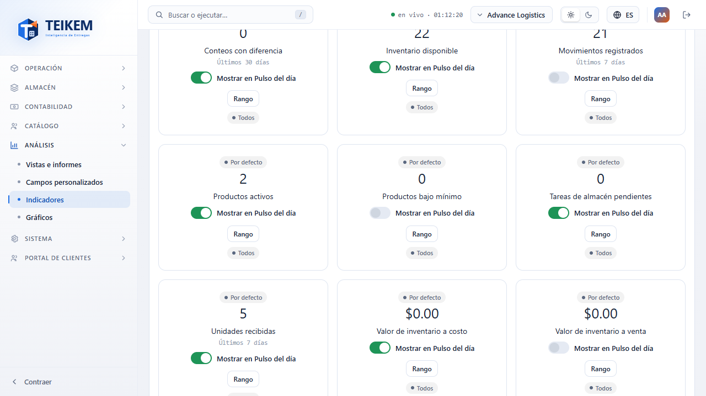

**"New indicator"/"New chart"** (`analytics.manage`): name in Spanish and English, data source, field and
aggregation, filter (field · operator · value, with `or`/`not` when the source allows it), business module, whether it is
money, visibility (whole company / private / shared with roles or people), default date range and
order in the company Pulse; charts add group by and the type (bar, donut, line).

**Messages you may see.**

- **"Company" chip** (Batch 15) next to the name of a chart without owner that is not a system one (the two warehouse ones: "Inventory value by
  category" and "Inventory movements by type"): with `analytics.manage` they are edited and deleted. When deleting one, the confirmation says
  "Delete chart {name}? It belongs to the company: once deleted it is not created again." Charts are always drawn (no list with few
  points) and, with more than 8 groups, the last point is "Others". Screenshots in [F7A](f7a-pulso-almacen-y-actividad.md).
- **"The name is required."** when saving without a name.
- **"The indicator '{name}' already exists."** / **"The chart '{name}' already exists."** (409): the name must be unique
  among the active ones.
- Edit/delete or the "…in the company's" switch only appear if you are the owner or have `analytics.manage`
  over that definition.
- If the data source can no longer be read (for example, `admin.audit` is removed from you and the definition used the
  log), the source responds **"Data source '{key}' not found."** (404): the definition still
  exists, but you can no longer see or edit it.

## Roles & users

**How to get there.** Group **System** → **Roles & users** (`admin.users` or `admin.roles`; the
Roles/Users segment shows only the tab you have permission for).

### Roles tab

Table with **Role**, **Permissions** (n / total), **Users** and edit/delete. System roles and templates
carry their chip; a role with assigned users cannot be deleted:

> "The role has assigned users; reassign them before deleting it." (409)

**"New role"/Edit** (`admin.roles`, and **re-authentication (AAL2)** when saving permission changes or when deleting):
name, description in Spanish and English and the permission checkboxes grouped by category (with "Whole group").
A repeated name responds **"The role '{name}' already exists."** (409).

### Users tab

Table with a search QBox (by name or email) and, by default, **without** suspended users ("Include suspended"
switch to see them too): Name, Email, Roles, Extra permissions, State (active/
suspended switch), MFA, Last login and, if you have `devices.manage` or `admin.users` with the Warehouse module turned on,
**App PIN**.

**"New user"** (email, name, roles, optional password): if you leave the password blank, the server
generates a temporary one and the screen shows it **only once**, in a modal that does not close with Esc or by
clicking outside — copy it with the button before pressing "Done", because afterwards it cannot be seen again (it can be
changed later from the user's own account).

**"Also add to these companies"** (since 2026-10-01, in "New user"): lists the other companies where **you also
manage users** (the platform administrator sees all the active ones); if there are none, the field does not appear. Check the
ones you want: the person signs in with the same email and the same password, and receives in each checked company the **same roles, by
name**, that you chose above. Everything is validated before creating anything: if any of the roles does not exist in a company you get
`In {company} the roles do not exist: {roles}.` (400) and the user is not created in any; if you do not manage users in a
company, `You cannot add users to that company.` (403). If the email already belongs to one of the checked ones, that company is not
touched and you are told ("Already a member of: …"). A single first sign-in (email, own password and MFA) works for all of them. Afterwards, the
roles of each company are adjusted from its own Users screen.

**Set/Reset PIN** (appears per row if the user has no PIN / if they already have one; requires AAL2 on saving):
a PIN of 4 to 6 digits, twice to confirm.

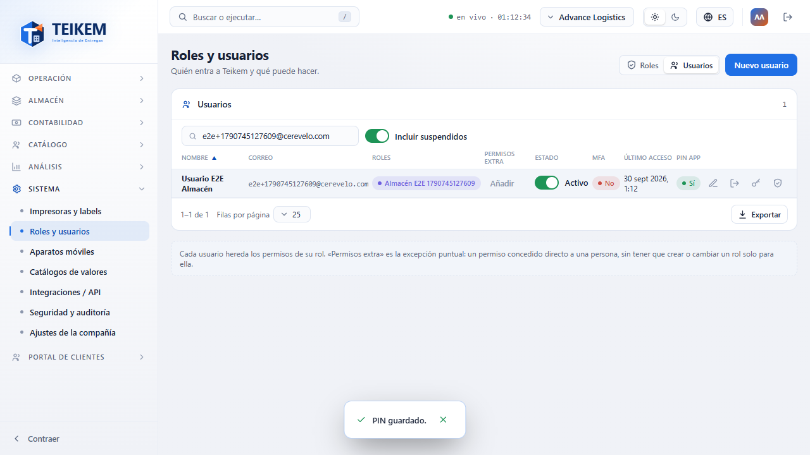

- **"The PINs do not match."**: the two entries are not the same.
- **"The PIN must have 4 to 6 digits."**: format.
- **"The PIN cannot be a trivial sequence."**: all digits the same (1111) or a consecutive ascending or
  descending sequence (1234, 4321, 9876…).

  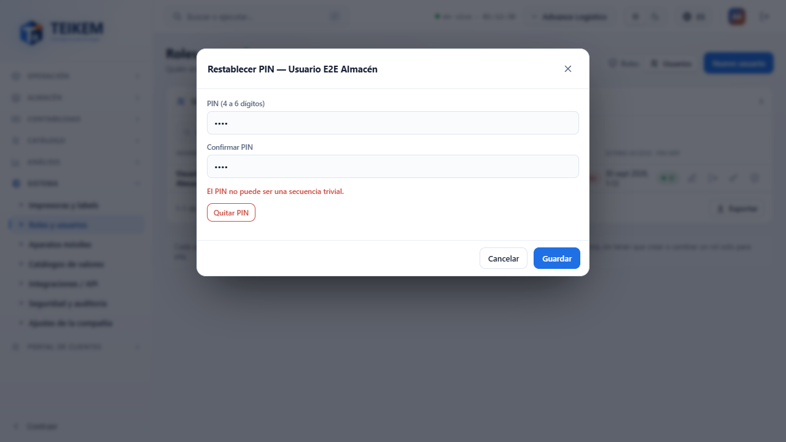
- **"Remove PIN"** (inside the same modal, only if they already have one): asks for confirmation and does not require re-authentication.
- **"You cannot set or remove the PIN of a user with more permissions than you."** (403): defense in depth,
  same as assigning roles.
- Setting or removing the PIN **closes the user's sessions on the devices** (their next sync asks for the PIN
  again).

**Editing a user who belongs to more than one company:**

> "This user belongs to more than one company; only the platform administrator can edit their account." (403)

Name and account state belong to the person, not to a particular company; an administrator of a single
company cannot change them if that person also works in another. The roles and permissions of **your** company can
still be edited as usual.

### MFA: require it from a person, and reset it if they lost their device

Apart from the MFA policy for the whole company (pending to be exposed on screen — see the next section),
an administrator can require it or stop requiring it from **one particular person**, and reset it if that person
lost the phone where they had two-step verification.

In the **MFA** column of the users table: **Yes**/**No** chip (if they already have it active) and, if it is required but
they have not activated it yet, an additional **"Pending"** chip.

- **"Set “always MFA”"** (shield icon; 2026-10-12, previously “Require MFA”): it is the individual **“always MFA”** mark. It asks for confirmation — "{name} will have to turn on two-step verification
  and will ALWAYS be asked for the code when signing in, even from a preferred IP…" — and AAL2 on saving. It is seen and changed **even if the company requires MFA from everyone**: the company
  policy asks everyone for the code, and the **preferred IPs** (trusted network) remove it for whoever signs in from them, **except** for whoever has this mark. Their next sign-in attempt responds `mfa_required` and
  asks them to enroll the second factor before letting them in (the administrator does not activate it for them: each person
  enrolls their own).
- **"Remove “always MFA”"** (same icon, appears when the mark is set): removes the individual mark; with the company policy they are still asked for the code, but from a preferred IP they will be able to sign in without it; if that person
  already had it active on their own, they keep it — no longer requiring it does not remove it.
- **"Reset MFA"** (restore icon, only if they already have one active): removes their confirmed two-step
  verification and their recovery codes — for when they lost the device and got locked out, unable to
  generate the code. On their next sign-in, if it is still required (by the company or by this specific
  requirement), they are asked again to enroll a new one from scratch.

**Setting for the whole company.** `Tenant.MfaRequired` (require MFA from everyone) already exists on the server and by
default comes as **Yes** for every new company — but the "Tenant settings" screen that would show it is
still a "pending" one (System group); for now that setting is only changed through the API.

## Mobile devices

**How to get there.** Group **System** → **Mobile devices** (`devices.manage`, **Warehouse and lot/serial** module).

**What you see.** Table with a QBox and, by default, **active only** ("Show: Include inactive" to see them all):
Code, Name, Default warehouse, State and Last heartbeat.

**"New device"**: name and default warehouse (optional); the device code **is generated by the server** (form
`AP-XXXXXX`, 6 random characters) — the screen no longer asks for it nor has a field to type it. On saving, a modal
shows the **enrollment code** (8 characters, single-use, expires in 24 h) with a button to copy it; it is seen
only once, until another is requested with "New enrollment code".

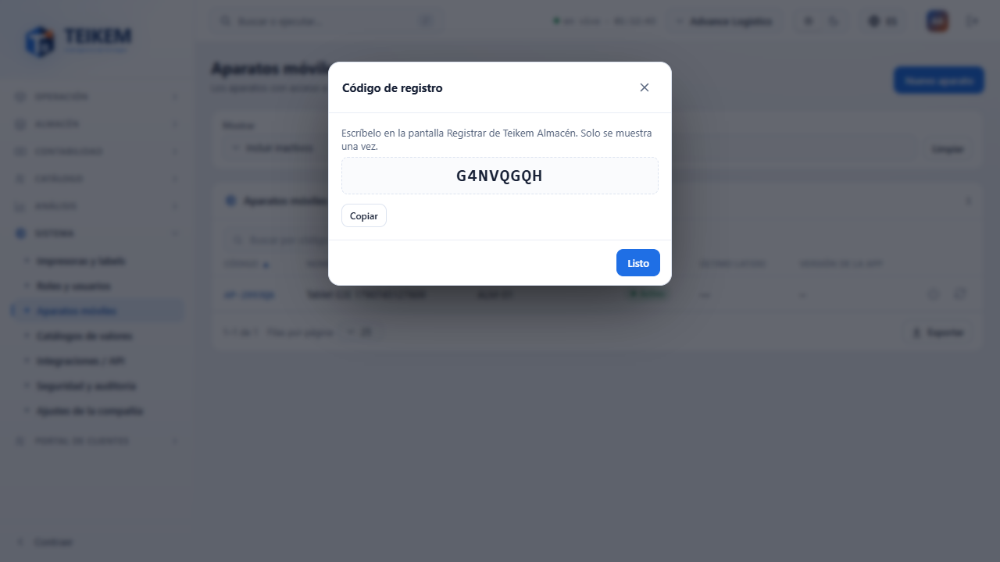

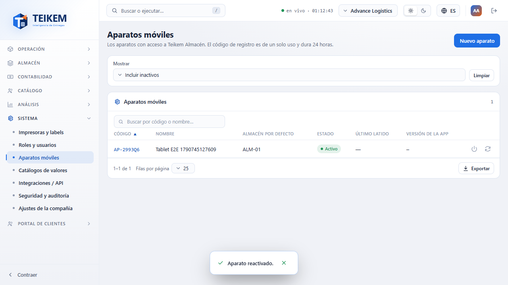

**Deactivate/Reactivate** (per row, with confirmation): deactivating revokes the sessions the device had open
(it stops syncing) and takes it out of the "Active only" list; reactivating it makes each person sign in again
with their PIN.

## Value lists

**How to get there.** Group **System** → **Value lists** (`admin.catalogs`).

**What you see.** Master-detail: list of domains on the left (with their System/Own chip) and, on the right, their
values (Code, Label in Spanish and English, Order, Enabled, Origin: **System** / **Adjusted** / **Own**).
The origin is decided by whether the value has an owner (company) or not, not by a loose flag: a value without a company is
a system one, even if it comes with an adjustment of yours on top.

**A system value** (for example, a warehouse task type) is not edited or deactivated directly: it is
**"Adjusted"** (label in both languages, order, enabled) — the adjustment is only for your company, without touching the
real value for the others — and it is **"Restored"** when it is no longer needed.

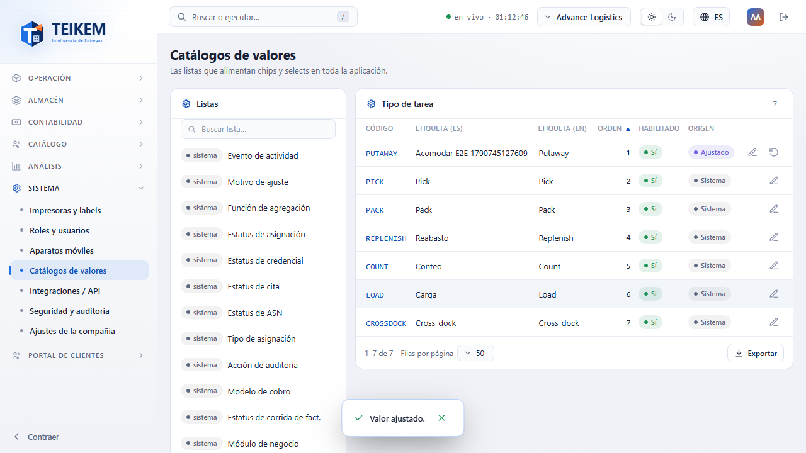

The change is reflected immediately wherever that value is shown — for example, the pending tasks
breakdown of the Pulse Warehouse panel — without having to reload the page.

**A value of your own company** (from a domain or a list you created) is edited, deactivated ("Disables it
without deleting the history that already uses it") and, if it was deactivated, it is **"Restored"** to offer it again when
capturing — before this batch that action had no real effect; now it does.

**"New list"** (own domain, for list-type custom fields): name in both languages and its
initial values; a row without code or without label responds with the row number:

> "The code is missing in row {n}." / "The label is missing in row {n}."

## My account → App PIN

**How to get there.** My account → **"App PIN"** tab (only if the Warehouse and lot/serial module is turned on).

**Set/Change PIN**: asks for your **current password** in addition to the new PIN (twice); the same format
and trivial-sequence rules as the PIN an administrator assigns you. **Remove** does not ask for a password.

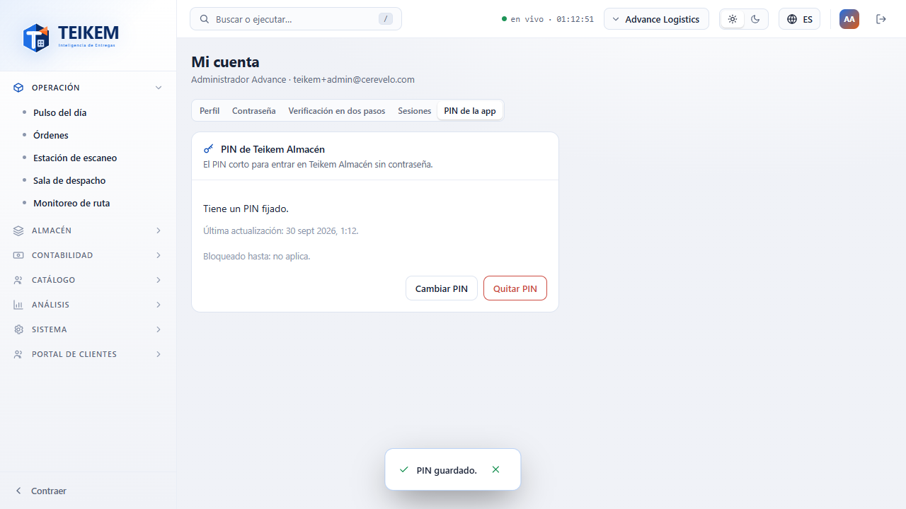

## On the phone (360 px)

The Pulse, Roles & users and Value lists are shown without horizontal scroll or cropped content; the command
palette opens from the header's magnifying glass instead of the "Search or run…" bar.

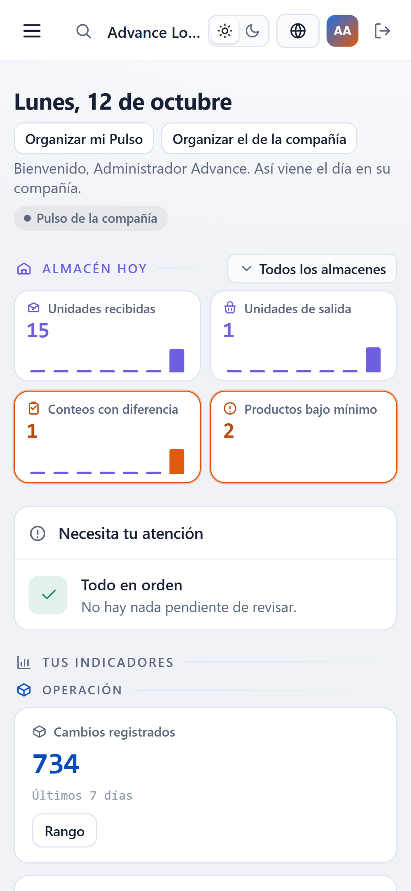
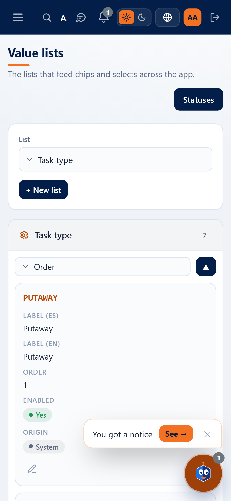

## Frequently asked questions for this chapter

See also [faq.md](../faq.md), section "Batch F8a — frontend: menu, System and Analytics".
