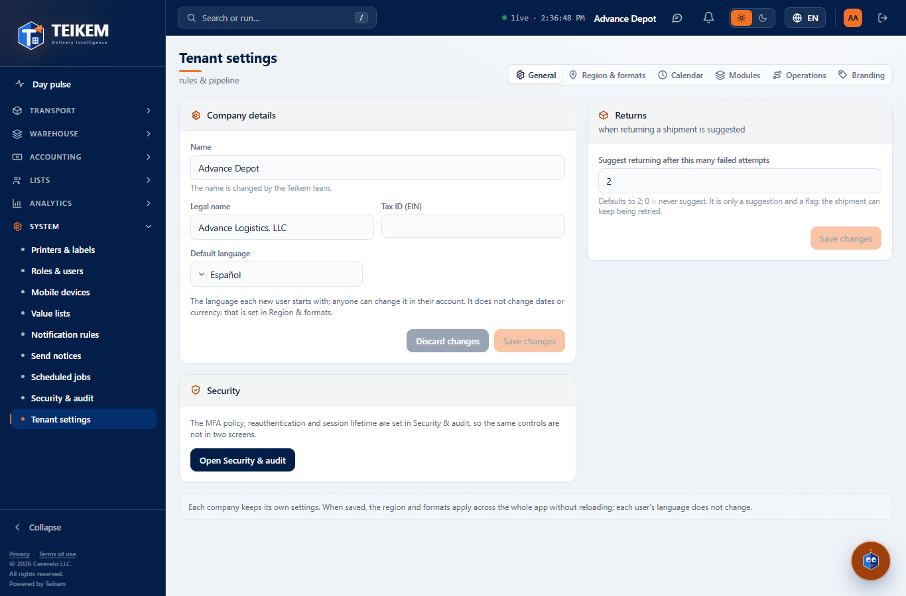
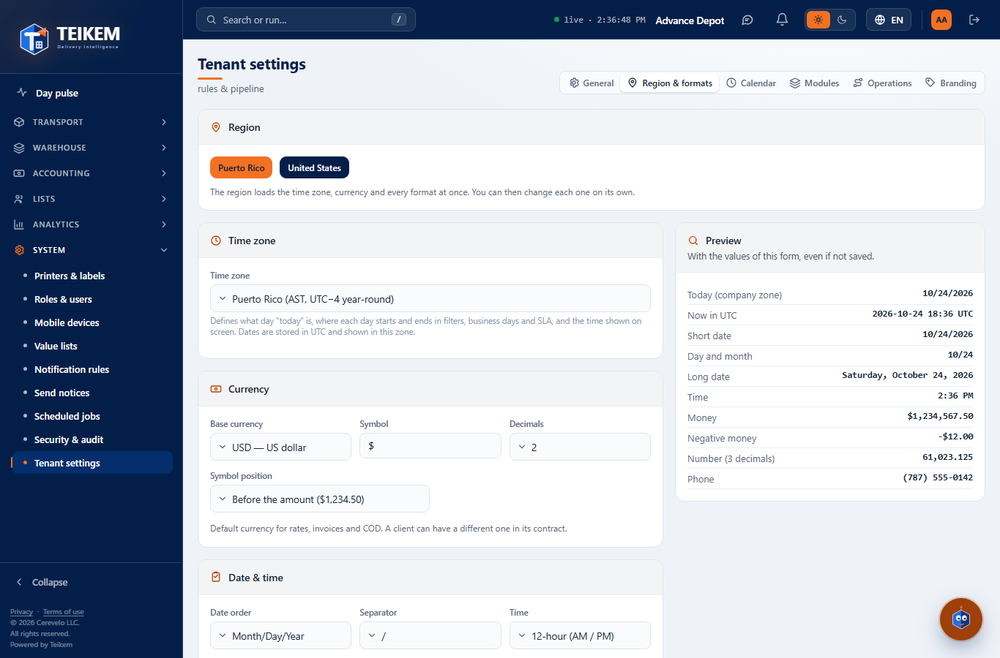
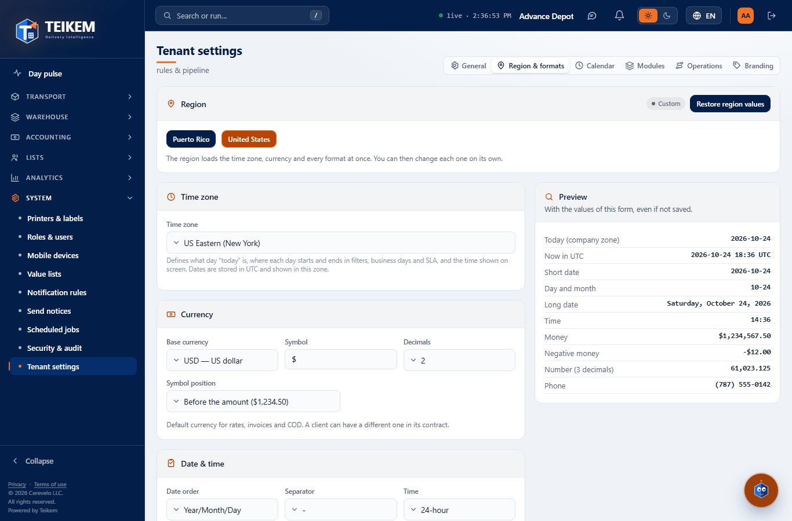
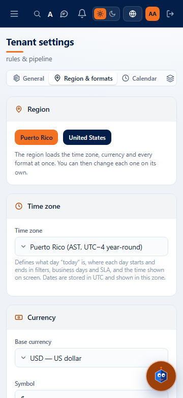
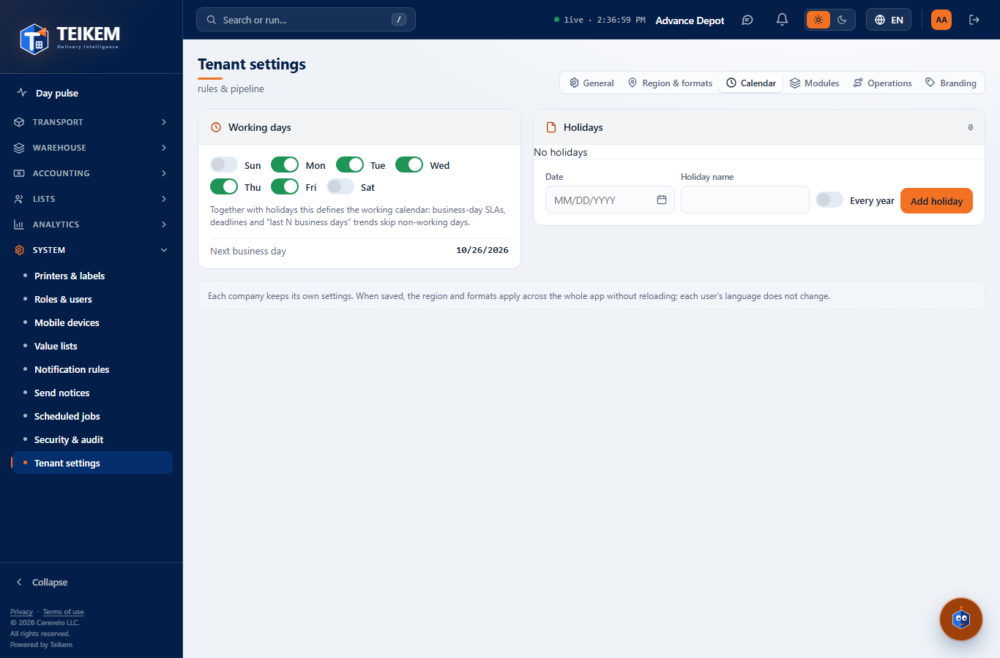
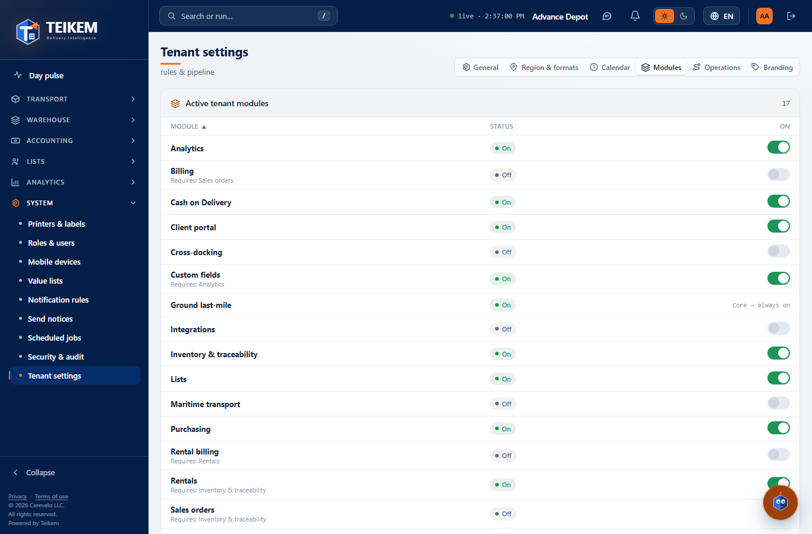
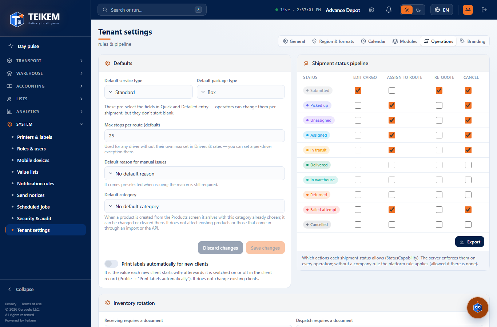
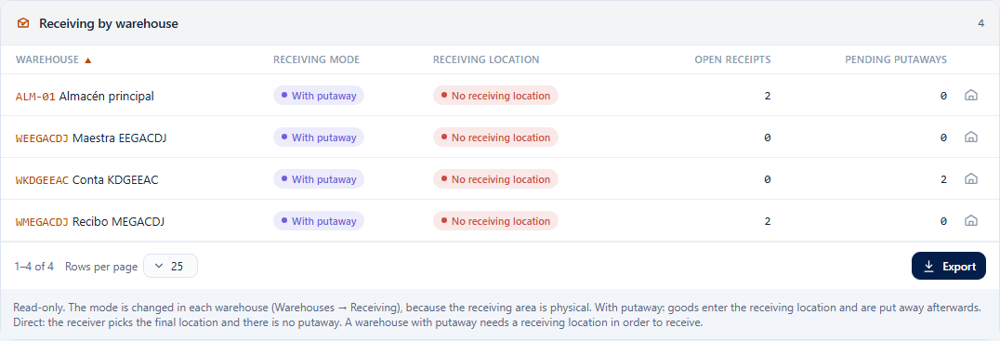
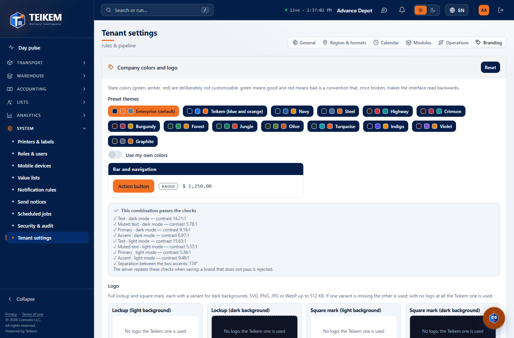

# F9 — Tenant settings and region and formats

Screen **System → Tenant settings** (`/system/settings`) and the change it brings to the whole application: since this batch
dates, times, numbers, money and phone numbers are shown with the **company's region and formats**, not with the user's
language. Backend from batch 18 (chapter 01, section 11.1); frontend decisions in `docs/frontend/loteF9-decisiones.md`.

**Who can.** See the screen: permission **`admin.tenant`** with the **System** module (`SYSTEM`) turned on (without the permission,
the menu does not show it and the address leads to "No permission"). Reading the settings (`GET /api/v1/tenant/settings`) only requires a session:
that is why the whole application knows the formats even if the user cannot change them. If someone enters without `admin.tenant`
(e.g. the permission was removed while the screen was open), everything becomes read-only with the notice "Read-only: your user does not
have permission to change the company settings (admin.tenant)." and with no save buttons.

**Tabs.** Top right, as in Security & audit: **General**, **Region & formats**, **Calendar**,
**Modules**, **Operations** and **Branding**. The tab stays in the address (`?tab=region`, `calendar`, `modules`, `ops`,
`brand`; General with no parameter), so a direct link can be sent. On the phone the tabs scroll within their
strip (never the page). Forms with **Save changes** show "There are unsaved changes." and **Discard changes**
goes back to what was saved; switching tabs without saving discards that tab's draft.

## 1. How dates, times, numbers and phone numbers are shown (whole application)

| What | Who decides | Puerto Rico (default) |
|---|---|---|
| Date order and separator | Company (Region & formats) | 10/02/2026 (month/day/year) |
| Time (12 or 24 hours) and time zone | Company | 9:30 PM in `America/Puerto_Rico` |
| "Today", start and end of each day | Company's zone | at 9:30 PM on October 2 it is still the 2nd |
| Thousands and decimal separators | Company | 61,023.125 |
| Money (symbol, position, decimals) | Company | $1,234.50 · -$12.00 |
| Phone | Company (country code and mask) | (787) 555-0142 |
| Month and day names, "a. m."/"AM" | User's language | "viernes, 2 de octubre" / "Friday, October 2" |

- Changing the **language** (header selector) no longer changes the date order or the separators: it only translates.
- The header **clock** ("● live · 2:05:09 PM") runs in the company's zone and with the company's time format.
- Lists, records, status histories, the ledger, the Pulse, the filter sentence of the exports ("from 09/01/2026 to
  09/30/2026"), PDFs and the names of exported files use these formats. Excel still stores dates as
  dates (`yyyy-mm-dd`), so the program reads them as such.
- Platform appointments, "Count what changed" and date and time custom fields are written in the company's
  time (before, appointments and custom fields used the computer's time).
- **On saving** Region & formats, the whole application changes **immediately, without reloading** (for all the users of the
  company when their screen reads the settings again: they are considered current for 10 minutes and afterwards are requested again when
  returning to the window or opening another screen; also when switching language or company).

## 2. General

- **Company details.** *Name* (read-only: "The name is changed by the Teikem team."), *Legal name*, *Tax ID
  (EIN)* and *Default language* (Español / English: the language each new user signs in with; it does not change dates or currency).
  Save → `PUT /api/v1/tenant/settings` with those three fields; notice "Settings saved". An empty text clears the value.
- **Security.** The MFA policy, re-authentication and session duration are in Security & audit (button
  **Open Security & audit**); they are not repeated here.

| Field | Rule | Message | Where |
|---|---|---|---|
| Default language | 2-letter code | "2-letter language code." | Server, 400 (the screen only offers es/en) |

## 3. Region & formats

- **Region.** **Puerto Rico** and **United States** buttons (those given by `GET /api/v1/tenant/format-options`). One click loads
  the region's complete set at once (zone, currency and all the formats) into the form; notice "Region applied: check
  the preview and save.". If any value differs from the region's, the **Custom** chip and the
  **Restore region values** button appear, which loads the complete set of the chosen region again.
- **Time zone** (Puerto Rico, US Eastern, Central, Mountain and Pacific, Alaska, Hawaii).
- **Currency.** *Base currency* (USD), *Symbol* (1 to 3 characters), *Decimals* (0, 2 or 3) and *Symbol position* (before the
  amount, `$1,234.50`, or after, `1.234,50 $`).
- **Date and time.** *Date order* (Month/Day/Year, Day/Month/Year, Year/Month/Day), *Separator* (`/`, `-`, `.`), *Time* (12 or 24
  hours) and *First day of the week* (Sunday or Monday; it orders the Calendar's days).
- **Numbers.** *Thousands separator* (comma, period or space) and *Decimal separator* (period or comma). They can never be the same:
  if you choose one that clashes with the other, **the other one changes by itself** and the notice "The thousands and decimal separators cannot
  be the same: the other one was changed." appears.
- **Phone.** *Country code* (`+` and 1 to 4 digits) and *Format* (`(000) 000-0000`, `000-000-0000`, `000.000.0000`,
  `000 000 0000`; each 0 is a digit). Phone numbers are stored with digits only and shown with this format.
- **Preview** (on the right; below on the phone). With the form's values, **even if they are not saved**: today in
  the company's zone, now in UTC, short date, day and month, long date, time, money, negative money, number with 3
  decimals and phone. The time advances by itself.
- **Save changes** sends the region and the 13 complete fields (`PUT /api/v1/tenant/settings`); "Settings saved".

**Messages** (all 400, below their field; if there is an error nothing is saved). Exact text in chapter 01, section 11.1 and
in the FAQ "Region & formats (2026-10)":

| Field | Message |
|---|---|
| Time zone | "The time zone '…' is not recognized by the platform. Use an IANA name, for example America/Puerto_Rico or America/New_York." |
| Symbol | "The currency symbol is required and 1 to 3 characters long, for example $." |
| Decimal separator | "The thousands and decimal separators cannot be the same" (should not be seen: the screen swaps them) |
| Country code | "The phone country code must be '+' followed by 1 to 4 digits, for example +1." |

## 4. Calendar

- **Working days.** One switch per day, in the order of the company's first day of the week. Each change is saved
  immediately (`PUT /tenant/settings` with `workDaysMask`; "Working days saved"). At least one must remain:
  turning off the last one is not allowed ("At least one working day is required"). Below, **Next business day** counted from today
  in the company's zone, skipping non-working days and holidays.
- **Holidays.** Table with Date (an "every year" holiday is shown with day and month only), Name and Every year; sortable columns.
  To add: Date, Holiday name, *Every year* switch and **Add holiday** (`POST /api/v1/tenant/holidays`;
  "Holiday added"). The trash can on each row asks for confirmation ("Remove the holiday?") and removes it
  (`DELETE /api/v1/tenant/holidays/{id}`; "Holiday removed").

| Message | When | Where |
|---|---|---|
| "Enter the holiday date and name" | the date or the name is missing | Screen |
| "There is already a holiday on that date." | one already exists on that same date; the server responds (409, batch 19) and the screen shows it | Server, 409 |
| "The name is required." | empty name | Server, 400 |
| "At least one working day is required" | turning off the last day | Screen (notice) |

## 5. Modules

List of the platform's modules (`GET /api/v1/modules`) with their **State** (On/Off) and, if one depends on another,
"Requires: …". The **core** ones say "Core — always on" and have no switch. The switch of a module whose
required module is off is disabled ("Enable first: …"). Turning off a module that other enabled ones depend on asks for
confirmation ("Turn … off?" — "Turning … off also turns off: …"). Turning on or off (`PUT /api/v1/modules/{key}`) requires
having confirmed your identity recently (AAL2): if not, re-authentication opens (password and MFA code) and the action
repeats by itself. When done, the menu and the search show or hide the module's screens without reloading.

| Message | Code |
|---|---|
| "'…' depends on '…', which must be turned on first." | 409 (the screen prevents it by disabling the switch) |
| "'…' is a core module and cannot be turned off." | 409 (the screen does not offer to turn it off) |

## 6. Operations

- **Default values.** *Default service type* and *Default package type* (from the list; "No default value"
  clears it) and *Max stops per route (default)* (integer ≥ 1; "Must be 1 or more." on screen, "Must be ≥ 1."
  from the server). Save → `PUT /tenant/settings`.
- **Shipment status pipeline** (only with the orders module, `LTL_GROUND`). Status × action matrix (Edit cargo,
  Assign to route, Re-quote, Cancel) read from `GET /api/v1/status/capabilities/TRANSPORT_ORDER`: checked = the status
  allows the action (with no rule, it is allowed). Each box is saved on click (`PUT …/capabilities/TRANSPORT_ORDER?statusDomain=OrderStatus`;
  "Status action saved") and requires the **`admin.statusconfig`** permission (without it, read-only). The server applies the
  matrix in every operation on the order.
- **New products: default category** (WMS module, 2026-10-11). A selector with the **active** categories (path “Root / Child”) and
  “No default category”. When a product is created in Products & inventory it arrives with that category chosen (it can be changed or cleared there);
  it does not affect products that already exist. Save sends `defaultProductCategoryId` (id; `0` = clear) and requires `admin.tenant` (without it, read-only).
  Server message under the selector: *The default category does not exist or is inactive.* (400).
- **Receiving by warehouse** (read-only; WMS module). Per warehouse: mode (**With putaway** / **Direct to bin**), default
  receiving bin, open receipts and pending putaways. A warehouse with putaway **without** a receiving bin
  shows in red **"No receiving location"**: it could not receive. The warehouse icon (or clicking the row) opens the warehouse
  record, where the mode is changed (Warehouses → Receiving). Without permission to see warehouses: "Your user cannot read the
  warehouses.". Note: the server uses the warehouse's first `STAGING` zone when it has no default bin, so the notice
  also appears in a warehouse that would receive with that zone (in the screenshot, ALM-01); set the default bin to remove it.

- **Inventory rotation** (WMS module, 2026-10-11). A selector **FEFO — first expired, first out** (the usual one and the one of all existing companies) / **FIFO — first in, first out**. It defines which stock the goods leave from first
  when the system assigns an issue (picking, manual issue, replenishment and the device's exit order); each product can have its exception on its record. Save sends `rotationMethod` and requires `admin.tenant` (without it, read-only).
  It applies from the next assignment; it does not change what was already picked. Server message under the selector: *The rotation method must be FEFO or FIFO.* (400). Functional detail in chapter 06 §2.2.
- **“Receiving by warehouse” in a single call** (2026-10-11): the open receipts and pending putaways of all warehouses are read with `GET /api/v1/receipts/summary-by-warehouse` (before, two queries per warehouse).

## 7. Branding

- **Preset themes** (14, with their colors; **Advance Logistics** —navy blue, orange and gray— is the default one) or **Use my own
  colors**: **primary** color (bars, navigation, tabs), **action** color (buttons and links; optional, “Same as
  primary”), **accent** color (marks, counters and money) and base tone (color picker or hexadecimal; a badly written one:
  "Enter a hexadecimal color, for example #1F6FE5."). Below, a **sample** with bar, button, mark and amount in the three colors.
- **Live validations**: contrast of the text, the dimmed text and the two accents against the panel in dark and light mode, and
  separation between the two accents (minimum 40°). If something fails, "Review these before using it" and it cannot be saved
  ("Fix the checks before saving.").
- While editing, **the whole application** is shown with the draft; **Save changes** leaves it in the company ("Branding saved");
  **Discard changes** or leaving the tab goes back to what was saved. **Restore** goes back to the default theme, Advance Logistics (you have to save).
- The status colors (green, amber, red) are deliberately not changed.
- **Logo:** the company's four logos are uploaded, viewed and removed from this tab since batch 19 (see
  [F11](f11-marca-por-compania.md)); without a logo of your own, Teikem's are used. The server also repeats the color
  validations.

## 8. Common cases

- **I switched to United States and see no difference.** Puerto Rico and the US East share formats and, from March to
  November, the same time (UTC−4). The difference is in the zone: in winter New York is one hour behind.
- **Dates in Spanish now come out month/day/year.** It is the company's format (Puerto Rico = MM/DD/YYYY). For day/month/year,
  change the *Date order* in Region & formats.
- **A phone number is shown "as is".** It does not have the digits the mask requires; edit it and type the complete digits.
