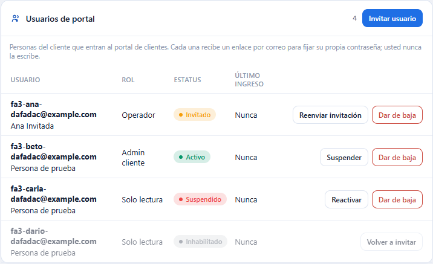
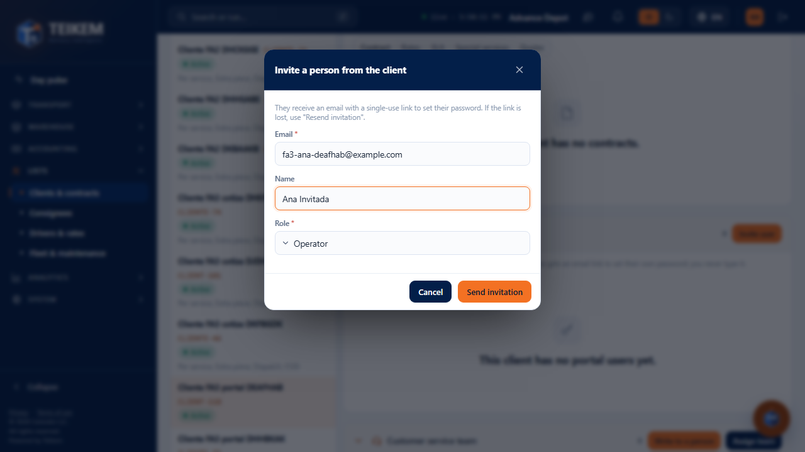
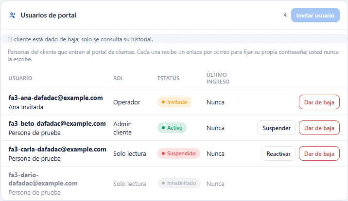
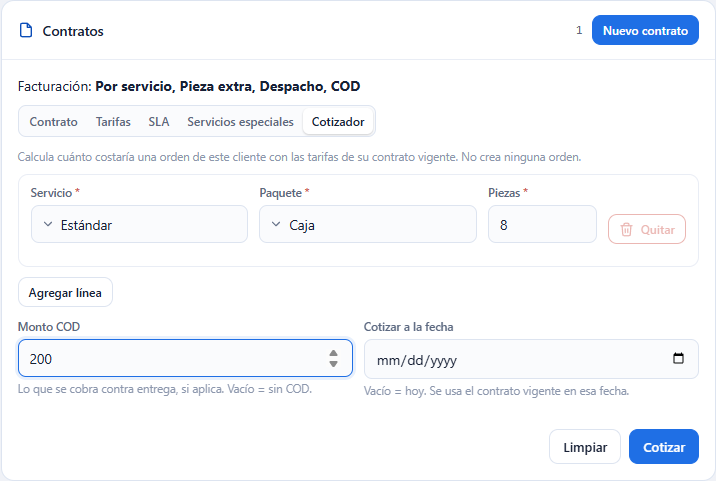
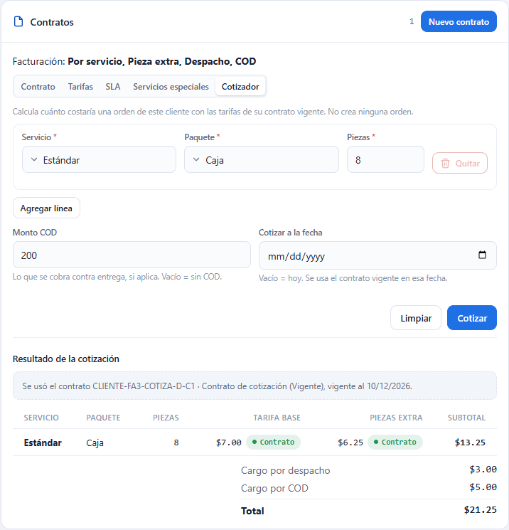
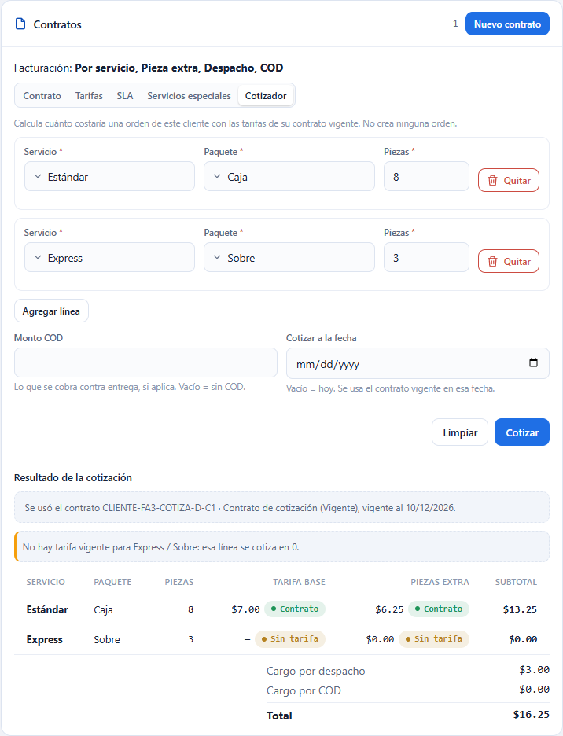

# Portal users and client Quoter

In each client's record (**Lists → Clients & contracts**) there are two more tools, which complete the work with clients and contracts from [F-A1](fa1-clientes.md) and [F-A2](fa2-contratos.md):

- **Portal users**: you **invite** by email the client's people who will use the client portal, resend a lost invitation, **suspend** and **reactivate** their access and **deactivate** them.
- **Quoter**: a new tab in the **Contracts** section that calculates **how much an order would cost** for that client with the rates of its contract, **without creating any order**.

This screen is the **administration** done by your company. The portal where the client signs in with their account is another screen, which is not built yet.

Screenshots: `img/fa3-invitar.png`, `img/fa3-portal.png`, `img/fa3-portal-baja.png`, `img/fa3-cotizador.png`, `img/fa3-cotizacion.png`, `img/fa3-sin-tarifa.png`.

## Permissions and modules

Each part appears only if you have its permission and your company has the module turned on. If something is missing, ask your company administrator for it.

| What | Permission | Company module |
|---|---|---|
| See the **Portal users** panel and all its buttons | `portalusers.manage` | **Client portal** (and List, like the whole screen) |
| See the **Quoter** tab and quote | `contracts.read` | **List** |

- Without `portalusers.manage`, or with the **Client portal** module off, the **Portal users** panel **does not appear**.
- Without `contracts.read` the whole **Contracts** section (the Quoter too) is reduced to the notice “Your user cannot view contracts (permission contracts.read)”.

---

# Portal users

The **Portal users** panel is below **Contracts**. Each row is a person from the client with their **email**, **name**, **role**, **status** and **last sign-in**.

## What each status means

| Status | What it means | Which buttons it has |
|---|---|---|
| **Invited** | They received the email but have not set their password yet. | **Resend invitation**, **Deactivate** |
| **Active** | They already accepted the invitation and can sign in to the portal. | **Suspend**, **Deactivate** |
| **Suspended** | Their access is stopped; they keep their password. | **Reactivate**, **Deactivate** |
| **Disabled** | Deactivated. Their history is kept. | **Invite again** |

Deactivated people appear at the end of the list, in gray. If the same person is in several clients of your company, “Also in N other client(s)” appears under their name.

## Inviting a person

1. In the **Portal users** panel press **Invite user**.
2. Type their **Email** (required, up to 150 characters).
3. If you want, type their **Name** (up to 150 characters).
4. Choose their **Role** (required): **Client admin**, **Operator** or **Read-only**.
5. Press **Send invitation**.

The system sends that person an email with a **single-use link** so that **they themselves** set their password. You never type or see the password, and you do not see the link either. The green notice tells you until when it is valid: “Invitation sent to … The link expires on …”. Until they use it, the person appears as **Invited**.

If the person already had an active portal account through another client of your company, no email is sent: they become **Active** in this client instantly and the notice says “… already had an active portal account: they are now active for this client and no invitation was sent.”

## Resending an invitation

Use it when the person says the link “does not work” or they lost it.

1. In the person's row (status **Invited**) press **Resend invitation**.
2. Confirm with **Resend invitation**.

A **new** link is sent and the previous one **stops being valid**. It can only be resent to whoever is still **Invited**.

## Suspending and reactivating

1. In the row of an **Active** person press **Suspend** and confirm: they will not be able to sign in to the portal, but they keep their password. If the person is in other clients with active access, those are not affected.
2. To give them access back, in their row (now **Suspended**) press **Reactivate** and confirm: they sign in with their usual password.

## Deactivating and inviting again

1. In the row press **Deactivate** and confirm. They become **Disabled**; the history is kept.
2. If later on they work with the client again, press **Invite again**: the window brings their email (it cannot be changed), name and role already filled in. Press **Send invitation**. They go back to **Invited** and set a new password with the link.

## Deactivated client

If the client is deactivated, the panel warns “The client has been deactivated; only its history can be viewed.”, the **Invite user** button is disabled and **Resend invitation** and **Invite again** disappear. The list is still shown, and **Suspend**, **Reactivate** and **Deactivate** remain available.

## Panel messages

Server messages appear as is.

| Message | What it means | What to do |
|---|---|---|
| `The email is required.` | You left the email empty. | Type it. |
| `Invalid email.` | It is missing the “@” or the domain's period. | Correct it. |
| `Maximum 150 characters.` | The email or the name is too long. | Shorten it. |
| `The portal role is required.` | You did not choose a role. | Choose one. |
| `That email is not available for this company's portal.` | That email is already invited, active or suspended **in this client**, or it belongs to an internal user of your company or to another company. It is the same message in every case, on purpose, so as not to reveal where it is registered. | Use another email. If the person is already in this client, find them in the list and use **Resend invitation**, **Reactivate** or **Invite again**. |
| `The client has been deactivated; only its history can be viewed.` | The client is deactivated (perhaps someone else did it while you had the record open). | Reactivate the client in the record header if you need to invite. |
| `The invitation can only be resent to a user who has not accepted it yet (status INVITED).` | The person already accepted (or changed status) and you had the old list. | Close the notice; the list refreshes by itself when you open the record again. |
| `Only a portal user in status ACTIVE can be suspended.` | The person is no longer **Active**. | Check their current status in the list. |
| `Only a portal user in status SUSPENDED can be reactivated.` | The person is no longer **Suspended**. | Check their current status in the list. |
| `The portal user is already deactivated.` | They were already **Disabled**. | If needed, use **Invite again**. |
| `Portal user '<n>' not found.` | That row no longer exists in this client. | Open the record again. |
| `The 'CLIENT_PORTAL' module is not enabled for this company.` | The company does not have the Client portal module. | Ask whoever administers the platform to turn it on. |

---

# Quoter

The **Quoter** tab is at the end of the **Contracts** section of the record.

## How to quote

1. In the client record open **Contracts → Quoter**.
2. In **Line 1** choose the **Service** and the **Package** and type the **Pieces** (a whole number from 1 up).
3. If the order has more than one package type, press **Add line** and fill in the new line. There can only be **one line per service/package pair**, with the total pieces. **Remove** deletes a line (the last one cannot be removed).
4. If the order is collected on delivery, type the **COD amount**. Empty = no COD.
5. If you want to quote with the rates of another day, choose the date in **Quote as of**. Empty = today; the contract in force on that date is used.
6. Press **Quote**. **Clear** returns the screen to its initial state.

## How to read the result

- **Which contract was used**: “Contract … (In effect) was used, in force on …”. If the client had no current contract on that date it says “The client has no contract in force on …: the company's generic rates were used, with no dispatch or COD fee.”
- **One row per line**: **Base rate**, **Extra pieces** (the charge for the additional pieces from the second one on, by tiers) and the line's **Subtotal** (base + extra pieces).
- The label next to each amount says **where it came from**: **Contract** (this client's rate), **Generic** (the company's general rate, when the contract does not have it or that component is off) or **No rate**.
- Below: **Dispatch fee** (once per order), **COD fee** and the **Total**. The dispatch fee and the COD fee are charged **only once per order**, not per line.

Example (the one in the screenshot): base $7.00 + 8 pieces (from 2 to 5 at $1.00 and from 6 onwards at $0.75 = $6.25) = $13.25; plus dispatch $3.00 and COD 2.5 % of $200 = $5.00; total **$21.25**.

### Line without rate

If the client has no rate for a line (neither contract nor generic), **it is not an error**: the line is quoted at **0** and the screen warns you: “There is no rate in force for X / Y: that line is quoted at 0.” Set up the rate in the **Rates** tab.

## Contract prices and who sees them

The Quoter shows the client's **contract** prices. Whoever has `contracts.read` sees them; the permission to see order prices (`orders.view_price`) does not change what appears here.

## Quoter messages

| Message | What it means | What to do |
|---|---|---|
| `The service type is required.` / `The package type is required.` | The service or the package of a line is not chosen. | Choose it. |
| `The number of pieces must be at least 1.` | Pieces at 0, empty or negative. | Type 1 or more. |
| `Pieces must be a whole number.` | You typed decimals. | Use a whole number. |
| `The COD amount cannot be negative.` | You typed a COD lower than 0. | Type 0 or more, or leave it empty. |
| `The service/package type pair is repeated; send a single line per (service, package type) with the total pieces.` | Two lines with the same service and package. | Combine the pieces into a single line. |
| `The client has been deactivated; only its history can be viewed.` | The client is deactivated: quoting is not allowed. | Reactivate the client if you need to quote. |
| `Client not found.` | The client no longer exists in your company. | Go back to the client list. |

## Frequently asked questions

**I don't see the “Portal users” panel.**
The `portalusers.manage` permission is missing or your company does not have the **Client portal** module. Ask the administrator for it.

**The person says the email did not arrive or the link does not work.**
Check that the email is spelled correctly and press **Resend invitation**. The link expires (the notice tells you when) and only works once; the previous one stops being valid when resent.

**Can I see or change a person's password?**
No. Each person sets their own with the link. If they lost theirs, the way from this screen is **Deactivate** and then **Invite again**: they receive a new link and set a new password.

**What is the difference between Suspend and Deactivate?**
Suspend is temporary: it keeps the password and is undone with **Reactivate**. Deactivate ends the access to this client; to come back you have to **Invite again** and the person sets a new password.

**I invited the same person from another client and got no error.**
That is expected: the same person can belong to several clients of your company. They become **Active** instantly if they already had a password and that is why the list shows “Also in N other client(s)”.

**The Quoter gives me 0 on a line.**
There is no rate in force for that service and package (neither contract nor generic). Add it in **Rates**.

**The total does not match the sum of the subtotals.**
The **Dispatch fee** and the **COD fee**, which are charged only once per order, are also added to the total.

**Does quoting create an order or change anything?**
No. It only calculates.

**I quote as of a past date and it comes out without dispatch or COD.**
On that date the client had no current contract; the company's generic rates are used and there are no dispatch or COD fees.
