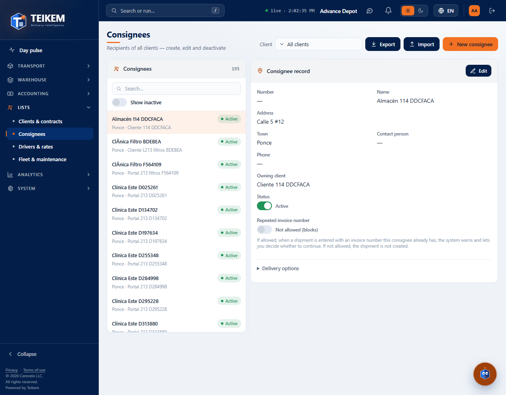
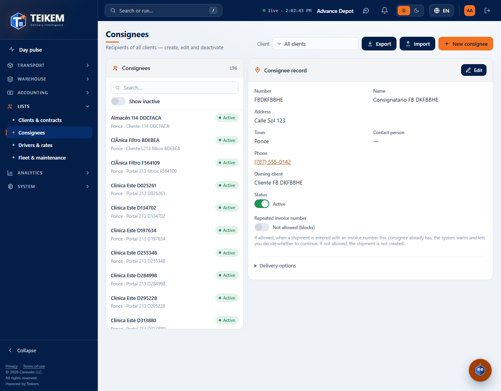
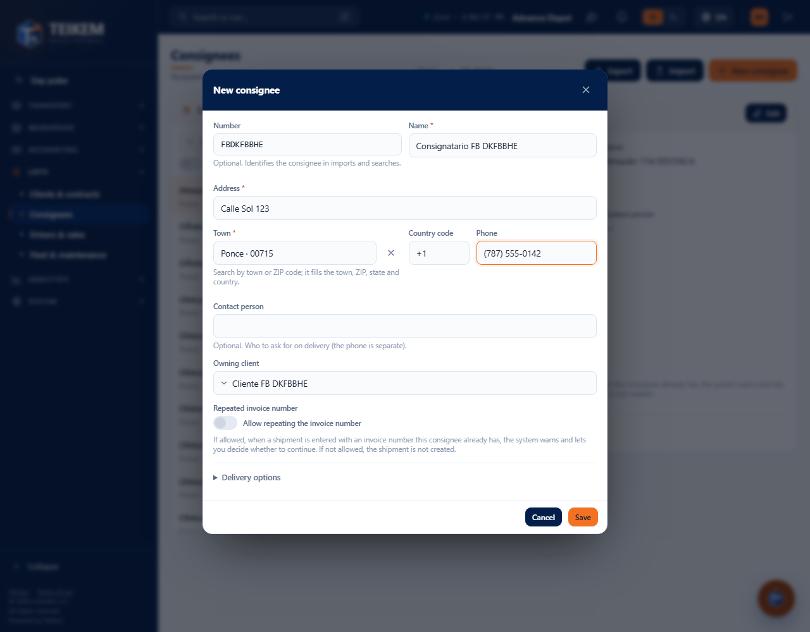
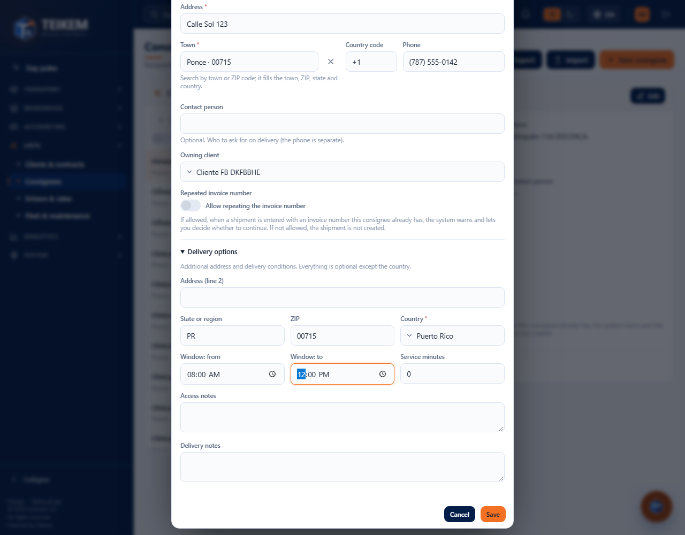
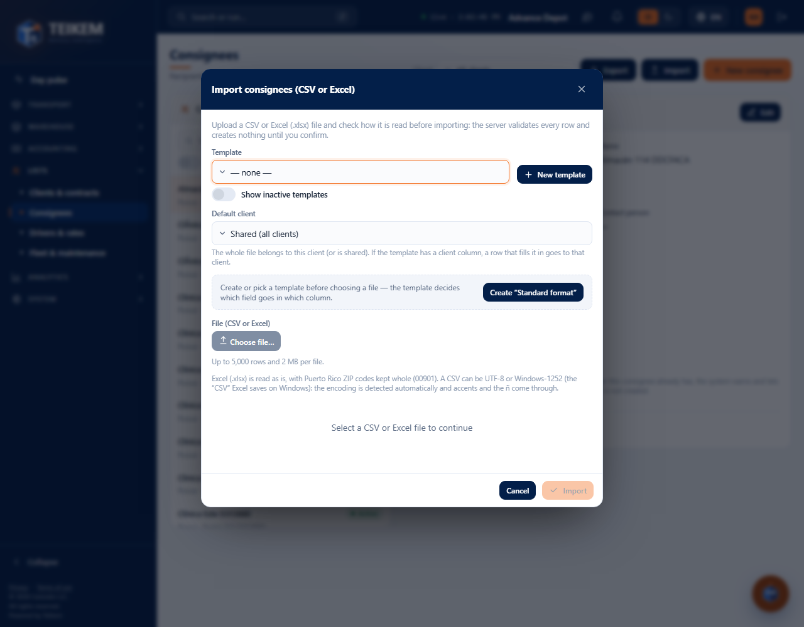
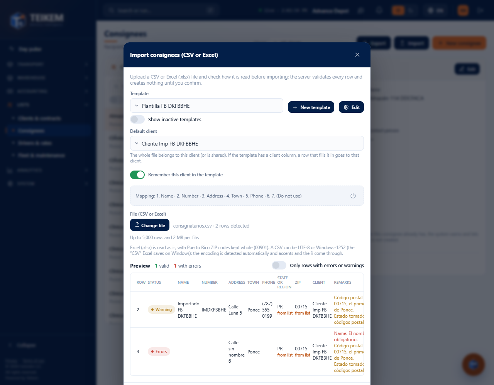
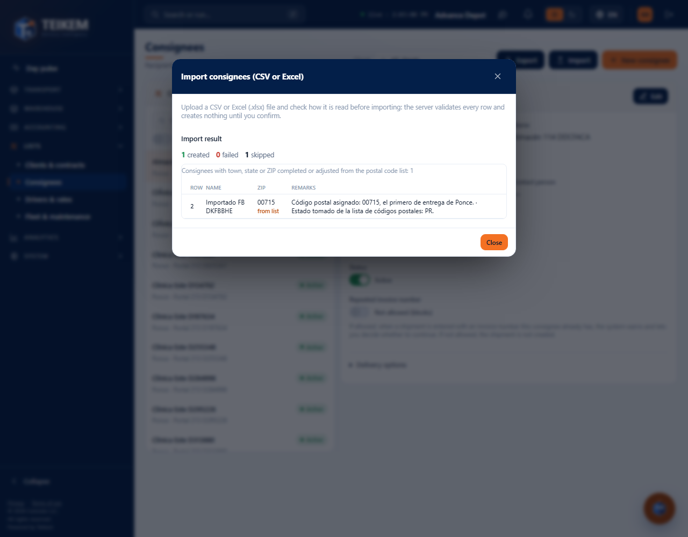
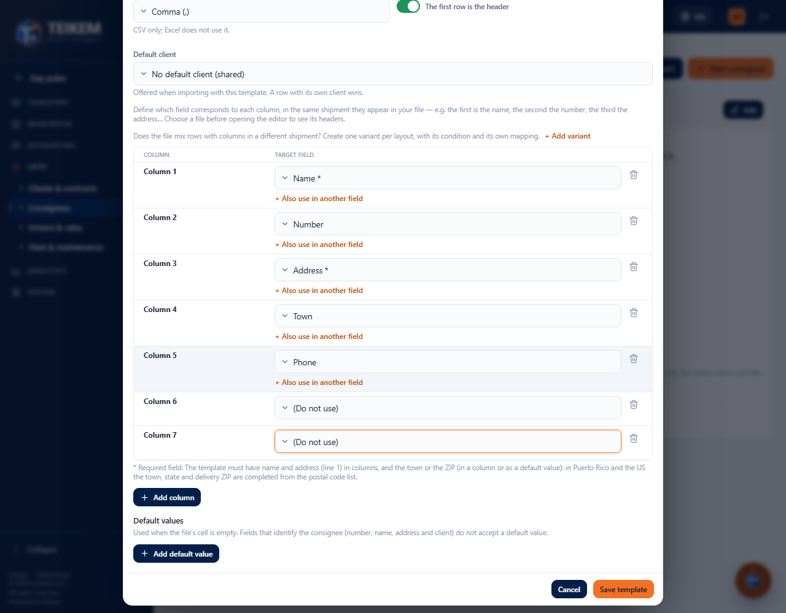

# F-B — Consignees: list, record, create/edit and CSV import

> **Updated by Batch F-B2 (2026-10-13)**: the import accepts **Excel (.xlsx)** and Windows CSV, **(Do not use)** columns, joined columns, a **Default client** saved in the template and a **Contact person**. See [fb2-importacion-consignatarios.md](fb2-importacion-consignatarios.md); what follows still applies, with the new names.

Screen **Lists → Consignees** (`/catalog/consignees`). Consignees are the recipients of deliveries: each one belongs to a client or is **shared**
(no owner; every client can use it). Backend: chapter 02 of the manual, §2 (Consignees and locations) and the import from batch 38. Frontend decisions:
`docs/frontend/loteFB-decisiones.md`.

**Who can.** See the screen: permission **`locations.read`** with the **Lists** module (`CATALOG`) turned on (without the permission the menu does not show it; with the module turned off, “Module turned off”).
Each action requires its permission and, without it, the button is not drawn and the toggles stay disabled:

| Action | Permission |
|---|---|
| See the list, the record, the import templates and the fields | `locations.read` |
| New consignee, Import, create/edit/deactivate templates | `locations.create` |
| Edit, deactivate, reactivate, “Repeated invoice number”, custom fields | `locations.update` |
| Write the phone (in the modal) | `contacts.manage` **and** `locations.update` |
| Choose a client in the filter and in the owner | `clients.read` (without it only “Shared” is offered) |

## 1. The list (left) and the filter

- **Consignees** panel with the counter. Each row: number (if it has one), name, **Active / Inactive** chip and “town · owner client” or “town · Shared (all clients)”.
  Only those of type **delivery** are listed (a client's warehouses and addresses do not appear here).
- **Search box**: filters what is already loaded by number, name, address, town, ZIP, owner and status (ignoring case and accents).
- **Show inactive**: by default only active ones are shown; inactive ones appear dimmed.
- **Client** (top): “All clients”, “Shared (no owner)” or a client (only its own, without the shared ones). Changing it clears the selection.
- Tapping a row opens its record on the right and keeps the consignee in the address bar (`?consignee=…`). On a phone (under 720 px) the record goes below the list.

## 2. The record (right)

**Consignee record**: number, name, address, town, phone, owner client, **Status** and **Repeated invoice number**. The collapsed **Delivery options** section shows
line 2, state/region, ZIP, country, time window, service minutes and the access and delivery notes. Below, the company's **custom fields** for consignees
(if any), with their Save button (`locations.update`).

- **Edit** (`locations.update`) opens the same modal as the create.
- **Status**: the toggle asks for confirmation. *Deactivate*: the consignee stops appearing in the order entry combos; the history is kept. *Reactivate*: it appears again.
  It is never deleted.
- **Repeated invoice number**: if allowed, when entering an order with an invoice number this consignee already has, the system warns and lets you decide; if not, the order is not created.
  Saves instantly.
- **Phone**: shown with the company's format. It lives in the consignee's contact points.

## 3. New consignee / Edit

**New consignee** button (`locations.create`). Fields and rules (the messages appear as-is below the field; the screen ones are repeated on the server):

| Field | Rule | Message (HTTP) |
|---|---|---|
| Number | optional, max. 40 (the import does not allow two consignees with the same number and owner) | `Maximum 40 characters.` (400) |
| Name | required, max. 200 | `The name is required.` · `Maximum 200 characters.` (400) |
| Address | required (line 1), max. 200 | `Address (line 1) is required.` (400) |
| Town | required; searched by town or postal code and also fills ZIP, state and country | `City is required.` (400) |
| Phone | optional; with the company's mask | `Invalid phone.` (400) |
| Owner client | a client or “Shared (all clients)” | `Client not found.` (404) · `Specify a client or mark the location as shared, not both.` (400) |
| Repeated invoice number | allow or not | — |

**Delivery options** (collapsed section; it opens by itself if something fails there):

| Field | Rule | Message (HTTP) |
|---|---|---|
| Address (line 2), State or region, ZIP | optional, max. 200 / 100 / 20 | `Maximum N characters.` (400) |
| Country | required; Puerto Rico by default | `Country is required.` · `List Country 'X' not found.` (404) |
| Window: from / to | both or neither; the end after the start | `The time window needs both a start and an end time.` · `The window end time must be after the start time.` (400) |
| Service minutes | integer, not negative | `Service minutes must be a whole number.` · `Service minutes cannot be negative.` (400) |
| Access / delivery notes | optional, max. 500 | `Maximum 500 characters.` (400) |

The location type is always **delivery** (not shown). When editing, only what changed is sent, together with the record version: if someone else saved first, the server answers
**409** `The location was modified by another user; reload and try again.`, the message stays in the modal and you have to reopen the record and repeat the change.

**Phone.** It is saved separately, as a contact point of the consignee, and requires `contacts.manage` in addition to `locations.update`; without those permissions the field is read-only. If the
consignee is saved and the phone fails, the notice says so and the consignee stays saved (the phone can be corrected with **Edit**). Leaving the phone empty removes it.

## 4. Import consignees (CSV or Excel)

**Import** button (`locations.create`). The import has two steps: the server **validates** the file row by row without creating anything, and only when you press **Import** does it create the valid rows.

1. **Template.** The template says which field goes in each column of the file, **by position** (1st column, 2nd, 3rd…). Without an active template, the file selector stays disabled.
   If the company has none, **Create “Standard format”** creates one with the columns `name, code, line1, city, contactPhone`. **New template** and **Edit** open the editor.
2. **Default client** (F-B2). Everyone in the file is assigned to that client (or shared). If the template has a client column (`clientCode` or `clientName`),
   each row that has it filled in gets THAT client (even if it is a different one); the rest fall into the one chosen here. The template remembers it.
3. **File (CSV or Excel).** Maximum **5,000 rows and 2 MB**. Since F-B2, **.xlsx** is accepted (with **Workbook sheet** if it has several) and a CSV in UTF-8 or Windows-1252 (the ñ and accents
   come through fine). Choosing it validates automatically; if the template, the client or the sheet changes, it is validated again (the previous batch is discarded).
4. **Preview** (done by the server): “N rows detected”, how many are **valid** and how many **with errors**, and a table with, per row, the status, the values read and the
   **remarks** (errors with their field, and warnings). **Only rows with errors or warnings** leaves only the ones that need attention. Up to 200 rows are shown; **Import** creates all the valid ones.
5. **Import** creates the valid rows (one by one) and shows the **result**: created, failed and skipped, with the reason for each failed one. The list refreshes by itself. **Cancel** (or ✕) discards
   the already validated batch and creates nothing.

Warnings that do not block the row (it is imported): `Code X is also used by a consignee of a client; for that client it will keep resolving to its own.` Errors that block the row: see the FAQ.

### The template editor

- **Template name** (required, max. 120, unique), **Delimiter** (comma, semicolon, tab or vertical bar) and **The first row is the header**.
- Table **Column N → Target field**: choose the field for each column of the file in the same order in which they appear; **(Do not use)** ignores the column (and since F-B2 it is saved in the template). **Add column** / the trash can remove rows.
  Fields with `*` are required in the row: the template must include **name** and **line1**, and the city (**city**) in a column or as a default value. `clientCode` and `clientName` cannot both be present.
- **Default values**: used when the cell in the file is empty (country, city, service minutes, phone…). Number, name, address and client do not accept a default value.
- Templates **are not deleted**: **Deactivate this template** (with confirmation) removes it from the selector; **Show inactive templates** + **Reactivate this template** brings it back. Already validated batches keep the reference.

Template messages (400 unless stated otherwise): `The template name is required.` · `Enter at least one column.` · `The template must include the name and line1 columns.` ·
`The template must give the city (city) in a column or in the defaults.` · `Use clientCode or clientName, not both.` · `The field X is repeated.` · `The field X does not accept a default value.` ·
`Unknown field: X.` · `An import template with that name already exists.` (409).

## 5. Common cases

- **A consignee does not appear in the list**: check the **Client** filter, **Show inactive** and the search box; those of type warehouse are not listed here.
- **Accents look wrong in the preview**: since F-B2 the encoding is detected automatically (UTF-8 or Windows-1252); if they still look wrong, save the file as .xlsx and upload it.
- **The Import button is off**: there are no valid rows in the file, or it is still validating. Fix the file and choose it again.
- **“The batch was already confirmed…”**: the batch was already imported (another tab or a double click): choose the file again if you need to import more.
- **I cannot edit the phone**: `contacts.manage` or `locations.update` is missing.
- **No phone after importing**: the template has no `contactPhone` column (nor a default value).
