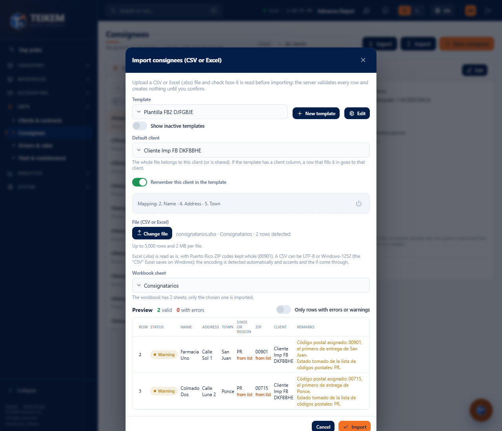
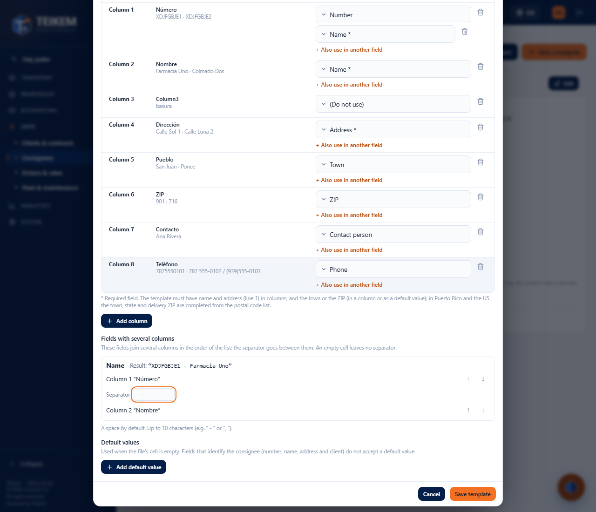
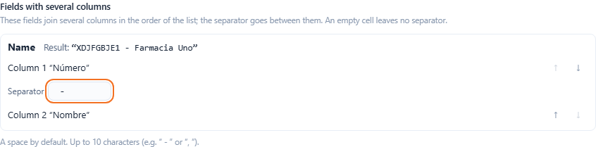
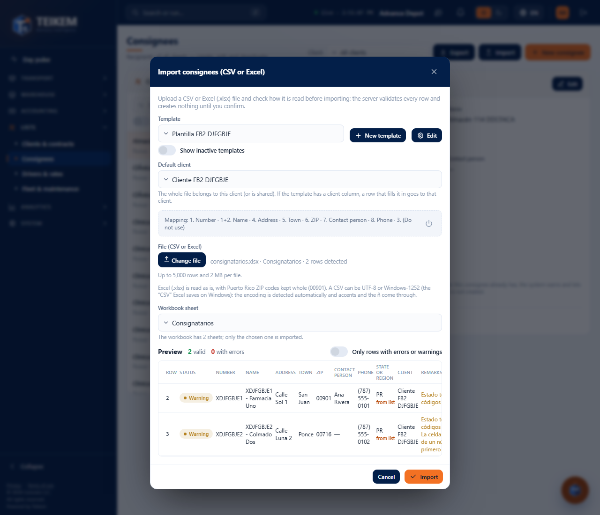
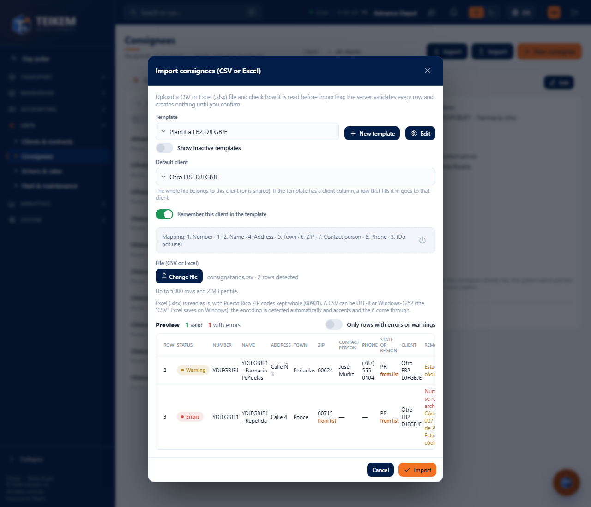
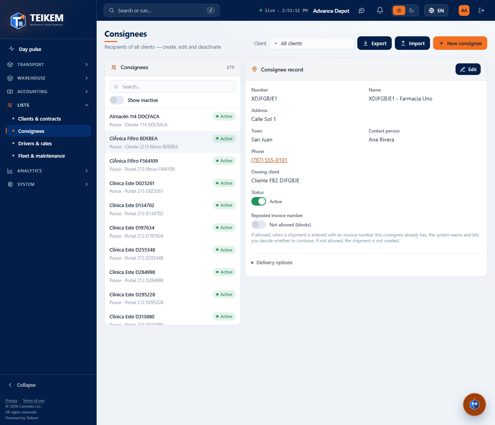

# F-B2 — Import consignees: Excel, “(Do not use)”, joined columns, default client and contact person

Improvements to **Lists → Consignees → Import** (batch 45 / F-B2, 2026-10-13). The basics of the screen (template, preview, Import, Cancel,
result, deactivating templates) remain as in [fb-consignatarios.md](fb-consignatarios.md) §4. Technical detail and server messages: chapter 02, §2.2.
Decisions: [loteFB2-decisiones.md](../../frontend/loteFB2-decisiones.md) and [lote45-decisiones.md](../../lote45-decisiones.md).

**Who can.** Same as before: the **Import** button, the template editor, **Review the file** and **Import** require `locations.create` with the **Lists** module. Seeing the
contact person in the record requires `locations.read`; changing it in **Edit**, `locations.update`. There are no new permissions.

## 1. CSV or Excel file

- The **Choose file…** button accepts **CSV** and **Excel (.xlsx)**. The server reads the file; there is no need to convert it.
- **Excel with several sheets**: **Workbook sheet** appears with the sheets of the file (“The workbook has N sheets; only the chosen one is imported.”). At first the
  first one is read; if the data is in another, choose it and the file is validated again with that sheet.
- **ZIP leading zeros**: Excel stores 00901 as the number 901. Teikem turns it back into **00901** (Puerto Rico and the United States, 3- or 4-digit ZIP). A ZIP with a
  zero format in Excel is read as-is. An empty ZIP is not an error.
- **Excel dates and times**: a cell with a time (08:00) arrives as `08:00`, ready for the time window; a date as `2026-10-13`.
- **CSV in UTF-8 or Windows-1252**: the “CSV” that Excel saves on Windows no longer breaks the ñ or the accents; the encoding is detected automatically.
- The old **.xls** file (Excel 97-2003) is not accepted: save it as **.xlsx** or **CSV**.
- The usual limits: 5,000 rows and 2 MB per file.

## 2. Default client

- **Default client** (formerly “Owner client of the consignees”): the whole file belongs to that client (or is shared). If the template has a client column
  (`Client (code)` or `Client (name)`) and the row has it **filled in**, the row gets **that** client even if it is a different one; before, that was an error. One file can bring
  consignees of several clients.
- The preview has the **Client** column: who each row ends up with.
- The template **saves its default client**: when you choose the template, the selector is set to that client by itself.
- If you choose a client other than the template's, **Remember this client in the template** appears (turned on): when you **Import**, the template keeps that
  client for next time. Turn it off if it is only for this time.

## 3. The template editor

Choose the file **before** opening **Edit** or **New template**: the editor then shows one row for **each column of the file**, with its header and up to
3 sample values (**In the file**). Without a file, the editor works the same but without samples.

- **Target field** of each column, or **(Do not use)**: the column is ignored completely and **the row is imported anyway**. The “(Do not use)” columns are saved in the
  template: when you open it again, the editor shows all the columns of the file as you left them (useful with files that bring empty columns or “Column2…Column11”).
- **Also use in another field**: the same column can fill two fields. Example: the “Number” column goes to the consignee's **Number** and is also part of
  the **Name**. If the column is switched to “(Do not use)”, the other fields are removed from it.
- **Default client** of the template (or “No default client (shared)”).
- **Contact person** is a new field in the mapping (it accepts a default value, e.g. “Reception”). **Phone** is still saved as the consignee's main
  phone.

### Fields with several columns

When a text field is chosen in **two or more columns** (for example Name in column 1 and in column 2, or an address split into two columns), this
section appears. For each field:

- The list of columns **in the order in which they are joined**; **↑** and **↓** change the order.
- **Separator** between one column and the next (a space by default; up to 10 characters, e.g. “ - ” or “, ”).
- **Result**: how the first row of the file turns out (without a file, “[Column 1] - [Column 2]”). An empty cell does not leave the separator dangling.
- Up to 5 columns can be joined. Country, client, service minutes, window times and “Allow repeated invoice” take a single column.

## 4. The preview

- The columns of the preview are the **fields** of the template (the name already joined), plus **Client** and **Remarks**.
- **Phones**: `787-555-0101`, `787 555-0101`, `7875550101`, `(787)555-0101` and `+1 787…` are accepted; the 10 digits are saved and shown with the company's format.
  If the cell has **two numbers**, the first is taken and the row comes out as **Warning**: “The phone cell has more than one number; the first one was taken (…).” The row is imported.
- **Number repeated in the file**: “Code X is repeated in row N of the file.” (it says the number and the first row where it appears); that row is not imported.

## 5. The contact person in the record

**Contact person** is shown in the record, in the list row (“town · client · person”) and is included in the search box. In **New consignee** / **Edit** it is an
optional field of up to 150 characters (“Maximum 150 characters.”); leaving it empty clears it.

## 6. Messages

| Where | Exact message | What to do |
|---|---|---|
| When choosing the file (400) | `Unsupported file format: use CSV or Excel (.xlsx).` | Open the file in Excel and save it as “Excel Workbook (.xlsx)” or “CSV”. |
| When choosing the file (400) | `The Excel file could not be read; open it and save it again as .xlsx.` | The workbook is damaged or is not a real .xlsx: open it and “Save as” .xlsx. |
| When changing the sheet (400) | `The workbook does not have the sheet 'X'.` | Someone changed the workbook: choose it again. |
| When choosing the file (400) | `The file exceeds the limit of 5,000 rows or 2 MB.` | Split it into smaller files. |
| Editor | `The field X accepts at most 5 joined columns.` | Join fewer columns in that field. |
| Editor | `The field X is repeated.` | That field (country, client, minutes, times or repeated invoice) goes in a single column. |
| Editor (server) | `Column N is marked “Do not use” and also has a field assigned.` | Leave the column as “(Do not use)” or remove the “(Do not use)” from it. |
| Editor (server) | `The separator accepts at most 10 characters.` | Shorten the separator. |
| Editor (server) | `The default client must be the same client as the template's.` | A template of a client only accepts that client as default (or none). |
| Editor (409) | `The client has been deactivated; only its history can be viewed.` | Choose another default client or reactivate the client. |
| Preview (warning) | `The phone cell has more than one number; the first one was taken (7875550101).` | Check in the record whether the number is the right one; the second was not saved. |
| Preview (error) | `Code X is repeated in row N of the file.` | Fix the repeated number in the file. |
| Preview / record | `Maximum 150 characters.` (contact person) | Shorten the person's name. |

They are all also in the [FAQ](../faq.md), section “Batch 45 / F-B2”.
