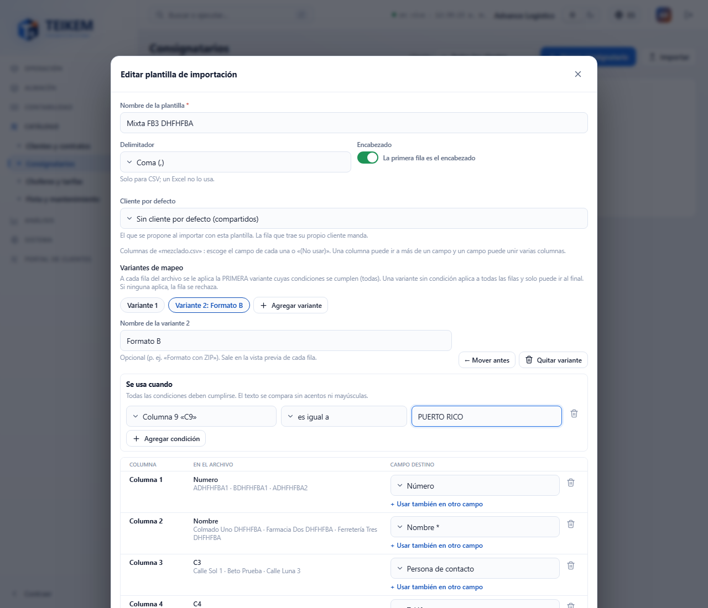
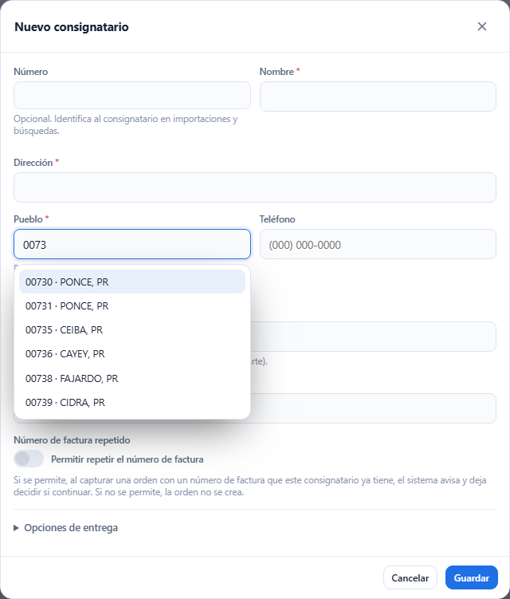

# F-B3 — Import consignees: town, state and ZIP from the postal code list, and mapping variants

Improvements to **Lists → Consignees → Import** (batch 46 / F-B3, 2026-10-14). The earlier parts of the screen remain as in [fb-consignatarios.md](fb-consignatarios.md) §4 and
[fb2-importacion-consignatarios.md](fb2-importacion-consignatarios.md). Technical detail and server messages: chapter 02, §2.3. Decisions:
[loteFB3-decisiones.md](../../frontend/loteFB3-decisiones.md) and [lote46-decisiones.md](../../lote46-decisiones.md).

**Who can.** Same as before: **Import**, the template editor and the variants require `locations.create` with the **Lists** module. There are no new permissions.

## 1. Town, state and ZIP from the postal code list

In Puerto Rico and the United States, Teikem completes the address of each row with the **postal code list** (the same one the town selector uses):

| The row brings | What Teikem does | What you see in the preview |
|---|---|---|
| Only the **ZIP** | Sets the **town** (in Puerto Rico, the municipality with accents: 00952 → Toa Baja) and the **state** (PR). | The town and the state with the **from list** mark and the warning “Town taken from postal code 00952: Toa Baja.” |
| Only the **town** | Assigns the **first delivery ZIP** of the town (standard ones first, then unique ones; same type, the lowest). Sets the state. | The ZIP with **from list** and “Postal code assigned: 00956, the first delivery one of Bayamón.” |
| **ZIP and town** | Saves both as they come. If they do not match, it only warns. | “Postal code 00716 belongs to Ponce, not to Caguas; both are saved as they come.” |
| A **P.O. Box** or **military** ZIP | Replaces it with a **delivery** ZIP of the **same city**. | **Postal code adjusted**: the original struck through → the new one, and “Postal code adjusted: 00734 is a P.O. Box code; 00715, a delivery one in Ponce, was used.” |
| A ZIP or a town that is **not** in the list | Rejects the row. | The row **With errors** and the message (see §4). |

- A consignee is a **delivery** address: it only uses **standard** (STANDARD) and **unique** (UNIQUE) ZIPs. P.O. Box and military ones are for
  **mailing** addresses (such as the client's mailing address), not for delivering.
- The **state** in the file is never changed: if it does not match the ZIP's, there is only a warning. If it comes empty, the one from the list is set.
- Towns are compared **ignoring accents and case** (“bayamon” = “Bayamón”; the postal service list comes in UPPERCASE without accents).
- A ZIP+4 (00901-1234) counts by its 5 digits and is saved as it comes.
- Other countries (which the list does not have) do not change: the town is still required.
- Teikem **makes nothing up**: what it completes comes from the list and is stated in the row. The list's coordinates are not copied to the consignee.

## 2. Mapping variants (one file with rows in different orders)

Some files mix rows with the columns in different orders: for example, some rows with **number, name, address 1, address 2, ZIP, contact, phone** and others
with **number, name, contact, phone, repeated name, address 1, neighborhood, town, “PUERTO RICO”**. A template with **variants** imports them in one go.

1. In **Edit** (or **New template**), below **Default client**, press **+ Add variant**. The tabs **Variant 1**, **Variant 2**… appear; the
   new one copies the mapping of the one that was open.
2. In each variant:
   - **Name of the variant** (optional; e.g. “Format B”). It appears in the preview.
   - **Used when**: one or more conditions on columns of the file — **equals**, **contains**, **is not empty**, **is empty**. All of them must hold. The
     text is compared ignoring accents and case (“puerto rico” = “PUERTO RICO”). Up to 5 conditions.
   - Its own column mapping (with “(Do not use)”, joined columns, etc., as always).
3. Each row gets the **first** variant whose conditions hold. A variant **without a condition** applies to all rows: it can only go **at the end**.
   **Move earlier** changes the order; **Remove variant** deletes it (with a single variant, the template goes back to being as before).
4. If **no** variant applies, the row is rejected and the preview shows its cells (“Row cells: …”).

The **default values** belong to the whole template (they hold for all variants). Up to 10 variants.

In the import window, the summary says **Mapping in 2 variants (the first one that holds is used)** with the condition and the columns of each. The preview has the
**Variant** column (which one each row used).

## 3. Result

After **Import**, in addition to created / failed / skipped, a table lists the consignees **created with town, state or ZIP completed or adjusted from the
list**, with the ZIP (and the original struck through, if adjusted) and their warnings.

**Manual creation.** In **New consignee** / **Edit**, the **Town** selector offers only delivery ZIPs (P.O. Box and military ones do not appear).

## 4. Messages

| Message | Where | What to do |
|---|---|---|
| `Postal code 00999 is not in the postal code list; correct it, or leave it empty and give the town.` | row (ZIP) | Correct the ZIP or clear it and enter the town. |
| `Postal code 9A1 is not valid: use 5 digits (or ZIP+4, such as 00901-1234).` | row (ZIP) | Correct the ZIP. |
| `The town 'Ciudad Gótica' is not in the postal code list; correct it or give the postal code.` | row (Town) | Correct the name or enter the ZIP. |
| `The town 'X' has no delivery postal code (only P.O. Box or military ones); give the postal code of the physical address.` | row (Town) | Enter the ZIP of the physical address. |
| `The town 'Springfield' exists in several states (IL, MA); give the state or the postal code.` | row (Town, U.S.) | Fill in the state or the ZIP. |
| `Postal code 09001 is military mail (APO/FPO) and APO has no delivery postal code to replace it with; give the postal code of the physical address.` | row (ZIP) | Enter the ZIP of the physical address. |
| `No variant of the template applies to this row; check the conditions of the variants.` | row (Variant) | Check the conditions or add a variant for that format. |
| `Variant 1 has no condition and leaves the following ones unused; move it to the end or give it a condition.` | editor | Use **Move earlier** on the other one or give it a condition. |
| `Choose the column of the condition.` | editor | Choose the column in **Used when**. |
| `The «equals» or «contains» condition needs a value.` | editor | Type the value. |
| `The template must give the city or the postal code, in a column or in the defaults.` | editor | Map the town or the ZIP (or give them a default value). |

Warnings (the row is imported): “Town taken from postal code…”, “State taken from the list…”, “Postal code assigned…”, “Postal code adjusted…”, “Postal code X
belongs to Y, not to Z; both are saved as they come.”, “State X does not match the postal code's (PR); it is saved as it comes.”.

## 5. Sources of the list

The type of each ZIP (standard, P.O. Box, unique, military), the postal district and the geolocation are loaded with the data script `Diseño/logistica-db-zip-catalog.sql`:

- **USPS “Zip Locale Detail”**: ZIP type, office type, district and postal name.
- **GeoNames** (www.geonames.org): latitude, longitude and accuracy of each ZIP, under the **Creative Commons Attribution 4.0 (CC BY 4.0)** license. Geolocation data ©
  GeoNames, used under that license. ZIPs that GeoNames does not have (military and some in territories) are left without coordinates.

Without that script the ZIPs remain **unclassified**: they are accepted as delivery ones and there is no “Postal code adjusted”.
