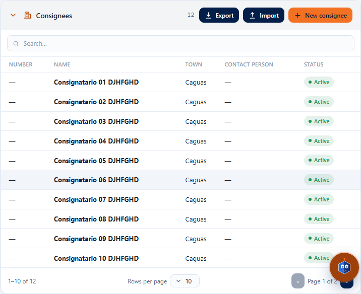
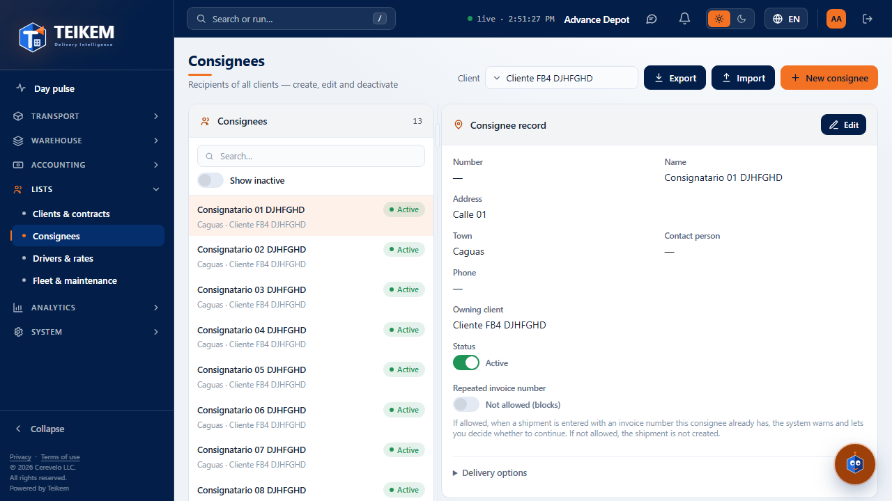
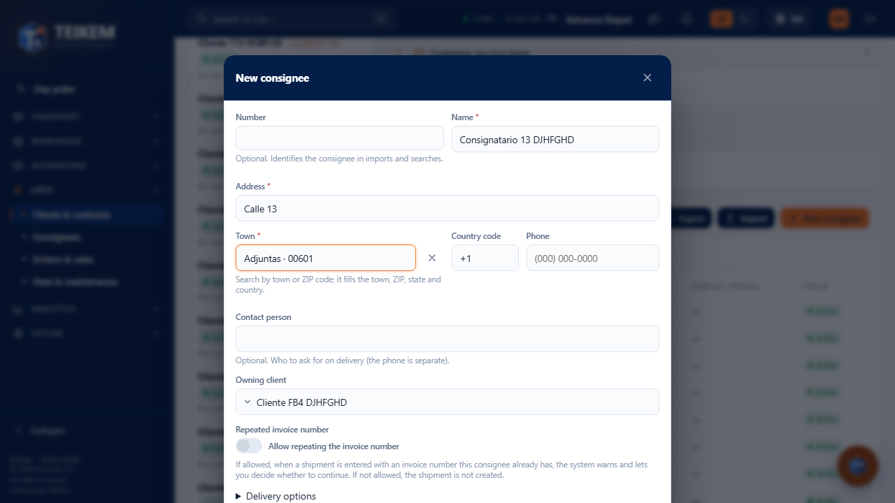
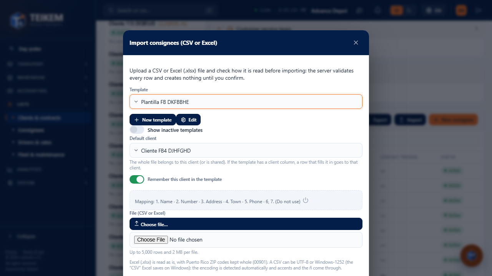
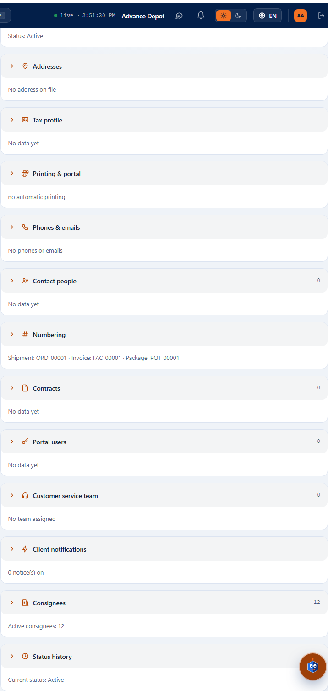
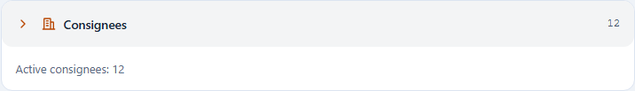

# Consignees inside the client record, and Export (Batch F-B4)

This guide explains how to see, search, export, import and create **a client's consignees without leaving its record**, and how to **export** from the Consignees screen. It is for those who serve clients and for support. The other Consignees functions (create, edit, deactivate, import with a template) remain in [fb-consignatarios.md](fb-consignatarios.md), [fb2-importacion-consignatarios.md](fb2-importacion-consignatarios.md) and [fb3-variantes-y-codigos-postales.md](fb3-variantes-y-codigos-postales.md).

## 1. What is new

1. In **Lists → Clients & contracts**, when you choose a client, the record has a new panel, **Consignees**. It goes **at the end**, right before the **Status history**.
2. In **Lists → Consignees**, the header has, together and in this order, **Export**, **Import** and **New consignee** (after the **Client** filter), the same as in the panel of the client record.
4. In **Lists → Consignees**, the list on the left starts **wider** (about 10 characters more) and between the list and the record there is a **bar to change the width**: drag it with the mouse or your finger, or use the ← and → arrows with the bar selected; **double click** (or Enter) goes back to the initial width. The browser remembers the width you left. On narrow screens (under 900 px) the record goes below the list and there is no bar.
3. The panels of the client record are **collapsible** and, when closed, give a **summary** (section 6).

## 2. Who can do it

| Action | Permission | Module |
|---|---|---|
| See the Consignees panel and **Export** | `locations.read` | Lists |
| **Import** and **New consignee** | `locations.create` | Lists |

Without `locations.read` the panel **does not appear** in the client record (it is not an error). Without `locations.create` you see the table and **Export**, but not **Import** or **New consignee**.

## 3. The panel in the client record

1. Go to **Lists → Clients & contracts** and choose a client.
2. Scroll down to the **Consignees** panel. The number next to the title is **how many consignees** match the search box (all of them, not only the ones shown).
3. The table shows **10 rows per page**: Number, Name, Town, Contact person and Status. If there are more, the table footer has the **pagination** (previous and next page, and “Rows per page”), so you can go through everything **without leaving the record**.
4. Only the consignees **owned by that client** that are **active** appear. The ones shared with all clients and the inactive ones are seen in the Consignees screen.
5. **Search:** type in the box. It searches by number, name, address, town, ZIP, contact person and status, **among all** the client's consignees (not only among the 10 visible rows).
6. A click on a row opens that consignee in the **Consignees** screen.

## 4. Export

1. Press **Export** and choose **Excel**, **CSV** or **PDF**.
2. The file has **exactly what the panel has filtered**: without a search, all the client's consignees; with a search, only those that match. **It is not limited to the 10 visible rows.**
3. Columns: Number, Name, Client, Address 1, Address 2, Town, State, Postal code, Country, Contact person and Record status. **The phone is not in the file.**
4. The menu says how many rows are exported.

In **Lists → Consignees**, the **Export** button is at the top, in the header, before **Import** and **New consignee**. It exports **what the list has in view**: it respects the **Client** filter, **Show inactive** and the search box.

## 5. Import and New consignee, without leaving the record

- **New consignee** opens the same window as the Consignees screen, with **this client already chosen as owner**. When you save, the window closes, **you stay in the client record** and the table refreshes by itself (the counter goes up).

- **Import** opens the same import window, with this client as **default client**. When it finishes, it returns to the record and the table is updated with what was imported.

Everything else in those windows (templates, preview, warnings, errors) works the same as in the Consignees screen.

## 6. Collapsible panels

All the panels of the client record (Profile, Phones & emails, Contact people, Numbering, Custom fields, Contracts, Portal users, Consignees and Status history) can be **closed and opened**:

- Press the **arrow** to the left of the title, or click on the header (outside the buttons). When closed, the panel **shows a one-line summary** of what it has, and its buttons are hidden. For example, “Active consignees: 12” or “Phones: 2 · Emails: 1”.
- What you were typing in a panel is not lost when you close it.
- The panels **start closed** every time you open a client or reload the page: how you left them is not remembered.
- The client header (name, status and “Deactivate”) also closes; when closed it only says the status.

The Consignees screen also opens already filtered by a client with the address `/catalog/consignees?client=<client id>`.

## 7. Panel messages

| Message | When it appears | What to do |
|---|---|---|
| “This client has no consignees yet. Use "New consignee" or "Import".” | The client has no active consignees. | Create one or import a file. If it had some and you deactivated them, check **Show inactive** in Consignees. |
| “No consignee of this client matches the search.” | The search box finds nothing. | Clear or change what you typed. |
| The title of the server error (in red) | Loading the list failed. | Reload the page; if it persists, tell support with the text. |

The messages of **New consignee** and **Import** are those of [fb-consignatarios.md](fb-consignatarios.md) and of [fb2](fb2-importacion-consignatarios.md) / [fb3](fb3-variantes-y-codigos-postales.md).

## 8. Common cases

- **I do not see the Consignees panel.** Your user does not have `locations.read`, or the Lists module is turned off. Ask an administrator for it.
- **I do not see Import or New consignee.** `locations.create` is missing.
- **I created a consignee and it does not appear in the table.** Only the **active** ones that **match the search box** are shown: clear what you typed in the box. If the counter went up but the row is not on the first page, go to the next page.
- **The exported file has more rows than the page.** That is correct: the table shows 10 per page; the file has all the filtered ones.
- **The phone is missing from the file.** The phone is saved separately and is not exported in this version.
