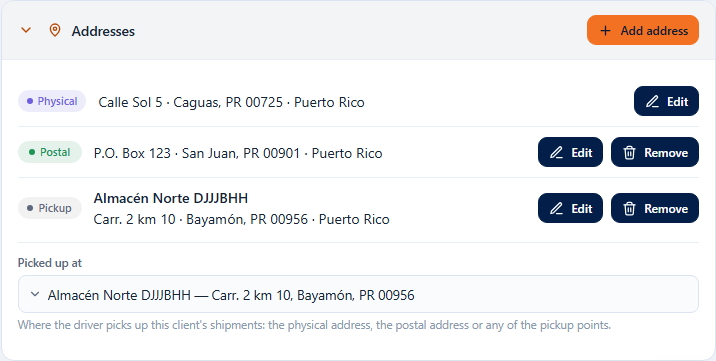
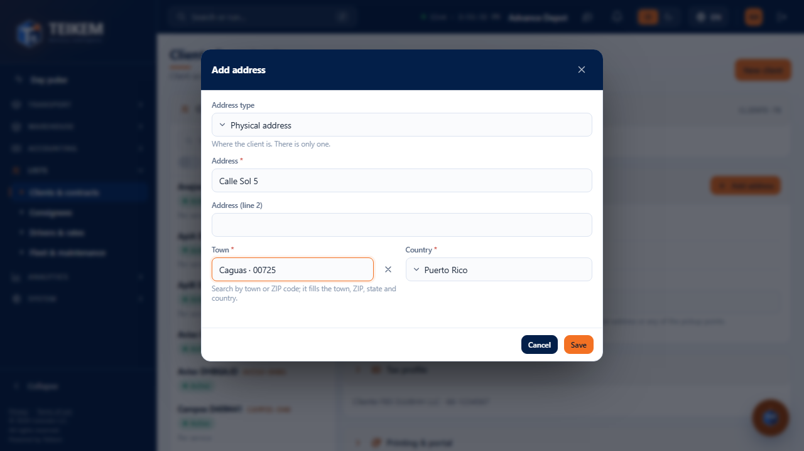
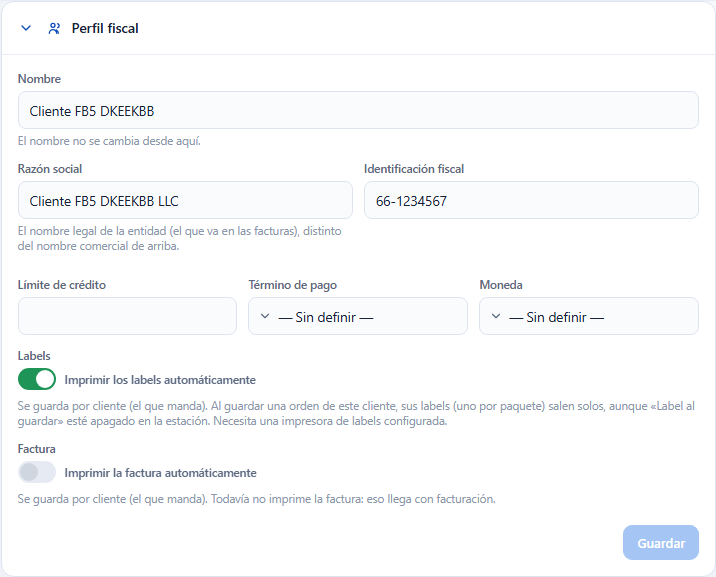

# Addresses, Tax profile and panels with a summary in the client record (Batch F-B5)

This guide explains how to record **where the client is and where pickups are made**, what changed in the **Tax profile** (new name of the former “Client profile”), the **Print labels automatically** toggle, and what each panel of the record looks like when it is **closed**. It is for those who serve clients and for support. The collapsible panels and the Consignees panel are in [fb4](fb4-consignatarios-en-la-ficha-del-cliente.md).

Client record: **Lists → Clients & contracts** and choose a client. **All the panels of the record start closed**, each with its summary; open them with the arrow to the left of the title.

## 1. What is new

1. A new panel, **Addresses**, **right below the client header** and before the Tax profile.
2. “Client profile” is now called **Tax profile**: it is about the tax entity (legal name, tax ID, credit, payment term and currency). The addresses moved out of there.
3. In the Tax profile there is a new toggle, **Print labels automatically**, before **Print the invoice automatically**.
4. All the panels of the record, including the header, open and close, and when closed they give a summary (section 5).

## 2. The Addresses panel

It is **a list**. Each row has a label and, on the right, its buttons:

| Label | What it is | Buttons |
|---|---|---|
| **Physical** | The address where the client is. There is only one. | Edit |
| **Postal** | Where mail is sent. There is only one. Until it has its own it says “Same as the physical address”. It can be a P.O. Box. | Edit, Remove |
| **Pickup** | A pickup point. There can be as many as you want, each with its name. | Edit, Remove |

Below the list is **Picked up at**: where the driver picks up this client's orders. It can be **the physical address, the postal address or any of the pickup points**. By default it is the physical one. It is saved when chosen.

There is **a single button to add**: **Add address**, at the top right of the panel.

### How to add an address

1. Open the **Addresses** panel and press **Add address**.
2. In **Address type** choose: **Physical address**, **Postal address** or **Pickup point**. The physical and the postal are only offered if the client does not have one yet.
3. Type the **address (line 1)** and, if needed, line 2.
4. In **Town** search by town or by postal code and choose from the list: the **state**, the **postal code** and the **country** are filled in by themselves. The physical address and the pickup points only offer **delivery** postal codes; the **postal** one also accepts **P.O. Box**.
5. If it is a pickup point, type its **name** (for example “Almacén Norte”).
6. **Save**. “Address saved.” appears and the list is updated.

If the pickup point is neither the physical nor the postal address, it is added as a **pickup point** and chosen in **Picked up at**. The postal and the physical can be the same (nothing is created) and there can also be a different pickup point.

### Edit and remove

- **Edit** opens the same window with the address. The type is not changed.
- **Remove** (pickup point): asks for confirmation. The point stops existing for this client; orders already created do not change. If it was the default point, pickup goes back to the physical address. Message: “Pickup point removed.”
- **Remove** (postal): the client's own postal address is removed and the postal address is the physical one again. Message: “The postal address is now the physical one.”
- The physical address is not removed; it is edited.

## 3. Who can do it

| Action | Permission |
|---|---|
| See the panel | `clients.read` |
| **Add address** | `locations.create` |
| **Edit** and **Remove** | `locations.update` |
| Choose **Picked up at** | `clients.update` |

Without those permissions the buttons do not appear and “Picked up at” is read-only.

## 4. Tax profile and print labels automatically

- **Legal name** is the **legal name** of the entity, the one that goes on the invoices; the **Name** in the header is the trade name. Next to it is the **Tax ID**.
- **Print labels automatically** (off by default): when an order of **this client** is saved in the orders screen, its labels (one per package) print by themselves, even if the station's **Print label on save** toggle is off. It needs the label printer set up at the station ([Printers & labels](fg1-impresoras.md)); if there is none or it fails, the order stays saved and a notice is shown.
- **Print the invoice automatically**: it is still only the preference; the invoice is not printed yet.
- **Save** is enabled only when there are changes.

## 5. Closed panels: what each summary says

| Panel | Summary when closed |
|---|---|
| Header | `Status: Active` (or `Status: Suspended`, if it is in a detour; with `· Inactive` if the client is deactivated) |
| Addresses | `Physical: Calle Sol 5, Caguas, PR 00725 · Picked up at: the physical address` (or the name of the point) |
| Tax profile | legal name · tax ID · currency · payment term |
| Phones & emails | `Phone: (787) 555-0100 · Email: info@acme.com · +2` (the main one of each and how many more there are) |
| Contact people | the main one and up to three more: `Ana Pérez (main), Luis, María, Pedro +2` |
| Numbering | `Order: ORD-00001 · Invoice: FAC-00001 · Package: PQT-00001` (examples) |
| Custom fields | `Field: value · Field: value · +2` (with a value), or how many fields there are without a value |
| Contracts | `Contracts: 2 · current: ACME-001 · Master contract` |
| Portal users | `Portal users: 3` |
| Consignees | `Active consignees: 12` |
| Status history | `Current status: Active` |

## 6. Messages

| Message | When it appears | What to do |
|---|---|---|
| `No address on file` | The client has no physical (or postal) address. | **Add address** and choose the type. |
| `Same as the physical address` | There is no postal address of its own. | If it is a different one, **Add address** → “Postal address”. |
| `Enter the point name.` | A pickup point without a name. | Type the name. |
| `Address (line 1) is required.` / `City is required.` / `Country is required.` | That data is missing. | Fill it in (the town is chosen from the list). |
| `Maximum N characters.` | Text too long. | Shorten it. |
| `The client already has an active corporate address; deactivate it or edit it.` (409) | An attempt was made to create a second physical address (only through a direct API call: the window no longer offers it). | Edit the existing one. |
| `The client already has an active postal (billing) address; deactivate it or edit it.` (409) | Same, a second postal address. | Edit the existing one or **Remove** it. |
| `The pickup point must be an active address of the client: the physical one, the postal one or a pickup point.` (400) | The chosen “Picked up at” is no longer valid. | Reopen the record and choose another. |
| `The record was modified by another user; reload and try again.` (409) | Someone else saved first. | Reload the record and repeat. |

## 7. Common cases

- **I do not see where to type the client's address.** Open the **Addresses** panel (it starts closed) and press **Add address**. If you do not see the button, the `locations.create` permission is missing.
- **The postal and the physical address are the same.** There is no need to create anything: leave “Same as the physical address”.
- **Pickup is at a third place.** **Add address** → “Pickup point”, and choose it in **Picked up at**.
- **I cannot find the postal code of a P.O. Box.** Only the **postal** address accepts them; the physical address and the pickup points offer delivery codes.
- **It does not let me add another physical (or postal) address.** There is only one of each; use **Edit**.
- **I turned on automatic labels and they do not print.** Check that the station has a label printer; the order was saved anyway and the notice gives the reason.
