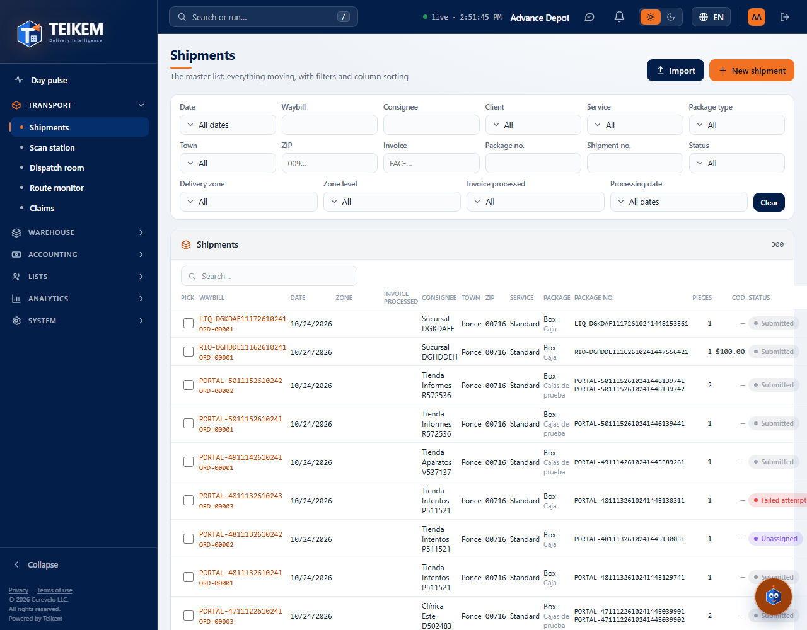
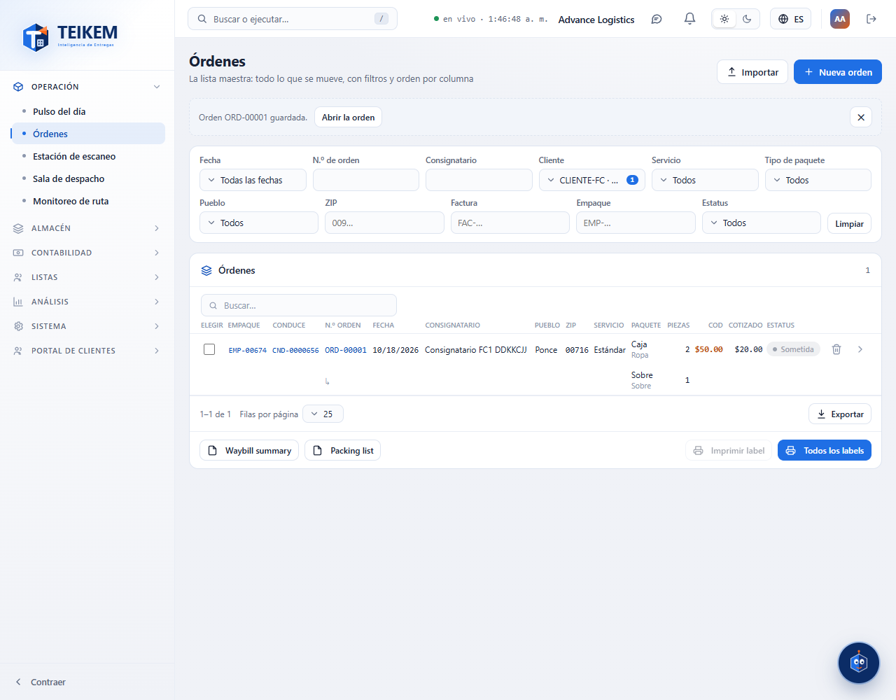
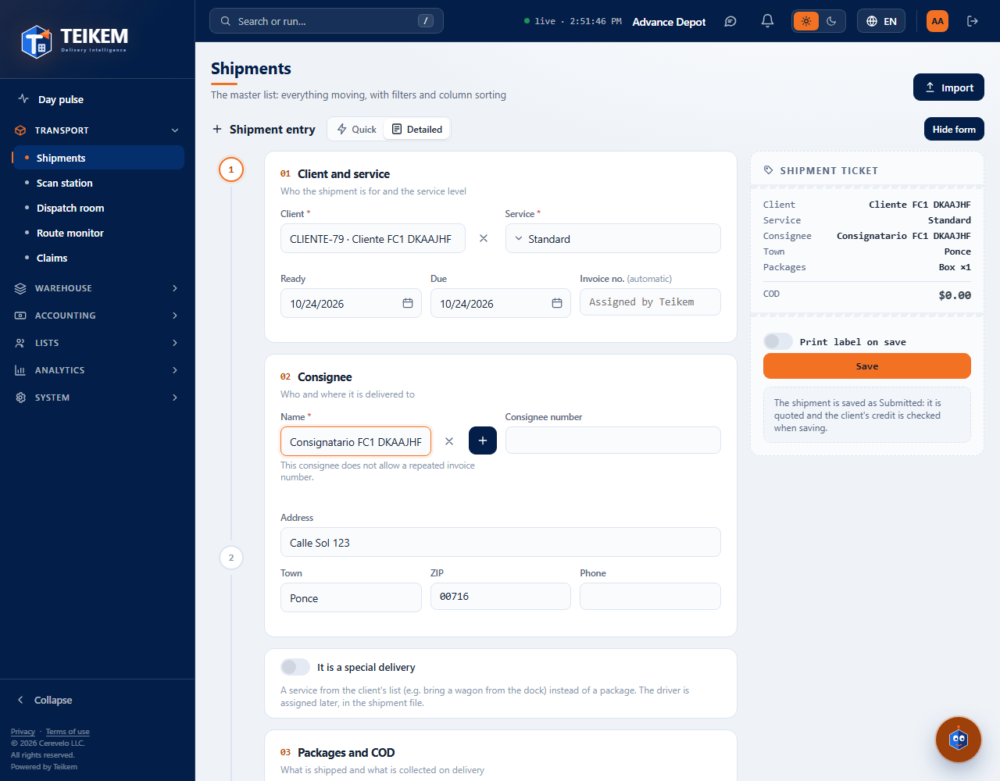
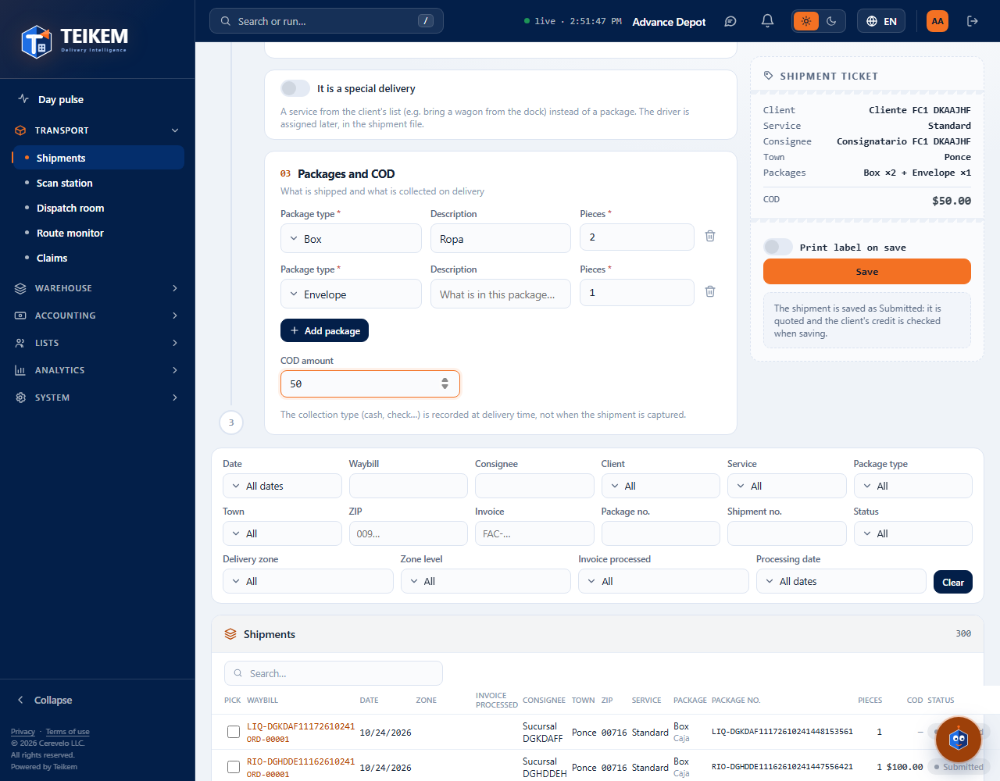
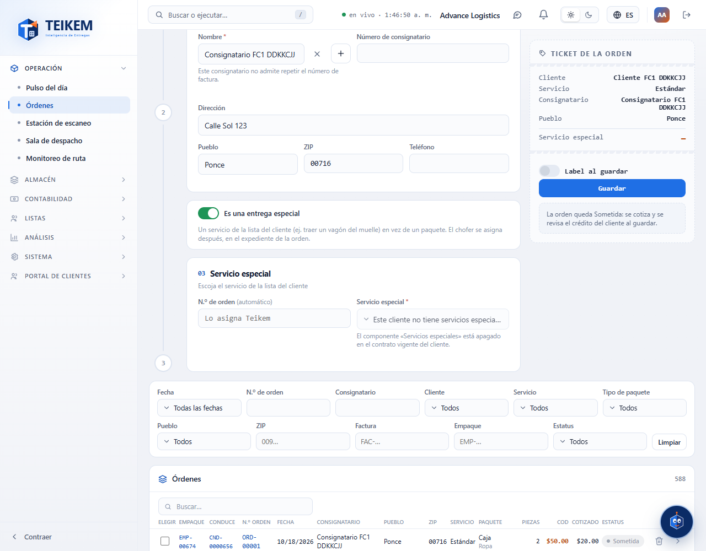
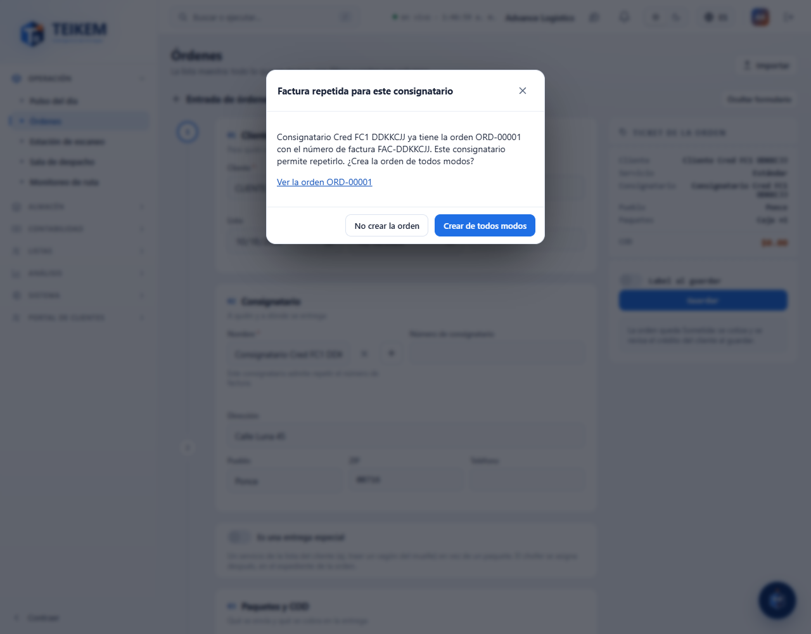

# Orders: search orders and create a new one

> **Batch 106 (2026-10-17): new status flow.** The order is born **Submitted** (Draft and Confirmed no longer exist) and the form has **a single button, “Save”**. On save it is quoted and the credit is measured. Status detail in [chapter 03, section 4](../03-ordenes-de-transporte.md#4-statuses-and-transitions).

Screen **Operations → Orders**. Here you can:

- **Search** any transport order with filters (by date, client, consignee, town, status…), sort the list and export it.
- **Create a new order** with a form: you choose the client, the consignee, the packages and the collect on delivery (COD), and save it; the order is born Submitted, already quoted and with the credit measured.
- **Create a special delivery** (a service from the client's list instead of packages).
- **Delete** an order that is still Submitted.

Editing an order, marking it as picked up, cancelling it, reopening it, re-quoting it and assigning it a driver is done in its file (when you open it), explained in [Orders: the order file](fc2-ordenes-expediente.md). For now this screen does **not** have the quick entry or the import of orders from a CSV file; that will come in the next delivery. What happens with the price, the credit and the statuses on the server is explained in chapter “03 — Transport orders” of this manual.

## Required permissions

To see the screen you need the `orders.view` permission. The “Last mile ground” module (LTL_GROUND) is always turned on. Each button appears only if you have its permission; if you do not have it, the button is not shown. If a permission is missing, ask your company's administrator for it (System → Roles).

| Permission | What it allows |
|---|---|
| `orders.view` | See the list of orders and open an order. |
| `orders.create` | Use the **New order** button and the **Save** button. |
| `orders.cancel` | Delete an order with the trash can (while it is in its initial status). |
| `orders.credit_override` | Authorize an order whose client exceeds its credit limit (**Authorize and save**). |
| `orders.view_price` | See the price of the orders (**Quoted** column). Without this permission the column does not appear. |
| `clients.read` | Search and choose the client in the form and in the **Client** filter. |
| `locations.read` | Search and choose the consignee, and fill the options of the **Town** filter. |
| `locations.create` | Use the **+** button to create a consignee from the order. |
| `contracts.read` | Use the **It is a special delivery** toggle (in addition, the Lists module must be turned on). |

---

## 1. Search orders in the list

**Example.** I want to see the orders of Bayamón that are in the initial status and belong to a particular client.

1. Go to **Operations → Orders**.
2. In **Client**, open the list, type part of the name and check the client. You can check several.
3. In **Town**, check “Bayamón”.
4. In **Status**, check the initial status “Submitted”.
5. The list updates by itself. To start over, press **Clear**.

### Filters

All the filters combine: the list shows only the orders that meet **all** the ones you filled in. Within a selection filter you can check several values and it is enough for the order to meet **one** (for example, Town = Bayamón and Ponce brings the orders of either). The selection lists have a search box and the **All** and **None** buttons.

| Filter | What it does |
|---|---|
| **Date** (**From** / **To**) | Orders created between those dates. The **To** day is included. |
| **Shipment no.** | Searches by the shipment number (or part of it). |
| **Consignee** | Searches by the consignee's name (or part of it). |
| **Client** | One or several clients. |
| **Service** | One or several service types. |
| **Package type** | One or several package classes. An order that has **any** of those types is included. |
| **Town** | One or several towns. The options are the towns of the registered consignees. Without the `locations.read` permission the list of towns comes out empty. |
| **ZIP** | The postal code **starts with** what you type: `009` brings `00901`, `00961`… |
| **Invoice** | Searches by the invoice number (or part of it). |
| **Pack** | Searches by the pack number (or part of it). |
| **Status** | One or several statuses. |
| **Clear** | Removes all the filters. |

The text filters (Shipment no., Consignee, ZIP, Invoice and Pack) are applied a moment after you stop typing. The table's search box (**Search…**) searches at once in the shipment number, the invoice, the pack and the consignee.

### What the table shows

Columns: **Pack**, **Order no.**, **Date**, **Consignee**, **Town**, **ZIP**, **Service**, **Package** (with the description below), **Pieces**, **COD** and **Status**. If you have `orders.view_price`, **Quoted** (the price of the order) also appears. Without that permission the column does not appear; the COD is always visible because it is what is collected on delivery, not a price.

- **Sort.** Press a column header. The sort applies to **all** the orders that meet the filter, not only to the ones shown on the page.
- **One row per package type.** If an order carries a box and an envelope, it takes **two rows**: the first has all the order's data; the second has only “↳”, the other package type and its pieces. It is still **one** order: the counter (“N orders”) and the pages count orders, and pressing any of its rows opens the order.
- **Phone.** On a narrow screen each order is a card with all its package types.
- **Export** (at the foot of the table): generates an Excel, CSV or PDF file with **all** the orders of the filter (not only the page). In addition to the table columns it includes the **Client** and the **Invoice**.

### Open an order

Press the arrow in the order's first row (**Open the shipment**), or press the row.

### Delete an order

**Example.** I entered an order by mistake and have not confirmed it yet.

1. Find the order in the list.
2. Press the trash can in its first row (**Delete the shipment**).
3. In the “Delete shipment …” window press **Delete** (or **Cancel** to keep it).
4. The notice “Order … deleted.” appears and the shipment number is free to be used again.

The trash can only appears if the order is in its **initial status** and you have `orders.cancel`. A deleted order is not erased: it is deactivated and remains in the history. If the server does not allow deleting it, the reason appears in the same window (see “Messages” below).

---

## 2. Create a new order

**Example.** I want to create an order for the client “Farmacia Las Marías”: two boxes and one envelope with documents, for a consignee that already exists, collecting 50.00 on delivery.

1. Press **New order** (top right). The form opens over the filters. To close it without saving, press **Hide form**.
2. **01 Client and service.** In **Client** type “Farmacia” and choose the client. Check **Service** (it comes with the company's default service, if there is one).
3. **02 Consignee.** In **Name** type part of the consignee's name and choose it from the list. The number, the address, the town, the ZIP and the phone are filled in by themselves (read-only).
4. **03 Packages and COD.** In the first line choose the **Package type** “Box”, type **Pieces** = 2. Press **Add package**, choose “Envelope”, **Description** = “Documents”, **Pieces** = 1. In **COD amount** type 50.
5. Check the **Shipment ticket** (on the right): it should say, for example, “Box ×2 + Envelope ×1” and the COD.
6. Press **Save** (see “Save” below).

Steps 01, 02 and 03 appear on the left; the **Shipment ticket** on the right (on narrow screens, below). The ticket summarizes what was entered: client, service, consignee, town, packages and COD. **It does not show a price.** The price is seen later, in the list and in the order record, and only with `orders.view_price`.

### 01 Client and service

| Field | What to enter | Rules |
|---|---|---|
| **Client** | Search by code or name and choose. | Required. Changing it clears the consignee, the special service and the invoice. |
| **Service** | Choose the service type. | Required. The company's default service comes in, if there is one. |
| **Ready** | Date on which the order is ready. | By default, today. |
| **Due** | Delivery due date. | By default, today. It cannot be before **Ready**. |
| **Invoice no.** | The client's invoice number. | If it says “(automatic)”, the field is locked: Teikem assigns that client's numbering. It can only be typed when the client assigns its own invoices. Maximum 40 characters. |

### 02 Consignee

| Field | What to enter | Rules |
|---|---|---|
| **Name** | Search by name, address or town and choose. | Required. You have to choose one from the directory; a loose name cannot be typed. The client's consignees and the shared ones (those of all clients) appear. Those that allow repeating the invoice say “allows repeated invoice”. The client must be chosen first. |
| Number, **Address**, **Town**, **ZIP**, **Phone** | Filled in by themselves when choosing the consignee. | Read-only. To change them, edit the consignee in Lists → Consignees. The phone only appears if you can see the contact data. |
| Notice under the consignee | — | Says whether that consignee allows repeating the invoice number or not. |

**Create a consignee from the order.** If it does not exist, press **+** (needs `locations.create` and having chosen the client). The same “New consignee” form of the List opens (see chapter “F-B — Consignees”). The new consignee gets the order's client as owner and **is left chosen** in the order. Note: creating the consignee **does not save the order**; you still have to press one of the save buttons.

### 03 Packages and COD

| Field | What to enter | Rules |
|---|---|---|
| **Package type** | Choose the package class. | Required on each line. The company's default type comes in, if there is one. |
| **Description** | What the package carries. | Optional. Maximum 200 characters. |
| **Pieces** | Number of pieces. | Whole number, minimum 1. |
| **Add package** | Adds another line. | Each distinct type appears as a distinct row in the list. |
| Trash can | Removes the line. | At least one line always remains. |
| **COD amount** | What is collected on delivery. | Optional; it cannot be negative. The collection type (cash, check…) is recorded on delivery, not when entering the order. |

### Save

| Button | What it does |
|---|---|
| **Save** | Creates the order in its initial status “Submitted”, where it can still be edited. Calculates its price with the rate of the client's contract (if the client has no contract or rate, the order is saved **unquoted and without error**) and checks the client's credit. If the credit is exceeded and you cannot authorize it, the order **is not created**. |
| **Authorize and save** | Appears in the exceeded credit window, only with the `orders.credit_override` permission: saves the order anyway and records who authorized it. |

When it is saved successfully:

- The form closes and is cleared.
- The notice “Order … saved.” appears and, over the filters, “Order … saved.”, with the **Open the shipment** button. Press **Dismiss notice** to remove it.

When something fails, the form **stays open with everything you had entered**; read the message, correct it and save again. If the form stays open with an error, the order was **not** created; you can retry without fear of duplicating it.

### Special delivery

A special delivery is a service from the client's list (for example, bringing a container from the dock) instead of packages.

**Example.** I want to record a special delivery for a client.

1. Press **New order** and choose the **Client**.
2. Turn on the **It is a special delivery** toggle.
3. Section 03 changes to “Special service”. In **Special service** choose the service (it shows “name · rate”).
4. If the client assigns its own order numbers, the **Shipment no.** field will be enabled; if not, it says “(automatic)”.
5. Press **Save**.

The order is created **without packages, without COD and without a driver**; the driver is assigned later. The ticket shows “Special service” instead of “Packages” and does not show COD.

If the toggle is disabled, the `contracts.read` permission is missing (the screen explains it). If the client has no special services, the screen says “This client has no special services configured”; if it says that the “Special services” component is off in the contract, it has to be turned on in the billing model of the client's contract (Clients → Contract).

---

## 3. Shipment status

The initial status of an order is called **Submitted** (your company may have renamed it in System → Lists). This screen does two things with the status:

| From → to | How | Who can | What is validated | What happens |
|---|---|---|---|---|
| (new order) → **Submitted** | **Save** | `orders.create`; if the credit is exceeded, also `orders.credit_override` (**Authorize and save**) | Required data; the client cannot be suspended or deactivated; its credit must suffice. | The order is created, quoted (if there is a contract and rate) and can still be edited. If the credit is exceeded and not authorized, it is not created. If authorized, who authorized it is recorded. |
| **Submitted** → deleted | Trash can | `orders.cancel` | The order must still be in its initial status. | It is deactivated and its shipment number is freed. |

Going from Submitted to **Pickup** (“Mark as picked up”), cancelling and reopening are done in the file (see [the file](fc2-ordenes-expediente.md)).

What can be done according to the status:

| Status | Delete with the trash can | What else |
|---|---|---|
| **Submitted** | Yes (with `orders.cancel`) | It can still be edited and marked as picked up, from the order file (see [the file](fc2-ordenes-expediente.md)). |
| **Pickup** and later | No. “A shipment can only be deleted in its initial status; use cancellation.” appears | A picked-up order is not deleted: it is cancelled (with a reason) from the file. |

---

## 4. Messages

### When filling in the form

The screen checks this data before sending and marks it under the field. If the server received it, it would give the same message with code 400.

| Field | Rule | Message | Code |
|---|---|---|---|
| Client | Required. | `The client is required.` | 400 |
| Service | Required. | `The service type is required.` | 400 |
| Consignee | Required; choose it from the directory. | `The consignee is required: choose one from the directory or capture a new one.` | 400 |
| Packages | At least one line (normal order). | `Enter at least one package line.` | 400 |
| Package type | Required on each line. | `The package type is required.` | 400 |
| Pieces | Whole number from 1 up. | `The number of pieces must be at least 1.` | 400 |
| COD amount | Not negative. | `The COD amount cannot be negative.` | 400 |
| Invoice no. / Shipment no. | Maximum 40 characters. | `The number cannot exceed 40 characters.` | 400 |
| Description | Maximum 200 characters. | `Maximum 200 characters.` | Screen only |
| Ready and Due | The due date cannot go before the ready date. | `The due date cannot be before the ready date.` | Screen only |
| Special service | Required in a special delivery. | `The special service is required for a special delivery.` | 400 |

### When saving (said by the server)

The text appears as-is over the form (or under the field, when stated). What to do in each case:

| Message | Code | What it means | What to do |
|---|---|---|---|
| **Repeated invoice for this consignee** window | 409 | You typed an invoice number that another active order of that consignee already uses, and that consignee does allow repeating it. | Press **Do not create the shipment** to check the number (**View order …** opens the one that already uses it) or **Create anyway** to create it with the repeated number. |
| `Consignee 'X' does not allow repeated invoices: order N already uses number F.` (appears under **Invoice no.**) | 409 | That consignee does not allow repeated invoices and the number is already in another order. | Change the invoice number or choose another consignee. The order is not created. |
| `The client exceeds its credit limit: limit X, in progress Y, this order Z.` | 422 | The client's credit does not suffice for this order (it is measured on save). | If you have `orders.credit_override`, press **Authorize and save** (the order is created and who authorized it is recorded). If not, the screen says “The shipment was not created. Ask someone with the permission to authorize exceeded credit (orders.credit_override) to capture it.”: ask for that favor or ask for the client's limit to be raised. |
| `The client exceeds its credit limit.` | 422 | It is the same case; you do not have `orders.view_price`, which is why the figures are not shown. | Same as the previous one. |
| `There is no rate in force for X/Y; set up the rate in the client's contract before confirming.` | 422 | The client's contract has no rate for that service and package type. On save it does **not** appear: the order is saved unquoted; the error appears when marking it as picked up. | Set up the rate (Clients → Contract → Rates) and mark the order as picked up again. |
| `The client is suspended; shipments cannot be created or confirmed.` | 422 | The client is suspended. | Reactivate the client from its record or choose another. |
| `The client has been deactivated; only its history can be viewed.` | 409 | The client is deactivated. | Reactivate the client from its record or choose another. |
| `Consignee is inactive; reactivate it or choose another.` | 400 | The consignee was deactivated. | Reactivate it in Lists → Consignees or choose another. |
| `The invoice number is assigned by Teikem for this client; leave it blank.` | 400 | An invoice number was sent, but this client uses automatic numbering. | Leave the invoice as “(automatic)”. |
| `The shipment number is assigned by Teikem for this client; leave it blank.` | 400 | Same, with the shipment number. | Leave the shipment number empty. |
| `The special service is not in force for this client.` | 400 | The chosen service has already been closed. | Choose another special service. |
| `The 'Special services' component is off in the client's current contract; turn it on in the billing model or capture a normal shipment.` | 409 | The client's contract does not allow special services. | Turn on the component in the client's contract or enter a normal order. |
| `Client not found.` / `Consignee not found.` | 404 | The client or the consignee no longer exists in your company. | Reload the screen and choose it again. |

### When deleting an order

| Message | Code | What it means | What to do |
|---|---|---|---|
| `A shipment can only be deleted in its initial status; use cancellation.` | 422 | Someone marked it as picked up while you had the list open; it can no longer be deleted. | Reload the list. If the order must be voided, cancel it. |

---

## 5. Common cases

- **I do not see the “New order” button.** The `orders.create` permission is missing. Without it **Save** does not appear either.
- **I do not see the “Quoted” column.** `orders.view_price` is missing. It is normal for staff who do not handle prices.
- **It does not let me choose a consignee and says “Choose a client first”.** Choose the **Client** first.
- **It says “The consignee directory could not be read”.** Your user does not have `locations.read`.
- **The “+” button next to the consignee does not appear.** `locations.create` is missing, or you have not chosen the client yet.
- **My order takes several rows.** It is one row per package type; it is a single order.
- **I cannot type the invoice number.** It says “(automatic)”: Teikem assigns it for that client.
- **The order was not saved and the form stays open.** Correct: it was not created. Fix the message and save again.
- **Searching by Town I cannot find an order.** The filter compares the consignee's full town (case and accents do not matter: “bayamon” finds “Bayamón”). If the consignee has the town written differently, try the **ZIP** filter.

The questions and answers for each message are also in the [FAQ](../faq.md) (sections “Batch 39” and “Batch F-C1”).
