# Orders: the order file

> **Batch 106 (2026-10-17): new status flow.** There is no longer Draft or Confirmed: the order is born **Submitted**, **Confirm** was renamed **Mark as picked up**, cancelling asks for a **reason** and there is a new button, **Reopen**. On hold and Partial no longer exist: **Failed attempt** remains. Detail in [chapter 03, section 4](../03-ordenes-de-transporte.md#4-statuses-and-transitions).

The **file** is the screen that opens when you press an order in **Operations → Orders** (the **Open the shipment** arrow, or the row). From there you can:

- **Correct the data** of an order that is still Submitted (consignee, packages, COD, comment, priority and dates) with a single **Save changes** button.
- **Mark the order as picked up**, **re-quote it**, **cancel it** (with a reason), **reopen it** or **delete it**.
- Record that the order had a **Failed attempt**, and return it to the stage it left.
- **Assign or reassign the driver** of a special delivery.
- See the **quote**, the **COD**, the **history**, the assigned driver, and fill in the **custom fields** and the **contacts** of the order.

This screen does **not** have buttons to print the label or for the proof of delivery: that will come in another delivery.

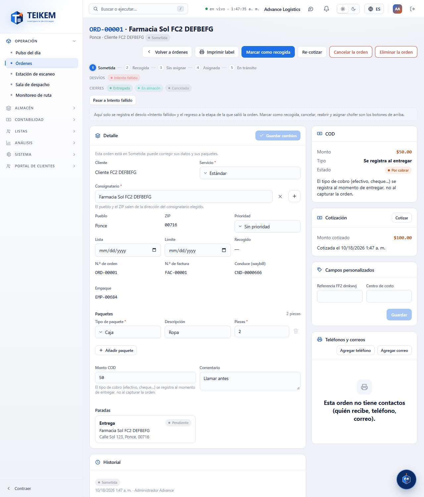

## Required permissions

Each button appears only if you have its permission and, in addition, if the order is in a status that allows it. If a permission is missing, ask your company's administrator for it (System → Roles).

| Permission | What it allows |
|---|---|
| `orders.view` | Open the file (see everything). |
| `orders.edit` | **Save changes**, **Mark as picked up**, **Re-quote** and the status buttons (Failed attempt and return). Also fill in the custom fields and the contacts (the contacts also require `contacts.manage`). |
| `orders.cancel` | **Cancel the shipment** and **Delete the shipment**. |
| `orders.reopen` | **Reopen** a Delivered, Cancelled or In warehouse order. The Company Admin role has it; another role needs it added. |
| `orders.credit_override` | Authorize an order whose client exceeds its credit limit. |
| `orders.view_price` | See the **Quote** panel and the **Quote** button. Without this permission the panel does not appear. |
| `trips.dispatch` | **Assign driver** / **Reassign driver** (the Lists module must be turned on). |
| `fleet.view` | See the list of drivers when assigning one. |
| `contacts.manage` | Add, edit and remove phones and emails of the order. |

## Which buttons appear according to the status

| Shipment status | Buttons at the top |
|---|---|
| **Submitted** (the initial status) | **Mark as picked up**, **Cancel the shipment**, **Delete the shipment**, and **Re-quote** if it is already quoted; the **Detail** can be edited. In a special delivery, also **Assign driver**. |
| **Pickup**, **Unassigned**, **Assigned**, **In transit** | **Cancel the shipment** (as long as the company allows it). The Detail remains as reference. |
| **In transit** (special delivery) | **Reassign driver** and **Cancel the shipment**. |
| **Failed attempt** | **Cancel the shipment** and, in the status bar, **Return to** the stage it left. |
| **Delivered**, **Cancelled** or **In warehouse** | **Reopen** (only with `orders.reopen`). Nothing else: the order is viewed. |

Below the buttons is the order's status bar. The small buttons of that bar are only for the “Failed attempt” **detour** and for the **return**; marking as picked up, cancelling, reopening and assigning a driver are the buttons at the top.

## 1. Correct the data of an order

While the order is Submitted, the **Detail** panel shows fields that can be changed. What cannot be changed is shown as text: the **client**, the **Shipment no.**, the **Invoice no.** and the **Pack**.

1. Open the order.
2. Change what you need: **Service**, **Consignee**, **Priority**, **Ready** and **Due** (the dates), the **Packages** (type, description and pieces), the **COD amount** and the **Comment**.
   - For another consignee, search for it in the **Consignee** field (the client's and the shared ones appear). The **Town** and the **ZIP** change by themselves according to the chosen address.
   - To add a package, press **Add package**; to remove it, the trash can on its line (at least one must always remain).
   - To remove the COD, leave **COD amount** empty.
3. Press **Save changes**. The button is enabled only when you change something.

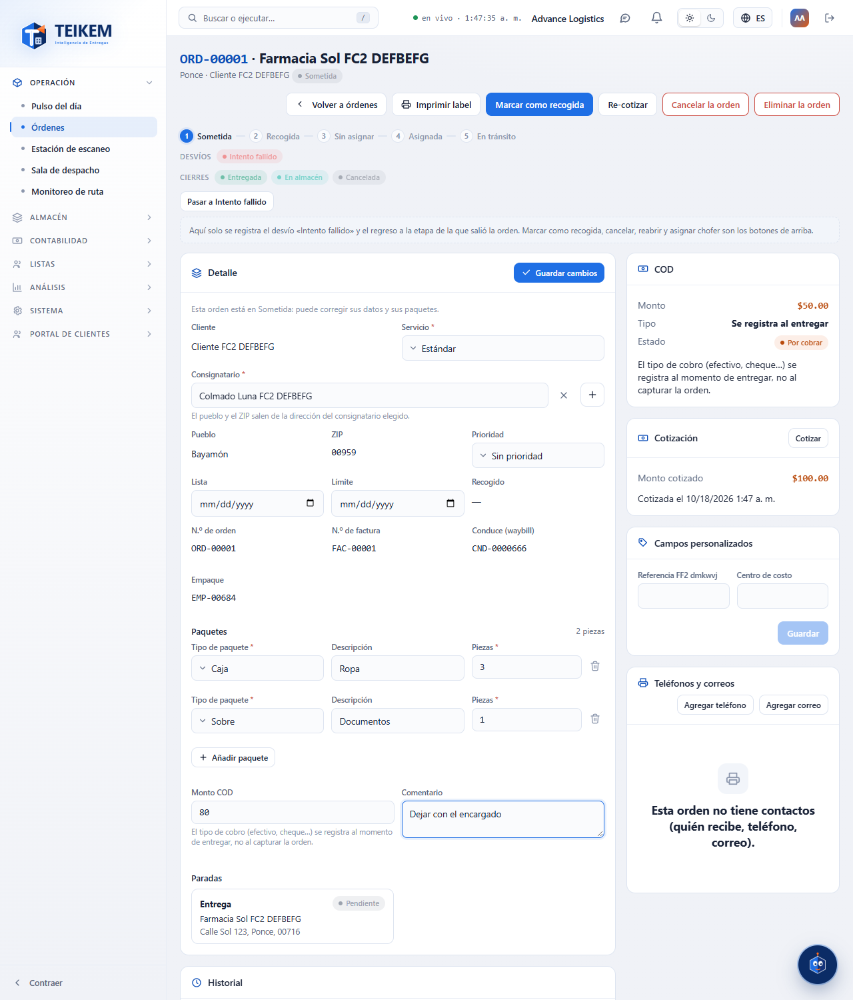

Teikem saves only what you changed. A **special delivery** has no packages or COD, so those fields do not appear.

If the order is no longer Submitted, the panel says “This shipment has moved past Submitted: its data is shown for reference and is no longer edited here.” and there is no **Save changes** button. If your user does not have `orders.edit`, it says “Your user cannot edit shipments: the data is shown for reference.”

### If someone else changed the order while you were editing it

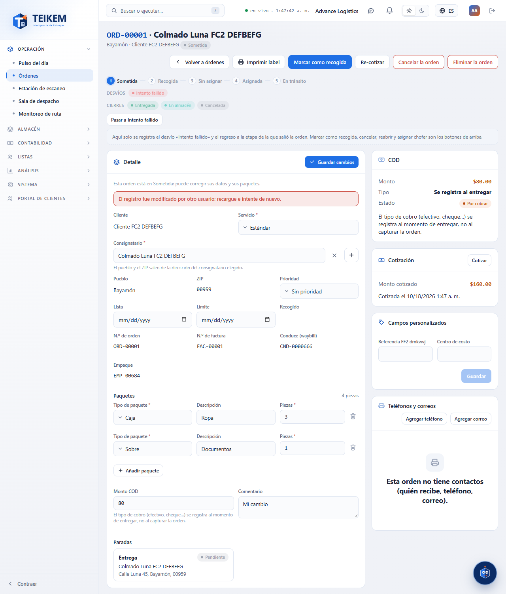

The notice “The record was modified by another user; reload and try again.” appears. The screen reads the order again and **keeps what you typed**. Check the new data and press **Save changes** again.

## 2. Mark the order as picked up

1. Press **Mark as picked up** (top right).
2. Read the notice and press **Mark as picked up**. Teikem quotes the order again with the contract rates (if the rate is missing, it warns and the order does not change), checks the client's credit and moves it from Submitted to Pickup.

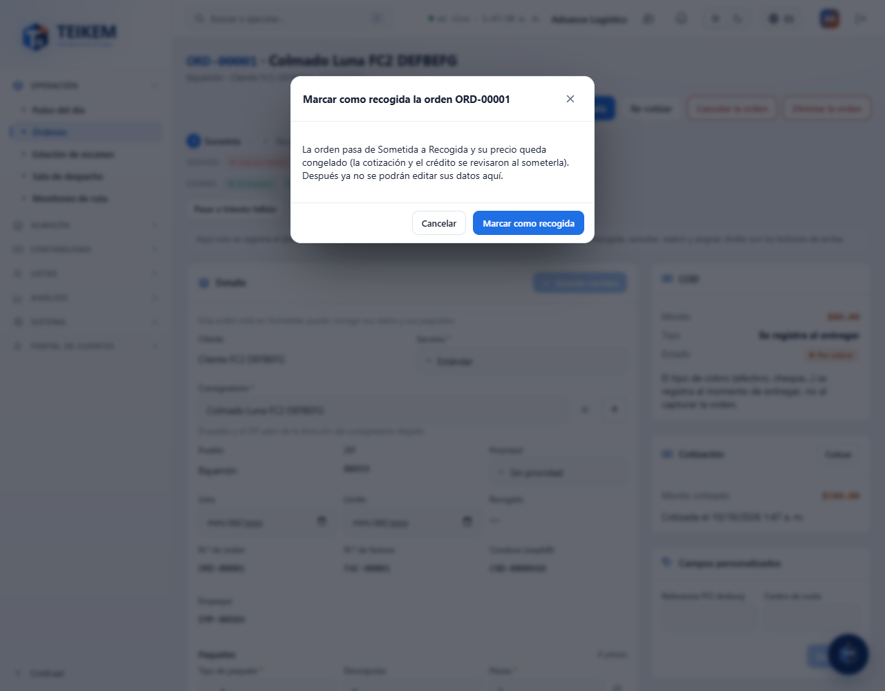

After marking it as picked up, the Detail data is no longer edited here.

### Exceeded credit

If the client goes over its credit limit, the **The client exceeds its credit limit** window appears with the server message. With the `orders.view_price` permission the message includes the figures (limit, in progress and this order); without it, it only says “The client exceeds its credit limit.”.

- If you have `orders.credit_override`, press **Authorize and mark as picked up**: the order moves to Pickup anyway and the history records who authorized it.
- If you do not have it, the order stays Submitted. Tell Billing or whoever can authorize, or ask for the client's limit to be raised.

If your user only has `orders.credit_override` (without `orders.edit`), the **Mark as picked up** button opens a window that offers **Authorize and mark as picked up** directly: that permission only serves to authorize the credit excess.

## 3. See the quote

The **Quote** panel (only with `orders.view_price`) shows the **Quoted amount** and when it was quoted. The order is quoted when created if the client has a contract and rate; the price is frozen when it is marked as picked up. If it has not been quoted yet it says “Not quoted yet: it is quoted when the order is created if the client has a contract and rate; if not, when it is marked as picked up.”

Press **Quote** to see a **preview** with the current rates: the lines, the **Dispatch**, the **COD fee**, the **Total** and the **Client credit** (limit, in progress, this order and available, with the notice “Exceeds credit” or “Within the limit”). The preview **saves nothing**.

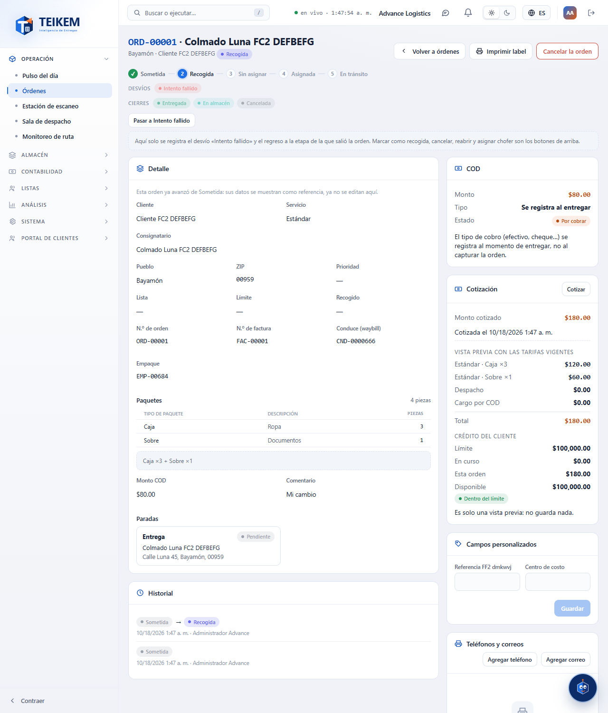

## 4. Re-quote

If the contract rates changed, press **Re-quote** on an already quoted Submitted order and confirm (after marking it as picked up the button no longer appears). Teikem recalculates the amount with the current rates; the status does not change.

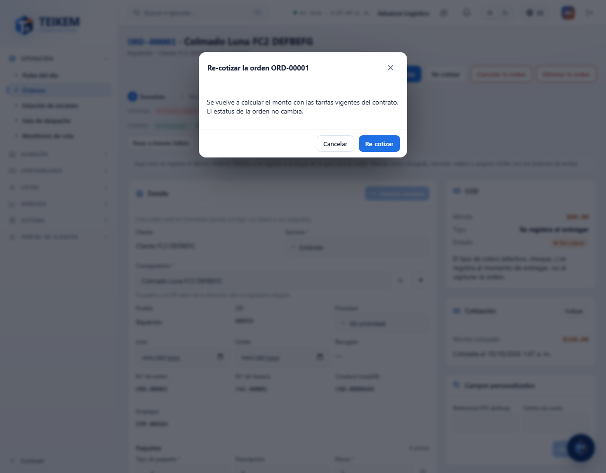

## 5. Failed attempt and the return

The small button under the status bar records the **Move to Failed attempt** detour. A window opens with an optional comment (maximum 500 characters); press **Change status**. The failed attempt is also documented as a delivery attempt.

While in Failed attempt, the only return is **Return to** the exact stage the order left (for example “Return to In transit”). There are no buttons to move forward, nor to cancel from there.

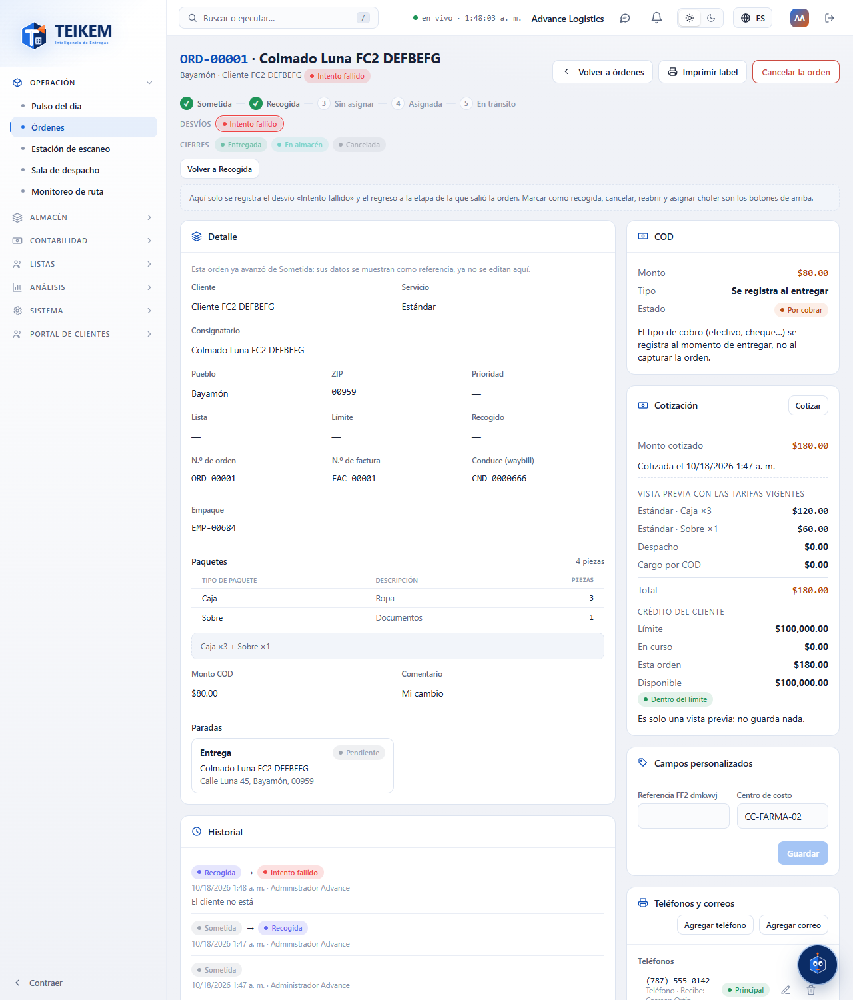

## 6. Cancel the shipment

1. Press **Cancel the shipment**.
2. Type the **Reason for cancelling** (required, maximum 500 characters). If you leave it empty, the window says “Enter the reason for the cancellation.” and does not cancel.
3. Press **Cancel the shipment** in the window. The **Back** button closes the window without cancelling.

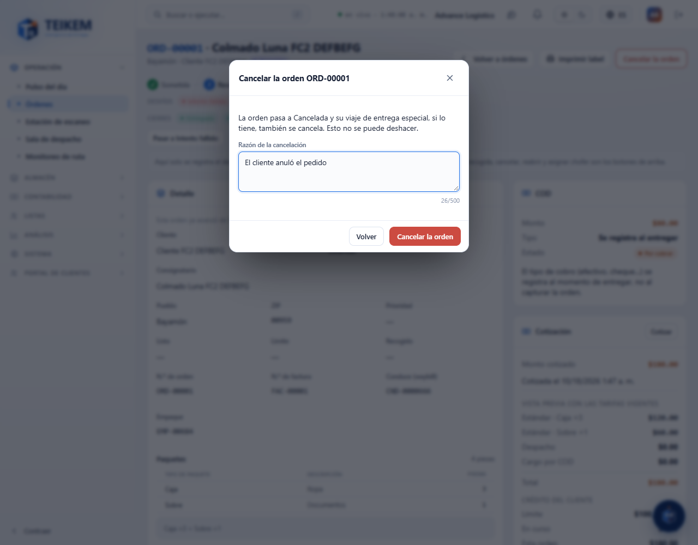

The order moves to **Cancelled** and the reason stays in the **History**. If it was a special delivery with a driver, its trip is also cancelled. It cannot be undone.

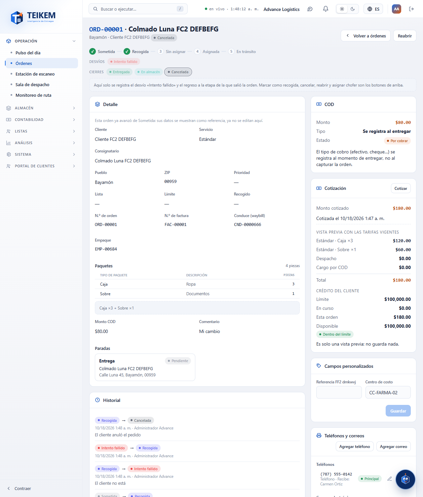

## 6b. Reopen an order in a final status

A **Delivered**, **Cancelled** or **In warehouse** order can be reopened if you have the `orders.reopen` permission.

1. Press **Reopen**.
2. In **Target status** leave “The last one it was in” (it returns to the last in-progress status the order had) or choose another in-progress status.
3. Type the **Reason for reopening** (required, maximum 500 characters). Empty, the window says “Enter the reason for reopening the shipment.”
4. Press **Reopen the shipment**. “Order … reopened.” appears.

The order returns to the flow, the reason stays in the **History** and in the security log. Reopening does **not** quote again or measure the credit again.

## 7. Delete the shipment

Only a **Submitted** order is deleted (with `orders.cancel`). Press **Delete the shipment**, confirm with **Delete** and the screen returns to the list. An already picked-up order is not deleted: it is cancelled.

## 8. Assign the driver of a special delivery

Only **special deliveries** are assigned here (the other orders go through the Dispatch room).

1. Open the special delivery and press **Assign driver**.
2. In **Driver**, search for and choose one (only active drivers appear). Type a comment if you want.
3. Press **Assign driver**.

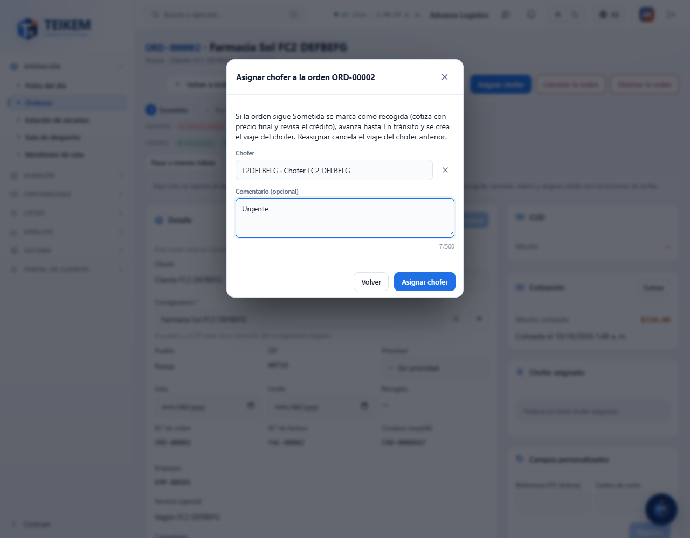

If the order was still Submitted, Teikem marks it as picked up (quotes and checks the credit), advances it to **In transit** and creates the driver's trip. The driver appears in the **Assigned driver** panel.

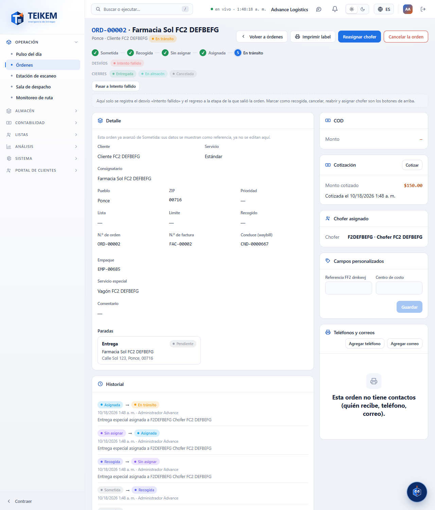

While the order is **In transit** the button becomes **Reassign driver**: when choosing another driver, the previous one's trip is cancelled. If you choose the same one, the system warns “The shipment is already assigned to that driver.”

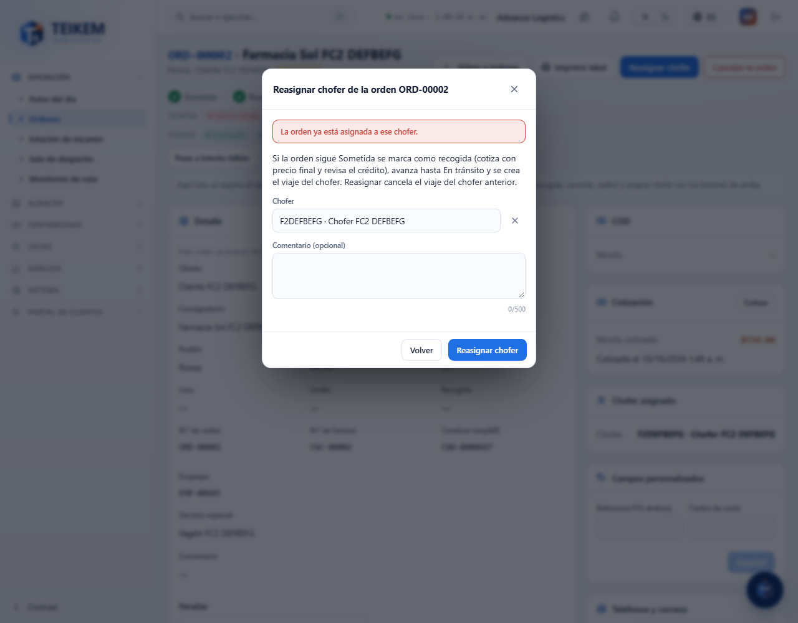

If when assigning the client exceeds its credit, the notice explains it; whoever has `orders.credit_override` sees the **Authorize and assign** button. If your user does not have `fleet.view`, the window warns that it cannot look up the drivers.

## 9. The panels on the right

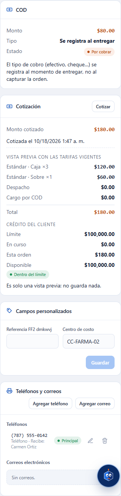

- **COD.** View only: the **Amount**, its **Status** and the **Type**. The collection type (cash, check…) is recorded on delivery, not before. To change the amount use the Detail.
- **Assigned driver.** The driver (and the trip, when there is one) of the order.
- **Custom fields.** The fields the company defined for orders (for example “Cost center”). Fill them in and press **Save**. The panel does not appear if the company defined no fields. Requires `orders.edit`.
- **Phones & emails.** Who receives and how to contact them. **Add phone** and **Add email** open a window (the caption, for example “Receives: Carmen Ortiz”, goes in **Label**); the pencil edits and the trash can removes. Requires `contacts.manage` and `orders.edit`.
- **History.** Each status change, with who, when and the comment.

## Messages and what to do

| Message | What it means | What to do |
|---|---|---|
| `The record was modified by another user; reload and try again.` (409) | Someone else saved the order before you. | The screen has already reloaded it and keeps what you typed: check and **Save changes** again. |
| `The date cannot be removed; choose another one.` | An already entered date (Ready or Due) cannot be left empty. | Choose another date. |
| `The due date cannot be before the ready date.` | **Due** goes before **Ready**. | Correct one of the two. |
| `The number of pieces must be at least 1.` | A package line has 0 pieces. | Type a whole number from 1. |
| `The package type is required.` / `The service type is required.` / `The consignee is required: choose one from the directory or capture a new one.` | That data is missing. | Choose it. |
| `The COD amount cannot be negative.` | **COD amount** less than zero. | Leave it empty or at 0 if there is no collection. |
| `Enter at least one package line.` | You removed all the packages. | Add one. |
| `A special delivery has no package lines or COD.` (400) | An attempt was made to put packages or COD on a special delivery. | They are not allowed: change only the other data. |
| `The current status does not allow the action 'EDIT_CARGO'.` (422) | The order has already left the status in which it is edited. | Reload; it is no longer edited here. |
| `The current status does not allow the action 'REPRICE'.` (422) | The order is not in a status that allows re-quoting. | Only a Submitted and quoted order is re-quoted. |
| `The client exceeds its credit limit: limit X, in progress Y, this order Z.` (422) | The credit does not suffice. Without `orders.view_price` the message has no figures. | With `orders.credit_override`: **Authorize and mark as picked up**. If not, tell Billing. |
| `The client is suspended; shipments cannot be created or confirmed.` (422) | The client is suspended. | Reactivate the client or tell whoever administers it. |
| `There is no rate in force for X/Y; set up the rate in the client's contract before confirming.` (422) | The contract has no rate for that service and package. The order was saved unquoted and now cannot be marked as picked up. | Set up the rate in Clients → Contract → Rates and try again. |
| `A shipment is only confirmed in its initial status.` (422) | The order is no longer Submitted (someone marked it as picked up before). | Reload the screen. |
| `A shipment can only be deleted in its initial status; use cancellation.` (422) | The order is no longer Submitted. | Use **Cancel the shipment**. |
| `Enter the reason for the cancellation.` (400) | An attempt was made to cancel without typing the reason. | Type why it is cancelled and press again. |
| `Enter the reason for reopening the shipment.` (400) | An attempt was made to reopen without a reason. | Type why it is reopened. |
| `A shipment is only reopened in a final status.` (422) | The order is no longer in a final status (someone reopened it before). | Reload the screen. |
| `A reopened shipment must be left in an in-progress stage.` (422) | A final status was chosen as target. | Choose an in-progress status or leave “The last one it was in”. |
| `The shipment has no previous status to return to; specify the target status.` (422) | The order was never in an in-progress status to return to. | Choose the **Target status**. |
| `Missing permission 'orders.reopen'.` (403) | Your user cannot reopen. | Ask the administrator for the permission (System → Roles). |
| `The comment allows at most 500 characters.` | The comment is too long. | Shorten it. |
| `Repeated invoice for this consignee` | The new consignee already has another order with that invoice number and allows repeating them. | Press **Save anyway** or cancel. If it does not allow them, the server rejects it and you must choose another consignee. |
| `Driver not found.` (404) | The driver no longer exists. | Choose another. |
| `The driver is not available for dispatch: …` (409) | The driver has an expired license, is inactive or another reason (listed in the message). | Choose another driver or fix the reason in Fleet → Drivers. |
| `The shipment is already assigned to that driver.` (409) | You chose the same driver it already has. | Choose another or press **Back**. |
| `The shipment already has a trip in force; reload and try again.` (409) | Two people assigned at the same time. | Reload and try again. |
| `Only special deliveries are assigned to a driver from here; the other shipments go through the Dispatch room.` (422) | The order is not a special delivery. | Use the Dispatch room. |
| `The special delivery has already reached its destination or finished; the driver cannot be assigned or reassigned.` (422) | The order has already moved past In transit, or is in a detour or finished. | The driver can no longer be changed. |
| `Missing permission '…'.` (403) | Your user does not have that permission. | Ask the administrator for it. |
