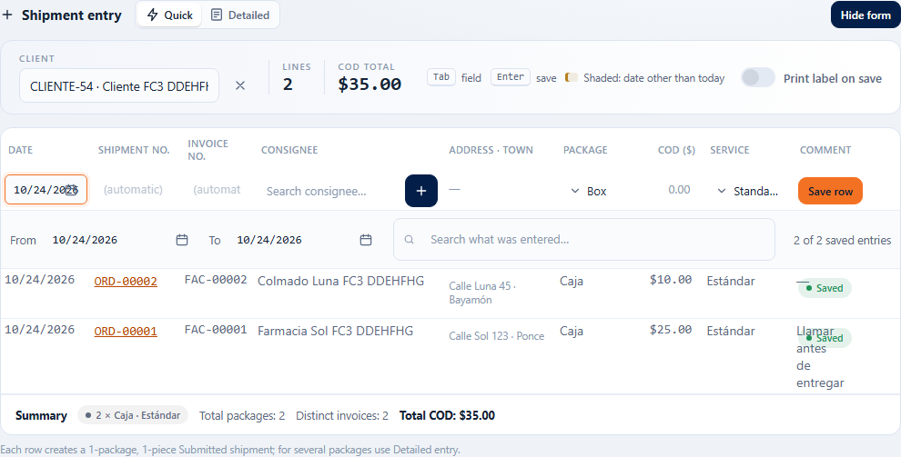
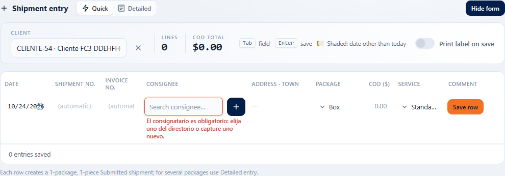
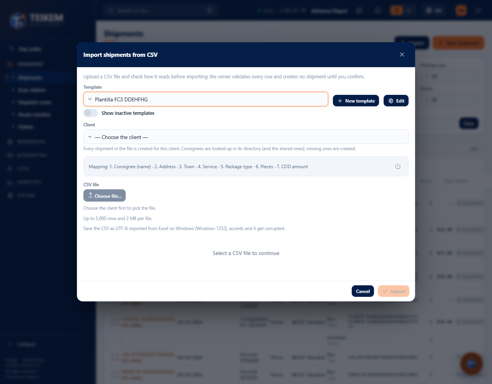
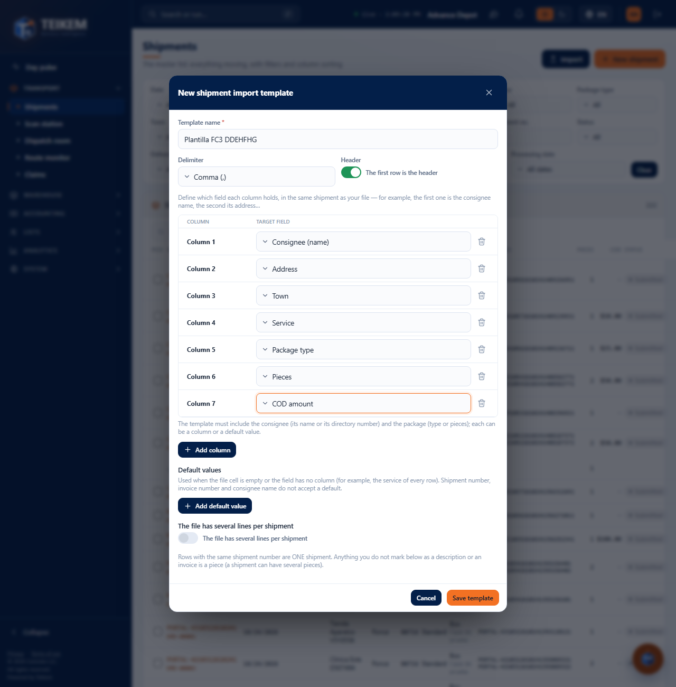
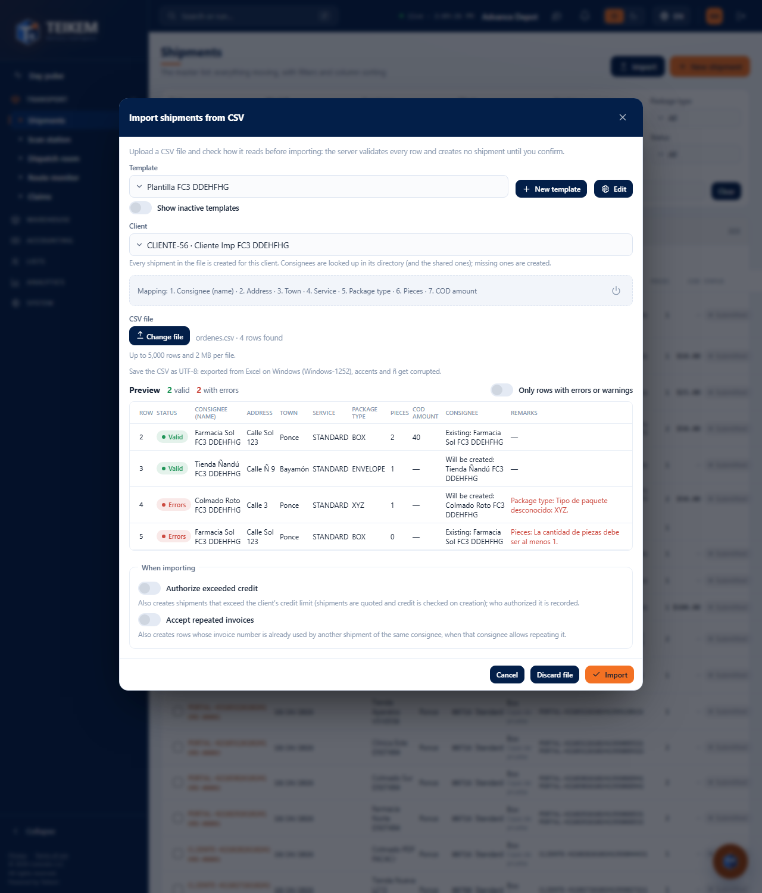
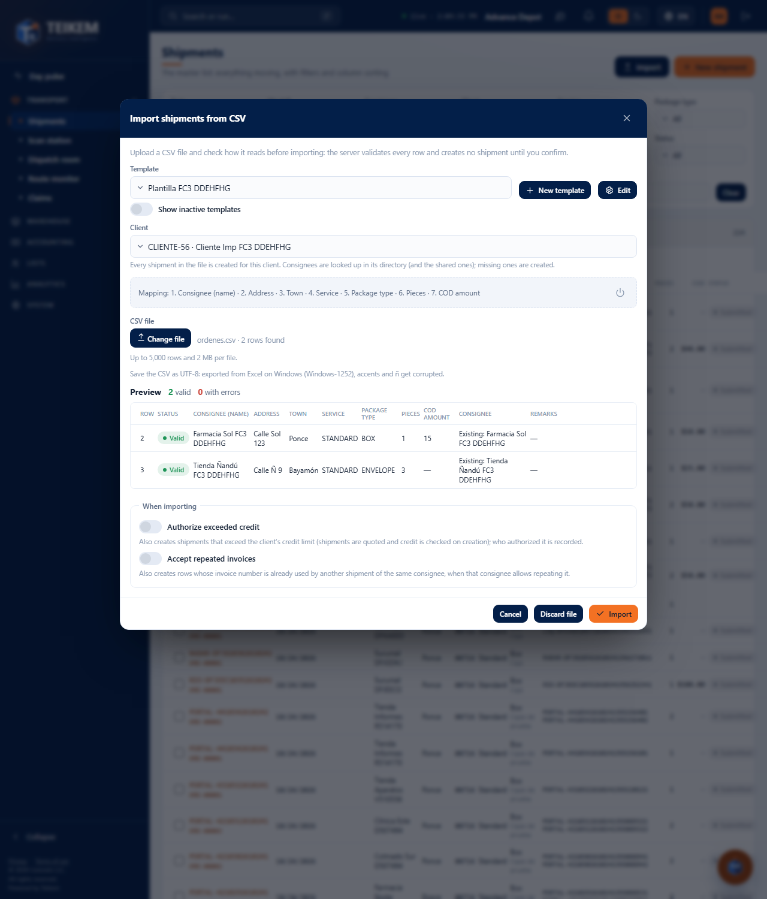
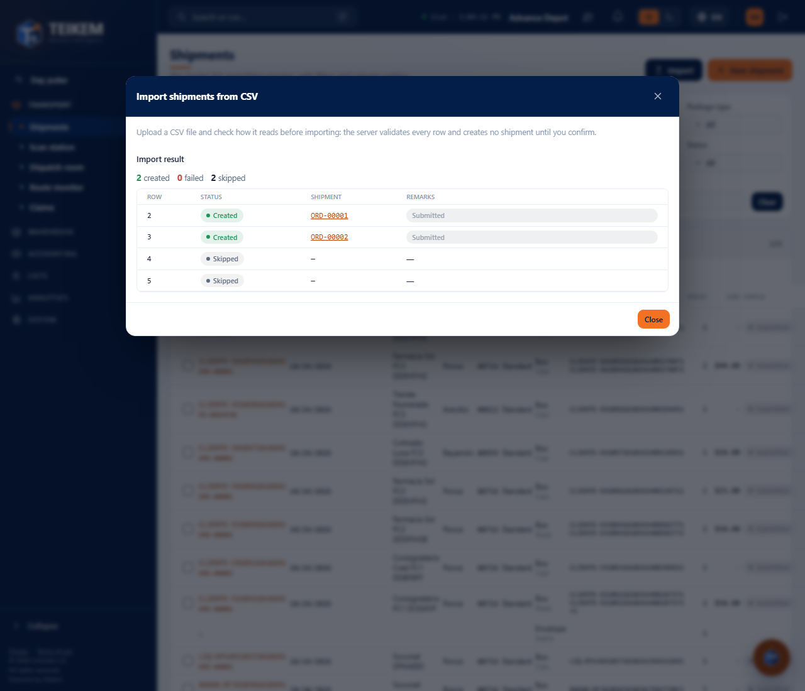
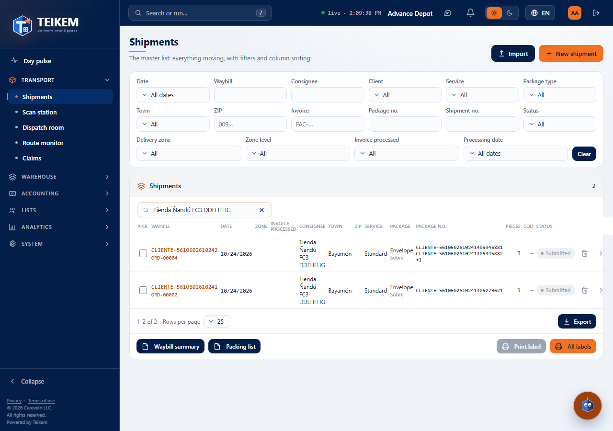

# Orders: quick entry and CSV import

In **Operations → Orders**, the **New order** button opens the order entry, which has two modes (the **Quick / Detailed** toggle at the top): **Quick**, to enter many orders in a row, and **Detailed**, for an order with several packages (see [Detailed entry](fc1-ordenes-alta.md)). Next to **New order** is the **Import** button, which creates orders from a CSV file.

The screen remembers your last choice: if you left it on **Detailed**, next time it opens on **Detailed**. The first time it opens on **Quick**.

The **“Print label on save”** toggle (in the legend, next to “Enter saves”) prints the label of each piece of the order that was just
saved on this station's label printer (see [F-G2 — Labels and documents](fg2-labels-y-documentos.md)). It comes turned on if the
company has “Print labels directly to the printer” and the station was not excluded; it can be changed while entering.

## Required permissions

| Permission | What it allows |
|---|---|
| `orders.create` | See and use **New order** (Quick and Detailed) and the **Import** button: validate the file, import and discard. |
| `orders.edit` | Choose, create, edit, deactivate and reactivate the import **templates**. |
| `orders.credit_override` | See the **Authorize exceeded credit** checkbox when importing. |
| `locations.create` | See the **+** button to create a consignee from the quick entry. |
| `clients.read` | Choose the client (in the quick entry and when importing). |

If a permission is missing, ask your company's administrator for it (System → Roles).

## Quick entry

Each **row** of the grid is **one order of 1 package and 1 piece**. It is saved as **Submitted** (Batch 106), already quoted if the client has a contract and rate: to mark it as picked up, open it from the list (**Mark as picked up** button of the file). If you need several packages in one order, use **Detailed**.

### How to use it

1. Press **New order**. If it does not open on **Quick**, press **Quick**.
2. In **Client** choose the client of the orders (it is required and applies to all rows).
3. In the empty row:
   - **Shipment no.**: it can only be typed if the client assigns its own numbers; if not, it says **(automatic)** and Teikem assigns it.
   - **Consignee**: search by name, number, address or town. The client's and the shared ones appear. Below, **Address · Town** shows where it will go. With the **+** button you can create a new consignee without leaving the screen.
   - **Package**, **COD ($)** (optional), **Service** and **Comment** (optional).
4. Press **Enter** in any field (or the **Save row** button). The order is created and the row is saved, with its shipment number, in gray and no longer editable.
5. A **new row** appears at the top: the client and the service stay as they were, and the cursor lands on the consignee. Repeat.

**Tab** moves from one field to the next. At the top, **Lines** counts the saved orders and **COD total** adds up their COD.

If the consignee list is open, **Enter** chooses the highlighted one and does **not** save the row: press **Enter** again to save.

### If something fails

The messages appear below the field or below the row, and **what you typed stays** so you can correct it and press **Enter** again. The order is not created while there is an error.

| Message | What it means and what to do |
|---|---|
| The client is required. | Choose the client in the bar at the top. |
| The consignee is required: choose one from the directory or capture a new one. | Choose one from the list or create it with **+**. |
| The package type is required. | Choose the **Package**. The company has no default package. |
| The service type is required. | Choose the **Service**. The company has no default service. |
| The COD amount must be a number. | Type only digits (for example 25 or 25.50). |
| The COD amount cannot be negative. | Type an amount of 0 or more. |
| The number cannot exceed 40 characters. | Shorten the Shipment no. |
| The client is suspended; shipments cannot be created or confirmed. | The client cannot receive new orders. Check with whoever administers it. |
| The client has been deactivated; only its history can be viewed. | Choose another client. |
| Consignee is inactive; reactivate it or choose another. | Choose another or reactivate it in Lists → Consignees. |
| Unknown package type: X. / Unknown service type: X. | That value no longer exists in the list; choose another from the list. |
| A shipment with that number already exists for this client. | The Shipment no. you typed is already used; type another or leave it empty if it is automatic. |

If the connection drops while saving, an error appears on the row; pressing **Enter** again retries **without duplicating** the order.

## Import shipments from CSV

It is used to create many orders at once from an Excel file saved as CSV. The process has two steps and **creates nothing** until you confirm it.

### Before starting

- The file must be **CSV in UTF-8**. If you save it from Excel on Windows, choose “CSV UTF-8”; with the normal “CSV (comma delimited)” format the accents and the ñ come out damaged.
- Maximum **5,000 rows** and **2 MB** per file.
- Each **row** of the file is an order with **one package type**. Each row must give the consignee (its name with the address, or its number in the directory) and the package (type or pieces).

### Templates

A **template** tells Teikem what is in each column of your file. It is made once and reused.

1. Press **Import**.
2. If there are no templates, press **Create “Standard format”**: it has consignee, address, town, service, package type, pieces and COD amount, in that order. Or press **New template** to build your own.
3. In the template window type the **Template name**, choose the **Delimiter** (comma, semicolon, tab or vertical bar) and whether the first row is the header.
4. For each **Column** choose the **Target field** (“— do not import —” ignores that column). Use **Add column** for more columns.
5. Optional: **Add default value** for a value that is used when the cell comes empty or the field has no column (for example, the service of all rows). The shipment number, the invoice number and the consignee name do not accept a default value.
6. Press **Save template**.

**Fields you can use:** Shipment no., Invoice no., Service, Consignee (name), Consignee (number), Address, Address (line 2), Town, State or region, ZIP, Country, Contact phone, Package type, Pieces, Weight (kg), Volume (m³), Description, COD amount, Requested date, Notes and Reference.

| Message when saving the template | What it means and what to do |
|---|---|
| The template name is required. | Type a name. |
| Enter at least one column. | Choose a target field in some column. |
| The template must include consigneeName or consigneeCode. | The consignee is missing: assign “Consignee (name)” or “Consignee (number)” to a column. |
| The template must define the package: packageType or pieces, in a column or in defaults. | Assign “Package type” or “Pieces” to a column, or set it as a default value. |
| The field X is repeated. | Each field can only be in one column. |
| The field X does not accept a default value. | Remove it from the default values. |
| An import template with that name already exists. | Use another name. |

A template is not deleted: **Deactivate this template** (the power icon next to the mapping) stops offering it; with **Show inactive templates** you see it and can **Reactivate this template**.

### Step 1: choose client and file, and review

1. Choose the **Template** and the **Client**. All the orders in the file are created for that client. Until you choose the client, the file cannot be chosen.
2. Press **Choose file…** and choose the CSV. Teikem reviews it row by row and shows the **Preview**.

In the preview each row says whether it is **Valid**, **Warning** or **With errors**, what was read in each column, the **Consignee** (**Existing: …** if it is already in the client's directory or shared, **Will be created: …** if it is new) and the **Remarks** with the error or the warning. Rows with errors **are not imported**; the rest are. **Only rows with errors or warnings** lets you see only the ones that need review.

If you change the client or the template, the file is reviewed again.

| Message | What it means and what to do |
|---|---|
| The file exceeds the limit of 5,000 rows or 2 MB. | Split the file into parts. |
| The file has no data rows. | The file is empty or only has the header. |
| Give the consignee: name (with address) or directory code. | The consignee is missing in that row. |
| Unknown package type: X. / Unknown service type: X. | Use a value from the list (for example STANDARD, BOX). |
| The number of pieces must be at least 1. / The number of pieces must be a whole number. | Correct the pieces. |
| The COD amount must be a number. / The COD amount cannot be negative. | Correct the COD. |
| The requested date is not valid; use yyyy-MM-dd. | Type the date as 2026-10-15. |
| There is no consignee with code 'X' for this client. | Correct the number or use the name and the address. |
| The client is suspended; shipments cannot be created or confirmed. | That client cannot receive orders right now. |

### Step 2: import or discard

Before importing, the **When importing** section has up to two checkboxes (since Batch 106 “Confirm the orders when importing” no longer exists: the orders are born **Submitted** and quoted):

| Checkbox | What it does |
|---|---|
| **Authorize exceeded credit** | Only appears with `orders.credit_override`. Also creates the shipments that go over the client's credit limit (on creation it is quoted and the credit is measured); who authorized it is recorded. |
| **Accept repeated invoices** | Also creates the rows whose invoice number is already used by another shipment of the same consignee, when that consignee allows repeating it. |

- **Import** creates one order per valid row. If one fails, the rest are created anyway.
- **Discard file** erases the review without creating anything and lets you choose another file.
- **Cancel** discards and closes the window.

When it finishes you will see the **Import result**: how many were **created**, **failed** and **skipped** (the rows with errors), and per row the **shipment number** (with a link to the order) or the reason for the failure.

| Message when importing | What it means and what to do |
|---|---|
| The batch was already confirmed; validate a new file to import more shipments. | That file was already imported. Choose the file again if you need another batch. |
| The batch was discarded; validate the file again. | Choose the file again. |
| The client exceeds its credit limit. | That row was not created. Ask someone with `orders.credit_override` to import with **Authorize exceeded credit**, or fix the client's credit limit. |
| Missing permission 'orders.credit_override'. | You cannot authorize credit; uncheck that checkbox. |

The imported orders appear in the **Orders** list.

