# Drivers and rates

The **Lists → Drivers & rates** screen is the master list of your drivers: who they are, which zone they work in, whether they are available, which licenses they hold and **how much they are paid** per delivery, per attempt and per trip. From there you can:

- **Create** a driver, **correct their data** and **delete** them.
- Mark them **Unavailable**, or turn off their **Active** switch.
- Keep their **licenses and certifications**, with a warning about which ones expire.
- Define their **rates** (per delivery, per attempt and per trip), with dates and with history.
- Choose the company's **payout formula** and see a **preview** of the pay.
- Register and cancel **paid trips**.
- See their **devices**, their **phones and emails**, their **custom fields** and the status **history**.

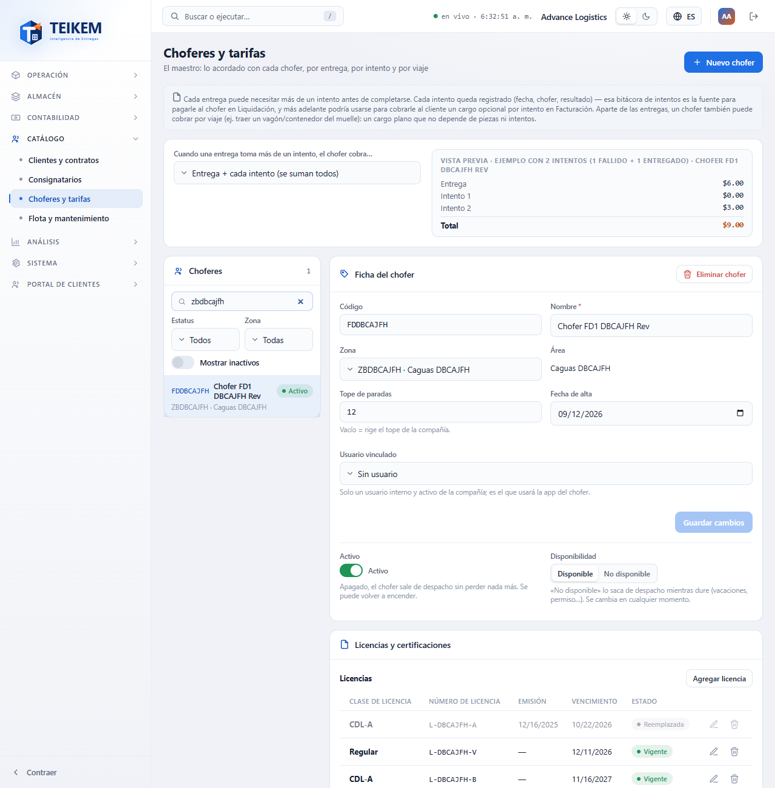

## Required permissions

Each button appears only if you have its permission. If one is missing, ask your company's administrator for it (System → Roles).

| Permission | What it allows |
|---|---|
| `fleet.view` | Open the screen and see drivers, licenses, certifications and devices. |
| `fleet.manage` | **New driver**, **Save changes**, **Availability**, **Active**, **Delete driver**, licenses, certifications, removing devices, custom fields and contacts (contacts also require `contacts.manage`). |
| `admin.users` | Choose or remove the driver's **Linked user** (in addition to `fleet.manage`). |
| `driverpay.view` | See the **payout formula**, the preview, the **rates** and the **paid trips**. Without this permission those panels do not appear. |
| `driverpay.manage` | Change the formula, add, edit and close rates, **+ Add attempt**, **Register trip** and **Cancel trip**. |

The **Lists** module must be turned on for your company.

## 1. The driver list

On the left is the **Drivers** panel. Each row shows the code, the name, a chip and the **zone · area**. The chip can say **Active**, **Unavailable**, **Inactive** or **Deleted**.

- **Search…** filters by code, name and zone.
- **Status** and **Zone** filter the list.
- **Show inactive** adds the inactive and deleted drivers.
- Tap a row to see its profile on the right. On a phone the profile sits below the list.

## 2. Create a driver

1. Press **New driver** (top right).
2. Type the **Code** and the **Name**. The code is saved in uppercase and **cannot be changed later**.
3. If you want, choose the **Zone**, type the **Stop cap** (if left empty, the company's applies), the **Hire date** and, if you have permission, the **Linked user**.
4. Press **Save**.

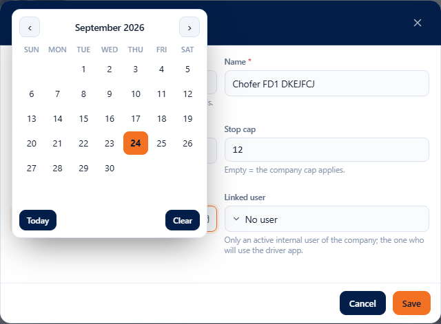

The new driver is selected and starts with no rates. If a driver with that code already exists (even a deleted one), “A driver with that code already exists.” appears and the window stays open.

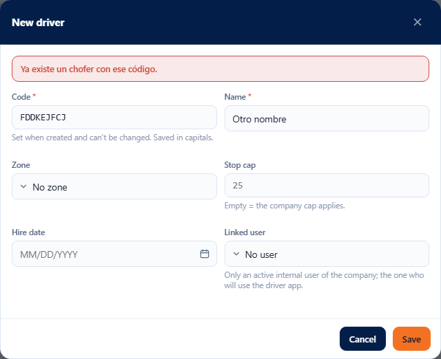

## 3. The driver profile

The profile shows the **Code** (fixed), the **Name**, the **Zone**, the **Area** (it is the name of the chosen zone; it is not typed), the **Stop cap**, the **Hire date** and the **Linked user**.

1. Change whatever you need.
2. Press **Save changes**. The button lights up only when you change something.

To remove the zone, choose **No zone**. To remove the driver's own cap, leave the field empty. The **Hire date** of a driver who already has one cannot be removed: choose another.

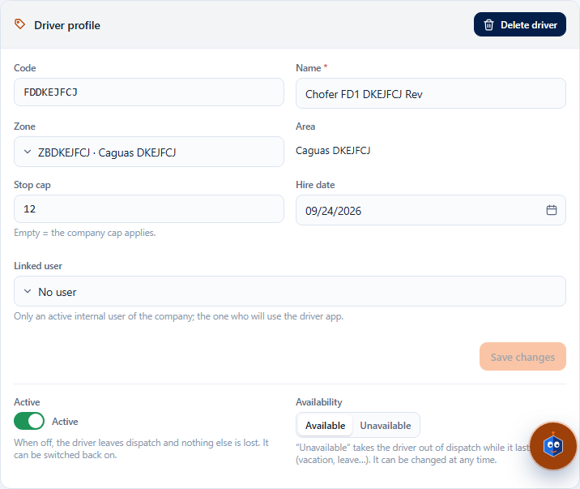

### If someone else changed the driver while you were editing

“The record was modified by another user; reload and try again.” appears. The screen reads the driver again and **keeps what you typed**. Review and press **Save changes** again.

### Linked user

It is the Teikem user who will use the driver app. Only internal, active users of your company are offered. If the user is already linked to another driver, “The user is already linked to another driver.” appears. Without the `admin.users` permission the user is visible but cannot be changed.

## 4. Active, Availability and Delete driver: three different things

| Control | What it is for | Can be undone |
|---|---|---|
| **Active** (switch) | Takes the driver out of dispatch without touching anything else. To see them in the list turn on **Show inactive**. | Yes: turn it back on. |
| **Availability** (**Available** / **Unavailable**) | Takes them out of dispatch while something temporary lasts (vacation, leave). | Yes: press **Available**. |
| **Delete driver** (red button) | Permanent deactivation. | **No.** |

When you press **Delete driver** the window explains what happens: their user is unlinked, their devices become inactive, they lose their zone, their open rates are closed today and their paid trips are kept so that what is pending can be paid. You can write a **Comment (optional)**.

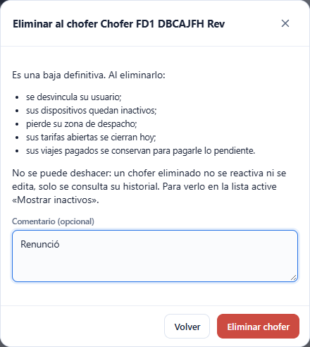

A deleted driver no longer appears in the list (use **Show inactive** to see them, with the **Deleted** chip) and their profile, rates and trips are **view-only**: “The driver was deleted; only their history can be viewed.”

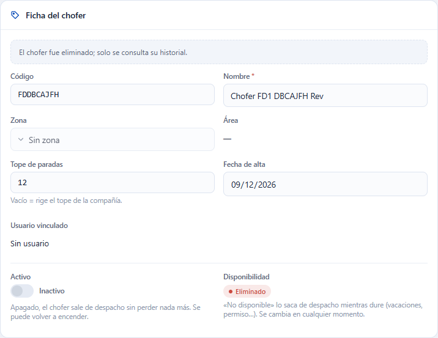

## 5. Licenses and certifications

In the **Licenses & certifications** panel each document carries a chip:

| Chip | Meaning |
|---|---|
| **Valid** | More than 30 days left. |
| **Expires in N days** / **Expires today** | Expires within the next 30 days. |
| **Expired N days ago** | Already expired. |
| **No expiry** | Has no expiration date. |
| **Superseded** | There is another document of the same type that expires later; this one no longer counts. |

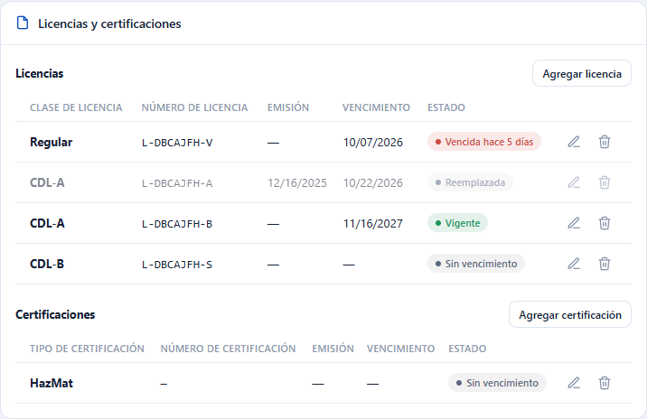

**Add:** press **Add license** or **Add certification**, choose the class or the type, type the number (required for a license), the **Issued** and **Expires** dates (if it does not expire, leave it empty) and press **Save**. The expiration cannot be earlier than the issue date.

**Edit** (the pencil) changes the data. **Remove** (the trash can) takes the document off the list and keeps it in the history.

## 6. Driver rates

Rates are kept **by date**: an old rate is never overwritten. If you change one, the previous one is closed on the date you choose and the new one starts there. If you remove one, it is **closed** (not deleted).

A new driver **has no rates at all**. “**No rate**” is not the same as **$0.00**: no rate means it has not been configured yet; $0.00 is a rate you set on purpose.

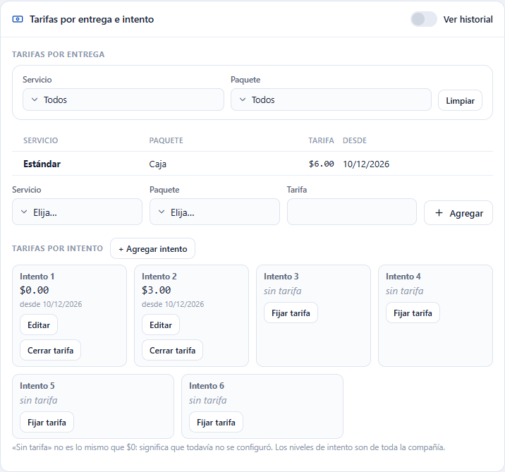

### Delivery rates

1. In the bottom row choose the **Service**, the **Package** and type the **Rate**.
2. Press **Add**.

To see only some of them, use the **Service** and **Package** filters and **Clear**.

To **change** a rate press the pencil: type the new **Rate** and **Effective from** (today by default; it can be a future date, never a past one). To **remove it** press **Close rate** and confirm.

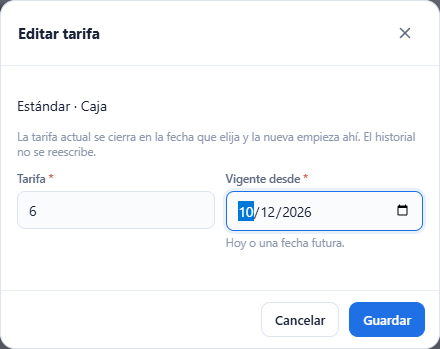

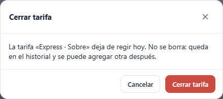

Only rates that are still open can be changed or closed: a rate that already has a closing date is visible, but has no buttons.

### Show history

Turn on **Show history** to also see the closed rates and the ones that start later, with their **From** and **Until** columns. “Until” is the day the rate stops applying. Rows that no longer apply are dimmed.

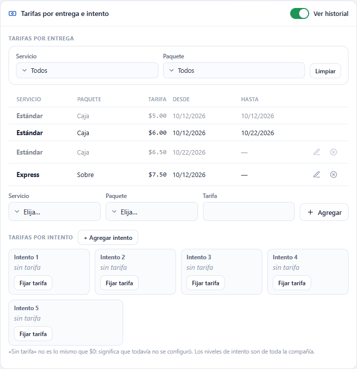

### Attempt rates

Each delivery may need several attempts. There is one cell per **Attempt**: **Set rate** when it has none, or **Edit** and **Close rate** when it does. **+ Add attempt** adds a level (Attempt 3, 4…) for **the whole company**; there is a maximum of 20 and they cannot be removed. Adding a level does not create rates: it stays “no rate”.

### Trip rates

A trip is a fixed charge that does not depend on pieces or attempts (for example, bringing a trailer from the dock). In the **Trip rates** panel choose the **Trip type**, type the **Rate** and press **Add**. The types come from the company's special services; if there are none it says “No special services — add them in Clients & contracts”.

### Without permission to write

With `driverpay.view` but without `driverpay.manage` the rates are visible without buttons. Without `driverpay.view` the rates, trips and formula panels do not appear.

## 7. Payout formula and preview

At the top of the screen, **When a delivery takes more than one attempt, the driver is paid…** defines how the delivery rate and the attempt rates are combined. It is **a single formula for the whole company**. It has three options:

- **Delivery + every attempt (all of them add up).**
- **Delivery includes the 1st attempt (only extra attempts are paid separately).**
- **Every failed attempt earns its own rate; the one that succeeds earns the delivery rate.**

On the right, the **Preview** calculates an example with 2 attempts (1 failed and 1 delivered) using the rates of the selected driver. It is recalculated when the formula or a rate changes. A line with no rate says “(no rate configured)” and adds $0.

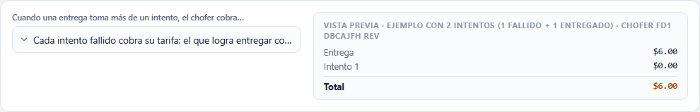

## 8. Paid trips

The **Paid trips** panel lists the driver's trips: date, type, amount, order, status and notes. By default the **current** ones are shown; use the **Dates** and **Status** filters (for example, **Cancelled**) and **Clear**.

**Register trip:** press **Register trip**, choose the **Trip type**, the **Date** (today by default; it cannot be in the future) and, if you want, **Notes**. The amount is **frozen** with the trip rate in effect that day. If the driver had no rate, the trip stays at $0.00 with the **No rate** chip.

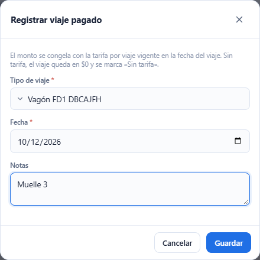

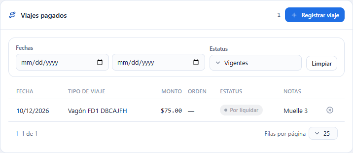

**Cancel trip:** press the **X** on the row, write a comment if you want and press **Cancel trip**. A trip that came from a **special delivery** is not cancelled here: “The trip comes from a special delivery; cancel the shipment or reassign the driver.” appears. Its shipment number is a link to the order.

## 9. Devices, contacts, custom fields and history

- **Devices:** registered by the driver app. You see the platform, the app version, the last connection and whether it has notifications. **Deactivate** stops sending it notifications. The device's secret code is never shown.
- **Phones & emails:** the driver's contact details.
- **Custom fields:** appears only if your company defined fields for drivers.
- **Status history:** who changed the driver's status, when and with what comment.

## Errors you may see

| Message | What it means | What to do |
|---|---|---|
| A driver with that code already exists. | Another driver already has that code (even a deleted one). | Use another code. |
| The driver’s code is required. / The driver’s name is required. | A field is missing. | Fill it in. |
| The code cannot exceed 30 characters. | Code too long. | Shorten it. |
| The stop cap must be 1 or more. | You typed 0 or less. | Type 1 or more, or leave it empty. |
| The dispatch zone is inactive. | The chosen zone is no longer in use. | Choose another zone. |
| The record was modified by another user; reload and try again. | Someone saved before you. | Review what is new and save again. |
| The user is already linked to another driver. | That user already belongs to another driver. | Choose another user. |
| The driver was deleted; only their history can be viewed. | The driver was already deactivated. | It cannot be edited; create a new one if needed. |
| The driver was deleted; they cannot be reactivated. | You tried to reactivate a deleted driver. | Create a new one. |
| The driver was deleted; their rates and trips can only be viewed. | You tried to change the rates or trips of a deleted driver. | It cannot be done. |
| The driver already has a current rate for … ; edit that rate or close it before adding another. | There is already an open rate for that service and package (or attempt, or trip type). | Edit it, or close it and add another. |
| The rate is already closed; add a new one if you need to pay it again. | You tried to change a rate that already has a closing date. | Add a new rate. |
| The date cannot be earlier than today: the rate history is not rewritten. | You chose a past effective date. | Choose today or a future date. |
| The rate cannot be negative. | You typed an amount below 0. | Type 0 or more. |
| The value allows at most 4 decimals and must be less than 100,000,000,000,000. | Too many decimals or a huge amount. | Correct it. |
| The maximum of 20 attempt levels was reached. | No more attempts can be added. | Use the existing ones. |
| No special services — add them in Clients & contracts | The company has no trip types. | Create a special service in Clients & contracts. |
| The trip date can’t be in the future. | You chose a day that has not arrived yet. | Choose today or a past date. |
| The trip comes from a special delivery; cancel the shipment or reassign the driver. | That trip belongs to an order. | Cancel the order or reassign the driver from the order. |
| The expiry date cannot be earlier than the issue date. | Dates reversed on a license or certification. | Correct them. |
| The license number is required. / The license class is required. | A license field is missing. | Complete it. |
| Missing permission '…'. | Your user does not have that permission. | Ask the administrator for it. |

The frequently asked questions are in the “Batch F-D1” section of the [FAQ](../faq.md).
