# Fleet and maintenance: vehicles, documents and availability

The **Lists → Fleet & maintenance** screen is the registry of your vehicles. It has seven tabs (the maintenance, work order and fuel tabs are explained in [Maintenance, work orders and fuel](fd3-mantenimiento-combustible.md)); the ones in this chapter are:

- **Vehicles**: create, correct, mark in maintenance, deactivate or retire a vehicle, and keep its documents (registration, insurance, inspection and permit).
- **Expiring documents**: a single list with the vehicle documents and the driver licenses and certifications that have already expired or expire soon.
- **Dispatch zones**: the zones where your drivers work.
- **Availability**: for a date, which drivers and vehicles can go out on a route and why not.

At the top there are four cards: **Active vehicles**, **Expiring documents (≤ 30 d)**, **Preventive maintenance (overdue)** and **Work orders (open)**. Pressing one opens its tab.

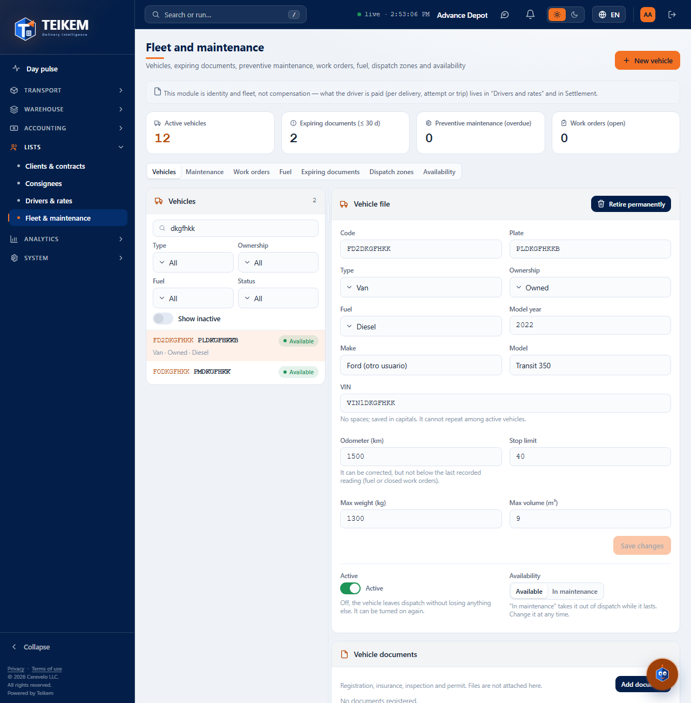

## Required permissions

Each button appears only if you have its permission. If one is missing, ask your company's administrator for it (System → Roles).

| Permission | What it allows |
|---|---|
| `fleet.view` | Open the screen and see vehicles, documents, zones and availability. |
| `fleet.manage` | **New vehicle**, **Save changes**, **Availability**, **Active**, **Retire permanently**, documents, custom fields, contacts (these also require `contacts.manage`) and the zone actions. |

The **Lists** module must be turned on for your company.

## 1. The vehicle list

On the left is the **Vehicles** panel. Each row shows the code, the plate, a chip and, below, the type, the ownership and the fuel. The chip can say **Available**, **In maintenance**, **Inactive** or **Permanently retired**.

- **Search…** filters by code, plate, VIN, make, model, type, ownership and fuel.
- **Type**, **Ownership**, **Fuel** and **Status** filter the list.
- **Show inactive** adds the inactive and retired vehicles.
- Tap a row to see its file on the right. On a phone the file sits below the list.

## 2. Create a vehicle

1. Press **New vehicle** (top right).
2. Type the **Code**. It is saved in uppercase and **cannot be changed later**.
3. If you want, fill in **Plate**, **Type**, **Ownership**, **Fuel**, **Model year**, **Make**, **Model**, **VIN**, **Odometer (km)**, **Stop cap**, **Max weight (kg)** and **Max volume (m³)**.
4. Press **Save**.

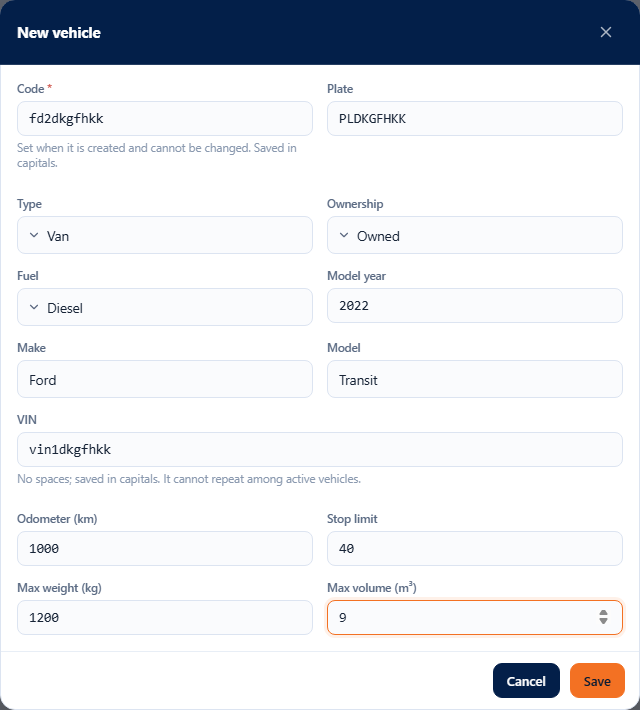

The new vehicle is selected. If the code already exists (even if that vehicle is retired), “A vehicle with that code already exists.” appears and the window stays open. If another active vehicle already has the VIN, “An active vehicle with that VIN already exists.” appears.

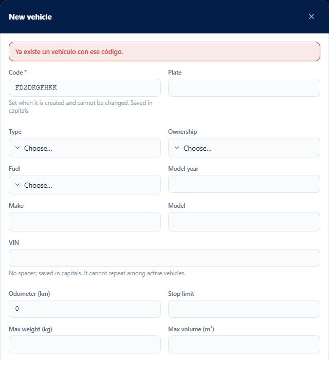

## 3. The vehicle file

The file shows the **Code** (fixed) and all the vehicle's data.

1. Change whatever you need.
2. Press **Save changes**. The button lights up only when you change something.

To clear a text (plate, make, model, VIN) leave it empty. A number that already has a value (year, capacities, stop cap, odometer) cannot be left empty: change it to another one. The **Odometer** can be corrected, but not below the last recorded reading.

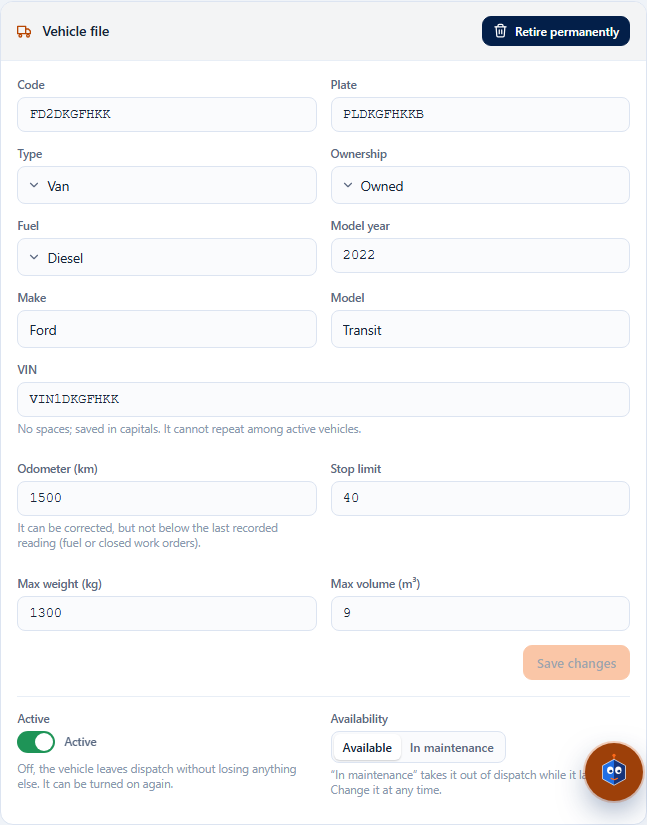

### If someone else changed the vehicle while you were editing

“The record was modified by another user; reload and try again.” appears. The screen reads the vehicle again and **keeps what you typed**. Review and press **Save changes** again.

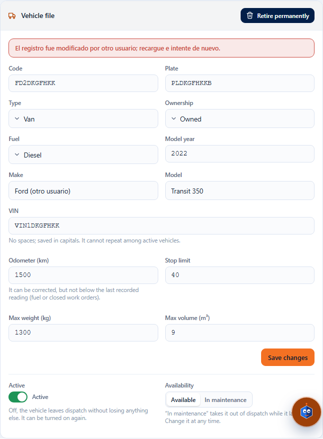

## 4. Active, Availability and Retire permanently: three different things

| Control | What it is for | Can be undone |
|---|---|---|
| **Active** (switch) | Takes the vehicle out of dispatch without touching anything else. To see it in the list turn on **Show inactive**. | Yes: turn it back on. |
| **Availability** (**Available** / **In maintenance**) | Takes it out of dispatch while something temporary lasts. | Yes: press **Available**. |
| **Retire permanently** (red button) | Permanent retirement. It is not deleted: its history and documents are kept. | **No.** |

When you press **Retire permanently** the window explains what happens and you can write a **Comment (optional)**.

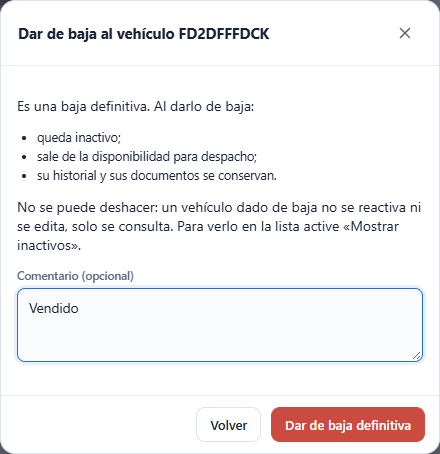

A retired vehicle appears with the **Permanently retired** chip (use **Show inactive** to see it) and its file and documents are **view-only**: “The vehicle was retired; only its history can be viewed.”

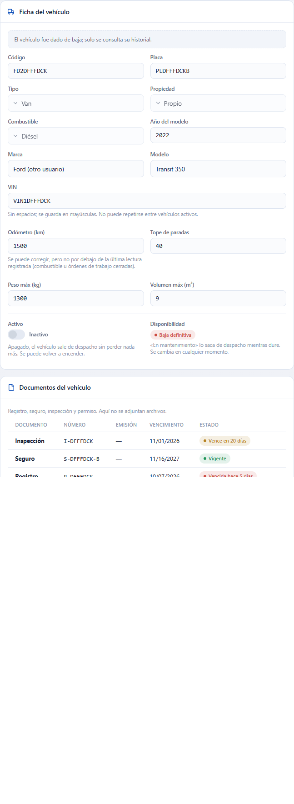

## 5. Vehicle documents

In the **Vehicle documents** panel each document (registration, insurance, inspection or permit) carries a chip:

| Chip | Meaning |
|---|---|
| **Valid** | More than 30 days left. |
| **Expires in N days** / **Expires today** | Expires within the next 30 days. |
| **Expired N days ago** | Already expired. |
| **No expiry** | Has no expiration date. |
| **Superseded** | There is another document of the same type that expires later; this one no longer counts. |

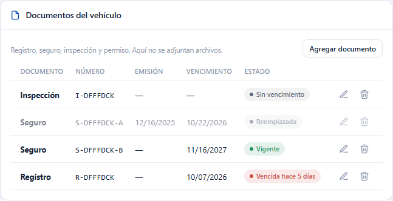

**Add:** press **Add document**, choose the **Document**, type the **Number** (optional) and the **Issued** and **Expires** dates (if it does not expire, leave the expiration empty) and press **Save**. No files are attached here.

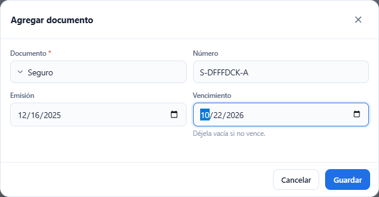

**Edit** (the pencil) changes the data. **Remove** (the trash can) takes the document off the list and keeps it in the history. Renewing a document does not force you to remove the old one: when you add a newer one of the same type, the previous one becomes **Superseded**.

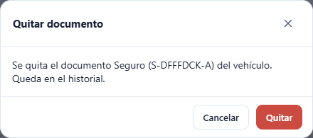

## 6. Expiring documents

The **Expiring documents** tab gathers in one list the documents of active vehicles and the licenses and certifications of active drivers that have already expired or expire within the window. A document that has already been renewed (a newer one of the same type) does not appear.

- **Document** and **Entity** (Vehicle / Driver) allow choosing several values. **Clear** removes them all and goes back to 30 days.
- **Within (days)** defines the window (30 by default, from 0 to 365).
- **Include expired** (on by default) adds the ones that have already expired.
- **Search…** filters by code, name, document or number.
- Columns are sorted by pressing their header. The **Days** chip says **Expired** (red), 0 to 14 days (blue), 15 to 30 (gray) or more (green).
- Tap a row to open the vehicle or the driver.

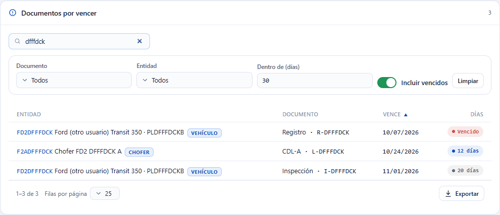

If there is nothing, it says “No expiring documents”.

## 7. Dispatch zones

In the **Dispatch zones** tab each zone shows its **Code**, its **Name**, how many **Drivers** have it as their primary zone and its **Status**. The zone name is the **Area** shown in the driver profile. The municipalities and postal codes of each zone are set up in Dispatch (later batch).

- **New zone:** type the **Code** (saved in uppercase and cannot be changed later) and, if you want, the **Name**. If the code already exists, “A dispatch zone with that code already exists.” appears.

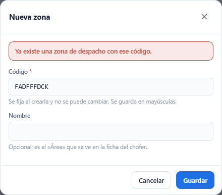

- **Edit** (the pencil): only the name can be changed.
- **Deactivate** (the power button): the zone is no longer offered when assigning drivers and it is not deleted. If the zone still has drivers, “The zone has drivers assigned; reassign them before deactivating it.” appears. Change their zone in **Drivers & rates** and try again.

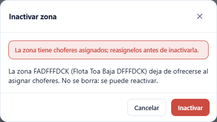

- **Reactivate:** turn on **Show inactive** and press the button on the row.

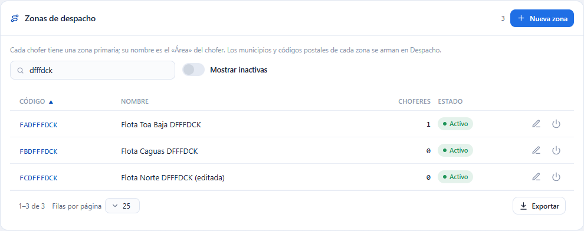

## 8. Availability

The **Availability** tab answers, for a **Date** (today by default), which drivers and vehicles can go out on a route. With **Only available** you see only the ones that can. **Search…** filters both tables. This is view-only: whatever is missing is fixed in the driver profile or the vehicle file (tap the row to open it).

Each row carries an **Available** or **Unavailable** chip and its **Reasons**:

- **Blocks**: prevents dispatching. For example: “The driver is inactive.”, “The driver has status “Unavailable”.”, “No valid license.”, “Their license expired on …”, “The vehicle is inactive.”, “The vehicle has status “In maint.”.”, “Registration expired on …” (or whichever document) and “Work order … is in progress.”
- **Warning**: worth reviewing, but it does not prevent dispatching. For example: “License … expires on …”, “Certification … expired on …” and “The vehicle has no documents registered.”

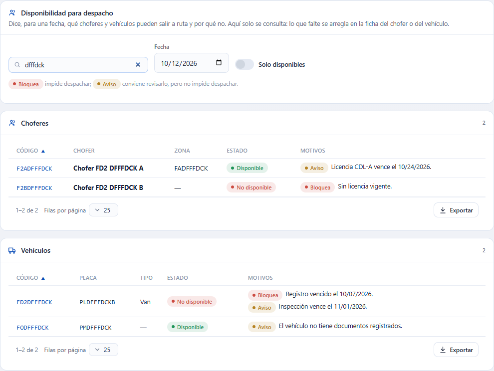

Retired vehicles are no longer shown. Overdue preventive maintenance is not evaluated here.

## 9. Custom fields, contacts and history

- **Custom fields:** appears only if your company defined fields for vehicles.
- **Phones & emails:** the vehicle's contact details (for example, those of the third party that leases it).
- **Status history:** who changed the vehicle's status, when and with what comment.

## Errors you may see

| Message | What it means | What to do |
|---|---|---|
| The vehicle code is required. | The code is missing. | Type it. |
| The code cannot exceed 30 characters. | Code too long (in zones, 20). | Shorten it. |
| A vehicle with that code already exists. | Another vehicle uses that code (even a retired one). | Use another code. |
| An active vehicle with that VIN already exists. | Another active vehicle has the same VIN. | Check the VIN; if it is the same vehicle, edit it instead of creating another. |
| The VIN allows at most 40 characters. | VIN too long. | Correct it. |
| It cannot exceed 20 / 60 characters. | Plate, make or model too long. | Shorten it. |
| Capacity cannot be negative. | Weight or volume below 0. | Type 0 or more. |
| The stop cap must be 1 or more. | You typed 0 or less. | Type 1 or more. |
| The odometer cannot be negative. | Mileage below 0. | Correct it. |
| The odometer cannot be lower than the last recorded reading (… km on …). | You tried to lower the odometer below a fuel fill-up or work order already recorded. | Type that reading or a higher one. |
| The model year must be between 1900 and … | Year out of range. | Correct it. |
| The value allows at most N decimals and must be less than … | Too many decimals or a huge value. | Correct it. |
| This value cannot be left empty once saved; enter another one. | You tried to empty a number already saved. | Type another value. |
| The record was modified by another user; reload and try again. | Someone saved before you. | Review what is new and save again. |
| The vehicle is permanently retired; only its history can be viewed. | You tried to change a vehicle or its documents after retiring it. | It cannot be done; create another vehicle if needed. |
| The vehicle is permanently retired; it cannot be reactivated. | You tried to reactivate it. | It cannot be done. |
| The document type is required. | You did not choose the document. | Choose it. |
| The expiry date cannot be earlier than the issue date. | Dates reversed. | Correct them. |
| The zone code is required. / A dispatch zone with that code already exists. | The code is missing or another zone already uses it. | Type it or use another. |
| The zone has drivers assigned; reassign them before deactivating it. | The zone is still the primary zone of some driver. | Change those drivers' zone and try again. |
| The zone has open routes; close them or move them to another zone before deactivating it. | There are unclosed routes in the zone. | Close them or move them to another zone. |
| Enter a whole number between 0 and 365. | “Within (days)” out of range. | Correct it; meanwhile the last valid window is shown. |
| Missing permission '…'. | Your user does not have that permission. | Ask the administrator for it. |

The frequently asked questions are in the “Batch F-D2” section of the [FAQ](../faq.md).
