# Maintenance, work orders and fuel

In **Lists → Fleet & maintenance** there are three tabs for taking care of your vehicles:

- **Maintenance**: which vehicles are up to date, due soon or overdue on their preventive maintenance, and the **programs** that define how often the service is due.
- **Work orders**: the record of each service or repair (tasks, vendor and costs), with its steps **Start**, **Close order** and **Cancel order**.
- **Fuel**: the fuel log, with efficiency (Km/L) and cost per kilometer.

Above the tabs there are four cards. Two belong to this chapter: **Preventive maintenance (overdue)** counts the overdue programs and **Work orders (open)** counts the orders that are not yet closed or cancelled. Pressing a card opens its tab.

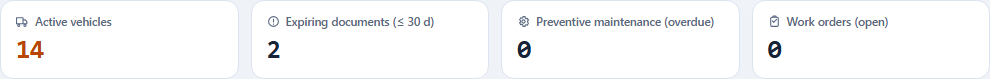

## Required permissions

Each button appears only if you have its permission. If one is missing, ask your company's administrator for it (System → Roles).

| Permission | What it allows |
|---|---|
| `fleet.view` | Open the screen and view programs, orders, tasks and fuel. |
| `fleet.maintenance` | **New program**, edit, **Deactivate** and **Reactivate** programs; **New work order**, **Save changes**, tasks, **Start**, **Close order** and **Cancel order**; **Register fill**, **Edit** and **Remove** fuel fills. |

The **Lists** module must be turned on for your company. Nothing done here deletes information: whatever is removed stays in the history.

## 1. Preventive maintenance

The **Preventive maintenance** panel shows, for each program and each vehicle it applies to:

| Column | What it says |
|---|---|
| **Vehicle** | The plate and, in a tag, the code. |
| **Program** | The program name. |
| **Basis** | **Mileage**, **Time** or **Both**. |
| **Next** | The kilometer or the date of the next service and, below, how much is left (“4,500 km left”, “Overdue by 10 days”). |
| **Status** | **Up to date**, **Due soon** (10% or less of the interval remains), **Overdue** or **No history**. |

**No history** means that the last service or the vehicle's odometer reading is missing: the system has nothing to calculate with. With basis **Both**, the worse of the two counts prevails.

The most urgent comes first. You can filter by **Status** and by **Vehicle**, search with **Search…** and press **Clear** to remove the filters.

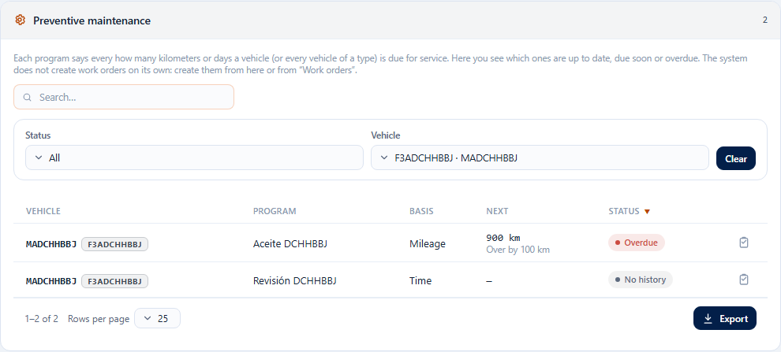

**Create the work order of a program:** press the **Create work order** icon at the end of the row. **New work order** opens with the vehicle and the program already chosen (see section 3). The system does not create orders on its own.

### Maintenance programs

Below is the **Maintenance programs** panel. A program applies to **one vehicle** or to **a vehicle type** (for example, all the Vans), never to both.

**Create a program**

1. Press **New program**.
2. Type the **Name**.
3. In **Applies to** choose **One vehicle** or **A vehicle type** and choose which.
4. Choose the **Trigger**: **Mileage**, **Time** or **Both**.
5. Type **Every (km)** and/or **Every (days)** depending on the trigger.
6. In a program for one vehicle you can state the **Last service (km)** and the **Last service date**: they are the starting point of the count. In a program by type they do not exist: the system uses the closed work orders of each vehicle.
7. Press **Save**.

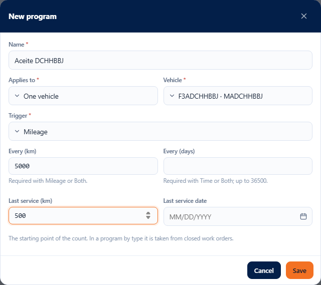

**Edit:** press the pencil on the row, change whatever you need and press **Save**. If you changed nothing, nothing is sent. To remove an interval (for example, the days of a program that switches to Mileage) leave the field empty. A last service that already has a value cannot be left empty: change it to another one.

**Deactivate and reactivate:** **Deactivate** removes the program from the due-dates panel (it asks for confirmation and deletes nothing). Turn on **Show inactive** to see it and press **Reactivate** to bring it back.

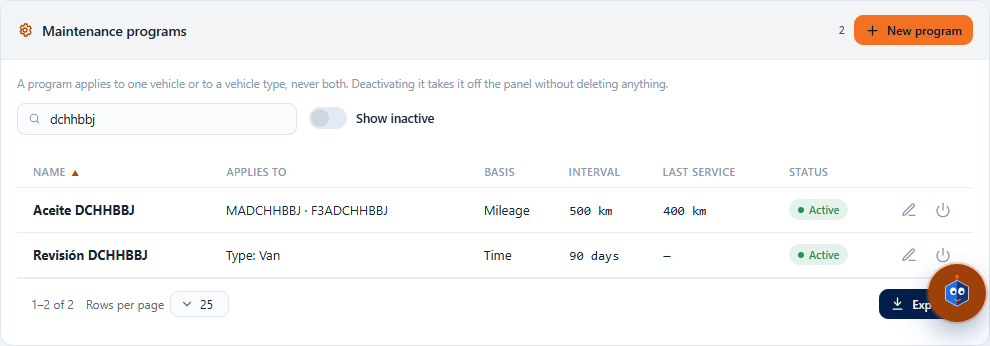

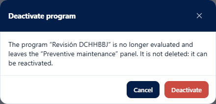

### Program error messages

| Message | What it means and what to do |
|---|---|
| “The program name is required.” | Type a name. |
| “The program name allows at most 150 characters.” | Shorten the name. |
| “Choose the vehicle or the vehicle type of the program, not both.” | Choose a vehicle or a vehicle type (only one). |
| “The program trigger is required.” | Choose Mileage, Time or Both. |
| “A mileage program needs an interval in km greater than 0.” | With Mileage or Both type **Every (km)** greater than 0. |
| “A time program needs an interval in days greater than 0.” | With Time or Both type **Every (days)** greater than 0. |
| “The interval in km must be greater than 0.” / “The interval in days must be greater than 0.” | A typed interval must always be greater than 0; if you do not use it, leave it empty. |
| “The interval in days allows at most 36500.” | Type 36500 days or less. |
| “The interval in days must be a whole number.” | Type whole days, without decimals. |
| “The last service reading cannot be negative.” | Type 0 or more. |
| “The last service date cannot be in the future.” | Use today's date or an earlier one. |
| “The value allows at most 1 decimals and must be less than 100,000,000,000.” | Kilometers allow a single decimal. |
| “This value cannot be left empty once saved; enter another one.” | A last service already saved can only be changed to another value. |

## 2. Work orders: the list

The **Work orders** tab shows all the orders with **Order**, **Vehicle**, **Type** (Preventive or Corrective), **Vendor**, **Date**, **Labor**, **Parts**, **Total** and **Status**.

The statuses are **Open**, **In progress**, **Closed** and **Cancelled**. You can filter by **Status** (one or several), **Type**, **Vehicle** and **Dates**, and search by number, plate, vendor or status. If you sort a column, **all** the orders in the filter are sorted, not only the visible ones. **Export** outputs all the orders in the filter.

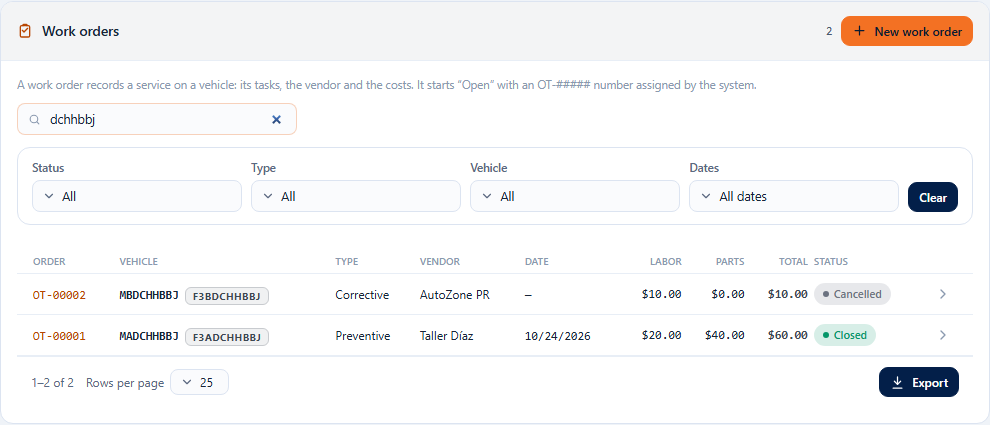

Tap a row (or the **View order** icon) to open its file above the list.

## 3. Create a work order

1. Press **New work order** (or the **Create work order** icon of a program).
2. Choose the **Vehicle**. Only active vehicles are offered.
3. Choose the **Maintenance type**, or a **Preventive program** of that vehicle: with a program the order is preventive.
4. If you want, state **Scheduled date**, **Odometer (km)**, **Vendor**, **Labor**, **Parts** and **Notes**. If you are going to add tasks, leave Labor and Parts empty: they are calculated from the tasks.
5. Press **Save**.

The system assigns the number **OT-#####** and the order starts **Open**. Its file opens automatically.

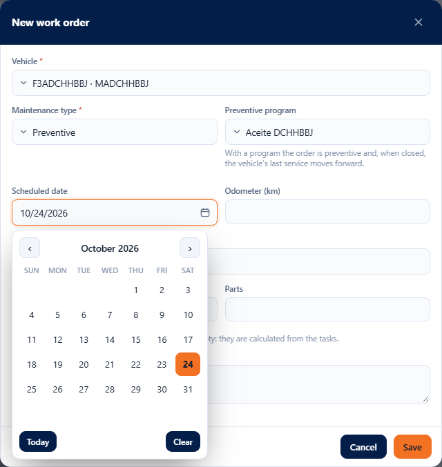

| Message | What it means and what to do |
|---|---|
| “The work order vehicle is required.” | Choose the vehicle. |
| “The maintenance type is required.” | Choose the type or a program. |
| “A corrective order is not linked to a preventive program.” | With a program the type must be Preventive: change the type or remove the program. |
| “The maintenance program does not apply to this vehicle.” | The program belongs to another vehicle or another type. |
| “The maintenance program is inactive.” | Reactivate it in **Maintenance programs** or choose another. |
| “The vehicle is inactive; reactivate it to register work orders or fuel fills.” | Reactivate the vehicle in its file. A retired vehicle does not accept orders. |
| “Costs cannot be negative.” | Type 0 or more. |
| “The vendor allows at most 150 characters.” | Shorten the text. |

## 4. The order file

Above the list you see the status, the vehicle, the type and the program, the action buttons and the order data: **Scheduled date**, **Odometer (km)**, **Vendor**, **Labor**, **Parts**, **Total** and **Notes**.

- The data is edited with a single **Save changes**, which lights up when you change something.
- While the order has **tasks**, **Labor** and **Parts** are the sum of the tasks and are not entered here. If the order had costs typed by hand and you add its first task, those costs are replaced by the task's.
- A **Closed** or **Cancelled** order is view-only: “This order is in status “Closed” and is read-only.”
- **Close file** hides it.

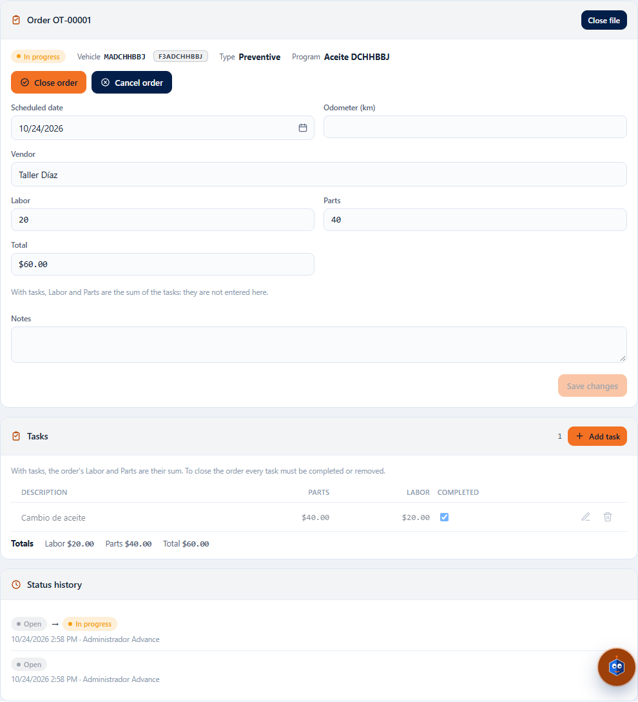

If someone else changed the order while you were editing it, “The record was modified by another user; reload and try again.” appears and what you typed is kept: review and press **Save changes** again.

### Tasks

1. Press **Add task**.
2. Type the **Description** and, if you want, **Parts** and **Labor**.
3. Press **Save**.

The **Completed** checkbox marks a task as done. The pencil edits it and **Remove** takes it off the order (it asks for confirmation; the costs of that task stop adding up). Below the table you see the **Totals**.

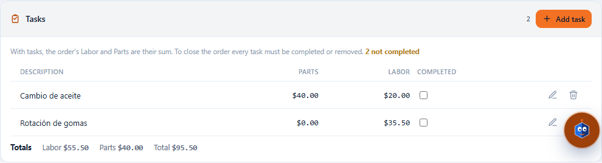

| Message | What it means and what to do |
|---|---|
| “The task description is required.” | Type what is done. |
| “The task description allows at most 250 characters.” | Shorten it. |
| “Costs cannot be negative.” | Type 0 or more. |
| “The order has tasks: labor and parts costs are calculated from the sum of its tasks.” | Do not type Labor or Parts on the order: change them in the tasks. |
| “The current status does not allow the action 'EDIT_WORK_ORDER'.” | The order is closed or cancelled and can no longer be edited. |

## 5. Start, close and cancel

| Button | When it appears | What it does |
|---|---|---|
| **Start** | **Open** order | Moves to **In progress**. The vehicle moves to **In maintenance** and leaves dispatch availability. |
| **Close order** | Open or In progress | Moves to **Closed**. The vehicle goes back to **Available** if it has no other order in progress, its odometer rises to the closing reading and, if the program is for a single vehicle, its last service advances. |
| **Cancel order** | Open or In progress | Moves to **Cancelled**. The vehicle goes back to **Available** if it was in maintenance because of that order. |

None of the three can be undone.

**Start** asks for confirmation and explains the effect on the vehicle.

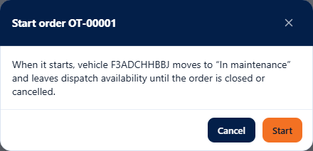

With the order in progress, in **Availability** the vehicle shows **Unavailable** with the reason “Work order OT-… is in progress.”

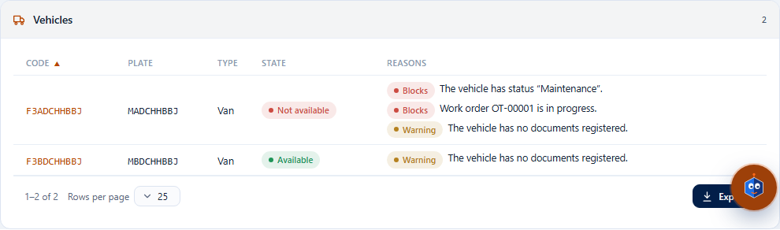

**Close order** opens a window with the **Closing date** (today by default), the **Odometer at closing (km)** and a **Comment (optional)**. If the order's program is by mileage (or Both), the odometer is required. Before closing, all tasks must be completed or removed.

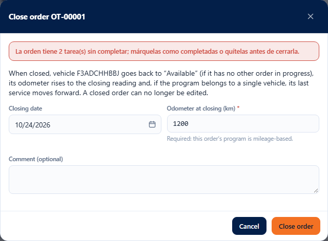

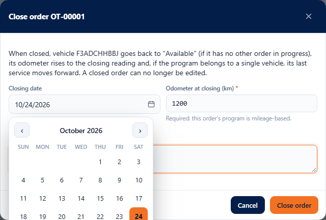

A closed order becomes read-only.

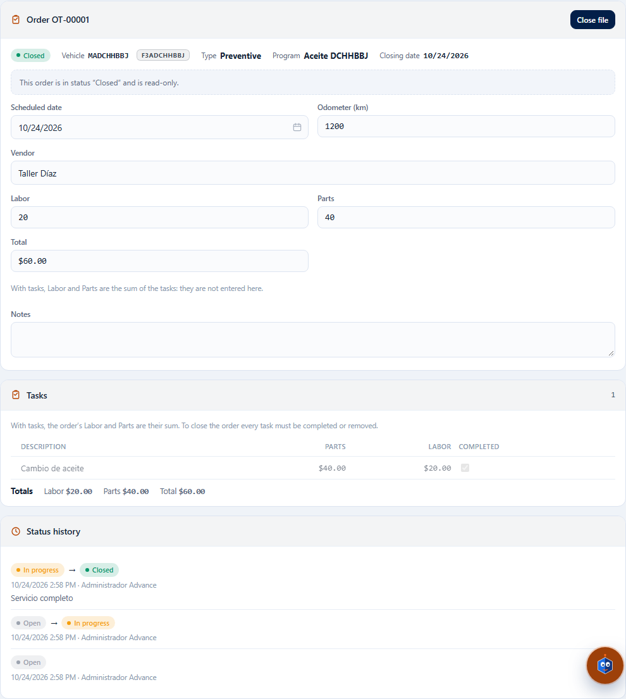

**Cancel order** asks for confirmation and accepts a **Comment (optional)**.

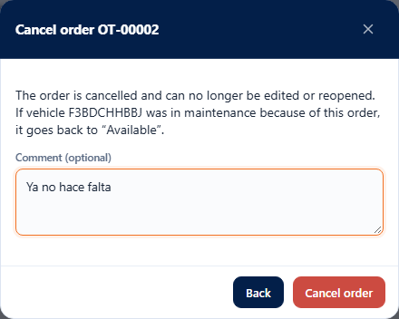

| Message | What it means and what to do |
|---|---|
| “The order has N task(s) not completed; mark them as completed or remove them before closing it.” | Mark **Completed** or **Remove** those tasks and close again. |
| “Enter the odometer reading to close an order of a mileage-based program.” | Type the **Odometer at closing (km)**. |
| “The closing date cannot be in the future.” | Use today or an earlier date. |
| “The odometer cannot be negative.” | Type 0 or more. |
| “The comment allows at most 500 characters.” | Shorten it. |

## 6. Fuel

The **Fuel** tab has the fill log and, below, the **Summary by vehicle**.

The table shows **Date**, **Vehicle**, **Driver**, **Station**, **Liters**, **Cost**, **Km driven**, **Km/L** and **Cost/km**. The last three **are not typed in**: the system compares each fill with the previous one that has an odometer reading for the same vehicle. The first fill of a vehicle has nothing to compare with and shows “—”. Fills without an odometer add their liters and cost to the next segment.

You can filter by **Vehicle**, **Driver** and **Dates** (the last day is included in full). The table is paginated in 25, 50 or 100; if you sort a column **all** the fills in the filter are sorted, and **Export** outputs all of them.

The **Summary by vehicle** adds up all the fills in the filter (not only those on the page): fills, liters, cost, km driven, Km/L and Cost/km.

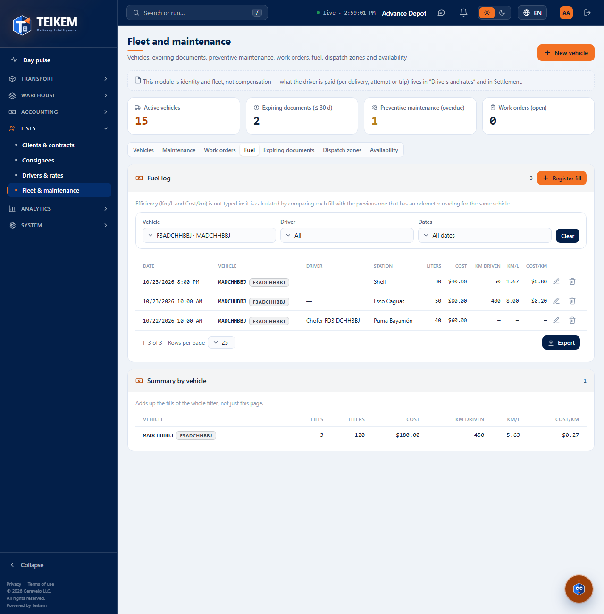

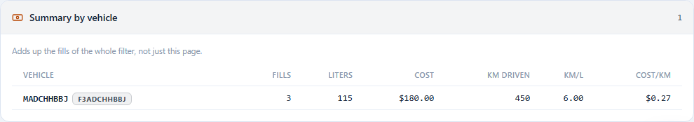

### Register a fill

1. Press **Register fill**.
2. Choose the **Vehicle** (if you filtered by one, it is already chosen).
3. State the **Date** and the **Time** (your company's time; now by default).
4. Type the **Liters** and the **Total cost**.
5. If you want, the **Odometer (km)**, the **Driver** and the **Station**.
6. Press **Save**.

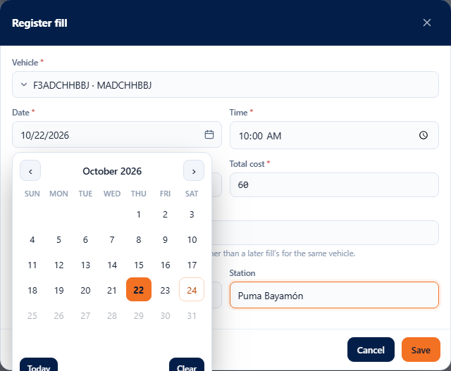

The **Odometer** must be consistent with the vehicle's other fills: it cannot be lower than that of a previous fill nor higher than that of a later one. If it is not, the message appears under the field and the window stays open.

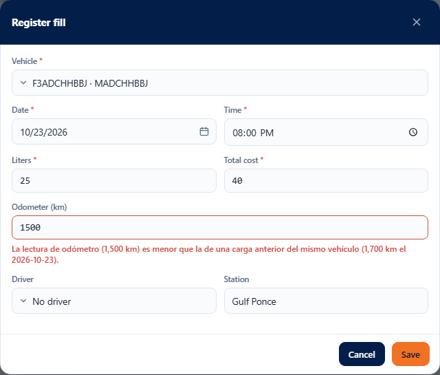

Each fill with an odometer raises the vehicle's odometer if the reading is higher; it never lowers it. That reading can bring a maintenance due date forward.

**Edit** corrects a fill (the **Vehicle** cannot be changed: remove the fill and register another). **Remove** asks for confirmation, takes the fill out of the log and the efficiency figures and does **not** lower the vehicle's odometer.

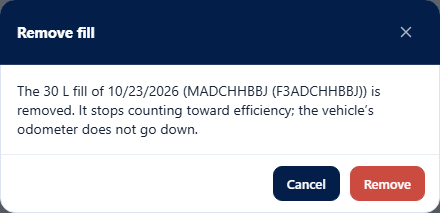

| Message | What it means and what to do |
|---|---|
| “The fill vehicle is required.” | Choose the vehicle. |
| “The fill date is required.” / “The fill time is required.” | State the date and the time. |
| “The fill date cannot be in the future.” | Use now or an earlier date (5 minutes are tolerated). |
| “Liters must be greater than 0.” | Type the liters filled. |
| “Enter the total cost of the fill.” | Type the cost (it can be 0). |
| “The total cost cannot be negative.” | Type 0 or more. |
| “The odometer cannot be negative.” | Type 0 or more. |
| “The odometer reading (1,500 km) is lower than that of a previous fill of the same vehicle (1,700 km on 2026-10-11).” | Check the reading; it must be between the vehicle's previous and later ones. |
| “The odometer reading (… km) is higher than that of a later fill of the same vehicle (… km on …).” | Same thing: the reading is higher than that of a more recent fill. |
| “The station allows at most 150 characters.” | Shorten it. |
| “The fuel fill is inactive; it cannot be corrected.” | The fill was already removed. |
| “The vehicle is inactive; reactivate it to register work orders or fuel fills.” | Reactivate the vehicle in its file. |

## If something does not go as expected

The most common questions are in the [frequently asked questions](../faq.md), section “Batch F-D3 — Maintenance and fuel”. The full server reference is in [chapter 04](../04-flota-choferes-mantenimiento.md).
