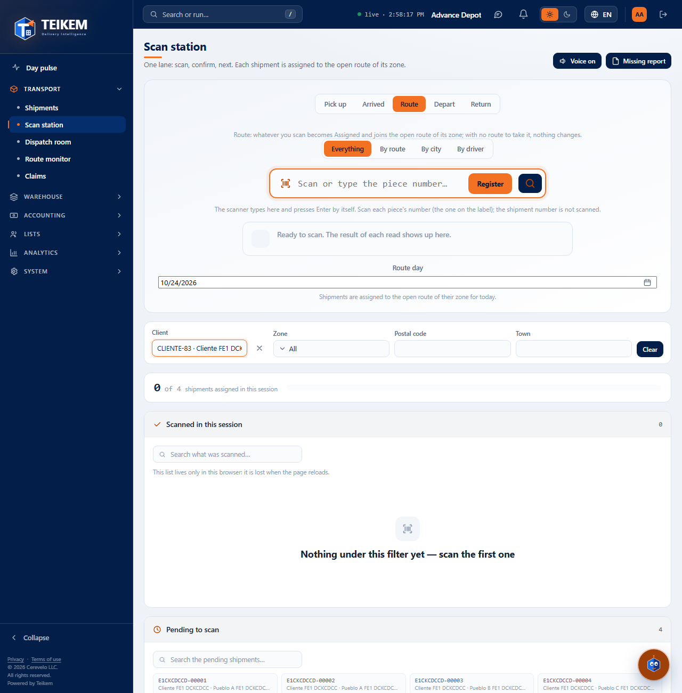
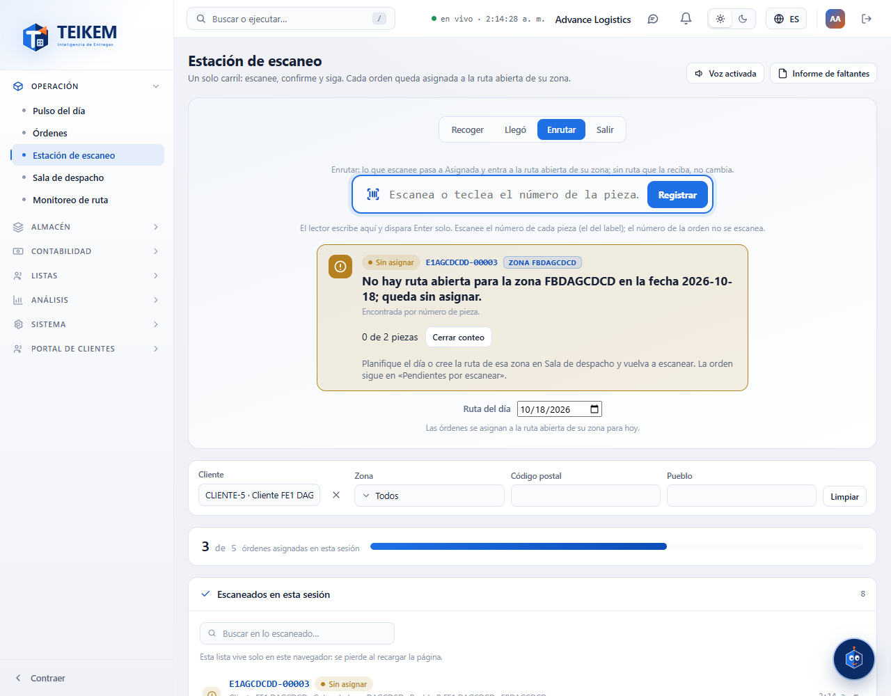
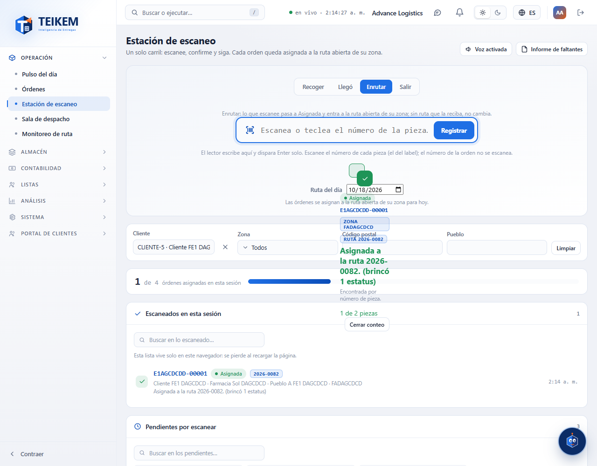
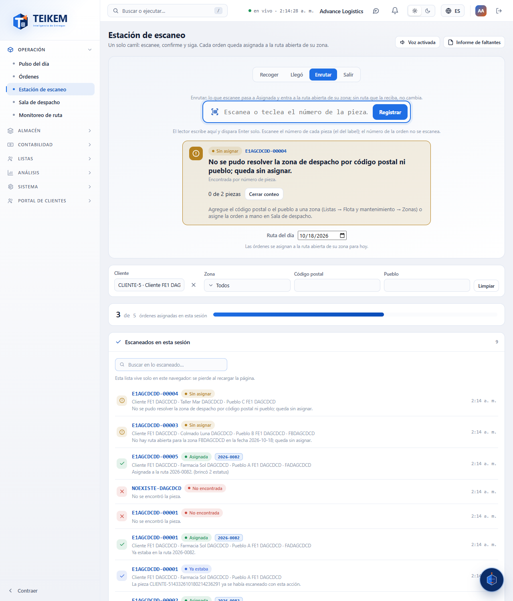
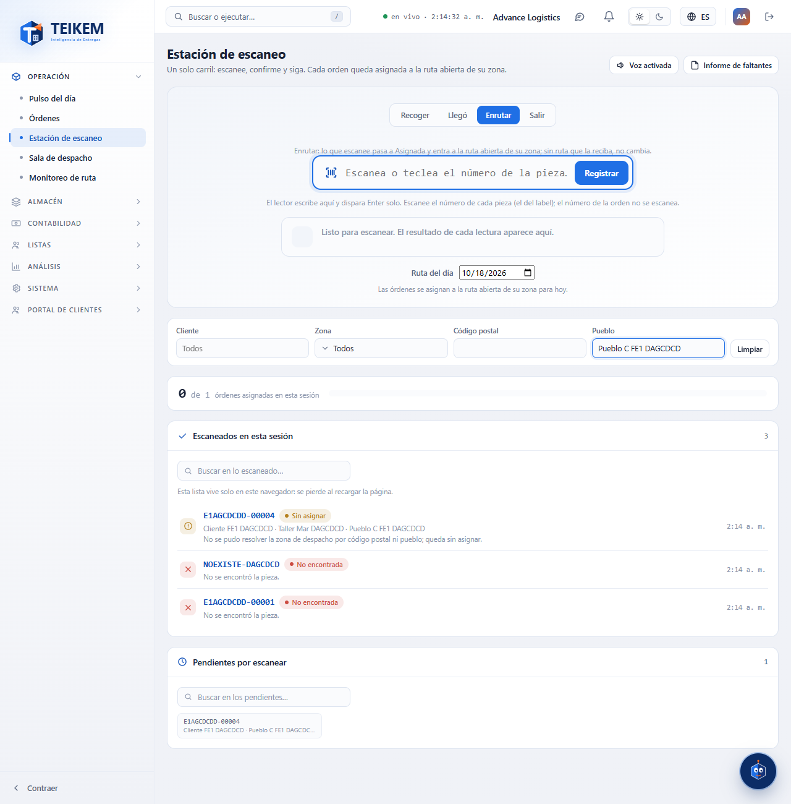
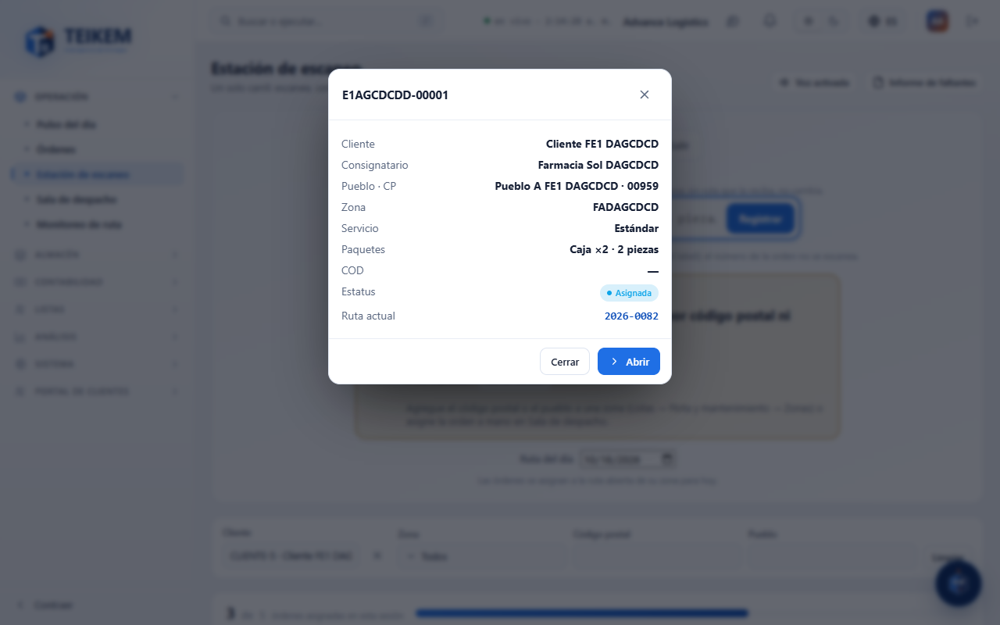

# Scan station (outbound)

The **Scan station** (Operations menu → **Scan station**) is used to pass each package through the reader and leave its order assigned to the day's route for its zone, without opening orders one by one. Scan, look at the result and move on to the next one.

What it does and what it does **not** do: it assigns the order to a route that **already exists and is open**. It does not create routes, does not change the driver or the vehicle and does not change the order's status.

## Who can use it

| To… | Permission | Module |
|---|---|---|
| Open the screen and scan | `trips.scan` | Cargo operations (LTL) |
| See “Pending to scan”, the filters and the “N of M” meter | `trips.view` | Cargo operations (LTL) |
| Filter by **Zone** | `fleet.view` | Lists |
| Filter by **Client** | `clients.read` | Lists |
| See the order data in the window and use **Open** | `orders.view` | Cargo operations (LTL) |

Without `trips.view` the screen keeps scanning: only the pending items and the filters disappear, and the meter shows only how many you have done. A filter whose permission is missing simply does not appear.

## Scanning

1. Open **Scan station**. The cursor is already in the big box (“Scan or type the reference…”).
2. Scan with the reader (it types the code and presses Enter by itself) or type the code and press **Enter** or the **Register** button.
3. Look at the big result that appears below the box. If sound is on, the station says “Yes”, “No” or “Already”.
4. The cursor goes back to the box on its own: scan the next one.

You can scan the **shipment number**, the **package number** or the **client's invoice number** (they are searched in that order). If several readers arrive at once, each read is registered in the order it arrived.

### Route day

Below the box is **Route day**: by default it is today. Orders are assigned to the open route of their zone **for that date**. To work with the routes of another day choose the date; **Today** goes back to today's.

### What each result means

| Result | What the screen says | What it means and what to do |
|---|---|---|
| **Assigned** (green) | `Assigned to route {code}.` | The order was placed on its zone's route. Move on to the next one. |
| **Already there** (blue) | `It was already on route {code}.` | The order already had a route. Nothing needs to be done. |
| **Not found** (red) | `The shipment was not found.` | No shipment, package or invoice number matches. Check the code or scan the package. |
| **Not found** (red) | `There are several shipments with that code; scan the package.` | The number is shared by orders of different clients. Scan the package number, which is unique. |
| **Not eligible** (purple) | The reason (see below) | The order cannot go on a route yet. Fix its status in **Orders** and scan again. |
| **Unassigned** (amber) | `The dispatch zone could not be resolved by postal code or town; it stays unassigned.` | The address does not belong to any zone. Add its postal code or town to a zone (Lists → Fleet & maintenance → Zones) or assign the order by hand in **Dispatch room**. |
| **Unassigned** (amber) | `The postal code or town belongs to several zones ({codes}); it stays unassigned.` | Leave that address in a single zone or assign the order by hand in **Dispatch room**. |
| **Unassigned** (amber) | `There is no open route for zone {code} on {date}; it stays unassigned.` | Plan the day or create that zone's route in **Dispatch room** and scan again. The order stays in “Pending to scan”. |

Reasons for **Not eligible** (exact server message):

- `The shipment already went out on a route or finished; it cannot be assigned to another route.` — the order is already on its way, finished or inactive.
- `Special deliveries are assigned to the driver from the shipment; they do not go through Dispatch room.` — assign the driver from the order.
- `The shipment is in “Submitted”; mark it as picked up before assigning it to a route.` — mark it as picked up from the order file.
- `The order is in '{status}'; return it to the pipeline before assigning it to a route.` — the order is in a lateral status (today, Failed attempt); return it to its normal flow.
- `The current status does not allow the action 'ASSIGN_TRIP'.` — the order's status does not allow assigning it to a route.
- `The shipment has no pending delivery stop.` — the order has no delivery to make.

### Code warnings

These warnings appear in the same box and do **not** register anything:

| Warning | What to do |
|---|---|
| `Scan or type a code.` | You pressed Enter with the box empty. Scan or type the code. |
| `The code cannot exceed 40 characters.` | The code is too long; check that it is the right one. |

If the server or the network fails, the box says **Not registered** with the reason; the read does not stay in the list and you can scan it again.

## “N of M” meter

It shows how many **distinct** orders you assigned in this session (N) against that total plus the ones still pending with the current filter (M), with a progress bar. Scanning again an order that was already there does not add up.

## Scanned in this session

List of each read in this session, the most recent at the top: reference, result, client, consignee, town, zone, route and time. The search box filters by any of those fields. Tap a row to see the order.

- The list lives **only in this browser**: it is lost when you reload the page, sign out or switch company. There is no saved scan history.
- Opening an order and coming back with “Back” does **not** clear it.
- A code that did not belong to any order stays in the list even if filters are active.

## Pending to scan

These are the orders without a route that scanning can assign. Each card shows the order number, the client, the town with its postal code and the zone (or “No zone” / “Ambiguous zone”). Tap one to see the order. The search box filters what is shown. If there are more than 500, it tells you how many are shown: use the filters.

### Filters

| Filter | What it does |
|---|---|
| **Client** | Only that client's orders (requires `clients.read`). |
| **Zone** | One zone, or **No zone** (requires `fleet.view`). |
| **Postal code** | Codes that start with what you typed. |
| **Town** | Town typed (regardless of accents or case). |

**Clear** removes them all. The filters also narrow the meter and the session list.

## Viewing the order

Tap a session row or a pending item: a window opens with client, consignee, town and postal code, zone, service, packages, COD, status and the current route. **Open** (only with `orders.view`) takes you to the order file. Without that permission the window shows only what was already known about the order.

## Sound

The **Voice on / Voice muted** button (top right) turns the voice on or off: “Yes” when the order was found, “No” when it was not found or is not eligible and “Already” when it was already there. It is remembered in this browser. If the browser cannot speak, the button says **Voice unavailable** and the results are shown on screen just the same.

## What it does not include

This screen only has the **Outbound** mode. The inbound and collection-reconciliation modes and the “With COD?” and “Route” filters of the mockup do not
exist yet. The **Missing report** does (button next to the voice, since F-G2): see [F-G2 — Labels and documents](fg2-labels-y-documentos.md).
Since F-G2 you can also scan the **package number** printed on the label of each piece.

## Frequently asked questions

See the “Batch F-E1” section of [faq.md](../faq.md).
