# Dispatch room

The **Dispatch room** (Operations menu → **Dispatch room**) is used to build the day's routes: decide which orders go on each route, who takes them and in which vehicle, order the stops, optimize, dispatch, record the departure and close the route when everything is done.

The active route shows a **schematic map** with its numbered stops, and the order of the stops is changed by **dragging** or with the ▲ and ▼ buttons. When a stop is missing its location (or it is wrong), you can **set a manual pin** on it. The map is not a street map: it shows where each stop is relative to the others. Live tracking of routes on their way will arrive with the Route monitor.

## Who can use it

| To… | Permission | Module |
|---|---|---|
| Open the screen and **Dispatch route**, **Start route** | `trips.dispatch` | Cargo operations (LTL) |
| See routes, the route map, unassigned orders and progress | `trips.view` | Cargo operations (LTL) |
| **Plan the day**, **New route**, **Reassign by zone**, add, remove and reorder orders (by dragging or with ▲ ▼), **Set pin** and **Move pin**, change driver or vehicle, **Delete route** | `trips.plan` | Cargo operations (LTL) |
| **Optimize** | `trips.optimize` | Cargo operations (LTL) |
| **Close route** | `trips.close` | Cargo operations (LTL) |
| Choose driver, vehicle and zone; see the **Drivers** panel | `fleet.view` | Lists |
| Filter by **Client** | `clients.read` | Lists |

A button that is not yours simply does not appear. If you lack `fleet.view`, the screen works the same: the driver and the vehicle are shown as text, and you are told that you cannot change them from here.

## The screen

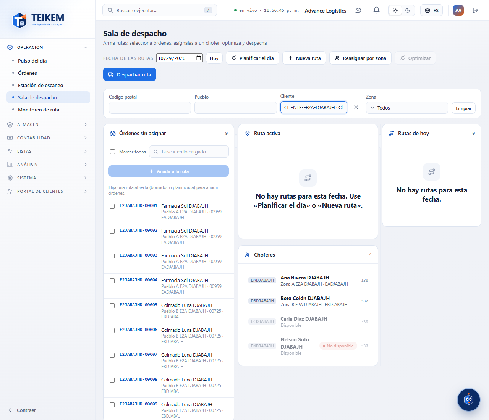

At the top are the **Route date** (today by default; **Today** goes back to today) and the buttons. Below, the filters of the unassigned orders and three columns:

- **Unassigned shipments** (left): the orders already picked up (not the Submitted ones) that do not have a route yet.
- **Active route** (center): the route you are working on, with its driver, vehicle, notices and orders. Below, the **Drivers** panel.
- **Today’s routes** (right): one card per route for the date. Tap one to make it the active route.

On a phone the columns stack one on top of the other. On a wide screen you can drag the bars between columns to change their width.

The route you are viewing and the date stay in the page address: you can reload or copy the link and come back to the same thing.

## Plan the day

1. Press **Plan the day**.
2. Choose the **Date**. In **Zones** choose the ones you want to plan; if you choose none, all active zones are planned.
3. If you want each zone's route to be created even if it has no orders (so the scan station has a destination early), turn on **Create empty routes**.
4. Press **Plan**.

The system splits by zone the already picked-up orders that have no route. It uses the zone's open route or creates one with the zone's **standard driver**. It does **not** optimize, does **not** dispatch and does **not** assign a vehicle, and running it again duplicates nothing.

When it finishes you will see the summary: **Routes created**, **Shipments assigned**, **Shipments skipped** and **Shipments without a zone**, and for each zone its notices (for example, an order that could not be assigned and why). Orders without a zone or with an ambiguous zone are not touched: fix the zone in the list.

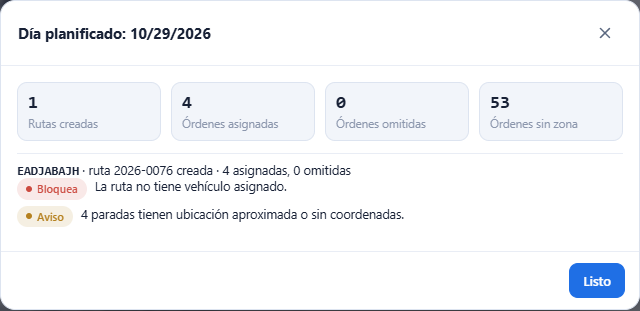

## Create a route by hand

1. Press **New route**.
2. Choose the **Route date** (from yesterday up to 60 days ahead).
3. Optionally choose **Dispatch zone**, **Driver**, **Vehicle** and **Departure time**. With no driver, the zone's standard driver is used. With no departure time, it leaves at 12:00 UTC (8:00 a.m. in Puerto Rico).
4. Press **Create route**. The new route becomes the active route.

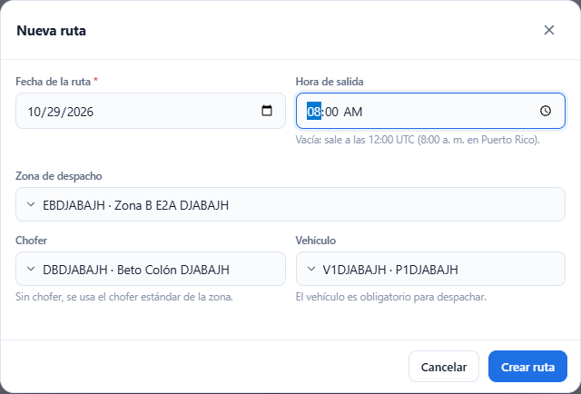

In the driver and vehicle lists, those not available on that date say **unavailable**. If you choose one, the system answers with the reason and does not create the route.

## Add orders to the route

1. Choose the active route in **Today’s routes**. It must be in **Draft** or **Planned**.
2. In **Unassigned shipments** check the orders (or **Select all**). You can narrow the list with the **Postal code**, **Town**, **Client** and **Zone** filters, and with the search box.
3. Press **Add to route (N)**. All of them are added, or none.

Each row shows the order number, the consignee and “town · postal code · zone”. An order without a zone says **No zone**.

Up to 500 orders are requested; if there are more, the screen tells you and you can refine the filters. Up to 200 can be added at a time and a route allows up to 300 stops.

If any order cannot be assigned, none is added and you will see each number with its reason. The selection is kept: remove the ones that failed and press again.

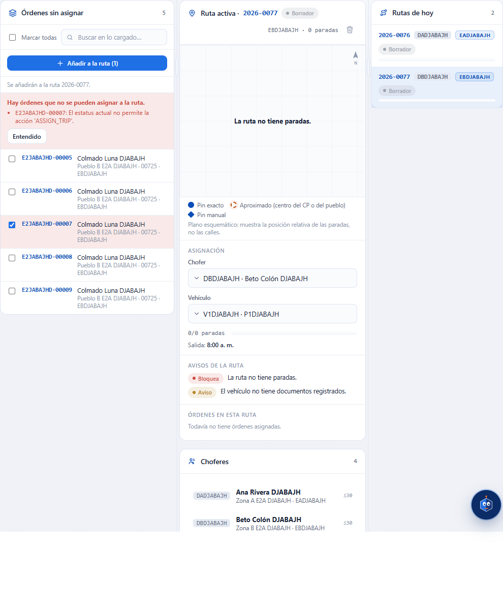

### Messages when adding

| Message | What it means and what to do |
|---|---|
| `There are shipments that cannot be assigned to the route.` and, below, `{order}: {reason}` | One or more orders are not eligible. The reason says why (for example `The shipment is in “Submitted”; mark it as picked up before assigning it to a route.` or `The current status does not allow the action 'ASSIGN_TRIP'.`). Fix the order or remove it from the selection. |
| `The shipment is already on this route.` | That order was already on the route. |
| `The order is already assigned to route {code}.` | Someone else assigned it before you. The list is refreshed. |
| `A route allows at most 300 stops.` | The route is full. Use another route. |
| `Add at most 200 shipments per request.` | You checked more than 200. Add them in two rounds. |
| `Route {code} was already dispatched; it cannot be edited or deleted.` | The route already left draft: its content is frozen. |

## The route map

Above the active route, below the title, is the **route map**.

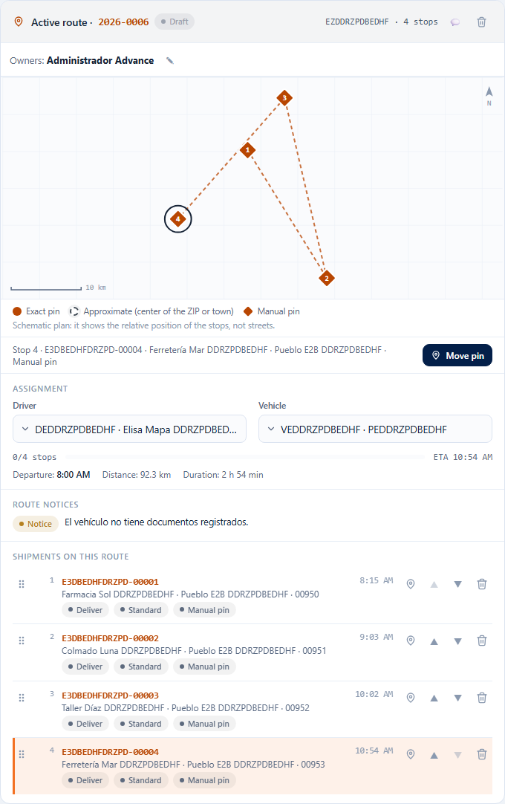

- Each stop that has a location is a **numbered pin** with its place in the sequence (1, 2, 3…). A dotted line joins the pins in route order.
- The **pin type** says how reliable the location is:
  - **Exact pin**: solid circle. The address was located precisely.
  - **Approximate**: dotted circle with a halo. The center of the postal code or the town was used, so the stop may be somewhere else in that town.
  - **Manual pin**: diamond. Someone set the location by hand.
- At the bottom left is the **scale** (for example, 5 km) and at the top right the **north**.
- Stops that **have no location** are not drawn; they are listed below the map as **Without location: N**, and still appear in the order list.
- When a route is already on its way, the pins change color according to the stop: **Delivered** (green), **Failed** (red) and **In progress** (dark blue with a ring). The legend only names the ones that appear.
- It is a **schematic** map: it has no streets or satellite imagery. It helps you see how the stops sit relative to one another, not how to get there.

If **no** stop has a location yet, the map says so:

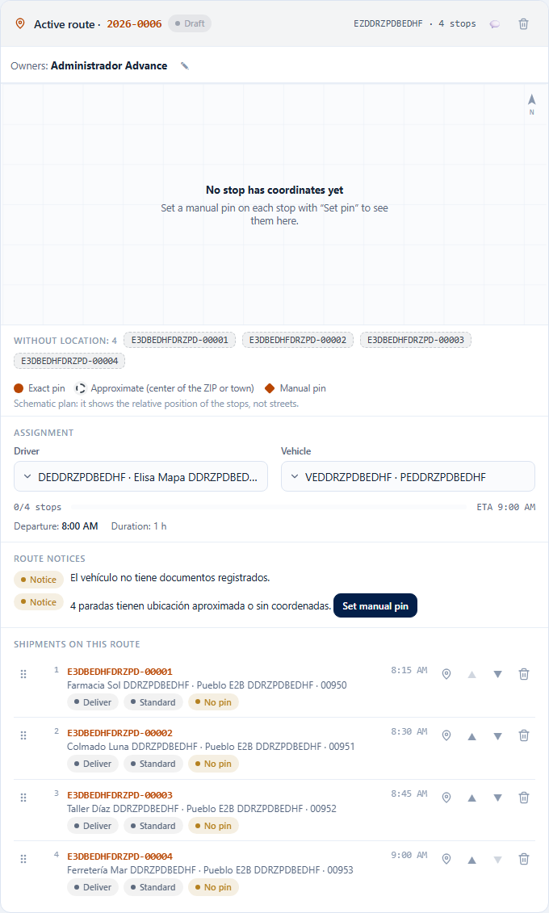

> **No stop has coordinates yet.** Set a manual pin on each stop with “Set pin” to see them here.

If you cannot set pins (you lack the `trips.plan` permission), the message asks you to request it from whoever plans the route.

### Selecting a stop

Press a pin (or press **Tab** until you reach it and **Enter** or the space bar) to select that stop: the pin is surrounded by a ring, its order is highlighted in **Shipments on this route** and a summary appears below the map (“Stop 4 · shipment number · consignee · town · pin type”). It also works the other way around: pressing an order in the list highlights its pin. The **Without location** stops can also be selected by pressing their shipment number.

If several orders go to the same address, their pins fan out so that all of them are visible.

## Sorting and removing orders

In **Shipments on this route** each order has a **handle** (six dots) on the left and, on the right, a pin, ▲, ▼ and a trash can:

- **Drag**: hold the handle, move the order to the position you want and release it. While dragging, the source order is dimmed and a blue line marks where it will land. It works with the mouse and with your finger.
- **With the keyboard**: move the focus to the handle with **Tab** and press **↑** or **↓**.
- **▲ Move up** and **▼ Move down** move the order one position.
- The trash can **Remove order … from the route** takes it off the route and it goes back to **Unassigned shipments** (its status does not change).

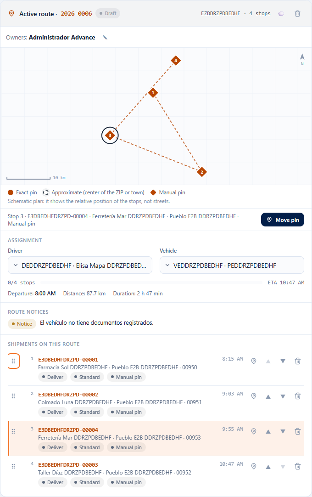

You can move several orders in a row without waiting: the changes are visible instantly and the system saves them in order, one at a time. The change is visible immediately in the list and on the map (the pins are renumbered and the line follows the new order) and is saved in the system; the estimated arrival times are recalculated. If the system does not accept the change, the list **goes back to the previous order** and the system message appears above the route.

Reordering is only possible while the route is in **Draft** or **Planned** and if you have `trips.plan`. On a dispatched, in-progress or closed route there is no handle, ▲, ▼ or trash can.

| Message | What it means and what to do |
|---|---|
| `The sequence must include exactly the stops of the current route, without repeats.` | The route changed while you were ordering it (for example, someone removed or added an order). The list goes back to its previous order and is refreshed; sort again. |
| `The record was modified by another user; reload and try again.` | Someone else changed the route. The screen refreshes on its own; sort again. |
| `Route {code} was already dispatched; it cannot be edited or deleted.` | Someone dispatched the route while you were working. It can no longer be sorted. |

Each order carries tags: **Arrives late** indicates that the estimated time is past the end of its window; **Approximate location** that its pin is the center of the postal code or the town; **Manual pin** that its location was set by hand; **No pin** that it has no location yet.

## Setting a manual pin

Use the manual pin when a stop **has no location** (**No pin**) or when the one it has is wrong or only approximate. It can only be done while the route is in **Draft** or **Planned** and with the `trips.plan` permission.

1. Press the order's pin button (**Set a pin for shipment …**, or **Move the pin of shipment …** if it already had one), or select the stop on the map and press **Set pin** / **Move pin** in the summary below the map. If the route has the approximate pins notice, that notice carries the **Set manual pin** button, which opens the first approximate stop.
2. Type the **Latitude** (between -90 and 90, for example 18.4655) and the **Longitude** (between -180 and 180, for example -66.1057). You can use a period or a comma for decimals.
3. Press **Save pin**.

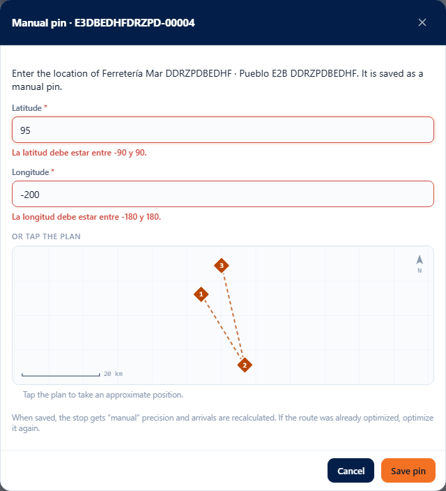

**Shortcut: take the position from the map.** If other stops already have a location, the window shows a reference map with them. Tap the place where you think the stop is: the latitude and longitude are filled in and the notice **Approximate position taken from the plan: check the latitude and longitude before saving.** appears. The map has no streets, so that position is only an approximation: check the numbers before saving. A red mark shows where the pin will be.

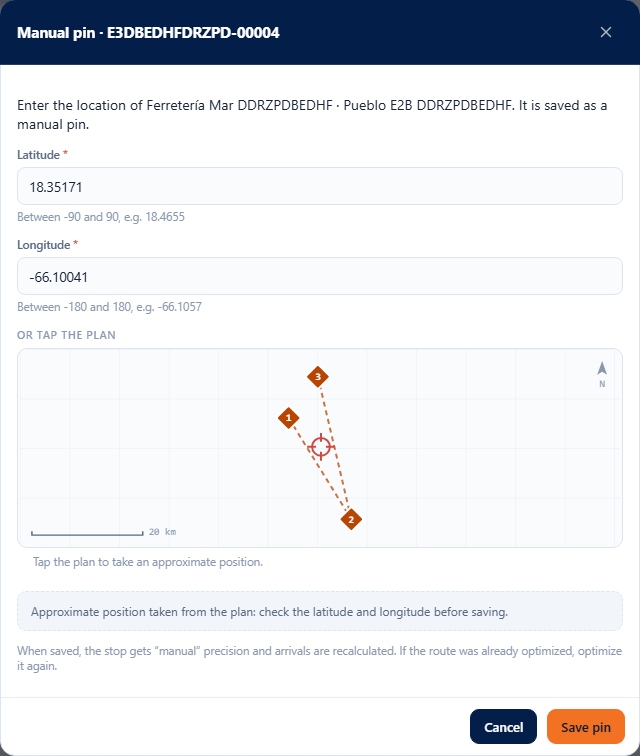

When saved, the stop gets a **Manual pin**, the map draws it as a diamond and the system recalculates the arrival times. If the route was already optimized, press **Optimize** again so the order takes advantage of the new location.

| Message | What it means and what to do |
|---|---|
| `Enter the latitude and the longitude.` | One of the two numbers (or both) is missing. Type them. |
| `The latitude must be between -90 and 90.` | The latitude is out of range. Check the number (did you put the longitude in the latitude field?). |
| `The longitude must be between -180 and 180.` | The longitude is out of range. Check the number. |
| `The latitude must be a number, e.g. 18.4655.` / `The longitude must be a number, e.g. -66.1057.` | You typed letters or symbols (such as “18°”). Use only digits, the minus sign and a period or a comma. |
| `Stop not found on this route.` | The stop is no longer on the route (it was removed or the route was optimized). Close the window; the screen refreshes. |
| `Route {code} was already dispatched; it cannot be edited or deleted.` | The route already left: the location cannot be changed. |
| `The record was modified by another user; reload and try again.` | Someone else changed the route. Close the window, review and try again. |

Errors are shown inside the window, which does not close, so you can correct and try again.

### A dispatched route

When the route is already dispatched, in progress or closed, the map is still shown and stops can be selected, but there is no handle, pin, ▲, ▼ or trash can.

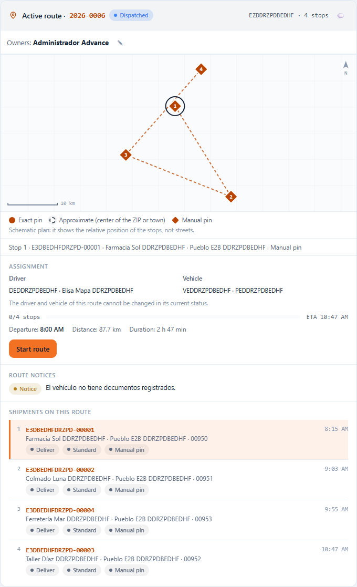

## Driver and vehicle

In **Assignment** choose the route's **Driver** and **Vehicle**; it is saved as you choose. The “unavailable” options can be chosen, but the system will reject them with the reason:

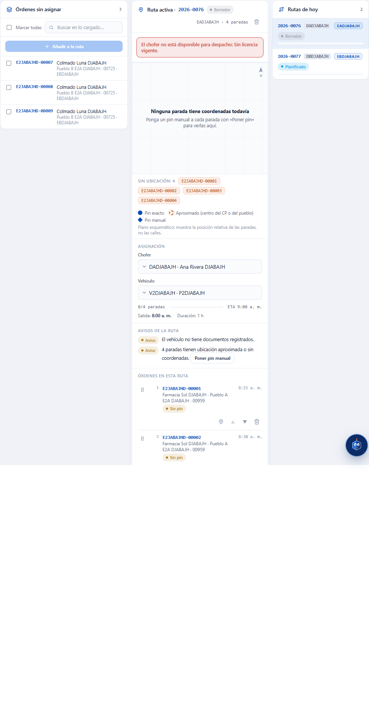

- `The driver is not available for dispatch: {reasons}.` / `The vehicle is not available for dispatch: {reasons}.`: the driver or the vehicle has an impediment (expired license, maintenance…). Choose another or resolve the impediment in **Drivers** or **Fleet**.
- `The record was modified by another user; reload and try again.`: someone else changed the route. The screen refreshes on its own; try again.
- On an already dispatched route they can only be changed if your company allows it, and they can never be removed.

## Route notices and blockers

Under **Route notices** the system lists what may get in the way of dispatching. **Blocks** (red) prevents dispatching; **Notice** (amber) does not.

| Blocks | Message |
|---|---|
| Yes | `The route has no driver assigned.` / `The driver is not available for dispatch: {reasons}.` |
| Yes | `The route has no vehicle assigned.` / `The vehicle is not available for dispatch: {reasons}.` |
| Yes | `The route has no stops.` and `Order {number}: {reason}` for each order that is no longer eligible |
| No | `The route has {n} stops and the driver's maximum is {m}.` / `…the vehicle allows {m}.` |
| No | The load or the volume exceeds the vehicle's capacity |
| No | `{n} stops arrive after the end of their window.` |
| No | `The route has no departure time; ETAs are not calculated.` |
| No | `{n} stops have an approximate location or no coordinates.` |
| No | `The driver is also on route {codes} that same day.` (same for the vehicle) |

If the route goes over the maximum number of stops, a red notice also appears at the top: “{code} exceeds the maximum number of stops: N > M”, which says whether the maximum is the **company default** or the **driver override**; the route card carries ⚠.

## Optimize

With the active route in **Draft** or **Planned** and with stops, press **Optimize**. The system reorders the route (by zone, window and postal code) respecting stops, weight and volume of the vehicle. A draft route moves to **Planned**.

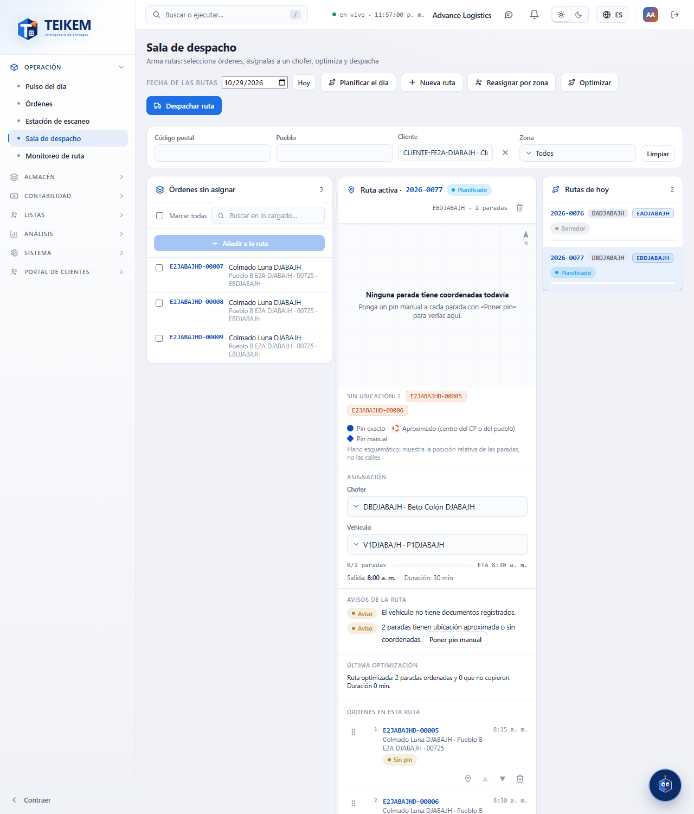

The result stays in **Last optimization**: how many stops were ordered and how many **did not fit**. What did not fit goes back to **Unassigned shipments** and is shown in **Did not fit** with its reason: change the vehicle or assign them to another route. If there was a previous optimization, distance and duration are compared (“Distance -12 % against the previous run”); the first time there is nothing to compare with and it says so. Without coordinates on the addresses there is no distance and only the duration is compared.

Messages: `The route has no stops to optimize.` (the button is disabled without stops); `The route changed while it was being optimized; optimize again.`; `The optimizer could not calculate the route; the run was recorded with an error.`

## Reassign by zone

1. Press **Reassign by zone**.
2. Choose the **Date**, the **Zones** and the **New driver**, and press **Reassign**.

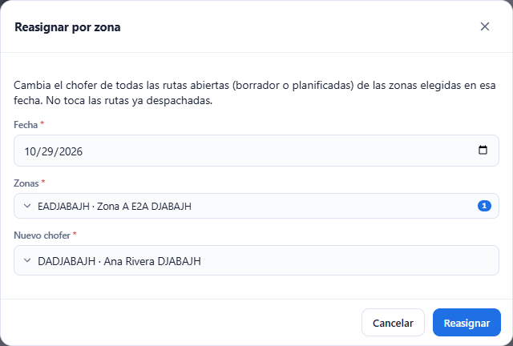

All open routes (draft or planned) of those zones on that day move to the chosen driver; the already dispatched ones are not touched. If there were none, you will see `There were no open routes in those zones and date; nothing changed.`; it is not an error. If the driver ends up on more than one route that day, the notice is shown.

## Dispatch routes

1. Press **Dispatch route**. **Routes to dispatch** opens with the draft or planned routes of the date. The active route comes checked if it can be dispatched.
2. Check the routes (or **Select all**). Those with a **Blocks** cannot be checked: fix the reason first. Those with only a **Notice** can.
3. Press **Dispatch selected (N)**. If any carries notices, the system asks you to confirm: the button becomes **Dispatch with notices (N)**; review them and press it again.
4. Optionally write a comment (up to 500 characters).

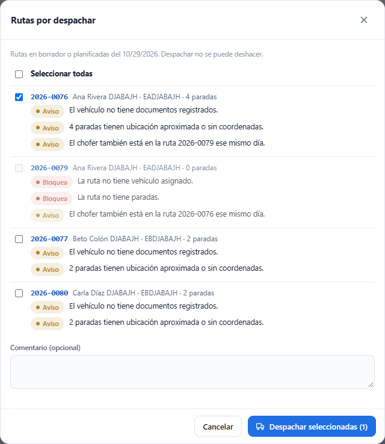

You will see the result for each route: **dispatched** or the exact message of why not (a route that fails does not prevent the others).

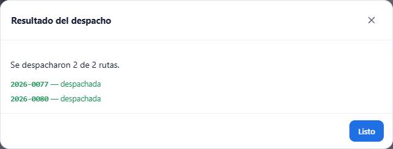

**Dispatching cannot be undone.** The route stays in **Dispatched**: its content is frozen and the orders move forward.

| Message | What it means and what to do |
|---|---|
| `Route {code} cannot be dispatched: {reasons}.` | There are blockers. Fix them on the route and try again. |
| `Select at least one route.` / `At most 50 routes per dispatch.` | Check between 1 and 50 routes. |
| `Route {code} was already dispatched; it cannot be edited or deleted.` | Someone dispatched it before. |
| `Route not found.` | The route no longer exists. |

## Start and close the route

- **Start route** (route in **Dispatched**): records the driver's departure; the route moves to **In progress** and its orders go out on the route. You can leave a comment.

  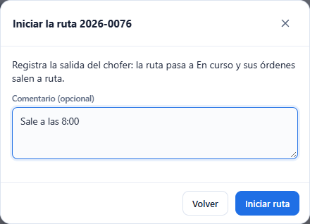

- **Close route** (route **In progress**, permission `trips.close`): it can only be closed when **all** its orders have finished (delivered, cancelled or with a failed attempt). If not, the message says which ones are missing and the route stays open:

  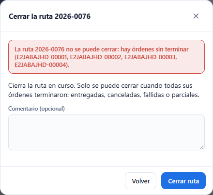

| Message | What to do |
|---|---|
| `Route {code} cannot be closed: there are unfinished orders ({numbers}).` | Record the delivery or the failed attempt of those orders and close again. |
| `Route {code} is not dispatched; dispatch it before recording its departure.` | Dispatch first. |
| `Route {code} already left.` / `Route {code} is already closed.` | It was already done; refresh the screen. |

## Delete a route

The trash can next to the route name (**Delete route**) only appears on **Draft** or **Planned** routes. It asks for an optional comment (up to 500 characters). The route moves to **Cancelled** and its orders go back to **Unassigned shipments** with the same status.

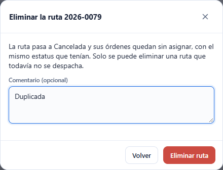

## What this screen does not do (yet)

- The map is **schematic**: it has no streets, place names or satellite imagery, and there is no 2D / Satellite switch. Seeing real streets would require an external map service, which this screen does not use.
- The line on the map joins the stops in order in a straight line; it does not follow the streets.
- It does not show the driver's last GPS point or live tracking.
- It does not show the orders' cash on delivery (COD): the routing system does not handle amounts.

## Frequently asked questions

The questions and answers are in the “Batch F-E2a — Dispatch room” and “Batch F-E2b — Route map, dragging and manual pin” sections of the [frequently asked questions file](../faq.md).
