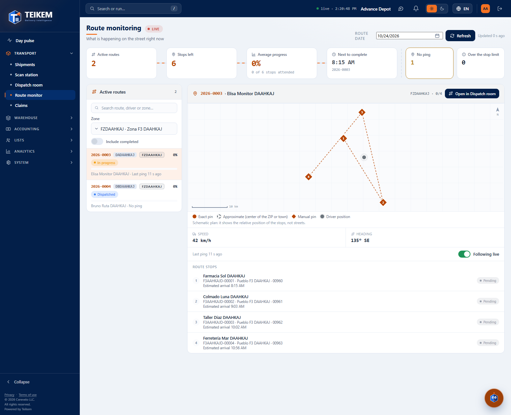
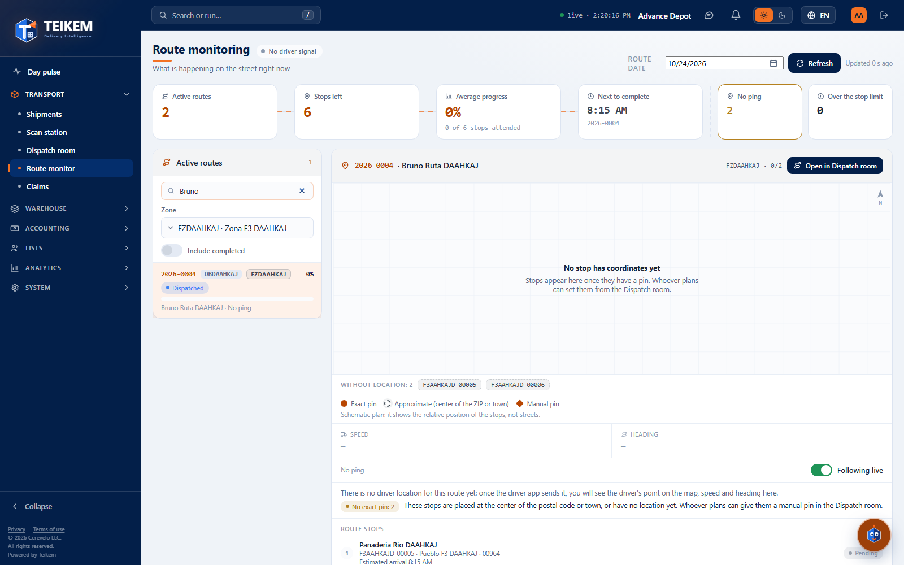
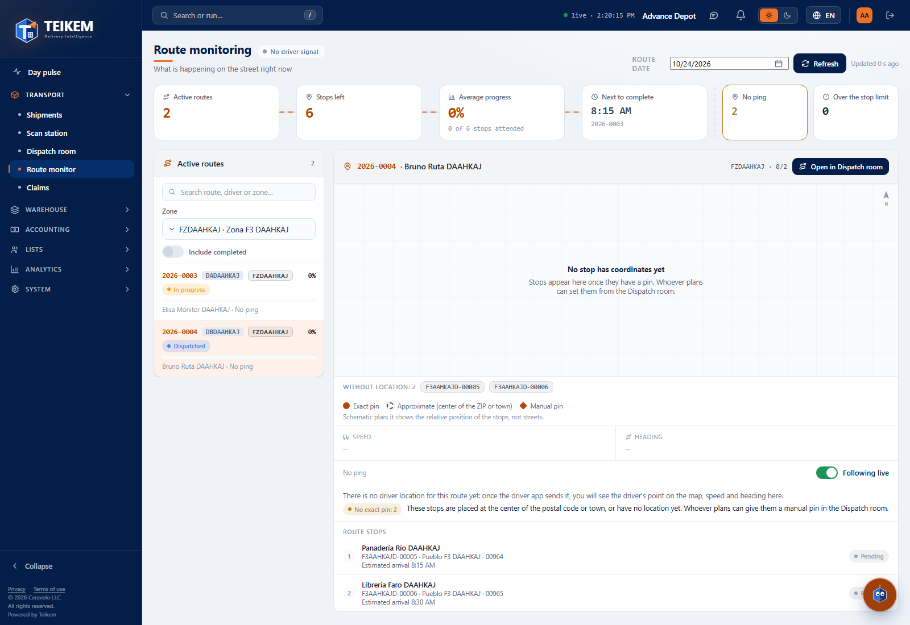
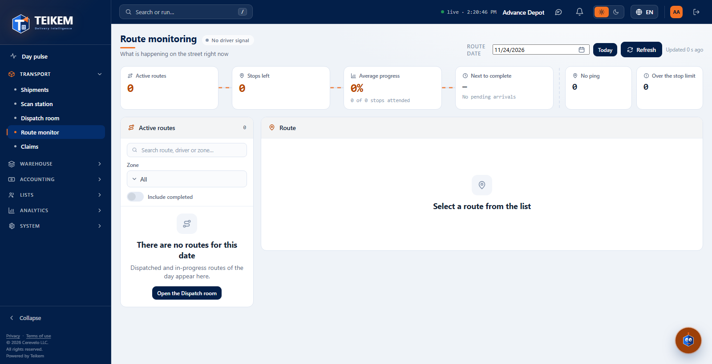

# Route monitor

**Route monitor** (Operations menu → **Route monitor**) shows what is happening with the day's routes: how many are on the street, how many stops are left, how much progress has been made and, for the route you choose, the map with its stops, the driver's last position and the state of each stop.

It is a **read-only** screen: nothing is dispatched here, the driver is not changed and stops are not moved. That is what the **Dispatch room** is for, and this screen takes you there with a link.

## What is visible today and what will arrive with the driver app

Today routes are built and dispatched from the web, but **the driver app does not yet send its location or mark the stops**. So, while that app is not in use:

- All routes say **No ping** and the title badge says **No driver signal**.
- There is no driver dot on the map, and **Speed** and **Heading** show “—”.
- All stops appear as **Pending** and each route's progress is 0%.

When the driver app starts sending its position and recording deliveries, the same screen will show, **without you doing anything different**: the **LIVE** badge, “Last ping N s ago”, the driver dot on the map, their speed and heading, and the stops moving to **On the way**, **Arrived**, **Completed** or **Failed**, with the progress rising. The phone's **GPS signal** and **battery** are not shown yet because the system does not receive that data yet.

The next image is an **example with simulated test data** (a ping from 12 seconds ago was given to the first route) so you can see how it will look when the driver app arrives:

## Who can use it

| To… | Permission | Module |
|---|---|---|
| Open the screen and see routes, map and stops | `trips.view` | Cargo operations (LTL) |
| See the **Open in Dispatch room** link | `trips.dispatch` | Cargo operations (LTL) |
| Filter by **Zone** | `fleet.view` | Lists |

Without `fleet.view` the screen works the same, but it does not offer the zone filter and explains why. Without `trips.dispatch` the link to the Dispatch room does not appear. The screen does not show the driver's phone numbers or contact details, or amounts.

## How it is organized

1. **Title and badge.** **LIVE** (red) appears only if any of the routes shown has a ping from less than 2 minutes ago. Otherwise it says **No driver signal**.
2. **Route date.** By default it is today. Choose another date to see that day's routes; **Today** goes back.
3. **Refresh** and “Refreshed N s ago” (see below).
4. **The “current” of totals** (the cards at the top), calculated by the system for the date and the zone:

| Card | What it counts |
|---|---|
| **Active routes** | Dispatched or in-progress routes for the date (with **Include completed** it becomes **Routes (with completed)**). |
| **Stops left** | Stops that are not yet delivered or failed. |
| **Average progress** | Stops attended (delivered or failed) over the total number of stops, with the count below (“2 of 7 stops attended”). A route with more stops weighs more. |
| **Next to complete** | The nearest planned arrival time among the routes shown, and which route it belongs to. “—” if none has pending arrivals. |
| **No ping** | Routes that do not yet have any driver position. |
| **Over the stop limit** | Routes with more stops than their driver allows. |

The totals **do not change when you search**: searching only shortens the list. (The exception is **Next to complete**, which is calculated with the routes being shown.)

5. **Active routes** (on the left; on narrow screens it sits at the top) and **the chosen route** (on the right).

## Active routes (the list)

1. Type in **Search route, driver or zone…**. The list refreshes on its own a moment after you stop typing.
2. If your user can see zones, choose one in **Zone** to see only that zone (the totals are also limited to it).
3. Turn on **Include completed** to also see the day's already closed routes.
4. Press a card to choose the route. The chosen one stays in the page address, so you can copy the link.

Each card shows the route code, the driver, the zone, the progress percentage with its bar, the route status (**Dispatched**, **In progress**, **Completed**), the driver's name and **“Last ping N s ago”** or **No ping**. If the last ping is more than 2 minutes old, that text turns the warning color. A red triangle ⚠ indicates that the route **exceeds the maximum number of stops**.

## The chosen route

- **Map.** Shows each stop with its number according to the route order. The map is **schematic**: it shows the relative position of the stops, not the streets. The pin is a circle (exact), a dotted circle (approximate: center of the postal code or the town) or a diamond (manual pin). Colors indicate the state: blue pending, green delivered, red failed. The orange dot is the driver. Stops without a location are listed below as **Without location: N**. If none has coordinates, the map says so: **No stop has coordinates yet**.
- **Speed and Heading.** They come from the driver's last ping. The heading is given in degrees and with its compass point (for example “135° SE”). Without a ping they show “—”.
- **Last ping.** “Last ping N s ago” (or min, h, d). Without a ping it says **No ping**. If more than 2 minutes have passed, **No recent signal** appears. If the ping is from the driver but is not tagged with this route, the screen warns you.
- **Following live.** Switch for the automatic refresh (see below).
- **Notices.** **No exact pin: N** (approximate stops or stops without a location) and **Exceeds the maximum number of stops**.
- **Route stops.** Each stop with its number, consignee, order, town and postal code, the delivery window, the estimated arrival (or “Arrived at…” once it has arrived), **Arrives late** if applicable and its state with the name your company uses. Press a stop to mark it on the map; press a pin on the map to mark it in the list.
- **Open in Dispatch room** (only with `trips.dispatch`): opens the Dispatch room on the same date with this route chosen.

## Refreshing and following live

- The screen **refreshes on its own every 30 seconds** while the tab is visible and **Following live** is on. With the tab hidden it does not query; when you come back it refreshes right away if more than 30 seconds have passed.
- Press **Refresh** to request the data instantly. Next to it, it says “Refreshed N s ago”.
- Turn off **Following live** to stop the automatic refresh (**Refresh** keeps working). The screen remembers your choice in this browser.
- If a refresh fails (for example, the connection dropped), the screen **does not go blank**: it keeps showing the last thing it received and warns you at the top. It retries on its own.

## When there are no routes

If the date has no dispatched or in-progress routes, the list says **There are no routes for this date** and, with `trips.dispatch`, offers **Open the Dispatch room**. If there are routes but the search finds none, it says **No route matches the search.**

## Screen messages

| Message | What it means and what to do |
|---|---|
| `Your user cannot view routes. Ask your administrator.` | You lack the `trips.view` permission. Ask for it. |
| `There are no routes for this date` | No dispatched or in-progress route on that date (and zone). Change the date or dispatch routes in the Dispatch room. |
| `No route matches the search.` | Change or clear the search text. |
| `Could not load the routes.` | The first load failed. Press **Retry**. |
| `Could not refresh. Showing the last data received, at {time}; it will try again.` | A refresh failed. What you see is the last data received. Check the connection; it retries on its own, or press **Refresh**. |
| `Could not load the route.` | Loading the chosen route failed. Press **Retry**. |
| `Your user cannot view zones, so the zone filter is not offered.` | You lack `fleet.view`: the screen works without the filter. |
| `Select a route from the list` | No route is chosen; press a card. |
