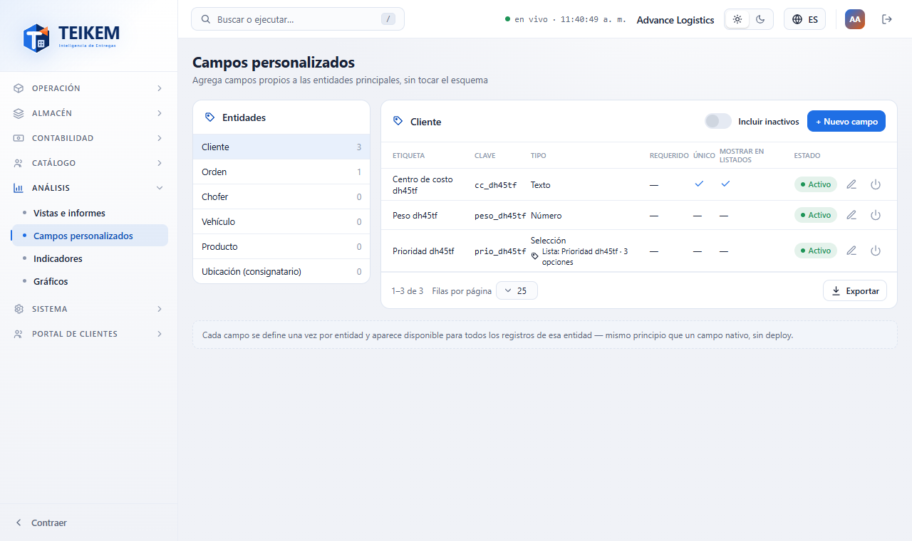
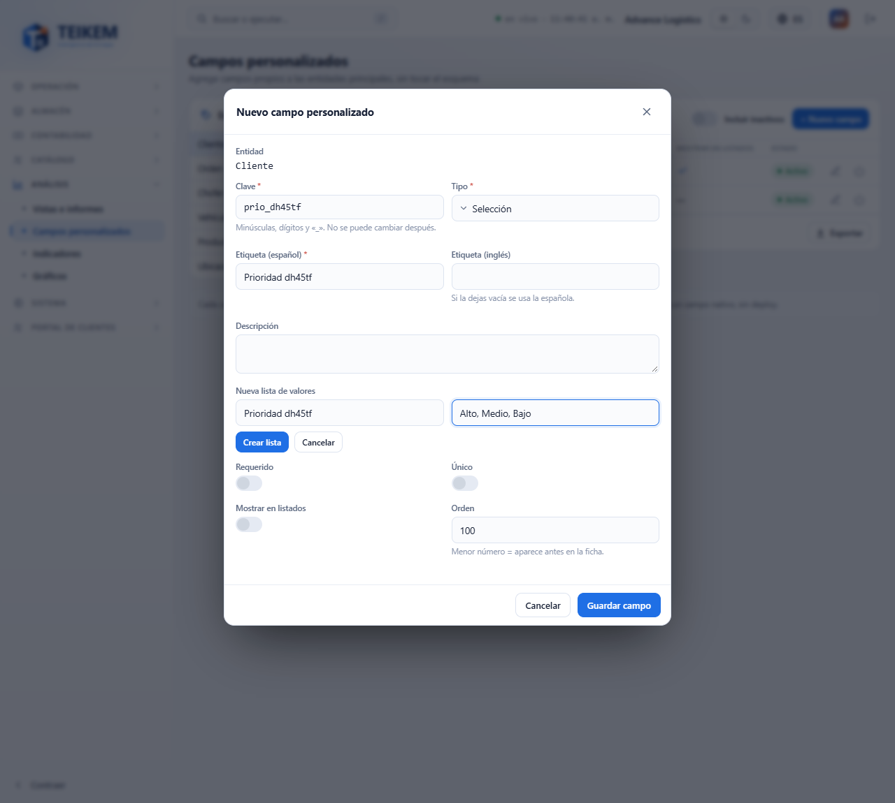
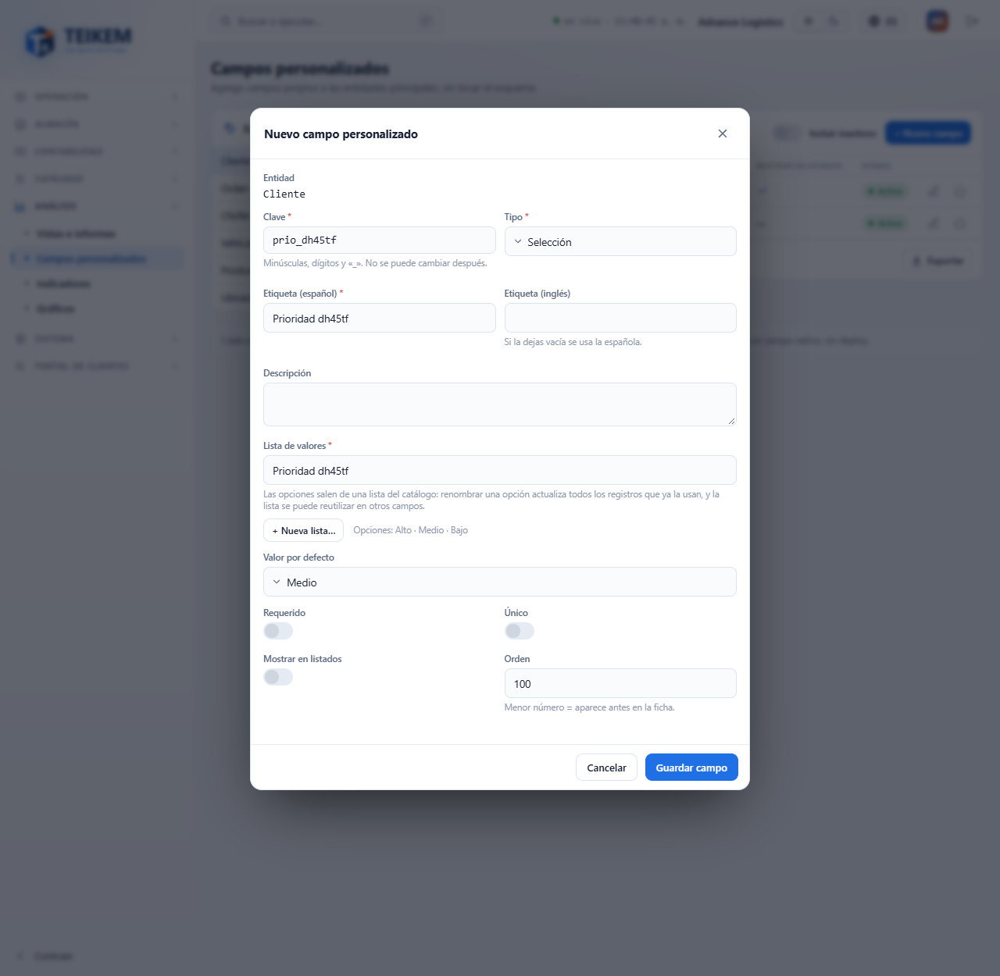
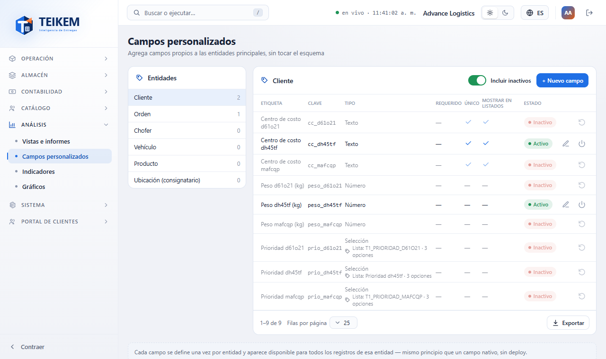
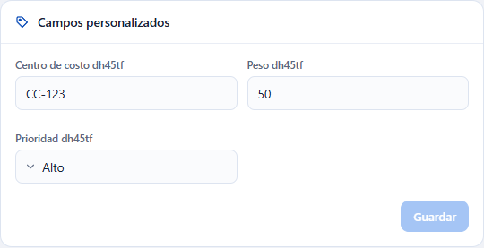
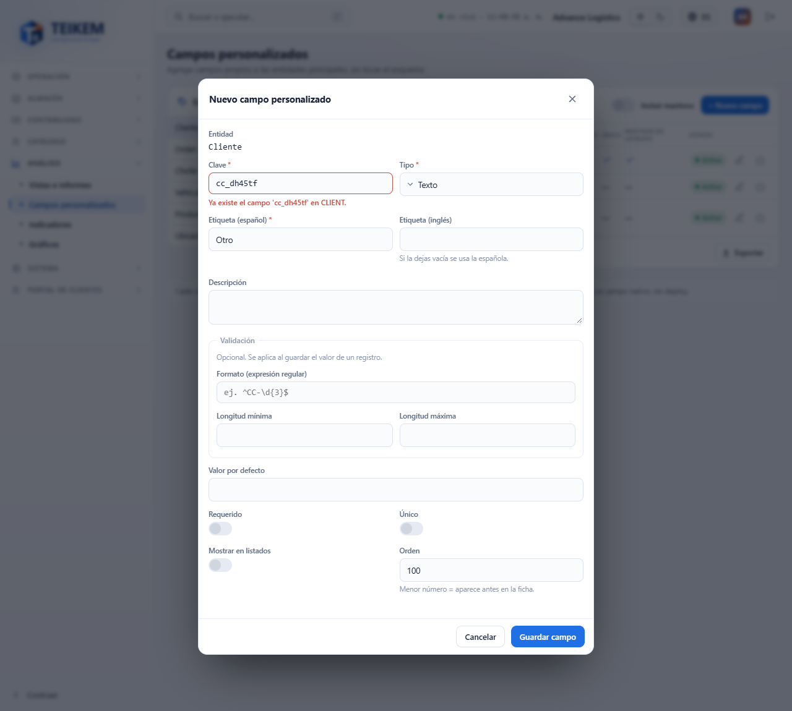
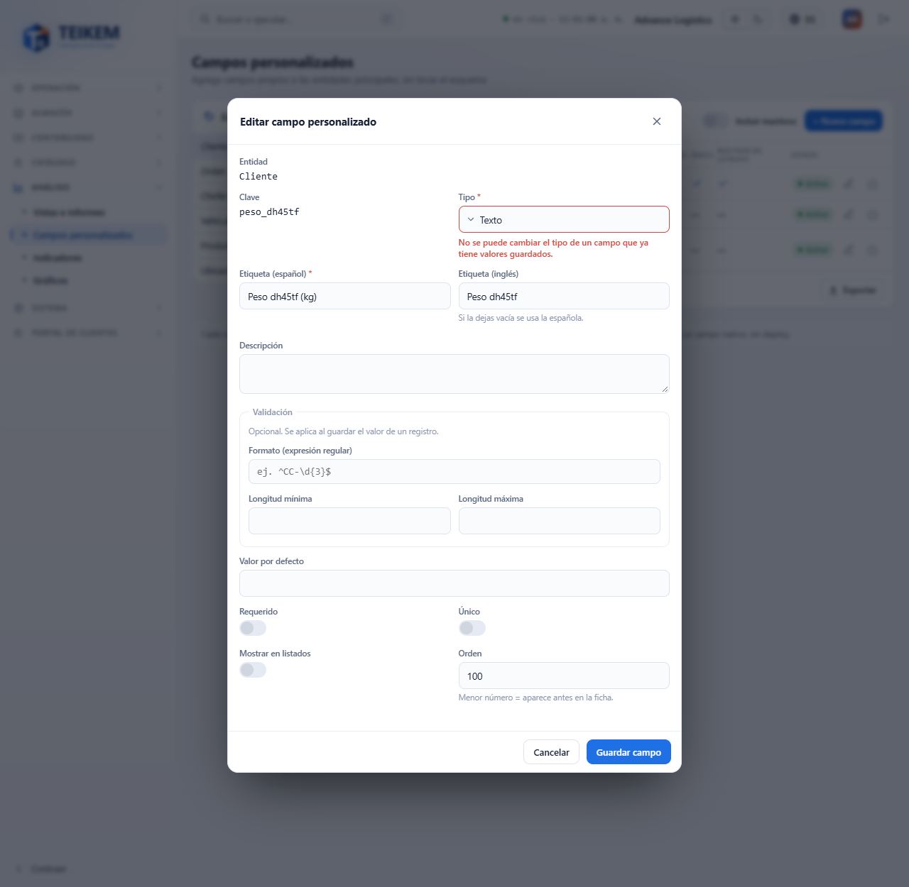

# Custom fields

**Custom fields** (Analytics menu → **Custom fields**) is used to add to your records the data your company needs and the system does not include out of the box: a cost center on the client, the maximum weight of a vehicle, the priority of an order. You define the field once and it appears in the record of **every** record of that entity.

This screen **defines** the fields. The **values** (for example, “CC-123” on a client) are typed in each record, in the **Custom fields** panel.

## Who can use it

| To… | Permission | Module |
|---|---|---|
| Open the screen, create, edit, deactivate and reactivate fields | `admin.customfields` | Custom fields |
| Create a **New list…** of values from a selection field | `admin.catalogs` | System |
| Type the value of a field in a record | the edit permission of that record (for example, `clients.update` in Clients) | the record's |

Without `admin.catalogs` you can choose a list that already exists, but the **New list…** button does not appear and the screen tells you to ask an administrator to create the list.

## How it is organized

1. **Entities** (on the left; on the phone, at the top): Client, Order, Driver, Vehicle, Product and Location (consignee). The number on the right is the number of **active** fields of that entity.
2. **The table of the chosen entity**: Label, Key, Type, Required, Unique, Show in lists and Status. In selection fields, below the type you see the list they use and how many options it has.
3. **Include inactive**: also shows the deactivated fields (dimmed).
4. **New field** and, on each row, **Edit**, **Deactivate** or **Reactivate**.

Only the entities that currently have a record where values can be typed are offered. If an entity has no fields, the table says “There are no custom fields for this entity yet.”

## Create a field

1. Choose the entity and press **New field**.
2. Type the **Key**: it is the field's internal name, only lowercase letters, digits and “_”, starting with a letter (for example `cost_center`). **It cannot be changed later.**
3. Choose the **Type** (see the table below).
4. Type the **Label (Spanish)**, which is what your users will see. The **Label (English)** is optional: if you leave it empty the Spanish one is used.
5. If you want, type a **Description** and the **Validation** that fits the type.
6. Check **Required**, **Unique** or **Show in lists** if applicable, and the **Order** (lower number = appears earlier in the record; 100 by default).
7. Press **Save field**. The notice “Field created” appears and the field is visible immediately in the records.

| Type | What it stores | Validation that can be requested | Default value |
|---|---|---|---|
| Text | Free letters and numbers | Format (regular expression), minimum and maximum length | A text |
| Number | A number | Minimum and maximum value | A number |
| Date | A day | Minimum and maximum **in days from today** (−30 = up to 30 days back; 0 = today) | A date |
| Date and time | A day with time (company time) | Same as Date | Date and time |
| Yes/No | Checked or unchecked | — | Checked by default |
| Selection | One option from a list | — | One option from the list |
| Multi-select | Several options from a list | — | Several options |
| List reference | One option from a value list | — | One option from the list |

You do not have to write anything technical: the format (for example `^CC-\d{3}$`, which means “CC-” and three digits) is the only thing that uses a regular expression, and it is optional.

### Required, Unique and Show in lists

- **Required**: the record cannot be saved without that value.
- **Unique**: there cannot be two records of the entity with the same value.
- **Show in lists**: marks the field to be shown in the lists.

## Selection fields: the value list

Selection fields **do not store loose options**: they point to a **list of the list**. That way, if an option is later renamed in **System → Value lists**, every record that already uses it is updated, and the same list serves other fields.

1. Choose **Selection**, **Multi-select** or **List reference**.
2. In **Value list** choose a list (your company's own come first; you can search by typing). Its options are shown below.
3. If the list you need does not exist, press **New list…**, type the **list name** and the **comma-separated options** (for example “High, Medium, Low”) and press **Create list**. The list is selected.
4. Optional: choose the **Default value** among the options.

Fields created earlier by other means may carry **own options** (“Own options · 2” in the table). When editing them they are kept; if you choose a value list, the list replaces those options.

## Edit a field

1. On the field's row press **Edit** (the pencil).
2. Change whatever you need. The **Key** is visible but cannot be changed.
3. Press **Save field** (“Field updated”).

Records that already have a value keep it. **The type cannot be changed if the field already has saved values** (see errors).

## Deactivate and reactivate

- **Deactivate** (the power button) asks for confirmation. The field **stops being requested and shown** in the records, but **its values are kept**. There is no permanent deletion.
- **Reactivate**: turn on **Include inactive** and press **Reactivate** on the row. The field returns to the records with the values it had.

## Where the values are typed

Open a record (for example, a client): the **Custom fields** panel shows the active fields of its entity in the indicated order. A value that does not meet the validation is rejected under the field, for example “Does not match the required format.”

## Error messages

| Message | What it means | What to do |
|---|---|---|
| “Invalid key: lowercase letters, digits and '_' (2-60), starting with a letter.” | The key has uppercase letters, spaces, hyphens or starts with a digit | Use for example `centro_costo` |
| “The field '…' already exists in …” | Another field of the entity already has that key, **including a deactivated one** | Use another key, or turn on **Include inactive** and **Reactivate** the old field |
| “The type of a field that already has saved values cannot be changed.” | There are records with a value in that field | Leave the type; if you really need it, deactivate this field and create another with a different key |
| “The label is required.” | The Spanish label is missing | Type it |
| “Choose or create a value list” | A selection field has no list | Choose a list or use **New list…** |
| “The list '…' does not exist.” | The chosen list is no longer available, or it is not a value list | Choose another list |
| “Give the list a name and at least one option” | The name or the options are missing when creating the list | Complete them |
| “A list with the key '…' already exists.” | There is already a list with that name | Use another name or choose the existing list |
| “A code cannot be built from: …” | An option has only symbols or is too long | Write it with letters or numbers (maximum 40) |
| “The regular expression is not valid.” | The typed format is malformed | Correct it or leave it empty |
| “The entity '…' does not support custom fields yet (its module is not built).” | The entity has no records where values can be stored | It cannot be done; use one of the entities in the list |
| “ValidationJson is not valid JSON.” | Only seen if the field was created with an external tool | Correct the validation from this screen |

If the server rejects the field for a reason that does not correspond to a specific control, the message appears above the form.
