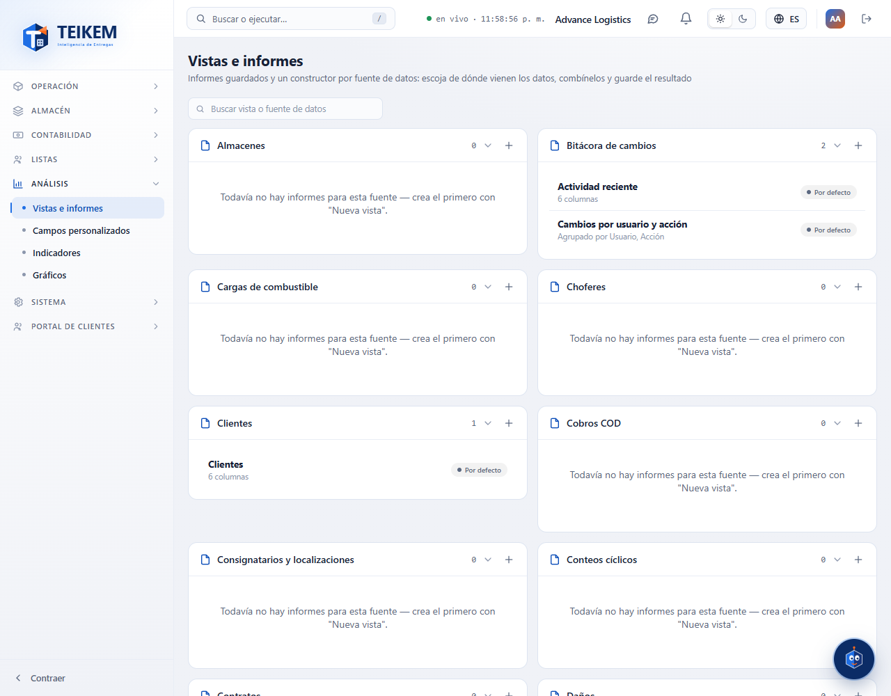
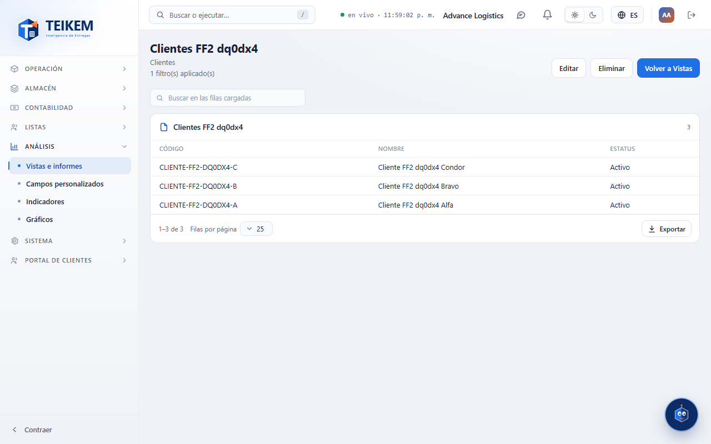
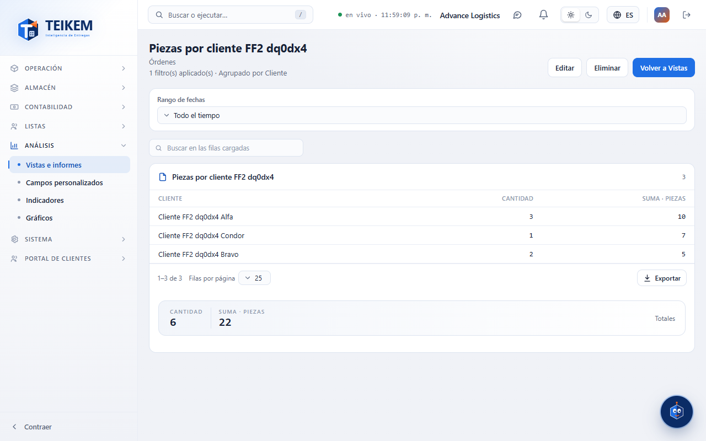
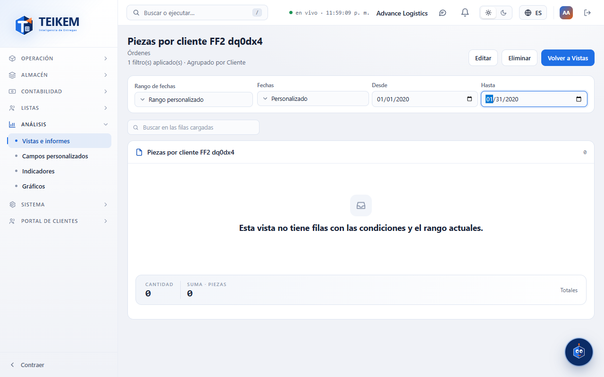
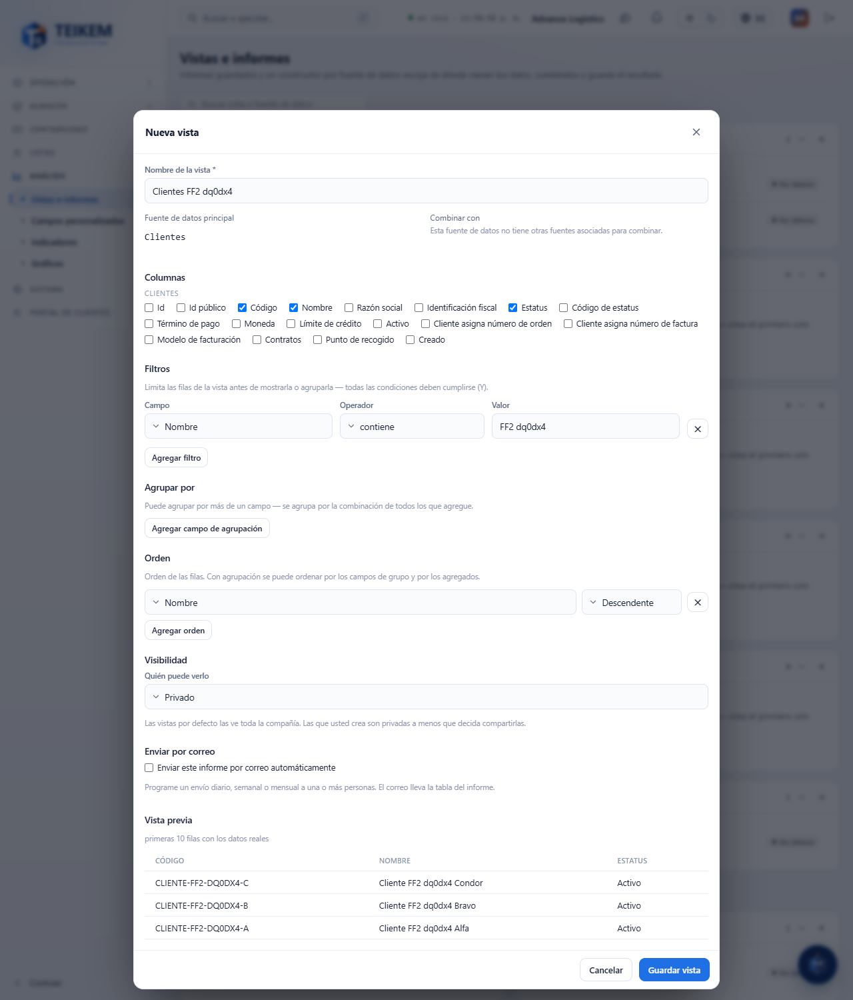
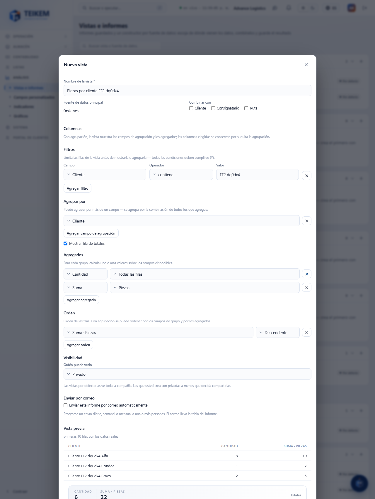
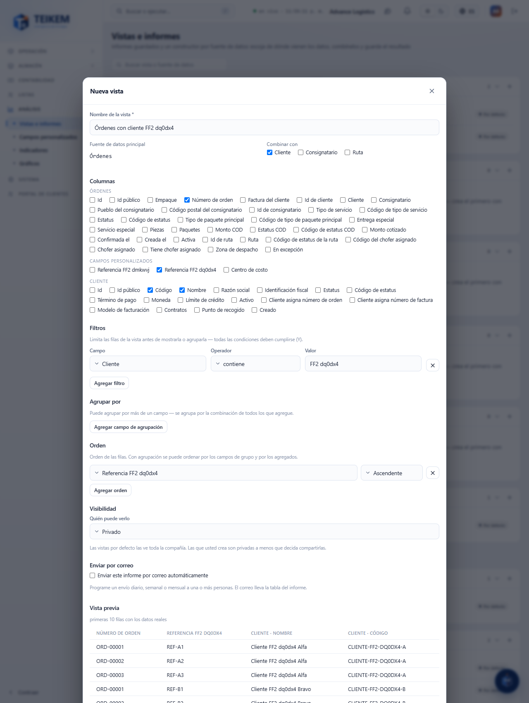
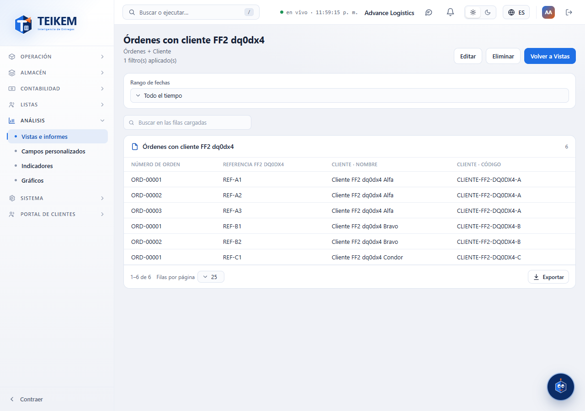
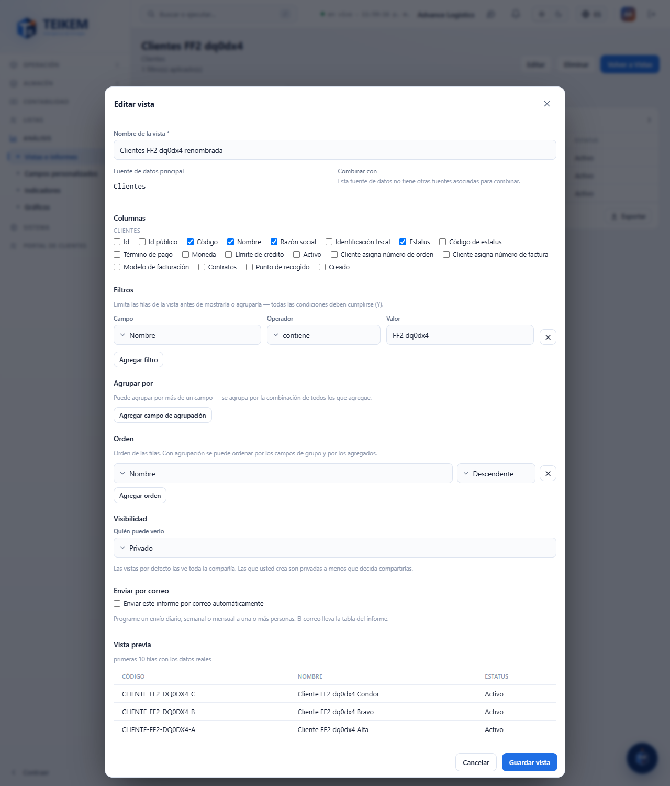

# Views & reports

**Views & reports** (Analytics menu → **Views & reports**) lets you build tables with your company's data —clients, orders, inventory, routes, drivers…—, save them under a name and open them again whenever you need them. Each **view** starts from **one data source** (for example, Orders), can be **combined** with another related source (for example, the Client of each order), filtered, grouped with totals and sorted. A view is **viewed and exported** with the same **Export** button as the rest of the screens.

## Who can use it

| To… | Permission | Module |
|---|---|---|
| Open, open a view, search in it, change the date range and export | `analytics.view` | Analytics |
| Create, edit and delete views (**+**, **Edit** and **Delete** buttons) | `analytics.manage` | Analytics |
| Share a view with **specific people** | `admin.users` (to be able to pick them from the list) | System |
| See the data sources of a module (for example, Rentals or Inventory) | the permission to view that module | that source's module |

Without `analytics.manage` the screen is read-only: neither the **+** nor **Edit** nor **Delete** appear. Each person only sees the data sources of the modules their company has turned on and their user is allowed to view.

## The gallery

1. There is **one panel per data source**, two per row (just one on the phone). All start **open**; press a panel's title to collapse or expand it.
2. To the right of the title is the **number of reports** for that source and the **+** button (**New view**), which opens the builder with that source already chosen.
3. Each report shows its **name** and, below it, “N columns” or “Grouped by …”, plus “+ Client” if it is combined with another source.
4. The **Default** badge marks the reports the platform ships with (they cannot be edited or deleted). **Created by …** marks those of someone else. The ones you created carry no badge and show the **Edit** and **Delete** icons.
5. A source with no reports says: “There are no reports for this source yet — create the first one with "New view".”
6. The search box at the top filters by the name of the view or of the source; while you type, the panels with matches are shown open.

Press a report's name to open it.

## Opening a view

1. The title is the view's name; below it, the source (and the combined ones) and the badge. If the view has filters or grouping, a line summarizes it: “1 filter(s) applied · Grouped by Client”.
2. **Date range**: appears only if the source has a date (for example, the order's creation date). By default it is **All time**. You can choose **Last 7 days**, **Last 30 days**, **This month** or **Custom range** (then type **From** and **To**). The range **is not saved** with the view: it applies only to this query.
3. **Search the loaded rows**: type one or more words; the rows that contain them (ignoring case and accents) in any column, as shown on screen, remain.
4. **Sort**: press a column header (on the phone, use “Sort by”). Press again to reverse.
5. **Export** (bottom right of the table): Excel, CSV or PDF with **what is loaded** and in the order you see it, with the search applied.
6. If the view has a **totals row**, the totals appear in a strip below the table.
7. **Edit** and **Delete** (if you may) and **Back to Views** are at the top right.

**How many rows are loaded.** Up to **5000 rows** are loaded. If the view has more, a notice says “Showing the first N of M rows…”; **the export and the search work with those N**. Narrow the view with a filter or a date range to see the rest.

## Creating a view

1. In the panel of the source you are interested in, press **+** (**New view**).
2. Type the **View name** (required, up to 150 characters).
3. **Main data source** shows the chosen source and cannot be changed. In **Combine with**, check the related sources you want to add (for example, **Client** in an Orders view). If the source has no other related sources, it says “This data source has no related sources to combine.”
4. **Columns**: check the boxes of the fields you want to see. There is one block per source; the **custom fields** your company defined appear in their own block. The columns of a combined source are labeled “Client · Name”.
5. **Filters** (optional): press **Add filter**; choose the **Field**, the **Operator** (equals, does not equal, greater than, greater or equal than, less than, less or equal than, contains, starts with, ends with, is in, is not in, between, is empty, is not empty, is true, is false) and the **Value**. With “is in” and “is not in”, separate the values with commas; with “between”, type two values. **All conditions must be met** (they are joined with “AND”).
6. **Group by** (optional): press **Add grouping field**; you can group by several fields. When grouping:
   - the view shows the grouping fields and the **Aggregates** (**Quantity**, **Sum**, **Average**, **Minimum**, **Maximum**). Press **Add aggregate**; **Quantity** can count “All rows”; the other functions need a numeric field;
   - check **Show totals row** to see the total of each aggregate;
   - the columns you checked before are saved but not shown while there is grouping.
7. **Order** (optional): **Add order**, choose the field and **Ascending** or **Descending**. With grouping you can order by the group fields and by the aggregates (“Sum · Pieces”). You can add several; they apply in that order.
8. **Visibility**: **Private** (only you), **Whole organization** or **Specific people**. With **Specific people**, choose people (requires `admin.users`) and/or roles; check “The chosen people can also edit the view” if you want them to be able to change it.
9. **Preview**: it refreshes by itself with real data (the first 10 rows) while you build the view. If something is missing, it says “Pick at least one column or a grouping field to see the preview.”
10. Press **Save view**. “View saved — available for future use: …” appears.

Example of a combined view: “Orders with client” (source **Orders**, combined with **Client**) with the columns Shipment number, Reference (custom field), Client · Name and Client · Code.

## Editing and deleting

1. Open the view and press **Edit** (or the pencil icon in the gallery). The builder brings everything that was saved: columns, filters, grouping, aggregates, order and visibility. The main source cannot be changed.
2. Change what you need and press **Save view**: “View updated: …”.
3. **Delete** asks for confirmation: “The view «…» will be deleted. The data is not touched: only the saved report goes away.” After deleting, the name is free to be used in another view.

**Default** views can only be viewed and exported; those of other people can only be changed by whoever created them or by whoever was given permission to edit.

## Messages you may see

| Message | What it means | What to do |
|---|---|---|
| Give the view a name | The name is missing. | Type the name and save. |
| Pick at least one column | The view has neither columns nor grouping. | Check a column or add a grouping field. |
| The Sum function requires a field. (same with Average, Minimum and Maximum) | An aggregate other than Quantity has no field. | Choose a numeric field in that aggregate. |
| A view '…' already exists for …. (409) | There is already another view with that name in the same source (it may be one you do not see, for example a private one of someone else). | Use another name. |
| A view needs at least one column or one grouping. (400) | The server received an empty view. | Check columns or group. |
| Source … does not combine with '…'. (400) | A combination with an unrelated source was requested. | Remove that combination; the screen only offers the valid ones, so it usually happens if the configuration changed while you were editing. |
| FilterJson is not valid JSON. (400) | The filter arrived damaged. | Build the filter again and save. |
| The name is required. (400) | The server received an empty name. | Type the name. |
| The platform's default items cannot be edited or deleted. (403) | You tried to change a **Default** view. | Create your own view with **+**. |
| Only the owner can edit or delete this item. (403) | The view belongs to someone else and they did not give you permission to edit. | Ask them to edit it, or to share it with editing. |
| View '…' not found. (404) | The view no longer exists, was deleted or stopped being shared with you. | Go back to **Views** and open another. |
| From cannot be later than To. / The custom range needs From and To. | Incomplete or reversed date range. | Fix the dates. |
| View not found (screen) | The link points to a view that does not exist or that you cannot see. | Press **Back to Views**. |

## Frequently asked questions

**Why does a source not appear in the gallery?** Because your company does not have that module turned on or your user does not have permission to view it.

**Is the date range saved with the view?** No. Every time you open the view it starts at **All time**; the range is only for the query.

**Can I schedule a view to be sent by e-mail?** Not yet. Today a view is opened and exported by hand.

**Why does the export not bring all the rows?** What is loaded is exported (up to 5000 rows). Narrow the view with filters or a date range.

**Why is a custom field's column empty in some rows?** Because that record has no value in that field.

**I changed a custom field and my view stopped showing it.** If the field was deactivated, its column is empty in every row; reactivate it in **Custom fields** or remove the column from the view.
