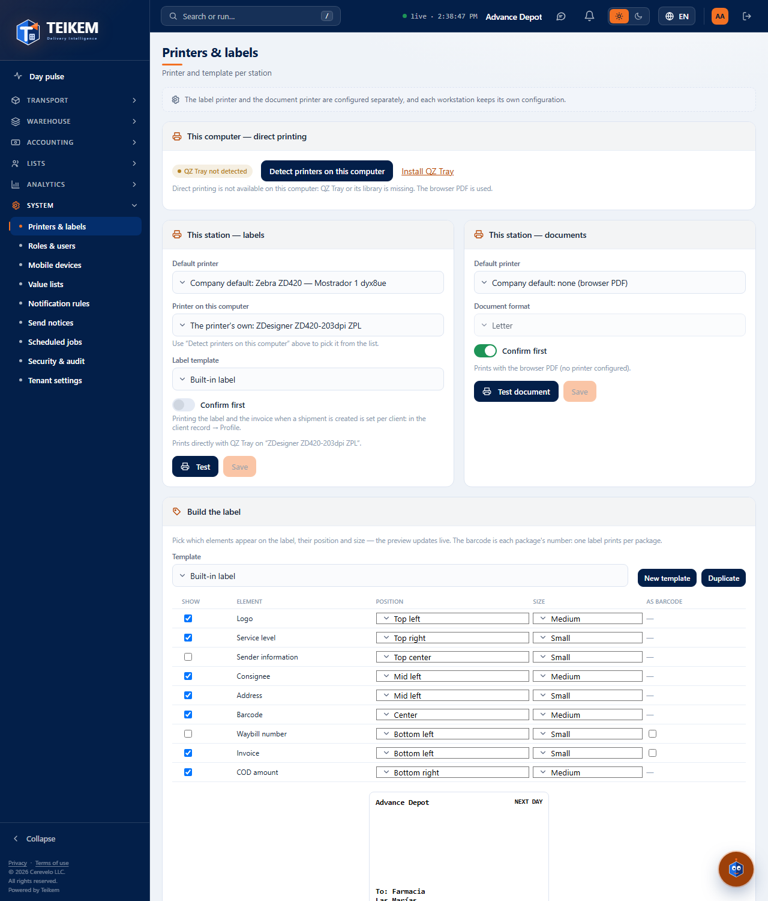
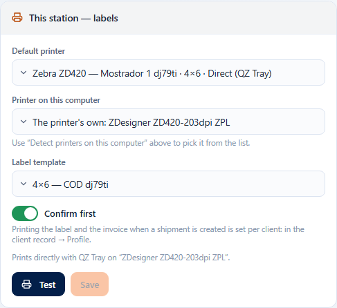
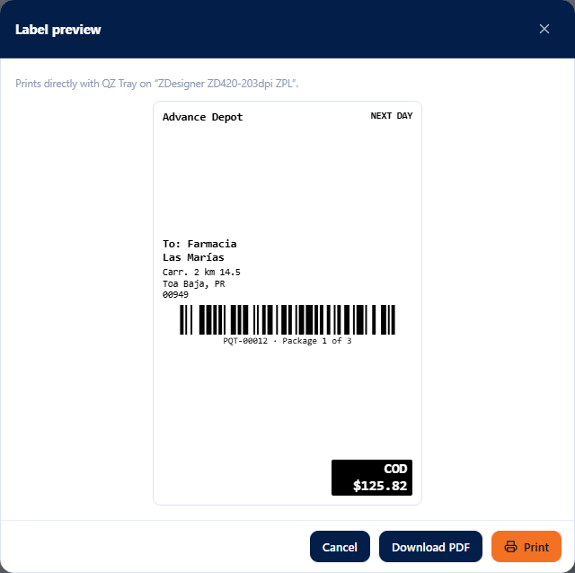
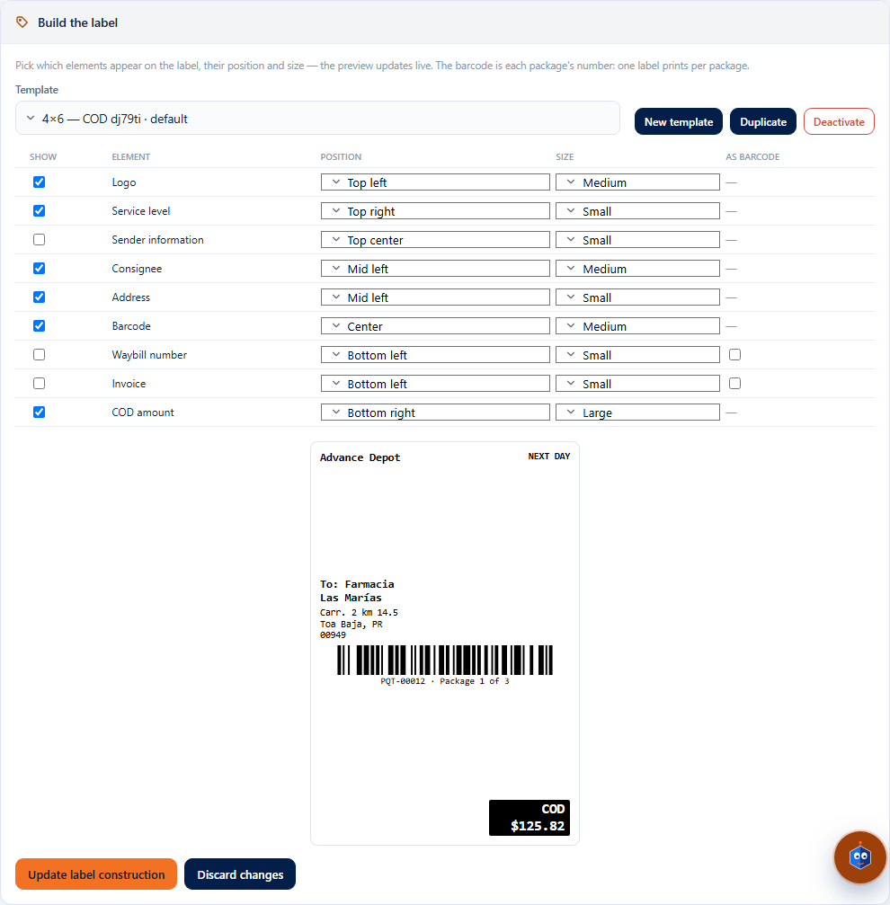
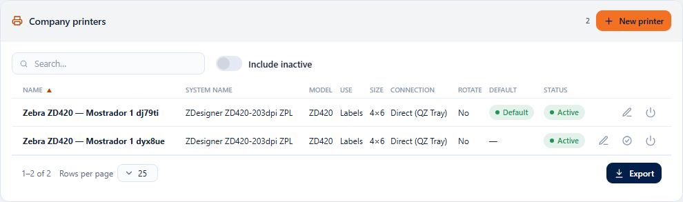
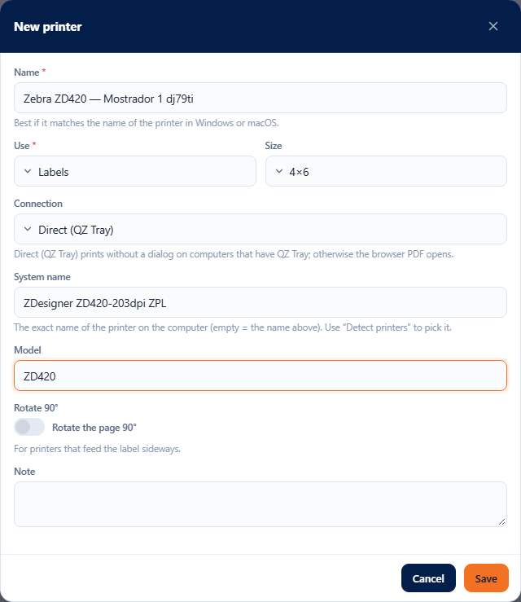

# FG1 — Printers & labels

**System → Printers & labels** (`/system/printers`). Who sees it: whoever has the **`printers.manage`** permission (“Manage printers &
label templates”; the Company admin role has it). The module is System (always on). Without the permission, the entry does not
appear in the menu and the address shows “No permission”.

Here you set up **how each station prints** (this computer with this browser), **build the shipping label** and
manage the **company's printers**. The server rules, the messages with their code and the installation of the
QZ Tray certificate (support) are in chapter [12 — Printers and labels](../12-impresoras-y-labels.md).

## 1. How Teikem prints

- **Direct**: if the printer's connection is **“Direct (QZ Tray)”** and this computer has **QZ Tray** installed and running, the label or
  the document goes **straight to the printer, with no dialog**.
- **Fallback**: otherwise (“browser PDF” printer, QZ Tray not installed or not running, or a failure), the **browser's print
  dialog** opens with the PDF; on a phone or tablet the PDF is **downloaded**. You are always told why it did not print directly.
- The label is **black and white**, the **exact size** of the label stock (4×6, 4×4 or 4×2), **one per piece**; its **barcode is
  the package number of the line**, with “Package i of N” underneath.

## 2. This computer — direct printing

The first panel says whether **QZ Tray** is available on this computer:
- **“QZ Tray connected”**: printers with the QZ Tray connection print without a dialog.
- **“QZ Tray not detected”**, with the **Install QZ Tray** link (qz.io) and the reason: QZ Tray or its library is missing, or it is not running.
  Meanwhile everything prints with the browser PDF.
- **Detect printers on this computer**: asks QZ Tray for the list of installed printers (their exact Windows or macOS names)
  and offers it in “Printer on this computer” of each station and in “System name” of a printer.
- If the server does not have the Teikem certificate, when printing QZ Tray asks “Allow / Permitir” (support installs it: chapter 12 §9).

## 3. This station — labels and documents

Two identical panels, as in the mockup. What you choose here stays **in this browser** (each station keeps its own) when you press
**Save**; Save is enabled only if there are changes.

| Field | What it does |
|---|---|
| Default printer | “Company default: …” (the one the administrator marks), a printer from the list (its size and whether it is direct) or “Browser PDF (no printer)”. |
| Printer on this computer | Only with a QZ Tray connection printer: the exact name of the printer on this computer (from “Detect printers”). Empty = the printer's “System name”. |
| Label template (labels) | “Company default: …”, a template or “Built-in label”. |
| Document format (documents) | Only **Letter** for now (invoice, BOL and receipt come with billing). |
| Print on save (labels) | If the company has “Print labels directly to the printer” turned on, when an order is saved this station prints its labels; turned off, this station does not print them. |
| Confirm first | Before printing, shows the label (or document) preview with **Print** and **Download PDF**. |

- Below it you can read how it prints: “Prints directly with QZ Tray on “…”.”, “Prints with the browser dialog (…).” or “Prints with the
  browser PDF (no printer configured).”.
- **Test** (labels) prints a sample label (Farmacia Las Marías, package PQT-00012, COD $125.82) with the chosen printer and
  template; **Test document** (documents), a letter-size sheet. With “Confirm first” the preview comes first:

- If the printer or the template chosen at this station are deactivated, the panel warns you and uses the company default until
  another is chosen and saved.

## 4. Building the label

- **Template**: the company's templates (the default one marked “default”, the inactive ones “inactive”) and the **Built-in
  label**. Buttons **New template** (starts from the built-in label), **Duplicate** (copies what is shown), **Make default**,
  **Deactivate** / **Reactivate**.
- The table has the **9 elements** of the mockup: **Show**, **Element**, **Position** (9 zones: Top left, Top center, Top
  right, Mid left, Center, Mid right, Bottom left, Bottom center, Bottom right), **Size** (Small, Medium, Large) and **As
  barcode** (only Waybill number and Invoice). On a phone each element is a card.
- The **preview** changes instantly and is the same as what comes out in the PDF: three rows (top, middle, bottom) with three columns, and the
  barcodes across the full width of their row (the **Barcode** is the package number with “Package i of N”). The COD prints in
  a black box and only if the order has COD.
- **Update label construction** saves the chosen template (with the Built-in label chosen it says **Save as template** and asks for
  the name). **Discard changes** goes back to what was saved.
- Without any visible barcode it cannot be saved: “The label needs at least one barcode so it can be scanned.”.

## 5. Tenant settings — Print labels directly to the printer

Company switch (off by default). Turned on, when a shipping order is saved (quick or detailed entry) **one label
per piece** goes to the station's label printer, with no dialog if the station prints with QZ Tray: the “Print label on
save” switch of the quick and detailed entry comes turned on (see [F-G2 — Labels and documents](fg2-labels-y-documentos.md)).

## 6. Company printers

Table with **Name, System name, Model, Use, Size, Connection, Rotate, Default and Status**, free-text search and **Include
inactive**. Actions per row: edit (pencil), **Make default**, **Deactivate** (asks to confirm; if it is the default, warns
that its use is left without a default) and **Reactivate**.

**New printer** opens the form:

| Field | Rule and message |
|---|---|
| Name | Required (“Type the printer name.”), up to 80; cannot repeat that of another active one (409 “There is already an active printer with that name.”). It is best to use the same one as in Windows. |
| Use | Labels or Documents. **Fixed when created** (in the edit it is shown but cannot be changed). |
| Size | Labels: 4×6, 4×4 or 4×2. Documents: Letter. |
| Connection | Direct (QZ Tray) or Browser PDF. |
| System name | With QZ Tray: the exact name on the computer (list from “Detect printers”); up to 200. |
| Model / Note | Optional (80 and 300). |
| Rotate 90° | For printers that feed the label sideways. |

The first active printer of each use becomes the default.

## 7. Common cases

- **Test opened the browser dialog**: the printer is not “Direct (QZ Tray)” or this computer does not have QZ Tray running (see the
  first panel). Install it, open it and press “Detect printers on this computer”.
- **QZ Tray asks “Allow”**: the Teikem certificate is missing on the server or on that computer (support, chapter 12 §9).
- **The label comes out cut off on 4×2**: “The label does not fit on 4×2: remove elements or use a bigger label.” appears; remove elements or
  use Small sizes.
- **I deactivated the default and now the PDF comes out**: make another one the default or choose one at the station.
- **My configuration is not on another computer**: it is per station; set it up and press Save on each computer.
