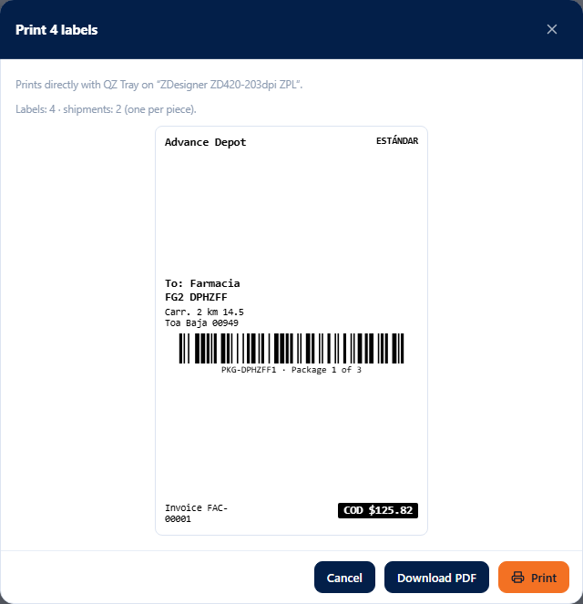
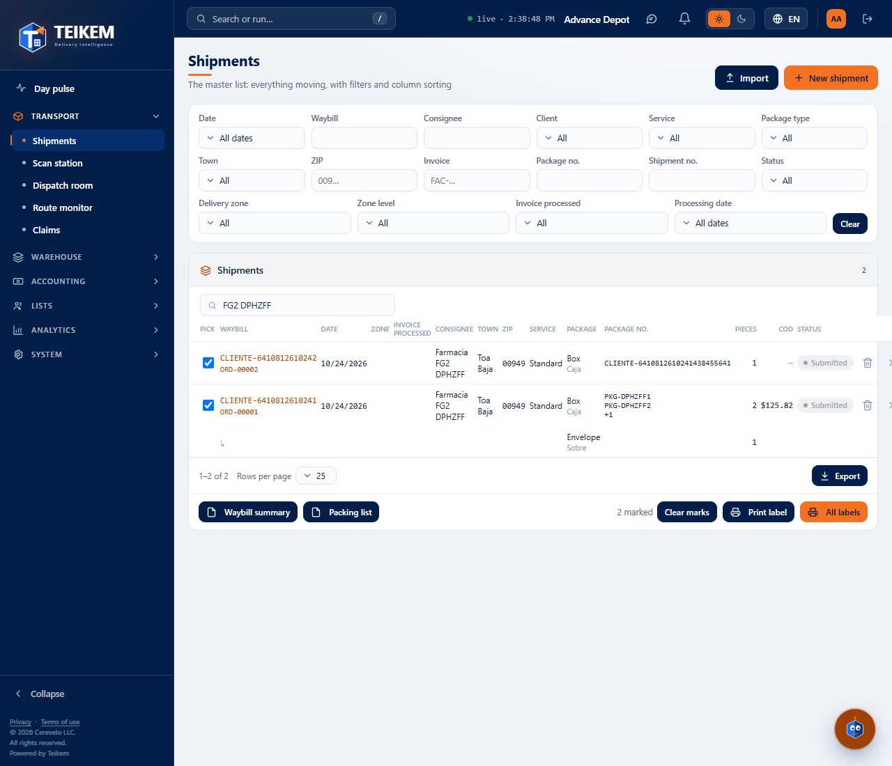
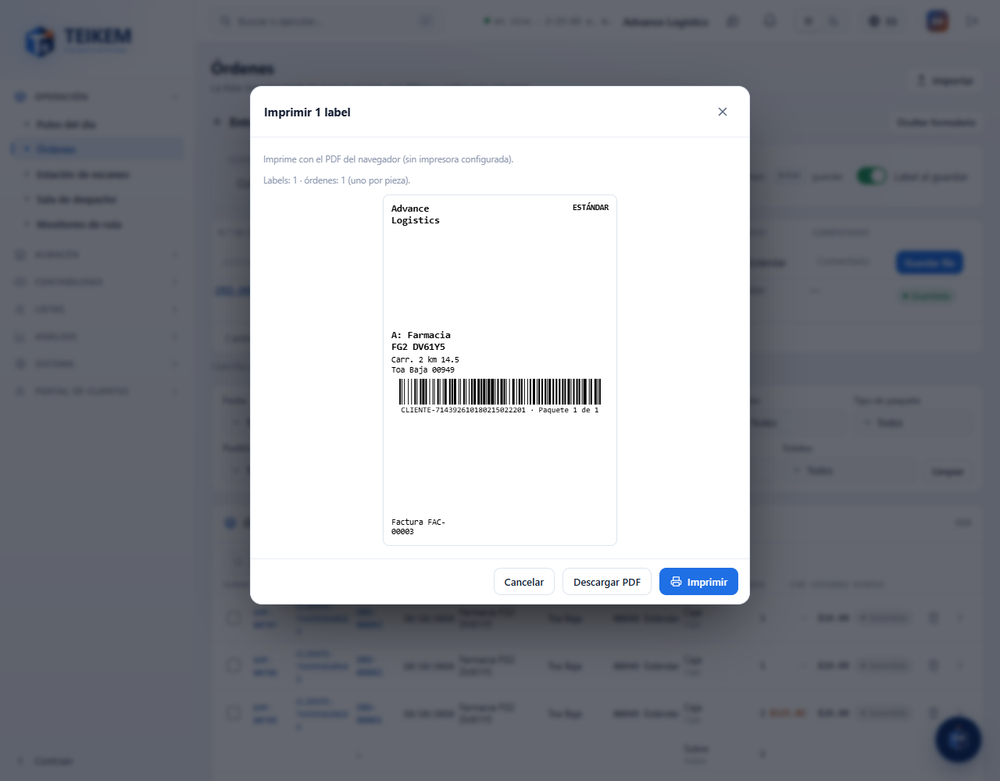

# F-G2 — Order labels and documents

From F-G2 you print the orders' **labels** (one per piece), the **Waybill summary**, the **Packing list** and the scan station's
**Missing report**. Everything comes out through the printers of **this station** (System → Printers & labels, chapter
[F-G1](fg1-impresoras.md)): directly with **QZ Tray** if the printer has that connection and QZ Tray is running; otherwise, with the
browser's print dialog (on a phone the PDF is downloaded). The rules and the messages are in chapter
[12 §10](../12-impresoras-y-labels.md). An order's price is never printed.

## 1. What a label carries

- **One per piece**: the quantity of each line of the order (in whatever unit) is the number of labels for that line.
- The **barcode** is the line's **package number** (the same on its pieces), with the readable number and “Package i of N” underneath
  (i runs over all the pieces of the order). The scan station recognizes it.
- Also (depending on the template): the company name, the service level, “From:” the client, “To:” the consignee and their address, the
  waybill number (= order number), the client's invoice and the COD in a black box if the order has one.
- **Cancelled** orders are not printed (“{N} cancelled orders were not printed.”) nor are the pieces of a line **without a package
  number** (“{N} pieces without a package number were not printed.”). From 500 labels on it warns that the PDF will be large; there is no limit.

With **“Confirm first”** turned on at the station, the preview appears first: how many labels, which printer they go to and the first label, with
**Print**, **Download PDF** and **Cancel**.

## 2. Orders list

- **Select**: a checkbox at the start of each order. The checks are remembered when changing page; the footer says “N marked” with **Clear marks**.
- In the table footer, as in the mockup:
  - **Waybill summary** and **Packing list**: of the **marked** orders or, with no marks, of **everything the filters and the search say**
    (all pages). They print on letter paper through the station's document printer.
    - *Waybill summary*: one row per order (Pack, Shipment no., Invoice, Client, Consignee, Town, ZIP, Service, Packages, Pieces,
      COD), grouped by client with subtotals and grand total.
    - *Packing list*: one section per order (pack, order, invoice, consignee and address) with its packages (type, package no.,
      description, pieces, weight) and totals.
  - **Print label**: the labels of the **marked** orders. With no marks it is grayed out: “To print only some, mark them in the list with
    their checkboxes.”.
  - **All labels**: the labels of everything filtered (all pages).

## 3. Order file

**Print label** in the header prints that order's labels (it does not appear on a cancelled or deleted order). POD will come later.

## 4. “Print label on save” (quick and detailed entry)

- **Quick entry**: the switch is in the top strip, next to “Enter saves”. Turned on, each saved row prints the labels of
  its order.
- **Detailed**: the switch is on the ticket, above “Save draft / Save and confirm”, with the note “The label prints automatically on
  this station's printer when saving (one per piece)…”.
- It comes turned on when the company has **“Print labels directly to the printer”** and this station did not turn off its “Print on save”;
  it can be changed while capturing.
- **A print failure never undoes the order**: “The order was saved, but the label could not be printed: {reason}. Use “Print label” in
  the order file.”.

## 5. Scan station

- **Missing report** (next to “Voice”; requires `trips.view`): the orders that are still **pending to be scanned** with the same
  filters as the screen (Zone, Client, ZIP code, Town), all of them, grouped by **zone** (“No zone” and “Ambiguous zone” at the end), with
  Pack, Order, Invoice, Client, Consignee, Town, ZIP, Pieces and Requested date, and at the top how many are still pending and how many were
  scanned in this session. It prints on letter paper through the station's document printer.
- **Scanning the label**: the label's package number finds its order (“Found by package number.”). If several orders have that number
  (each client numbers its packages from PQT-00001): “The package number is in {n} orders (from different clients or
  repeated); scan the pack or the shipment number.”.

## 6. Common cases

- **The browser dialog came up instead of printing directly**: the station's printer is not “Direct (QZ Tray)” or QZ Tray is not
  running on this computer (the notice says why). See [F-G1](fg1-impresoras.md).
- **Labels of an order are missing**: its lines have no package number (the notice says how many pieces). Enter it in the order file and print
  again.
- **“Print label” is grayed out**: mark the orders; for all of them use “All labels”.
- **The Waybill summary brings more orders than I wanted**: with no marks it uses everything filtered; mark the ones you want or adjust the filters.
