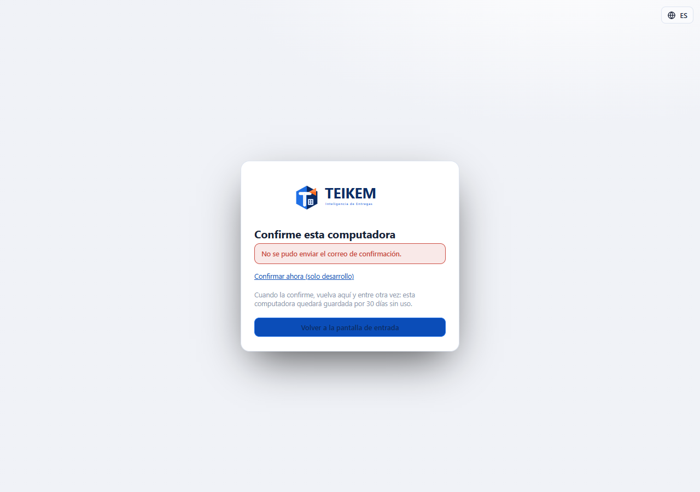

# L100 — Trusted computers (screens)

Rules, messages and how to turn it on: [chapter 25](../25-acceso-seguro.md).

## Signing in from a new computer

With the feature turned on, after signing in correctly with the password from a computer that is not recognized, **“Confirm this computer”** appears: “We sent an email to j***@empresa.com” and the instructions (the link is valid for 24 hours and can be opened from the phone). **“Back to the sign-in screen”** returns to the form. *(The screenshot is from the development environment, where there is no e-mail provider: it says it could not be sent and offers the confirmation link for testing only.)*

## The e-mail link

`/confirm-browser?token=…` confirms the computer and says “Done: this computer is now confirmed.” with the **“Go to the sign-in screen”** button; an expired or used link shows “The link is not valid or has expired. Try signing in again to receive a new one.”

## My trusted computers

**My account → Sessions**, below the active sessions: computer (“Chrome on Windows”, with the **This computer** tag on the current one), address, when it was confirmed, last use and when it expires. **Remove** (with confirmation) sends it to be confirmed by e-mail the next time. It works from 360 px up (on the phone the table is shown as cards), with no horizontal page scroll.

## Files
`kernel/auth/browserToken.ts` (the computer's mark), `features/auth/LoginPage.tsx` (confirmation screen), `features/auth/ConfirmBrowserPage.tsx` (`/confirm-browser`), `features/account/TrustedBrowsersPanel.tsx` (+ `api.ts`); texts `auth.browser.*` and `account.trusted.*` (es/en); tests `auth/browserConfirm.test.tsx` and the `e2e/lote100-computadora-confianza.spec.ts` walkthrough (it skips itself if the API does not have the feature turned on).
