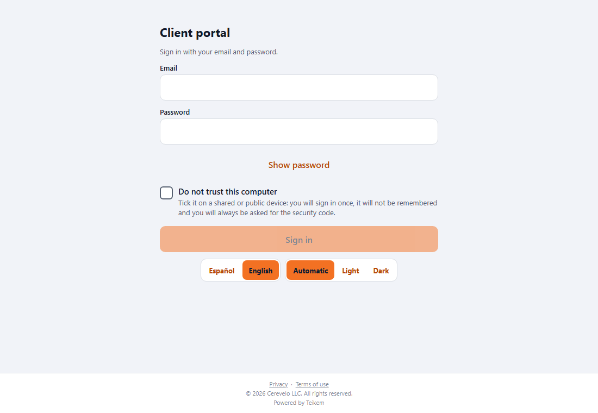
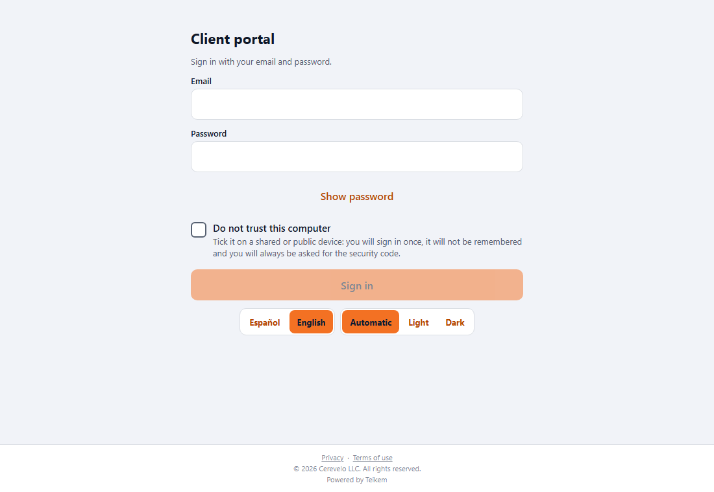
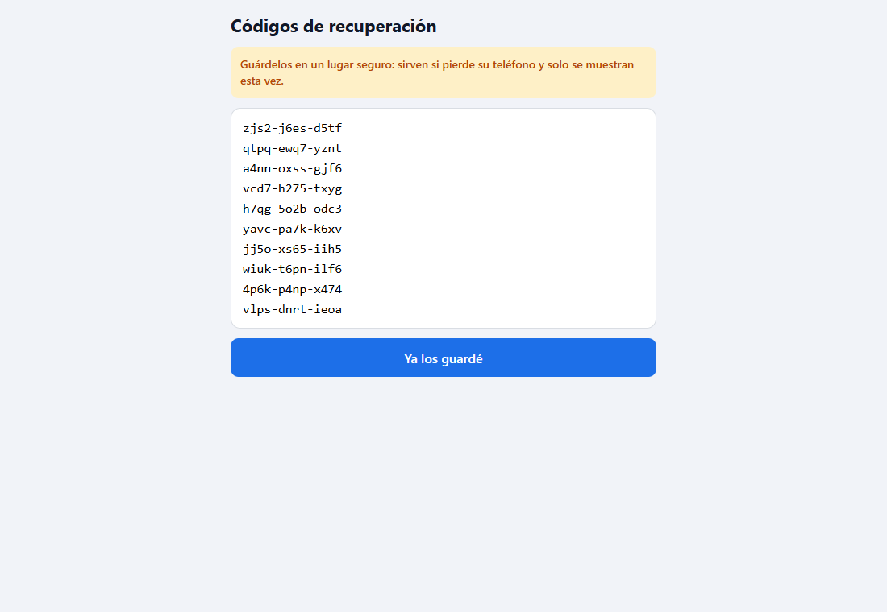
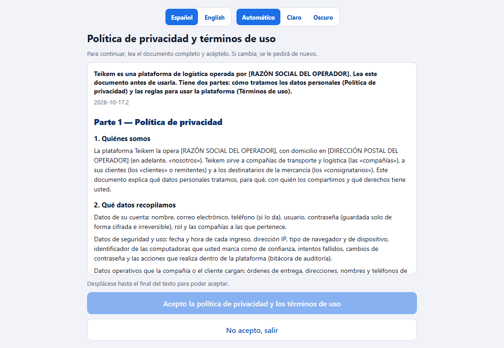
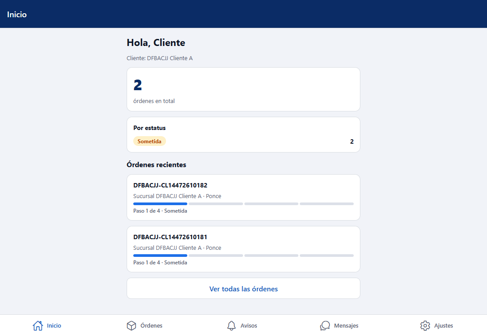
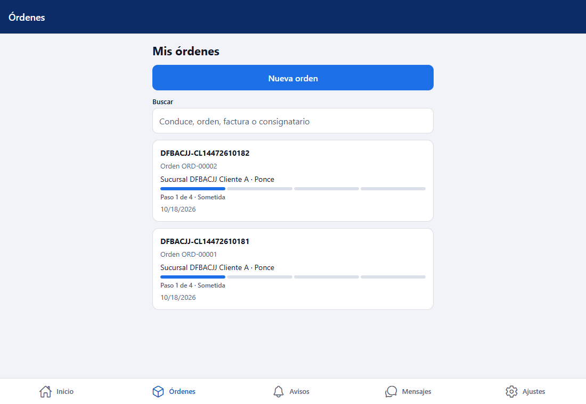
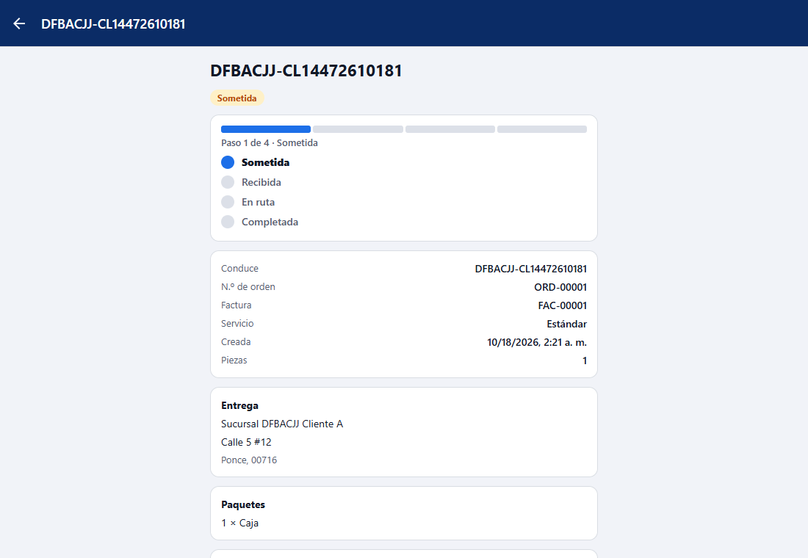
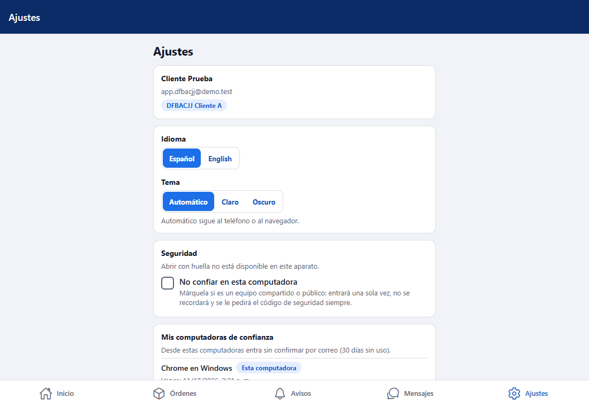
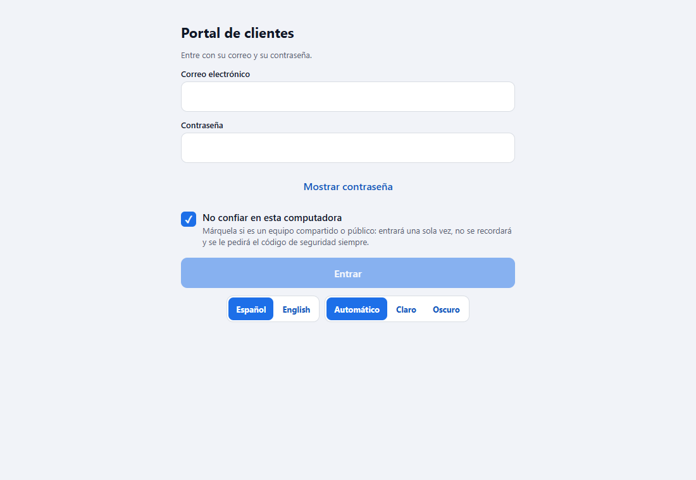

# L102 — Client app (screens)

Rules and messages: [chapter 27](../27-app-cliente.md) and [chapter 26](../26-portal-acceso.md). The screenshots are from the **web** version at 1100 px; on the phone it is the same interface in one column.

## Signing in and confirming the computer

E-mail, password (“Show password”) and the **“Do not trust this computer”** checkbox. The first time from a new computer:

*(The screenshot is from the development environment, with no e-mail provider: it says it could not be sent and offers the link for testing only. With e-mail configured it says “We sent an email to a***@cliente.co”.)*

## Second step (MFA)

The first time, the authenticator app is enrolled (setup key, link to open it, code) and the **recovery codes are shown only once**; after that comes “Security code”.

## Legal document

“I accept” is disabled until you reach the end of the text (“Scroll to the end of the text to be able to accept.”).

## Home, orders, order file

Home shows the total, the orders by status and the most recent ones; Orders searches and loads 20 at a time; the order file brings the delivery, the packages and the **tracking**.

## Settings

Account, switch client (with several), language, security (**Open with fingerprint** only on the phone; on the web it explains that it is not available), “Do not trust this computer” and **my trusted computers**.

The checkbox **is remembered**: when you come back to the login it is checked.

## Files
`app-cliente/`: `src/app/*` (routes), `src/features/{login,legal,lock,home,orders,notices,settings}`, `src/kernel/{api,auth,i18n,ui,storage.ts}`; es/en texts; jest tests (39) and the `web-app/e2e/lote102-app-cliente.spec.ts` walkthrough (against the real API; it skips itself if the API does not return the invitation token).
