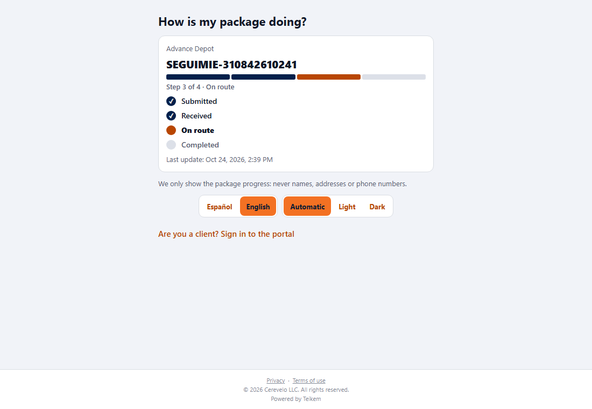
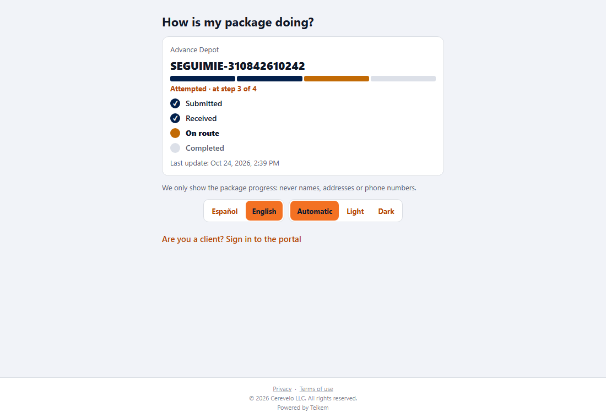
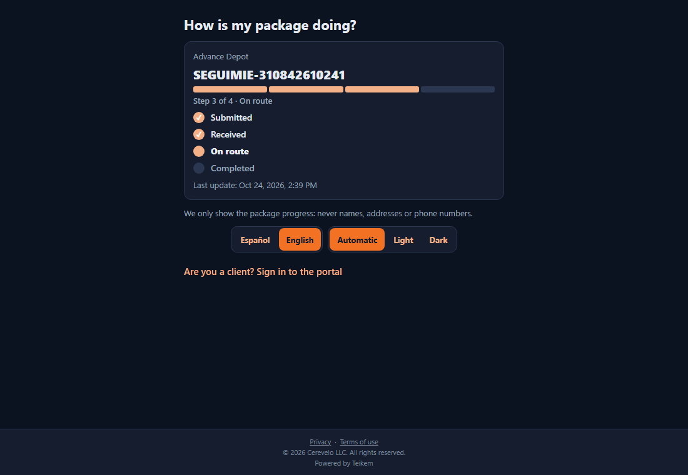
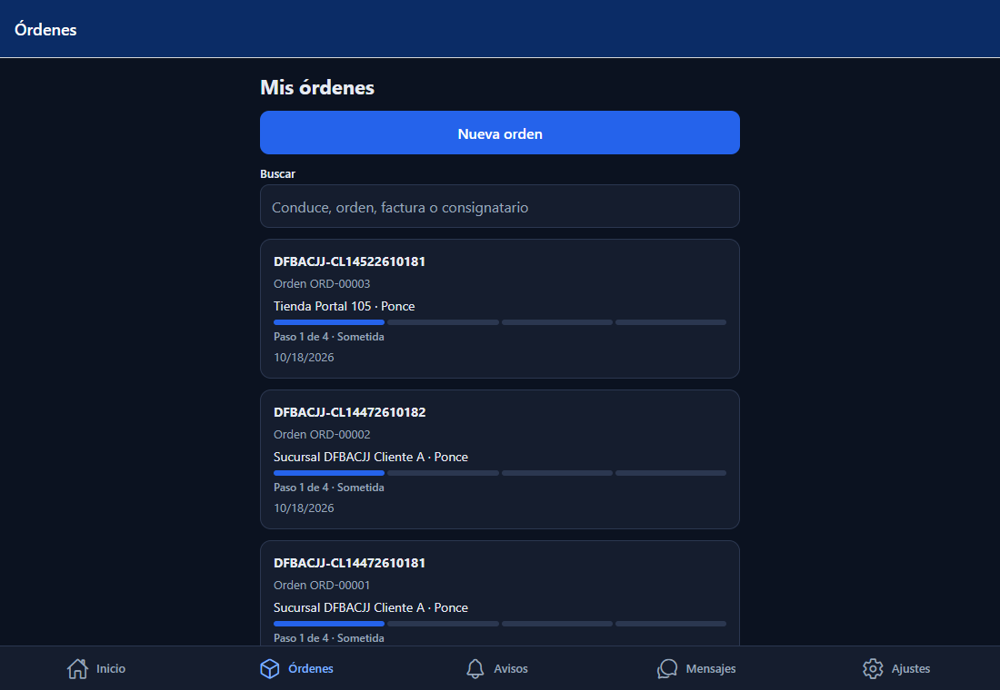

# L103 — “How is my package doing?” and the progress bar (screens)

Rules and messages: [chapter 28](../28-como-va-mi-orden.md). **Since Batch 116 the page is only reachable through a link with a token** (the search by waybill number and the company's “Public tracking” setting were removed); the screenshots of this page were taken with the `web-app/e2e/lote103-seguimiento.spec.ts` walkthrough, rewritten for the link. Screenshots of the **web** version at 1100 px (on the phone it is the same interface in one column).

## The public page

Without a session, when opening the link from the notice you see the **progress**: the company name, the waybill, the **four-stage** bar (Submitted, Received, On route, Completed), “Step 3 of 4 · On route”, the list of stages with the current one highlighted and the last update. At the bottom: “We only show the package progress: never names, addresses or phone numbers” and the link to the portal.

An order with a **Failed attempt**: the bar stays where it was, the current stage is shown in amber and the text says “Attempted · on step 3 of 4”. A **cancelled** one is shown with all stages off; a **delivered** one, all in green.

## Dark theme and English

On the public page, the login, the legal document and Settings there are two selectors: **Español / English** and **Automatic / Light / Dark**. Automatic follows the device; what you choose is remembered.

## In the client portal

Each order in the **list** (and on Home) carries its low bar with “Step N of M · status”.

The **order file** carries the bar and the **list of stages**.

## Files
`app-cliente/src/features/{progress,track}/` (`ProgressBar`, `ProgressSteps`, rules, `TrackScreen`) and the public route `src/app/track/[token].tsx` (the gate in `_layout.tsx` does not redirect it); es/en texts; jest tests (`progress.test.tsx`, `TrackScreen.test.tsx`) and the `web-app/e2e/lote103-seguimiento.spec.ts` walkthrough.
